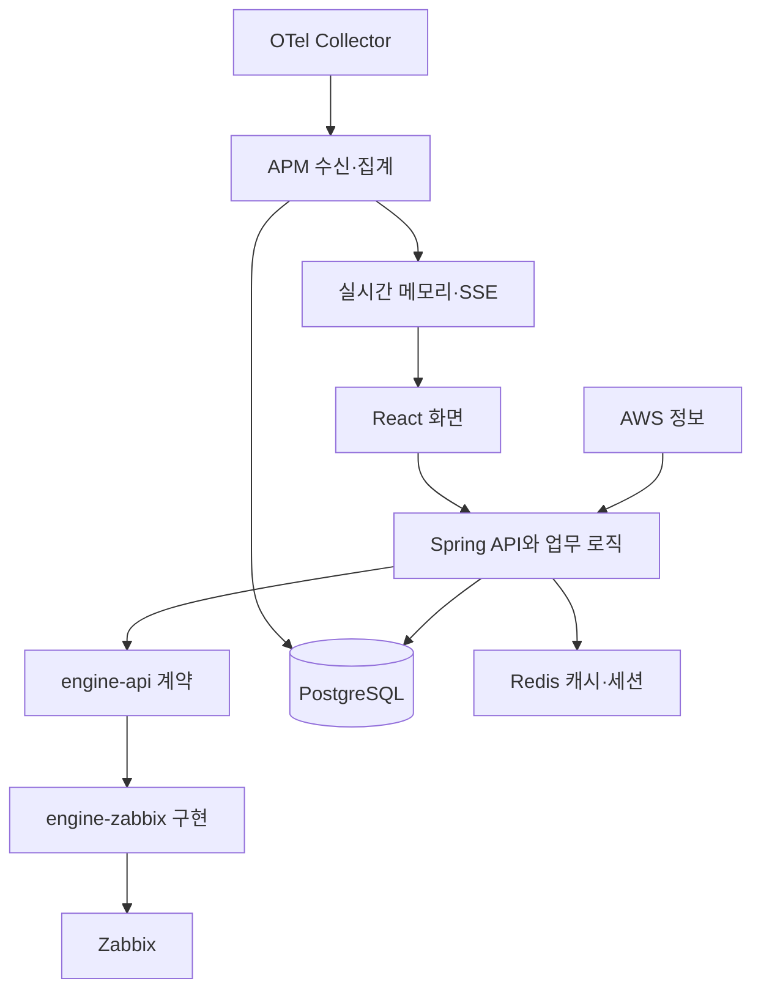

# 설계와 구현의 연결 지도

[읽기 안내](MovesEye-%EC%B5%9C%EA%B7%BC-%EC%9E%91%EC%97%85%EA%B3%BC-APM-%EC%9D%BD%EA%B8%B0-%EC%95%88%EB%82%B4.md) · 다음: [부족점 리포트](%ED%98%84%EC%9E%AC-APM-%EA%B5%AC%ED%98%84%EC%9D%98-%EB%B6%80%EC%A1%B1%EC%A0%90-%EB%B6%84%EC%84%9D-%EB%A6%AC%ED%8F%AC%ED%8A%B8.md)

이 문서는 **해결하려던 문제 → 설계 선택 → 실제 구현 위치 → 현재 한계**를 연결합니다. 모든 세션 문서를 읽기보다 관심 있는 기능의 한 줄에서 출발하세요.

## 1. 제품 전체의 역할 분담

Spring이 현재 BE 정본이며 구 NestJS는 참조용입니다. 수집 엔진 분리는 Zabbix 의존을 계약 뒤에 두는 작업입니다. APM은 OTel 수신 경로를 별도로 갖습니다. 기존 중립 포트가 있다는 사실만으로 Prometheus·Datadog의 전체 어댑터가 구현됐다고 볼 수는 없습니다.

근거: [BE 모듈 규약](../../moveseye-be-spring/AGENTS.md), [수집 엔진 설계](../../02-%EC%84%A4%EA%B3%84/%EC%88%98%EC%A7%91-%EC%97%94%EC%A7%84-%EB%A0%88%EC%9D%B4%EC%96%B4%28Collector-Engine%29-%EC%84%A4%EA%B3%84%EC%84%9C-v2.md).

## 2. APM 설계와 구현

| 작업 | 설계의 핵심 | 구현의 중심 | 현재 상태 |
|---|---|---|---|
| 메트릭 | 허용된 지표를 정규화하고 여러 시간 해상도로 보관 | `collector/ingest`, `core/batch`, `overview` | 현재. 재전송 멱등성 보강 필요 |
| 트레이스 | 상세 span과 trace 요약·파생 집계를 나눔 | `trace/ingest`, `trace/query`, `trace/errors`, `trace/dbquery` | 현재. 저장된 표본의 분석 |
| 서비스 맵 | 관측된 호출을 서비스 간 관계로 집계 | `servicemap`, `trace`의 edge 집계 | 현재. 누락된 계측까지 복원하는 토폴로지는 아님 |
| SLO·합성 점검 | 목표 평가와 정기 점검을 운영 기능으로 연결 | `slo`, `synthetic`, `alert` | 현재. 알람 동시성·외부 I/O 경계 보강 필요 |
| RUM | 브라우저 수신과 보안·예산·집계를 별도 구성 | `rum`, `resources/apm/rum-snippet.js` | 부분. 수신·집계 구현, 브라우저 실패 복구·환경 검증 미완료 |
| 실시간 완료 요청 | 보존용 trace와 분기해 최근 기록을 메모리에 유지 | `collector/ingest/live`, `overview/live/spans` | 현재. 송신 용량·운영 환경 검증 필요 |
| 진행 중 요청 | 종료 전 상태를 Java 확장에서 직접 관측 | 별도 확장 폴더, `ActiveRequestListIngestor`, 걸림 감시기 | 부분. 검증된 Java 조합에 제한 |
| 화면 자기설명 | null·미수신·보존 만료·미지원의 이유를 전달 | 상태 DTO, 보존 Provider, 화면 도움말 | 현재. 모든 화면 일관성은 추가 확인 대상 |
| 내보내기 | 계획 단계에서 범위·보존·조건을 고정하고 다운로드 | APM export 및 FE 내보내기 UI | 현재. 과거 파일 복원과 별개 |
| 콜드 아카이브 | 삭제 전에 보관 확인, 공통 파일 기반과 소스 구현 분리 | 공통 `archive`, APM `archive`, retention gate | 현재. 복원은 보류, 배포 실증 부족 |

패키지 경로는 [BE APM 디렉터리](../../moveseye-be-spring/src/main/java/com/dmove/moveseye/premium/apm) 아래 기준입니다. FE는 [APM 화면 디렉터리](../../moveseyee_fe/src/pages/application-monitoring)와 관리 콘솔의 데이터 아카이브 화면에 대응합니다.

## 3. 원본 문서는 무엇을 골라 읽어야 하나

| 주제 | 설계와 결정 | 개발 계약·현재 설명 |
|---|---|---|
| APM 기본 구조 | [APM 기본 설계](../../02-%EC%84%A4%EA%B3%84/APM%28%EC%95%A0%ED%94%8C%EB%A6%AC%EC%BC%80%EC%9D%B4%EC%85%98-%EB%AA%A8%EB%8B%88%ED%84%B0%EB%A7%81%29-%EC%84%A4%EA%B3%84%EC%84%9C-v3.1-%28OpenTelemetry-%ED%99%95%EC%A0%95-%EC%A3%BC%EB%A0%A5-%EA%B8%B0%EB%8A%A5-%EB%B2%94%EC%9C%84-%EC%BD%94%EB%8D%B1%EC%8A%A4-%EA%B2%80%EC%88%98-%EB%B0%98%EC%98%81%29.md) | [수신·저장 계약](../../06-API-%EA%B3%84%EC%95%BD/APM-%EA%B3%84%EC%95%BD%EC%84%9C.md), [읽기 API](../../06-API-%EA%B3%84%EC%95%BD/APM-%EC%9D%BD%EA%B8%B0-API-%EA%B3%84%EC%95%BD-P1-%282026-08-31-%EC%98%A4%EC%BC%80%EC%8A%A4%ED%8A%B8%EB%A0%88%EC%9D%B4%ED%84%B0-%ED%99%95%EC%A0%95%EB%B3%B8%29.md) |
| 실시간 완료 요청 | [실시간 설계](../../02-%EC%84%A4%EA%B3%84/APM-P5-%EC%8B%A4%EC%8B%9C%EA%B0%84-%EA%B4%80%EC%A0%9C%28Realtime%29-%EC%84%A4%EA%B3%84-X-View-%EC%95%A1%ED%8B%B0%EB%B8%8C-%EC%9A%94%EC%B2%AD-%EC%8B%A4%EC%8B%9C%EA%B0%84-%EB%8C%80%EC%8B%9C%EB%B3%B4%EB%93%9C.md), [화면 설계](../../02-%EC%84%A4%EA%B3%84/APM-P5-%EC%8B%A4%EC%8B%9C%EA%B0%84-%EA%B4%80%EC%A0%9C-%ED%99%94%EB%A9%B4-%EC%83%81%ED%98%B8%EC%9E%91%EC%9A%A9-%EC%84%A4%EA%B3%84%28UX-%EC%A0%95%EB%B3%B8%29-%EC%95%A1%ED%8B%B0%EB%B8%8C-%EC%84%9C%EB%B9%84%EC%8A%A4-X-View-%EB%B9%84%EB%8F%99%EA%B8%B0-%EB%AA%A8%EB%8B%88%ED%84%B0%EB%A7%81.md) | [P5 계약](../../06-API-%EA%B3%84%EC%95%BD/APM-P5-%EC%8B%A4%EC%8B%9C%EA%B0%84-%EA%B4%80%EC%A0%9C-BE-FE-%EA%B3%84%EC%95%BD-%EC%9A%94%EC%95%BD%EC%84%9C-%28GET-apm-live-spans-stream%29.md) |
| 진행 중 요청 | [Java 확장 설계](../../02-%EC%84%A4%EA%B3%84/%EC%84%A4%EA%B3%84-%EC%B4%88%EC%95%88-%EC%A7%84%ED%96%89-%EC%A4%91-%EC%9A%94%EC%B2%AD-%EA%B4%80%EC%A0%9C-%28%EC%9E%90%EB%B0%94-%EC%97%90%EC%9D%B4%EC%A0%84%ED%8A%B8-%ED%99%95%EC%9E%A5-P5.3b%29.md) | [확장 README](../../12-%EC%98%A8%EB%B3%B4%EB%94%A9-%EA%B7%9C%EC%95%BD/OTel-%ED%99%95%EC%9E%A5-%EC%86%8C%EA%B0%9C.md), [실측 기록](../../08-%EA%B2%80%EC%A6%9D-QA/P5.3b-OpenTelemetry-%ED%99%95%EC%9E%A5-PoC-%EC%B8%A1%EC%A0%95-%EB%B3%B4%EA%B3%A0%EC%84%9C.md) |
| SLO·합성·메시징·배치 | [기본 설계](../../02-%EC%84%A4%EA%B3%84/APM%28%EC%95%A0%ED%94%8C%EB%A6%AC%EC%BC%80%EC%9D%B4%EC%85%98-%EB%AA%A8%EB%8B%88%ED%84%B0%EB%A7%81%29-%EC%84%A4%EA%B3%84%EC%84%9C-v3.1-%28OpenTelemetry-%ED%99%95%EC%A0%95-%EC%A3%BC%EB%A0%A5-%EA%B8%B0%EB%8A%A5-%EB%B2%94%EC%9C%84-%EC%BD%94%EB%8D%B1%EC%8A%A4-%EA%B2%80%EC%88%98-%EB%B0%98%EC%98%81%29.md) | [P3 계약](../../06-API-%EA%B3%84%EC%95%BD/APM-P3-%EA%B3%84%EC%95%BD-SLO-%ED%99%88-%EC%9C%84%EC%A0%AF-%ED%95%A9%EC%84%B1-%EA%B0%90%EC%8B%9C-%EB%A9%94%EC%8B%9C%EC%A7%95-%EB%B0%B0%EC%B9%98-%EB%A6%AC%ED%8F%AC%ED%8A%B8-%282026-09-07-BE-%EA%B5%AC%ED%98%84-%EC%99%84%EB%A3%8C-FE-%EB%AF%B8%EC%B0%A9%EC%88%98%29.md) |
| RUM·K8s | [기본 설계](../../02-%EC%84%A4%EA%B3%84/APM%28%EC%95%A0%ED%94%8C%EB%A6%AC%EC%BC%80%EC%9D%B4%EC%85%98-%EB%AA%A8%EB%8B%88%ED%84%B0%EB%A7%81%29-%EC%84%A4%EA%B3%84%EC%84%9C-v3.1-%28OpenTelemetry-%ED%99%95%EC%A0%95-%EC%A3%BC%EB%A0%A5-%EA%B8%B0%EB%8A%A5-%EB%B2%94%EC%9C%84-%EC%BD%94%EB%8D%B1%EC%8A%A4-%EA%B2%80%EC%88%98-%EB%B0%98%EC%98%81%29.md) | [P4 계약](../../06-API-%EA%B3%84%EC%95%BD/APM-P4-RUM-K8s-BE-%EA%B3%84%EC%95%BD.md) |
| 수집 장애 대응 | [회복력 설계](../../02-%EC%84%A4%EA%B3%84/APM-%EC%88%98%EC%A7%91-%ED%9A%8C%EB%B3%B5%EB%A0%A5-BE-%EC%9E%AC%EA%B8%B0%EB%8F%99-Collector-%ED%81%90-%EC%86%90%EC%A7%88-%EC%84%A4%EA%B3%84-v2.md) | [Collector 설정 해설](../../05-%EC%9E%91%EC%97%85-%EA%B0%80%EC%9D%B4%EB%93%9C/MovesEye-APM-Collector-%EC%84%A4%EC%A0%95-%ED%8C%8C%EC%9D%BC%28config.yaml%29-%ED%95%9C-%EC%A4%84%EC%94%A9-%EC%84%A4%EB%AA%85.md) |
| 대시보드 | [위젯 설계](../../02-%EC%84%A4%EA%B3%84/APM-%EB%8C%80%EC%8B%9C%EB%B3%B4%EB%93%9C-%ED%8E%B8%EC%A7%91-%EA%B0%80%EB%8A%A5%ED%95%9C-%EC%B0%A8%ED%8A%B8-%EB%A0%88%EC%9D%B4%EC%95%84%EC%9B%83-%EC%A0%84%EC%B2%B4-%EC%84%9C%EB%B9%84%EC%8A%A4%EB%B3%84-%EB%8C%80%EC%8B%9C%EB%B3%B4%EB%93%9C-%28v0-%EC%B4%88%EC%95%88-2026-09-15%29.md) | [위젯 계약](../../06-API-%EA%B3%84%EC%95%BD/%EA%B3%84%EC%95%BD-APM-%EB%8C%80%EC%8B%9C%EB%B3%B4%EB%93%9C-%EC%9C%84%EC%A0%AF-%EB%B0%B0%EC%B9%98-%28ZM-122-2026-09-15%29.md) |
| 내보내기 | [내보내기 설계](../../02-%EC%84%A4%EA%B3%84/%EC%84%A4%EA%B3%84-APM-%EB%8D%B0%EC%9D%B4%ED%84%B0-%EA%B8%B0%EA%B0%84-%EC%A7%80%EC%A0%95-%EB%82%B4%EB%B3%B4%EB%82%B4%EA%B8%B0%28CSV-JSONL%29-%28ZM-154%29.md) | [현재 기능 설명](../%EA%B8%B0%EB%8A%A5/APM-%EB%8D%B0%EC%9D%B4%ED%84%B0-%EB%82%B4%EB%B3%B4%EB%82%B4%EA%B8%B0.md) |
| 콜드 아카이브 | [아카이브 설계](../../02-%EC%84%A4%EA%B3%84/%EC%84%A4%EA%B3%84-APM-%EC%BD%9C%EB%93%9C-%EC%95%84%EC%B9%B4%EC%9D%B4%EB%B8%8C-%EB%B3%B4%EC%A1%B4-%EB%A7%8C%EB%A3%8C-%EC%A0%84%EC%97%90-%ED%8C%8C%EC%9D%BC%EB%A1%9C-%EB%B3%B4%EA%B4%80-%28ZM-156%29.md) | [현재 기능 설명](../%EA%B8%B0%EB%8A%A5/APM-%EC%BD%9C%EB%93%9C-%EC%95%84%EC%B9%B4%EC%9D%B4%EB%B8%8C.md), [계약](../../06-API-%EA%B3%84%EC%95%BD/%EA%B3%84%EC%95%BD-%EB%8D%B0%EC%9D%B4%ED%84%B0-%EC%95%84%EC%B9%B4%EC%9D%B4%EB%B9%99-%EA%B3%B5%ED%86%B5-APM-%EC%BD%9C%EB%93%9C-%EC%95%84%EC%B9%B4%EC%9D%B4%EB%B8%8C-%28ZM-156%29.md) |
| 장기 상세 분석·복원 | [보존 정책 설계](../../02-%EC%84%A4%EA%B3%84/APM-%EB%B3%B4%EC%A1%B4-%EC%84%A0%EB%B3%84-%EC%88%98%EC%A7%91-%EC%9E%A5%EA%B8%B0-%EC%83%81%EC%84%B8-%EC%A1%B0%ED%9A%8C-%EC%84%A4%EA%B3%84.md) | [보류 상태](../../03-%EA%B8%B0%ED%9A%8D-%EB%B0%B1%EB%A1%9C%EA%B7%B8/%EB%B3%B4%EB%A5%98-%EC%9E%91%EC%97%85-APM-%EB%B3%B4%EC%A1%B4-%EC%A0%95%EC%B1%85%EA%B3%BC-%EC%9E%A5%EA%B8%B0-%EC%83%81%EC%84%B8-%EC%A1%B0%ED%9A%8C.md) |

과거 계약에 현재 코드와 차이가 있다는 기록이 있습니다. 구현 시에는 관련 Controller·DTO와 FE 타입을 함께 대조해야 합니다. 이 표는 원문을 찾는 지도이며, 원문의 모든 줄을 최신으로 보증하지 않습니다.

## 4. 실제로 어떻게 개발했는가

작업 기록에서 반복되는 개발 순서는 다음과 같습니다.

1. **설계와 범위를 정함.** 무엇을 저장하고 무엇을 버릴지, 보존·권한·용량 제약을 정했습니다.
2. **위험한 가정을 먼저 시험함.** Collector 전송·재시도, 샘플링, 마스킹, 데이터량을 실제 또는 격리 환경에서 확인했습니다.
3. **BE와 DB를 구현함.** 수신, 정규화, 저장, 배치, 조회 API를 나누고 Flyway로 스키마를 관리했습니다.
4. **API 계약으로 FE를 연결함.** 응답 shape, null, 상태, 실패 사유를 문서화하고 화면·훅·타입을 연결했습니다.
5. **코드 검수와 행위 검증을 반복함.** 정적 검사 외에 DB 동시성, HTTP, 브라우저, 실제 Collector 경로를 검증했습니다. 단계별 미실시 항목도 남아 있습니다.

좋았던 선택은 “데이터가 존재한다”와 “어떻게 해석해야 하는가”를 함께 다룬 것입니다. 부족했던 부분은 전체 과정을 통과한 기준선이 여러 문서와 커밋에 흩어졌다는 점입니다.

## 5. 저장 설계의 핵심 결정

**메트릭은 시간 해상도를 나눕니다.** 최근은 자세히, 오래된 것은 요약해서 저장량과 조회 비용을 줄입니다. 요약이 남아 있어도 예전 개별 요청이나 인스턴스 상세가 남는다는 뜻은 아닙니다.

**트레이스는 span 원본과 파생 자료를 구분합니다.** 워터폴에는 원본 구간이 필요하고, 오류 빈도·DB 그룹·서비스 관계는 별도 집계로 빠르게 조회합니다.

**라이브는 메모리의 최근 창을 씁니다.** 낮은 지연을 얻는 대신 재시작과 노드 분산 시 별도 고려가 필요합니다. SSE는 이 메모리 상태를 화면으로 보내는 길입니다.

**아카이브는 파일과 원장을 함께 관리합니다.** 파일이 있다고 완료로 간주하지 않고, 어떤 날짜·데이터셋을 어떻게 보관했는지 상태를 남깁니다. 다만 복원·재검색은 후속 단계입니다.

## 6. APM 이외의 설계 지도

| 주제 | 현재 설명·지도 | 상세 설계 |
|---|---|---|
| 자빅스 성능·증분 조회 | [작업군 지도](../../00-%EB%AC%B8%EC%84%9C-%EC%A7%80%EB%8F%84/%EC%9E%90%EB%B9%85%EC%8A%A4-%EC%84%B1%EB%8A%A5-%EC%9E%91%EC%97%85%EA%B5%B0-%EB%AC%B8%EC%84%9C-%EC%A7%80%EB%8F%84-%28ZM-123-ZM-93-ZM-136%29.md) | 지도에서 이슈별 설계·검증 연결 |
| 권한·세션 | [기능 설명](../%EA%B8%B0%EB%8A%A5/%EA%B6%8C%ED%95%9C-%EA%B0%95%EC%A0%9C%EC%99%80-%EC%84%B8%EC%85%98-%ED%9A%8C%EC%88%98.md) | [작업군 지도](../../00-%EB%AC%B8%EC%84%9C-%EC%A7%80%EB%8F%84/%EA%B6%8C%ED%95%9C-%EC%9E%91%EC%97%85%EA%B5%B0-%EB%AC%B8%EC%84%9C-%EC%A7%80%EB%8F%84-%28ZM-157%29.md) |
| 자산·비용 | [자산 화면 안내](../%EA%B0%80%EC%9D%B4%EB%93%9C/%ED%99%94%EB%A9%B4%EB%B3%84/%EC%9E%90%EC%82%B0-%EA%B4%80%EB%A6%AC/%EC%9E%90%EC%82%B0-%EB%AA%A9%EB%A1%9D.md), [비용 안내](../%EA%B0%80%EC%9D%B4%EB%93%9C/%ED%99%94%EB%A9%B4%EB%B3%84/%EC%9E%90%EC%82%B0-%EA%B4%80%EB%A6%AC/%EB%B9%84%EC%9A%A9.md) | [자산 설계](../../02-%EC%84%A4%EA%B3%84/MovesEye-%EC%9E%90%EC%82%B0%EA%B4%80%EB%A6%AC%28Assets%29-%EB%A9%94%EB%89%B4-%ED%86%B5%ED%95%A9-%EC%84%A4%EA%B3%84-%EC%A0%95%EC%9D%98%EC%84%9C.md), [비용 설계](../../02-%EC%84%A4%EA%B3%84/MovesEye-%EA%B0%9C%EB%B0%9C-%EC%84%A4%EA%B3%84-%EC%9E%90%EC%82%B0-%EA%B4%80%EB%A6%AC-%EB%B9%84%EC%9A%A9-%28Cost-Monitoring%29.md) |
| 네트워크·지리 맵 | [네트워크 맵](../%EA%B0%80%EC%9D%B4%EB%93%9C/%ED%99%94%EB%A9%B4%EB%B3%84/%EC%9E%90%EC%82%B0-%EA%B4%80%EB%A6%AC/%EB%84%A4%ED%8A%B8%EC%9B%8C%ED%81%AC-%EB%A7%B5.md), [지리 맵](../%EA%B0%80%EC%9D%B4%EB%93%9C/%ED%99%94%EB%A9%B4%EB%B3%84/%EC%9E%90%EC%82%B0-%EA%B4%80%EB%A6%AC/%EC%A7%80%EB%A6%AC-%EB%A7%B5.md) | [네트워크 설계](../../02-%EC%84%A4%EA%B3%84/MovesEye-%EA%B0%9C%EB%B0%9C-%EC%84%A4%EA%B3%84-Network-Maps-%28%EB%84%A4%ED%8A%B8%EC%9B%8C%ED%81%AC-%EC%95%84%ED%82%A4%ED%85%8D%EC%B2%98-%EC%9E%91%EB%8F%84%29.md), [지리 설계](../../02-%EC%84%A4%EA%B3%84/Geo-Maps-%28%EC%A7%80%EB%A6%AC-%EB%A7%B5%29-%EA%B0%9C%EB%B0%9C-%EC%84%A4%EA%B3%84%EC%84%9C-v1.md) |
| 클라우드 | [수집 주기 설명](../%EA%B8%B0%EB%8A%A5/%ED%81%B4%EB%9D%BC%EC%9A%B0%EB%93%9C-%EC%8A%A4%EB%83%85%EC%83%B7-%EC%88%98%EC%A7%91-%EC%A3%BC%EA%B8%B0-%EB%B6%84%EB%A6%AC.md) | [재구성 설계](../../02-%EC%84%A4%EA%B3%84/%ED%81%B4%EB%9D%BC%EC%9A%B0%EB%93%9C-%EB%AA%A8%EB%8B%88%ED%84%B0%EB%A7%81-%EC%9E%AC%EA%B5%AC%EC%84%B1.md) |
| GPU | [후속 상태](../../03-%EA%B8%B0%ED%9A%8D-%EB%B0%B1%EB%A1%9C%EA%B7%B8/GPU-%EB%AA%A8%EB%8B%88%ED%84%B0%EB%A7%81-%ED%9B%84%EC%86%8D-%EC%9E%91%EC%97%85.md) | [수집 경로 설계](../../02-%EC%84%A4%EA%B3%84/NVIDIA-GPU-%EC%88%98%EC%A7%91-%EA%B2%BD%EB%A1%9C-%EC%84%A4%EA%B3%84.md) |

이 표의 자산·맵·클라우드 영역은 기존 기능 설명과 설계의 연결을 정리한 것입니다. 이번에 각 영역의 전체 구현을 재검수한 것은 아닙니다.

## 7. 앞으로 문서를 늘리지 않고 유지하는 방법

기능 변경 때마다 설명 문서를 새로 만들기보다 해당 기능 문서를 갱신하고, 이 지도에는 상태와 링크만 갱신합니다. 검수 회차별 기록은 증거로 남기되 독자에게 필독으로 요구하지 않습니다.

각 기능 문서 첫 화면에는 네 가지만 둡니다. **사용자에게 달라진 점, 현재 구현 범위, 미완료 범위, 코드·검증 기준선**입니다. 세부 API와 과거 논의는 뒤에서 연결합니다.
