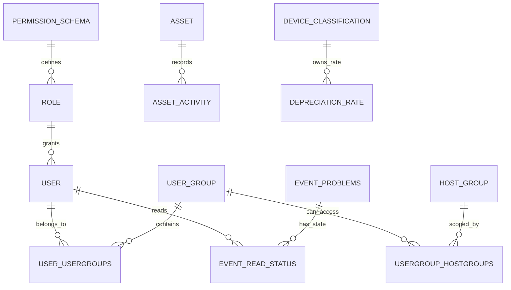

# MovesEye 데이터 모델 정의서

## 1. 저장소별 책임

| 저장소 | 정본 데이터 | 예시 |
|---|---|---|
| Zabbix | 모니터링 구성·관측값·장애 원천 | Host, Host Group, Item, History, Trend, Trigger, Problem, Inventory |
| PostgreSQL | MovesEye 사용자·권한·업무 상태·보강 정보 | User, Setting, Event mirror, Asset, Cost, Map, Scheduler |
| Redis | 짧은 수명의 인증·cache 상태 | refresh/session, Zabbix auth 관련 cache |
| AWS API | Cloud inventory와 metric 원천 | Region, VPC, EC2, CloudWatch |

같은 의미의 값을 여러 저장소에 둘 때는 소유자를 명시한다. 예를 들어 host 좌표는 Zabbix inventory가 원천이고, MovesEye Geo Cluster는 여러 host를 묶는 문서만 저장한다.

## 2. schema 관리 규칙

- Flyway migration이 schema의 유일한 정본이다.
- JPA `ddl-auto`는 `none`이며 Entity가 schema를 생성·수정하지 않는다.
- V1은 구 TypeORM schema의 baseline이고 V2 이후가 Spring 관리 변경이다.
- 기존 DB는 `baseline-on-migrate=true`, `baseline-version=1` 정책을 따른다.
- 새 변경은 적용된 migration을 수정하지 않고 다음 `V{n}__description.sql`로 추가한다.

## 3. 핵심 관계

관계 그림은 책임을 설명하는 논리 모델이다. column·constraint의 최종 사실은 migration과 Entity mapping에서 확인한다.

## 4. 테이블 그룹

### 4.1 사용자·권한·설정

| 테이블 | 책임 |
|---|---|
| `user` | MovesEye 사용자, Zabbix 사용자 연결, 상태·Role |
| `role` | 사용자 유형과 permission 집합 연결 |
| `permission_schema` | 기능 단위 permission 정의 |
| `user_group` | 사용자 묶음 |
| `user_usergroups` | User–User Group 다대다 |
| `host_group` | Zabbix Host Group의 로컬 참조·표시 정보 |
| `usergroup_hostgroups` | User Group이 접근 가능한 Host Group 범위 |
| `setting` | Zabbix·Cloud 연결 설정 등 JSON 값 |
| `otp` | 비밀번호 재설정 등 일회성 token 상태 |
| `email` | 비동기 email 발송 상태 |

권한은 Role의 기능 권한과 User Group–Host Group의 데이터 범위를 함께 통과해야 한다.

`setting`에 credential 성격의 값이 포함될 수 있지만, 2026-08-05 기준 [Credential 보호 정책](../%EC%9A%B4%EC%98%81/%EC%8B%9C%ED%81%AC%EB%A6%BF-%EB%B3%B4%ED%98%B8-%EC%A0%95%EC%B1%85.md)은 `draft`다. 실제 값을 문서나 log에 남기지 말고, 정책이 current로 승격되기 전 production credential 저장을 승인하지 않는다.

### 4.2 이벤트·보고서·대시보드

| 테이블 | 책임 |
|---|---|
| `event_problems` | Zabbix Problem/Event의 조회 최적화 mirror |
| `event_read_status` | 사용자별 읽음 상태 |
| `dashboard_widget` | Host별 custom widget 정의와 layout |
| `host_group_report` | Host Group 보고서 결과·metadata |
| `report_retention_setting` | 보고서 보존 정책 |

Zabbix Problem이 원천이며 DB mirror는 사용자 상태와 조회 성능을 위한 제품 저장소다.

### 4.3 자산·비용

| 테이블 | 도입 migration | 책임 |
|---|---:|---|
| `asset` | V5, V6, V14 | Zabbix/custom 자산 snapshot과 보강 필드 |
| `asset_activity` | V5 | 자산 변경 이력 |
| `device_classification` | V13, V17 | 장비 분류, 표시 순서, 감가상각 관련 설정 |
| `depreciation_rate` | V17 | 분류·연도별 감가상각률 |
| `cost_bulk_upload_job` | V18, V19 | CSV 일괄 업로드 payload·상태·heartbeat·만료 |

`asset.source`, `zabbix_hostid`, `linked_hostid`, `excluded` 조합이 자산의 원천과 soft-delete 상태를 설명한다. Zabbix host와 연결된 자산을 물리 삭제해 동기화 때 중복 생성하지 않도록 복원·제외 semantics를 유지한다.

### 4.4 맵

| 테이블 | 책임 |
|---|---|
| `network_architecture` | React Flow 기반 node·edge 문서와 main map |
| `geo_cluster` | 지도 cluster 문서와 main cluster |

두 테이블은 각자 main row를 하나만 허용하는 partial unique index를 사용한다. Geo host 좌표 자체는 Zabbix inventory를 원천으로 한다.

### 4.5 관리 감사·스케줄러

| 테이블 | 책임 |
|---|---|
| `host_change_log` | Host 등록·수정·상태·삭제 감사 |
| `zabbix_change_log` | Item·Trigger·Template 등 Zabbix 관리 변경 감사 |
| `scheduler_setting` | job 활성화, cron/주기, 실행 상한 |
| `scheduler_run_log` | job 시작·종료·처리 건수·결과 |

## 5. Migration 이력 요약

| 범위 | 내용 |
|---|---|
| V1 | TypeORM 기준 사용자·권한·설정·event baseline |
| V2-V4 | custom widget, Host Group 보고서, 보존 설정 |
| V5-V6 | 자산 core와 보강 필드 |
| V7-V8 | 네트워크 맵, Geo Cluster |
| V9 | `recently_viewed` 제거 — FE localStorage로 이동 |
| V10 | 관리자 seed |
| V11-V12 | Host/Zabbix 변경 감사 로그 |
| V13-V14 | 장비 분류, 자산–host 연결 index |
| V15-V16 | scheduler 설정·실행 로그 |
| V17 | 감가상각 모델 |
| V18-V19 | 비용 CSV upload job과 heartbeat |

## 6. 변경 체크리스트

- [ ] 새 migration 번호가 기존 번호와 충돌하지 않는다.
- [ ] 빈 DB에서 V1부터 전부 적용된다.
- [ ] 기존 기준 DB에서 다음 migration만 적용된다.
- [ ] JPA Entity의 table·column·enum·quoted identifier가 일치한다.
- [ ] index와 unique constraint가 조회·동시성 불변식을 보장한다.
- [ ] rollback이 필요하면 데이터 보존·복구 절차를 Runbook에 기록한다.
- [ ] FE/BE 계약과 관련 문서를 같은 변경에서 갱신한다.

## 변경 이력

| 날짜 | 변경 |
|---|---|
| 2026-08-05 | Flyway V1-V19 기준 최초 작성 |
