# Moves Workforce — 데이터 모델 정의서 (ERD · KVS 오브젝트 스토어)

| 항목 | 내용 |
|------|------|
| 문서명 | 데이터 모델 정의서 (ERD · KVS) |
| 버전 | v1.3 |
| 작성일 | 2026-07-09 (최종 현행화 2026-08-06) |
| 대상 독자 | 개발/운영팀 (스키마·데이터 흐름 이해) |
| 관련 문서 | 아키텍처 설계서, 개발자 온보딩, 핵심 로직 정의서, 공통 용어집 |
| 기준 소스 | `src/rdb/schema/ddl/*`, `manifest.yml`(storage.entities), 각 도메인 Service |

---

> **기준선 주의:** 이 문서는 2026-08-20 개발 소스의 최종 스키마를 설명합니다. 운영 DB에 v015~v019가 실제 반영됐다는 뜻은 아니므로 대상 환경의 배포·설치 트리거와 migration 로그를 별도로 확인해야 합니다.

## 1. 목적·범위

Moves Workforce가 데이터를 **어디에(Forge SQL / Forge KVS) 어떤 구조로 저장하고 어떻게 사용하는지**를 정의한다. 실제 DDL과 매니페스트 기준이며, 추측이 아니라 코드에 있는 것만 기술한다.

### 1.1 저장소 2종과 배치 기준

| 저장소 | 실체 | 용도 | 한도 |
|--------|------|------|------|
| **Forge SQL** | TiDB(MySQL 호환) | 행이 쌓이거나 WHERE/JOIN/집계가 필요한 데이터 | 설치당 **1 GiB** |
| **Forge KVS** | 키-값 스토어(Custom Entity) | 종류가 유한한 설정성 데이터 + 계산 캐시 | 값 하나 **240 KiB** |

> 배치 기준: **"쌓이고 검색하는 데이터는 SQL, 몇 개 안 되고 키로 바로 꺼내는 데이터는 KVS."** 길이가 자라는 배열은 KVS에 넣지 않는다.

### 1.2 저장하지 않는 데이터 — 워크로그

**워크로그는 앱 DB에 저장하지 않는다.** Jira가 원본이며, 조회 시 Jira REST로 가져와 KVS에 단기 캐시(TTL 10분)만 한다. (초기 설계에 있던 `worklog_issue_daily` 미러 테이블은 `ddl/worklog.js`에 주석 처리된 채 채택되지 않음 → 이중 소스·동기화 부담 회피.)

### 1.3 TiDB(Forge SQL) 제약 — 무결성은 앱이 보장

일부 테이블에 `FOREIGN KEY`가 선언돼 있으나 **TiDB는 FK를 강제하지 않고, ON DELETE CASCADE·트랜잭션도 지원하지 않는다.** 따라서:
- 연쇄 삭제(cascade) = 앱이 **자식→부모 순차 멱등 DELETE**로 직접 수행
- 이슈당 1폴더·링크 유일성 = **PK 설계**로 보장
- 중첩 순환·범위 위반 = **앱 코드 검증**으로 차단

---

## 2. Forge SQL — 테이블 (13)

### 2.1 ERD

```mermaid
erDiagram
    project ||--o{ projectusers : "has members"
    project ||--o{ project_dashboard : "has widgets"
    project ||--o| portfolio_project_snapshot : "0..1 current snapshot"
    project ||--o{ gantt_folder : "has folders"
    project ||--o{ gantt_folder_issue : "issue-folder map"
    project ||--o{ gantt_folder_link : "folder links"
    project ||--o{ project_skills : "required skills"
    project ||--o{ project_team : "assigned teams"
    project ||--o{ project_subscription : "subscribes sources"
    users   ||--o{ projectusers : "assigned to"
    users   ||--o{ user_schedule : "leave/holiday"
    users   ||--o{ user_skills : "has skills"
    gantt_folder ||--o{ gantt_folder : "parent (self-ref)"
    gantt_folder ||--o{ gantt_folder_issue : "contains"

    project {
        BINARY16 project_id PK
        VARCHAR100 project_name
        VARCHAR50 project_status_key "→ KVS status.id"
        DATE start_date
        DATE end_date
        DOUBLE total_budget
        TINYINT1 collab_mode "협업 모드(0/1, 기본 0)"
        VARCHAR100 collab_mode_changed_by
        TIMESTAMP collab_mode_changed_at
    }
    users {
        VARCHAR100 account_id PK "Jira accountId"
        VARCHAR50 permission_key "→ KVS permission"
        VARCHAR50 role_key "→ KVS role"
        VARCHAR50 level_key "→ KVS level"
        VARCHAR50 team_key "→ KVS team"
        DOUBLE salary "개인 연봉"
    }
    projectusers {
        BINARY16 project_member_id PK
        BINARY16 project_id FK
        VARCHAR100 account_id FK
        VARCHAR50 role_key
        VARCHAR50 level_key
        DOUBLE salary "참여 총단가"
        VARCHAR20 salary_type "PROJECT | ANNUAL"
    }
    user_schedule {
        BINARY16 schedule_id PK
        VARCHAR100 account_id FK
        DATE schedule_start_date
        DATE schedule_end_date
        VARCHAR30 schedule_type
        DOUBLE work_ratio
    }
    project_dashboard {
        VARCHAR100 dashboard_id PK
        BINARY16 project_id FK
        VARCHAR50 chart_type
        VARCHAR50 data_type
        INT pos_x
        INT pos_y
    }
    portfolio_project_snapshot {
        BINARY16 project_id PK
        DOUBLE completion_rate
        DOUBLE schedule_rate
        DOUBLE actual_mm
        DOUBLE avg_utilization
        VARCHAR20 salary_policy "INDIVIDUAL | LEVEL_BAND"
        JSON members_json
        JSON monthly_effort_json
        JSON weekly_effort_json
    }
    gantt_folder {
        BINARY16 folder_id PK
        BINARY16 project_id
        VARCHAR120 name
        BINARY16 parent_folder_id "self-ref, nullable"
        INT sort_order
    }
    gantt_folder_issue {
        VARCHAR50 issue_key PK "이슈당 1폴더"
        BINARY16 project_id
        BINARY16 folder_id
    }
    gantt_folder_link {
        BINARY16 project_id PK
        VARCHAR64 source_ref PK "folder:uuid | issueKey"
        VARCHAR64 target_ref PK
    }
    user_skills {
        VARCHAR100 account_id PK
        VARCHAR50 skill_id PK "→ KVS skill"
        TINYINT proficiency
    }
    project_skills {
        BINARY16 project_id PK
        VARCHAR50 skill_id PK "→ KVS skill"
        TINYINT weight
    }
    project_team {
        BINARY16 project_id PK
        VARCHAR50 team_key PK "→ KVS team"
        TINYINT is_primary
    }
    project_subscription {
        VARCHAR10 source_type PK "SPACE | BOARD"
        VARCHAR50 source_id PK "전역 배타 소유"
        BINARY16 project_id
        TEXT issue_type_ids
        TINYINT include_subtasks
        VARCHAR1000 extra_jql
        TIMESTAMP baseline_at
        TIMESTAMP watermark
        VARCHAR500 sweep_cursor
        TINYINT is_active
        INT generation
        TIMESTAMP last_synced_at
        VARCHAR24 last_sync_status
        VARCHAR500 last_error
        INT last_run_tagged
        INT lifetime_tagged
    }
```

> 관계선은 **논리적 관계**다. TiDB가 FK를 강제하지 않으므로 실제 무결성은 앱 코드가 담당한다. KVS 참조(`→ KVS ...`)는 크로스-스토어 논리 참조로, DB 조인이 아니라 코드에서 키로 조회한다.

### 2.2 테이블별 상세

#### ① `project` — 프로젝트 마스터
| 컬럼 | 타입 | 설명 |
|------|------|------|
| **project_id** | BINARY(16) PK | UUID. 모든 프로젝트 종속 데이터의 부모 키 |
| project_name | VARCHAR(100) | 프로젝트명 |
| project_status_key | VARCHAR(50) NULL | 상태 → **KVS `status.id`** 논리 참조 |
| start_date / end_date | DATE | 프로젝트 기간(일정률·근무일 산정 기준) |
| total_budget | DOUBLE | 예산(참고값) |
| created/updated_id·at | VARCHAR/TIMESTAMP | 감사 컬럼(공통) |
| collab_mode | TINYINT(1) NOT NULL DEFAULT 0 | 협업 모드(아키텍처 §4.4 ⑥). 1 이면 참여 인원이 연결 이슈·워크로그를 앱 자격으로 조회. **v025**. 협업 쿼리(`FIND_COLLAB_ACCESS`/`UPDATE_COLLAB_MODE`)만 읽고 쓴다 |
| collab_mode_changed_by | VARCHAR(100) NULL | 협업 모드를 마지막으로 바꾼 accountId(값이 실제로 바뀔 때만 갱신) |
| collab_mode_changed_at | TIMESTAMP NULL | 그 시각. 최종 변경 1건만 남는다(이력 테이블 없음) |

**사용처**: 프로젝트 목록/상세, 모든 분석·진척도·비용 화면의 기준. 삭제 시 자식 테이블부터 순차 cascade.

#### ② `users` — 앱 사용자
| 컬럼 | 타입 | 설명 |
|------|------|------|
| **account_id** | VARCHAR(100) PK | Jira accountId |
| permission_key | VARCHAR(50) NULL | 권한 세트 → **KVS `permission`** |
| role_key | VARCHAR(50) NULL | 역할 → **KVS `role`** |
| level_key | VARCHAR(50) NULL | 등급 → **KVS `level`** |
| team_key | VARCHAR(50) NULL | 단일 소속 팀 → **KVS `team`**. v013 추가, NULL=미소속 |
| salary | DOUBLE | 개인 연봉. 전환 전에 있던 값은 `LEVEL_BAND`에서도 보존하되 응답에서 숨김. 해당 정책 중 신규 사용자는 NULL일 수 있음 |

**사용처**: 백오피스 사용자 관리, 권한 해석(PrincipalResolver), 인력 분석의 인원 마스터. 엑셀 대량 업로드로 채워짐(큐).

#### ③ `projectusers` — 프로젝트 인력 배정 (N:M 조인)
| 컬럼 | 타입 | 설명 |
|------|------|------|
| **project_member_id** | BINARY(16) PK | UUID |
| project_id | BINARY(16) FK→project | 대상 프로젝트 |
| account_id | VARCHAR(100) FK→users | 대상 인원 |
| role_key / level_key | VARCHAR(50) | 프로젝트별 역할·등급(오버라이드) |
| salary | DOUBLE | 프로젝트 투입 급여. `PROJECT` 모드의 유효 인건비 원천 |
| salary_type | VARCHAR(20) | `PROJECT`(투입 급여 그대로) 또는 `ANNUAL`(개인 연봉 월할). v012 추가 |

인덱스: `(project_id, account_id)`, `(account_id)`. **사용처**: 프로젝트 인력 탭, 가동률·MM·비용 계산, projectScope(소속 프로젝트) 판정, 포트폴리오 인원 raw.

#### ④ `user_schedule` — 개인 일정(연차·휴무)
| 컬럼 | 타입 | 설명 |
|------|------|------|
| **schedule_id** | BINARY(16) PK | UUID |
| account_id | VARCHAR(100) FK→users | 대상 인원 |
| schedule_start/end_date | DATE | 일정 기간 |
| schedule_type | VARCHAR(30) | 유형(연차·반차 등) |
| work_ratio | DOUBLE | 근무 비율(0=휴무, 0.5=반휴) |
| description | VARCHAR(255) | 메모 |

UNIQUE `(account_id, schedule_start_date, schedule_type)`. **사용처**: 가용 근무일(effectiveMD) 차감 → 가동률 분모.

#### ⑤ `project_dashboard` — 대시보드 위젯 레이아웃
| 컬럼 | 타입 | 설명 |
|------|------|------|
| **dashboard_id** | VARCHAR(100) PK | 위젯 ID |
| project_id | BINARY(16) FK→project | 소속 프로젝트 |
| dashboard_title | VARCHAR(100) | 위젯 제목 |
| chart_type | VARCHAR(50) | 차트 유형 |
| data_type | VARCHAR(50) | 데이터 소스 유형 |
| pos_x / pos_y / width / height | INT | react-grid-layout 배치 |

**사용처**: 프로젝트 상세 대시보드 탭(위젯 추가·이동·리사이즈 영속).

#### ⑥ `portfolio_project_snapshot` — 전사 대시보드 스냅샷 (프로젝트당 1행)
| 컬럼 그룹 | 컬럼 |
|-----------|------|
| 식별/기간 | project_id PK, project_name, project_status_key, start_date, end_date |
| 지표 | completion_rate, schedule_rate, diff_percent_point, planned_total_md, actual_total_md, **actual_mm**, risk_score |
| 이슈 카운트 | issue_done, issue_in_progress, issue_todo (INT) |
| 인원/비용 | member_count(INT), total_salary(DECIMAL 18,2), avg_utilization(DOUBLE) |
| raw(JSON) | **members_json**, **monthly_effort_json**, **weekly_effort_json** |
| 메타 | aggregated_at(TIMESTAMP), **salary_policy(VARCHAR(20) NULL)** |

인덱스: `(risk_score)`. **사용처**: 일일 배치(`portfolio-snapshot`)가 프로젝트별 1행 upsert → 전사 대시보드가 이 스냅샷만 읽고 프론트가 재집계한다. 수동 재집계는 큐에서 처리하며 UI는 `lastAggregatedAt` 변경을 완료 신호로 사용한다. `salary_policy`는 집계 당시 정책이며 현재 정책과 다르면 비용 축을 마스킹한다. 인원 배열과 스페이스별 이슈 상태 롤업은 across 집계를 SQL로 하지 않으므로 각각 `members_json`, `spaces_json`에 저장한다. 문제이슈 TOP50은 여기가 아니라 KVS 롤업에 있음.

#### ⑦ `gantt_folder` — 간트 가상 폴더(중첩)
| 컬럼 | 타입 | 설명 |
|------|------|------|
| **folder_id** | BINARY(16) PK | UUID |
| project_id | BINARY(16) NOT NULL | 소속 프로젝트 |
| name | VARCHAR(120) | 폴더명(서비스단 120자 검증) |
| parent_folder_id | BINARY(16) NULL | **자기참조**(임의 깊이, 앱레벨 순환 방지) |
| sort_order | INT | 정렬 순서 |

인덱스: `(project_id)`, `(project_id, parent_folder_id)`. **사용처**: 간트 트리의 가상 그룹핑 노드(Jira 이슈 아님, Jira write 0).

#### ⑧ `gantt_folder_issue` — 이슈↔폴더 매핑
| 컬럼 | 타입 | 설명 |
|------|------|------|
| **issue_key** | VARCHAR(50) PK | **PK가 issue_key → 이슈당 최대 1폴더** |
| project_id | BINARY(16) NOT NULL | 소속 프로젝트 |
| folder_id | BINARY(16) NOT NULL | 소속 폴더 |

인덱스: `(project_id)`, `(folder_id)`. **사용처**: 간트 어댑터가 이슈를 폴더 아래로 배치.

#### ⑨ `gantt_folder_link` — 폴더 레벨 선후행(FS) 링크
| 컬럼 | 타입 | 설명 |
|------|------|------|
| **project_id + source_ref + target_ref** | 복합 PK | 링크 유일성 + ON DUPLICATE 멱등 |
| source_ref / target_ref | VARCHAR(64) | 끝점 문자열: `folder:<uuid>`(43자) 또는 이슈 key |

인덱스: `(project_id)`, `(project_id, source_ref)`, `(project_id, target_ref)`. **사용처**: 폴더가 한쪽 이상 끝점인 선후행 관계(이슈↔이슈 선후행은 Jira 네이티브 링크 사용, 여기 아님). 순환=`detectDagCycle` 앱 검증.

#### ⑩ `user_skills` — 사용자 보유 스킬 (N:M)
| 컬럼 | 타입 | 설명 |
|------|------|------|
| **account_id + skill_id** | 복합 PK | 사용자-스킬 유일 |
| skill_id | VARCHAR(50) | → **KVS `skill`** 논리 참조 |
| proficiency | TINYINT NULL | 숙련도 |

인덱스: `(skill_id)`. **사용처**: 자원관리(스킬 기반 매칭).

#### ⑪ `project_skills` — 프로젝트 요구 스킬 (N:M)
| 컬럼 | 타입 | 설명 |
|------|------|------|
| **project_id + skill_id** | 복합 PK | 프로젝트-스킬 유일 |
| skill_id | VARCHAR(50) | → **KVS `skill`** |
| weight | TINYINT NULL | 요구 가중치 |

인덱스: `(skill_id)`. **사용처**: 자원관리(프로젝트 요구 스킬 대비 인력 매칭).

#### ⑫ `project_team` — 프로젝트 담당 팀 (N:M)
| 컬럼 | 타입 | 설명 |
|------|------|------|
| **project_id + team_key** | 복합 PK | 프로젝트-팀 배정 유일 |
| team_key | VARCHAR(50) | → **KVS `team`** 논리 참조 |
| is_primary | TINYINT(1) | 주 담당 팀. 프로젝트당 1개 정책은 서비스가 보장 |
| created_id / created_at | VARCHAR/TIMESTAMP | 감사 컬럼 |

인덱스: `(team_key)`. **사용처**: 프로젝트 담당 팀, `TEAM_ONLY` project scope, 팀원 일괄 배정. Forge SQL transaction 부재로 전량 교체는 DELETE→INSERT 순서이며, 중간 실패 시 동일 payload 재시도와 운영 복구 절차가 필요하다.

#### ⑬ `project_subscription` — Jira 소스 자동 편입 규칙

| 컬럼 | 타입 | 설명 |
|------|------|------|
| **source_type + source_id** | VARCHAR(10)+VARCHAR(50) 복합 PK | `SPACE`/`BOARD` 소스의 **전역 배타 소유**. project_id는 PK가 아님 |
| project_id | BINARY(16) | 소유 RMS 프로젝트 |
| source_key / source_name | VARCHAR | 표시용 메타 스냅샷. immutable 식별은 source_id |
| issue_type_ids | TEXT | 선택 이슈타입 ID JSON. NULL=전체 |
| include_subtasks / extra_jql | TINYINT / VARCHAR(1000) | 하위작업 포함과 추가 AND 조건 |
| is_active / generation | TINYINT / INT | 활성 상태와 규칙 세대. 세대 변경으로 대기 중인 낡은 백필 무효화 |
| baseline_at / watermark | TIMESTAMP NULL | 백필 하한과 완주한 리컨실 시점. 서로 다른 의미 |
| sweep_cursor | VARCHAR(500) | 예산 내 미완주 스윕의 다음 커서 |
| last_synced_at / last_sync_status / last_error | TIMESTAMP / VARCHAR(24) / VARCHAR(500) | 마지막 정합성 실행 시각·상태·오류 |
| last_run_tagged / lifetime_tagged | INT | 최근/누적 편입 건수 |

인덱스: `(project_id)`, `(is_active, last_synced_at)`. **사용처**: 구독 목록·미리보기·이슈 생성 이벤트·시간별 리컨실·백필 큐. 프로젝트 삭제 cascade가 앱 레벨에서 함께 제거한다. 구독 해제 시 이미 태깅된 이슈는 유지한다.

> **마이그레이션 순서**(`migrate.js`): v001 project·users → v003 projectusers → v004 project_dashboard → v005 user_schedule → v006 portfolio_snapshot → v007~v009 gantt 폴더 3종 → v010~v011 skill 매핑 → v012 `projectusers.salary_type` → v013 `users.team_key` → v014 `project_team` → v015 `portfolio_project_snapshot.salary_policy` → v016 `project_subscription` → v017 `project_subscription.default_estimate_seconds` → v018 `project_dashboard.filter_json` → v019 `portfolio_project_snapshot.spaces_json`. 스키마 버전은 `migrationRunner`가 멱등 관리.

---

## 3. Forge KVS — 오브젝트 스토어

KVS는 두 갈래로 쓴다: **① Custom Entity**(매니페스트 `storage.entities`에 스키마 선언, 인덱스 쿼리 가능) + **② 직접 키(plain key)**(캐시·메타, 스키마 없음).

### 3.1 Custom Entity (12) — 설정성 마스터 데이터

| 엔티티 | 속성 | 인덱스 | 용도 |
|--------|------|--------|------|
| **role** | id, name, description | name | 역할 마스터 |
| **team** | id, name, parentTeamKey, leaderAccountId, permissionKey, description, sortOrder | name | 계층형 팀 마스터. 빈 parentTeamKey는 root, leader/permission은 상속·팀장 권한 원천 |
| **level** | id, name, description, **salaryMin, salaryMax, salaryRepresentative** | name | 등급 마스터 + `LEVEL_BAND` 급여 범위·계산 대표값 |
| **skill** | id, name, category, description | name | 스킬 사전(매핑은 SQL) |
| **permission** | id, edit(bool), name, pages(any), **projectScope**(string) | name | 권한 세트. pages는 raw 17키(`PROJECT_GANTT` legacy 포함, UI 유효 16) read/write, scope=ALL/MEMBER_ONLY/TEAM_ONLY |
| **status** | id, name, color, order(int) | name | 프로젝트 상태 마스터 |
| **status_link** | id, from, to | from | 상태 전이(플로우 엣지) |
| **settings** | currency, hourRate, utilization 경계, scope 경계, progressThreshold, **salaryPolicy** | (없음) | 현재 Service/UI가 사용하는 전역 설정. salaryPolicy=`INDIVIDUAL`(기본) 또는 `LEVEL_BAND`; manifest의 `monthRate/monthMode/monthVals` 선언은 현재 미사용 legacy 속성 |
| **holiday** | id, name, holidayDate, workRatio(float) | by-date(range: holidayDate) | 공휴일(근무일·1MM·가동률 분모) |
| **job** | id, total, totalBatches, processed, failed, status | (없음) | 엑셀 업로드 잡 진행 상태 |
| **job_batch** | id, jobId, processedCount, failCount, done(bool) | jobId | 업로드 배치 단위 진행 |
| **job_fail** | id, jobId, data, message | jobId | 업로드 실패 레코드(재처리·리포트) |

> ⚠️ **규칙**: KVS 엔티티에 새 필드를 쓰려면 매니페스트 `storage.entities` attributes에 먼저 선언하고 `forge deploy` 해야 한다(미선언 필드 저장 시 422). 접근은 `src/nosql/query/CustomEntityManager.js`의 공통 매니저(save/findById/findByField/findByWhere/delete)를 통해서만.

### 3.2 직접 키 (plain key) — 캐시·메타

| 키 | 값 | TTL | 용도 |
|----|----|-----|------|
| `seed_version` | 정수(현재 **9**) | 영구 | 시드 멱등 관리. `onInstall`이 버전 비교로 중복 시드 방지 |
| `permission_preset_provisioned` | 프리셋 ID별 boolean 원장 | 영구 | PM/PMO/Team Lead/Team Member를 한 번만 제공하고 삭제 후 부활 방지 |
| `license-status-cache` | `{active, checkedAt}` | **1시간** | 라이선스 활성 여부 캐시(Atlassian 하드리밋보다 낮은 조회 빈도) |
| `portfolioRollup:current` | 롤업 메타 객체 | 영구(배치가 갱신) | 마지막 집계 시각·진행 가드·전사 가동률(합집합 분모)·**문제이슈 TOP50** |
| `ProjectProgress:{projectId}` | 진척도 계산 결과 | **10분** | 현재 시점의 프로젝트 전체 진척 스냅샷 캐시 |
| `ProjectCost:{projectId}` | 비용 계산 결과 | **10분** | 비용 분석 캐시 |
| `UserDate:{projectId}:{start}:{end}:{...accountIds}` | 워크로그 집계 | **10분** | 담당자×일별 워크로그 그래프 |
| `Date:{projectId}:{start}:{end}` | 워크로그 집계 | **10분** | 일별 워크로그 |
| `User:{projectId}:{start}:{end}` | 워크로그 집계 | **10분** | 인원별 워크로그 |
| `Collab:Date:{projectId}:{start}:{end}` | `{ rows, truncated }` | **10분** | 협업 모드 히트맵(앱 자격). 본인 자격 키와 분리 |
| `Collab:UserDate:{projectId}:{start}:{end}:{sha256(정렬 accountIds JSON)}` | `{ rows, truncated }` | **10분** | 협업 모드 담당자×일별(앱 자격) |
| `Collab:coverage:{projectId}` | `{ issueKeys, projects, truncated, perms }` | **5분** | 협업 모드 제한 알림의 앱 쪽 결과(앱 검색 키·스페이스·앱 BROWSE 권한) |

> **인메모리 캐시(비 KVS)**: `PrincipalResolver`는 권한 principal을 30초 in-memory Map으로 캐시 → warm 상태에서 권한 조회 외부 호출 0회.

### 3.3 캐시 무효화

- **워크로그·진척·비용**: 기본적으로 TTL 만료로 자연 소멸한다. 프로젝트 삭제 cascade는 진척·비용 키를 명시적으로 삭제하지만 일반 프로젝트 수정은 즉시 삭제하지 않는다.
- **포트폴리오 롤업**: 일일 배치가 덮어씀(재집계 버튼도 동일 경로), 진행 중 가드로 중복 실행 차단.
- 진척·비용 캐시 키는 `projectId` 단일 구성이라 **프로젝트 삭제 cascade의 마지막 단계**에서 즉시 삭제 가능.
- **급여정책/등급 밴드**: 프론트에서 settings·levels·users·project salary/cost/summary 관련 query key prefix를 함께 무효화한다. 서버 비용 캐시는 최대 10분, 포트폴리오는 재집계로 정책을 맞춘다.

---

## 4. 크로스-스토어 참조 요약

SQL 행이 KVS 마스터를 키로 참조한다(조인이 아니라 코드 조회):

| SQL 컬럼 | → KVS 엔티티 |
|----------|--------------|
| `project.project_status_key` | status |
| `users.permission_key` | permission |
| `users.role_key` / `projectusers.role_key` | role |
| `users.level_key` / `projectusers.level_key` | level |
| `users.team_key` / `project_team.team_key` | team |
| `user_skills.skill_id` / `project_skills.skill_id` | skill |

## 5. Jira Issue Entity Property

팀 관리형 프로젝트에서도 검색·표시가 동일하게 동작하도록 Jira issue property `movesRms`를 REST API로 read-merge-write한다.

| 경로 | 타입 | 용도 | manifest JQL alias |
|---|---|---|---|
| coworkers | accountId[] | 협업자 | `movesRmsCoworkers` |
| assignedAt | `yyyy-MM-dd` | 등록일 검색/정렬 | `movesRmsAssignedAt` |
| assignedAtIso | ISO datetime | 화면 표시 | 없음 |
| assignedById | accountId | 등록자 | `movesRmsAssignedBy` |
| wbsParent | issue key/null | 앱 WBS override | 없음 |

property CRUD는 `IssuePropertyApi`가 `asApp()`으로 수행한다. 사용자 resolver는 그 전에 PermissionMap·project scope·issue 소속 검증을 통과해야 하며, 부분 변경은 다른 필드를 보존하는 read-merge-write다.

---

## 6. 용어 정의

이 문서의 용어(MD·MM·effectiveMD·projectScope·롤업 등)는 [공통 용어집]을 따른다.

## 7. 변경 이력

| 버전 | 날짜 | 변경 내용 |
|------|------|-----------|
| v1.0 | 2026-07-09 | 최초 작성(SQL 11테이블 + KVS 11엔티티 + 캐시 키, DDL/매니페스트 실측 기준) |
| v1.1 | 2026-08-03 | SQL/KVS 각 12종, v012~v014, team/TEAM_ONLY, `movesRms` entity property, progressThreshold 계약 반영 |
| v1.2 | 2026-08-04 | SQL 13종, v015~v016, `project_subscription`, salary_policy·등급 밴드·프리셋 원장 반영 |
| v1.3 | 2026-08-06 | v017 `project_subscription.default_estimate_seconds` 및 수동 재집계 완료 신호 반영 |
| v1.4 | 2026-08-20 | v018 `project_dashboard.filter_json`, v019 `portfolio_project_snapshot.spaces_json` 반영 |
| v1.5 | 2026-09-30 | v025 `project.collab_mode`·`collab_mode_changed_by`·`collab_mode_changed_at`(협업 모드), `Collab:` KVS 캐시 키 3종 |
