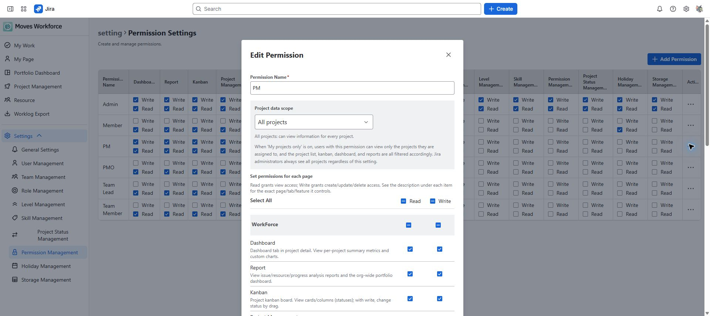

# Permissions and data visibility

[Guide home](./index.md) · [한국어](../ko/admin-permissions.md)

> Review draft: English screenshots were captured on the designated staging site on 2026-10-04 and are shared by both language guides. The deployed version and role-specific access and save operations remain under review.

Permissions determine **what actions are allowed**; visibility scope determines **which data those actions apply to**. Jira permissions apply separately. Check all three when investigating missing menus or rejected changes.

## Create a permission set

Permission Management read allows inspection; write allows creating and changing sets.

1. Add a set in **Settings → Permission Management**.
2. Select read and write access for the required features.
3. Set project visibility scope.
4. Assign the set to a user or team.
5. Check the user's effective permissions in My Page and verify their actual access.

Permission Management write can grant other permissions, so assign it to those responsible for access administration. Ordinary assigners may be prevented from granting a set broader than their own access.

## Project scope

| Scope | Meaning |
|---|---|
| All projects | All projects within the app |
| Member projects only | Projects where the user is registered as a project member |
| My teams only | Projects allowed through membership or leadership of teams and subteams |

For team scope, check user membership and leadership alongside responsible teams and actual project membership. With no valid team relationship, the project list may be empty.

The PM permission editor showing project data scope and read/write permissions, without saving changes.

## Cost and organizational information

- Cost read separately controls salary and labor-cost visibility. Project or Report read alone does not grant cost access.
- Personal amounts also depend on salary policy. Level-based policy can hide individual annual salaries.
- Team and people visibility uses a separate organizational scope check. Do not assume changing project scope alone hides the full directory.
- Check the following organizational scope rules for the resource directory and team analysis.

| Priority | Condition | Organizational data scope |
|---|---|---|
| 1 | Jira global administrative permission | All |
| 2 | **Read access to at least one** of Team Management, User Management, or Resource Management **and all-project scope** | All |
| 3 | Neither condition above, but registered as an actual team leader | Teams the user leads and their subteams |
| 4 | None of the above | No visible data through these organizational queries |

This table does not replace the permission needed to open a screen. Resource Management still requires its own read access. **Report read alone does not open the organization-wide directory.** These rules were checked in the local implementation; their deployment on staging still needs live verification.

Do not infer actual access from labels such as Admin, PM, or PMO alone. Check which system-set fields are editable and the Jira-administrator exceptions.

## Inherit team permissions

Distinguish an explicitly assigned personal set from team inheritance. With inheritance selected, permissions come from the team or an ancestor team. If the screen warns that no set can be inherited, correct the configuration before completing the assignment.

Leadership changes, team moves, and team deletion can change inherited access. Recheck using the affected account afterward.

## Jira permissions remain separate

Jira can reject issue edits, assignments, or worklogs even when the user has app write access. See [work management](./project-work.md) and [My Work](./my-work.md) for the relevant Jira permissions. Worklog Export data also follows the user's Jira access.

<!-- control-reference:start -->

## Buttons, fields, and result checks

Permission Management defines both screen access (Read/Write) and data scope. A visible menu does not imply access to every person or cost record.

| Control or field | Function, conditions, and data affected | Result check and recovery |
|---|---|---|
| Add Permission / name | Name a set and select feature read/write access before saving. Duplicate names or an empty permission selection can be rejected. | Creation alone does not apply the set to users; assign it personally or through a team. |
| Read / Write / Select All | Read permits viewing; Write permits the feature's creation/modification/deletion. Select All broadens the checkboxes in the draft. | Select the necessary scope and save. App Write does not grant Jira Edit/Assign/Schedule/Link permissions. |
| All / my projects / my team project scope | Define project visibility scope. Administrators follow separate all-project rules. People directories additionally follow organizational-scope checks. | Do not assume team scope plus Resource/User Read exposes all company candidates. Actual leaders can be restricted to led teams and descendants. |
| Cost / salary access | Cost access and salary policy jointly govern monetary values. Directory access and cost access are separate. | Check an account without cost access and personal-amount visibility under Level-based separately. |
| Edit / Delete permission | Editing affects effective access for assigned users/teams. Deleting an in-use set can be rejected. | Have affected users check with their own accounts. Review/remove references before deleting a set. |
| Personal permission / inherit from team | An explicit personal set takes precedence; team inheritance follows the team or nearest ancestor set. Distinguish registration defaults from editing's inherit choice. | Review effective access before moving teams/changing team sets. Do not assume missing inheritance automatically grants Member access. |

<!-- control-reference:end -->

