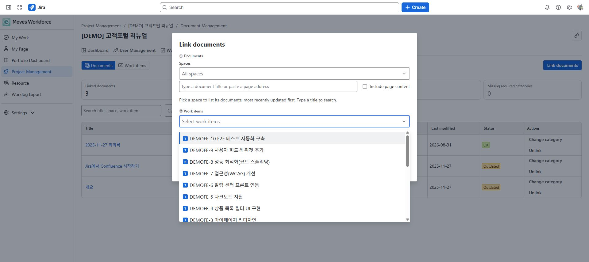

# Linking Confluence documents

[Guide home](./index.md) · [한국어](../ko/documents.md)

> Review draft: availability of document management and the same-site Confluence connection must be verified on staging.

Link designs, meeting notes, and deliverables to a project or Jira work item so they are easy to find. Linking does not edit or copy the source Confluence page.

## Required access

- Project read allows viewing; Project write allows linking, classification changes, and unlinking.
- Linking to a Jira work item also requires editing access to that item.
- Search and live status checks use your own Confluence access.

Prepare Confluence access on the site where the app is used. **The guide destination, dmove-addons, is a different site from the app reference site, dmove-staging.** Publishing this guide on another site does not make its pages searchable from the app.

<!-- detailed-walkthrough:start -->

## Prepare the example and understand the link dialog

**Path:** Jira → Apps → Moves Workforce → Project Management → Demo website launch → **Document Management**.

Prepare a Confluence page you can open on the same site, such as **Demo release design**. Also prepare the project and link DEMO-12 to it. These names are illustrative; use your actual page title and issue key. Confluence on another site is outside this search workflow.

| Dialog area | What you choose | Effect |
|---|---|---|
| Documents | Pages found using a space and search term | Checked pages are linked. Seeing a result is different from selecting it. |
| Work items | Jira issues already linked to this project | Leave empty for project documents; select issues for work-item documents. |
| Category | A document category prepared by your organization | Identifies the document's purpose. You can start uncategorized when no category is available. |

### Example A: a project document

1. Open **Link documents** and search the Documents area by space and title. If no result appears, try page-content search or open the original page to check your access.
2. Check Demo release design. Review the selected count and title.
3. **Leave Work items empty.** Choose a category if one is available, then save.
4. In Documents view, check the title and **Project document** indicator. This does not mean the page was linked to a specific issue.
5. Click the title and check that the original Confluence page opens.

### Example B: a document for DEMO-12

1. Open Link documents again and select the same page.
2. This time select **DEMO-12** in Work items. Check the key and title, choose a category, and save.
3. Find DEMO-12 in Work items view and check its document link. Also check the linked issue in Documents view.
4. For multiple issues, review per-issue success and failure results first. Check edit permission and document limits for failed items, then retry only those targets.

### Verify category changes and unlinking

Open the document row's category-change or unlink action and review the affected issue/project relationships. When a page has several links, check which relationship you are changing before saving. After a category change, verify the row's category; after unlinking, verify that the link disappears from the selected target. The original Confluence page should still open. Relinking the same page to the same issue can update its category; do not expect a second document entry.

<!-- detailed-walkthrough:end -->

## Link documents

1. Open document management in the project and choose the link-document action.
2. Find pages using a Confluence space, title, or page URL. Enable body search when needed.
3. Select the work items to link. With none selected, the document is linked to the project as a whole.
4. Choose a classification and save.
5. If you selected multiple work items, check their individual success and failure results.

Document, work-item, and category selection. With no work item selected, the document is linked to the project.

The work-item selection list in the document dialog. Selecting a work item links documents to that work item.

## Read document status

| Status | Meaning and check |
|---|---|
| Healthy | A document currently accessible to you |
| Stale | A document not updated within the administrator-defined period |
| Broken | The page may have been deleted or may be inaccessible to the current user |
| Unknown | Current status could not be determined, for example because of connectivity or verification limits |

Use work items without documents and missing required classifications to identify gaps. Unknown does not mean healthy or zero documents.

## Changes and troubleshooting

- Changing classification or unlinking changes the relationship. Unlinking does not delete the Confluence source.
- Limits apply to documents per work item and pages selected in one operation. If a limit is reported, reduce the selection and check the result.
- For failures on only some work items, check Jira editing access and limits.
- With Confluence disconnected, previously saved titles may still be visible. Ask an administrator to check the connection and access before adding links or relying on current status.
- If a colleague sees a different status, open the same Confluence page directly to check access differences.

<!-- control-reference:start -->

## Buttons, fields, and result checks

Distinguish viewing/searching/selecting from changing document links. Source pages follow your Confluence access on the same site as the app's Jira installation.

| Control or field | Function, conditions, and data affected | Result check and recovery |
|---|---|---|
| Documents / Work items | Switch between page-oriented and issue-oriented lists without changing relationships. | Project document identifies a project-level relationship made without selecting issues. |
| Summary cards / work without documents | Review linked documents, work without documents, stale/broken pages, and missing required categories. Use the undocumented-work card to find such issues. | Do not read Unknown as zero documents or Healthy. Check the displayed scope if a partial-list warning appears. |
| Document search / category / status filters | Find by title/space/issue and narrow by category/status. Filtering the linked list does not delete source pages. | Clear filters to distinguish no matches from no linked documents. |
| Link dialog space / title-URL / include content | A space selection can list recently updated pages; search by title/page URL. Include page content broadens matching. | Check the all-space fallback notice if spaces fail to load and verify that the same account can open the original page. |
| Select all / clear all / show more | Select all applies only to the loaded list. Show more loads additional search results. | Review selected titles/counts. Distinguish the 30-page selection limit from the 30-page total per issue. |
| Work items / category / Save | No issues selected means a project-level link; selected issues receive issue-level links. Choose an available category or save uncategorized. | Review per-target success/failure. An issue exceeding the total limit including existing links can fail individually. |
| Open title / metadata status | The title opens the Confluence original. Healthy/Stale/Broken/Unknown reflect metadata checking for the current user. | Current metadata checking covers up to 500 pages. Connection/coverage limits can produce Unknown; Broken alone does not prove deletion. |
| Category change / unlink target selection | All current targets are selected by default. Narrow the selection before saving when changing only some issue links. | Also check whether the project document is selected. Unlink removes selected relationships without deleting the source page. |
| Retry / Confluence unavailable | Use Retry for loading failures. When disconnected, saved titles can remain visible while new links/current checking are restricted. | Check same-site Confluence installation, current-user access, app write access, and Jira Edit Issues. |

<!-- control-reference:end -->

