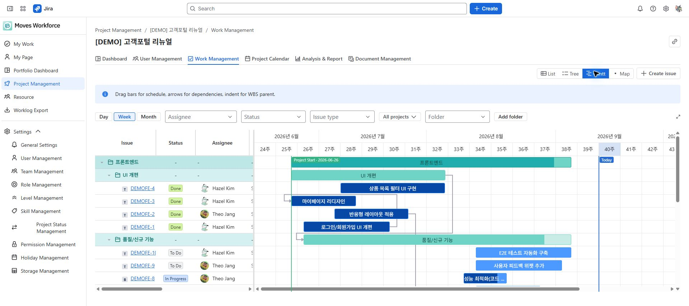
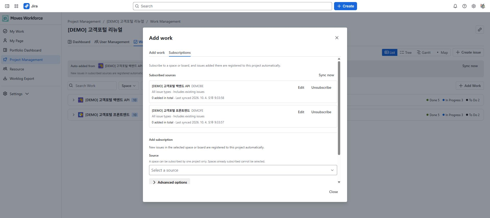
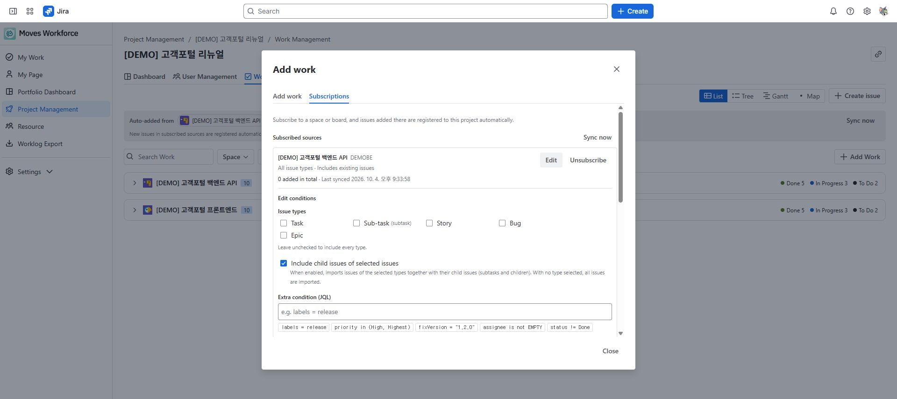

# Work and schedule management

[Guide home](./index.md) · [한국어](../ko/project-work.md)

> Review draft: screens and the deployed version have not yet been verified. Availability of subscriptions, Gantt, and Map must be checked on staging.

Link existing Jira issues to a project and manage assignments, coworkers, planned effort, structure, and schedules. **Adding work links an existing Jira issue; it does not create a new one.**

## Permissions and actions

Viewing requires Project read; linking, removing, and editing require Project write. Actions that change Jira issues also require Jira permissions.

| Action | Jira access to check |
|---|---|
| View an issue | Browse Projects and access to the specific issue |
| Change dates | Edit Issues and Schedule Issues |
| Set an assignee | Assign Issues |
| Link dependencies | Link Issues |
| Change planned effort | Edit Issues and enabled time tracking |

<!-- detailed-walkthrough:start -->

## Example: link one existing Jira issue

**Prepare:** Use an issue you can open in Jira, such as DEMO-12 Write test scenarios. Replace this illustrative key and title with your own. Prepare the issue in Jira first if it does not exist.

1. Open **Project Management → Demo website launch → Work Management**.
2. Open **Add work** and choose the Jira space and search filters. Restrictive filters can hide a result even when the key is correct.
3. Find DEMO-12 and check its title and current project relationship before selecting it. If it belongs to another app project, review the move notice and the effect on analysis first.
4. Check that only the intended issues are selected, then add them.
5. Review the result, close the dialog, and search for the key in the work list. Check that the issue appears in the list or tree.
6. Open the same key in Jira and confirm the original issue. Linking it to the app does not create a copy.

**Completion check:** You can find the issue in the project's work list. To record time, select it in [My Work](./my-work.md). Check project membership and the Jira assignee separately.

### Change planning values after linking

For bulk changes, select only the intended issues and check the start date, due date, and estimate fields to change. The bulk-apply dialog does not change assignees. Empty fields preserve values; do not use them with the intention of clearing a value. For an organization using 8 hours per day, 1MD means 8 hours. After saving, check the selected issues' dates and estimates in Jira and the app. Missing dates can prevent a bar from appearing in the Gantt or issue calendar.

Start with manual linking before configuring subscriptions. In the subscription preview, review existing matches, future inclusion rules, and issues excluded because they belong to another project. Do not assume that selecting every search result or saving a subscription means every issue is linked immediately.

<!-- detailed-walkthrough:end -->

## Link existing issues

1. Open work management in the project and add work.
2. Find issues using the Jira space and search filters.
3. Select the issues and check any notice about their existing project membership.
4. Save and check the issue list.

An issue belongs to one app project. Moving it from another project can change its links and analytical attribution; review the move notice. **Removing an issue from a project unlinks it without deleting the Jira issue.**

## Choose a view

| View | Main purpose |
|---|---|
| List | Search, filter, edit cells, and update selected issues in bulk |
| Tree | Organize folders and parent–child structure |
| Gantt | Review periods, dependencies, and milestones on a timeline |
| Map | Review work structure as a read-only relationship diagram |

Tree, Gantt, and Map share work structure. Distinguish app folders and parent assignments from Jira's native issue hierarchy. Moving a Gantt bar can change the actual issue dates.

Sample project Gantt showing folders, work dates, and dependencies.

## Update several issues

1. Select issues in the list and open the bulk-update action.
2. Enter only the start date, due date, or planned effort you want to change. Empty fields are left unchanged.
3. Check successful and failed results.
4. Correct the cause and retry only failed items.

Planned effort is entered in MD. If 1MD is 8 hours, 2MD represents 16 planned hours. It is separate from time actually logged.

## Configure automatic inclusion

In the subscription settings of the add-work dialog, choose the source space and conditions and review the preview. Choose whether to include existing issues or only issues created later, then save.

- Issues already belonging to another app project may be skipped. Check the reason.
- If synchronization differs from expectations, check source access, filters, and subtask options.
- Do not assume a default estimate replaces existing estimates. Read the setting's description and target conditions.

The Subscriptions tab in Add work, separating existing subscriptions from the new-subscription form.

Issue types, child-issue inclusion, and JQL conditions for an existing subscription, without saving changes.

## Assignees and coworkers

An assignee is one responsible person; coworkers are multiple collaborators. Changing the assignee does not automatically change coworkers. If a change takes time to appear in My Work searches, first verify the saved Jira issue. Maintain project membership separately.

<!-- control-reference:start -->

## Buttons, fields, and result checks

Path: project details → Work Management. Distinguish view changes from actions that save Jira fields or app relationships.

| Control or field | Function, conditions, and data affected | Result check and recovery |
|---|---|---|
| List / Tree / Gantt / Map | List supports search/inline changes/bulk apply; Tree shows hierarchy; Gantt supports scheduling/dependencies; Map is a read-only structure view. | Options vary by access. Distinguish shared Tree/Gantt/Map filters from the List's independent search conditions. |
| Add work / select / confirm taking issues | Link existing Jira issues. Taking an issue from another app project changes its attribution for time/cost analysis. | Read the prior-project notice and choose whether to take or skip it. This does not delete the issue. |
| Create Jira issue | Create an actual Jira issue in a registered space where you have create access, using its type/title and other fields, then link it to the project. | For unsupported required fields, create in Jira and then Add work. If creation succeeds but linking fails, relink the existing key rather than create another issue. |
| Bulk apply: start / due / planned MD | Apply entered values from these three fields to selected issues. There is no assignee field. Blank values preserve data; 1MD uses organizational daily hours. | Enter at least one value and check date order. Closing/cancelling is restricted during execution. Review each issue's result. |
| Retry failed only | Retry the previous values for failed issues. If schedule saving succeeds before MD fails, changed dates can remain. | Do not interpret failure as a full rollback. Check Edit Issues, Schedule Issues, and time-tracking fields before retrying. |
| Assignee / coworkers editing | Assignee is one person; coworkers can be multiple people. Change them using the issue's editing actions, separately from roster registration. | Check relevant Jira permissions such as Assign Issues and verify the original issue's saved values. |
| Gantt zoom / filters | Change day/week/month scale and assignee/status/type/space/folder filters. Filtering does not delete data or change dates. | Do not treat filtered-out work as missing. Folder filters are shared by Tree and Gantt. |
| Drag Gantt bars / edit schedule | Save actual Jira start/due dates. Read-only mode permits navigation, zooming, and expansion. | Check saved dates after dragging. For rejection, check scheduling permission and start ≤ due. |
| Parent issue / dependency / clear | Organize work hierarchy and relations. Self-reference, cycles, and cross-project links can be rejected. | Verify the structure in Tree/Gantt. Distinguish Jira-supported hierarchy from app folders and check Link Issues. |
| Folder create / rename / move / assign / delete | Folders group app work. Deleting a folder moves contents to its parent/root without deleting Jira issues. | Detach a parent-issue relationship before moving that issue to a folder. A folder cannot move under its own descendant. |
| Remove from project | Unlink the app-project relationship, separately from deleting Jira issues/worklogs. | Check the key and attribution impact. Issue-property document links can reappear when the issue is relinked. |
| Subscription source / advanced options | Subscribe to a Jira space. A project supports up to 10 subscriptions; the same source cannot be subscribed by another project. | Check existing subscriptions and source access. To change source, unsubscribe and subscribe to the new source. |
| Subscription types / children / extra JQL | No selected types means all types. Including children also imports children of selected types; extra JQL is combined using AND. | Viewer-dependent functions such as currentUser() are disallowed. Check matching/conflicting/already-added counts in Preview. |
| Subscription default estimate | Enter hours (h), up to 100 hours. Fill only incoming issues without an Original Estimate; existing values are not overwritten. | Distinguish hours from bulk apply's MD. Empty input disables estimate filling. |
| Bring in existing issues / Add subscription | Checked includes existing matches; unchecked starts with issues created after subscription. Existing-issue import can continue asynchronously. | Import delays/failures do not imply subscription creation was cancelled. Check the list and next sync instead of creating a duplicate. |
| Sync now | Check subscribed sources without waiting for the hourly sync. Newly created Jira issues can be delayed by search indexing. | Partial application can continue on the next sync; do not immediately add every issue again manually. |
| Edit conditions / pause / unsubscribe | Changed rules apply from the next sync. Pausing, unsubscribing, or narrowing conditions does not remove previously imported issues. | An in-progress existing-issue import can stop. Remove existing issues separately and check subscription status/last sync. |

<!-- control-reference:end -->

