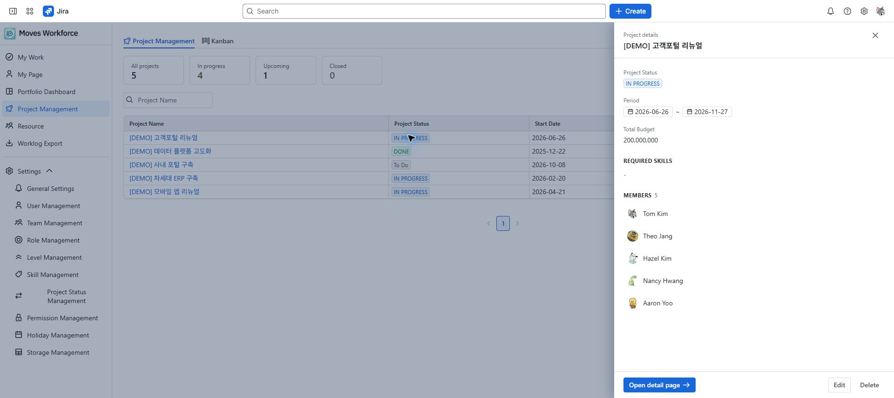

# Project management

[Guide home](./index.md) · [한국어](../ko/projects.md)

> Review draft: English screenshots were captured on the designated staging site on 2026-10-04 and are shared by both language guides. The deployed version and role-specific access and save operations remain under review.

Create Moves Workforce projects and manage their dates, budgets, and status. One app project can contain issues linked from multiple Jira spaces.

## Required access

The list and details require **Project read** access; creating, editing, and deleting require **Project write**. Kanban uses separate **Kanban read and write** permissions. Visible projects also depend on your project scope.

<!-- detailed-walkthrough:start -->

## Create an example project and verify it

**Path:** Jira → Apps → Moves Workforce → Project Management → add project. This app project groups work from Jira spaces. It is different from creating a Jira space.

| Field | Example and meaning |
|---|---|
| Name | Demo website launch. Use a name you can find again in the list. |
| Status | Choose your organization's starting status from the available options. Names vary by site configuration. |
| Start / end dates | 2026-10-05 / 2026-10-30. These define the planned project period. |
| Project cost | The budget in your organization's currency; this field is not an automatically calculated salary-based labor cost. |
| Required skills | Skills to compare when assigning people. Select them when your skill catalog is ready. |

1. Enter the name, status, dates, and other applicable fields in the add dialog. Follow required-field markers and validation messages.
2. Save, then search the list for the name. Check for an existing entry before trying to add the same project again.
3. Click the **project name** to open its detail page. Clicking a blank part of the row can open a summary drawer instead.
4. Check the saved name, status, dates, budget, and selected skills in the detail view.
5. [Add project members](./project-people.md) and [link existing Jira issues](./project-work.md). Empty member and work lists immediately after creation can simply mean these steps have not been completed.

If the dialog asks you to retry saving skills, the basic project may already exist. Follow the retry guidance in the open dialog and check the existing project. Repeatedly creating new projects can duplicate the management unit for the same work.

<!-- detailed-walkthrough:end -->

## Create a project

1. Open **Project Management** and add a project.
2. Enter its name, status, start date, and end date.
3. Enter the project budget in the project cost field. This is separate from calculated labor cost.
4. Select required skills. These are used to compare candidates during assignment.
5. Save, then add [people](./project-people.md) and [work](./project-work.md) in the project details.

Project list with the row summary drawer open. Clicking a project name opens the detail page.

If the basic project details were saved but the app asks you to save skills again, check the retained selection and save result before retrying.

## Use the list and Kanban

- Search by name in the list. Click a project name to open its details, or an empty area of a row to open its summary drawer.
- Each Kanban card represents one project. Moving it to another column changes the project's status.
- A disallowed transition may be rejected. If a card returns to its original column, check the message and configured status flow.
- Use the load-more control in the completed column, when present, to retrieve older projects.

## Before deleting a project

Deleting a project removes related app membership, configuration, and linking data and cannot be undone. **It does not delete the Jira issues themselves.**

1. Check the project name and impact before confirming deletion.
2. Check completion in the deletion progress dialog.
3. If deletion fails, inspect the reason and use the retry action.
4. If linked Jira issues cannot be accessed, ask an administrator who can access them to retry.

## Troubleshooting

| Symptom | What to check |
|---|---|
| Only the list or Kanban is visible | The separate permissions for both features |
| A participating project is missing | Project membership and project visibility scope |
| Project cost differs from labor cost | Whether you are comparing an entered budget with calculated labor cost |
| Deletion does not complete | The failed stage and the executing user's Jira access |

<!-- control-reference:start -->

## Buttons, fields, and result checks

The list and kanban manage Moves Workforce projects. Distinguish them from Jira spaces and Jira workflow statuses.

| Control or field | Function, conditions, and data affected | Result check and recovery |
|---|---|---|
| Name search / clear / pagination | Search projects and move between pages. Clearing filters does not delete projects. | Check search conditions and visibility scope before diagnosing a missing project. |
| Project name / blank row area | The name opens the detail page; a blank row area opens the summary drawer. | Use Open detail page in the drawer to access all project functions. |
| Add Project / Save project | Name, status, start date, and end date are required. Budget is optional and represents the planned project amount. | Resolve field errors and save. Creation does not automatically add members or issues. |
| Required skills: category/search/select/remove | Select required skills from the catalog. Removing a selected skill removes a project requirement, not the dictionary entry. | Previously selected skills missing from the catalog can have an unknown label. Do not treat failed loading as an empty requirement list. |
| Edit / reload / retry partial save | Edit the existing project. Failed detail/skill loading can lock saving. A skills failure after basic information was saved differs from total creation failure. | Follow retry guidance in the open dialog and check the existing project; do not repeatedly create new projects. |
| Move a kanban card | Change an app project's status along the allowed flow. This does not bulk-change Jira issue statuses. | If the card returns, check the transition and write access. Show more in the completed column loads additional historical projects. |
| Delete project / retry deletion | After confirmation, remove project-related app data such as member/team assignments, subscriptions, dashboards, Gantt structure, and skill mappings. Original Jira issues are preserved. | This cannot be undone. Review the failed stage/inaccessible issues, resolve access, and use Retry deletion. Some stages may already have completed. |

Check deletion progress and whether the dialog permits closing. Closing it does not reverse deletion stages already completed.

<!-- control-reference:end -->

<!-- supplemental-guides:start -->

## Detailed guides

- [Project details](https://dmove-addons.atlassian.net/wiki/spaces/MW/pages/204046659)
- [Project detail screens and access](https://dmove-addons.atlassian.net/wiki/spaces/MW/pages/204046679)

<!-- supplemental-guides:end -->
