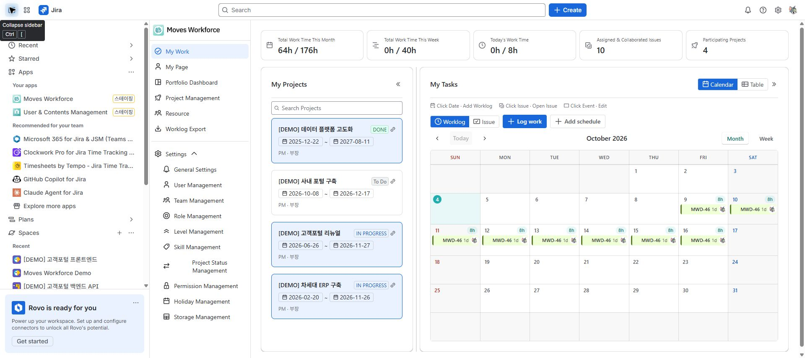
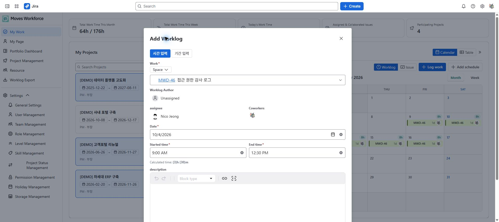

# Quick start

[Guide home](./index.md) · [한국어](../ko/quick-start.md)

> Review draft: English screenshots were captured on the designated staging site on 2026-10-04 and are shared by both language guides. The deployed version and role-specific access and save operations remain under review.

Use this guide to record your time and check its project context. For a new installation, an administrator must first complete [initial setup](./admin-setup.md).

## Before you start

- A Jira account with access to the app and registration as a Moves Workforce user
- A Jira issue that you can view and log work against
- To check project analysis, membership in the Moves Workforce project and an issue linked to that project

<!-- detailed-walkthrough:start -->

## A complete worked example

The names and values below are illustrative. Replace them with your own project, Jira issue, and actual work date. Use an existing project when one is already prepared.

| Prerequisite | Example | If it is missing |
|---|---|---|
| App project | Demo website launch | An administrator [creates the project](./projects.md). |
| App user and project member | Your Jira account | An administrator registers you in the app and [adds you to the project](./project-people.md). |
| Jira issue | DEMO-12 Write test scenarios | Prepare an accessible issue in Jira, then [link it to the project](./project-work.md). |
| Time to record | 2026-10-05, 09:00–12:30 | Replace these values with your actual date and times. |

1. Open **Jira → Apps → Moves Workforce → My Work**. Confirm that you are viewing your own account.
2. Select the work date and open the worklog dialog. Check existing entries before adding the same work again.
3. Search for the prepared issue key. Check the result's title before selecting it. If the search is empty, check whether you can open the issue directly in Jira.
4. Enter the date and start/end times. The example should calculate **3 hours 30 minutes**. Describe the work and submit the entry.
5. After the dialog closes, check the entry's **issue key, date, author, and duration**. The daily total includes other entries and need not equal 3 hours 30 minutes.
6. Check the same entry in the Jira issue's worklogs. Do not log the same work again in Jira.
7. Open **Project Management → Demo website launch**. Check the issue in Work Management and your membership in User Management separately.
8. If you have access, select a period covering the date in analysis and reports. Also check the last aggregation time for aggregated views such as the portfolio.

**Completion check:** You have checked your worklog and both project relationships. Saving time does not register a project member or link an issue automatically. For empty analysis, check work date → issue link → project membership → visibility scope → aggregation time.

<!-- detailed-walkthrough:end -->

## Record your first worklog

1. Open **Moves Workforce** from the Jira **Apps** menu.
2. In **My Work**, select the date or use the button to add a worklog.
3. Select a Jira issue, for example `DEMO-12 Write test scenarios`.
4. Enter the date and start and end times. For example, 09:00–12:30 represents 3 hours 30 minutes.
5. Describe the work and save.
6. Check that the worklog and the total time for that date have updated.

Moves Workforce under Apps in the Jira sidebar.

An unsaved worklog with a sample issue and times of 09:00–12:30, calculating 3 hours 30 minutes.

This is a Jira worklog. Creating a separate entry in both Jira and the app for the same work would duplicate it, so check existing records first.

## Check your project

1. Open your project from **Project Management**.
2. In work management, check that the issue you logged time against is linked to the project.
3. In project people, check that you are registered as a project member.
4. If permitted, open analysis and reports and select a period covering the worklog date.

Assigning a Jira issue, registering a project member, and linking an issue to a project are separate actions. Completing one does not automatically complete the others.

## Check the result

| Check | Expected result |
|---|---|
| Your worklog | An entry with the selected issue, date, and duration |
| Your project | Projects consistent with your permissions and assignments |
| Project analysis | The relevant period, people, and issues can be checked |
| Portfolio dashboard | You check the aggregation timestamp before interpreting results |

If a menu is missing or an issue cannot be selected, use the [FAQ](./faq.md). You do not need to change every setting to get started.
