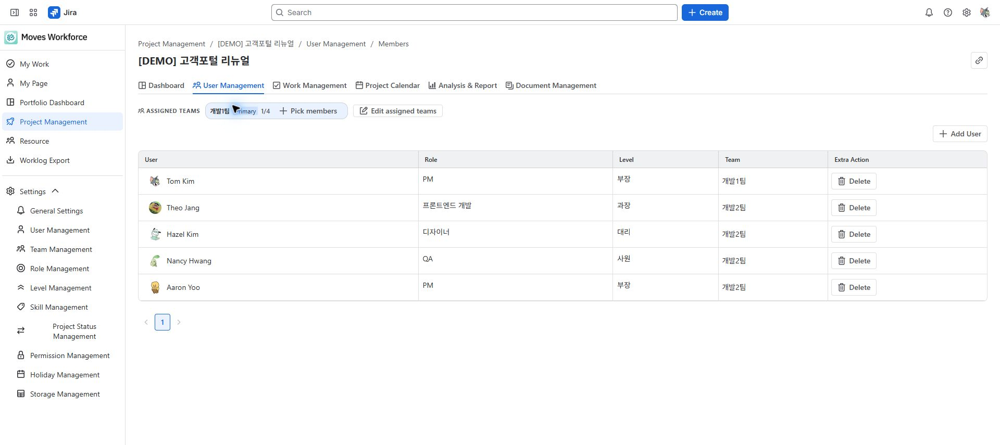

# 프로젝트 인력과 인건비

[가이드 홈](./index.md) · [English](../en/project-people.md)

> 검토 초안: 2026-10-04 지정된 staging의 영어 화면을 촬영했습니다. 화면 이미지는 한·영 가이드가 공통으로 사용합니다. 배포 버전과 역할별 접근·저장 동작은 아직 검증 중입니다.

프로젝트에 참여할 사람과 책임 팀을 정하고, 허용된 사용자만 인건비 기준을 설정합니다. 인력 목록·급여 관리·작업 배정은 목적이 다릅니다.

## 필요한 권한

- 인력 조회: 프로젝트 관리 읽기. 인력·담당 팀 변경: 프로젝트 관리 또는 자원관리 쓰기.
- 급여·비용 조회: 비용 읽기. 금액 변경: 비용 쓰기와 해당 정책에서 허용된 편집 권한.
- Jira 이슈 배정: 앱의 쓰기 권한에 더해 해당 Jira 작업의 담당자 지정 등 작업별 권한.

개인 금액의 표시 여부는 비용 권한과 급여 정책을 함께 따릅니다. 일반 인력 목록을 볼 수 있다고 개인 연봉을 볼 수 있는 것은 아닙니다.

<!-- detailed-walkthrough:start -->

## 구성원 한 명을 추가하는 예시

**경로:** 프로젝트 관리 → Demo website launch → **인력 관리(User Management) → 구성원(Members)**. 아래 예시는 이미 앱 사용자로 등록된 본인의 Jira 계정을 사용합니다. 회사에 없는 가상 사용자를 등록할 필요는 없습니다.

1. 구성원 목록에서 본인이 이미 등록되어 있는지 확인합니다.
2. **사용자 추가(Add User)**를 열고 등록된 사용자를 선택합니다. 검색에 나오지 않으면 관리자에게 앱 사용자 등록 여부를 확인합니다.
3. 선택한 사용자를 추가한 뒤 구성원 목록에 나타나는지 확인합니다. Add User 창에서는 사용자를 선택하며 역할·레벨을 지정하지 않습니다.
4. 구성원 목록의 역할·레벨 셀에서 프로젝트 기준을 선택해 저장합니다. 선택지가 없으면 관리자에게 역할·레벨 기준 설정을 요청합니다.
5. 구성원 목록에서 이름·역할·레벨의 저장값을 확인합니다. 인건비는 별도 화면과 비용 권한으로 관리하며, 인력 등록을 위해 임의의 급여를 입력하지 않습니다.

담당 팀을 사용하는 경우 **담당 팀 편집(Edit assigned teams)**에서 팀을 지정한 뒤 **구성원 선택(Pick members)**으로 필요한 사람을 가져옵니다. 팀 지정과 실제 프로젝트 구성원 등록은 별개입니다. 처리 결과에서 추가·제외 대상을 확인하고, 팀 이름이 보이는 것만으로 모든 팀원이 등록되었다고 판단하지 마세요.

**다음 단계:** [작업 관리](./project-work.md)에서 DEMO-12를 프로젝트에 연결합니다. 해당 이슈의 Jira 담당자 지정은 또 다른 작업이며, 인력 등록만으로 Jira 담당자가 변경되지는 않습니다. 비용 계산이 목적이면 아래 비용 기준을 추가로 검토합니다.

<!-- detailed-walkthrough:end -->

## 담당 팀과 인력 등록하기

1. 프로젝트 상세의 **인력 관리**를 엽니다. 영어 화면에서는 **User Management → Members**로 이동합니다.
2. 책임을 맡을 담당 팀과 주 담당 팀을 지정합니다.
3. **사용자 추가**로 실제 참여자를 등록하거나 담당 팀의 **구성원 선택(Pick members)**으로 필요한 사람을 선택합니다.
4. 인력별 역할과 등급을 확인합니다.

**담당 팀 지정은 인력 등록을 대신하지 않습니다.** 또한 Jira 이슈 담당자 지정도 프로젝트 인력 등록과 별개입니다. 구성원 선택으로 추가한 후에는 추가·건너뜀 결과와 실제 명단을 확인합니다.

프로젝트의 담당 팀과 참여 인력 목록. Edit assigned teams와 Add User는 서로 다른 작업입니다.

## 인건비 기준 선택하기

| 조직 정책 | 프로젝트에서 사용할 기준 |
|---|---|
| 인원별 | **프로젝트** 유형은 입력한 투입 급여를 사용. **연봉** 유형은 개인 연봉을 프로젝트 기간에 비례해 환산 |
| 등급 기반 | 개인 금액 대신 등급의 대표 연간 금액을 프로젝트 기간에 비례해 환산 |

연봉 환산은 종료일을 포함한 달력일을 기준으로 합니다. 프로젝트 개월수는 달력일수 ÷ 30.4375이고, 인건비는 연간 금액 ÷ 12 × 프로젝트 개월수입니다. 이 계산은 MD·MM의 근무일 환산과 구분합니다.

등급 대표값이 없다면 하한·상한이 모두 있는지 확인합니다. 유효한 대표값 또는 두 경계값이 모두 준비돼야 등급 기반 원가를 산정할 수 있습니다.

## 작업 배정하기

작업 배정에서 후보의 스킬과 부하를 비교한 뒤 맡길 이슈를 선택합니다. 프로젝트 인력으로만 추가하는 경우와 이슈 담당까지 지정하는 경우를 구분하고, 저장 후 두 결과를 각각 확인하세요. 전사 후보를 비교하려면 [자원 관리](./resources.md)를 사용합니다.

## 인건비가 비어 있거나 0일 때

| 상태 | 확인할 것 |
|---|---|
| 항목이 보이지 않음 | 비용 읽기 권한과 개인 금액을 숨기는 급여 정책 |
| 연봉 유형의 값이 0 | 개인 연봉과 프로젝트 기간 |
| 등급 기반의 값이 0 | 프로젝트 인력의 등급과 유효한 등급 금액 |
| 프로젝트 유형의 값이 0 | 투입 급여를 입력했는지, 의도한 무상 배정인지 |

입력한 프로젝트 예산과 계산된 인건비는 다를 수 있습니다. 분석 화면의 미산정 안내를 확인하고, 정책 변경 후에는 집계 시각도 확인합니다.

<!-- control-reference:start -->

## 버튼·입력 항목과 처리 결과 상세

경로: 프로젝트 상세 → User Management → Members. 사용자를 추가한 뒤 목록의 역할·레벨을 별도로 확인·편집하고, 비용 관리는 허용된 비용 화면에서 수행합니다.

| 버튼·입력 항목 | 기능·사용 조건·변경 대상 | 결과 확인과 문제 대응 |
|---|---|---|
| Add User·사용자 선택·Add | 앱에 등록된 Jira 사용자를 다중 선택해 프로젝트 인력에 추가합니다. 이 추가 창에는 역할·레벨을 입력하는 단계가 없습니다. | 미등록 사용자 오류가 나면 설정의 사용자 등록부터 진행합니다. 추가 후 명단을 확인합니다. |
| 역할·레벨 셀 편집 | 인력 목록에서 해당 셀을 열어 기준 항목을 선택하고 확인합니다. 변경은 해당 프로젝트 인력 정보에 적용됩니다. | 목록의 저장값을 확인합니다. 조직 사용자 기준과 프로젝트에서 맡는 역할·레벨을 혼동하지 않습니다. |
| 담당 팀 편집·주 담당 팀 | 프로젝트 책임 팀과 주 담당 팀을 정합니다. 팀을 지정하는 것만으로 모든 팀원이 프로젝트 구성원이 되지는 않습니다. | 저장 후 담당 팀 표시를 확인하고 실제 인력은 구성원 선택으로 추가합니다. |
| Pick members·구성원 선택 | 담당 팀의 구성원을 골라 추가합니다. 이미 등록된 사람과 추가 가능한 사람을 구분합니다. | 추가·건너뜀 결과와 실제 명단을 확인합니다. 팀 선택과 인력 선택을 같은 작업으로 간주하지 않습니다. |
| 인력 제외 | 프로젝트 인력 연결을 제거합니다. Jira 계정·Jira 워크로그 삭제와 다른 동작입니다. | 제외 후 명단과 배정 상태를 확인합니다. Jira 이슈 담당자 관계도 별도로 확인합니다. |
| 급여 계산 모드·투입 금액 | 인원별 정책에서는 입력한 투입 금액을 그대로 사용하는 모드와 연봉을 프로젝트 달력 기간으로 환산하는 모드를 구분합니다. | 비용 쓰기 권한으로 저장하고 유효 원가를 확인합니다. 연봉 또는 프로젝트 기간이 없으면 연봉 환산이 0일 수 있습니다. |
| 급여 밴드·유효 원가 | 등급 기반 정책에서는 대표 연간 금액을 사용하며 개인 급여 입력·표시는 제한됩니다. 비용 권한도 별도로 필요합니다. | 레벨과 유효한 대표값 또는 양쪽 경계값을 확인합니다. 원가 0을 무료 투입으로 단정하지 않습니다. |
| 담당 해제·동료 제거 | 선택 작업에서 현재 담당자를 해제하거나 해당 후보의 동료 관계를 제거합니다. 다른 버튼이며 프로젝트 구성원 삭제와는 별개입니다. | 담당 해제는 Jira 담당자 권한, 동료 변경은 이슈 속성 편집 접근을 확인합니다. 처리 후 원본 담당자·동료와 프로젝트 명부를 각각 확인합니다. |

<!-- control-reference:end -->

