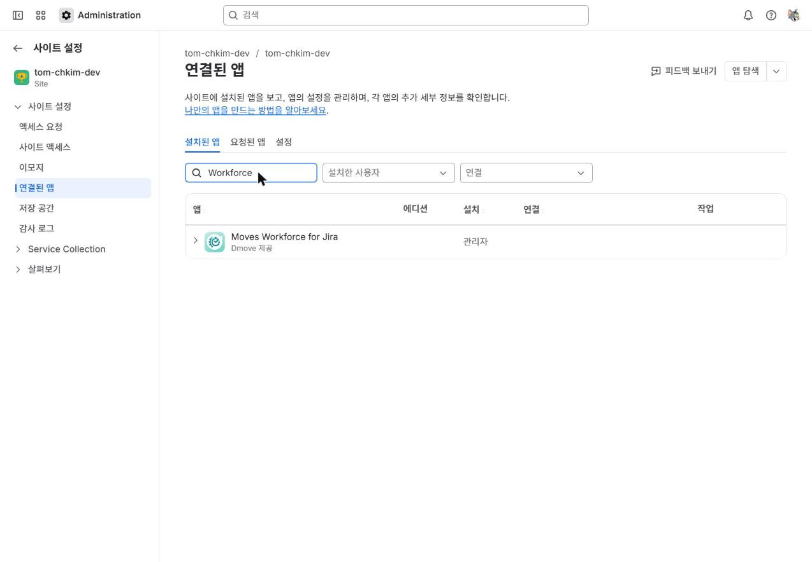
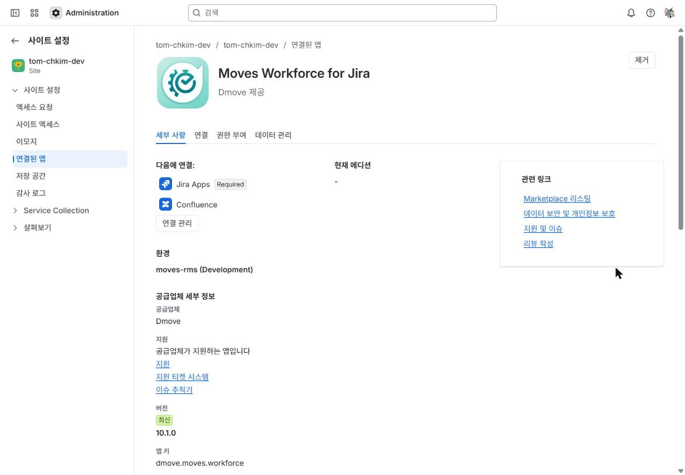
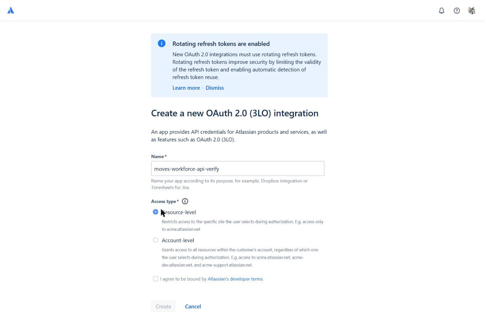
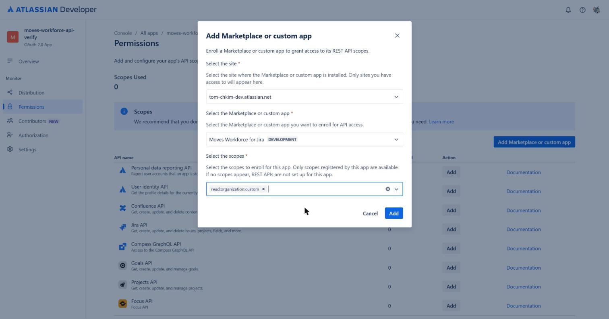
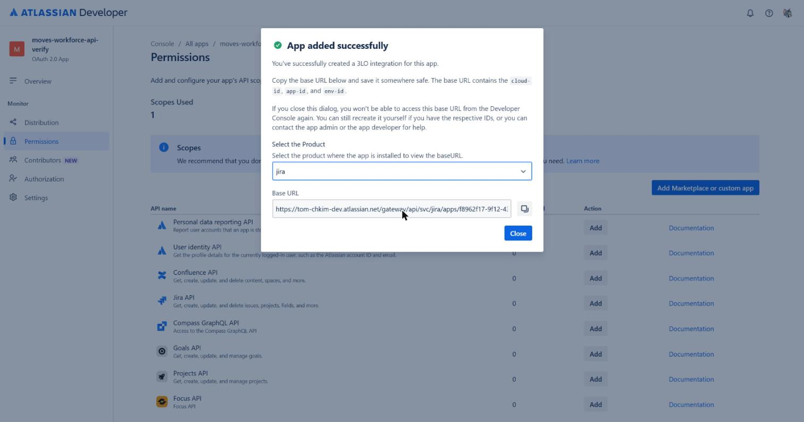
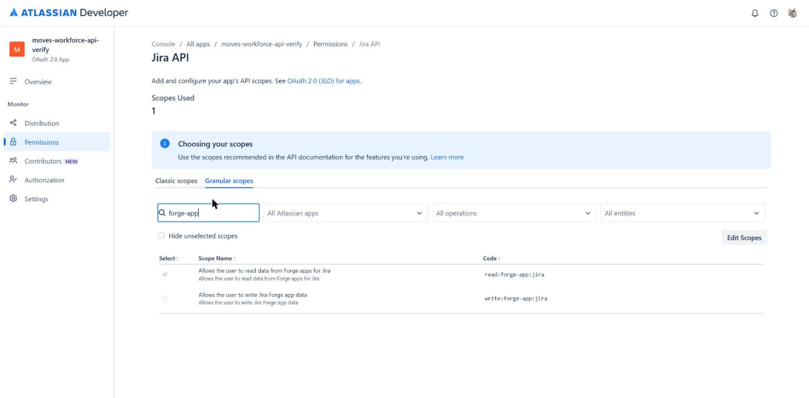
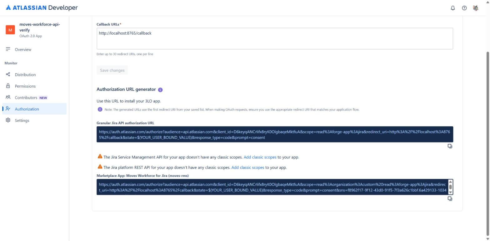
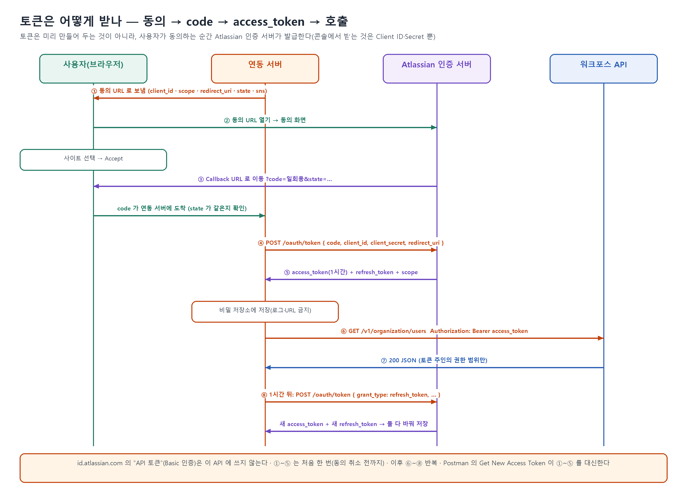

# Moves Workforce 외부 조회 API 연결 가이드 및 설정 방법

> 대상: 고객 사이트 관리자(1장), 연동 담당자(2·3장), **연동을 개발하는 개발자(4·5장)**
> 기준: 2026-10-20, 개발 사이트에서 실측한 화면·응답. 화면 문구는 Atlassian이 바꿀 수 있다.
> 바로 쓸 수 있는 예제 코드: [`examples/workforce-client.mjs`](examples/workforce-client.mjs)(Node.js 18+) · [`examples/workforce_client.py`](examples/workforce_client.py)(Python 3.9+) — 둘 다 개발 사이트에서 실행 확인.

Moves Workforce(이하 Workforce)는 외부 시스템에서 팀·사용자 조직 정보를 읽을 수 있도록 REST API(HTTP 요청으로 데이터를 조회하는 인터페이스)를 제공한다.
외부 시스템은 **사용자 본인의 동의를 거치는 OAuth 2.0 3LO(사용자·연동 시스템·Atlassian 간 인증·인가 방식)**로 받은 토큰을 사용해 API를 호출한다.
API는 **해당 사용자가 Workforce에서 볼 수 있는 범위만** 반환한다. 토큰을 받았다고 권한이 늘어나지는 않는다.

| API | 설명 |
|---|---|
| `GET /v1/organization/users` | 사용자 목록(20명 단위) 또는 1명 조회. 이름·활성 여부·소속 팀·팀장 여부 제공 |
| `GET /v1/organization/teams` | 팀 목록(10팀 단위) 조회. 상위 팀·팀장·구성원 제공 |

두 API 모두 같은 scope(토큰에 부여할 접근 권한 범위)인 `read:organization:custom`을 사용한다. 화면 이름은 "Read organization teams and users"다.

## 전체 순서

이 장에서는 설정부터 API 호출·토큰 갱신까지의 순서와 단계별 담당자를 확인한다.

| 단계 | 담당자 | 작업 위치 | 수행 시점 |
|---|---|---|---|
| 1. 앱 REST API 켜기 | 사이트 관리자 | admin.atlassian.com | 사이트당 한 번 |
| 2. OAuth 앱 만들기·권한 연결 | 연동 담당자 | developer.atlassian.com | 연동 시스템당 한 번 |
| 3. 동의 → 인증 코드(`code`)를 토큰으로 교환 | 토큰 주인이 될 사용자 → 연동 서버 | 동의 화면 → `auth.atlassian.com/oauth/token` | 처음 한 번(취소 전까지) |
| 4. 호출·토큰 갱신 | 연동 서버 | 기본 URL | 계속(토큰은 1시간마다 갱신) |

---

## 1. 앱 REST API 켜기 (사이트 관리자)

이 장에서는 사이트 관리자가 앱 REST API를 켜고 기본 URL을 확인하는 방법을 안내한다.

Atlassian은 사이트마다 앱 REST API를 기본으로 꺼 둔다. 외부 호출을 받으려면 사이트 관리자가 이 설정을 켜야 한다.

1. [admin.atlassian.com](https://admin.atlassian.com)에 접속한다. 조직을 선택한 뒤 **앱** → **사이트** → 해당 사이트 → **연결된 앱**으로 이동한다.
2. "Workforce"로 검색한다. **Moves Workforce for Jira**를 펼친 뒤 **앱 세부 정보 보기**를 선택한다.

   

   

3. 화면 아래쪽에서 **앱 REST API** 항목의 "사용 중지" 상태를 확인한다. **앱 REST API 사용으로 설정**을 선택한 뒤 확인 창에서 확인한다.

   

   

4. "사용" 배지와 **기본 URL**이 나오면 설정이 끝난다. 이 URL을 연동 담당자에게 전달한다.

   

- 기본 URL 형식: `https://{사이트}.atlassian.net/gateway/api/svc/jira/apps/{appId}_{envId}`
- 같은 API를 `https://api.atlassian.com/svc/jira/{cloudId}/apps/{appId}_{envId}`로도 호출할 수 있다.
- API를 끄려면 같은 위치에서 **앱 REST API 사용 중지**를 선택한다. 끄면 모든 외부 호출이 차단된다.
- 참고: 이 설정 변경은 사이트 감사 로그에 남지 않았다(2026-10-20 확인). 누가 설정을 켰는지는 내부 기록으로 남겨 두는 것이 좋다.

## 2. OAuth 앱 만들기·권한 연결 (연동 담당자)

이 장에서는 OAuth 앱을 만들고 API 권한·동의 URL·인증 정보를 설정하는 방법을 안내한다.

외부 시스템이 토큰을 받으려면 Atlassian에 등록된 "OAuth 2.0 앱"이 필요하다.

### 2-1. 앱 만들기

1. [Developer Console](https://developer.atlassian.com/console/myapps/)에서 **Create** → **OAuth 2.0 integration**을 선택한다.
2. 앱 이름을 입력한다. 접근 유형은 **Resource-level**(동의할 때 고른 사이트 하나만 접근)을 권장한다.
3. 약관에 동의한 뒤 **Create**를 선택한다.



> 화면 위 안내대로 **refresh token(액세스 토큰 갱신에 쓰는 토큰) 회전이 강제**된다. 갱신할 때마다 refresh token도 새 값으로 발급되므로 매번 바꿔 저장해야 한다(4-3 참고).

### 2-2. Workforce 권한 연결

1. **Permissions** 화면에서 **Add Marketplace or custom app**을 선택한다.
2. 사이트를 선택한 뒤 앱 **Moves Workforce for Jira**를 선택한다.
3. scope **`read:organization:custom`**을 선택한 뒤 **Add**를 선택한다.



권한을 추가하면 기본 URL이 한 번 표시된다. 제품을 **jira**로 바꿔 확인한다.
이 화면을 닫으면 기본 URL을 다시 보여 주지 않지만, 1장에서 확인한 기본 URL과 같다.



### 2-3. Jira 권한 추가

1. 같은 **Permissions** 화면에서 **Jira API**의 **Add**를 선택한 뒤 **Configure**를 선택한다.
2. **Granular scopes**에서 `forge-app`을 검색한다.
3. **`read:forge-app:jira`**만 선택한 뒤 **Save**를 선택한다. 바로 아래의 `write:forge-app:jira`는 **선택하지 않는다**.



권한 요약에 Jira API 1개, Moves Workforce for Jira 1개가 표시되는지 확인한다.


### 2-4. Callback URL·동의 URL 설정

1. **Authorization** 화면에서 **OAuth 2.0 (3LO)**의 **Add**를 선택한다.
2. 연동 시스템의 Callback URL(동의 후 브라우저가 돌아올 주소)을 저장한다.
3. 아래 **Authorization URL generator**에 표시되는 동의 URL을 확인한다. **반드시 "Marketplace App: Moves Workforce for Jira" 아래의 URL을 사용한다.** 이 URL 끝에는 `sns={appId}.{envId}`가 붙어 있다.



#### 동의 URL 만들기 — 콘솔이 만든 URL을 복사해서 두 군데만 고친다

Callback URL을 저장하면 **Authorization** 화면 아래에 동의 URL이 자동으로 나온다. 여러 줄이 보이지만 **쓰는 것은 하나뿐**이다.

| 화면에 보이는 것 | 쓰나? | 쉽게 말하면 |
|---|---|---|
| "…doesn't have any classic scopes" | 무시 | 옛날 방식 권한 안내. 이 연동과 상관없다 |
| Granular Jira API authorization URL | ❌ | **Workforce 권한이 빠진 URL**(`sns` 없음). 동의는 되는데 API를 부르면 403(4-4) |
| **Marketplace App: Moves Workforce for Jira** | ✅ | **이것만 쓴다** |

> 참고: Callback URL을 여러 개 등록했으면 콘솔은 **맨 위 주소**로 URL을 만든다. 직접 만든 URL도 `sns`가 빠지면 같은 403이 난다.

**예시 — 콘솔에서 복사한 URL**

```
https://auth.atlassian.com/authorize?audience=api.atlassian.com
  &client_id={Client ID}
  &scope=read%3Aorganization%3Acustom%20read%3Aforge-app%3Ajira      ← ② 고칠 곳
  &redirect_uri=http%3A%2F%2Flocalhost%3A8765%2Fcallback
  &state=${YOUR_USER_BOUND_VALUE}                                     ← ① 고칠 곳
  &response_type=code
  &prompt=consent
  &sns={appId}.{envId}
```

**① `state` — 아무 글자로 바꾼다**

`${YOUR_USER_BOUND_VALUE}`는 "여기에 값을 넣으세요"라는 빈칸이다. 동의할 때마다 새로 만든 아무 문자열을 넣는다.

```
변경 전: state=${YOUR_USER_BOUND_VALUE}
변경 후: state=k29fx8qa
```

Accept 뒤 돌아온 주소에도 `state=k29fx8qa`가 붙어 있어야 한다. 다르면 내가 보낸 요청이 아니므로 버린다.

**② `scope` 끝에 `%20offline_access`를 붙인다**

```
변경 전: scope=read%3Aorganization%3Acustom%20read%3Aforge-app%3Ajira
변경 후: scope=read%3Aorganization%3Acustom%20read%3Aforge-app%3Ajira%20offline_access
```

`%20`은 띄어쓰기다. 권한 여러 개를 띄어쓰기로 나열하는 것이다.

**`offline_access`는 왜 붙이나 — "출입증 재발급 카드"**

동의하면 **1시간짜리 출입증(access token)**을 받는다. 1시간이 지나면 새 출입증이 필요하다.

- `offline_access`를 붙이면 출입증과 함께 **재발급 카드(refresh token)**도 준다. 카드만 있으면 사람 없이 프로그램이 새 출입증을 받는다(4-3).
- 붙이지 않으면 출입증만 준다. 1시간 뒤에는 **담당자가 직접 다시 Accept**해야 한다.

"offline"은 인터넷이 끊긴다는 뜻이 아니라 **"사람이 자리에 없을 때도"**라는 뜻이다.

**예시 — 매일 새벽 2시에 사용자 목록을 가져오는 배치**

`offline_access` 없이 동의한 경우:
```
10/21 14:00  담당자 Accept → 출입증(1시간)
10/21 14:05  시험 호출 → 성공 ✅
10/21 15:00  출입증 만료
10/22 02:00  배치 호출 → 401 실패 ❌  (재발급 카드가 없음)
             → 담당자가 출근해서 다시 Accept해야 함. 매일 반복
```

`offline_access`를 붙이고 동의한 경우:
```
10/21 14:00  담당자 Accept → 출입증 + 재발급 카드
10/22 02:00  배치: 출입증 만료 → 카드로 새 출입증 받음 → 호출 성공 ✅
             → 새로 받은 카드 저장
10/23 02:00  같은 방식으로 성공 ✅
             담당자는 처음 한 번만 Accept
```

**콘솔 URL에는 왜 없나?** Atlassian은 "사용자가 화면 앞에 앉아 쓰는 웹앱"을 기본으로 생각한다. 그런 앱은 장기 출입이 필요 없어서 콘솔이 만든 URL에서 빠져 있다(실측). 사람 없이 도는 연동은 **직접 붙여야 한다**.

**제대로 됐는지 확인**

| 언제 | 볼 것 | 없으면 |
|---|---|---|
| 동의 화면(3-1) | "In Moves … Read organization teams and users" 줄 | Marketplace App URL이 아님 → Cancel 후 다시 |
| 토큰 받은 직후(3-2) | 응답에 `refresh_token` 항목 | `offline_access` 빠짐 → 붙여서 동의 다시 |

**꼭 지킬 것** — 재발급 카드는 쓸 때마다 **새 카드로 바뀐다**. 받은 새 카드를 매번 저장한다(5-5). 옛 카드를 계속 쓰면 얼마 뒤 막히고 동의부터 다시 해야 한다. 90일 동안 한 번도 쓰지 않아도 만료된다.

#### Callback URL 자세히

Callback URL 은 사용자가 동의 화면에서 **Accept** 를 누른 뒤 브라우저가 돌아오는 주소다. Atlassian 은 이 주소 뒤에 일회용 `code`(그리고 동의 URL 에 넣은 `state`)를 붙여 보낸다. 이 `code` 를 토큰으로 바꾼다(3-2). 이 주소에서 받는 서버를 꼭 띄워 둘 필요는 없다(아래).

```
https://integration.example.com/oauth/atlassian/callback?state=<보낸 값>&code=<일회용 코드>
```

| 항목 | 내용 | 근거 |
|---|---|---|
| 어디에 등록하나 | Developer Console → 해당 OAuth 앱 → **Authorization** → OAuth 2.0 (3LO) → **Callback URLs** → **Save changes** | 공식[^oauth-jira] |
| 몇 개까지 | 한 줄에 하나, 최대 30개("Enter up to 30 redirect URIs, one per line") | Developer Console 화면 |
| 어느 주소가 쓰이나 | 동의 URL 의 `redirect_uri` 값으로 정해진다. 콘솔의 Authorization URL generator 는 **목록의 첫 번째 주소**로 URL 을 만든다 | 콘솔 화면 안내 |
| 일치 조건 | `redirect_uri` 는 등록한 Callback URL 과 **일치해야 한다**. 토큰 요청(3-2)의 `redirect_uri` 도 동의 URL 과 같은 값을 쓴다 — 스킴(`https`)·호스트·경로·끝의 `/` 까지 똑같이 적는다 | 공식("must match")[^oauth-jira] |
| 로컬 개발 | `http://localhost:<포트>/callback` 도 동작했다(개발 사이트 실측). 운영에는 `https` 주소를 쓴다 | 실측 |
| Postman 으로 시험 | Postman 의 "Authorize using browser" 를 쓰면 `https://oauth.pstmn.io/v1/callback` 을 목록에 추가해야 한다 | Postman 동작 |
| `code` 유효 시간·재사용 | 공식 문서에 명시가 없다. 실측으로는 **발급 후 5분**(code 안의 `iat`→`exp` 300초)이었다. **받는 즉시 한 번만** 토큰으로 바꾼다 | 공식 문서 미기재, 실측 2026-10-21 |

**Callback 을 받는 서버를 꼭 만들어야 하나? — 아니다**

Callback URL 은 콘솔에 **등록만** 하면 된다. 그 주소에서 프로그램이 실행 중일 필요는 없다.

**Accept** 를 누르면 Atlassian 은 브라우저에게 "이 주소로 이동하라"고만 응답한다.

```
HTTP 302
Location: http://localhost:8765/callback?code=<일회용 코드>&state=<보낸 값>
```

`code` 는 이 주소 문자열 안에 들어 있으므로 **이 시점에 이미 브라우저가 갖고 있다**. Atlassian 이 고객 서버로 접속해 오는 것이 아니다. 브라우저가 그 주소에 접속을 시도할 뿐이다.

- 받는 프로그램이 있으면 → 프로그램이 주소에서 `code` 를 읽어 자동으로 토큰을 받는다.
- 받는 프로그램이 없으면 → 브라우저에 "사이트에 연결할 수 없음" 화면이 뜬다. 그래도 **주소창에 `code=…` 가 그대로 남아 있다**. 이것을 복사해 3-2 의 토큰 요청에 넣으면 된다.

콘솔에 주소를 등록하는 이유는 Atlassian 이 **등록된 주소로만** 이동시키게 해서, 공격자가 자기 서버 주소로 `code` 를 가로채지 못하게 하기 위해서다. 그 주소에 실제로 누가 기다리는지는 확인하지 않는다.

| 방식 | Callback URL 예 | 필요한 것 | 맞는 경우 |
|---|---|---|---|
| A. 수동 복사 (권장 — 첫 연동) | `http://localhost:8765/callback` | 담당자 PC 의 브라우저, `curl` | 연동 계정 하나로 한 번 동의하고 끝나는 배치·동기화 |
| B. 로컬 도우미 | `http://localhost:8765/callback` | 담당자 PC 에서 **Accept 하는 동안만** 실행하는 스크립트(브라우저와 같은 PC) | A 의 복사·붙여넣기를 자동으로 하고 싶을 때 |
| C. 연동 서버에 Callback | `https://integration.example.com/oauth/atlassian/callback` | 외부에서 접속 가능한 https 주소 | 제품 화면에 "Atlassian 연결" 버튼을 두거나 여러 사람이 각자 동의할 때 |

A·B 로 받은 **refresh token** 을 연동 서버(배치·동기화 프로그램)의 비밀 저장소에 넣으면, 이후 갱신·호출(4장)은 연동 서버가 한다. 토큰 교환·갱신·API 호출은 모두 고객 쪽에서 **밖으로 보내는 HTTPS 요청**이라 포트를 열거나 웹 서버를 띄울 필요가 없다. 상시 실행 서버가 아니라 정해진 때 실행되는 배치여도 된다. 다만 다음은 지킨다.

- 교환·갱신에는 Client Secret 이 들어가므로 **브라우저 JavaScript 에서 하지 않는다**. Secret 을 숨길 수 있는 곳(서버·배치·담당자 PC 의 스크립트)에서만 한다.
- `code` 는 한 번만 쓸 수 있고 금방 만료된다. 복사한 즉시 교환한다.
- 갱신 때마다 새 refresh token 이 나온다. **매번 저장한다**(5-5). 90일 동안 갱신하지 않으면 만료되어 동의부터 다시 해야 한다.

**Callback 을 받는 서버(연동 서버)가 할 일** — 방식 C 를 쓸 때

1. 쿼리의 `state` 가 동의 URL 을 만들 때 저장한 값과 같은지 확인한다. 다르면 처리하지 않는다(요청 위조 방지).
2. `code` 를 바로 3-2 의 토큰 요청으로 바꾼다. `code`·토큰을 로그나 화면에 남기지 않는다.
3. 사용자에게는 "연결 완료" 같은 짧은 화면만 보여 준다. 토큰을 브라우저로 돌려보내지 않는다.
4. 오류로 돌아온 경우(OAuth 표준대로라면 쿼리에 `error` 가 붙는다 — 사용자가 취소하는 등, 실측 안 함) 그 내용을 담당자에게 알리고 동의를 다시 받는다.

**자주 나는 문제**(OAuth 일반 동작 기준의 예상 — 정확한 오류 문구는 실측하지 않았다)

| 증상 | 원인 | 조치 |
|---|---|---|
| Accept 뒤 Atlassian 오류 화면, 우리 주소로 안 돌아옴 | 동의 URL 의 `redirect_uri` 가 등록 목록에 없음(오타·`http`/`https`·끝 `/` 차이) | 콘솔 목록과 글자까지 맞춘다 |
| 우리 주소로 돌아왔는데 토큰 요청이 실패 | 토큰 요청의 `redirect_uri` 가 동의 URL 과 다름, `code` 를 이미 썼거나 시간이 지남 | 같은 값으로 다시, 안 되면 동의부터 다시 |
| 돌아왔는데 `state` 가 다름 | 다른 창·오래된 동의 URL 로 진행, 또는 위조 요청 | 버리고 동의 URL 을 새로 만든다 |


### 2-5. Client ID·Secret 보관

1. **Settings** → **Authentication details**로 이동한다.
2. Client ID·Secret을 각각 복사 아이콘으로 복사해 연동 시스템의 비밀 저장소에 보관한다.

Secret은 화면에서 점으로 가려져 있다. 옆의 회전 아이콘은 **Secret 재발급** 기능이다.
Secret이 노출되면 바로 재발급하고 연동 시스템에 저장된 값도 바꾼다.


- **Client ID**: 동의 URL과 토큰 요청에 사용한다. 비밀값은 아니다.
- **Secret**: 토큰 요청(3-2·4-3)에만 사용하는 비밀값이다. 브라우저·앱 화면·로그·URL에 넣지 않는다.

## 3. 동의하고 토큰 받기

이 장에서는 사용자가 동의한 뒤 연동 서버에서 토큰을 발급받고 연결을 확인하는 순서를 안내한다.

토큰을 받는 흐름은 다음과 같다.



그림의 ①~⑤는 **처음 한 번** 또는 동의를 다시 받을 때만 수행한다. 이후에는 ⑥~⑧(호출·갱신)만 반복한다.

#### 도우미로 한 번에 연결하기 (권장)

예제 클라이언트의 `connect` 명령이 3-1~3-3을 한 번에 한다. 직접 하려면 이 단락을 건너뛰고 3-1부터 따라 한다. 두 판은 설정 파일·토큰 파일 형식이 같아 섞어 써도 된다.

| 판 | 필요한 것 | 파일 |
|---|---|---|
| **PowerShell** | Windows 기본 PowerShell(5.1 이상) — **설치할 것 없음**. macOS·Linux는 PowerShell 7(`pwsh`) 설치 필요 | [`examples/workforce-connect.ps1`](examples/workforce-connect.ps1) |
| Node.js | Node.js 18 이상 | [`examples/workforce-client.mjs`](examples/workforce-client.mjs) |

**설정 파일** — [`examples/wf-config.example.json`](examples/wf-config.example.json)을 `wf-config.json`으로 복사해 값을 채우고, 같은 폴더에서 실행한다.

```json
{
  "clientId": "{Client ID}",
  "clientSecret": "{Secret}",
  "baseUrl": "https://{사이트}.atlassian.net/gateway/api/svc/jira/apps/{appId}_{envId}",
  "redirectUri": "http://localhost:8765/callback",
  "tokenFile": "./wf-token.json"
}
```

```powershell
# PowerShell 판 (Windows)
.\workforce-connect.ps1 connect
# 스크립트 실행이 막혀 있으면
powershell -ExecutionPolicy Bypass -File .\workforce-connect.ps1 connect
```

```
# Node.js 판
node workforce-client.mjs connect
```

PowerShell 판의 `connect -NoBrowser`는 기본 브라우저를 열지 않고 URL만 출력한다(같은 PC의 원하는 브라우저에 붙여 넣는다 — 기본 브라우저에 다른 Atlassian 계정이 로그인돼 있을 때).

이후 호출은 `.\workforce-connect.ps1 users`·`teams`·`user <accountId>`(Node.js 판은 `node workforce-client.mjs users` 등)이다.

`wf-config.json`·`wf-token.json`에는 Secret과 토큰이 들어가므로 커밋·공유하지 않는다. 운영 서버에서는 아래처럼 환경변수(비밀 저장소에서 주입)를 쓰고, 환경변수가 파일보다 우선한다.

**환경변수로** (두 판 공통)

```powershell
# PowerShell
$env:WF_CLIENT_ID     = '{Client ID}'
$env:WF_CLIENT_SECRET = '{Secret}'
$env:WF_BASE_URL      = 'https://{사이트}.atlassian.net/gateway/api/svc/jira/apps/{appId}_{envId}'
$env:WF_TOKEN_FILE    = '.\wf-token.json'
node workforce-client.mjs connect
```

```bash
# bash
export WF_CLIENT_ID='{Client ID}' WF_CLIENT_SECRET='{Secret}' WF_TOKEN_FILE=./wf-token.json
export WF_BASE_URL='https://{사이트}.atlassian.net/gateway/api/svc/jira/apps/{appId}_{envId}'
node workforce-client.mjs connect
```

실행하면 다음 순서로 진행된다.

1. `offline_access`·`state`·`sns`가 들어간 동의 URL을 만들어 출력하고 브라우저로 연다. `sns`는 `WF_BASE_URL`에서 계산한다.
2. 토큰 주인이 될 계정으로 사이트를 고르고 **Accept**를 누른다.
3. Callback이 `http://localhost:…`이면 도우미가 **Accept하는 동안만** 같은 PC에서 code를 받아 바로 토큰으로 바꾼다(code 5분 만료를 신경 쓰지 않아도 된다). 다른 주소면 Accept 뒤 주소창의 주소를 붙여 넣으라고 묻는다.
4. `refresh_token`과 Workforce 권한(`read:organization:custom`)이 들어 있는지 확인하고 `WF_TOKEN_FILE`에 저장한다. 토큰 값은 화면에 출력하지 않는다.
5. 사용자 API를 한 번 호출해 `연결 완료 — 사용자 N명을 읽을 수 있다.`를 출력한다.

| 설정 | 내용 |
|---|---|
| `WF_REDIRECT_URI` | 기본 `http://localhost:8765/callback`. 2-4에 등록한 Callback URL과 글자까지 같아야 한다 |
| 브라우저 | 도우미를 실행한 PC의 브라우저로 Accept해야 localhost로 돌아온다. 브라우저가 열리지 않으면 출력된 URL을 직접 연다 |
| 연동 서버로 옮기기 | 다른 PC에서 연결했다면 `WF_TOKEN_FILE` 내용(토큰)을 연동 서버의 비밀 저장소로 옮긴다. 이후 갱신은 연동 서버가 한다 |

이후에는 `node workforce-client.mjs users`처럼 호출만 하면 된다. 토큰은 자동으로 갱신·저장된다(4-3).

### 3-1. 동의 (토큰 주인이 될 사용자)

1. 2-4에서 확인한 Marketplace App URL을 준비한다.
2. `state=${YOUR_USER_BOUND_VALUE}`를 매번 새로 만든 임의 문자열로 바꾼다. `state`는 요청 위조를 막기 위한 확인값이다. 그림의 ③(Callback 도착)에서 같은 값이 돌아오는지 확인한다.
3. 주기적으로 호출하는 연동이면 `scope=` 끝에 `%20offline_access`를 **반드시** 추가한다(이유는 2-4 「동의 URL 만들기」).

완성된 URL 예는 다음과 같다. 줄바꿈은 읽기 편하도록 넣었다.

```
https://auth.atlassian.com/authorize
  ?audience=api.atlassian.com
  &client_id={Client ID}
  &scope=read%3Aorganization%3Acustom%20read%3Aforge-app%3Ajira%20offline_access
  &redirect_uri={Callback URL, URL 인코딩}
  &state={임의 문자열}
  &response_type=code
  &prompt=consent
  &sns={appId}.{envId}
```

4. 토큰 주인이 될 사용자가 완성된 URL을 브라우저에서 연다.
5. 동의 화면에서 **사이트를 선택한다**. 아래 권한 두 줄을 확인한 뒤 **Accept**를 선택한다.


- "In Jira … View Forge app" — Workforce 앱 데이터 읽기
- "In Moves … Read organization teams and users" — 설명에 "인증된 사용자의 기존 워크포스 팀·사용자 관리 권한 안에서"라고 적혀 있다.

**"In Moves" 줄이 없으면 잘못된 URL이다**(아래 화면). **Cancel**을 선택한 뒤 2-4의 Marketplace App URL로 다시 연다.


토큰 주인은 다음 기준으로 선택한다.

- API 결과는 **토큰 주인의 Workforce 권한**으로 정해진다. 사용자 API를 호출하려면 Workforce 권한 세트에 **인력 관리 Read**가 있어야 한다. 팀 API를 호출하려면 **팀 관리 Read 또는 인력 관리 Read**가 있어야 한다. 기본 제공 권한 세트 중에는 Admin만 두 권한이 모두 있다.
- 개인 계정을 사용하면 퇴사·권한 변경 때 연동이 멈춘다. 연동 전용 계정에 필요한 권한만 부여하는 것을 권장한다.
- 동의를 취소하려면 해당 사용자의 Atlassian 계정 설정 → **연결된 앱**에서 제거한다.

### 3-2. 인증 코드(`code`)를 토큰으로 교환하기 (연동 서버)

사용자가 **Accept**를 선택하면 브라우저가 `{Callback URL}?state=…&code=…`로 이동한다. 연동 서버는 다음 순서로 처리한다.

1. `state`가 3-1에서 만든 값과 같은지 확인한다.
2. `code`를 **바로** 토큰으로 교환한다. `code`는 한 번만 사용할 수 있고 금방 만료된다.


```bash
curl -s -X POST https://auth.atlassian.com/oauth/token \
  -H 'Content-Type: application/json' \
  -d '{
    "grant_type": "authorization_code",
    "client_id": "{Client ID}",
    "client_secret": "{Secret}",
    "code": "{받은 code}",
    "redirect_uri": "{Callback URL — 동의 URL 과 글자까지 같게}"
  }'
```

응답 예는 다음과 같다. 값은 가렸다.

```json
{
  "access_token": "eyJ…",
  "expires_in": 3600,
  "token_type": "Bearer",
  "refresh_token": "eyJ…",
  "scope": "{appId}.{envId}:read:organization:custom offline_access read:forge-app:jira"
}
```

3. 응답의 **`scope`에 `{appId}.{envId}:read:organization:custom`이 있는지 확인한다.** 없으면 `sns`가 빠진 URL로 동의한 것이다. 이 토큰으로 호출하면 4-4의 403이 발생한다.
4. `refresh_token`이 있는지 확인한다. 없으면 동의 URL에 `offline_access`를 넣지 않은 것이다.
5. `access_token`(API 호출에 쓰는 액세스 토큰)과 `refresh_token`을 연동 서버의 비밀 저장소에 저장한다. 로그·URL에는 넣지 않는다.

### 3-3. 연결 확인

다음 명령으로 사용자 API를 호출한다.

```bash
curl -s -o /dev/null -w '%{http_code}\n' \
  -H 'Authorization: Bearer {access_token}' \
  '{기본 URL}/v1/organization/users'
```

응답 상태 코드가 `200`이면 연결이 완료된 것이다. `401`·`403`이면 4-4의 오류 표를 확인한다.

PowerShell에서는 다음 명령을 사용한다.

```powershell
$h = @{ Authorization = "Bearer $env:WF_ACCESS_TOKEN"; Accept = 'application/json' }
Invoke-RestMethod -Uri "$env:WF_BASE_URL/v1/organization/users?offset=0" -Headers $h
```

## 4. API 호출

이 장에서는 사용자·팀 API의 요청과 응답, 토큰 갱신, 오류 처리, 응답 시간을 확인한다.

### 4-1. 사용자 API

```http
GET {기본 URL}/v1/organization/users?offset=0
Authorization: Bearer {access_token}
Accept: application/json
```

| 쿼리 매개변수(query) | 설명 |
|---|---|
| (없음) 또는 `offset` | 목록 조회. 0, 20, 40 … 9980(20의 배수) |
| `accountId` | 1명 조회. `offset`과 함께 사용할 수 없음 |

목록 조회 응답 예는 다음과 같다.

```json
{
  "success": true,
  "content": {
    "users": [
      { "accountId": "712020:…", "displayName": "홍길동", "active": true,
        "team": { "teamKey": "team-…", "teamName": "A-2", "isLeader": true } },
      { "accountId": "619ae7…", "displayName": "김영희", "active": true, "team": null }
    ],
    "source": "WORKFORCE_API",
    "page": { "offset": 0, "size": 20, "nextOffset": null, "total": 5 },
    "limits": { "usersPerPage": 20, "maxOffset": 9980 }
  }
}
```

- `nextOffset`이 `null`이면 마지막 페이지다.
- `active`는 Jira 계정의 활성 여부다.
- `team`은 소속 팀 정보다. 소속 팀이 없으면 `null`이다.
- 이메일·급여 범위·권한 세트·직무 역할·등급은 **응답에 없다**.

### 4-2. 팀 API

```http
GET {기본 URL}/v1/organization/teams?offset=0
```

| 쿼리 매개변수 | 설명 |
|---|---|
| (없음) 또는 `offset` | 목록 조회. 0, 10, 20 … 990(10의 배수). 다른 쿼리 매개변수는 400 |

응답 예는 다음과 같다.

```json
{
  "success": true,
  "content": {
    "teams": [
      { "teamKey": "team-ed7e…", "teamName": "A팀", "parentTeamKey": null,
        "leaderAccountId": "712020:…", "leaderName": "이철수", "memberCount": 1,
        "members": [ { "accountId": "712020:…", "displayName": "이철수", "isLeader": true } ],
        "membersTruncated": false },
      { "teamKey": "team-f480…", "teamName": "A-1", "parentTeamKey": "team-ed7e…", "…": "…" }
    ],
    "source": "WORKFORCE_API",
    "page": { "offset": 0, "size": 10, "nextOffset": null, "truncated": false },
    "limits": { "teams": 10, "membersPerTeam": 100, "membersPerPage": 500 }
  }
}
```

- 팀 계층은 `parentTeamKey`로 연결한다. 최상위 팀의 값은 `null`이다.
- 구성원은 팀당 100명, 한 페이지 합계 500명까지 포함한다.
- 한도를 넘으면 해당 팀의 `membersTruncated:true`, 페이지의 `truncated:true`로 표시된다. 전체 명단이 필요하면 **사용자 API로 조회한 결과를 `team.teamKey`로 묶는다**(5-4).

### 4-3. 토큰 갱신

#### 토큰 수명 한눈에

이 연동에는 값이 세 가지 나온다. API 호출에 쓰는 것은 access token 하나이고, 나머지는 그것을 얻기 위한 것이다.

| 값 | 쉽게 말하면 | 수명 | 끝나면 | 근거 |
|---|---|---|---|---|
| `code` | 동의 영수증 | 발급 후 **약 5분**, 한 번만 사용 | 동의(3-1)부터 다시 | 실측(code 안의 `iat`→`exp` 300초) |
| access token | 1시간짜리 출입증 | 발급 후 **1시간**(`expires_in: 3600`) | API가 401 → refresh token으로 새로 받는다 | 공식[^oauth-jira] |
| refresh token | 출입증 재발급 카드 | **쓸 때마다 새 카드로 바뀐다**(회전). **90일 동안 한 번도 안 쓰면** 만료 | 동의(3-1)부터 다시 | 공식[^oauth-jira] |

**예시 — 14:46에 동의한 경우**

```
14:46  동의 → access token(15:46까지) + refresh token
15:46  access token 만료 → 호출하면 401
15:50  배치 실행 → refresh token으로 새 access token(16:50까지) + 새 refresh token → 둘 다 저장 → 호출 성공
...    매일 배치가 돌면 refresh token이 계속 새것으로 바뀌어 사실상 끝나지 않는다
```

예제 클라이언트(`workforce-connect.ps1`·`workforce-client.mjs`)는 만료 1분 전에 자동으로 갱신하고 새 값을 저장한다. 이를 위해 설정에 Client Secret이 들어 있어야 한다.

**기간과 상관없이 토큰이 못 쓰게 되는 경우**

| 상황 | 결과 | 조치 |
|---|---|---|
| 토큰 주인이 계정 설정 → 연결된 앱에서 이 앱을 **제거** | 갱신 실패 | 동의 다시 |
| 토큰 주인 계정 **비활성화·퇴사** | 호출 실패 | 다른 계정으로 동의(연동 전용 계정 권장, 3-1) |
| 토큰 주인의 Workforce **권한 세트 변경** | 호출은 되지만 결과가 바뀌거나 403 | 권한 세트 확인 |
| Developer Console에서 **Secret 재발급** | 옛 Secret으로 갱신 실패(`unauthorized_client`) | 설정의 Secret을 새 값으로 바꾼다. 기존 refresh token을 계속 쓸 수 있는지는 실측하지 않았다 |
| OAuth 앱에 **권한(scope) 추가** | 기존 토큰에는 새 권한이 없다 | 동의 다시 |
| refresh token을 새 값으로 **저장하지 않음** | 옛 값은 약 10분 뒤 막힌다(`403 invalid_grant`) | 동의 다시, 저장 코드 수정(5-5) |

> 사용 기간과 무관한 절대 만료(예: 발급 후 1년)가 있는지는 공식 문서에서 확인하지 못했고 실측하지 않았다. 갱신이 `invalid_grant`로 실패하면 기간과 상관없이 재동의 안내를 띄우도록 만든다.

#### 갱신 요청

액세스 토큰은 1시간(3600초) 동안 유효하다. 만료되면 refresh token으로 새 토큰을 받는다.

```http
POST https://auth.atlassian.com/oauth/token
Content-Type: application/json

{ "grant_type": "refresh_token", "client_id": "…", "client_secret": "…", "refresh_token": "…" }
```

응답으로 받은 **액세스 토큰과 refresh token을 둘 다 새 값으로 바꿔 저장**한다. 사용한 refresh token은 폐기된다.

- 공식 문서 기준 기본값은 **재사용 허용 구간 10분**, **미사용 90일이면 만료**다[^oauth-jira]. 재사용 허용 구간 안에서는 같은 refresh token을 여러 번 사용해도 도난 감지가 적용되지 않는다. 이는 네트워크 동시성에 대비한 설정이다.
- 실측에서도 회전 직후 이전 refresh token을 한 번 더 사용할 수 있었다. 이 재사용 허용 구간에 의존하는 코드는 만들지 않는다.
- refresh token이 만료되면 3장의 동의 절차부터 다시 진행한다.
- `403 invalid_grant "Unknown or invalid refresh token"`은 refresh token이 만료됐거나 새 refresh token으로 바꿔 저장하지 않은 경우다[^refresh].

### 4-4. 오류

| HTTP | 본문 | 원인 | 조치 |
|---|---|---|---|
| 401 | `{"code":401,"message":"Unauthorized"}` | 토큰 없음·만료·잘못된 토큰 | 4-3에 따라 갱신하거나 다시 동의 |
| 403 | `Missing required scopes … Missing: [read:organization:custom]` | `sns` 없이 동의한 토큰 | 2-4의 Marketplace App URL로 다시 동의 |
| 403 | `{"success":false,"error":{"code":"PERMISSION_DENIED"}}` | 토큰 주인에게 Workforce 인력·팀 관리 Read 권한 없음 | Workforce 권한 관리에서 권한 부여 또는 토큰 주인 변경 |
| 403 | `LICENSE_…` | Workforce 라이선스 없음·만료 | 라이선스 확인 |
| 400 | `API_INVALID_QUERY` | 잘못된 `offset` 배수, 알 수 없는 쿼리 매개변수, `offset`·`accountId` 동시 사용 | 요청 수정. `offset`은 사용자 20·팀 10의 배수 |
| 404 | `USER_NOT_FOUND` | Workforce에 없는 `accountId` | — |
| 404 | `No matching API route found …` | 경로·메서드 오류(GET만 지원) | 경로 확인 |
| 503 | `API_READ_FAILED` | 일시 장애 | 잠시 후 재시도 |

### 4-5. 응답 시간

앱이 유휴 상태일 때의 첫 호출은 9~11초, 이후 호출은 약 2초가 걸렸다(2026-10-20 개발 사이트).
연동 시스템의 타임아웃은 **15초 이상**으로 설정한다.

### 4-6. API 호출 가이드 — Postman·curl·PowerShell·Python

4-1·4-2의 API를 도구별로 실제로 불러 보는 방법이다. 모든 도구에서 할 일은 같다.

```
GET {기본 URL}/v1/organization/users        ← 또는 /v1/organization/teams
Authorization: Bearer {access token}
```

- **보내는 것은 access token 하나뿐**이다. Client ID·Secret·refresh token·code는 API 호출에 넣지 않는다.
- `Bearer ` 뒤에 한 칸 띄우고 access token을 붙인다.
- 첫 호출은 10초 넘게 걸릴 수 있다. 도구의 타임아웃을 **30초** 정도로 둔다.

#### 준비 — 두 가지 값

| 값 | 어디서 | 예 |
|---|---|---|
| 기본 URL | 1장 관리 화면 | `https://{사이트}.atlassian.net/gateway/api/svc/jira/apps/{appId}_{envId}` |
| access token | 3-2 토큰 응답의 `access_token`, 또는 도우미가 저장한 `wf-token.json`의 `access_token` | `eyJraWQiOi…` (수백~천 자) |

도우미로 연결했다면 PowerShell에서 아래 한 줄로 access token만 클립보드에 복사할 수 있다(화면에는 나오지 않는다).

```powershell
(Get-Content .\wf-token.json | ConvertFrom-Json).access_token | Set-Clipboard
```

access token은 1시간 뒤 만료된다. 만료되면 아래 「토큰 갱신」으로 새로 받거나, 도우미의 `users`를 한 번 실행하면 자동 갱신된다.

#### Postman

**A. 받아 둔 access token으로 호출 (가장 간단)**

| 항목 | 값 |
|---|---|
| Method | `GET` |
| URL | `{기본 URL}/v1/organization/teams` (사용자는 `/v1/organization/users`) |
| Params | `offset` = `0` (선택. 사용자는 20의 배수, 팀은 10의 배수) |
| Authorization 탭 | Auth Type **Bearer Token** → Token 칸에 access token 붙여 넣기 |
| Settings | Request timeout을 30초 이상(0 = 무제한도 가능) |

Headers는 따로 넣지 않는다. Bearer Token을 고르면 Postman이 `Authorization` 헤더를 붙인다. **Send** → `200`과 `"success": true`가 나오면 성공이다.

**B. Postman이 직접 동의·토큰 받기 (만료 후에도 Postman 안에서 계속)**

Authorization 탭에서 Auth Type을 **OAuth 2.0**으로 바꾸고 **Configure New Token**을 채운다.

| 항목 | 값 |
|---|---|
| Grant type | **Authorization Code** |
| Callback URL | `http://localhost:8765/callback` (2-4에 등록한 값) |
| Authorize using browser | **해제** — Postman 자체 창으로 로그인한다. 켜려면 콘솔 Callback 목록에 `https://oauth.pstmn.io/v1/callback`을 추가하고 그 값을 쓴다 |
| Auth URL | `https://auth.atlassian.com/authorize?audience=api.atlassian.com&prompt=consent&sns={appId}.{envId}` |
| Access Token URL | `https://auth.atlassian.com/oauth/token` |
| Client ID / Client Secret | 2-5의 값 |
| Scope | `read:organization:custom read:forge-app:jira offline_access` |
| State | 아무 문자열 |
| Client Authentication | **Send client credentials in body** |

**Get New Access Token** → Atlassian 로그인 → 사이트 선택 → "In Moves" 줄 확인 → **Accept** → **Use Token** → **Send**.

- Postman 화면에는 `audience`·`prompt`·`sns` 칸이 없어서 **Auth URL 뒤에 직접 붙인다**. `client_id`·`scope`·`state` 등은 Postman이 덧붙인다.
- 만료되면 토큰 관리 화면의 **Refresh**(또는 Auto-refresh)를 쓴다.
- B 방식은 개발 사이트에서 끝까지 시험하지 않았다. 토큰 받기에서 실패하면 A 방식으로 한다.

#### curl

```bash
# bash · macOS · Linux · Git Bash
BASE='https://{사이트}.atlassian.net/gateway/api/svc/jira/apps/{appId}_{envId}'
TOKEN='{access token}'

curl -s --max-time 30 -H "Authorization: Bearer $TOKEN" "$BASE/v1/organization/teams"
curl -s --max-time 30 -H "Authorization: Bearer $TOKEN" "$BASE/v1/organization/users?offset=20"
curl -s --max-time 30 -H "Authorization: Bearer $TOKEN" "$BASE/v1/organization/users?accountId=712020:…"
```

- 결과를 보기 좋게 보려면 끝에 `| python3 -m json.tool`을 붙인다.
- Windows 명령 프롬프트·PowerShell에서는 `curl` 대신 **`curl.exe`**를 쓴다(PowerShell의 `curl`은 다른 명령의 별칭이다).
- Git Bash에서 경로가 `C:/Program Files/Git/v1/…`로 바뀌어 400이 나면 앞에 `MSYS_NO_PATHCONV=1`을 붙인다.

#### PowerShell (Windows, 설치 없음)

```powershell
$base  = 'https://{사이트}.atlassian.net/gateway/api/svc/jira/apps/{appId}_{envId}'
$token = (Get-Content .\wf-token.json | ConvertFrom-Json).access_token   # 또는 '{access token}'
$h     = @{ Authorization = "Bearer $token" }

# 팀 목록
$teams = Invoke-RestMethod -Uri "$base/v1/organization/teams" -Headers $h -TimeoutSec 30
$teams.content.teams | Format-Table teamName, leaderName, memberCount, parentTeamKey

# 사용자 목록 — 페이지를 끝까지
$offset = 0
while ($null -ne $offset) {
  $page = (Invoke-RestMethod -Uri "$base/v1/organization/users?offset=$offset" -Headers $h -TimeoutSec 30).content
  $page.users | Format-Table displayName, active, @{ n = 'team'; e = { $_.team.teamName } }
  $offset = $page.page.nextOffset
}

# 원문(JSON) 그대로 보기
Invoke-RestMethod -Uri "$base/v1/organization/teams" -Headers $h -TimeoutSec 30 | ConvertTo-Json -Depth 8
```

#### Python (표준 라이브러리만)

```python
import json, urllib.request

BASE = "https://{사이트}.atlassian.net/gateway/api/svc/jira/apps/{appId}_{envId}"
TOKEN = json.load(open("wf-token.json"))["access_token"]  # 또는 "{access token}"

def get(path):
    req = urllib.request.Request(BASE + path, headers={"Authorization": f"Bearer {TOKEN}"})
    with urllib.request.urlopen(req, timeout=30) as res:
        return json.load(res)["content"]

for t in get("/v1/organization/teams")["teams"]:
    print(t["teamName"], t["leaderName"], t["memberCount"])
```

#### 토큰 갱신 (1시간 뒤 401이 날 때)

refresh token은 Workforce API가 아니라 **토큰 발급 서버에만** 보낸다.

| 도구 | 방법 |
|---|---|
| Postman | `POST https://auth.atlassian.com/oauth/token`, Body → raw → JSON에 아래 본문 |
| PowerShell | 아래 명령 |
| 도우미 | `.\workforce-connect.ps1 users`를 실행하면 자동으로 갱신·저장 |

```json
{ "grant_type": "refresh_token", "client_id": "{Client ID}", "client_secret": "{Secret}", "refresh_token": "{refresh token}" }
```

```powershell
$r = Invoke-RestMethod -Method Post -Uri 'https://auth.atlassian.com/oauth/token' -ContentType 'application/json' -Body (@{
  grant_type = 'refresh_token'; client_id = '{Client ID}'; client_secret = '{Secret}'; refresh_token = '{refresh token}'
} | ConvertTo-Json)
$r.access_token    # 새 access token
$r.refresh_token   # 새 refresh token — 반드시 저장해서 다음에 이 값을 쓴다
```

#### 응답 확인 포인트

| 확인 | 정상 |
|---|---|
| HTTP 상태 | `200` |
| `success` | `true` |
| `content.source` | `"WORKFORCE_API"` |
| `content.page.nextOffset` | 다음 페이지가 있으면 숫자, 마지막이면 `null` |
| 응답 헤더 `x-ratelimit-remaining` | 남은 호출 수. 0에 가까우면 `x-ratelimit-reset`까지 기다린다 |

#### 오류 빠르게 보기

| 응답 | 가장 흔한 원인 | 조치 |
|---|---|---|
| `401 Unauthorized` | access token 만료(1시간)·복사 실수·`Bearer ` 누락 | 토큰 갱신, 헤더 확인 |
| `403 Missing required scopes … [read:organization:custom]` | `sns` 없이 동의한 토큰 | 2-4의 Marketplace App URL(또는 도우미)로 다시 동의 |
| `403` `PERMISSION_DENIED` | 토큰 주인에게 Workforce 권한(인력 관리·팀 관리 Read)이 없음 | 권한 세트 확인(3-1) |
| `400` | `offset`이 20(팀은 10)의 배수가 아님, 허용되지 않은 쿼리 | 쿼리 확인 |
| `404 No matching API route found` | 기본 URL·경로 오타, GET 외 메서드 | URL 확인(1장 기본 URL 그대로 복사) |
| `404 USER_NOT_FOUND` | Workforce에 없는 accountId | — |
| `503 API_READ_FAILED` | 일시 장애 | 잠시 후 재시도 |
| 응답 없이 시간 초과 | 첫 호출(콜드) | 타임아웃 30초로, 다시 시도 |
| `429` | 호출 한도 | `x-ratelimit-reset`까지 기다린다 |

## 5. 연동 개발 가이드 (개발자)

이 장에서는 운영에 필요한 토큰 관리·오류 처리·전체 동기화·보안·테스트 방법을 안내한다.

4장은 개별 API를 호출하는 방법을 설명한다. 이 장은 연동을 안정적으로 운영하기 위한 구현 방법을 다룬다.
아래 내용을 그대로 구현한 예제가 `examples/`에 있다.

### 5-1. 구성 요소

```
[비밀 저장소]  Client ID · Secret · refresh token · access token(+만료 시각)
      │
[토큰 관리자]  만료 1분 전 갱신 → 응답의 access·refresh 를 한 번에 저장(회전)
      │         동시에 여러 요청이 갱신하지 않게 한 번만(single-flight / 잠금)
[API 클라이언트] 기본 URL + 경로, 타임아웃 15초, 오류별 재시도(5-3)
      │
[동기화 작업]  사용자·팀 전체 페이지 순회(5-4) → 내 시스템에 반영
```

single-flight는 동시에 들어온 갱신 요청을 하나로 합쳐 처리하는 방식이다.

### 5-2. 설정값

| 이름 | 확인 위치 | 비밀 여부 |
|---|---|---|
| `WF_BASE_URL` | 1장 관리 화면의 **기본 URL**(사이트형). 또는 `https://api.atlassian.com/svc/jira/{cloudId}/apps/{appId}_{envId}` | 아니오 |
| `cloudId`(svc형 사용 시) | `https://{사이트}.atlassian.net/_edge/tenant_info`의 `cloudId`[^acc] | 아니오 |
| `WF_CLIENT_ID` | 2-5의 **Settings** 화면 | 아니오 |
| `WF_CLIENT_SECRET` | 2-5의 **Settings** 화면 | **예** |
| `redirect_uri` | 2-4에 등록한 Callback URL | 아니오 |
| refresh token·액세스 토큰 | 3-2의 응답. 이후 갱신할 때마다 새 값 사용 | **예** |

- `cloudId` 확인에 토큰의 `accessible-resources`를 사용할 수 없다. 이 API에서는 빈 목록이 반환됐다(실측).
- `WF_CLIENT_SECRET`은 비밀 저장소에만 보관한다.
- `redirect_uri`는 동의 URL과 토큰 요청에서 **글자까지 같아야 한다**.

### 5-3. 오류별 처리 방법

| 응답 | 재시도 | 코드에서 처리할 일 |
|---|---|---|
| 401 `Unauthorized` | 토큰 갱신 후 **1번만** | 계속 401이면 재동의가 필요하다고 알림 |
| 403 `Missing required scopes` | 안 함 | `sns` 없이 동의한 설정 문제. 2-4의 URL로 다시 동의 |
| 403 `PERMISSION_DENIED` · `LICENSE_…` | 안 함 | Workforce 권한·라이선스 조치가 필요하다고 담당자에게 알림 |
| 400 `API_INVALID_QUERY` | 안 함 | 코드 버그 수정. `offset`은 사용자 20·팀 10의 배수 |
| 404 `USER_NOT_FOUND` | 안 함 | 해당 사용자가 Workforce에 없는 정상 결과로 처리 |
| 404 `No matching API route found` | 안 함 | 경로·메서드 오류 수정(GET만 지원) |
| 429 | **`X-Ratelimit-Reset`까지 기다린 뒤** 재시도 | 호출 한도 준수. 동기화는 순차 호출로 충분 |
| 5xx(`503 API_READ_FAILED`)·타임아웃·네트워크 오류 | 지수 백오프(2·4초…)로 **최대 3번** | 계속 실패하면 다음 주기로 미룸 |
| 토큰 갱신 `invalid_grant` | 안 함 | refresh token 만료(미사용 90일) 또는 회전된 토큰 저장 누락. 다시 동의 |

- `X-Ratelimit-Reset`은 epoch(기준 시점부터 경과한 시간)의 초 단위 값이다.
- 호출 한도는 설치당 분당 7,000·초당 300, 사용자당 분당 1,200이다[^lim].
- 지수 백오프는 재시도할 때마다 대기 시간을 늘리는 방식이다.
- 타임아웃은 **15초 이상**으로 설정한다. 앱이 유휴 상태일 때의 첫 호출은 10초를 넘었다(4-5).
- 응답 본문의 `success`가 `true`인지 확인한다. 데이터는 `content` 아래에 있다.

### 5-4. 전체 동기화 — 페이지 순회

```
offset = 0
반복:
  page = GET /v1/organization/users?offset={offset}
  page.content.users 를 처리
  offset = page.content.page.nextOffset   # null 이면 끝
```

- **사용자**: 페이지당 20명, `offset` 최대 9,980(= 10,000명). 이보다 인원이 많은 조직은 문의한다.
- **팀**: 페이지당 10팀, `offset` 최대 990. 구성원 목록이 잘리면(`truncated`) 사용자 API 결과를 `team.teamKey`로 묶어 명단을 만든다.
- **1명 갱신**: `?accountId={id}`로 조회한다. 결과는 1건이며, 해당 사용자가 없으면 404다.
- **동기화 주기**: 조직 정보는 자주 바뀌지 않는다. 하루 1~수 회 전체 동기화하고 필요할 때 1명을 조회하는 방식을 권장한다. 5분마다 전체를 순회하는 식으로 자주 실행하지 않는다.
- **삭제 반영**: 이번 결과에 없는 사용자·팀은 연동 시스템에서 비활성 처리한다. 응답에는 삭제 이벤트가 없다.
- **계정 비활성 상태**: `active:false`는 Jira 계정이 비활성 상태라는 뜻이다.

### 5-5. 토큰 저장 — 꼭 지킬 것

1. 갱신 응답의 **액세스 토큰과 refresh token을 둘 다 한 번에** 저장한다. 임시 파일·트랜잭션을 사용한 뒤 교체한다. refresh token만 이전 값으로 남으면 다음 갱신이 실패한다.
2. 여러 인스턴스·스레드가 동시에 갱신하지 않도록 한 곳에서만 갱신하거나 잠금을 사용한다. Atlassian은 같은 refresh token의 재사용을 10분까지 허용하지만[^oauth-jira], 이 구간에 의존하지 않는다.
3. 저장 형식 예: `{ "access_token": "…", "refresh_token": "…", "expires_at": 1792479600 }`. 만료 시각은 초 단위이며, 두 예제 모두 같은 형식을 사용한다.
4. 90일 넘게 사용하지 않으면 refresh token이 만료된다. 주기 작업이 멈춰 있었다면 재동의 안내를 표시한다.
5. 토큰·Secret을 로그·오류 메시지·URL에 넣지 않는다.

### 5-6. 예제 코드

**Node.js** — [`examples/workforce-client.mjs`](examples/workforce-client.mjs)

```bash
export WF_CLIENT_ID=… WF_CLIENT_SECRET=… WF_BASE_URL='https://{사이트}.atlassian.net/gateway/api/svc/jira/apps/{appId}_{envId}'
export WF_TOKEN_FILE=./wf-token.json   # connect 가 저장하거나, 3-2 에서 받은 토큰을 위 저장 형식으로
node workforce-client.mjs connect      # 처음 한 번: 동의 → 토큰 저장 → 시험 호출 (3장)
node workforce-client.mjs users        # 전체 사용자
node workforce-client.mjs teams        # 전체 팀
node workforce-client.mjs user <accountId>
```

다른 코드에서 사용하는 예는 다음과 같다.

```js
import { allUsers, call } from './workforce-client.mjs';
for await (const user of allUsers()) {
  await upsertEmployee({ id: user.accountId, name: user.displayName, active: user.active, team: user.team?.teamKey ?? null });
}
```

**Python** — [`examples/workforce_client.py`](examples/workforce_client.py)

```python
from workforce_client import all_users, call, ApiError
for user in all_users():
    upsert_employee(user["accountId"], user["displayName"], user["active"], (user.get("team") or {}).get("teamKey"))
```

두 예제 모두 2026-10-20 개발 사이트에서 실행해 확인했다.
만료된 토큰의 자동 갱신, 사용자 5명·팀 3개 순회, 없는 사용자 조회 시 404 오류를 확인했다.

**PowerShell** — `workforce-connect.ps1` (Windows 기본 PowerShell, 설치 없음)

```powershell
# wf-config.json 을 같은 폴더에 두고(3장 「도우미로 한 번에 연결하기」)
.\workforce-connect.ps1 connect          # 처음 한 번: 동의 → 토큰 저장 → 시험 호출
.\workforce-connect.ps1 users            # 전체 사용자 (만료 시 자동 갱신)
.\workforce-connect.ps1 teams            # 전체 팀
.\workforce-connect.ps1 user 712020:…    # 한 명
```

다른 스크립트에서 쓰려면 함수 부분(`Call-Api`·`All-Users`·`All-Teams`)을 가져다 쓴다. PowerShell 판은 2026-10-21 개발 사이트에서 `users`·`teams` 호출(한글 이름 포함)과 `connect`의 동의 URL 생성·`state` 불일치 거부를 확인했다.

**첨부 파일** — [`examples/`](examples/) 폴더(Confluence 판은 페이지 첨부 파일).

| 파일 | 내용 |
|---|---|
| `workforce-connect.ps1` | PowerShell 판 도우미·클라이언트(connect·users·teams·user) |
| `workforce-client.mjs` | Node.js 판 도우미·클라이언트(같은 명령) |
| `workforce_client.py` | Python 판 클라이언트(갱신·순회·오류 처리, connect 없음) |
| `wf-config.example.json` | 설정 파일 양식 — `wf-config.json`으로 복사해 값을 채운다 |

### 5-7. 응답 필드

**사용자** `content.users[]`

| 필드 | 형식 | 설명 |
|---|---|---|
| `accountId` | 문자열 | Atlassian 계정 ID. 사용자의 고유 키 |
| `displayName` | 문자열·null | 표시 이름 |
| `active` | 참·거짓·null | Jira 계정 활성 여부 |
| `team` | 객체·null | 소속 팀 `{teamKey, teamName, isLeader}`. 없으면 null |

**팀** `content.teams[]`

| 필드 | 형식 | 설명 |
|---|---|---|
| `teamKey` | 문자열 | 팀 고유 키 |
| `teamName` | 문자열 | 팀 이름 |
| `parentTeamKey` | 문자열·null | 상위 팀. 최상위면 null |
| `leaderAccountId` · `leaderName` | 문자열·null | 팀장 |
| `memberCount` | 숫자 | 구성원 수. 목록이 잘려도 전체 수 표시 |
| `members[]` | 배열 | `{accountId, displayName, isLeader}` |
| `membersTruncated` | 참·거짓 | 구성원 목록이 잘렸는지 여부 |

공통 필드는 다음과 같다.

- `content.page`: `offset`·`size`·`nextOffset`·`total`/`truncated`
- `content.limits`: 한도
- `content.source`: `WORKFORCE_API`

**응답에 없는 정보**는 이메일·급여·권한 세트·직무 역할·등급이다. 개인정보·민감정보는 포함하지 않는다.
앞으로 필드는 **추가만** 할 수 있으므로, 알 수 없는 필드는 무시하도록 구현한다.

### 5-8. 보안 체크리스트

- [ ] Secret·토큰은 비밀 저장소에만 보관한다(소스 저장소·설정 파일·로그 금지).
- [ ] 동의 URL의 `state`는 매번 새 임의값을 사용하고, Callback에서 같은 값이 돌아왔는지 확인한다.
- [ ] 토큰 주인은 **연동 전용 계정**으로 정하고, Workforce 권한은 필요한 Read만 부여한다(인력 관리·팀 관리).
- [ ] OAuth 앱은 Resource-level로 설정한다. 3LO 앱의 scope는 `read:organization:custom` + `read:forge-app:jira`만 부여한다(`write:` 금지).
- [ ] Secret이 노출되면 2-5의 화면에서 바로 재발급한다.
- [ ] 연동을 종료하면 토큰 주인의 계정 설정 > 연결된 앱에서 동의를 철회한다. 필요하면 1장의 절차에 따라 앱 REST API를 끈다.

### 5-9. 연동 테스트 체크리스트 (운영 전에 고객 사이트에서)

| 단계 | 할 일 | 기대 결과 |
|---|---|---|
| 1 | 토큰 없이 호출 | 401 |
| 2 | 정상 토큰으로 사용자 첫 페이지 조회 | 200. Workforce 인력 관리 화면과 인원·팀 일치 |
| 3 | 전체 페이지 순회 | `nextOffset:null`에서 종료. 총원 = `total` |
| 4 | 만료 시각을 지난 토큰으로 호출 | 자동 갱신 → 200. 저장소의 액세스 토큰·refresh token 모두 변경 |
| 5 | Workforce 권한이 없는 계정의 토큰으로 호출 | 403 `PERMISSION_DENIED` |
| 6 | 1장에서 앱 REST API 끄기 → 호출 | 거부 확인 후 다시 켜기 |
| 7 | 첫 호출 지연 확인 | 15초 안 |

### 5-10. 변경 정책

- 경로에 버전(`/v1/`)이 있다. 호환성이 깨지는 변경은 새 버전 경로로 제공한다. `v1`에는 필드 **추가만** 한다.
- 이 기능은 Atlassian **Preview**(미리 보기 단계)다. Atlassian 측 변경이 생기면 이 문서로 알린다. 폐기 예고 기간은 짧을 수 있다[^ov].
- 지원 범위는 Jira Cloud 사이트이며, Isolated Cloud는 제외한다[^ar].

## 출처

이 장에서는 가이드의 근거가 되는 공식 문서와 실측 내용을 구분해 확인한다.

이 가이드의 절차는 아래 Atlassian 공식 문서를 따른다.
화면·응답·시간은 2026-10-20 개발 사이트에서 실측했다. 공식 문서에 없는 내용은 따로 표시했다.

| 내용 | 출처 |
|---|---|
| 앱 REST API 개요(Preview, Jira·Confluence만), 기본 URL 두 형식 | [Forge app REST APIs](https://developer.atlassian.com/platform/forge/app-rest-apis/) · [Access REST APIs exposed by a Forge app](https://developer.atlassian.com/platform/forge/access-rest-apis-exposed-by-a-forge-app/) |
| 1장 — 사이트마다 기본으로 꺼짐. 연결된 앱 → 앱 세부 정보 → App REST APIs에서 켜기·끄기. 끄면 즉시 차단 | [Access REST APIs exposed by a Forge app — Step 1](https://developer.atlassian.com/platform/forge/access-rest-apis-exposed-by-a-forge-app/) |
| 2장 — 3LO 앱 만들기, Add Marketplace or custom app, 필요한 scope만 추가, `read:forge-app:jira` 추가, Callback URL, 콘솔의 동의 URL 사용 | [Access REST APIs exposed by a Forge app — Step 2](https://developer.atlassian.com/platform/forge/access-rest-apis-exposed-by-a-forge-app/) |
| 2-4·3장 — **`sns={appId}.{envId}`** 매개변수 | **공식 문서 설명 없음.** Developer Console의 Authorization URL generator("Marketplace App" URL)에만 표시. 없으면 403이 발생하는 것은 실측(4-4) |
| 3장 — 동의 URL 매개변수(`audience`·`client_id`·`scope`·`redirect_uri`·`state`·`response_type=code`·`prompt=consent`), 추측 불가능한 `state`, `code` → 토큰 교환 | [OAuth 2.0 (3LO) apps — Jira](https://developer.atlassian.com/cloud/jira/platform/oauth-2-3lo-apps/) |
| 2-4·4-3 — `offline_access`로 refresh token 받기, 회전·재사용 10분·미사용 90일, `invalid_grant` | [OAuth 2.0 (3LO) apps — Jira](https://developer.atlassian.com/cloud/jira/platform/oauth-2-3lo-apps/) · [Implementing the Refresh Token Flow](https://developer.atlassian.com/cloud/oauth/getting-started/refresh-tokens/) |
| 개발사 측 — `apiRoute` 모듈, `custom-scopes.yaml`, 환경별 scope 등록 | [Expose Forge app REST APIs](https://developer.atlassian.com/platform/forge/expose-forge-app-rest-apis/) · [API route (manifest)](https://developer.atlassian.com/platform/forge/manifest-reference/modules/api-route/) |
| 사이트 감사 로그에 기록 없음, 응답 시간, `accessible-resources` 빈 목록 | 실측(공식 문서 언급 없음) |

[^oauth-jira]: [OAuth 2.0 (3LO) apps — Jira Cloud platform](https://developer.atlassian.com/cloud/jira/platform/oauth-2-3lo-apps/) "Reuse interval or leeway" 기본 10분, "Inactivity expiry time" 기본 90일.
[^refresh]: [Implementing the Refresh Token Flow](https://developer.atlassian.com/cloud/oauth/getting-started/refresh-tokens/) Troubleshooting.
[^acc]: [Access REST APIs exposed by a Forge app](https://developer.atlassian.com/platform/forge/access-rest-apis-exposed-by-a-forge-app/) — 기본 URL 두 형식, `_edge/tenant_info`, 와일드카드 경로.
[^lim]: [Forge invocation limits](https://developer.atlassian.com/platform/forge/limits-invocation/) — 호출 한도·429 처리(2026-09-01 갱신본).
[^ov]: [Forge app REST APIs](https://developer.atlassian.com/platform/forge/app-rest-apis/) — Preview, Jira·Confluence, 3LO.
[^ar]: [API route (manifest)](https://developer.atlassian.com/platform/forge/manifest-reference/modules/api-route/) — `application/json` 만, Isolated Cloud 불가.

## 자주 묻는 것

이 장에서는 API 접근 범위와 연동 중지 방법에 관한 질문을 확인한다.

- **API를 켜면 누구나 우리 조직 정보를 읽을 수 있나?** 아니다. 사이트 사용자 본인이 동의한 토큰이 있어야 한다. API는 그 사용자가 Workforce 화면에서 볼 수 있는 범위만 반환한다. 토큰 없이 호출하면 401이다.
- **다른 사이트 정보까지 나가나?** Resource-level 앱이면 동의할 때 고른 사이트 하나만 접근한다.
- **연동을 멈추려면?** 전체 외부 호출을 막으려면 1장의 **앱 REST API 사용 중지**를 선택한다. 해당 연동만 멈추려면 토큰 주인의 동의를 취소한다.
