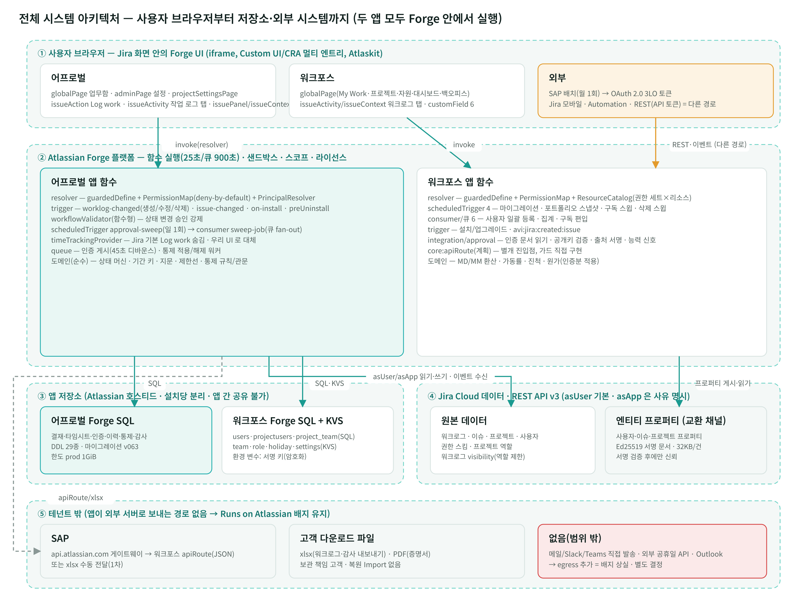
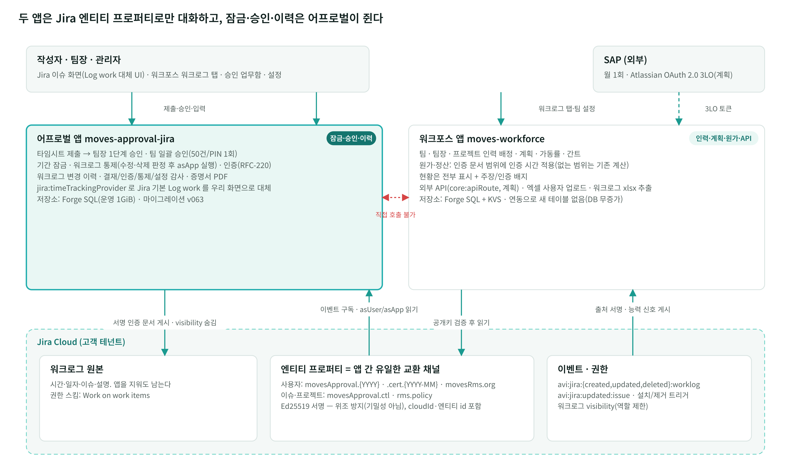
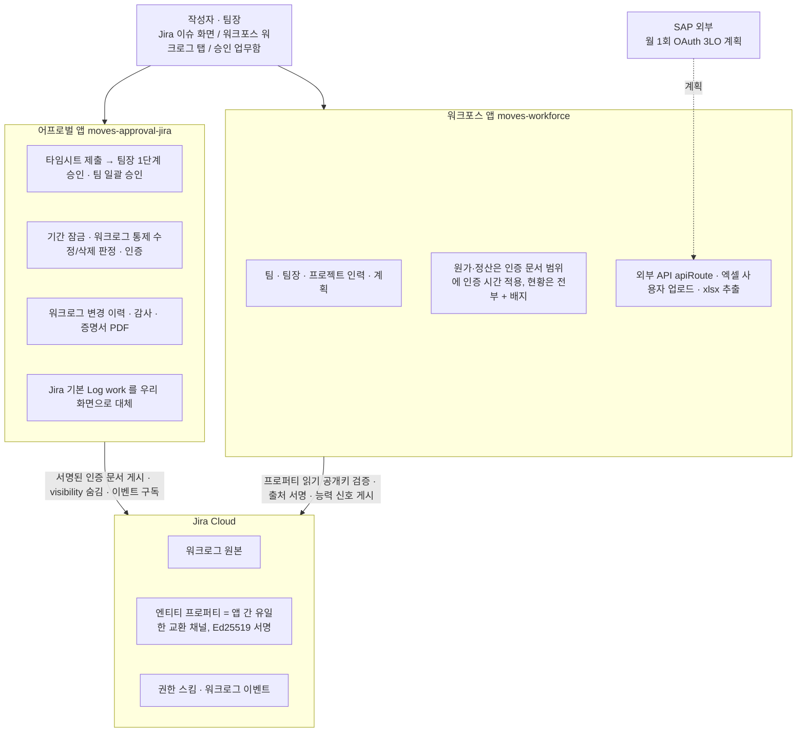
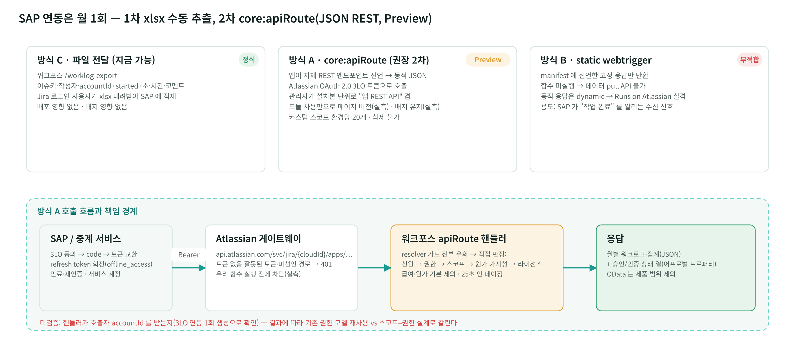
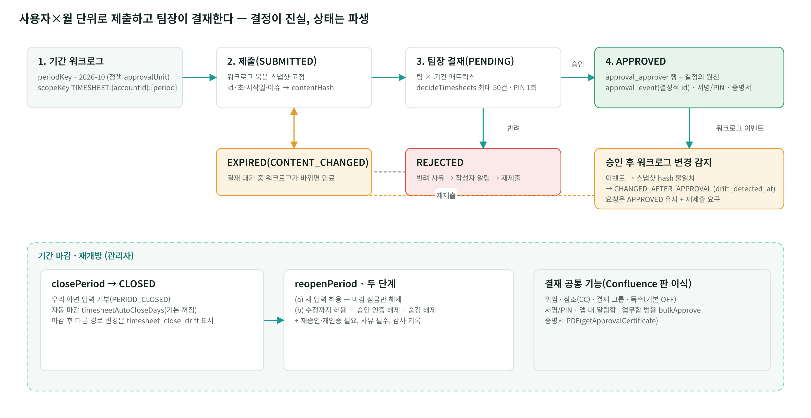
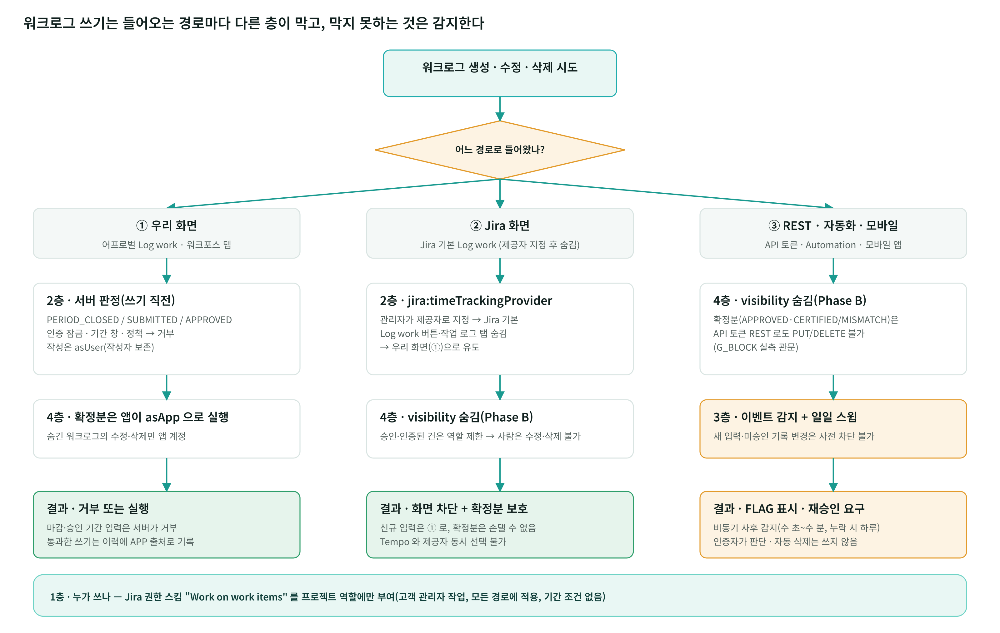
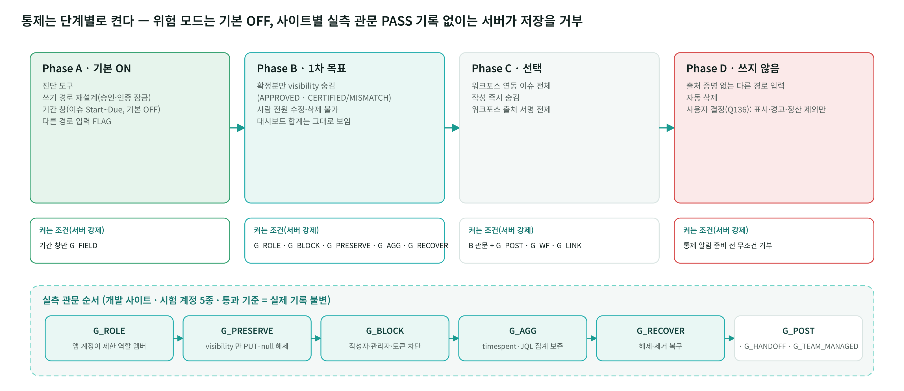
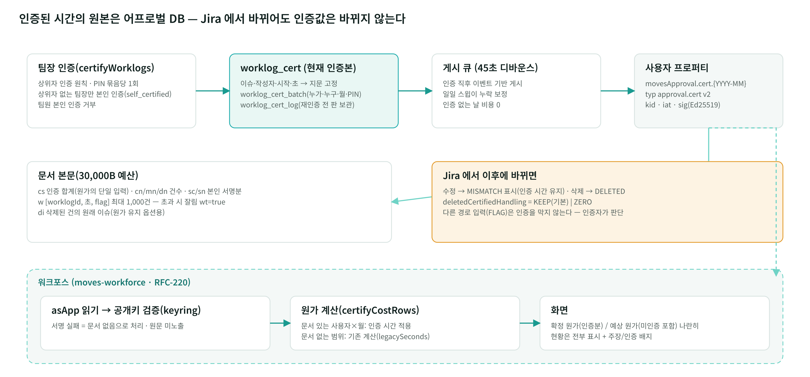
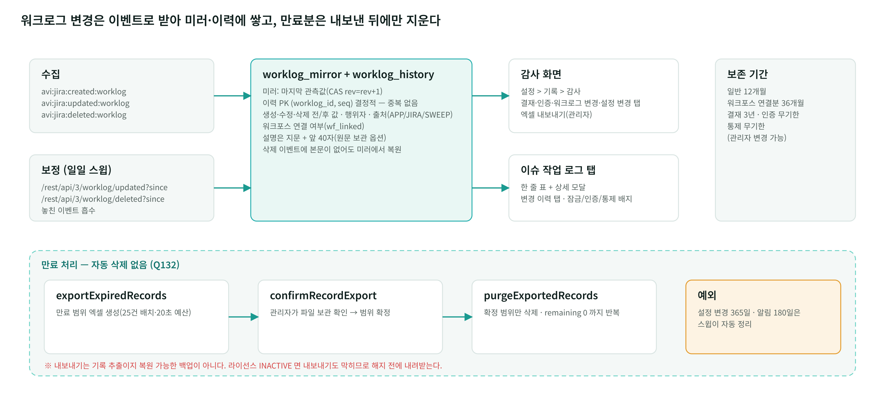
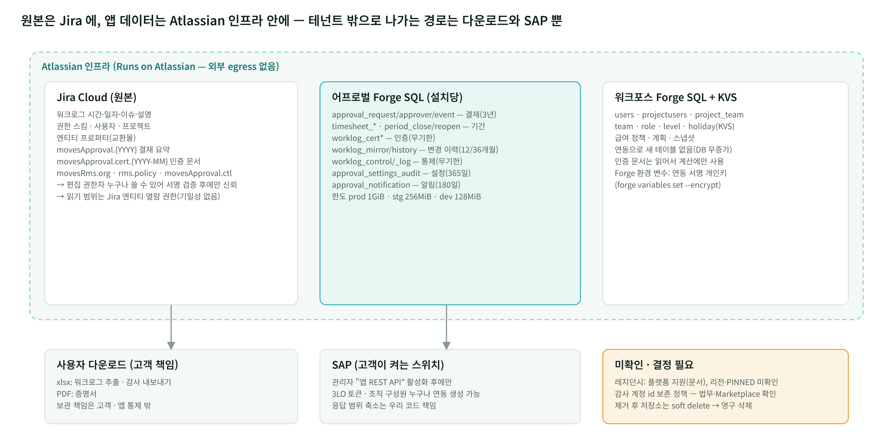

# 스트라드비전 요구사항 대응 방안 — 워크포스 + 어프로벌 두 앱 기준

> 작성: 2026-10-13 초판 → **2판**(코덱스 독립 검토 `codex-review.md` 25건 반영, §9. 초판은 `STRADVISION_RESPONSE.v1.md`) → **3판**(그림 9장 `images/`, 구현 방법 표, 공식 문서 링크 부록, 보고용 PPT `스트라드비전_요구사항_대응방안_Workforce+Approval.pptx` 31장)
> 산출물: 이 문서 · PPT · `images/*.png|svg`(생성 스크립트 `diagrams.js`, PPT 빌드 `build.js`)
> 기준 리포: `moves-approval-jira` master `b23524f`(2026-10-12), `moves-workforce` 브랜치 `RFC-220` `46f0899`(2026-10-12, master 미병합 + 미커밋 변경 있음)
> 입력: 스트라드비전 미팅 기록(디무브 Andy Wi·Allen Park·Tom Kim / 스트라드비전 Tempo 담당 PM 포함 5명), 워크포스 `_workspace/worklog-governance/*`(2026-09-29·30), `_workspace/api-exposure/API_EXPOSURE.md`(2026-09-16 실측), 어프로벌 `docs/DESIGN.md`·`_workspace/*` 설계·검증 보고서
> 근거 등급: **코드**(리포에서 확인) / **실측**(개발 사이트에서 직접 확인) / **문서**(Atlassian 공식 문서, 실측 전) / **미검증**

---

## 0. 요약

미팅 기록의 "미지원·구조상 불가" 판정은 **워크포스 단독 기준**이다. 어프로벌 앱(moves-approval-jira)을 같이 보면 핵심 요구(워크로그 락킹·승인·이력 감사)는 **코드 구현이 끝나 있다.** 다만 **연동 구현(워크포스 쪽)·플랫폼 실측(배포 관문)·운영 준비(운영 키·Marketplace)는 미완료**다. 고객에게는 **워크포스 + 어프로벌 두 앱 번들**로 제안하되, 아래 "지금 제공 가능"과 "수용 기준"을 구분해 말한다.

| # | 요구사항 | 미팅 기록 판정 | 두 앱 기준 판정 | 담당 앱 | 지금 제공 가능 | 미완료 |
|---|---|---|---|---|---|---|
| 1 | SAP 연동(월 1회) | 조건부 지원 | **조건부 지원** | 워크포스 | 워크로그 xlsx 수동 추출 | `apiRoute`(Preview) 실기능·호출자 신원 실측·SAP 필드 매핑 |
| 2 | 사용자 관리 자동화 | 부분 지원 | **부분 지원** | 워크포스 | 엑셀 사용자 등록(이메일 열), 퇴사자 워크로그는 Jira 원본이라 보존 | 입·퇴사 자동 반영·Jira 그룹/역할 동기화·팀 열 Import. Atlassian 조직·Teams 는 범위 밖(§3.3) |
| 3 | 워크로그 락킹·승인 ⭐ | 미지원, 구조상 불가 | **코드 구현 완료, 실측·연동 전** | 어프로벌 | 월 단위 제출→팀장 1단계 승인·팀 일괄 승인(50건/PIN 1회)·승인자 로깅, 우리 화면 기간 잠금, 다른 경로 변경의 사후 감지 | Jira 경로 수정·삭제 차단(visibility, Phase B)은 **실측 관문 5종 통과 후** 사이트별 활성화. 연동 모드 팀장 명부 게시(워크포스) |
| 4 | 변경 이력 감사 | 미지원(Storage 제약) | **코드 구현 완료** | 어프로벌 | 수집 시작 이후 관측한 생성·수정·삭제 이력(전/후 값·행위자·출처), 보존·내보내기 | 삭제 행위자·누락률 실측, 용량 산정(인원 확인 후) |
| 5 | 기타 5건 | 확인 필요 | 6-1 경로 있음 / 6-2 부분 / 6-3·6-4·6-5 없음 | 혼합 | §6 | |

미팅 기록 4.2 "Worklog 를 쌓는 로직을 앱이 직접 컨트롤해야 함"이 곧 어프로벌의 `jira:timeTrackingProvider` + 통제권 이관 설계다. 워크포스 단독으로는 여전히 불가하므로 이 요구는 어프로벌이 담당한다.

### 수용 기준 — 계약·제안서에 문장으로 올릴 것(괄호 안에 숨기지 않는다)

1. **Preview 의존 2건**: `jira:timeTrackingProvider`(Jira 기본 Log work 대체)와 `core:apiRoute`(SAP REST)는 Atlassian Preview 기능이다. 정식 출시 전 변경·폐기 가능성을 명시한다.
2. **시간 추적 제공자는 사이트당 하나**다. 어프로벌을 제공자로 선택하면 Tempo 를 제공자로 **동시에 선택할 수 없다**(Tempo 앱 설치 자체나 다른 Tempo 기능과의 공존은 별개 — 기능별 전환 영향 확인 필요).
3. **잠금의 범위**: (a) 우리 화면(어프로벌 Log work·워크포스 탭)에서는 마감·제출·승인 기간 입력을 서버가 거부한다. (b) Jira 화면·REST 등 다른 경로의 **기존 확정분(승인 또는 인증된 워크로그) 수정·삭제**는 visibility 숨김으로 막는다 — 실측 관문 통과 후 사이트별 활성화. (c) 다른 경로로 **새로 쓰는 것**, **마감만 되고 미승인인 기록**, **원래 제한 공개였던 기록**은 사전 차단하지 않는다. 이벤트 기반으로 사후 감지해 표시하고, 누락은 일일 보정 스윕이 메운다("즉시"가 아니라 "비동기, 정상 시 수 초~수 분, 장애 시 최대 하루").
4. **다른 경로 입력의 정산 처리**: 현행 기본값은 출처 경고(`FOREIGN_ORIGIN`) **표시만**이며 인증을 막지 않는다. "정산 제외"는 인증자가 인증하지 않는 방식으로 이루어지고, 서버 자동 제외(`FOREIGN_BLOCKS_CERTIFICATION`)는 워크포스 출처 서명 가동 후 켠다.
5. **변경 이력은 수집 시작 이후 관측한 변경**이다. 설치 이전 이력, 이벤트 사이의 중간 수정, Jira 경로 삭제의 행위자(미검증)는 포함되지 않을 수 있다.
6. **원가 "인증분만"**: 인증 문서가 있는 사용자×월에 인증 시간을 적용하고, **문서가 없는 범위는 기존 계산(원본 워크로그)을 그대로 쓴다**(`legacySeconds`). 인증 필수 모드(문서 없으면 0)는 미구현·결정 필요.
7. **앱 제거 전 통제 해제**는 관리자가 화면에서 실행해 잔여 0 을 확인하는 것이 주 절차다. 제거 트리거는 45초 예산의 보조 수단이며 실패해도 제거는 진행된다.
8. **데이터 보관**은 설치당 Forge SQL 한도 안에서(운영 1GiB, 문서) 보존 기간·내보내기 운영으로 관리한다. 내보내기는 기록 추출이지 복원 가능한 백업이 아니다.

---

## 1. 두 앱의 역할 분담과 연동 아키텍처

| | 워크포스(moves-workforce) | 어프로벌(moves-approval-jira) |
|---|---|---|
| 역할 | 팀·팀장·프로젝트 인력 배정·계획·원가·가동률·간트·외부 API | 타임시트 승인·기간 잠금·워크로그 통제·인증·변경 이력·감사·증명서 |
| 저장소 | Forge SQL + KVS, **DB 무증가 원칙**(연동으로 새 테이블 없음) | Forge SQL, 마이그레이션 v063 까지 |
| Jira 모듈 | globalPage·issueActivity·issueContext·customField 6·entityProperty 2·scheduledTrigger 4 | globalPage·adminPage·projectSettingsPage·**timeTrackingProvider**·issueAction 2·issuePanel·issueActivity·**workflowValidator**·trigger 4(워크로그 3종 이벤트 포함)·scheduledTrigger·consumer·preUninstall |
| 유료 | `licensing.enabled` | `licensing.enabled` |
| 단독 동작 | 어프로벌 없으면 지금 그대로 | 워크포스 없으면 앱 내 팀 명부(`timesheet_team_member`)로 팀장 판정 |
| 상태 | 커밋 524, 운영 배포 경험 있음. 연동 코드는 `RFC-220` 브랜치 + 미커밋 | 커밋 30(2026-10-04~12), 개발 사이트 1회 배포, 운영 설치처·Marketplace 미등록. 테스트 통과 수는 운영 준비도의 근거가 아니다 |

### 1.1 전체 시스템 아키텍처(5계층)

① Jira 화면 안 Forge UI(iframe) → ② Forge 함수(resolver·트리거·스케줄·큐, 25초/큐 900초) → ③ 앱 저장소(설치당 분리, 앱 간 공유 불가) → ④ Jira 데이터·엔티티 프로퍼티(유일한 교환 채널) → ⑤ 테넌트 밖(SAP·다운로드 파일). 앱이 외부 서버로 보내는 경로는 없다.

### 1.2 두 앱 역할 분담과 연동

- Forge 앱끼리는 저장소 공유·직접 호출이 불가하다. **Jira 엔티티 프로퍼티가 유일한 채널**이며, 프로퍼티는 편집 권한자 누구나 쓸 수 있어 **서명 검증 후에만 신뢰**한다(`docs/DESIGN.md §4`). 서명 대상에 `cloudId`·엔티티 id 를 넣어 복사 재사용을 막는다. **서명은 위조 방지이지 기밀성이 아니다** — 프로퍼티의 읽기 범위는 Jira 엔티티 열람 권한을 따른다(§7.2).
- 연동 모드는 자동 감지가 아니라 **관리자가 명시적으로 켠다**. 어프로벌 `workforceLinkEnabled` 기본 false(2026-10-12), 워크포스 `settings.approvalLinkMode` 기본 OFF.
- 인증된 시간의 원본은 어프로벌 DB. 워크포스는 사용자 프로퍼티 `movesApproval.cert.{YYYY-MM}`(사용자×월 서명 문서: 인증 합계 `cs`, 건수, `[worklogId, 초, flag]` 목록, 삭제분 원래 이슈 `di`)을 asApp 으로 읽어 공개키 검증 후 원가 계산에만 쓴다(Q133·Q135).
- 반대 방향(워크포스 → 어프로벌): 작업 트리에 **능력 신호(`movesRms.org` cap `wlorigin`)·작성 출처 서명·연동 신호 게시는 구현**돼 있다(미커밋). **팀·팀장 명부(`rms.org.leaderKeys`)·`rms.pm`·`rms.check`(제한선 위반) 게시는 미구현**(계약 사본만). 연동 모드의 팀장 판정은 명부 게시가 전제다.
- 연동 서명 공개 키는 dev·stg 등록, **prd 미등록**. 키 교체·폐기 절차 미정.

---

## 2. SAP 연동

### 2.1 고객 요구
Tempo API 문서를 SAP 측에 넘겨 월 1회 동기화. SAP 가 어떤 데이터를 가져가는지 미확인.

### 2.2 두 앱에서 제공하는 방식 — 담당 워크포스
인력·프로젝트·워크로그 집계 데이터의 주인은 워크포스. 어프로벌은 승인·인증 상태 열을 보태는 역할.

| 구분 | 방식 A `core:apiRoute`(권장) | 방식 B static webtrigger | 방식 C 파일 전달(즉시 가능) |
|---|---|---|---|
| 현재 코드 | 없음(2026-09-16 프로브 실측 후 제거, `custom-scopes.yaml` 잔존) | 없음(manifest 주석) | **있음** — `/worklog-export` 워크로그 xlsx 추출(이슈키·작성자·accountId·started·초·시간·코멘트·worklogId) |
| 무엇을 줄 수 있나 | 동적 JSON 응답(월별 워크로그·집계·승인 상태) | **manifest 에 선언한 고정 응답만**(함수 미실행). 데이터 pull API 대안이 **아니다**. 동적 응답은 dynamic webtrigger 가 필요하고 이는 Runs on Atlassian 실격 | 사용자가 Jira 로그인 후 다운로드 |
| 인증 | Atlassian OAuth 2.0 3LO | 공유 키 직접 검증, URL 공개, asUser 불가 | Jira 로그인 |
| Runs on Atlassian 배지 | **유지(실측)** | static 은 허용 | 영향 없음 |
| 배포 영향 | **모듈 사용만으로 메이저 버전 상승(실측, 공식 목록엔 없음)** → 고객 관리자 승인. 커스텀 스코프 환경당 20개·삭제 불가 | static 추가는 minor(문서) | 없음 |
| 성숙도 | Preview | 정식 | 정식 |

→ 데이터 조회 용도로는 **A 하나만** 고려한다. B 는 "SAP 가 작업 완료를 알리는 수신 신호" 같은 고정 응답 용도로만.

### 2.3 아키텍처·구현 현황

- `apiRoute` 는 resolver 와 **별개 진입점**이라 `guardedDefine`·`PermissionMap`·`resolvePrincipal`·라이선스 검사가 전부 우회된다(실측). 핸들러마다 신원 확정 → 권한 → 스코프 → 원가 가시성 → 라이선스를 직접 통과시켜야 하고, 판정 로직을 resolver 와 공용 함수로 뽑아야 한다.
- 관리자가 "앱 REST API"를 켜면 **조직 구성원 누구나** 3LO 연동을 만들 수 있다 → 응답 범위 축소는 전적으로 우리 코드 책임. 급여·원가는 기본 제외로 시작.
- 승인 상태 열: 어프로벌이 사용자 프로퍼티 `movesApproval.{YYYY}`(기간별 결재 상태·지문)·`movesApproval.cert.{YYYY-MM}`(인증 시간)을 게시하므로 워크포스 API 응답에 "승인/인증 여부"를 실을 수 있다.
- **제안 범위는 JSON REST** 다. OData 호환은 제품 범위에서 제외한다(기술 불가 판정이 아니라 범위 결정 — `$metadata`·`$filter` 표준 준수 구현과 25초 실행 한도 안 페이징 부담 때문).

### 2.4 제약·미검증
- **호출자 `accountId` 수신 여부 미검증** — 3LO 연동 생성 1단계만 남음(영구 자격증명 생성이라 자동 진행 안 함). 결과에 따라 기존 권한 모델 재사용(들어옴) vs 스코프 = 권한 설계(안 들어옴)로 갈린다.
- **3LO 운영 책임은 SAP(또는 중계 서비스) 쪽에 있다**: 동의 흐름, authorization code → 토큰 교환, 토큰 저장, refresh token 회전(`offline_access`), 만료·재인증. 연동 계정 퇴사·권한 회수·동의 철회 시 배치가 멈추므로 **서비스 계정과 재인증 절차**를 정해야 한다. 서버 배치에 사용자 동의 기반 3LO 가 적합한지 자체가 확인 대상.
- Preview → 계약서 명시. 폐기 유예가 짧을 수 있다.
- 25초 실행 한도 안에서 페이징 응답(대용량은 커서).

### 2.5 후속 조치
1. (고객) SAP 가 Tempo API 에서 실제 쓰는 엔드포인트·필드, 파일/API, 전달 방향(push/pull), 호출 주체 계정 확인.
2. (내부) Tempo API ↔ 워크포스 데이터 매핑표. 어프로벌 승인 상태 열 포함 여부 결정.
3. (내부) 3LO 연동 1회 생성해 호출자 신원 실측 → 권한 모델 확정 → 커스텀 스코프 이름 체계 확정(되돌릴 수 없음).
4. (제안) 1차는 **xlsx 수동 추출**로 월 1회 운영 시작, `apiRoute` 는 2차.

---

## 3. 사용자 관리

### 3.1 고객 요구
입·퇴사자·팀·조직원 수동 관리 불만 → 자동화. Atlassian 조직 체계 동기화. 대안 엑셀 Import. 퇴사자 워크로그 보존.

### 3.2 두 앱에서 제공하는 방식 — 담당 워크포스

| 항목 | 현행(코드) | 제공 방안 |
|---|---|---|
| 입·퇴사자 자동 반영 | 없음. `users` 에 활성/비활성 열 없음, 퇴사 = 삭제(팀장 참조·배정·일정·스킬·users 행 순 삭제) | Jira 사용자 상태(active)·그룹을 주기 스윕으로 읽어 `inactive` 표시(삭제 아님). 신규 기능 |
| 조직 동기화 | 없음(그룹·역할 호출 코드 0건, `getMyGroupApi` 정의만) | 1단계 **Jira 그룹·프로젝트 역할** → 팀 매핑. Atlassian 조직·Teams 는 아래 제약 |
| 엑셀 Import | **있음** — `Email` 열만 읽어 Jira 사용자 조회 후 큐 등록 | 팀·팀장 여부·직급·입사일·퇴사일 열 추가(기존 업로드 확장) |
| 퇴사자 워크로그 보존 | 워크로그 원본이 Jira 라 **보존됨**. 단 `users`·`projectusers` 삭제 시 집계·원가에서 빠질 수 있음(미검증) | 퇴사 = 비활성 전환으로 바꿔 집계도 유지 |

### 3.3 제약·미검증
- **Atlassian 조직(admin.atlassian.com) 사용자·그룹**은 Admin API(조직 API 키) 영역이라 Forge 앱이 asApp/asUser 로 읽을 수 없다(문서). **Atlassian Teams** 도 공식 Teams REST 에 Forge/OAuth2 접근 불가가 명시돼 있어(문서) Jira 그룹·역할과 같은 범위로 제시하면 안 된다. 고객에게는 **"Jira 그룹·프로젝트 역할 기준 동기화"로 범위를 명시**하고, 조직·Teams 는 endpoint·인증·scope·egress 확인 후 별도 판단.
- 어프로벌 연동 모드의 팀장 판정은 워크포스 `rms.org` 명부 게시에 의존하므로(미구현, §1), 팀 동기화와 게시를 같이 설계한다.
- `UserService` 주석의 `worklog_issue_daily` 보존은 DDL 이 주석 처리돼 **존재하지 않는 테이블**(코드·주석 불일치).

### 3.4 후속 조치
1. (내부) Jira 그룹·프로젝트 역할 읽기 범위 1일 실측. 조직·Teams 는 범위 밖으로 고객에게 명시.
2. (내부) 퇴사 = 삭제 → 비활성 전환 설계(집계 유지·명부 제외) + `rms.org` 명부 게시 구현.
3. (고객) 엑셀 양식 초안 확인. "조직 단위"가 Jira 그룹인지 관리자 콘솔 조직인지 확인.
4. (고객 안내) 퇴사자는 Jira 계정 **삭제 말고 비활성화**. 삭제가 필요하면 그 전에 감사 기록 내려받기.

---

## 4. 워크로그 락킹 및 승인 ⭐ 핵심

### 4.1 고객 요구
Tempo 수준의 단순 승인. 팀장 일괄 승인. 누가 승인했는지 로깅. 승인·마감 기간 워크로그 추가·수정·삭제 차단.

### 4.2 두 앱에서 제공하는 방식 — 담당 어프로벌

| 기능 | 미팅 기록 | 어프로벌 현행(코드) |
|---|---|---|
| 승인 요청/승인 | 미지원 | **구현.** 대상 = 사용자×기간, `scopeKey = TIMESHEET:{accountId}:{periodKey}`, 기본 월(`approvalUnit`, 주로 변경 가능). 제출 시 워크로그 묶음 스냅샷(id·초·시작일·이슈 → 지문) 고정 → 팀장 1단계 결재(팀 설정으로 2단계 그룹·제한선 위반 시 예외 단계 추가 가능) |
| 일괄 승인 | 미지원 | **구현.** 팀×기간 매트릭스(`getTeamTimesheetMatrix`) + `decideTimesheets` 최대 50건·PIN 1회·18초 예산 초과분 `remaining` 반환. 업무함 범용 `bulkApprove` 도 있음 |
| 승인 이력 로깅 | 미지원 | **구현.** `approval_approver`(결정이 진실)·`approval_event`(결정적 id, REQUESTED/APPROVED/REJECTED/EXPIRED/CANCELLED/CHANGED_AFTER_APPROVAL/PERIOD_REOPENED) + 서명/PIN + 증명서 PDF. 설정 > 기록 > 감사 탭에서 검색·엑셀 |
| 기간 락킹 | 미지원 | **구현(실측 전)** — §4.3 |
| 워크로그 인증(RFC-220) | — | **구현.** 팀장이 워크로그 값을 인증하는 순간 지문을 우리 DB 에 고정. 이후 Jira 에서 바뀌어도 인증된 시간은 안 바뀜(MISMATCH·DELETED 표시). 상위자 인증 원칙, 상위자 없는 팀장만 본인 인증(`self_certified`). 워크포스 원가는 인증 문서 범위에 인증 시간 적용(§0 수용 기준 6) |

**승인 상태 머신**: 요청 `PENDING/APPROVED/REJECTED/EXPIRED/CANCELLED`, 기간 `NOT_SUBMITTED/SUBMITTED/APPROVED/REJECTED/CHANGED_AFTER_APPROVAL`. 결재 중 변경 → `EXPIRED(CONTENT_CHANGED)`, 승인 후 변경 → APPROVED 유지 + `drift_detected_at` + 재제출 요구. **타임시트 "재승인"과 워크로그 "재인증"은 별개 행위**다(승인 = 기간 묶음 결재, 인증 = 건별 값 고정).

### 4.3 잠금 아키텍처 — 4층

| 층 | 장치 | 막는 것 | 상태 | 한계 |
|---|---|---|---|---|
| 1 누가 | Jira 권한 스킴 "Work on work items" → 프로젝트 역할만 | 미소속자의 모든 경로 | 고객 관리자 작업. 앱은 가이드(`docs/guide/ko/06-worklog-period-lock.md`) | 기간 조건 없음. team-managed 는 권한 스킴 미사용 |
| 2 언제(우리 화면) | **`jira:timeTrackingProvider`**(Preview) — 관리자가 제공자로 고르면 Jira 기본 Log work 버튼·작업 로그 탭이 숨고 우리 `issueAction`·`issueActivity` 화면으로 대체. 서버가 쓰기 직전 `PERIOD_CLOSED/SUBMITTED/APPROVED` 판정. 작성은 asUser(작성자 보존) | 일반 사용자의 Jira 화면 입력·수정·삭제 | **구현.** 실측 전 | 제공자 사이트당 하나. REST·자동화·모바일 경로 차단 여부 문서 미언급(P1~P3 미검증) |
| 3 다른 경로 감지 | 워크로그 이벤트 3종 + 일일 스윕 + `worklog/updated·deleted` since 보정 | 2층 우회 변경 | **구현** | **비동기 사후 감지**(정상 시 수 초~수 분, 누락 시 일일 보정). FLAG 표시·재승인 요구. 사전 차단 아님 |
| 4 확정분 보호(worklog-control) | Jira 경로는 워크로그 **visibility 를 앱 역할(`atlassian-addons-project-access`)로 제한**해 사람 전원이 손을 못 대게(시스템 역할이라 관리자도 사람을 못 넣음). 숨긴 건의 수정·삭제는 우리 화면에서 앱이 판정 후 **asApp 실행**(숨기지 않은 일반 수정·삭제는 기존 asUser). 숨긴 건은 작성자 본인·팀장 인증 경로에만 asApp 으로 보임(불변식 8 예외) | **승인(APPROVED) 또는 인증(CERTIFIED/MISMATCH)된 워크로그의 수정·삭제** | **구현, 기본 OFF** | 마감만 되고 미승인인 기록·원래 제한 공개였던 기록(Q128)은 대상 아님. 새로 쓰는 것은 못 막음. 보호 적용(큐)까지 경합 시간 존재. 같은 역할의 다른 앱(Tempo 등)은 본다 |

**Phase 와 기본값**(`SettingsRepository.js`, `gates.js`)

| Phase | 내용 | 기본 | 켜는 조건(서버가 강제) |
|---|---|---|---|
| A | 진단 도구·쓰기 재설계·기간 창(이슈 Start~Due)·다른 경로 입력 FLAG | **ON**(기간 창은 OFF) | 기간 창은 G_FIELD |
| B | 확정분(APPROVED·CERTIFIED/MISMATCH)만 visibility 숨김 | OFF | 사이트별 관문 **G_ROLE·G_BLOCK·G_PRESERVE·G_AGG·G_RECOVER** PASS 기록(`recordWorklogControlGate`) |
| C | 연동 이슈 전체 즉시 숨김 | OFF | B 관문 + G_POST·G_WF·G_LINK |
| D | 출처 증명 없는 다른 경로 입력 자동 삭제 | OFF | **사용자 결정으로 쓰지 않음**(Q136: 표시·경고·정산 제외만) |

**1차 목표는 B** — "특정 기간 승인된 워크로그는 수정 불가". 숨김은 수단이지 비공개가 목적이 아니므로 대시보드 합계에는 그대로 보인다(Q136). 마감 기간 재개방은 "새 입력 허용" / "수정까지 허용(승인·인증 해제 + 사유 필수 + 감사)" 두 단계(Q137, v061~v063).

**FLAG(다른 경로 입력)의 효과**: 탭 배지·감사 표·작성자 알림(알림은 Q130 미해결). 인증은 **막지 않는다**(`FOREIGN_BLOCKS_CERTIFICATION = false`, 리더 결정 2026-10-11) — 워크포스 출처 서명(WF-12)이 가동되기 전에는 연동 이슈의 정상 워크포스 탭 입력도 FLAG 되기 때문. 켜면 `certifiable:false`·`WORKLOG_FOREIGN_LOCKED`.

### 4.4 구현 방법 — 모듈·테이블·resolver (코드 근거)

| 요구 | Jira 모듈(manifest.yml) | 테이블(src/rdb/schema/ddl) | resolver · 함수 |
|---|---|---|---|
| 승인 요청/승인 | `jira:globalPage` 업무함 · `jira:issueActivity` 작업 로그 탭 | `approval_request` · `approval_approver` · `approval_event` · `timesheet_submission` | `submitTimesheet` · `decideApproval` · `getTeamTimesheetMatrix` |
| 일괄 승인 | globalPage 업무함(팀×기간 매트릭스) | `approval_approver`(조건부 UPDATE, 삭제-재삽입 금지) | `decideTimesheets`(≤50건·PIN 1회·18초 예산) · `bulkApprove` |
| 승인 이력 로깅 | `jira:adminPage` 설정 > 기록 > 감사 | `approval_event`(결정적 id) · `approval_signature` · `approval_pin` | `getApprovalCertificate` · 감사 검색·엑셀 · 보관 내보내기 |
| 기간 락킹 | **`jira:timeTrackingProvider`** · `jira:issueAction` Log work · `trigger` worklog-changed · `scheduledTrigger` approval-sweep | `approval_period_close` · `approval_period_reopen` · `timesheet_close_drift` | `closePeriod` · `reopenPeriod` · `onWorklogChanged` · `runSweep` |
| 확정분 보호(통제) | `preUninstall` worklog-control-pre-uninstall · `consumer` sweep-job(큐) | `worklog_control` · `worklog_control_intent` · `worklog_control_log` | `WorklogControlWorker`(숨김/해제) · `recordWorklogControlGate` · 진단 도구 |
| 인증 | issueActivity(인증 배지) · 큐(게시 45초 디바운스) | `worklog_cert` · `worklog_cert_batch` · `worklog_cert_log` | `certifyWorklogs` · `certifyOwnWorklogs` · `WorkforcePublisher` |
| 변경 이력 | trigger worklog-changed · scheduledTrigger | `worklog_mirror` · `worklog_history`(PK `worklog_id, seq`) | `WorklogHistoryRecorder` · `exportExpiredRecords` · `purgeExportedRecords` |

resolver 는 3단계 등록(`guardedDefine` → `PermissionMap` 선언 → `CONTROLLER_REGISTRARS`)을 계약 테스트가 대조한다. 권한 축 `{teamLead:true}` 판정은 `TeamScope`·`TimesheetAccess` 두 곳뿐이며, 연동 모드에서는 서명 검증된 워크포스 `rms.org.leaderKeys` 가 앱 명부보다 우선한다.

### 4.5 제약·미검증 — 배포 관문
- **실측 0건.** 개발 사이트 배포는 2026-10-12 한 번. 관문 순서: G_ROLE(Forge 앱 계정이 제한 역할 멤버인가 — 실패하면 visibility 안 전체 재검토) → G_PRESERVE(visibility 만 PUT 해 다른 값 보존, null 해제) → G_BLOCK(작성자·관리자·API 토큰 REST 로 GET/PUT/DELETE 차단) → **G_AGG**(이슈 timespent·JQL·리포트 집계 보존) → **G_RECOVER**(해제·제거 복구) → G_POST → G_HANDOFF(워크포스 탭 → 승인 앱 넘김) → G_TEAM_MANAGED.
- visibility 실측 메모(2026-10-08, 워크포스 리포): 설정자도 구성원이어야 해 사람 자격으론 400, 그룹 가시성은 Jira 기본 설정에서 꺼져 있어 역할 경로만, 같은 역할의 다른 앱은 본다, 앱 제거 전 전체 해제 필수.
- 검증 보고(2026-10-11) 이후 상태: F3(연동 판정 실패 시 기간 창)은 **fail-close 로 수정됨**(코드 확인). F1 은 "인증 비차단 신호"로 결정. 오탐 규모(연동 이슈 정상 입력 FLAG)는 운영 데이터로 실측.
- 워크포스 쪽 통제 연동(본인 숨김 조회·승인 앱 넘김·작성 출처 서명·연동 신호)은 **`RFC-220` 브랜치·일부 미커밋**. master 미반영.
- 워크로그 **생성**을 asUser 유지 vs asApp 전환은 논의 중(`docs/WORKLOG-INPUT-CONTROL-DISCUSSION.md`) — 현행 구현과 별개.

### 4.6 후속 조치
1. (내부, 최우선) 개발 사이트에서 진단 도구 + 수동 관문 실측(`04_spike_todo.md`). 시험 계정 5종(작성자 A·타인 B·팀장 L·타 팀장 L2·Edit all 관리자 M). 통과 기준은 "실제 기록 불변". **G_AGG·G_RECOVER 통과 전에는 Phase B 를 약속하지 않는다.**
2. (내부) timeTrackingProvider 가 REST·자동화·모바일 입력을 막는지 실측(P1~P3) → 고객 설명 문구 확정.
3. (내부) 워크포스 `RFC-220` master 병합 + `rms.org` 명부 게시 + prd 서명 키 등록. 통제 알림(Q130) 해결.
4. (고객) Tempo 전환 합의 — 제공자 지정 시점, 기존 Tempo 승인·마감·조직 데이터의 이관 범위(§7.7). 승인 단위 월 확인, 반려 흐름 필요 여부, "수정까지 허용" 재개방 권한자.

---

## 5. 이력 감사(History)

### 5.1 고객 요구
워크로그 생성·수정·삭제 변경 로그.

### 5.2 두 앱에서 제공하는 방식 — 담당 어프로벌
미팅 기록의 "Forge Storage 제약으로 권장하지 않음"은 KVS 기준이다. 어프로벌은 **Forge SQL** 을 쓰며, 그 이유는 업무함의 다축 필터·정렬·페이징을 Custom Entity(인덱스 7개)로 표현할 수 없기 때문이다.

| 축 | 테이블 | 내용 | 기본 보존 / 선택지 | 만료 처리 |
|---|---|---|---|---|
| 워크로그 변경 | `worklog_mirror` + `worklog_history`(PK `(worklog_id, seq)` 결정적) | **생성·수정·삭제** 각각 이전/이후 값, 행위자, 출처(APP/JIRA/SWEEP), 워크포스 연결 여부. 설명은 지문+앞 40자(원문은 `worklogHistoryKeepComment` 옵션) | 일반 12개월 / 워크포스 연결분 36개월(0·12·24·36·60) | 내보내기 확정 후 삭제 |
| 결재 | `approval_event`·`approval_request`·`approval_approver` | 결정·만료·취소·승인 후 변경·재개방 | 3년(0·1·3·5·10) | 내보내기 확정 후 삭제 |
| 인증 | `worklog_cert_batch`·`_log` | 누가·누구의·어느 월·PIN | 무기한(0·3·5·7·10) | 내보내기 확정 후 삭제 |
| 통제 조치 | `worklog_control_log`(append-only) | 숨김·해제·FLAG·관리자 확인(사유 필수) | 무기한(0·1·3·5·7·10) | 내보내기 확정 후 삭제 |
| 설정 변경 | `approval_settings_audit` | 정책·스위치·관문 기록 | 365일 고정 | **스윕이 자동 정리**(내보내기 대상 아님) |
| 앱 내 알림 | `approval_notification` | — | 180일 | 자동 삭제(판단 근거는 이벤트 테이블에 남음) |

- 수집: 워크로그 이벤트 3종 → 미러 upsert + 이력 append. 누락은 일일 스윕이 `worklog/updated·deleted`(since) 로 보정. 삭제 이벤트에 본문이 없어도 미러에 마지막 스냅샷이 있어 삭제 기록이 남는다.
- 화면: 설정 > 기록 > 감사(결재·인증·워크로그 변경·설정 변경 탭), 이슈 작업 로그 탭 상세 모달의 변경 이력 탭.

### 5.3 제약·미검증
- **범위는 "수집 시작 이후 관측한 변경"**: 설치 이전 이력, 이벤트 사이의 중간 수정(마지막 관측값 대비 차이만), Jira 경로 삭제의 행위자(페이로드 실측 전, UNKNOWN 가능), 입력 경로 구분(웹/REST/모바일) 없음, 원래 제한 공개 기록은 관측 불가일 수 있음.
- **용량**(200명 기준, 실측 전): 워크로그 이력 148MB/년(원문 보관 +54MB), 결재 150MB, 인증 80MB, 통제 최악 80MB, 필드 변경 포함 누적 **약 465MB/년** → 3년 보관이면 운영 한도 1GiB 초과 가능. 1,000명이면 약 5배.
- H4(배포 최우선): 우리 화면 쓰기 응답(asUser)과 asApp `worklog/list` 값 표현이 다르면 APP 쓰기마다 가짜 수정 행.

### 5.4 후속 조치
1. (고객) 인원·월 워크로그 건수·변경 횟수·보존 기간 확인 → 용량 산정표 갱신.
2. (내부) 삭제 이벤트 페이로드·H4·이벤트 누락률 실측.
3. (고객 안내) 이력 범위(수집 시작 이후)와 보존 만료 기록은 엑셀로 내려받은 뒤 삭제된다는 운영 절차.

---

## 6. 기타 요구사항

| # | 요구 | 워크포스 현행 | 어프로벌 현행 | 판정 | 후속 |
|---|---|---|---|---|---|
| 6-1 | 프로젝트 미소속자 입력 제한 | 내 작업 화면은 소속 프로젝트 이슈만 노출. RFC-220 에서 작성 대상이 워크포스 프로젝트 소속인지 확인 | 가이드·화면 문구(권한 스킴 "Work on work items" → 프로젝트 역할). 워크포스 `NOT_MEMBER` 위반 코드 수신 → 예외 단계 코드 있음 | **경로 있음, 완전 차단은 고객 권한 스킴** | CLAUDE.md 의 "역할 동기화(워크포스)"는 **미구현**(프로젝트 역할 API 호출 코드 없음). `rms.check` 게시도 미구현. 구현 여부 결정 |
| 6-2 | 계획 초과 알림(PM, 별도 채널) | 계획 = Jira Original Estimate, 초과 배지(100/130%)·가동률 밴드(1.1/1.3) **화면 표시만**. 메일·웹훅 없음 | `OVER_PLAN` 수신·예외 승인 단계 코드 있음. 알림은 앱 내 알림함 + Jira 코멘트 @멘션(상태 변경 승인만). **앱 자체 메일·Slack·Teams 없음**. 독촉(기본 OFF, 3일 후 3일마다) | **부분** | 워크포스 `rms.check` 게시 구현 + Jira 코멘트 @멘션으로 PM 알림(Jira 가 메일 발송). 외부 메신저는 egress 추가 = 배지 상실 → 고객 채널 확인 후 결정 |
| 6-3 | OKR | 없음 | 없음 | **없음** | 고객 요구 구체화 전 범위 밖 |
| 6-4 | 휴일 자동 Import | 공휴일 **수동 등록** 있음(KVS `holiday`, `workRatio` 부분 근무일). 자동 Import 는 외부 통신 필요 → 보류 | 휴일 변경 시 환산 기준 `movesRms.kb` 재게시(RFC-220) | **수동만** | 외부 공휴일 API = egress → Runs on Atlassian 실격. 대안: 연 1회 엑셀 Import |
| 6-5 | Outlook 연동 | 없음 | 없음 | **없음** | 용도(일정/휴가/알림) 확인. Microsoft Graph 는 외부 인증·egress → 배지 상실. 범위 밖 권고 |

---

## 7. 데이터 관리 및 처리 방안

### 7.1 데이터는 어디에 있고 누가 주인인가

| 데이터 | 원본 위치 | 주인 | 사본·교환물 | 비고 |
|---|---|---|---|---|
| 워크로그(시간·일자·이슈·설명) | **Jira**(고객 테넌트) | 고객 | 어프로벌 `worklog_mirror`(마지막 관측값), 워크포스는 읽기만 | Jira 가 원본이므로 앱을 지워도 워크로그는 남는다 |
| 승인 결정·결재선·서명/PIN | 어프로벌 Forge SQL | 고객(앱 설치 단위) | 사용자 프로퍼티 `movesApproval.{YYYY}` 요약(상태·지문) | `approval_approver` 행이 진실, 상태는 파생 |
| 인증된 시간(RFC-220) | 어프로벌 Forge SQL `worklog_cert*` | 고객 | 사용자 프로퍼티 `movesApproval.cert.{YYYY-MM}` 서명 문서 | 워크포스는 서명 검증 후 계산에만 쓰고 원문 미노출 |
| 워크로그 변경 이력·통제 조치·설정 변경 | 어프로벌 Forge SQL | 고객 | 엑셀 내보내기 | 추가 전용, 수정 resolver 없음 |
| 팀·팀장·프로젝트 인력·급여·계획 | 워크포스 Forge SQL + KVS | 고객 | 사용자/프로젝트 프로퍼티 `rms.*` 서명 문서(명부 게시는 구현 전) | 워크포스 DB 무증가 원칙 |
| 연동 서명 개인키 | Forge 환경 변수(`forge variables set --encrypt`) | 디무브 | 상대 앱에 공개키 내장(`keyring.js`) | dev·stg 등록, prd 미등록. 교체·폐기 절차 미정 |
| 고객이 내려받는 파일 | xlsx(워크로그 추출·감사 내보내기)·PDF(증명서) | 고객 | 고객 PC·파일 서버 | 앱 통제 밖. 보관 책임은 고객 |
| SAP 로 나가는 데이터 | 워크포스 응답(apiRoute) 또는 xlsx | 고객 | SAP 측 저장 | 고객이 관리자 스위치로 문을 열어야 함 |

- 모든 앱 저장소가 Atlassian 호스팅(Forge SQL·KVS·Jira 프로퍼티)이고 외부 egress 가 없어 **Runs on Atlassian 배지 유지**. **앱이 외부 서버로 전송하는 경로는 없다.** 데이터가 테넌트 밖으로 나가는 것은 사용자 다운로드(xlsx·PDF)와 고객이 켜는 SAP 연동이다.
- **데이터 레지던시**: Forge 호스티드 저장소(SQL·KVS)는 레지던시를 지원한다(문서). 미확인은 (a) 고객 사이트의 실제 리전, (b) 두 앱의 PINNED 충족 상태, (c) 로그·환경 변수·다운로드 파일·SAP 사본의 적용 범위.

### 7.2 접근 통제 — 누가 무엇을 보나

- 기본은 **사용자 권한(asUser)**. 앱 권한(asApp)은 트리거·스윕 등 사용자 컨텍스트가 없는 경로와 승인된 예외(숨긴 워크로그를 작성자 본인·팀장 인증 경로에만 반환, 워크포스 인증 원가 읽기)에만 쓰고, 예외마다 6조건(호출자 = resolver principal, SQL 소유자 조건 선적용, 건별 이슈 열람 재확인, 우리가 가린 것만, 설명은 본인만, count·합계·캐시도 같은 범위)을 지킨다.
- 가드 통과 ≠ 데이터 범위 확정 — 목록은 건별 이슈 열람 권한으로 다시 좁힌다. 팀장은 자기 팀원 타임시트만(`TeamScope`), 감사 화면·기록 내보내기는 앱 관리자만, 워크포스 원가는 `PROJECT_COST` 권한 분리.
- **엔티티 프로퍼티의 읽기 범위는 앱 화면 권한과 다르다.** 사용자 프로퍼티(`movesApproval.*`, `rms.org`)는 Jira 사용자 조회 권한자가 REST 로 읽을 수 있고, 이슈·프로젝트 프로퍼티는 해당 엔티티 열람자가 읽는다. 따라서 프로퍼티에는 **판정 결과·지문·합계만** 싣고 설명 원문·급여·단가는 싣지 않는다. 프로퍼티별 노출 필드 표는 후속(§8).
- `apiRoute` 는 위 가드가 전부 우회되는 별개 진입점 → 핸들러에서 신원·권한·스코프·원가 가시성·라이선스를 직접 통과시키고, 급여·원가는 기본 제외.

### 7.3 보존·삭제·내보내기(라이프사이클)

보존 표는 §5.2. 원칙:
- 결재·워크로그 이력·인증·통제 기록은 보존 기간이 지나도 **서버 내보내기 세션(`exportExpiredRecords`→`confirmRecordExport`→`purgeExportedRecords`)으로 실제 내보낸 뒤 확정한 것만** 지운다(Q132). 내려받기 전용(`downloadRecords`)은 기간 무관. 설정 변경(365일)·앱 내 알림(180일)은 스윕이 자동 정리한다.
- 삭제·내보내기 작업은 25건 배치·20초 예산으로 나눠 Forge 실행 한도 안에서 돈다.
- **내보내기는 기록 추출이지 백업이 아니다.** 복원 Import 가 없고, 서버의 "내보내기 확정"은 관리자가 파일을 실제로 보존했다는 증명이 아니다. 라이선스 INACTIVE 상태에서는 내보내기 resolver 도 막힌다 → **해지 전 내보내기**를 절차에 둔다.
- 워크포스 퇴사자 처리는 현재 "삭제"(users·projectusers 행 제거) → **비활성 전환으로 바꿔 집계·원가 보존**(§3).

### 7.4 용량 계획

| 항목 | 200명 기준 연간(실측 전) | 비고 |
|---|---|---|
| 결재·타임시트 | 약 150MB | 스냅샷 압축 시 110MB |
| 워크로그 이력 | 약 148MB | 설명 원문 보관 시 +54MB |
| 인증 | 약 80MB | |
| 통제 | 최악 80MB | |
| 필드 변경 승인 포함 누적 | **약 465MB/년** | 3년 보관이면 운영 한도 초과 가능 |

- Forge SQL 한도는 **환경별**: production 1GiB, staging 256MiB, development/custom 128MiB(문서). 앱의 `STORAGE_LIMIT_BYTES` 환경 변수는 **표시·경고 기준만** 바꾸고 플랫폼 quota 를 늘리지 않는다. 넘으면 쓰기 실패. `getStorageUsage` 가 `information_schema` 로 사용량을 읽어 설정 화면에 표시한다(워크포스는 80/90% 경고).
- 유휴 비용: Forge SQL 은 요청 수·실행 시간 과금. 2026-10-10 정리로 유휴 상태 하루 SQL 27회(연동 38회)로 고정. 인증 게시는 이벤트 기반 큐(45초 디바운스)라 인증 없는 날 비용 0.
- **프로퍼티 상한이 정산 완전성을 가른다**: 프로퍼티 한 건 32KB(게시 판정 30,000B) → 사용자×월 문서의 워크로그 목록은 최대 1,000건, 초과 시 잘림(`wt`). **잘린 문서의 목록 밖 워크로그는 워크포스가 UNKNOWN 으로 원가에서 제외한다**(월 합계 `cs` 는 유지). 그 밖에 인증 문서 조회 300명, 숨김 인증 보충 1,000건 상한. → 합의된 최대 인원·월 건수에서 **원가 합계 완전성 검증**이 필요하고, 초과 시 정산 중단·오류 안내·대체 조회 중 택일.
- **고객 산정 입력값**: 인원 수 × 월 워크로그 건수 × 월 변경 횟수 × 보존 기간.

### 7.5 개인정보·계정 삭제·앱 제거

- `report:personal-data` 스코프로 Atlassian 개인정보 보고 주기(기본 7일)를 받아, 삭제(closed)된 계정의 **기능용 개인정보**(서명 이미지·PIN·알림·위임·명부 등록)를 지운다. 점검 대상 테이블·열은 `PERSONAL_DATA_SOURCES` 한 곳에서 관리.
- 감사 기록의 계정 id 보존은 **내부 방침(Q138)이지 고객에게 확정할 정책이 아직 아니다.** 화면 "탈퇴한 사용자 A/B" 표시는 익명화가 아니며 id·설명·스냅샷·이미 내보낸 파일은 그대로다. 보존 근거(회사 감사·세무)·기간·개인 삭제 요청 예외·가명화 범위·워크포스 급여·연동 프로퍼티·파일 사본 처리까지 **법무·Marketplace 확인 후** 개인정보 처리방침에 명시한다.
- 일반 퇴사(비활성)는 closed 가 오지 않으므로 처리 없음 → 고객 가이드 "퇴사자는 삭제 말고 비활성화, 삭제 전 감사 기록 내려받기".
- **앱 제거**: 주 절차는 관리자가 설정 > 워크로그 통제에서 **전체 해제를 실행하고 잔여 0 을 확인**한 뒤 제거하는 것. `preUninstall` 트리거는 45초 예산의 **보조 수단**이고 못 끝내거나 실패해도 제거는 진행된다(공식 문서). 잔여가 남으면 같은 역할의 다른 앱이나 Jira 관리자 REST 로 visibility 를 풀어야 하므로 복구 절차(G_RECOVER)를 문서화한다.
- 제거 후 저장소: Forge 호스티드 저장소는 **soft delete 후 보존 → 영구 삭제**이며 재설치는 새 설치로 취급된다(문서, 복구 요청 창 별도). 자동 복구 보장으로 쓰지 않는다. 제거 전 기록 내보내기를 절차로 둔다.

### 7.6 무결성·감사 가능성

- 결정이 진실·상태는 파생, 승인자 행 삭제-재삽입 금지(조건부 UPDATE), CAS `rev = rev + 1`, 감사 이벤트 id 결정적, 이력 PK `(worklog_id, seq)` — 같은 이벤트·스윕 경합이 중복 행을 만들지 않는다.
- 인증은 인증 시점 지문을 고정하므로 이후 Jira 변경이 인증 시간을 바꾸지 못한다(MISMATCH·DELETED 로 표시만).
- 통제 조치·관리자 판단(해제·확인)은 사유 필수·추가 전용.
- 증명서 PDF 는 서버가 돌려준 결정 사실·대상 지문으로 프론트가 생성.

### 7.7 Tempo 전환 시 데이터 이관(미정)

Jira 워크로그가 남는다는 것만으로 Tempo 의 승인·기간 마감·팀 구성·원가·감사 자료가 두 앱으로 옮겨지지 않는다. 정할 것:
- 기존 Jira 워크로그의 **기준선 수집**(미러 초기 적재)과 과거 기간의 일괄 인증 여부.
- Tempo 고유 데이터(승인 이력·계정·팀) 추출 범위와 워크포스 엑셀 Import 로의 매핑.
- 원가 대사(Tempo 집계 vs 워크포스 집계) 기준 월.
- 전환 실패 시 복귀(제공자 선택 되돌리기·숨김 전체 해제).

---

## 8. 종합 후속 조치

| 우선 | 항목 | 구분 | 담당 |
|---|---|---|---|
| 1 | **고객 약속 문구 수정** — §0 수용 기준 8항을 제안서·회신에 반영 | 내부 | 영업·PM |
| 2 | 잠금·복구·집계 실측 관문(G_ROLE→G_PRESERVE→G_BLOCK→G_AGG→G_RECOVER→G_POST→G_HANDOFF), timeTrackingProvider 비UI 경로(P1~P3), 삭제 이벤트 행위자·H4 | 내부 기술 검토 | 어프로벌 |
| 3 | 정산 완전성 검증 — 합의 인원·건수에서 프로퍼티 잘림·300명·1,000건 상한, legacySeconds 정책(인증 필수 모드 여부) | 내부 | 양쪽 |
| 4 | 워크포스 `RFC-220` master 병합·미커밋 정리, `rms.org` 명부·`rms.check` 게시, prd 서명 키·교체 절차, 통제 알림(Q130) | 내부 구현 | 양쪽 |
| 5 | Tempo 전환·이관 범위 합의(§7.7), 승인 단위·반려 흐름·재개방 권한자 | 고객 확인 | 영업 |
| 6 | SAP 데이터 항목·방식·호출 계정 확정, 3LO 호출자 신원 실측, 1차 xlsx 수동 추출 | 고객 확인 + 내부 | 워크포스 |
| 7 | Jira 그룹·역할 동기화 실측, 퇴사 = 비활성 설계, 엑셀 양식 정의 | 내부 + 고객 | 워크포스 |
| 8 | 이력 용량 산정(인원×건수×보존), 보존·내보내기·제거 전 해제 운영 절차, 프로퍼티별 노출 필드 표, 레지던시(리전·PINNED) 확인 | 내부 + 고객 | 어프로벌 |
| 9 | 개인정보 보존 정책 법무·Marketplace 확인(Q138) | 내부 | 디무브 |
| 10 | 6-1~6-5 범위 구체화(OKR·Outlook 범위 밖 권고, 알림 채널 확인) | 고객 확인 | 영업 |

**고객 회신 초안 한 단락**
> 워크로그 승인·기간 잠금·변경 이력은 Moves Workforce 와 함께 설치하는 Moves Approval 앱이 제공합니다. 월 단위 제출 → 팀장 승인(팀 일괄 승인 포함)과 승인자·일시·대상 기간 기록, 수집 시작 이후의 워크로그 생성·수정·삭제 이력이 포함됩니다. 승인된 기간의 기존 워크로그 수정·삭제는 앱이 차단하고(사이트별 검증 후 활성화), 다른 경로로 새로 입력된 건은 이벤트 기반으로 감지해 표시하고 재승인을 요구합니다 — Jira 플랫폼 제약상 새 입력의 사전 차단은 불가합니다. 이 앱을 시간 추적 제공자로 지정하면 Tempo 를 제공자로 함께 선택할 수 없으므로 전환 시점과 데이터 이관 범위를 함께 정해야 합니다. 두 기능은 Atlassian Preview 모듈에 의존합니다. SAP 연동은 1차로 월 1회 엑셀 추출, 2차로 Atlassian OAuth 기반 JSON REST API(Preview)를 제공하며 OData 는 범위에 포함되지 않습니다.

---

## 9. 코덱스 독립 검토 결과와 반영

검토: `codex-review.md`(gpt-6.1-sol, 읽기 전용, 두 리포 열람). 총평은 "코드 구현·개발 사이트 검증·고객 제공 가능 상태를 혼합해 회신 근거로 바로 쓰기 어렵다"였다. 🔴 13·🟠 9·🟡 3 중 **코드 대조가 필요한 8건은 직접 확인**했고(`WorklogControlHooks.js:17`, `certification.js:327`, `rules.js:197`, `onPreUninstall.js:9`, `recordRetention.js:26`, `gates.js:47`, `ApprovalCertReader.js:35`, `WorklogControlContext.js:66`), 전부 코덱스가 맞았다.

| # | 지적 | 반영 |
|---|---|---|
| 1 | "구현 끝, 실측만 남음"은 과장 | §0 표를 "지금 제공 가능 / 미완료"로 분리, 수용 기준 8항 신설 |
| 2 | FLAG 는 인증을 막지 않음 → "정산 제외" 자동 성립 안 함 | §0-4, §4.3 FLAG 효과 명시, 회신 초안에서 "정산 제외" 삭제 |
| 3 | 원가 "인증분만"은 코드와 다름(`legacySeconds`) | §0-6, §1·§4.2 문구 수정 |
| 4 | Phase B 는 확정분(APPROVED/CERTIFIED/MISMATCH)만, 마감만 된 기록·원래 제한 공개 기록 제외 | §0-3, §4.3 4층 표 |
| 5 | "즉시 감지"·"승인 순간부터" 근거 없음(비동기·일일 보정) | §0-3, §4.3 3층, 회신 초안 |
| 6 | `preUninstall` 은 45초 보조 수단 | §0-7, §7.5 |
| 7 | static webtrigger 는 고정 응답, pull API 대안 아님, 추가는 minor | §2.2 표 |
| 8 | 3LO 토큰 운영 책임은 SAP 쪽 | §2.4 |
| 9 | "OData 불가"는 범위 결정으로 | §2.3, 회신 초안 |
| 10 | Atlassian Teams 는 Forge 접근 불가(문서) | §3.3, §0 표 |
| 11 | 보존 표 오류(통제 선택지·설정 변경 자동 정리) | §5.2 표 재작성, §7.3 |
| 12 | 제거 시 저장소는 soft delete 후 보존 | §7.5 |
| 13 | SQL 한도는 환경별, 환경 변수는 표시 기준만 | §7.4 |
| 14 | 서버 관문은 G_AGG·G_RECOVER 포함 5종 | §4.3·§4.4·§8 |
| 15 | timeTrackingProvider 도 Preview, Tempo 배타성 범위 좁히기 | §0-1·2, 회신 초안 |
| 16 | 잘림(`wt`) 은 원가 누락 위험, 300명·1,000건 상한 | §7.4, §8-3 |
| 17 | 서명 ≠ 기밀성, 프로퍼티 읽기 범위, 다운로드 경로 | §1, §7.1, §7.2 |
| 18 | 감사 계정 id 보존은 확정 정책 아님 | §7.5 |
| 19 | 레지던시는 플랫폼 지원, 미확인은 리전·PINNED | §7.1 |
| 20 | 내보내기 ≠ 백업, 라이선스 INACTIVE 시 내보내기 불가 | §0-8, §7.3 |
| 21 | 이력은 수집 시작 이후 관측분 | §0-5, §5.3, 회신 초안 |
| 22 | Tempo 데이터 이관 계획 없음 | §7.7 신설, §8-5 |
| 23 | asApp 실행 일반화 | §4.3 4층 표 |
| 24 | F3 수정됨·F1 결정됨·능력 신호 게시 있음 | §1, §4.4 |
| 25 | 구조 — 판정이 세부에 묻힘, §8 순서 | §0 재구성, §8 재배열(약속 수정→검증→연동→고객 범위). 아키텍처 세부는 각 절에 유지(이 문서의 목적이 내부 기술 검토이기도 하므로) |

코덱스가 검증 불가로 남긴 것: 개발 사이트 관문 결과, apiRoute 신원·배지 실측(리포 보고서로만), visibility 차단·집계 보존, 고객 SAP 필드·인원·보존 기간, 운영 서명 키·레지던시·PINNED, 삭제 행위자·H4·대용량 성능·개인정보 법적 근거.

---

## 참고 문서

- 어프로벌: `docs/DESIGN.md`(§2.0 입력 통제·§4 연동 계약·§10 스파이크), `docs/WORKLOG-TRUST-DESIGN.md`(고객용 쉬운 설명), `_workspace/worklog-control/{01_architect_design,03_verify_report,04_spike_todo,codex-review}.md`, `_workspace/worklog-certification-model/01_architect_design.md`, `_workspace/audit-trail/01_architect_design.md`, `_workspace/audit-retention-sync/01_design_notes.md`, `_workspace/QUESTIONS.md`(Q127~Q139), `docs/guide/ko/06-worklog-period-lock.md`, `src/domain/worklogControl/{rules,gates}.js`, `src/resolver/worklogControl/WorklogControlHooks.js`, `src/trigger/onPreUninstall.js`, `src/domain/retention/recordRetention.js`
- 워크포스: `_workspace/worklog-governance/{CUSTOMER_REQUIREMENTS_REPORT,WORKLOG_GOVERNANCE_ANALYSIS,WORKLOG_VISIBILITY_LOCK,EXTERNAL_BACKEND_DESIGN}.md`, `_workspace/api-exposure/API_EXPOSURE.md`, `src/integration/approval/certification.js`, `src/resolver/approvalLink/{ApprovalCertReader,ApprovalLinkSignals}.js`
- 경험 노트: `claude-experiences/projects/moves-workforce/2026-09-29-worklog-governance-analysis.md`, `topics/forge/jira-worklog-visibility-lock.md`, `projects/moves-approval/2026-10-02-jira-approval-design.md`

### 공식 문서 근거 (2026-10-13 URL 응답 확인)

| 주제 | 문서 | 이 문서에서의 쓰임 |
|---|---|---|
| SAP · apiRoute | [Forge app REST APIs (Preview)](https://developer.atlassian.com/platform/forge/app-rest-apis/) | 관리자 활성화 필수 · Runs on Atlassian 적격 |
| | [API route 모듈](https://developer.atlassian.com/platform/forge/manifest-reference/modules/api-route/) · [Expose Forge app REST APIs](https://developer.atlassian.com/platform/forge/expose-forge-app-rest-apis/) | path·operation·scopes 계약 · custom-scopes 등록 절차 |
| | [Access REST APIs exposed by a Forge app](https://developer.atlassian.com/platform/forge/access-rest-apis-exposed-by-a-forge-app/) | 호출 측 절차 · 조직 구성원 누구나 연동 생성 |
| | [OAuth 2.0 (3LO) apps](https://developer.atlassian.com/cloud/jira/platform/oauth-2-3lo-apps/) | SAP 측 토큰 교환·refresh 회전 책임 |
| | [Web trigger 모듈 (static/dynamic)](https://developer.atlassian.com/platform/forge/manifest-reference/modules/web-trigger/) · [Web triggers 런타임](https://developer.atlassian.com/platform/forge/runtime-reference/web-trigger/) | static 은 고정 응답 · dynamic 은 배지 실격 · 플랫폼 인증 없음 |
| | [App versions — major version upgrades](https://developer.atlassian.com/platform/forge/versions/) | 메이저 트리거 목록(apiRoute 는 목록에 없으나 CLI 가 막음 — 실측) |
| 잠금 | [jira:timeTrackingProvider (Preview)](https://developer.atlassian.com/platform/forge/manifest-reference/modules/jira-time-tracking-provider/) | Jira 기본 Log work 숨김 · 사이트당 하나 |
| | [jira:issueAction](https://developer.atlassian.com/platform/forge/manifest-reference/modules/jira-issue-action/) · [jira:issueActivity](https://developer.atlassian.com/platform/forge/manifest-reference/modules/jira-issue-activity/) | 대체 Log work UI · 작업 로그 탭 |
| | [jira:workflowValidator](https://developer.atlassian.com/platform/forge/manifest-reference/modules/jira-workflow-validator/) | 상태 변경 승인 강제(함수형만) |
| | [Issue worklogs REST](https://developer.atlassian.com/cloud/jira/platform/rest/v3/api-group-issue-worklogs/) | visibility 가 걸린 워크로그의 PUT/DELETE 권한 조건 · `worklog/updated`·`deleted` since |
| | [Product events](https://developer.atlassian.com/platform/forge/events-reference/product_events/) · [Jira events](https://developer.atlassian.com/platform/forge/events-reference/jira/) · [Async events API](https://developer.atlassian.com/platform/forge/runtime-reference/async-events-api/) | 워크로그 이벤트 3종 · 큐 · 비동기 사후 감지 |
| | [Trigger](https://developer.atlassian.com/platform/forge/manifest-reference/modules/trigger/) · [Scheduled trigger](https://developer.atlassian.com/platform/forge/manifest-reference/modules/scheduled-trigger/) · [Consumer](https://developer.atlassian.com/platform/forge/manifest-reference/modules/consumer/) | 이벤트·스윕·큐 fan-out |
| | [Pre-uninstall trigger](https://developer.atlassian.com/platform/forge/manifest-reference/modules/pre-uninstall-trigger/) | 55초 · 실패해도 제거 진행 |
| | [Manage project permissions](https://support.atlassian.com/jira-cloud-administration/docs/manage-project-permissions/) · [Permission schemes REST](https://developer.atlassian.com/cloud/jira/platform/rest/v3/api-group-permission-schemes/) | 1층 "Work on work items" → 프로젝트 역할 |
| 데이터 | [Forge SQL](https://developer.atlassian.com/platform/forge/storage-reference/sql/) · [Platform quotas and limits](https://developer.atlassian.com/platform/forge/platform-quotas-and-limits/) | 환경별 한도(prod 1GiB · stg 256MiB · dev 128MiB) · 25초 |
| | [Custom entities](https://developer.atlassian.com/platform/forge/storage-reference/storage-api-custom-entities/) | KVS 인덱스 7개 한계 → SQL 선택 근거 |
| | [Hosted storage data lifecycle](https://developer.atlassian.com/platform/forge/storage-reference/hosted-storage-data-lifecycle/) · [Data residency](https://developer.atlassian.com/platform/forge/data-residency/) | 제거 후 soft delete → 영구 삭제 · 레지던시 지원 |
| | [Jira entity properties](https://developer.atlassian.com/cloud/jira/platform/jira-entity-properties/) · [Issue properties REST](https://developer.atlassian.com/cloud/jira/platform/rest/v3/api-group-issue-properties/) · [jira:entityProperty](https://developer.atlassian.com/platform/forge/manifest-reference/modules/jira-entity-property/) | 편집 권한자 누구나 쓸 수 있음 · 32KB · 이슈 프로퍼티만 JQL 인덱싱 |
| | [User privacy guidelines](https://developer.atlassian.com/platform/forge/user-privacy-guidelines/) | `report:personal-data` 보고 주기 · 계정 삭제 처리 |
| | [Permissions (manifest)](https://developer.atlassian.com/platform/forge/manifest-reference/permissions/) | 스코프·egress 선언 → 메이저 버전·배지 |
| 조직 | [Teams REST API](https://developer.atlassian.com/platform/teams/rest/v1/) | Forge/OAuth2 접근 불가 → 범위 밖 |
| 배지 | [Build Runs on Atlassian apps](https://developer.atlassian.com/platform/forge/runs-on-atlassian-apps/) · [Runs on Atlassian 프로그램](https://developer.atlassian.com/platform/marketplace/runs-on-atlassian/) | remotes·dynamic webtrigger 실격 · apiRoute·SQL·트리거 적격 |
| UI | [jira:globalPage](https://developer.atlassian.com/platform/forge/manifest-reference/modules/jira-global-page/) · [jira:adminPage](https://developer.atlassian.com/platform/forge/manifest-reference/modules/jira-admin-page/) | 업무함·설정 화면 모듈 |

"문서" 등급 근거는 실측 전이다. 계약 전 해당 항목(timeTrackingProvider 비UI 경로, visibility 차단, SQL 한도, soft delete 기간)을 개발 사이트에서 재확인한다.
