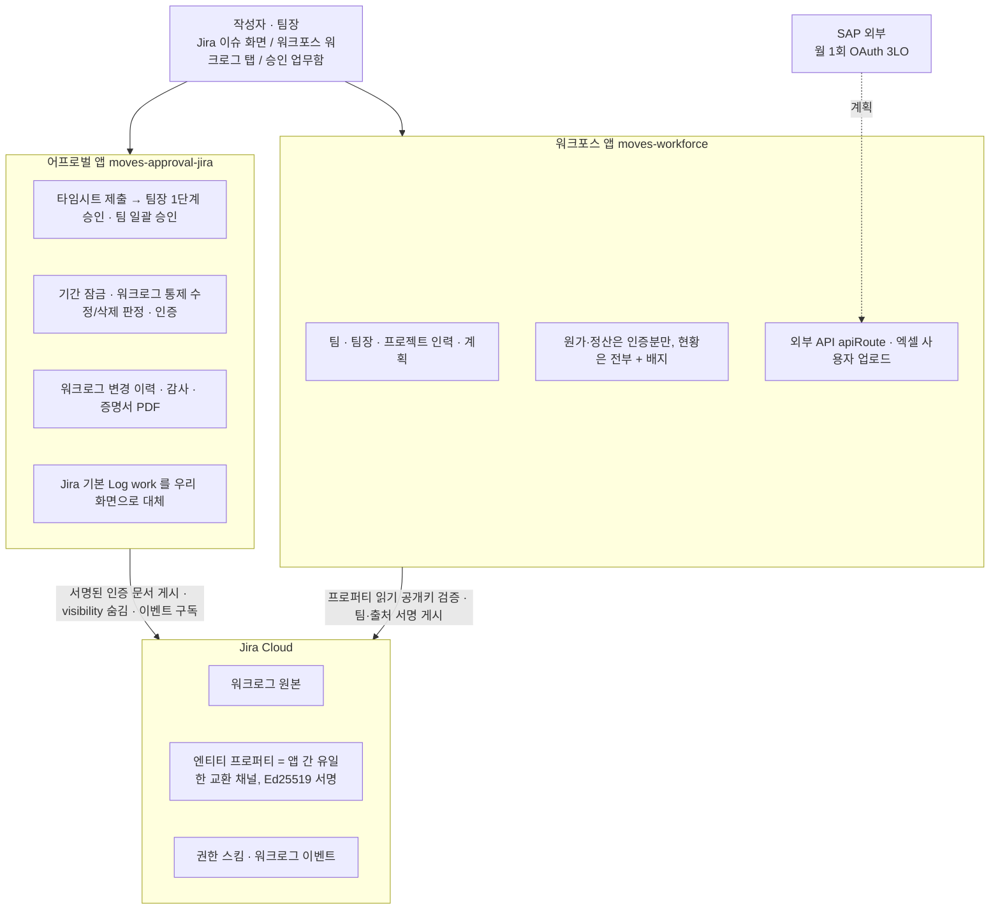

# 검토 의뢰 — 스트라드비전 요구사항 대응 방안 문서 (독립 검토)

너는 Jira Cloud Forge 앱 두 개(moves-workforce, moves-approval-jira)를 만드는 팀의 독립 검토자다. 아래 `<document>` 는 고객(스트라드비전, 현재 Tempo 사용)의 요구사항 5건에 대해 "두 앱으로 어떻게 제공할지 · 아키텍처 · 구현 현황 · 제약 · 데이터 관리 방안"을 정리한 문서다. 이 문서는 내부 기술 검토 자료이자 고객 회신의 근거가 된다.

## 검토 관점 (우선순위 순)
1. **사실 오류·과장**: 문서가 "구현 완료"·"가능"·"실측" 이라고 쓴 항목이 리포 코드·설계 문서와 맞는지. 리포는 읽기 전용으로 열람할 수 있다: 어프로벌 `C:\CloudJira\moves-approval-jira`(docs/DESIGN.md, src/, manifest.yml, _workspace/worklog-control, _workspace/PROGRESS.md, _workspace/QUESTIONS.md), 워크포스 `C:\CloudJira\moves-workforce`(_workspace/worklog-governance, _workspace/api-exposure, src/integration/approval, src/resolver/approvalLink, manifest.yml). 파일은 UTF-8 로 읽어라. 셸이 막히면 문서 본문만으로 판단하고 "검증 불가" 로 표시하라.
2. **고객 앞에서 터질 약속**: 플랫폼 제약(Forge, Jira REST, timeTrackingProvider Preview, visibility, apiRoute Preview, Runs on Atlassian)상 문서가 가능하다고 한 것 중 실제로는 안 되거나 조건이 빠진 것. 특히 §4 잠금 3층·Phase B, §2 SAP, §3 Atlassian 조직 동기화, §7 데이터 관리.
3. **빠진 제약·위험**: 계약서·제안서에 "수용 기준" 으로 올려야 하는데 문서에 없는 것. 데이터 관리(보존·삭제·개인정보·앱 제거·용량·레지던시·백업)에서 빠진 항목.
4. **구조·가독성**: 영업·PM 이 읽는다. 지나치게 긴 곳, 결론이 뒤에 숨은 곳, 표 vs 문장 선택이 잘못된 곳.
5. **후속 조치의 우선순위가 맞는지**, 고객 회신 초안 문구가 과장·누락 없이 정확한지.

## 출력 형식 (한국어, 마크다운)
- 맨 위에 "총평" 3문장.
- 지적은 표로: `# | 심각도(🔴 사실오류/약속위반 · 🟠 누락 · 🟡 개선) | 위치(§) | 내용 | 근거(파일:라인 또는 공식 문서) | 수정 제안`.
- 마지막에 "검증 불가로 남긴 항목" 목록.
- 문서를 다시 써 주지 말고 지적만. 파일을 수정하지 마라.

<document>
# 스트라드비전 요구사항 대응 방안 — 워크포스 + 어프로벌 두 앱 기준

> 작성: 2026-10-13 · 기준 리포: `moves-approval-jira` master `b23524f`(2026-10-12), `moves-workforce` 브랜치 `RFC-220` `46f0899`(2026-10-12, master 미병합)
> 입력: 스트라드비전 미팅 기록(디무브 Andy Wi·Allen Park·Tom Kim / 스트라드비전 Tempo 담당 PM 포함 5명), 워크포스 `_workspace/worklog-governance/CUSTOMER_REQUIREMENTS_REPORT.md`(2026-09-30), `WORKLOG_GOVERNANCE_ANALYSIS.md`(2026-09-29), `_workspace/api-exposure/API_EXPOSURE.md`(2026-09-16 실측), 어프로벌 `docs/DESIGN.md`·`_workspace/*` 설계·검증 보고서
> 근거 등급: **코드**(리포에서 확인) / **실측**(개발 사이트에서 직접 확인) / **문서**(Atlassian 공식 문서, 실측 전) / **미검증**
> 독립 검토: 코덱스(`codex-review.md`, §9 에 반영)

---

## 0. 요약

미팅 기록의 "미지원·구조상 불가" 판정은 **워크포스 단독 기준**이다. 어프로벌 앱(moves-approval-jira)을 같이 보면 핵심 요구(워크로그 락킹·승인·이력 감사)는 **이미 설계·구현이 끝나 있고, 개발 사이트 실측(배포 관문)만 남았다.** 고객에게는 **워크포스 + 어프로벌 두 앱 번들**로 제안한다.

| # | 요구사항 | 미팅 기록 판정 | 두 앱 기준 판정 | 담당 앱 | 현재 상태 |
|---|---|---|---|---|---|
| 1 | SAP 연동(월 1회) | 조건부 지원 | **조건부 지원**(변경 없음) | 워크포스 | `apiRoute` 2026-09-16 실측 완료(메이저 버전·배지 유지 확인). 호출자 신원 1단계 미검증. 실기능 미구현. 대안으로 워크로그 xlsx 추출은 있음 |
| 2 | 사용자 관리 자동화 | 부분 지원 | **부분 지원** | 워크포스 | 엑셀 사용자 등록 있음(이메일 열만). 입·퇴사 자동 반영·Atlassian 조직 동기화·팀 열 Import 없음. 퇴사자 워크로그는 Jira 원본이라 보존 |
| 3 | 워크로그 락킹·승인 ⭐ | 미지원, 구조상 불가 | **구현 완료, 실측 전** | 어프로벌 | 월 단위 제출→팀장 1단계 승인·팀 일괄 승인(50건/PIN 1회)·승인자 로깅 구현. 잠금은 3층(시간 추적 제공자로 Jira 입력 화면 대체 + visibility 숨김 + 이벤트 감지) |
| 4 | 변경 이력 감사 | 미지원(Storage 제약) | **구현 완료** | 어프로벌 | Forge SQL `worklog_mirror`+`worklog_history`. 생성·수정·삭제 전/후 값·행위자·출처. 보존 12/36개월, 만료분 엑셀 내보내기 후 삭제 |
| 5 | 기타 5건 | 확인 필요 | 6-1 경로 있음 / 6-2 부분 / 6-3·6-4·6-5 없음 | 혼합 | §6 |

미팅 기록 4.2 "Worklog 를 쌓는 로직을 앱이 직접 컨트롤해야 함"이 곧 어프로벌의 `jira:timeTrackingProvider` + 통제권 이관 설계다. 워크포스 단독으로는 여전히 불가하므로, 이 요구는 어프로벌 앱이 담당한다.

**고객에게 말할 때 숨기면 안 되는 제한 3가지**
1. 어프로벌을 시간 추적 제공자로 지정하면 **Tempo 와 공존할 수 없다**(사이트당 제공자 하나). Tempo 해지·전환 시점을 합의해야 한다.
2. "다른 경로(REST·자동화·모바일)로 **새로** 쓰는 것"은 어떤 구조로도 사전 차단이 안 된다. 감지·표시·정산 제외·재승인으로 대응한다. 승인·인증이 끝난 기존 워크로그의 **수정·삭제**는 visibility 숨김(Phase B)으로 막을 수 있으나, 실측 관문 통과 후 사이트별로 켠다.
3. SAP 가 쓰는 `apiRoute` 는 Atlassian Preview 기능이다. 계약서에 "정식 출시 전 기능"을 명시한다.

---

## 1. 두 앱의 역할 분담과 연동 아키텍처

| | 워크포스(moves-workforce) | 어프로벌(moves-approval-jira) |
|---|---|---|
| 역할 | 팀·팀장·프로젝트 인력 배정·계획·원가·가동률·간트·외부 API | 타임시트 승인·기간 잠금·워크로그 통제·인증·변경 이력·감사·증명서 |
| 저장소 | Forge SQL + KVS, **DB 무증가 원칙**(연동으로 새 테이블 없음) | Forge SQL(설치당 1GiB), 마이그레이션 v063 까지 |
| Jira 모듈 | globalPage·issueActivity·issueContext·customField 6·entityProperty 2·scheduledTrigger 4 | globalPage·adminPage·projectSettingsPage·**timeTrackingProvider**·issueAction 2·issuePanel·issueActivity·**workflowValidator**·trigger 4(워크로그 3종 이벤트 포함)·scheduledTrigger·consumer |
| 유료 | `licensing.enabled` | `licensing.enabled` |
| 단독 동작 | 어프로벌 없으면 지금 그대로 | 워크포스 없으면 앱 내 팀 명부(`timesheet_team_member`)로 팀장 판정 |
| 성숙도 | 커밋 524, 테스트 BE ~1,773·FE ~2,080, 운영 배포 경험 있음 | 커밋 30(2026-10-04~12), 테스트 BE 2,460·UI 677 통과, 개발 사이트 1회 배포, 운영·Marketplace 미등록 |

- Forge 앱끼리는 저장소 공유·직접 호출이 불가하다. **Jira 엔티티 프로퍼티가 유일한 채널**이며, 프로퍼티는 편집 권한자 누구나 쓸 수 있어 **서명 검증 후에만 신뢰**한다(`docs/DESIGN.md §4`). 서명 대상에 `cloudId`·엔티티 id 를 넣어 복사 재사용을 막는다.
- 연동 모드는 자동 감지가 아니라 **관리자가 명시적으로 켠다**. 어프로벌 `workforceLinkEnabled` 기본 false(2026-10-12), 워크포스 `settings.approvalLinkMode` 기본 OFF.
- 인증된 시간의 원본은 어프로벌 DB. 워크포스는 사용자 프로퍼티 `movesApproval.cert.{YYYY-MM}`(사용자×월 서명 문서: 인증 합계 `cs`, 건수, `[worklogId, 초, flag]` 목록, 삭제분 원래 이슈 `di`)을 asApp 으로 읽어 공개키 검증 후 원가 계산에만 쓴다(Q133·Q135).
- 반대 방향: 워크포스 → 어프로벌 `rms.org`(팀·팀장), `rms.pm`, `rms.policy`, `rms.check`(제한선 위반 코드). **`rms.org`·`rms.check` 게시 코드는 워크포스에 아직 없다**(계약 사본만). 연동 모드의 팀장 판정은 이 게시가 전제다.
- 연동 서명 공개 키는 dev·stg 만 등록. **prd 키 없음**.

---

## 2. SAP 연동

### 2.1 고객 요구
Tempo API 문서를 SAP 측에 넘겨 월 1회 동기화. SAP 가 어떤 데이터를 가져가는지 미확인.

### 2.2 두 앱에서 제공하는 방식
담당은 **워크포스**(인력·프로젝트·워크로그 집계 데이터의 주인). 어프로벌은 승인·인증 상태 열을 보태는 역할.

| 구분 | 방식 A `core:apiRoute`(권장) | 방식 B static webtrigger | 방식 C 파일 전달(즉시 가능) |
|---|---|---|---|
| 현재 코드 | 없음(2026-09-16 프로브 실측 후 제거, `custom-scopes.yaml` 잔존) | 없음(manifest 주석) | **있음** — `/worklog-export` 워크로그 xlsx 추출(이슈키·작성자·accountId·started·초·시간·코멘트·worklogId) |
| 인증 | Atlassian OAuth 2.0 3LO. 토큰 발급·갱신은 Atlassian 몫 | 공유 키를 앱이 직접 검증. URL 공개, asUser 불가 | Jira 로그인 사용자가 다운로드 |
| Runs on Atlassian 배지 | **유지(실측)** | static 은 허용 | 영향 없음 |
| 배포 영향 | **모듈 사용만으로 메이저 버전 상승(실측, 공식 목록엔 없음)** → 고객 관리자 승인. 커스텀 스코프 환경당 20개·삭제 불가 | 메이저 버전 상승(`MAJOR_VERSION_RULE`) | 없음 |
| 성숙도 | Preview | 정식 | 정식 |

### 2.3 아키텍처·구현 현황
- `apiRoute` 는 resolver 와 **별개 진입점**이라 `guardedDefine`·`PermissionMap`·`resolvePrincipal`·라이선스 검사가 전부 우회된다(실측). 핸들러마다 신원 확정 → 권한 → 스코프 → 원가 가시성 → 라이선스를 직접 통과시켜야 하고, 판정 로직을 resolver 와 공용 함수로 뽑아야 한다.
- 관리자가 "앱 REST API"를 켜면 **조직 구성원 누구나** 3LO 연동을 만들 수 있다 → 응답 범위 축소는 전적으로 우리 코드 책임. 급여·원가는 기본 제외로 시작.
- 승인 상태 열: 어프로벌이 사용자 프로퍼티 `movesApproval.{YYYY}`(기간별 결재 상태·지문)·`movesApproval.cert.{YYYY-MM}`(인증 시간)을 게시하므로, 워크포스 API 응답에 "승인/인증 여부"를 실을 수 있다(`DESIGN.md §3` "SAP export 의 승인 상태 열").
- OData 는 Forge 에서 불가(25초 함수 안에서 `$metadata`·`$filter` 표준 준수 무리). REST 만 제공.

### 2.4 제약·미검증
- **호출자 `accountId` 수신 여부 미검증** — 3LO 연동 생성 1단계만 남음(영구 자격증명 생성이라 자동 진행 안 함). 결과에 따라 기존 권한 모델 재사용(들어옴) vs 스코프 = 권한 설계(안 들어옴)로 갈린다.
- Preview 기능 → 계약서 명시. 폐기 유예가 짧을 수 있다.
- 월 1회 배치면 25초 실행 한도 안에서 페이징 응답 필요(대용량은 커서).

### 2.5 후속 조치
1. (고객) SAP 가 Tempo API 에서 실제 쓰는 엔드포인트·필드 목록, 파일/API, 전달 방향(push/pull) 확인.
2. (내부) Tempo API ↔ 워크포스 데이터 매핑표 작성. 어프로벌 승인 상태 열 포함 여부 결정.
3. (내부) 3LO 연동 1회 생성해 호출자 신원 실측 → 권한 모델 확정 → 커스텀 스코프 이름 체계 확정(되돌릴 수 없음).
4. (제안) 1차는 **xlsx 수동 추출**로 월 1회 운영 시작, `apiRoute` 는 2차.

---

## 3. 사용자 관리

### 3.1 고객 요구
입·퇴사자·팀·조직원 수동 관리 불만 → 자동화. Atlassian 조직 체계 동기화. 대안 엑셀 Import. 퇴사자 워크로그 보존.

### 3.2 두 앱에서 제공하는 방식 — 담당 워크포스

| 항목 | 현행(코드) | 제공 방안 |
|---|---|---|
| 입·퇴사자 자동 반영 | 없음. `users` 에 활성/비활성 열 없음, 퇴사 = 삭제(팀장 참조·배정·일정·스킬·users 행 순 삭제) | Jira 사용자 상태(active)·그룹을 주기 스윕으로 읽어 `inactive` 표시(삭제 아님). 신규 기능 |
| Atlassian 조직 동기화 | 없음(그룹·Atlassian Teams·프로젝트 역할 호출 코드 0건, `getMyGroupApi` 정의만) | 1단계 Jira 그룹 → 팀 매핑. Atlassian 관리자 콘솔 조직·Teams 는 기술 검토 후(아래 제약) |
| 엑셀 Import | **있음** — `Email` 열만 읽어 Jira 사용자 조회 후 큐 등록 | 팀·직급·입사일 열 추가(기존 업로드 확장) |
| 퇴사자 워크로그 보존 | 워크로그 원본이 Jira 라 **보존됨**. 단 `users`·`projectusers` 삭제 시 집계·원가에서 빠질 수 있음(미검증) | 퇴사 = 비활성 전환으로 바꾸면 집계도 유지. 어프로벌 쪽 결정(Q138): 감사 기록 계정 id 는 무조건 보존, 삭제 계정은 "탈퇴한 사용자 A/B" 표시 |

### 3.3 제약·미검증
- Atlassian **조직(admin.atlassian.com)** 단위 사용자·그룹은 Jira REST 가 아니라 Admin API(조직 API 키) 영역이라 Forge 앱이 asApp/asUser 로 읽을 수 없다(**문서 기준, 실측 전**). Jira 그룹·프로젝트 역할·Atlassian Teams(`/gateway/api/public/teams`) 범위에서만 가능하다고 봐야 한다.
- 어프로벌 연동 모드의 팀장 판정은 워크포스 `rms.org` 게시에 의존하므로, 팀 동기화가 바뀌면 게시도 같이 돌아야 한다.
- `UserService` 주석의 `worklog_issue_daily` 보존은 DDL 이 주석 처리돼 **존재하지 않는 테이블**이다(코드·주석 불일치).

### 3.4 후속 조치
1. (내부) Jira 그룹·프로젝트 역할·Atlassian Teams 중 어디까지 읽히는지 1일 실측. Admin API 는 범위 밖으로 고객에게 명시.
2. (내부) 퇴사 = 삭제 → 비활성 전환 설계(집계 유지·명부 제외).
3. (고객) 엑셀 양식 초안(이메일·팀·팀장 여부·직급·입사일·퇴사일) 확인. "조직 단위"가 Jira 그룹인지 관리자 콘솔 조직인지 확인.
4. (고객 안내) 퇴사자는 Jira 계정 **삭제 말고 비활성화**. 삭제가 필요하면 그 전에 감사 기록 내려받기.

---

## 4. 워크로그 락킹 및 승인 ⭐ 핵심

### 4.1 고객 요구
Tempo 수준의 단순 승인. 팀장 일괄 승인. 누가 승인했는지 로깅. 승인·마감 기간 워크로그 추가·수정·삭제 차단.

### 4.2 두 앱에서 제공하는 방식 — 담당 어프로벌

| 기능 | 미팅 기록 | 어프로벌 현행(코드) |
|---|---|---|
| 승인 요청/승인 | 미지원 | **구현.** 대상 = 사용자×기간, `scopeKey = TIMESHEET:{accountId}:{periodKey}`, 기본 월(`approvalUnit`, 주로 변경 가능). 제출 시 워크로그 묶음 스냅샷(id·초·시작일·이슈 → 지문) 고정 → 팀장 1단계 결재(팀 설정으로 2단계 그룹·제한선 위반 시 예외 단계 추가 가능) |
| 일괄 승인 | 미지원 | **구현.** 팀×기간 매트릭스(`getTeamTimesheetMatrix`) + `decideTimesheets` 최대 50건·PIN 1회·18초 예산 초과분 `remaining` 반환. 업무함 범용 `bulkApprove` 도 있음 |
| 승인 이력 로깅 | 미지원 | **구현.** `approval_approver`(결정이 진실)·`approval_event`(결정적 id, REQUESTED/APPROVED/REJECTED/EXPIRED/CANCELLED/CHANGED_AFTER_APPROVAL/PERIOD_REOPENED) + 서명/PIN + 증명서 PDF. 설정 > 기록 > 감사 탭에서 검색·엑셀 |
| 기간 락킹 | 미지원 | **3층 구현, 실측 전**(아래) |
| 워크로그 인증(RFC-220) | — | **구현.** 팀장이 워크로그 값을 인증하는 순간 지문을 우리 DB 에 고정. 이후 Jira 에서 바뀌어도 인증된 시간은 안 바뀜(MISMATCH·DELETED 표시). 상위자 인증 원칙, 상위자 없는 팀장만 본인 인증(`self_certified`). 워크포스 원가는 이 인증분만 |

**승인 상태 머신**: 요청 `PENDING/APPROVED/REJECTED/EXPIRED/CANCELLED`, 기간 `NOT_SUBMITTED/SUBMITTED/APPROVED/REJECTED/CHANGED_AFTER_APPROVAL`. 결재 중 변경 → `EXPIRED(CONTENT_CHANGED)`, 승인 후 변경 → APPROVED 유지 + `drift_detected_at` + 재제출 요구.

### 4.3 잠금 아키텍처 — 3층 + 통제권 이관

| 층 | 장치 | 막는 것 | 상태 | 한계 |
|---|---|---|---|---|
| 1 누가 | Jira 권한 스킴 "Work on work items" → 프로젝트 역할만 | 미소속자의 모든 경로 | 고객 관리자 작업. 앱은 가이드(`docs/guide/ko/06-worklog-period-lock.md`) | 기간 조건 없음. team-managed 는 권한 스킴 미사용 |
| 2 언제 | **`jira:timeTrackingProvider`**(`moves-time-tracking`) — 관리자가 제공자로 고르면 Jira 기본 Log work 버튼·작업 로그 탭이 숨고 우리 `issueAction`·`issueActivity` 화면으로 대체. 서버가 쓰기 직전 `PERIOD_CLOSED/SUBMITTED/APPROVED` 판정 | 일반 사용자의 Jira 화면 입력 | **구현.** 실측 전 | **Tempo 공존 불가.** REST·자동화·모바일 경로 차단 여부 문서 미언급(P1~P3 미검증) |
| 3 남은 구멍 | 워크로그 이벤트 3종 + 일일 스윕 + `worklog/updated·deleted` since 보정 | 2층 우회 변경 | **구현** | 사후 감지·FLAG·재승인. 사전 차단 아님 |
| 4 통제권 이관(worklog-control, 2026-10-11) | 우리 화면의 수정·삭제는 앱이 DB 상태로 판정 후 **asApp 실행**. Jira 경로는 워크로그 **visibility 를 앱 역할(`atlassian-addons-project-access`)로 제한**해 사람 전원이 손을 못 대게(시스템 역할이라 관리자도 사람을 못 넣음). 숨긴 건은 작성자 본인·팀장 인증 경로에만 asApp 으로 보임(불변식 8 예외) | 승인·인증 **확정분의 수정·삭제** | **구현, 기본 OFF** | 고객 권한 스킴 무변경이 장점. 새로 쓰는 것은 여전히 못 막음 |

**Phase 와 기본값**(`SettingsRepository.js`)

| Phase | 내용 | 기본 | 켜는 조건 |
|---|---|---|---|
| A | 진단 도구·쓰기 재설계·기간 창(이슈 Start~Due)·다른 경로 입력 FLAG | **ON**(기간 창은 OFF) | — |
| B | 확정분(타임시트 APPROVED·인증 CERTIFIED/MISMATCH)만 visibility 숨김 | OFF | 사이트별 실측 관문 PASS 기록(`recordWorklogControlGate`) 없이는 서버가 저장 거부 |
| C | 연동 이슈 전체 즉시 숨김 | OFF | B 와 같음 + 워크포스 WF-9 |
| D | 출처 증명 없는 다른 경로 입력 자동 삭제 | OFF | **사용자 결정으로 쓰지 않음**(Q136: 표시·경고·정산 제외만) |

**1차 목표는 B** — "특정 기간 승인된 워크로그는 수정 불가". 숨김은 수단이지 비공개가 목적이 아니므로 대시보드 합계에는 그대로 보인다(Q136). 마감 기간 재개방은 "새 입력 허용" / "수정까지 허용(승인·인증 해제 + 사유 필수 + 감사)" 두 단계(Q137, v061~v063).

### 4.4 제약·미검증 — 배포 관문
- **실측 0건.** 개발 사이트 배포는 2026-10-12 한 번. 관문 우선순위: G_ROLE(Forge 앱 계정이 제한 역할 멤버인가 — 실패하면 visibility 안 전체 재검토) → G_PRESERVE(visibility 만 PUT 해 다른 값 보존, null 해제) → G_BLOCK(작성자·관리자·API 토큰 REST 로 GET/PUT/DELETE 차단) → G_POST → G_HANDOFF(워크포스 탭 → 승인 앱 넘김) → G_AGG(timespent·JQL·리포트) → G_TEAM_MANAGED.
- visibility 실측 메모(2026-10-08, 워크포스 리포): 설정자도 구성원이어야 해 사람 자격으론 400, 그룹 가시성은 Jira 기본 설정에서 꺼져 있어 역할 경로만, 같은 역할의 다른 앱(Tempo 등)은 본다, **앱 제거 전 전체 해제 절차 필수**(`preUninstall` 55초 실측 필요).
- 검증 보고(2026-10-11) 미해결: F1 FLAG 의 "인증 제외" 서버 미구현(워크포스 출처 서명 WF-7 전엔 연동 이슈 정상 입력도 FLAG 됨 — 오탐 규모 실측 필요), F3 연동 판정 실패 시 기간 창 fail-open.
- 워크포스 쪽 통제 연동(본인 숨김 조회·승인 앱 넘김·작성 출처 서명·연동 신호)은 **`RFC-220` 브랜치·일부 미커밋**. master 미반영.
- 어프로벌 기본 워크로그 입력을 asUser 유지 vs asApp 전환은 아직 비교 중(`docs/WORKLOG-INPUT-CONTROL-DISCUSSION.md`).

### 4.5 후속 조치
1. (내부, 최우선) 개발 사이트에서 진단 도구 + 수동 관문 실측(`04_spike_todo.md`). 시험 계정 5종(작성자 A·타인 B·팀장 L·타 팀장 L2·Edit all 관리자 M). 통과 기준은 "실제 기록 불변".
2. (내부) timeTrackingProvider 가 REST·자동화·모바일 입력을 막는지 실측(P1~P3) → 고객 설명 문구 확정.
3. (내부) F1·F3 수정, 워크포스 `RFC-220` master 병합 + prd 서명 키 등록.
4. (고객) Tempo 전환 시점 합의(제공자 지정 = Tempo Log work 숨김). 승인 단위 월 확인, 반려 흐름 필요 여부, "수정까지 허용" 재개방 권한자.
5. (고객 회신 문구) "승인·마감 기간의 기존 워크로그 수정·삭제는 앱이 차단합니다. 다른 경로로 새로 입력된 건은 즉시 감지해 표시하고 정산에서 제외하며 재승인을 요구합니다. 사전 차단은 Jira 플랫폼 제약으로 불가합니다."

---

## 5. 이력 감사(History)

### 5.1 고객 요구
워크로그 생성·수정·삭제 변경 로그.

### 5.2 두 앱에서 제공하는 방식 — 담당 어프로벌
미팅 기록의 "Forge Storage 제약으로 권장하지 않음"은 KVS 기준이다. 어프로벌은 **Forge SQL** 을 쓰며, 그 이유는 업무함의 다축 필터·정렬·페이징을 Custom Entity(인덱스 7개)로 표현할 수 없기 때문이다.

| 축 | 테이블 | 내용 | 기본 보존 |
|---|---|---|---|
| 워크로그 변경 | `worklog_mirror` + `worklog_history`(PK `(worklog_id, seq)` 결정적) | **생성·수정·삭제** 각각 이전/이후 값, 행위자, 출처(APP/JIRA/SWEEP), 워크포스 연결 여부. 설명은 지문+앞 40자(원문은 `worklogHistoryKeepComment` 옵션) | 일반 12개월, 워크포스 연결분 36개월(관리자 변경 가능, Q132) |
| 결재 | `approval_event` | 결정·만료·취소·승인 후 변경·재개방 | 3년(0·1·3·5·10) |
| 인증 | `worklog_cert_batch`·`_log` | 누가·누구의·어느 월·PIN | 무기한 |
| 통제 조치 | `worklog_control_log`(append-only) | 숨김·해제·FLAG·관리자 확인(사유 필수) | 무기한(Q131) |
| 설정 변경 | `approval_settings_audit` | 정책·스위치·관문 기록 | 1년 |

- 수집: 워크로그 이벤트 3종 → 미러 upsert + 이력 append. 누락은 일일 스윕이 `worklog/updated·deleted`(since) 로 보정. 삭제 이벤트에 본문이 없어도 미러에 마지막 스냅샷이 있어 삭제 기록이 남는다.
- 만료 기록은 **엑셀 내보내기 확정 후에만 삭제**(자동 삭제 없음, Q132). 내려받기 전용도 가능.
- 화면: 설정 > 기록 > 감사(결재·인증·워크로그 변경·설정 변경 탭), 이슈 작업 로그 탭 상세 모달의 변경 이력 탭.

### 5.3 제약·미검증
- 알 수 없는 것: Jira 경로 삭제의 행위자(삭제 이벤트 페이로드 실측 전), 입력 경로 구분(웹/REST/모바일), 이벤트 사이의 중간 수정, 설치 이전 이력.
- **용량**(200명 기준, 실측 전): 워크로그 이력 148MB/년(원문 보관 +54MB), 결재 150MB, 인증 80MB, 통제 최악 80MB, 필드 변경 포함 누적 **약 465MB/년** → 3년 보관이면 설치당 1GiB 초과 가능. 보존 기간·내보내기 운영이 필수. 1,000명이면 약 5배.
- H4(배포 최우선): 우리 화면 쓰기 응답(asUser)과 asApp `worklog/list` 값 표현이 다르면 APP 쓰기마다 가짜 수정 행.

### 5.4 후속 조치
1. (고객) 인원·월 워크로그 변경 건수·보존 기간 확인 → 용량 산정표 갱신.
2. (내부) 삭제 이벤트 페이로드·H4 실측.
3. (고객 안내) 보존 기간 만료 기록은 엑셀로 내려받은 뒤 삭제된다는 운영 절차.

---

## 6. 기타 요구사항

| # | 요구 | 워크포스 현행 | 어프로벌 현행 | 판정 | 후속 |
|---|---|---|---|---|---|
| 6-1 | 프로젝트 미소속자 입력 제한 | 내 작업 화면은 소속 프로젝트 이슈만 노출. RFC-220 에서 작성 대상이 워크포스 프로젝트 소속인지 확인 | 가이드·화면 문구(권한 스킴 "Work on work items" → 프로젝트 역할). 워크포스 `NOT_MEMBER` 위반 코드 수신 → 예외 단계 코드 있음 | **경로 있음, 완전 차단은 고객 권한 스킴** | CLAUDE.md 의 "역할 동기화(워크포스)"는 **미구현** — 워크포스에 프로젝트 역할 API 호출 코드 없음. 구현 여부 결정 |
| 6-2 | 계획 초과 알림(PM, 별도 채널) | 계획 = Jira Original Estimate, 초과 배지(100/130%)·가동률 밴드(1.1/1.3) **화면 표시만**. 메일·웹훅 없음 | `OVER_PLAN` 수신·예외 승인 단계 코드 있음. 알림은 앱 내 알림함 + Jira 코멘트 @멘션(상태 변경 승인만). **앱 자체 메일·Slack·Teams 없음**. 독촉(기본 OFF, 3일 후 3일마다) | **부분** | 워크포스 `rms.check` 게시 구현 + Jira 코멘트 @멘션으로 PM 알림(Jira 가 메일 발송). 외부 메신저는 egress 추가 = 배지 상실 위험 → 고객 채널 확인 후 결정 |
| 6-3 | OKR | 없음 | 없음 | **없음** | 고객 요구 구체화 전 범위 밖 |
| 6-4 | 휴일 자동 Import | 공휴일 **수동 등록** 있음(KVS `holiday`, `workRatio` 부분 근무일). 자동 Import 는 외부 통신 필요 → 보류 | 휴일 변경 시 환산 기준 `movesRms.kb` 재게시(RFC-220) | **수동만** | 외부 공휴일 API = egress → Runs on Atlassian 실격. 대안: 연 1회 엑셀 Import |
| 6-5 | Outlook 연동 | 없음 | 없음 | **없음** | 용도(일정 표시/휴가/알림) 확인. Forge 에서 Microsoft Graph 는 외부 인증·egress 필요 → 배지 상실. 범위 밖 권고 |

---

## 7. 데이터 관리 및 처리 방안

### 7.1 데이터는 어디에 있고 누가 주인인가

| 데이터 | 원본 위치 | 주인 | 사본·교환물 | 비고 |
|---|---|---|---|---|
| 워크로그(시간·일자·이슈·설명) | **Jira**(고객 테넌트) | 고객 | 어프로벌 `worklog_mirror`(마지막 관측값), 워크포스는 읽기만 | Jira 가 원본이므로 앱을 지워도 워크로그는 남는다 |
| 승인 결정·결재선·서명/PIN | 어프로벌 Forge SQL | 고객(앱 설치 단위) | 사용자 프로퍼티 `movesApproval.{YYYY}` 요약(상태·지문) | `approval_approver` 행이 진실, 상태는 파생 |
| 인증된 시간(RFC-220) | 어프로벌 Forge SQL `worklog_cert*` | 고객 | 사용자 프로퍼티 `movesApproval.cert.{YYYY-MM}` 서명 문서 | 워크포스는 서명 검증 후 계산에만 쓰고 원문 미노출 |
| 워크로그 변경 이력·통제 조치·설정 변경 | 어프로벌 Forge SQL | 고객 | 엑셀 내보내기 | 추가 전용, 수정 resolver 없음 |
| 팀·팀장·프로젝트 인력·급여·계획 | 워크포스 Forge SQL + KVS | 고객 | 사용자/프로젝트 프로퍼티 `rms.org`·`rms.pm`·`rms.policy`·`rms.check` 서명 문서(게시 구현 전) | 워크포스 DB 무증가 원칙 — 연동으로 새 테이블 없음 |
| 연동 서명 개인키 | Forge 환경 변수(`forge variables set --encrypt`) | 디무브 | 상대 앱에 공개키 내장(`keyring.js`) | dev·stg 등록, prd 미등록 |
| SAP 로 나가는 데이터 | 워크포스 응답(apiRoute) 또는 xlsx | 고객 | SAP 측 저장 | 고객이 관리자 스위치로 문을 열어야 함 |

- 모든 저장소가 Atlassian 호스팅(Forge SQL·KVS·Jira 프로퍼티)이고 외부 egress 가 없어 **Runs on Atlassian 배지 유지**. 데이터가 Atlassian 테넌트 밖으로 나가는 경로는 고객이 명시적으로 켜는 SAP 연동뿐이다.
- 데이터 레지던시(리전 고정)는 두 리포 어느 문서에도 확인 기록이 없다 → **미검증**. 고객이 요구하면 Forge 호스티드 스토리지의 레지던시 지원 범위를 공식 문서로 확인한다.

### 7.2 접근 통제 — 누가 무엇을 보나

- 기본은 **사용자 권한(asUser)**. 앱 권한(asApp)은 트리거·스윕 등 사용자 컨텍스트가 없는 경로와 승인된 예외(숨긴 워크로그를 작성자 본인·팀장 인증 경로에만 반환, 워크포스 인증 원가 읽기)에만 쓰고, 예외마다 6조건(호출자 = resolver principal, SQL 소유자 조건 선적용, 건별 이슈 열람 재확인, 우리가 가린 것만, 설명은 본인만, count·합계·캐시도 같은 범위)을 지킨다.
- 가드 통과 ≠ 데이터 범위 확정 — 목록은 건별 이슈 열람 권한으로 다시 좁힌다. 팀장은 자기 팀원 타임시트만(`TeamScope`), 감사 화면·기록 내보내기는 앱 관리자만, 워크포스 원가는 `PROJECT_COST` 권한 분리.
- 엔티티 프로퍼티는 편집 권한자 누구나 쓸 수 있으므로 **서명 검증 전에는 신뢰하지 않는다**. 검증 실패 = 없는 것(단독 경로) + 감사 로그.
- `apiRoute` 는 위 가드가 전부 우회되는 별개 진입점 → 핸들러에서 신원·권한·스코프·원가 가시성·라이선스를 직접 통과시키고, 급여·원가는 기본 제외.

### 7.3 보존·삭제·내보내기(라이프사이클)

| 기록 | 기본 보존 | 관리자 선택지 | 만료 처리 |
|---|---|---|---|
| 결재 이벤트·요청 | 3년 | 0(무기한)·1·3·5·10년 | 엑셀 내보내기 → 확정 → 삭제(자동 삭제 없음) |
| 워크로그 변경 이력 | 일반 12개월 / 워크포스 연결분 36개월 | 관리자 변경 | 동일 |
| 인증 기록 | 무기한 | 0·3·5·7·10년 | 동일 |
| 통제 조치 기록 | 무기한 | — | 동일 |
| 설정 변경 | 1년 고정 | — | 동일 |
| 앱 내 알림 | 180일 | — | 사본 없이 삭제(판단 근거는 이벤트 테이블에 남음) |

- 만료 기록은 **반드시 파일로 내려받을 수 있어야 한다**는 사용자 결정(Q132)에 따라 내보내기 세션(`exportExpiredRecords`→`confirmRecordExport`→`purgeExportedRecords`)을 거쳐야 삭제된다. 내려받기 전용(`downloadRecords`)도 있다.
- 삭제·내보내기 작업은 25건 배치·20초 예산으로 나눠 Forge 실행 한도 안에서 돈다.
- 워크포스 퇴사자 처리는 현재 "삭제"(users·projectusers 행 제거) → **비활성 전환으로 바꿔 집계·원가 보존**(§3).

### 7.4 용량 계획

| 항목 | 200명 기준 연간(실측 전) | 비고 |
|---|---|---|
| 결재·타임시트 | 약 150MB | 스냅샷 압축 시 110MB |
| 워크로그 이력 | 약 148MB | 설명 원문 보관 시 +54MB |
| 인증 | 약 80MB | |
| 통제 | 최악 80MB | |
| 필드 변경 승인 포함 누적 | **약 465MB/년** | 3년 보관이면 설치당 1GiB 초과 가능 |

- Forge SQL 한도 설치당 1GiB(`STORAGE_LIMIT_BYTES` 로 환경별 덮어쓰기). 넘으면 쓰기 실패. `getStorageUsage` 가 `information_schema` 로 사용량을 읽어 설정 화면에 표시하고, 워크포스는 80/90% 경고가 있다.
- 유휴 비용: Forge SQL 은 요청 수·실행 시간 과금. 2026-10-10 정리로 유휴 상태 하루 SQL 27회(연동 38회)로 고정(테스트가 상한을 지킴). 인증 게시는 이벤트 기반 큐(45초 디바운스)라 인증 없는 날 비용 0.
- 프로퍼티 한 건 32KB(게시 판정 30,000B) → 사용자×월 문서의 워크로그 목록은 최대 1,000건, 초과 시 잘림 표시(`wt`).
- **고객 산정 입력값**: 인원 수 × 월 워크로그 건수 × 월 변경 횟수 × 보존 기간. 스트라드비전 인원이 확인되면 위 표를 다시 계산한다.

### 7.5 개인정보·계정 삭제·앱 제거

- `report:personal-data` 스코프로 Atlassian 개인정보 보고 주기(기본 7일)를 받아, 삭제(closed)된 계정의 **기능용 개인정보**(서명 이미지·PIN·알림·위임·명부 등록)를 지운다. 감사 기록의 계정 id 는 **무조건 보존**(Q138) — 화면은 "탈퇴한 사용자 A/B"로 표시, 엑셀에는 이름+계정 id 함께. 점검 대상 테이블·열은 `PERSONAL_DATA_SOURCES` 한 곳에서 관리.
- 일반 퇴사(비활성)는 closed 가 오지 않으므로 처리 없음 → 고객 가이드 "퇴사자는 삭제 말고 비활성화, 삭제 전 감사 기록 내려받기".
- 앱 제거: `preUninstall` 트리거가 앱이 숨긴 워크로그 visibility 를 **전부 해제**한다(안 하면 제거 후 아무도 못 본다). 55초 안에 끝나는지 실측 필요. Forge SQL 은 제거 시 삭제되므로 **제거 전 기록 내보내기**를 운영 절차로 둔다.
- 개인정보 처리방침에 감사 기록 계정 식별자 보관을 명시하고, 출시 전 Atlassian 마켓플레이스 지원·법무 확인(Q138).

### 7.6 무결성·감사 가능성

- 결정이 진실·상태는 파생, 승인자 행 삭제-재삽입 금지(조건부 UPDATE), CAS `rev = rev + 1`, 감사 이벤트 id 결정적, 이력 PK `(worklog_id, seq)` — 같은 이벤트·스윕 경합이 중복 행을 만들지 않는다.
- 인증은 인증 시점 지문을 고정하므로 이후 Jira 변경이 인증 시간을 바꾸지 못한다(MISMATCH·DELETED 로 표시만).
- 통제 조치·관리자 판단(해제·확인)은 사유 필수·추가 전용.
- 증명서 PDF 는 서버가 돌려준 결정 사실·대상 지문으로 프론트가 생성.

---

## 8. 종합 후속 조치

| 우선 | 항목 | 구분 | 담당 |
|---|---|---|---|
| 1 | 워크로그 통제 실측 관문(G_ROLE→G_PRESERVE→G_BLOCK→G_POST→G_HANDOFF)·timeTrackingProvider 비UI 경로 실측 | 내부 기술 검토 | 어프로벌 |
| 2 | 워크포스 `RFC-220` master 병합·prd 서명 키·`rms.org`/`rms.check` 게시 구현, F1·F3 수정 | 내부 구현 | 양쪽 |
| 3 | SAP 데이터 항목·방식 확정, 3LO 호출자 신원 실측, 1차는 xlsx 수동 추출 | 고객 확인 + 내부 | 워크포스 |
| 4 | Jira 그룹/역할/Teams 동기화 범위 실측, 퇴사 = 비활성 설계, 엑셀 양식 정의 | 내부 + 고객 | 워크포스 |
| 5 | 이력 용량 산정(인원×건수×보존), 보존·내보내기 운영 절차 고객 안내 | 고객 확인 | 어프로벌 |
| 6 | Tempo 전환 시점·승인 단위·반려 흐름·재개방 권한자 합의 | 고객 확인 | 영업 |
| 7 | 6-1~6-5 범위 구체화(OKR·Outlook 은 범위 밖 권고, 알림 채널 확인) | 고객 확인 | 영업 |

**고객 회신 초안 한 단락**
> 워크로그 승인·기간 잠금·변경 이력은 Moves Workforce 와 함께 설치하는 Moves Approval 앱이 제공합니다. 월 단위 제출 → 팀장 승인(팀 일괄 승인 포함)과 승인자·일시·대상 기간 기록, 워크로그 생성·수정·삭제 이력이 포함됩니다. 승인·마감 기간의 기존 워크로그 수정·삭제는 앱이 차단하고, 다른 경로로 새로 입력된 건은 즉시 감지·표시·정산 제외 후 재승인을 요구합니다(Jira 플랫폼 제약상 사전 차단은 불가). 이 앱을 시간 추적 제공자로 지정하면 Tempo 와 함께 쓸 수 없으므로 전환 시점을 함께 정해야 합니다. SAP 연동은 1차로 월 1회 엑셀 추출, 2차로 Atlassian OAuth 기반 REST API(Preview 기능)를 제공합니다.

---

## 9. 코덱스 독립 검토 결과와 반영

(검토 후 기록)

---

## 참고 문서

- 어프로벌: `docs/DESIGN.md`(§2.0 입력 통제 3층·§4 연동 계약·§10 스파이크), `docs/WORKLOG-TRUST-DESIGN.md`(고객용 쉬운 설명), `_workspace/worklog-control/{01_architect_design,03_verify_report,04_spike_todo,codex-review}.md`, `_workspace/worklog-certification-model/01_architect_design.md`, `_workspace/audit-trail/01_architect_design.md`, `_workspace/audit-retention-sync/01_design_notes.md`, `_workspace/QUESTIONS.md`(Q127~Q139), `docs/guide/ko/06-worklog-period-lock.md`
- 워크포스: `_workspace/worklog-governance/{CUSTOMER_REQUIREMENTS_REPORT,WORKLOG_GOVERNANCE_ANALYSIS,WORKLOG_VISIBILITY_LOCK,EXTERNAL_BACKEND_DESIGN}.md`, `_workspace/api-exposure/API_EXPOSURE.md`, `src/integration/approval/*`, `src/resolver/approvalLink/*`
- 경험 노트: `claude-experiences/projects/moves-workforce/2026-09-29-worklog-governance-analysis.md`, `topics/forge/jira-worklog-visibility-lock.md`, `projects/moves-approval/2026-10-02-jira-approval-design.md`
- Atlassian: Forge app REST APIs(Preview) · API route 모듈 · Web trigger · OAuth 2.0 (3LO) · Build Runs on Atlassian apps · `jira:timeTrackingProvider`(Preview) · Worklog REST(visibility 조건)

</document>
