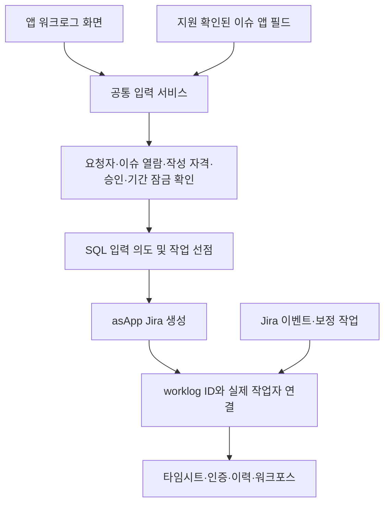

# 앱 전용 워크로그 입력 설계

> 선택 상태(2026-10-12): 이 문서는 asApp 대안이다. [최신 논의 기록](cloudjira--WORKLOG-INPUT-CONTROL-DISCUSSION.md)에 따라 asUser 화면 통제와 운영 부담을 비교 중이며 최종 채택은 미확정이다.

> **개정 안내(2026-10-11):** 저장·집계의 최신 결정은 [워크로그 properties 기반 작업자 저장 설계](cloudjira--WORKLOG-IDENTITY-PROPERTIES-DESIGN.md)를 따른다.
> 아래 1판의 §6~8·§10에 있는 영구 SQL 소유권 원장 및 매핑 게시물 제안은 최신안으로 대체한다. §1~5의 입력 통제, §9의 UI 지원 확인은 유지한다. §11~13의 운영·검증·구현 순서는 최신안의 변경 사항을 함께 적용한다.
> 별도 영구 소유권 테이블은 기본안에서 제외하지만 기존 승인·실행 op·통제 SQL 기록은 유지한다. 아래 내용은 대안 비교를 위한 1판 기록이다.

> 작성일: 2026-10-11 · 상태: 구현 전 설계안
> 사용자 확정: 워크로그 생성에 `asApp()` 사용 허용. Jira 작성자가 앱으로 표시되는 차이 수용.
> 이 문서는 신규 생성 방식의 변경안이다. 기존 구현이 이미 이 방식으로 동작한다는 의미가 아니다.
> 기존 제품 설계: [DESIGN.md](cloudjira--DESIGN.md). 이 문서의 생성·소유권 변경안이 기존 `asUser()` 생성 전제를 대체하며, 실측 관문 통과 후 구현에 반영한다.

## 1. 목적과 사용자 경험

일반 사용자가 Jira 기본 화면이나 개인 API 토큰으로 워크로그를 직접 생성하지 못하게 하고, Moves Approval의 서버 검증을 통과한 입력만 앱이 Jira에 기록한다.

예를 들어 철수가 2시간을 입력하면 우리 앱에서는 `철수 · 2시간`, Jira 기본 워크로그에서는 `Moves Approval 앱 · 2시간`으로 보인다. 실제 작업자는 최신안에 따라 워크로그의 서명된 properties에 저장한다. Jira의 작성자 기반 JQL·보고서·외부 제품이 자동으로 철수를 인식하지는 않는다.

허용할 입력 경로는 다음 두 가지다.

1. 기존 앱 워크로그 화면 및 이슈의 앱 `Log work` 액션.
2. Jira 이슈 수정 화면에 배치할 앱 입력 필드. 정확한 화면 지원과 저장 시점은 실측 대상이며, 실패하면 기존 앱 액션 모달을 제공한다. 이 대체안은 원래 요청의 수정 화면 삽입을 완료한 것으로 취급하지 않는다.

두 경로 모두 같은 백엔드 서비스를 호출한다. 화면만으로 승인·소유자·기간 잠금을 판정하지 않는다.

## 2. 확정 사항과 설계 제안

| 구분 | 내용 |
|---|---|
| 사용자 확정 | `asApp()` 생성 허용, Jira 작성자 앱 표시 수용, 우리 앱의 입력 경로로 통제 |
| 설계 제안 | 프로젝트 단위로 일반 사용자의 생성 권한을 회수하고, 최신 properties 설계에 따라 실제 작업자를 보존 |
| 설계 제안 | 최초 버전은 본인 입력만 허용. 팀장도 다른 사람 명의로 생성하지 않음 |
| 설계 제안 | 기존 개인 명의 워크로그를 재생성하거나 작성자를 바꾸지 않고 혼합 조회 |
| 미검증 | 실제 사이트의 사용자/앱 권한 분리, 다른 앱·자동화 경로, 수정 모달 지원 |
| 미검증 | `asApp()` 생성 응답의 author와 앱 계정 ID 일치, POST properties 원자적 저장·재조회 |

## 3. 통제 범위와 한계

### 3.1 프로젝트 권한과 이슈 정책의 역할

Jira의 `Work on issues` 권한은 프로젝트 권한이다. 따라서 강제 통제를 켠 프로젝트에서는 대상 일반 사용자의 생성 권한을 모든 부여 경로에서 제거한다. 그룹·프로젝트 역할·사용자 직접 부여·광범위한 허용을 모두 확인해야 한다.

특정 이슈에만 승인 조건을 적용할 수는 있지만, 같은 프로젝트의 다른 이슈에서 사용자가 직접 기록하도록 권한을 남겨 두면 이슈별 앱 전용 생성을 보장할 수 없다. 제안하는 최초 범위는 **프로젝트 전체의 입력 경로 통제 + 이슈별 앱 정책**이다. 통제 대상이 아닌 이슈도 우리 앱에서 즉시 기록하도록 허용하는 방식으로 운영한다.

| 경로 | 목표 동작 | 보장 조건 |
|---|---|---|
| 일반 사용자 Jira 기본 UI·직접 REST | 생성 거부 | 해당 사용자의 유효 `Work on issues` 권한 없음 |
| 우리 앱 UI | 서버 검증 후 asApp 생성 | 앱 권한, 앱 자체 작성 자격, 이슈 열람, 정책 통과 |
| 다른 앱·자동화·가져오기 | 별도 점검 | 호출 주체에 생성 권한이 남아 있으면 우회 가능 |
| Jira 관리자 | 설정 변경 가능 | 관리자에 의한 권한 복원까지 기술적으로 금지하지 않음 |
| 우리 앱 필드의 직접 REST 수정 | 승인 우회 불가 | 필드 값은 입력일 뿐이며 서버의 허가·소유권 근거로 사용하지 않음 |

`atlassian-addons-project-access` 같은 공용 앱 역할을 허용했다는 사실만으로 우리 앱만 허용됐다고 표시하지 않는다. Forge 앱 계정의 권한과 설치된 다른 앱의 권한을 구분해 실측한다. 다른 주체가 생성 가능한 사이트는 `사용자 직접 입력 차단` 수준으로만 표시한다.

### 3.2 Time tracking provider

기존 `jira:timeTrackingProvider`를 사용해 기본 Log work 버튼·Work log 탭을 우리 UI로 대체한다. provider는 사이트 설정이며 프로젝트별 권한 차단을 대신하지 않는다. 다른 provider를 사용하는 사이트는 전환 영향과 비통제 프로젝트의 입력 화면까지 확인한다.

생성 통제와 수정·삭제 통제는 별개다. 수정·삭제의 own/all 권한이 남아 있으면 기존 사람 명의 기록 또는 앱 명의 기록을 다른 경로에서 바꿀 수 있다. 기존 `worklog-control`과 함께 별도 권한·visibility 상태를 점검한다.

## 4. 구성과 책임

새 서비스·테이블 이름은 제안이며 기존 공용 지점을 확장할 수 있으면 재사용한다.

| 기존 지점 | 변경 책임 |
|---|---|
| `src/resolver/worklog/WorklogService.js` | 일반 입력·수정·삭제의 공통 정책 검증, 모드별 권한 판정 |
| `src/resolver/worklog/WorklogGateway.js` | 기존 asUser 경로 보존. 앱 생성은 별도 제한된 gateway로 분리 |
| `src/resolver/worklogApproval/WorklogApprovalService.js` | 승인 후 적용을 공통 생성 서비스에 위임, requester 귀속 보존 |
| `src/resolver/worklogControl/` | 실제 작업자 기준 소유권, 기존 op·visibility·처리 중 가드 재사용 |
| `src/resolver/timesheet/WorklogCollector.js` | Jira author 전용 필터를 공통 소유권 해석으로 변경 |
| `src/resolver/worklogHistory/` | Jira 기록 주체, 실제 작업자, 실제 행위자 분리 |
| `src/integration/workforce/` | 실제 작업자 매핑의 서명 계약 및 구버전 처리 |
| `src/permission/` | 앱 자체 작성 자격 정의. resolver 3종 등록 및 SQL owner 조건 유지 |

## 5. 사용자 권한과 서버 검증

앱 생성 모드에서는 사용자의 `workOn === true`를 요구하지 않는다. 그것이 false여야 직접 생성을 막는 설계이기 때문이다. 대신 서버에서 다음 조건을 모두 확인한다.

1. resolver context에서 인증된 요청자 확인. payload의 `accountId`, `author`, `approved`는 허가 근거로 쓰지 않는다.
2. 프로젝트 활성 여부와 앱 생성 모드 확인. 기존 계층 정책과 명부/소속 판정을 재사용해 별도 앱 작성 자격을 확인한다. 최초 버전은 명시적인 허용 명부/역할 규칙이 없으면 거부한다.
3. 해당 사용자의 현재 이슈 열람 권한을 asUser로 확인한다. 앱이 볼 수 있다는 이유로 사용자에게 허용하지 않는다.
4. 실제 작업자는 요청자 본인으로 고정한다. 승인 후 적용에서는 원래 requester를 유지하며 최종 결재자를 소유자로 바꾸지 않는다.
5. 입력값, 현재 정책, 승인 상태·승인된 payload 해시, 기간 창, 인증 잠금, 기간 잠금, 기존 처리 중 작업을 확인한다.
6. 앱의 생성 권한과 시험을 통과한 설정 revision을 확인하고, 정책 변경·권한 진단 실패 시 새 쓰기를 거부한다.
7. Jira 전송 직전에도 현재 승인·기간·모드 revision을 재확인한다.

앱 자체 작성 자격은 기존 Jira 생성 권한의 단순 우회가 아니라 별도의 허가 체계다. 관리자가 정책을 구성하고 실제 권한 회수 완료를 확인하기 전에는 활성화하지 않는다.

기간 마감과 생성이 경합하지 않도록 사용자×기간의 공통 mutation gate를 사용한다. 생성 선점부터 결과 확정까지 같은 기간을 마감·인증하는 작업도 이 gate를 확인한다. UNKNOWN 작업이 있으면 기간을 최종 확정하지 못하게 한다. 재확인만으로 SQL 검사와 Jira POST 사이의 경쟁이 없어졌다고 간주하지 않는다.

## 6. 실제 작업자 원장

### 6.1 별도 저장이 필요한 이유와 비용

**이 설계에는 실제 작업자 정보를 별도로 저장하는 계층이 필수다.** Jira에 앱 작성자로 남는 것에 동의했다고 해서 사용자별 집계 데이터도 필요 없어지는 것은 아니다. 사용자도 설계 중 이 점을 지적했으며, 추가 저장·연동 비용까지 수용한 것으로 간주하지 않는다.

새 외부 서버나 별도 DB 제품을 도입하는 제안은 아니다. 이미 운영하는 Forge SQL에 소유권 원장을 추가한다. 하지만 테이블 하나를 추가하는 작업으로 끝나지는 않는다. 원장 복구·내보내기·조회 권한·워크포스 연동까지 앱이 책임진다.

| 정보 | 원천 | 통계에서의 사용 |
|---|---|---|
| 시간·작업일·현재 설명 | Jira 워크로그 | 현재 유효한 작업량 |
| 실제 작업자 | Forge SQL 소유권 원장 | 사람별 귀속 |
| 승인·인증·잠금 | 기존 승인 앱 DB | 승인분/정산 대상 판정 |
| 워크포스용 실제 작업자 매핑 | 원장에서 파생한 서명 게시물 | 다른 앱에서 검증 후 사용 |

예: Jira의 `worklog 123 = 앱 작성, 2시간`과 SQL의 `worklog 123 = 철수`를 ID로 결합해야 `철수 2시간`이 된다. 원장이 없거나 복구되지 않으면 철수의 실적으로 추측해 넣지 않는다. 해당 기간을 불완전 상태로 표시하고 정산 확정을 막는다.

Jira 기본 보고서·`worklogAuthor` JQL은 이 원장을 자동으로 읽지 않는다. 외부 보고서도 별도 연동 없이는 사람별 집계가 되지 않는다. **Jira 표준 통계에서 실제 작업자별 집계가 필수라면 이 설계는 그 요구를 충족하지 못한다.** 그 경우 사람 명의 asUser 작성과 직접 생성 통제 수준을 다시 비교해야 한다.

### 6.2 데이터 모델

Jira `author`는 기술적 기록 주체다. 실제 작업자의 원천은 SQL 매핑이다. 제안 테이블 `worklog_identity`는 설치별 DB 범위에서 관리한다.

| 필드 | 의미 |
|---|---|
| `operation_id` | 서버 생성 UUID, PK. Jira 전송 전부터 존재 |
| `client_intent_id` | 재시도 식별자. 사용자×이슈×intent UNIQUE |
| `worklog_id` | 확정 후 Jira ID, UNIQUE. 전송 전에는 NULL |
| `issue_id`, `project_id` | 검증된 귀속. 이슈 이동·워크로그 이동 시 재대조 |
| `owner_account_id` | 실제 작업자, 서버가 결정하고 변경 불가 |
| `actor_account_id` | 생성 요청을 한 사용자. 이후 행위자는 이벤트별 저장 |
| `jira_author_account_id` | Jira 응답의 앱 계정 ID |
| `input_hash`, `approved_request_id` | 입력과 승인 결속. 승인 불필요 시 request는 NULL |
| `observed_started`, `observed_updated_at` | Jira에서 마지막으로 확인한 작업일·수정 시각. 기간 후보 조회용 파생값 |
| `policy_revision`, `mode_revision` | 선점 시 적용 기준 |
| `state`, `rev`, `created_at`, `updated_at` | 실행 상태·CAS·복구 기준 |

소유자×기간 조회용 인덱스와 보정 상태×갱신 시각 인덱스를 둔다. 실제 컬럼·DDL은 구현 시 기존 op 원장과 중복을 제거해 확정한다. 이미 배포한 migration 이름은 변경하지 않으며, 번호는 구현 당시 최신 버전 다음을 사용한다. 신규 테이블 접근은 `isTableReady()`를 거친다.

기간 인덱스는 owner와 `observed_started`에 둔다. 작업일 변경 시 기존 파생값을 보존한 이벤트로 이전 기간과 새 기간을 모두 무효화한 뒤 파생값을 갱신한다. 이 인덱스는 후보를 찾기 위한 것이며 Jira 현재 값의 대조를 대신하지 않는다.

Jira properties에는 버전·operation ID 등 대조 정보를 POST와 함께 넣는다. **프로퍼티에 적힌 사용자 ID만으로 소유권을 만들거나 변경하지 않는다.** SQL 사전 intent, Jira ID/이슈/앱 author, 입력 해시, 서버 작업 표식을 함께 대조한다. 작업 표식의 복제나 여러 후보가 발견되면 자동 귀속하지 않는다.

소유권 해석 규칙:

- 원장에 확정 매핑이 있고 Jira 응답과 일치: 매핑의 실제 작업자.
- 기존 사람 명의 기록: Jira author. 기존 기록을 앱 명의로 재작성하지 않는다.
- 앱 명의인데 매핑이 없거나 충돌: `UNRESOLVED`. 현재 조회자에게 임의 귀속하지 않고 별도 진단한다.
- 외부 사람 명의 신규 기록: 외부 경로 기록으로 분류하고 기존 FLAG 정책으로 처리한다.

매핑은 최근 이력 보관 기간이 지났다고 삭제하지 않는다. Jira 기록이 살아 있는 동안 유지하고, 삭제된 기록도 감사·복구 보존 정책에 따라 tombstone을 남긴다. 매핑만 담은 SQL은 시간·설명 원본을 대체하지 않는다. 정상 집계는 현재 Jira 값을 사용하고 변경 감지·승인 지문을 갱신한다.

## 7. 생성 상태와 중복 방지

상태: `PREPARED → DISPATCHING → APPLIED`. 명확한 거부는 `REJECTED`, 결과가 불명확하면 `UNKNOWN`이다.

1. 서버가 정규화한 입력과 요청자·이슈로 intent를 저장한다. 같은 intent에 다른 입력이면 충돌 응답을 반환한다.
2. 승인 필요 시 기존 승인 엔진의 승인 완료를 기다린다. 승인 불필요 입력도 같은 실행 경로를 사용한다.
3. 현재 정책을 확인하고 CAS로 DISPATCHING을 선점한다. 모든 CAS는 `rev = rev + 1`을 포함한다.
4. 선점 성공한 실행자만 asApp POST를 한 번 보낸다. 전송 전 SQL에 operation ID가 있어야 한다.
5. 성공 응답의 Jira ID·issue ID·author·시간·입력·작업 표식을 대조하고 원장을 APPLIED로 확정한다.
6. POST timeout, 연결 종료, 성공 후 SQL 실패, 응답 대조 실패는 UNKNOWN으로 남긴다. DISPATCHING의 실행자 중단도 복구 시 UNKNOWN으로 취급한다.
7. 이벤트/보정은 기존 operation과 일치하는 Jira 기록을 찾아 매핑을 복구한다. 후보 0개도 검색 누락 가능성이 있으므로 자동 재POST하지 않는다. 후보 2개 이상이면 충돌로 남긴다.

같은 intent 재요청은 기존 상태를 반환한다. UNKNOWN이 있는 동일 사용자의 동일 이슈·동일 정규화 입력은 새로운 intent라도 중복 위험으로 막고 해결 경로를 안내한다. 관리자가 확인 없이 재시도 버튼으로 UNKNOWN을 풀 수 없게 한다.

Jira와 Forge SQL 사이에는 하나의 트랜잭션이 없다. 따라서 exactly-once를 주장하지 않고 **불명확한 전송의 자동 재실행 금지 + 대조 복구**를 보장한다. 이벤트가 SQL 확정보다 먼저 도착해도 사전 intent를 통해 복구할 수 있어야 한다.

## 8. 조회·수정·삭제와 기존 기능 호환

모든 사람별 기능은 공통 소유권 해석을 사용한다. 다음 항목을 부분적으로 바꾸면 다른 화면에서 기록이 누락되거나 타인의 기록이 섞인다.

- 타임시트 목록·기간 합계·승인 대상·인증 지문·잠금 판정.
- 본인 수정/삭제, 팀장 조회, 숨긴 기록 보충, count·내보내기·캐시.
- 변경 이력의 실제 작업자와 실제 변경자, 증명서와 사용자별 감사.
- 워크포스 시간·원가 집계, 연동 사용자×기간/월 문서.

조회 순서는 SQL에서 owner/TeamScope로 후보 축소 → Jira 응답의 ID·author 대조 → 조회자 asUser 이슈 열람 확인 → 공개 범위·설명 제한 → 합계/페이지 처리다. 캐시 키에 조회자·소유권 버전을 포함한다. 설명은 기존 규칙대로 작성자 본인에게만 제공하는 제한을 보존한다.

asUser 조회가 가능한 공개 워크로그는 기존 경로를 유지한다. 숨긴 앱 명의 기록의 asApp 보충은 기존 HiddenAwareCollector의 보안 검사를 실제 작업자 원장 기준으로 확장한다. 미매핑 기록의 존재나 설명을 일반 사용자에게 노출하지 않는다.

수정·삭제에서는 앱 author가 같다는 이유로 소유자로 인정하지 않는다. 실제 작업자와 호출자를 SQL에서 먼저 비교한 뒤 기존 통제 서비스의 승인·인증·기간·진행 중 작업 검사를 적용한다. asApp 수정은 기존 op 출처 증명에 실제 행위자를 저장한다. 소유자 변경은 지원하지 않는다.

외부 수정·삭제·이슈 이동은 이전/현재 실제 작업자의 영향을 받는 기간을 재평가한다. 연결 불명확 시 새 프로젝트나 현재 요청자에게 소유권을 넘기지 않고 격리한다. 미완료·UNRESOLVED가 있는 기간은 정상 완료·정확한 합계로 표시하지 않는다.

intent가 있어 owner를 아는 UNKNOWN은 그 사용자의 해당 기간을 불완전 상태로 만든다. owner 자체를 모르는 UNRESOLVED는 프로젝트×작업일 범위의 완전성 장애로 기록하고 그 범위를 포함한 정산 확정을 보수적으로 막는다. 일반 사용자에게는 조회 가능한 범위에 대한 일반적인 불완전 안내만 제공하며 다른 기록의 존재·설명·사용자를 노출하지 않는다. 상세 원인은 관리자 진단에서 확인한다. 작업일조차 알 수 없으면 프로젝트의 미해결 장애로 유지하고 자동으로 기간을 추정하지 않는다.

## 9. 이슈 수정 화면의 앱 필드

필드 편집 모달, Jira 전체 이슈 수정 모달, 생성/전환 화면은 서로 다른 확장 지점이다. 현재 manifest에는 `jira:customField`가 없으므로 추가 구현이 필요하다.

필드에는 작업일·시간·설명·입력 intent를 담되 실제 작업자와 승인 상태는 서버가 결정한다. `view.submit()`은 필드 값 제출이지 Jira 워크로그 생성 완료가 아니다. blur, 필드 편집 저장, 이슈 전체 저장을 동일한 확정 시점으로 가정하지 않는다.

실측 관문은 정확한 대상 화면에서 custom edit UI가 렌더링되는지, 전체 저장/취소를 구분할 수 있는지, 수정 결과와 인증된 행위자를 서버가 확인할 수 있는지다. 통과 전에는 필드 이벤트에서 즉시 POST하지 않는다.

지원되면 명시적 제출을 공통 입력 서비스로 연결하고 결과를 대기/승인 대기/기록 완료/확인 필요로 표시한다. 지원되지 않으면 앱 액션 모달에서 별도 확정을 받는다. 필드의 직접 API 수정·가져오기·자동화는 승인된 입력으로 간주하지 않으며 서버 intent와 요청자 결속이 없으면 실행하지 않는다.

## 10. 워크포스 연동 계약

현재 워크포스가 Jira author를 실제 작업자로 해석하는 경우 앱 작성분이 앱 계정에 모이거나 누락된다. 승인 앱만 바꾸고 연동 완료로 처리하지 않는다.

제안하는 v2 매핑 게시물은 issuer·audience·schemaVersion·설치 식별자·issueId·worklogId·operationId·실제 작업자·Jira author·revision·현재 데이터 지문을 묶어 기존 서명 인프라로 서명한다. 검증된 매핑만 실제 작업자 해석에 사용하며 원천 권한 판정은 승인 앱 DB에 남긴다. 서명 검증은 데이터 열람 권한을 대신하지 않는다.

워크포스는 서명·키·대상 ID·revision·현재 Jira 데이터 일치를 검증하고 조회자의 이슈 열람 권한을 적용한다. 단순한 프로퍼티 복사나 오래된 서명으로 다른 기록/현재 값을 인증하지 않는다. 게시 실패·불일치는 `동기화 대기/확인 필요`로 표시하고 실제 작업자별 정산에서 제외한다. 앱 계정으로 조용히 집계하지 않는다.

프로퍼티 단위 게시/페이지 분할과 크기 상한, 배치 조회 비용은 구현 전 계약 시험에서 결정한다. 기존 승인·인증 문서의 의미는 유지하고 capability/version을 추가한다. 연동 설치는 양쪽 호환 버전 확인 전 앱 생성 모드를 활성화하지 않는다. 미연동 설치는 이 조건 없이 단독 사용한다.

## 11. 활성화·운영·해제

설정 상태 제안: `OFF → PREPARING → ACTIVE`, 오류 시 `DEGRADED`, 종료 시 `DRAINING → OFF`. 이 상태는 외부 우회가 영구적으로 불가능하다는 증명서가 아니라 운영 준비 상태다.

활성화 순서:

1. 시험 프로젝트에서 §12 관문 통과. 실제 앱 ID/개발 설치부터 확인한다.
2. 소유권 원장과 혼합 조회, 오류 복구를 먼저 준비한다. 기존 기록은 그대로 유지한다.
3. 앱 자체 작성 자격, 이슈 정책, 원장 보존·내보내기, 연동 capability를 구성한다.
4. PREPARING에서 신규 앱 입력을 잠시 막고 미완료 기존 asUser 요청을 처리한다. 승인은 유지하되 적용 경로 전환 후 재검증한다.
5. 관리자가 시험을 거친 프로젝트 권한 설정으로 일반 사용자 생성 권한을 회수한다. 공유 permission scheme이면 영향 프로젝트를 모두 확인하고 필요하면 별도 scheme을 만든다.
6. 실제 일반 사용자 직접 POST 거부와 앱 POST 성공을 확인한 뒤 ACTIVE로 전환한다. 자동으로 권한을 잠깐 열었다 닫는 방식은 사용하지 않는다.

실제 차단의 원천은 Jira 권한이다. 설정 진단에는 검사 시각·설정 revision·검사 범위·확인되지 않은 경로를 남긴다. 관리자에 의한 권한 복원이나 다른 앱 설치 후 우회가 생길 수 있으므로 이벤트·보정 감지는 유지한다. 우회 기록은 FLAG 처리하고 기존 자동 삭제 정책을 새 모드 때문에 자동 활성화하지 않는다.

DEGRADED/진단 만료 시 앱 쓰기는 거부하며 감지·복구는 계속한다. 작업은 기존 일일 fan-out/결정 직후 실행을 재사용하고 미완료 커서를 보존한다. 새 5분 스케줄을 만들지 않는다. 라이선스 INACTIVE는 신규 업무 쓰기를 막되 필요한 내보내기·복구·통제 해제는 관리자 예외를 검토한다.

해제 시 DRAINING에서 신규 생성 중단 → 진행 중/UNKNOWN 대조 → 실제 작업자 매핑과 서명/키 보존 자료 내보내기 → 관리자가 승인한 권한 복원 및 provider 조정 → OFF로 전환한다. 앱 제거 후 Jira 기록은 남아도 실제 작업자 매핑을 앱 DB에서 읽지 못할 수 있다. 제거 전 내보내기와 복구 절차가 필수이며 preUninstall에만 의존하지 않는다.

롤백은 앞으로의 입력 모드를 되돌리는 것이다. 이미 생성된 앱 명의 기록을 사람 명의로 변환하지 않는다. 코드 롤백도 원장 혼합 조회가 가능한 버전까지만 허용한다.

## 12. 구현 전 실측 관문과 수용 기준

| ID | 시험 | 통과 기준 / 실패 시 처리 |
|---|---|---|
| G1 | 앱 설치·인증 | 정확한 app ID와 개발 설치 확인. 2026-10-11 CLI 조회는 설치 없음 반환; 실측 미완료 |
| G2 | asApp POST·GET·삭제 정리 | 생성 성공, author가 앱 계정, 입력·properties 재조회 일치. 시험 기록만 정리 |
| G3 | 사용자 권한 회수 | 별도 시험 스킴/프로젝트에서 일반 사용자 직접 POST 거부, 동일 이슈 앱 POST 성공 |
| G4 | 다른 경로 | 다른 설치 앱·자동화·모바일·bulk/import의 지원 경로와 주체 조사 및 결과 기록. 미검증 경로를 전면 차단으로 표시하지 않음 |
| G5 | 프로젝트 유형 | company-managed 우선. team-managed는 별도 검증 전 강제 모드 미지원 |
| G6 | 이슈 수정 화면 | 요구한 정확한 모달에서 렌더링·저장·취소 확인. 실패하면 대체 UI와 미충족 요구를 명시 |
| G7 | 작성자·권한 표시 | Jira 앱 author, 우리 화면 실제 작업자. 남의 기록/설명/존재 누출 없음 |
| G8 | POST timeout·SQL 실패 | 자동 재POST 없음, 이벤트 선도착·보정 복구·중복 후보 충돌 처리 |
| G9 | 승인·기간 경합 | 승인 payload 변경 거부, 반려/만료 거부, 생성 진행 중 마감 차단, UNKNOWN 기간 확정 차단 |
| G10 | 기존 기록과 외부 변경 | 사람/앱 명의 혼합 합계 중복 없음, 이동·외부 수정/삭제 시 재평가 |
| G11 | 연동·제거 | 워크포스 실제 작업자 귀속, 서명 위조/복사/구버전 거부, 게시 지연 표시, 매핑 내보내기 복구 |

사용자 직접 API를 실행한 시험과 앱 API 시험은 주체·권한·설정 revision·HTTP 상태·Jira ID·대조 결과를 남긴다. 인증 정보와 사용자 설명은 기록하지 않는다. 읽기 진단은 페이지 로드로 실행 가능하게 하되 생성·권한 변경 실험은 명시적 시험 실행으로 격리한다.

## 13. 구현 단위와 완료 조건

1. **플랫폼 실측:** G1~G6, 다른 앱까지 차단할 수 있는 실제 범위 확정.
2. **소유권 원장·혼합 조회:** 기존 기능의 회귀 검증, 미매핑 격리, 보존·내보내기.
3. **공통 asApp 생성:** 앱 작성 자격, 승인 연동, 상태 머신, 기간 gate, 복구.
4. **수정·삭제·집계·이력 전환:** 형제 resolver 전수 점검, 숨김 조회 및 actor 분리.
5. **워크포스 v2 계약:** 서명·capability·구버전 차단·게시 복구.
6. **입력 UI와 운영 설정:** provider, 지원 확인된 필드, 활성화/해제 안내 및 진단.

각 단위는 독립적으로 검토 가능한 커밋으로 나눈다. 구현 착수 시 AGENTS.md의 asApp 허용 경로와 CLAUDE.md 불변식 8을 사용자 결정에 맞춰 갱신한다. 본 설계 작성만으로 실행 코드의 기존 가드를 제거하지 않는다.

코드 변경 검증은 저장소 순서대로 backend test → UI test → UI build → forge lint. 이후 G2~G11 실측을 수행한다. 현재 문서 단계에서는 링크·경로·설계 모순을 검토하며 구현 완료나 실측 통과로 보고하지 않는다.

## 14. 근거와 확인 수준

- [Forge requestJira](https://developer.atlassian.com/platform/forge/apis-reference/fetch-api-product.requestjira/): asApp은 앱 사용자로 실행하며 앱 권한이 있으면 호출 사용자와 독립적으로 요청한다.
- [Jira Add worklog](https://developer.atlassian.com/cloud/jira/platform/rest/v3/api-group-issue-worklogs/): 생성에는 Browse projects·Work on issues 및 해당 이슈 보안 접근이 필요하다.
- [공식 OpenAPI](https://dac-static.atlassian.com/cloud/jira/platform/swagger-v3.v3.json): `Worklog.author`·`updateAuthor`는 `readOnly: true`. 임의 실제 작업자 지정은 표준 입력 계약에 없다.
- [Forge time tracking provider](https://developer.atlassian.com/platform/forge/manifest-reference/modules/jira-time-tracking-provider/): 기본 UI 대체, Preview. 모든 REST 요청에 대한 앱 전용 검증 훅이 아니다.
- [Forge custom field](https://developer.atlassian.com/platform/forge/manifest-reference/modules/jira-custom-field/): 필드 제출과 Jira worklog 생성은 별도 API. 대상 화면별 지원 확인 필요.
- 현재 코드: `WorklogGateway.js:57` asUser 기본, `WorklogApprovalService.js`의 workOn 가드, `WorklogCollector.js:147` Jira author 필터, manifest의 provider·issueAction·issueActivity 구성.

문서/API 스키마 확인과 코드 확인은 완료했다. 사용자/앱 권한을 분리한 실제 사이트 시험은 수행하지 않았다. 기존 “다른 경로 생성은 어떤 구조로도 사전 차단 불가”라는 설명은 asUser 생성 전제의 한계이며, 이 변경안의 권한 회수 구조에는 그대로 적용하지 않는다.
