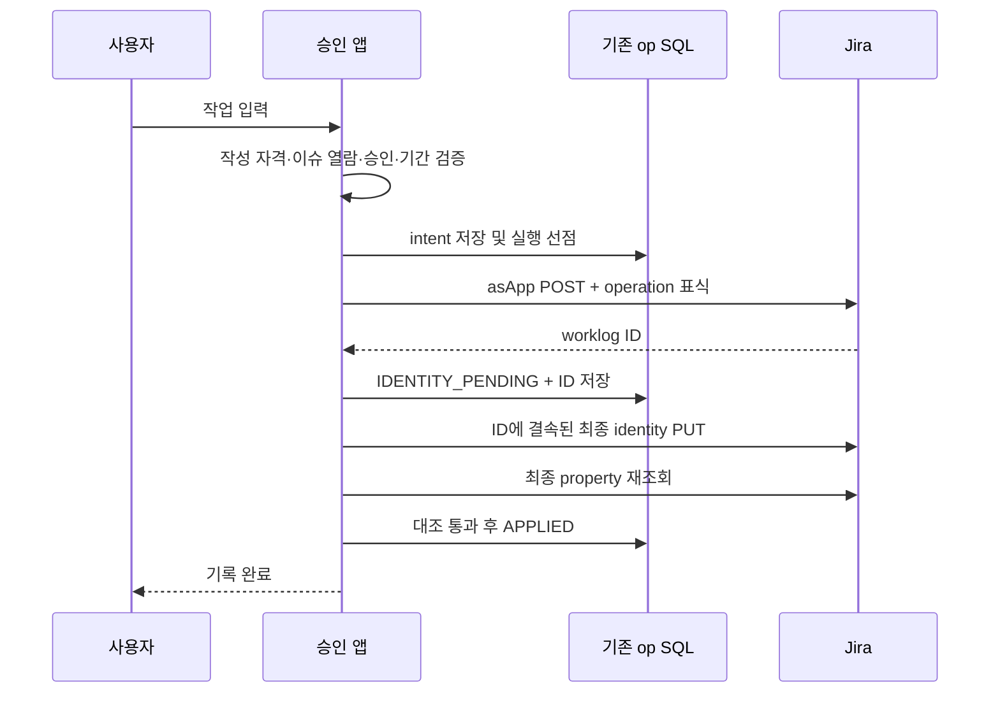

# 워크로그 properties 기반 실제 작업자 저장 설계

> 선택 상태(2026-10-12): **asApp 대안을 선택할 경우**의 저장 설계다. asUser를 유지하면 이 추가 identity는 필요하지 않다. [최신 통제 방식·운영 부담 논의](cloudjira--WORKLOG-INPUT-CONTROL-DISCUSSION.md)에서 최종 방식은 미확정으로 기록한다.

> 작성일: 2026-10-11 · 상태: 구현 전 개정안 · 기본안: properties 우선
> 상위 설계: [앱 전용 워크로그 입력](cloudjira--APP-MANAGED-WORKLOG-DESIGN.md)
> 이 문서는 상위 설계 1판의 §6~8·§10을 대체하고 §11~13의 운영·검증 계획을 보완한다. 실제 작업자의 별도 영구 SQL 원장은 기본안에서 제외한다. 코드·배포·실제 사이트 시험은 이번 문서 작업의 범위가 아니다.

## 1. 결정과 목적

워크로그 생성은 `asApp()`으로 실행한다. Jira 기본 작성자가 앱으로 표시되는 차이는 사용자가 수용했다. 실제 작업자는 각 Jira 워크로그의 **서명된 property**에 저장하고 우리 앱과 워크포스가 이를 검증해 사람별로 집계한다.

예를 들어 Jira의 `worklog 123, 2시간, 작성자 앱`에 `실제 작업자 철수, worklogId 123, 앱 서명`을 붙인다. 우리 앱에서는 철수 2시간으로 집계한다. Jira 기본 `worklogAuthor` 검색과 기본 보고서가 자동으로 철수로 바뀌지는 않는다.

1판의 `worklog_identity` 영구 SQL 테이블은 만들지 않는 것을 기본으로 한다. 기존 승인 DB·생성 intent/op·통제 행은 계속 필요하다. **별도 저장 비용 0원이나 추가 Jira 호출 0회를 약속하는 설계는 아니다.** 조회 규모에 따라 properties 읽기가 더 비쌀 수 있으므로 성능 관문을 둔다.

## 2. 데이터별 원천과 남는 저장

| 정보 | 저장 위치 | 목적 |
|---|---|---|
| 시간·작업일·설명 | Jira 워크로그 | 현재 작업량의 원천 |
| 실제 작업자·대상 ID 결속 | `movesApproval.identity` worklog property(제안 키) | 검증 가능한 영구 작업자 정보 |
| 승인·인증·기간 잠금 | 기존 승인 SQL | 현재 업무 허가 판정 |
| 입력 intent·전송 상태·중복 방지 | 기존 생성/통제 op SQL 확장 | 부분 실패 복구, 재POST 방지 |
| 숨긴 기록의 소유자 후보 | 기존 worklog-control SQL | asApp 조회 전 범위 제한 |
| 조회 인덱스·캐시 | 기존 미러/캐시 또는 선택적 파생 인덱스 | 재구축 가능한 성능 보조 |
| 공개키·폐기 상태 | 기존 연동 신뢰 설정 및 내보내기 | 과거 서명 검증 |

소유권 원천과 검색용 캐시는 구별한다. 캐시·통제 행의 owner만으로 최종 소유권을 인정하지 않고 현재 property를 대조한다. 반대로 서명된 property가 현재 승인·잠금 정책을 대신하지 않는다.

## 3. property 계약과 위조 방지

최종 property의 제안 형식이다. 키 이름·스키마는 구현 시 기존 키와 충돌을 확인한다.

```json
{
  "schemaVersion": 1,
  "issuer": "moves-approval",
  "cloudId": "<site-id>",
  "installationId": "<installation-id>",
  "issueId": "10001",
  "worklogId": "123",
  "operationId": "<server-generated-uuid>",
  "ownerAccountId": "<authenticated-requester-id>",
  "jiraAuthorAccountId": "<app-account-id>",
  "issuedAt": "<UTC-timestamp>",
  "keyId": "<trusted-key-id>",
  "signature": "<signature-over-canonical-payload>"
}
```

서명은 signature를 제외한 전 필드의 정규화 결과에 적용한다. 기존 Ed25519·canonicalization·keyring 구현을 재사용하고 두 앱에서 같은 테스트 벡터를 사용한다. 신뢰하는 공개키는 사전에 등록된 발급자·사이트·설치 설정에서 찾는다. property 안에 임의 공개키를 넣어 자기 서명을 신뢰시키는 방식은 허용하지 않는다. 개인키는 서버에서만 사용한다.

ownerAccountId는 resolver context의 인증 사용자 또는 기존 승인 요청의 requester에서 결정한다. 클라이언트가 보낸 계정 ID는 무시한다. 최초 버전은 대리 입력·작업자 변경을 지원하지 않는다. 이름·이메일·설명·비밀값은 identity에 넣지 않는다. property는 앱 전용 비밀 저장소가 아니다.

검증 순서:

1. 스키마 버전·크기·필수값 검사.
2. 신뢰된 발급자·설치·사이트·keyId와 키 폐기 상태 확인.
3. 서명 검증.
4. 현재 Jira 응답의 worklogId·issueId·author와 서명 값 일치 확인.
5. 현재 조회자 이슈 열람·본인/TeamScope·업무 정책 확인.

다른 기록·이슈·사이트에 복사된 서명은 ID 결속으로 거부한다. 같은 기록의 소유자는 불변이므로 시간·설명 수정마다 identity를 재서명하지 않는다. identity는 작업자만 증명하고 현재 시간·설명·승인 여부는 증명하지 않는다. 승인 지문은 현재 Jira 값과 별도로 대조한다.

키 유출 시에는 폐기된 키의 서명을 무조건 신뢰하지 않고 영향 기록을 미확인 상태로 전환한다. 정상 키 교체에서는 과거 공개키를 보존한다. 서명은 삭제 방지 기능이 아니므로 property가 삭제되면 복구 자료가 필요하다.

## 4. 생성은 두 단계로 확정

POST 전에는 worklogId를 알 수 없다. ID 없는 서명을 최종 소유권 증명으로 인정하면 다른 기록으로 복사할 수 있으므로 다음 순서를 사용한다.



POST에 넣는 기존 operation 표식은 복구용이며 소유권 증명이 아니다. 최종 property는 worklog property 전용 PUT으로 게시한다. 최종 서명 저장·재조회까지 성공해야 우리 앱에서 완료로 표시한다.

두 단계 사이에는 Jira 기록은 존재하지만 실제 작업자 귀속이 아직 확정되지 않은 구간이 있다. 우리 UI는 `기록 확인 중`으로 표시하고 해당 기간 정산·인증 확정을 막는다. property 실패 때문에 워크로그를 다시 생성하거나 자동 삭제하지 않는다.

## 5. 최소 op와 실패 복구

상태: `PREPARED → DISPATCHING → IDENTITY_PENDING → APPLIED`. 명확한 거부는 `REJECTED`, 결과 불명은 `UNKNOWN`이다. 기존 생성/통제 op를 확장하고 별도 영구 identity 테이블을 만들지 않는다.

최소 op는 operation ID, requester, issue ID, client intent, 정규화 입력 해시/복구 payload, 승인 request ID, 정책 revision, 확인된 worklog ID, 상태와 CAS rev를 포함한다. 사용자×이슈×intent UNIQUE와 Jira ID 중복 연결 가드를 둔다. CAS는 `rev = rev + 1`을 유지한다.

| 실패 | 처리 |
|---|---|
| POST timeout·실행자 중단 | UNKNOWN, 자동 재POST 금지 |
| POST 성공 후 SQL 실패·이벤트 선도착 | 사전 op와 표식·앱 author·이슈·입력을 대조해 ID 복구 |
| 후보 없음 | 검색 누락 가능성 때문에 실패 확정·자동 재POST 금지 |
| 후보 둘 이상 | 충돌로 격리, 자동 귀속·재서명 금지 |
| 최종 property PUT 실패 | known ID의 동일 payload 게시만 재시도 |
| property PUT timeout | GET으로 먼저 대조, 동일 값 확인 시 완료 |
| 다른 최종 identity 발견 | 덮어쓰지 않고 충돌 처리 |

같은 intent는 기존 상태를 반환하고 입력이 다르면 거부한다. 미해결인 동일 사용자·이슈·입력에 새 intent를 만들어 재요청해도 중복 위험으로 막는다. SQL과 Jira의 분산 트랜잭션 또는 exactly-once는 보장하지 않는다.

property 재게시 전 op/대상 ID/author를 다시 확인한다. 기간 mutation gate는 생성 선점부터 최종 identity 확정까지 유지하며 UNKNOWN 기간을 확정하지 않는다. 임대 만료만으로 재생성 권한을 주지 않는다.

미해결 op는 보관 정리로 삭제하지 않는다. 완료된 op의 상세 payload는 기존 보존 정책을 따르되 최소 intent tombstone은 설치 수명 동안 유지하는 것을 기본안으로 둔다. 기존 통제 행도 숨김 조회에 필요하다. 이 저장량은 비용 계산에 포함하며 SQL이 없어졌다고 설명하지 않는다.

## 6. 사람별 조회·통계와 비용

### 6.1 소유권 해석

- 앱 명의 + 검증된 최종 identity: 실제 작업자로 집계.
- 기존 사람 명의 기록: Jira author로 집계. identity로 사람 author를 바꾸지 않음.
- 앱 명의 + 누락/위조/키 불명/ID 불일치: UNRESOLVED. 앱 계정이나 현재 조회자의 실적으로 조용히 집계하지 않음.
- 미완료 op에 해당하는 기록: PENDING. 최종 확인 전 정산 확정에서 제외.

타임시트·합계·승인·인증·본인 수정/삭제·팀장 조회·이력·내보내기·워크포스가 같은 계약을 사용한다. 현재 WorklogCollector의 author 전용 필터는 이 해석으로 바꿔야 한다.

### 6.2 후보를 찾는 방법

`worklogAuthor = 철수`로 앱 명의 기록을 찾을 수 없다. worklog property를 사람별 JQL로 직접 검색할 수 있다고 가정하지 않는다. 기존 사람 명의 후보와 조회자가 볼 수 있는 통제 프로젝트/이슈의 앱 작성분 후보를 함께 수집하고 worklogId로 중복을 제거한다.

이슈 후보 검색 후 개별 워크로그 목록을 기간 조건·페이지 단위로 읽고 identity를 검증한다. 이슈 단위 JQL의 author/date가 서로 다른 워크로그에 의해 만족될 수 있으므로 최종 판정은 개별 기록에서 수행한다. 매번 사이트 전체를 무제한 순회하지 않는다.

`expand=properties`로 시간과 identity를 같은 응답에서 받는 경로를 우선 검증한다. 미지원/필드 누락이면 필요한 property만 GET하되, expand 누락을 identity 부재로 단정하지 않는다. 예산 초과 시 커서와 불완전 상태를 반환하고 부분 합계를 확정값으로 표시하지 않는다.

### 6.3 비교할 비용

| 항목 | 기본 비용 모델 |
|---|---|
| 생성 | POST 1회 + 최종 property PUT 1회 + 재조회 1회, 기존 op SQL 별도 |
| 목록 조회 | 이슈 후보 검색 + 워크로그 P페이지; expand 지원 시 개별 property GET 생략 가능 |
| expand 대체 | 후보 N건이면 최대 N회 property GET 추가 |
| 팀 U명 | 같은 후보를 반복하면 U×P 비용 가능; 권한 범위를 보존하는 재사용 필요 |
| 저장 | 별도 영구 소유권 테이블 제외, 기존 op/tombstone·통제 행·키 보존 비용 유지 |

1천/1만/10만 워크로그에서 초기·재조회·팀 집계의 Jira 호출 수, SQL 증가량, 응답 바이트, p95 지연, 429, 완주율을 측정한다. UI 목표 p95 3초를 제안 기준으로 두고 초과 시 커서 기반 진행 표시를 사용한다. 플랫폼 성능 보장값은 아니다.

규모상 필요하면 기존 미러에 owner/started의 **재구축 가능한 파생 인덱스**를 추가하는 대안을 비교한다. 인덱스가 있더라도 현재 property 검증이 최종 근거다. 비용 절감 목적에 반하는 추가 SQL을 실측 없이 기본 구성으로 넣지 않는다. 별도 SQL 원장보다 싸다는 결론은 측정 후 내린다.

## 7. 열람·수정·이력 보안

공개 기록은 asUser 조회 → identity 검증 → 본인/TeamScope 범위 → 설명 제한 → 합계/페이지 순서다. 현재 조회자 기준 이슈 열람 권한을 재확인하며 캐시에 조회자·권한 범위·서명/키 버전을 포함한다.

숨긴 기록은 기존 통제 SQL에서 owner/TeamScope 후보를 먼저 제한한 뒤 asApp으로 보충한다. 기존 통제 행을 없애지 않으며 후보마다 identity·ID·author와 asUser 이슈 열람을 재검증한다. SQL 후보가 없는 숨긴 기록을 전역 asApp 스캔해서 사용자에게 반환하지 않는다. 필요한 복구는 관리자 경로에서 한다.

수정·삭제는 실제 작업자와 호출자를 비교한 뒤 기존 승인·인증·기간·처리 중 가드를 적용한다. 앱 author가 같다는 이유로 허용하지 않는다. 실제 변경자는 기존 op·감사 이력에 남긴다. 시간·작업일 변경은 이전/현재 기간을 모두 재평가하며 이전 값은 기존 이력/미러를 활용한다.

같은 issue ID를 유지하는 프로젝트 이동은 현재 프로젝트 정책·권한을 다시 평가한다. 다른 issue ID로 이동한 worklog는 서명 결속 불일치로 격리한다. 이동 전 증거가 확인되는 관리자 복구 절차 없이 새 이슈로 재서명하지 않는다.

property가 삭제되면 남은 op 또는 신뢰된 내보내기 자료로만 복구한다. 없으면 실제 작업자를 추측하지 않는다. 삭제된 Jira 기록의 시간·설명은 identity만으로 복원할 수 없으므로 기존 이력 보존은 유지한다.

owner를 아는 PENDING/UNKNOWN은 그 사용자의 해당 기간을 불완전하게 한다. owner를 모르는 UNRESOLVED는 프로젝트×작업일 범위의 장애로 기록해 영향을 받는 정산 확정을 막는다. 일반 사용자에게 남의 기록 존재·설명을 공개하지 않고 필요한 범위의 불완전 안내만 제공한다.

## 8. 워크포스와 키 수명

워크포스는 Jira에서 동일 identity를 읽고 검증한다. 사람별 귀속만을 위한 별도 사용자×기간 매핑 게시물은 기본안에서 만들지 않는다. 기존 승인/인증 결과 문서는 계속 사용한다.

두 앱은 schema·canonicalization·키 신뢰·폐기 처리·테스트 벡터를 공유한다. identity는 작업자만 증명하므로 현재 Jira 데이터와 기존 승인/인증 스냅샷을 대조해 정산 여부를 판단한다. `approved=true` 같은 임의 property나 identity 서명을 승인으로 해석하지 않는다.

워크포스도 조회자의 asUser 권한을 준수한다. 숨긴 워크로그는 property가 있다고 열람 가능해지는 것이 아니므로 visibility와 기존 연동의 호환 실측이 필요하다. 미지원·알 수 없는 키/버전·게시 중이면 동기화 대기/확인 필요로 표시하고 정산을 확정하지 않는다.

capability `signedWorklogIdentityV1`(제안)을 확인해 연동 설치는 양쪽 지원 전 새 생성 모드를 활성화하지 않는다. 구버전이 앱 계정 실적으로 조용히 집계하도록 fallback하지 않는다. 미연동 설치는 단독 사용한다.

키 교체 후 과거 공개키를 보존한다. 제거 전 property·스키마·공개키·폐기 상태를 내보내되 개인키는 내보내지 않는다. 제거 후 property가 유지되는지, 재설치의 앱 계정/설치 ID와 과거 서명을 어떻게 연결할지는 실측 대상이며 자동 보존을 보장하지 않는다.

## 9. 상위 운영·구현 계획의 변경

상위 설계의 프로젝트 권한 분리, provider, 앱 자체 작성 자격, 수정 모달 지원 확인은 유지한다. 구현 시 AGENTS/CLAUDE의 asApp 생성 허용과 **검증된 identity의 소유권 사용**을 명시한다. 엔티티 프로퍼티 원문을 신뢰하는 예외를 만들지 않는다.

활성화 전 준비는 `소유권 SQL 원장` 대신 `최종 서명 게시·혼합 조회·두 단계 복구·키 보존`이다. 해제는 신규 생성 중단 → 미해결 생성/identity 대조 → property/키/필요 감사 자료 내보내기 → 관리자가 승인한 권한 복원/provider 조정 순서를 따른다.

롤백은 앞으로의 입력 방식만 되돌린다. 기존 앱 명의 기록을 사람 명의로 자동 변환하지 않는다. 읽기 버전은 서명 property를 해석할 수 있어야 한다. 기존 개인 명의 기록은 그대로 둔다.

구현 단위: 플랫폼·비용 시험 → property 계약/검증기 → 기존 op 기반 두 단계 생성 → 혼합 조회·통계·수정/삭제 → 워크포스 호환 → UI/운영 설정. 새로운 영구 identity 테이블 migration을 선행 작업으로 만들지 않는다. 기존 op 변경 migration은 구현 시 중복 저장 여부를 확인한 후 결정한다.

## 10. 추가 실측 관문

상위 G1~G11에 아래 시험을 추가하고 G8은 두 단계 실패까지 확장한다.

| ID | 시험 | 수용 기준 |
|---|---|---|
| G12 | 조회 비용 | expand 지원/대체 GET, 1천/1만/10만 건, 팀 중복 조회·429·p95·커서, SQL 인덱스 대안 비교 |
| G13 | 서명 공격 | 다른 worklog/issue/site로 복사, 임의 키, 알 수 없는 버전, 변조 owner 거부 |
| G14 | 두 단계 장애 | POST만 성공, property PUT timeout, SQL 실패, 이벤트 선도착에도 재POST 없음 |
| G15 | 키/데이터 수명 | 정상 교체·폐기·property 삭제·앱 제거/재설치·공개키 내보내기/재검증 |
| G16 | 연동·숨김 | 두 앱 동일 결과, 구버전 차단, 제한 공개 기록의 합법적 조회 및 설명 비노출 |
| G17 | 실제 저장 비용 | 기존 op 재사용, intent tombstone·통제 행 증가량, 추가 property 호출 비용 산정 |

사이트 실측 전에는 `properties로 저장 가능`과 `운영 규모에서 저렴하고 안전하게 조회 가능`을 구분한다. 현재 완료한 것은 문서/API 계약 및 코드 경로 확인이며 위 시험은 미완료다.

## 11. 근거

- [Worklog properties API](https://developer.atlassian.com/cloud/jira/platform/rest/v3/api-group-issue-worklog-properties/): 워크로그별 사용자 정의 데이터 저장·조회·삭제 지원.
- [Jira Worklogs API](https://developer.atlassian.com/cloud/jira/platform/rest/v3/api-group-issue-worklogs/): 생성 body의 properties, 목록/단건/일괄 조회 계약.
- [Entity properties](https://developer.atlassian.com/cloud/jira/platform/jira-entity-properties/): 앱만을 위한 비밀·불변 저장 공간으로 가정하지 않는다.
- 현재 코드의 재사용 후보: `src/integration/workforce/{signature,canonical,keyring}.js`, `src/resolver/worklogControl/WorklogControlGateway.js`의 expand 경로, `src/resolver/timesheet/WorklogCollector.js`의 property 수집과 author 필터.

보안·성능·운영 세부 항목은 위 API가 자동 제공하는 기능이 아니라 이 앱이 구현하고 검증할 설계다.
