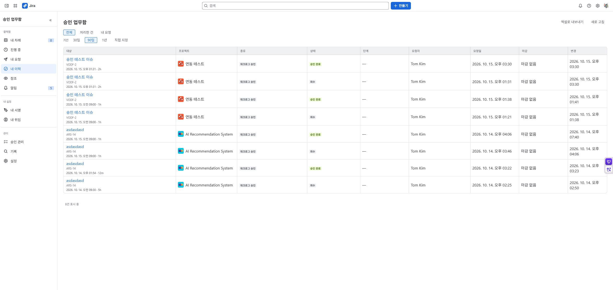

# Author and requester guide

## Record work and request approval

1. Open **Log work** on the issue and enter the work date, duration and description.
2. Check the save result. Automatic-request policies submit an approval request after saving. Under a manual policy, request approval from the record details.
3. If an approver is required, choose from the candidates returned by the app. Candidates depend on the team-lead rules, active accounts and issue visibility.
4. Open **Work log → Details** to see approval status and any lock reason. You can also track your requests and history in the app inbox.

| Result | Next action |
| --- | --- |
| Saved, awaiting approval | Wait for a decision without saving again |
| Approver required | Select a candidate on the existing record |
| Saved, request failed | Retry only the request on the existing record |
| Rejected | Read the reason and edit or resubmit if current policy allows |
| Closed or approved | Check the lock reason; request reconsideration if offered |

Changing an approver may be available only while a request is pending and no decision has been made. It creates a new request round without overwriting previous decisions. If no candidates appear, ask your administrator to check team configuration and issue permissions.

Unapproved records flagged for rule violations can also require an explanation. This is separate from reconsideration of an approved record. In connected mode, a Workforce team lead may approve their own work on an eligible linked issue; an upper-level lead is preferred as the default when available.

## Reconsideration and history

If reconsideration is available for a finalized record, enter a reason in its details. The existing lock and certified time remain in place during reconsideration. This is not permission to edit the record freely.

Approval history records who decided and when. Change history records creations, edits and deletions observed by the app. Visibility depends on current permissions and collection settings.

Check [current status change availability](cloudjira--07-transition-approval.md).

[Documentation home](cloudjira--00-index.md) · [한국어](../ko/cloudjira--03-requester-guide.md)

