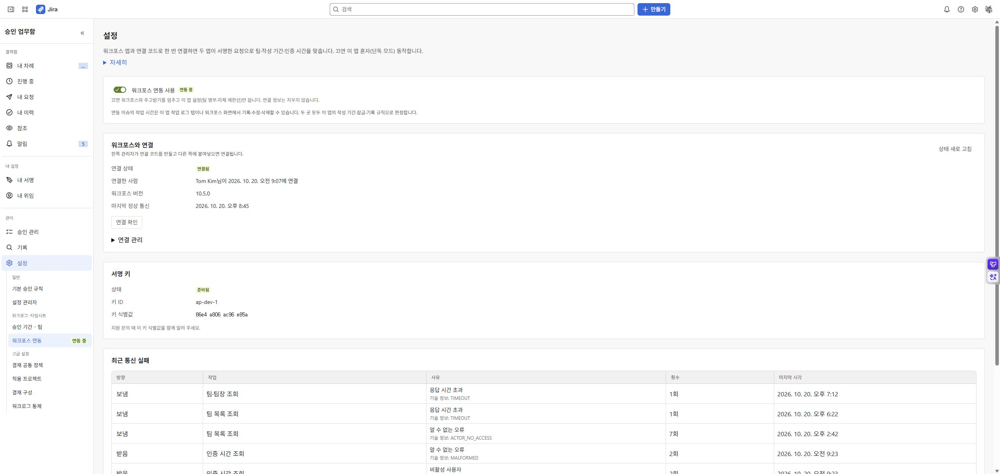

# Connecting Moves Workforce

Workforce is an optional integration. Install compatible versions of both apps and explicitly connect them as an administrator. Standalone mode uses Approval's own teams and policies.

## Pairing

1. Install compatible releases and open integration settings in both apps as an administrator.
2. Enable integration and choose **Create pairing code** in one app.
3. Before it expires, paste the code into the other app's pairing input and follow the connection prompts.
4. Verify the connection state in both apps and retrieve teams and linked issues.
5. Test one worklog from creation through approval and check the result in the other app.

Pairing codes contain secret information. Do not include them in public documents, screenshots or support tickets. Manually distributing private keys, publishing entity properties and entering 3LO tokens are not part of the current pairing process.

## Where is information managed?

| Information | Owner |
| --- | --- |
| Workforce teams, leads and linked issues | Workforce |
| Workforce-managed issue entry and request settings | Workforce |
| Decisions, certified evidence and control judgments | Approval |
| Connection status, disconnection and diagnostics | Integration settings in each app |

Normal entry within Workforce asks Approval for a decision before saving. If directed to Approval, continue there. A connection failure does not mean an unverified request is permitted.

If statuses differ, check the connection, current permissions, cache refresh and peer version. The old entity-property republishing procedure is no longer applicable. Disconnecting the apps and releasing worklog controls are different actions.

[Documentation home](cloudjira--00-index.md) · [한국어](../ko/cloudjira--10-workforce-integration.md)

