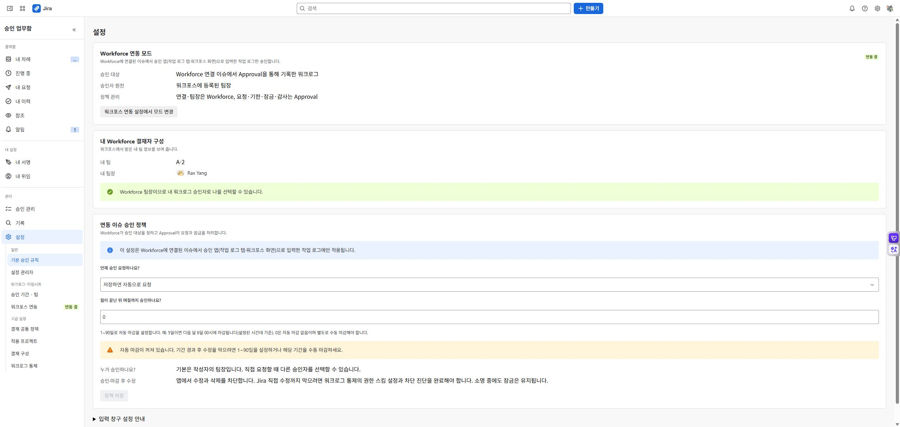

# 실제 화면 캡처

2026-10-20 · development · 한국어 UI 원본. 운영 출시 화면이나 영문 UI 캡처가 아닙니다. 공개 전에 시험 사용자 이름·사이트 정보의 공개 범위와 출시 버전 일치를 확인하세요.

## 업무함에서 워크로그 승인과 이력 확인

승인 완료와 회수된 요청 회차, 작업 일시·소요 시간을 구분하는 실제 개발 환경의 내 이력 화면입니다.

## 자동 요청과 월 마감 규칙 설정

실제 개발 환경의 기본 승인 규칙 화면입니다. 자동 마감 0일의 의미와 보호 범위를 함께 안내합니다.

## 필요할 때 Moves Workforce 연결

실제 개발 환경의 연결 상태와 통신 진단 화면입니다. 연결 코드와 개인키는 표시하지 않았습니다.

[문서 홈](cloudjira--00-index.md)
