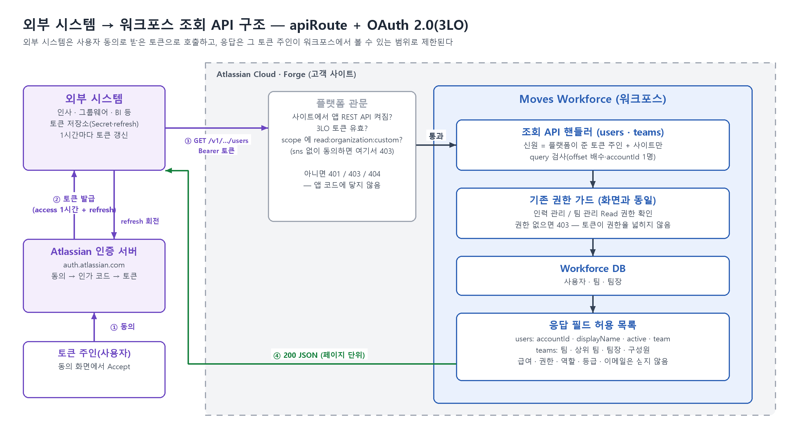
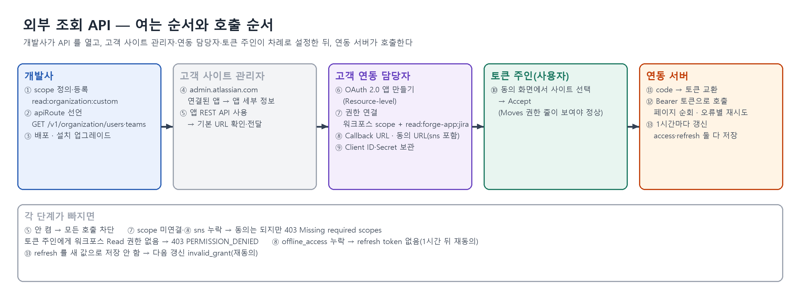
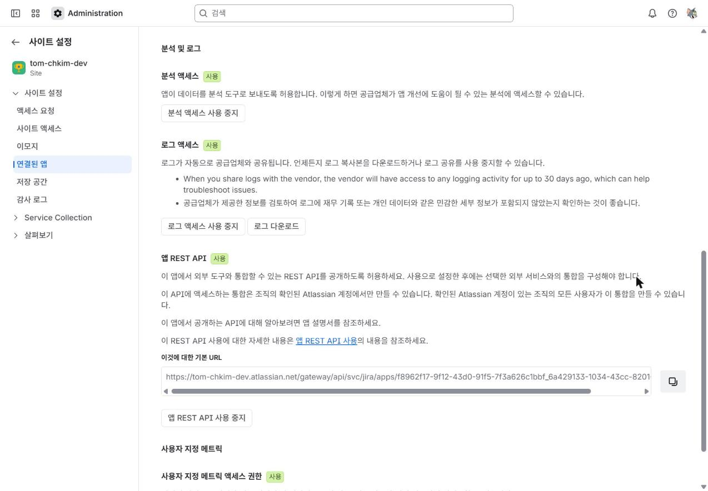
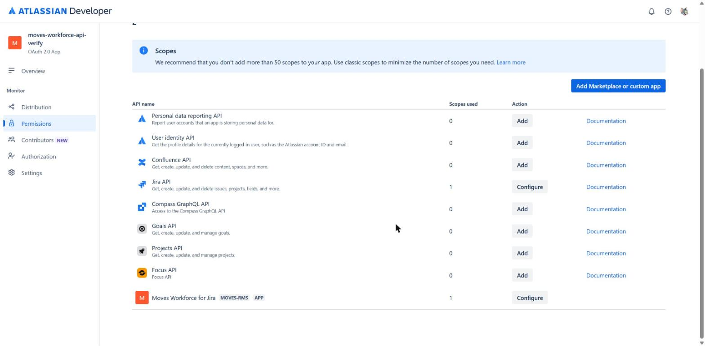
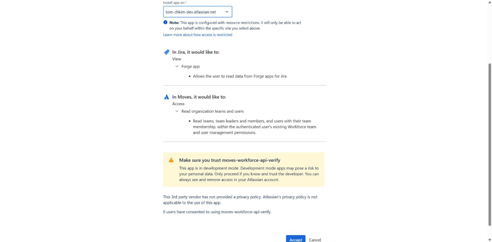
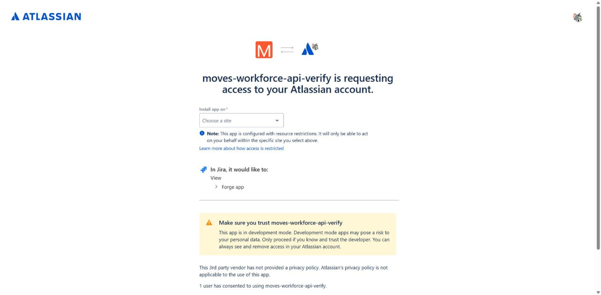
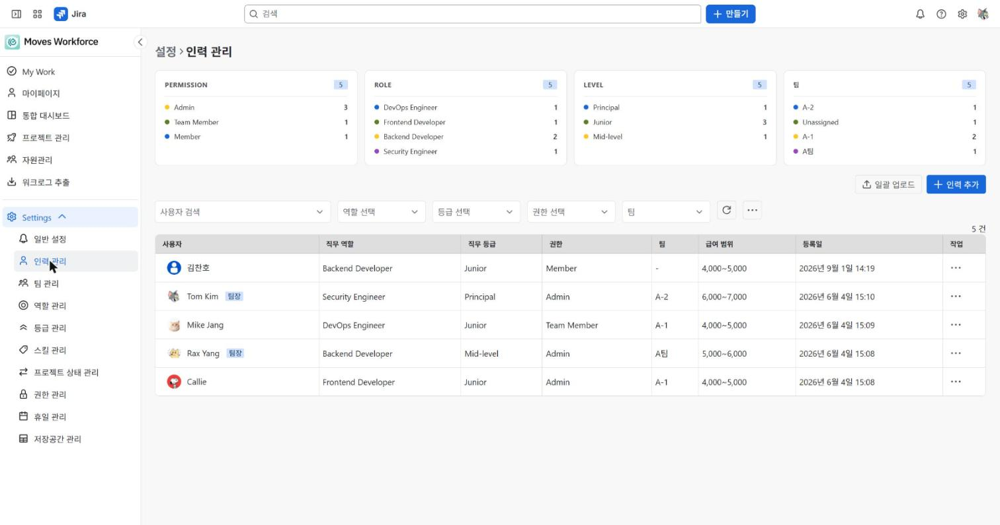

# 외부 시스템 → 워크포스 조회 API — apiRoute + OAuth 2.0(3LO, 사용자 동의 기반 인증)

> 가능성 · 구현 · 검증 (2026-10-20 기준, 개발 사이트 실측)
> 대상: Moves Workforce for Jira의 `GET /v1/organization/users`(샘플)·`GET /v1/organization/teams`
> 고객용 연결 가이드: 「Moves Workforce 외부 조회 API 연결 가이드 및 설정 방법」(별도 문서)

## 요약

이 장에서는 외부 조회 API의 구현 가능 여부와 주요 실측 결과를 살펴본다.

- **결론: 구현 가능하며, 워크포스에 API를 열고 개발 환경에서 호출까지 확인했다.** 외부 시스템(인사·그룹웨어·BI 등)은 사용자가 동의하여 발급받은 토큰으로 워크포스의 조직 정보를 읽는다.
- 응답 범위는 **토큰 소유자가 워크포스 화면에서 볼 수 있는 범위**다. 외부 API도 기존 화면의 권한 검사 로직을 그대로 거친다. 토큰의 scope(권한 범위)가 사용자의 기존 권한을 넓히지는 않는다.
- 고객 측 설정 작업이 필요하다. 사이트 관리자는 앱 REST API를 켜야 한다. 연동 담당자는 OAuth 앱 생성·권한 연결·Client Secret(앱 인증 비밀 값) 보관을 담당하고, 토큰 소유자는 접근에 동의해야 한다.
- **Preview(정식 출시 전 공개) 기능**이다. Jira·Confluence 앱만 지원하며, 기능 폐기 예고 기간이 짧을 수 있다.

| 항목 | 값(개발 환경 실측) |
|---|---|
| 토큰 없음·가짜 토큰 | 401 |
| 정상 호출 | 200, 콜드 호출(초기 호출) 9~11초 → 이후 약 2초 |
| custom scope(사용자 정의 권한 범위)가 빠진 토큰 | 403 `Missing required scopes` |
| 화면 대조 | 사용자 5명·팀·팀장 일치. 급여·권한·역할·등급은 응답에 없음 |

---

## 1. 기술적으로 가능한가

이 장에서는 공식 지원 범위와 제약사항을 확인하고, 워크포스의 대응 방식을 정리한다.

### 1.1 확인해야 했던 것

| 질문 | 답 | 근거 |
|---|---|---|
| Forge 앱이 외부에 REST API를 열 수 있는가 | 가능하다. manifest(앱 구성 명세)의 `apiRoute` 모듈을 사용한다(Preview). | 공식[^ar] |
| 어떤 인증 수단을 사용하는가 | **3LO(OAuth 2.0) 토큰만** 사용한다. 토큰 없이 호출하면 401이다. 다른 Forge 앱의 호출도 인증을 거쳐야 한다. | 공식[^ov], 사전 실측 |
| 호출자 신원은 어떻게 확인하는가 | 핸들러의 `principal.accountId`는 **토큰을 발급받은 사용자**를, `installContext`는 사이트를 나타낸다. | 사전 실측 |
| API 접근에 필요한 scope는 어떻게 정하는가 | 개발사가 custom scope(`read:organization:custom`)를 정의하고, 고객의 3LO 앱이 해당 scope를 연결한다. | 공식[^ex] |
| 동의 시 주의할 점은 무엇인가 | 동의 URL에 **`sns={appId}.{envId}`**가 없으면 동의는 완료되지만 custom scope가 빠져 403이 발생한다. 이 매개변수는 공식 튜토리얼에 없고, Developer Console의 **Authorization URL generator**에만 있다. | 사전 실측·이번 실측(§3.2의 9번) |
| 사용자 개입 없이 주기적으로 호출할 수 있는가 | 동의 URL에 `offline_access`를 포함하면 refresh token(액세스 토큰 갱신용 토큰)을 받는다. refresh token은 사용할 때마다 새 값으로 바뀌는 회전 방식이 필수다. | 공식[^oauth] |

이 문서에서 “사전 실측”은 본 개발 전에 시험용 앱 두 개로 같은 사이트에서 측정한 결과를 뜻한다. “이번 실측”은 §3에 정리한 결과를 뜻한다.

### 1.2 공식 문서의 제약사항과 대응

| 제약(공식) | 출처 | 워크포스 영향·대응 |
|---|---|---|
| **Preview** — "may be subject to shorter deprecation windows" | [App REST APIs][ov] · [API route][ar] | 외부 API는 `/v1/` 버전 경로를 사용한다. 응답에는 명시적으로 허용한 필드만 포함한다. 변경 시 v2 경로를 추가한다. |
| **Jira·Confluence 앱만 지원**, **Isolated Cloud 미지원** | [API route][ar] | 워크포스는 Jira 앱이므로 지원 대상이다. Isolated Cloud 고객은 사용할 수 없다. |
| **사이트마다 기본적으로 꺼져 있음**. 사이트·조직 관리자가 **연결된 앱** 화면에서 켜야 한다. 끄면 **즉시** 모든 호출을 차단한다. | [Access REST APIs][acc] | 고객 관리자 작업이므로 설치 안내에 포함한다. 고객 가이드 1장에서 다룬다. |
| 인증 수단은 **3LO만 명시됨**. API 토큰 등은 언급이 없다. 토큰은 고객 동의 후에만 발급되며, 매 호출에 필요하다. | [App REST APIs][ov] | 연동 서버가 토큰을 보관하고 refresh token을 회전해야 한다. 고객 가이드 3·4장에서 다룬다. |
| **3LO 앱은 해당 사이트 구성원만 생성 가능**. 외부 업체가 직접 만들 수 없다. | [App REST APIs][ov] · [Access REST APIs][acc] | 고객 측 담당자가 생성해야 한다. 외주 연동 업체가 생성하려면 고객 계정이 필요하다. |
| **custom scope는 앱·환경당 20개**. 이름은 `…:custom` 형식이며 최대 93자 + 접미다. **이름 변경·비활성화·삭제 불가**. | [Expose REST APIs][ex] | 현재 `read:organization:custom` 1개를 teams·users에서 공용으로 사용한다. 실험용 `read:probe:custom`은 삭제할 수 없어 apiRoute에 매핑하지 않은 상태로 둔다. 새 scope는 신중히 추가한다. |
| scope는 **환경별로 등록**해야 한다. 앱 관리자만 등록할 수 있으며, apiRoute에 매핑하기 전에 등록해야 한다. | [Expose REST APIs][ex] | 개발 환경마다 등록해 확인한다. 운영 환경에는 배포 전에 등록한다. |
| 수신 형식은 **`application/json`만 지원**한다. 지원 메서드는 GET·PUT·POST·DELETE·PATCH이며, 응답에 `statusCode`가 필수다. | [API route][ar] · [Expose REST APIs][ex] | GET만 선언했다. 다른 메서드는 플랫폼이 404를 반환하며, 핸들러에 도달하지 않는다(실측). |
| 경로 와일드카드는 `*`(한 칸)·`**`(여러 칸)를 지원한다. query(쿼리 매개변수)는 정확한 경로에 붙는다. | [Access REST APIs][acc] | 고정 경로에 query(`offset`·`accountId`)를 붙여 사용한다. |
| 3LO 앱에 **Forge 제품 scope `read:forge-app:jira` 추가 필요**. 필요한 scope만 추가해야 한다. | [Access REST APIs][acc] | 읽기 전용이므로 `write:`는 추가하지 않는다. 고객 가이드 2-3에서 다룬다. |
| 마켓플레이스 배포 시 **REST API와 scope의 대응 관계를 설명하는 개발자 문서 공개 필요** | [App REST APIs][ov] · [Expose REST APIs][ex] | 고객 가이드 4장(요청·응답·오류)을 공개 문서로 다듬어야 한다. |
| `environment-id`·`app-id`는 앱마다 달라 **고객에게 제공 필요**. cloudId는 `https://<사이트>/_edge/tenant_info`로 조회한다. | [Expose REST APIs][ex] · [Access REST APIs][acc] | 기본 URL은 관리 화면(1단계)에 표시된다. 토큰의 `accessible-resources`가 빈 목록을 반환하므로(실측), cloudId는 tenant_info로 조회한다. |
| apiRoute 앱도 **다른 조건을 모두 만족하면** Runs on Atlassian 자격을 얻을 수 있다. | [App REST APIs][ov] | 워크포스는 webtrigger(dynamic)·egress(외부로 나가는 통신) 때문에 이미 자격 요건을 충족하지 못한다(앱 간 채널 문서). |
| refresh token은 **회전 방식**이다. **재사용 허용 시간은 10분**이며, **90일 동안 사용하지 않으면 만료**된다. | [OAuth 2.0 (3LO) — Jira][oauth] | 회전 결과를 원자적으로 저장한다. 90일 동안 사용하지 않으면 다시 동의해야 한다. |
| **Callback URL** — OAuth 앱의 Authorization 화면에 등록(최대 30개, 한 줄에 하나). 동의 URL·토큰 요청의 `redirect_uri` 는 등록값과 일치해야 함. `code` 유효 시간·재사용 여부는 문서에 없음 | [OAuth 2.0 (3LO) — Jira][oauth] · 콘솔 화면 | 로컬 `http://localhost` 주소도 동작(실측). 고객 가이드 2-4 에 등록·처리 순서·자주 나는 문제 정리 |
| 실행 시간·크기·호출 한도: apiRoute 문서에는 수치가 없다. Forge 공통 [Invocation limits][lim]는 요청 5MB, 설치당 분당 7,000·초당 300, 사용자당 분당 1,200이다. | [Invocation limits][lim] | 페이지 크기를 사용자 20명·팀 10개로 작게 유지한다. 429 응답을 받으면 `X-Ratelimit-Reset`까지 대기한다. |

---

## 2. 어떻게 구현했나

이 장에서는 외부 API의 구조와 구현 항목, 기존 화면 권한을 유지하는 방식을 살펴본다.

### 2.1 구조

### 2.2 구현 항목

| 항목 | 내용 |
|---|---|
| custom scope | `read:organization:custom`의 표시 이름은 "Read organization teams and users"다. 설명에 "인증된 사용자의 기존 워크포스 팀·사용자 관리 권한 안에서"라고 명시했다. 이 설명은 동의 화면에 그대로 표시된다. scope 정의 파일로 환경마다 등록한다. |
| apiRoute | `GET /v1/organization/users`, `GET /v1/organization/teams`를 선언했다. 수신 형식은 `application/json`이며, 두 경로 모두 위 scope 하나를 사용한다. |
| 핸들러: 호출자 신원 | 플랫폼이 제공한 `principal.accountId`·`installContext`만 신원 판단에 사용한다. query의 accountId는 조회 대상일 뿐이다. 다른 사이트의 cloudId가 섞이면 401을 반환한다. |
| 핸들러: query 검사 | 허용 목록으로 검사한다. `offset`은 20의 배수이고, `accountId`는 1명 조회용이다. 둘을 동시에 지정하거나 알 수 없는 키를 보내면 400을 반환한다. |
| 핸들러: 권한 검사 | 화면과 같은 기존 권한 검사 로직을 거쳐 조회한다. |
| 핸들러: 실패 응답 | 권한·라이선스 오류는 403, 조회 대상이 없으면 404, 그 밖의 오류는 503을 반환한다. 그 밖의 오류에는 원인 문구를 포함하지 않는다. |
| 핸들러: 응답 필드 | 명시적으로 허용한 필드만 응답에 포함한다. |
| 테스트 | 신원·query 검사, 권한 거부(권한 없음 → 403), 응답 필드 허용 목록을 확인한다. |

설계 원칙은 **새 권한 로직을 만들지 않는 것**이다. 외부 API도 화면과 같은 권한 검사 로직을 거친다. 따라서 화면에서 볼 수 없는 정보는 API로도 볼 수 없다.

---

## 3. 어떻게 검증했나 · 결과

이 장에서는 개발 환경의 설정·호출 실측 결과와 미확인 항목, 재검증 절차를 정리한다.

### 3.1 개설·등록 절차 확인 및 화면 캡처(개발 환경, 2026-10-20)

| 단계 | 결과 | 캡처 |
|---|---|---|
| scope 등록·배포·업그레이드 | 개발 환경에 `read:organization:custom` 등록 | 배포 도구 출력 |
| 관리자 App REST API 켜기 | "사용" + 기본 URL |  |
| OAuth 앱 + 권한 연결 | Moves Workforce (MOVES-RMS) 1개 + Jira `read:forge-app:jira` |  |
| 동의(sns 포함) | "In Moves … Read organization teams and users" 보임 |  |
| 동의(sns 없음) | Moves 항목이 **없음** → 403 |  |

### 3.2 호출 결과

| # | 요청·확인 항목 | 기대 | 결과 |
|---|---|---|---|
| 1 | 토큰 없음·가짜 토큰(사이트형·svc형) | 401 | 401(0.08~0.1초) |
| 2 | 목록 조회 | 200 | 200, 5명(콜드 호출 8.8초 → 1.9초) |
| 3 | 1명 조회 / 없는 사람 조회 | 200 / 404 | 200 / 404 `USER_NOT_FOUND` |
| 4 | `offset=20`(사용자 5명뿐) | 빈 페이지 | 200 `users:[]` |
| 5 | 잘못된 query | 400 | 400 `API_INVALID_QUERY` |
| 6 | POST·없는 경로 | 거부 | 404(플랫폼 응답, 핸들러 미도달) |
| 7 | 같은 토큰으로 teams 조회 | 200 | 200(같은 scope) |
| 8 | refresh token 회전 | 토큰 둘 다 새 값 | 둘 다 새 값. 기존 refresh token도 10분 안에 1회 통과(공식 재사용 허용 구간) |
| 9 | sns 없는 토큰 | 403 | 403 `Missing: [read:organization:custom]` |

워크포스의 **설정 > 인력 관리** 화면에 표시된 5명과 응답을 대조했다. 이름·팀·팀장이 일치했다. 화면에 있는 급여·권한·역할·등급은 응답에 포함되지 않았다.

### 3.3 아직 확인하지 않은 것

| 항목 | 확인 방법·시점 |
|---|---|
| **권한 없는 사용자 거부(403 `PERMISSION_DENIED`)** — 단위 테스트로만 확인 | 워크포스 인력 관리 Read 권한이 없는 계정(예: Member 세트)으로 동의한 뒤 호출한다. |
| 라이선스 없는 설치, production(운영) 환경, 여러 사이트에 동의한 토큰 | 운영 전에 확인한다. |

### 3.4 재검증 절차

1. 고객 가이드 1~3장에 따라 App REST API를 켜고, OAuth 앱을 생성한 뒤 사용자 동의를 진행한다.
2. 측정 도우미 스크립트로 동의·호출·갱신을 확인한다. 명령은 `consent`(동의 서버), `call <이름> <token|none|bogus|nosns> <site|svc> <GET> <경로>`, `refresh`다. 사용자가 Client ID·Client Secret을 별도 파일에 직접 저장해야 한다. 스크립트는 해당 값을 출력하지 않는다. Git Bash에서는 경로 인자가 변환되므로 `MSYS_NO_PATHCONV=1`을 설정한다.
3. 검증을 마치면 검증용 OAuth 앱을 삭제하거나 Client Secret을 재발급한다. 사용자 동의를 철회하고 토큰 파일도 삭제한다.

---

[ov]: https://developer.atlassian.com/platform/forge/app-rest-apis/
[ar]: https://developer.atlassian.com/platform/forge/manifest-reference/modules/api-route/
[ex]: https://developer.atlassian.com/platform/forge/expose-forge-app-rest-apis/
[acc]: https://developer.atlassian.com/platform/forge/access-rest-apis-exposed-by-a-forge-app/
[oauth]: https://developer.atlassian.com/cloud/jira/platform/oauth-2-3lo-apps/
[lim]: https://developer.atlassian.com/platform/forge/limits-invocation/

[^ar]: [API route (manifest)](https://developer.atlassian.com/platform/forge/manifest-reference/modules/api-route/)
[^ov]: [Forge app REST APIs](https://developer.atlassian.com/platform/forge/app-rest-apis/)
[^ex]: [Expose Forge app REST APIs](https://developer.atlassian.com/platform/forge/expose-forge-app-rest-apis/)
[^oauth]: [OAuth 2.0 (3LO) apps — Jira](https://developer.atlassian.com/cloud/jira/platform/oauth-2-3lo-apps/) · [Implementing the Refresh Token Flow](https://developer.atlassian.com/cloud/oauth/getting-started/refresh-tokens/)
