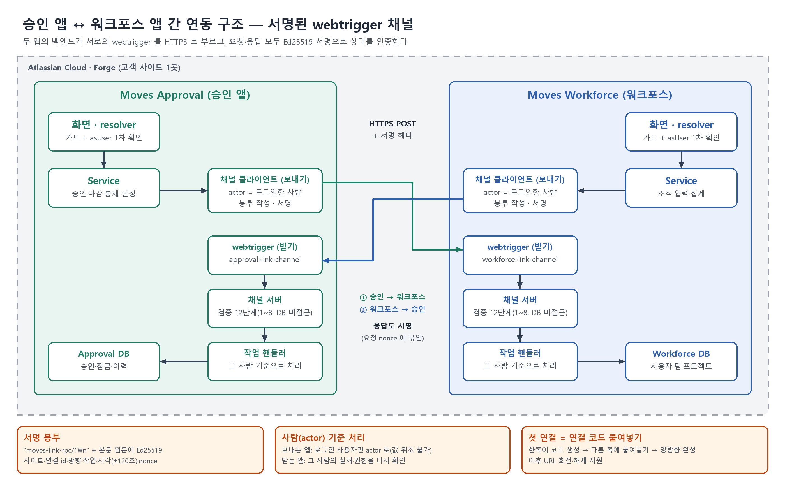
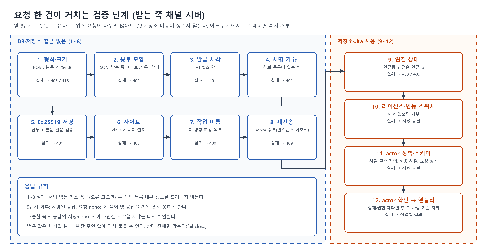
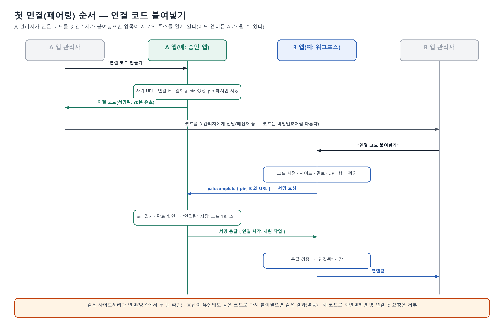
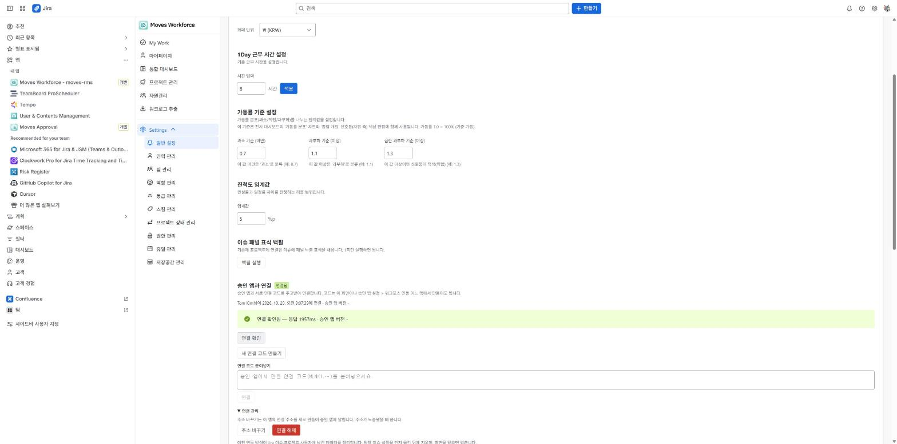
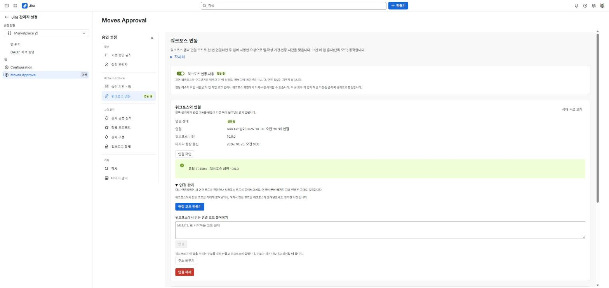
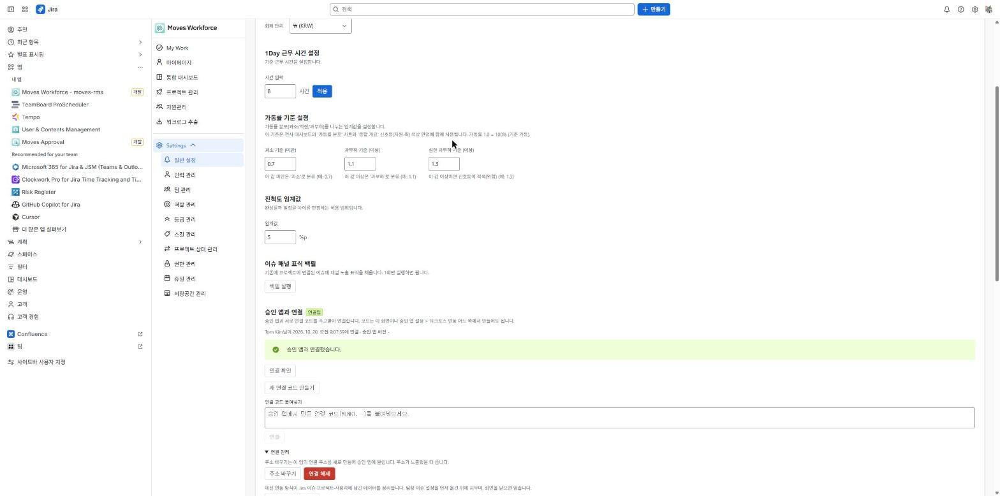
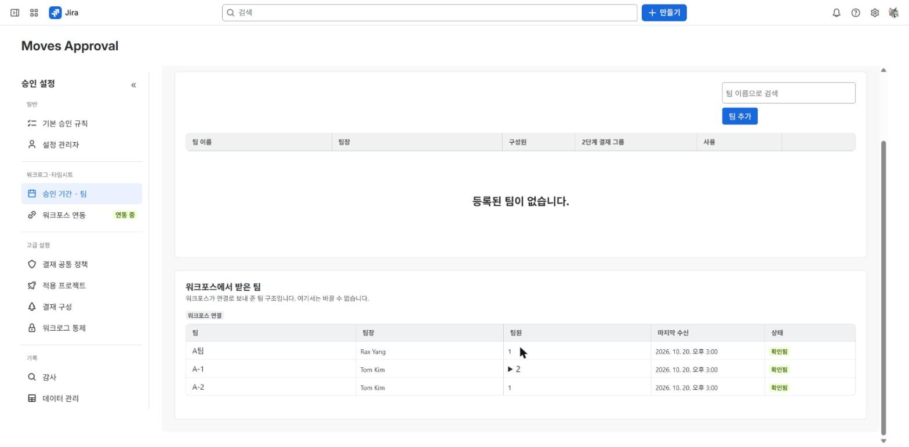
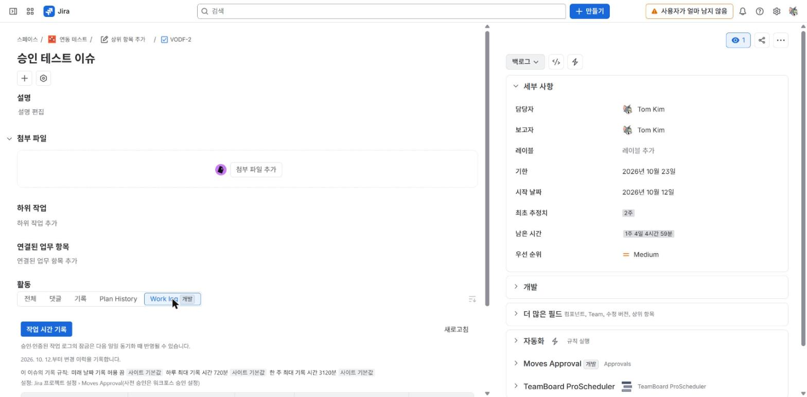
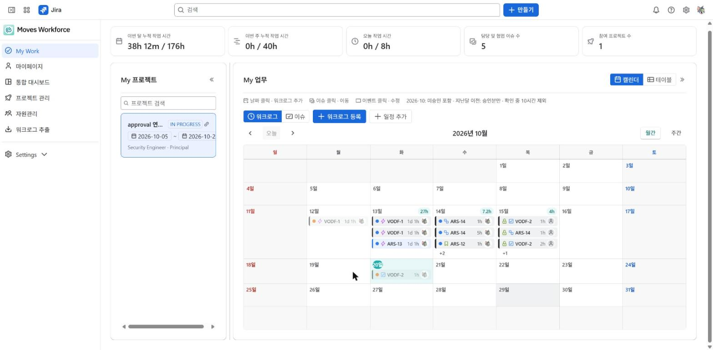
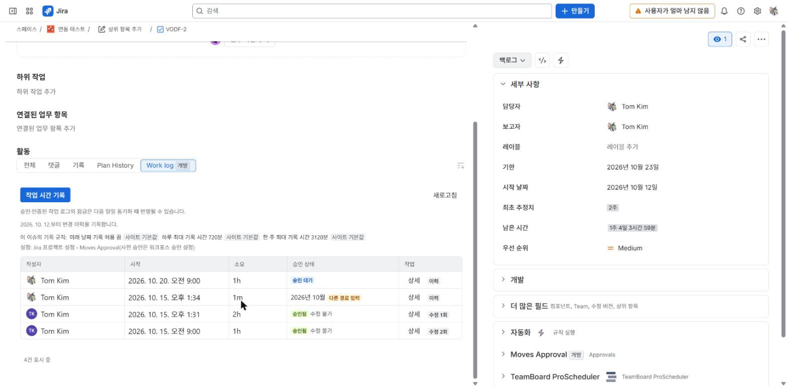

# 승인 앱 ↔ 워크포스 간 연동 — webtrigger 채널

> 가능성 · 구현 · 검증 (2026-10-20 기준, 개발 사이트 실측)
> 대상 앱: Moves Approval for Jira(승인 앱) · Moves Workforce for Jira(워크포스)

## 요약

이 장에서는 연동 가능 여부, 채택한 방식, 주요 실측 결과를 정리한다.

- **결론: 연동이 가능하며, 개발 환경(dev)에 구현해 동작을 확인했다.** 두 Forge 앱의 백엔드가 서로의 dynamic webtrigger(동적 응답을 반환하는 HTTP 호출 진입점)를 HTTPS로 호출한다. 상대 앱은 Ed25519 디지털 서명으로 인증한다.
- 이전 방식인 Jira 엔티티 프로퍼티를 통한 서명 문서 교환은 모두 제거했다. 프로퍼티는 이슈 편집 권한이 있는 누구나 쓸 수 있어 신뢰하기 어렵다. 반영이 늦고, 크기 한도(32KB)도 있었다.
- 첫 연결은 **연결 코드 붙여넣기**로 완료한다. 한쪽 관리자가 만든 코드를 다른 쪽 관리자가 붙여넣으면 양방향 연결이 완성된다.
- 요청은 **요청을 일으킨 행위자(actor) 기준**으로 처리한다. 보내는 앱이 먼저 확인하고, 받는 앱이 해당 행위자의 권한을 다시 확인한다.
- 수용한 영향: dynamic webtrigger와 외부 호출 때문에 두 앱 모두 **Runs on Atlassian 자격을 잃는다**.

| 항목 | 값(개발 환경 실측) |
|---|---|
| 호출 지연 | 사전 실측 0.12~0.4초, 실제 앱 연결 확인 0.24~2초, 콜드 시작 직후 4~7초 |
| 위조 요청 | 26종 + 동시 80건 전부 거부, DB(데이터베이스) 접근 0 |
| 기능 | 채널 작업 14종 중 11종 화면 실측 통과(§3.3) |

---

## 1. 기술적으로 가능한가

이 장에서는 앱 간 직접 호출의 가능성, 대안 비교, Forge의 제약과 대응을 살펴본다.

### 1.1 확인해야 했던 것

| 질문 | 답 | 근거 |
|---|---|---|
| Forge 앱 백엔드가 **다른 Forge 앱**을 직접 호출할 수 있는가 | 가능하다. 상대의 webtrigger URL을 `fetch`로 호출한다. 사용자 실행 정보가 없어도 200을 반환한다. | 사전 실측 |
| 받는 쪽이 호출자를 알 수 있는가 | **알 수 없다.** 핸들러의 실행 정보(context)에는 `principal: null`과 사이트 ARI(Atlassian 리소스 식별자)만 전달된다. | 사전 실측, 공식 문서 "Web trigger URLs are not authenticated by the Forge platform"[^wt] |
| 호출자를 어떻게 인증하는가 | 요청·응답 원문에 Ed25519 서명을 적용한다. Forge 런타임(Node 22)의 `crypto`로 서명·검증이 동작하며, 본문 1바이트 변조를 감지한다. | 사전 실측 |
| 큰 데이터를 전송할 수 있는가 | 200KB 본문 전송을 확인했다(0.26초). | 사전 실측 |
| 상대 URL을 어떻게 확인하는가 | 각 앱이 런타임에 `webTrigger.getUrl(key)`로 자기 URL을 얻는다. CLI(명령줄 도구)로 만든 URL과 같으며, 재배포·major 버전 업그레이드 후에도 유지된다. | 사전 실측, 공식[^wtapi] |
| URL이 유출되면 어떻게 하는가 | URL을 교체할 수 있다. `getUrl(key, true)`로 새 URL을 만들고, `deleteUrl`로 기존 URL이 즉시 404를 반환하게 한다. | 사전 실측 |
| 응답에 서명 헤더를 실을 수 있는가 | 가능하다. dynamic 응답에 지정한 사용자 정의 헤더가 호출자에게 그대로 전달된다. | 사전 실측, 공식(응답 `headers`)[^wt] |
| 받는 쪽에서 해당 행위자의 권한으로 Jira를 호출할 수 있는가 | 사용자 세션이 없어 **`asUser()`는 사용할 수 없다.** 대신 앱 권한으로 호출하는 `asApp`으로 해당 행위자의 권한을 조회한다. `user/permission/search?accountId=`는 200을 반환한다(0.4~0.6초). `permissions/check`에 accountId를 지정하면 403을 반환한다. | 사전 실측 |
| 마켓플레이스에는 어떤 영향이 있는가 | dynamic webtrigger와 외부 송신(egress)으로 Runs on Atlassian 자격을 잃는다. | 공식[^roa], 배포 도구 출력 |

“사전 실측”은 본 개발 전에 시험용 앱 두 개를 같은 사이트에 설치해 측정한 결과다.

### 1.2 다른 방법과 비교: webtrigger를 선택한 이유

| 비교 항목 | webtrigger + 서명(채택) | apiRoute + 3LO(사용자 동의 기반 OAuth 인증) | 엔티티 프로퍼티(이전) |
|---|---|---|---|
| 고객 설치 시 작업 | 연결 코드 한 번 붙여넣기 | 사이트마다 REST API 활성화·OAuth 앱·동의·Secret 보관 | 없음 |
| 사용자 없이 실행되는 경로(트리거) | 사용 가능 | 저장된 refresh token(갱신 토큰) 소유자에 의존. 퇴사하면 정지 | 사용 가능 |
| 속도 | 약 0.2초 | 약 1.8초 | 게시·읽기 주기만큼 지연 |
| 위조 방어 | 서명·사이트·재전송·작업 목록 검사 | 플랫폼 토큰 | 서명하더라도 누구나 덮어쓰거나 삭제 가능 |
| Runs on Atlassian | 실격 | 실격(호출하는 쪽) | 유지 |

apiRoute는 **외부 시스템**용으로 남겼다. 관련 내용은 `APIROUTE-EXTERNAL-API.md`에 정리했다.

### 1.3 공식 문서의 제약 사항과 대응

| 제약(공식) | 출처 | 영향·대응 |
|---|---|---|
| **플랫폼 인증 없음** — "Web trigger URLs are not authenticated by the Forge platform". URL을 아는 누구나 호출 가능 | [Web triggers][wt] · [Web trigger 모듈][wtm] | Ed25519 서명·사이트·연결 ID·시각·재전송 검사로 직접 인증한다(§2.2). URL은 KVS(키·값 저장소)에만 저장하며, 화면·로그에 남기지 않는다. |
| **webtrigger 함수 안에서 `asUser` 사용 불가** — 호출에 Atlassian 사용자 정보가 붙지 않음 | [Web trigger 모듈][wtm] | 받는 쪽은 `asApp`으로 행위자의 권한을 조회한다. 기존 서비스를 재사용할 때는 `asUser` 단계를 건너뛴다(§2.3·§3.3 결함 1). |
| **dynamic은 Runs on Atlassian 실격** — static만 자격 충족 | [Web trigger 모듈][wtm] · [Runs on Atlassian][roa] | 서명 응답·데이터 응답에 dynamic이 필수이므로 실격을 수용한다(D4). |
| **첫 dynamic webtrigger 추가 시 major 버전 필요** | [Web trigger 모듈][wtm] | 이미 major 버전으로 배포했다(고객 재동의 1회). 이후 같은 모듈을 유지한다. |
| **URL 형식** — `urlFormat` 기본값은 v1(앱 기준). 새 트리거에는 v2(설치 기준) 권장. 형식을 바꾸면 새로 만드는 URL이 바뀌며, 기존 URL은 유지 | [Web trigger 모듈][wtm] | 현재 기본값을 사용한다. URL은 설치마다 다르다는 전제로 연결할 때 교환한다. 형식을 변경하려면 재연결 계획이 필요하다. |
| **실행 시간 최대 55초** | [Invocation limits][lim] | 실측에서 `timeoutSeconds`를 지정할 수 없었다. 핸들러 자체 처리 시간은 6초, 호출자 대기 시간은 8초로 제한한다. |
| **요청 본문 최대 5MB** — 헤더 포함. 요청·응답 모두 함수 한도에 포함 | [Invocation limits][lim] | 수신 1단계에서 256KB로 제한한다. 작업별 상한·커서를 적용해 전송량을 더 줄인다. |
| **호출 한도** — 설치당 분당 7,000·초당 300, 사용자당 분당 1,200(고정 1분 창). 429 발생 시 `X-Ratelimit-Reset`까지 기다린 뒤 재시도. webtrigger 자동 재시도 없음 | [Invocation limits][lim] · [Web triggers][wt] | 위조 요청 폭주는 호출 한도를 소모할 수 있지만, 1~8단계에서 거부되므로 DB 비용은 0이다. URL이 유출되면 정상 호출도 429를 받을 수 있어 URL 교체가 필요하다. 클라이언트는 플랫폼 429(`HTTP_429`)를 즉시 재시도하지 않으며, 5xx만 재시도한다. 자체 행위자별 한도 오류인 `RATE_LIMITED`도 재시도하지 않는다. |
| **외부 요청 한도** — 호출당 런타임 분당 100건, 앱당 분당 50,000건(`requestJira` 제외) | [Invocation limits][lim] | 화면 1회당 채널 호출은 1~수 건이므로 여유가 있다. |
| **메모리 기본 512MB(최대 1,024MB)** | [Invocation limits][lim] | 영향이 없다. |
| **응답 형식** — 함수 결과가 형식에 맞지 않으면 500 | [Web triggers][wt] | 서명 실패 시에도 최소 JSON 응답을 반환한다. |
| **CLI를 통한 URL 생성은 설치 관리자만 가능** — 그 밖에는 SDK(소프트웨어 개발 도구 모음) 사용 | [Web triggers][wt] | 런타임 `getUrl`로 자동 생성하므로 고객이 CLI를 사용할 필요가 없다. |
| (제안 단계) HMAC(공유 비밀 키 기반 메시지 인증 코드) 인증 webtrigger | 커뮤니티 [RFC-141](https://community.developer.atlassian.com/t/rfc-141-hmac-authenticated-web-triggers/102029) | 사용하지 않는다. 정식 출시되면 기존 서명에 추가하는 방안을 검토한다. |

공식 문서에 없는 사항 중 실측으로 확인한 것은 수신 핸들러의 `principal: null`과 다른 사용자의 `permissions/check`(accountId) 호출 시 403 응답이다. production 환경의 webtrigger 도메인은 아직 확인하지 못했으므로 egress 정규식도 확정하지 못했다.

---

## 2. 어떻게 구현했나

이 장에서는 채널 구조, 요청 검증, 행위자 권한 확인, 연결과 키 관리 방식을 설명한다.

### 2.1 구조



- 두 앱은 **대칭 구조**다. 각 앱은 작업 식별자인 `op`로 요청을 분기하는 webtrigger 하나와 송신 클라이언트 하나를 둔다.
- 공유 계약 파일에는 요청·응답을 감싸는 봉투, 서명, 작업 목록, 키링(서명 키 목록), 연결 코드가 포함된다. 두 앱의 파일은 **바이트 단위까지 동일하게** 유지하며, 테스트로 일치 여부를 검증한다.

### 2.2 요청 한 건이 거치는 단계

요청은 `POST {상대 URL}`로 전송한다. 헤더에는 `x-moves-link-sig: <Ed25519 서명 86자>`를 넣고, 본문에는 JSON 원문을 넣는다.

서명 대상은 `"moves-link-rpc/1\n"` + 본문 원문 바이트다. 본문을 재직렬화하지 않아 정규화 문제를 피한다. 접두 문자열은 다른 용도의 서명과 구분하기 위한 것이다.

아래 봉투의 `nonce`는 재전송을 판별하는 일회용 값이다. `kid`는 서명 키 ID, `iat`는 발급 시각을 뜻한다.

```json
{ "env": { "v":1, "linkId":"<연결 id>", "op":"org.teams", "from":"approval", "to":"workforce",
           "cloudId":"<사이트>", "kid":"ap-dev-1", "iat":1792476027960, "nonce":"<22자>",
           "actor":{"type":"USER","accountId":"<보낸 사람>"} },
  "data": { … } }
```



받는 쪽 `ChannelServer`는 아래 순서로 검사한다. **앞 8단계는 DB·KVS에 접근하지 않으므로, 이 단계에서 거부하는 위조 요청은 DB·KVS 비용을 발생시키지 않는다.**

| 단계 | 검사 | 실패 |
|---|---|---|
| 1 | POST 여부, 본문 ≤ 256KB | 405 / 413 |
| 2 | JSON 형태, `to`=수신 앱, `from`=상대 앱 | 400 `MALFORMED` |
| 3 | 발급 시각 ±120초 | 401 `STALE_REQUEST` |
| 4 | 서명 키 ID(`kid`)의 신뢰 목록 포함 여부 | 401 `UNTRUSTED_KID` |
| 5 | Ed25519 서명 | 401 `BAD_SIGNATURE` |
| 6 | 사이트(`cloudId`)와 현재 설치의 일치 여부 | 403 `SITE_MISMATCH` |
| 7 | 작업(`op`)의 해당 방향 허용 목록 포함 여부 | 400 `OP_UNKNOWN`(서명 응답) |
| 8 | `nonce` 재사용 여부(인스턴스 메모리) | 409 `REPLAYED` |
| 9 | 연결 상태(KVS): PAIRED·동일한 `linkId` | `NOT_PAIRED` / 409 `STALE_LINK` |
| 10 | 라이선스·연동 스위치 | `LICENSE_INACTIVE` / `LINK_DISABLED` |
| 11 | 행위자 정책·요청 스키마: 사람 필수 여부, 시스템 작업 사유의 허용 목록 포함 여부 | `ACTOR_NOT_ALLOWED` / `MALFORMED` |
| 12 | 행위자의 실재·활성 여부 확인 후 해당 행위자 기준으로 핸들러 실행 | 작업별 코드 |

호출자도 응답의 서명과 시각을 검증한다. `re`가 자신이 보낸 `nonce`와 같은지 확인하고, `from`·`to`·`linkId`·`cloudId`·`op`도 검증한다. 이 검증으로 이전 응답을 끼워 넣는 것을 방지한다.

### 2.3 행위자 기준 처리

- **보내는 쪽**: `ChannelClient`는 `accountId`를 인자로 받지 않는다. 요청 처리 함수인 resolver가 연 실행 범위(`ActorScope`/`InvocationScope`)에서 플랫폼이 제공한 사용자 ID만 읽어 봉투에 넣는다. 따라서 화면이나 요청 데이터(payload)의 값으로 다른 사람을 사칭할 수 없다. 전송 전에는 송신 앱의 접근 검사와 `asUser` 확인을 이미 통과한 상태다.
- **받는 쪽**: webtrigger에는 사용자 세션이 없으므로 앱별로 다음과 같이 확인한다.
  - 승인 앱: `asApp`의 `/user?accountId`로 행위자의 실재·활성 여부를 확인한다. 이슈와 관련된 작업은 `asApp`의 `user/permission/search?accountId=actor` 결과가 **정확히 [actor]**일 때만 허용한다. 이후 기존 DB 규칙인 작성자 본인·팀장 범위·관리자 조건으로 허용 범위를 좁힌다.
  - 워크포스: 자체 권한 세트(DB)로 판정한다. **채널 경로에서는 Jira 관리자 판정·이름 조회처럼 `asUser`가 필요한 단계를 건너뛴다.** 이 경로에서는 권한 범위를 좁히기만 한다.
- 사용자 없이 실행되는 요청(트리거·큐)은 `actor:SYSTEM`과 허용된 사유만 사용한다. 대상은 서버가 Jira 데이터로 정한 1건으로 제한한다.

### 2.4 연결·키 관리



- **연결 코드**의 형식은 `MLNK1.<payload>.<서명>`이다. payload에는 앱·환경·사이트·자기 URL·`linkId`·일회용 pin·만료(30분)가 포함된다. 코드 자체에 비밀 값인 pin이 있으므로 화면에서는 복사만 제공하고, 로그에는 해시만 남긴다.
- 연결 순서는 다음과 같다. A 관리자가 “연결 코드 만들기”로 코드를 생성한다. B 관리자가 코드를 붙여넣으면 B가 코드 서명·사이트·만료를 확인한다. B는 A에 `pair.complete{pin, B의 URL}`을 전송한다. A가 pin을 확인하고 연결 정보를 저장한 뒤 서명 응답을 반환하면 B도 저장한다. **한쪽에서 코드를 붙여넣으면 양방향 연결이 완성된다.** 어느 쪽이든 코드를 만들 수 있다.
- 연결 해제에는 `sys.unpair`, URL 교체에는 `sys.rekey`를 사용한다. URL을 교체할 때는 상대가 새 URL을 확인한 뒤 기존 URL을 삭제한다.
- 서명 키는 앱마다 Ed25519 한 쌍을 사용한다. 비밀 키는 Forge 암호화 변수에 저장한다. 공개 키는 두 앱에 내장된 공개 키 목록에 두며, 신뢰할 키 범위는 환경 변수로 정한다. 키 교체는 새 `kid`를 양쪽 키링에 추가·배포한 뒤 서명을 전환하고, 기존 `kid`를 제거하는 순서로 진행한다.
- ⚠ **운영(prd) 키는 아직 없다.** production 배포 전에 생성·등록해야 한다. 서명 키 운영 절차서도 이전 방식 기준이므로 새 채널에 맞게 수정해야 한다.

### 2.5 채널 작업(14종)

| 방향 | 작업 | 용도·화면 |
|---|---|---|
| 양쪽 | `pair.complete` · `sys.ping` · `sys.rekey` · `sys.unpair` | 연결·연결 확인·URL 교체·연결 해제 |
| 승인 앱→워크포스 | `org.get` · `org.teams` | 결재자(소속 팀장) 결정, 설정 > 팀의 “워크포스에서 받은 팀” |
| 승인 앱→워크포스 | `link.resolve` · `kb.get` | 이슈 연동 여부·팀장 작성 기간·사전 승인 확인, 근무 기준(하루 시간·공휴일) 조회 |
| 승인 앱→워크포스 | `change.notify` | 인증·기간 마감·통제·결재선 변경 알림(캐시 무효화) |
| 워크포스→승인 앱 | `cert.query` · `issue.control` · `period.status` | 승인 배지·원가 집계, 수정 가능 여부·숨긴 기록, 기간 상태 조회 |
| 워크포스→승인 앱 | `write.judge` → `write.commit` | 워크포스의 워크로그 입력을 승인 앱이 판정한 뒤 저장 결과와 결속 |
| 워크포스→승인 앱 | `flows.list` · `change.notify` | 팀장 승인 설정의 결재선 목록 조회, 조직·연결·작성 기간 변경 알림 |

받은 값은 **캐시이며 원장은 아니다.** 필요하면 원장을 소유한 앱에 다시 조회할 수 있다. 상대가 응답하지 않으면 작업을 차단하는 fail-close 방식을 적용한다. 연동 이슈 쓰기를 거부하고, 기존 잠금을 유지한다.

### 2.6 구성 요소

| 역할 | 승인 앱 | 워크포스 |
|---|---|---|
| 공유 계약(두 앱 동일) | 봉투·서명 검증, Ed25519, 작업 목록·요청 스키마·행위자 정책, 공개 키 목록, 연결 코드, 상대 URL 검사 | 같음 |
| 수신 | 채널 서버(검증 12단계) + 작업별 핸들러 | 같음 |
| 송신 | 채널 클라이언트(실행 범위의 행위자만 사용) | 같음 |
| 연결 상태·연결 처리 | 연결 상태 저장(원자적 전이)·연결 서비스 | 같음 |
| 행위자 확인 | Jira 실재·활성 여부 + 권한 조회(`asApp`) | 워크포스 권한 세트(채널 경로는 `asUser` 단계 생략) |
| manifest(앱 구성 명세) | webtrigger 1개(dynamic), 상대 앱 webtrigger 도메인 egress | 같음 |
| 화면 | 설정 > 워크포스 연동 | 설정 > 승인 앱 연결 |

---

## 3. 어떻게 검증했나: 방법과 결과

이 장에서는 자동 테스트와 개발 환경 실측 결과, 미확인 항목, 재검증 순서를 정리한다.

### 3.1 자동 테스트

- 공유 계약: 고정 서명 예제(테스트 벡터), 봉투 검증 단계별 거부, 두 앱의 공유 파일 일치 여부를 검증했다.
- 서버: 단계별 거부·서명 응답, 행위자 정책, 동시 연결 처리의 경쟁 상황(원자적 상태 전이)을 검증했다.
- 채널 경로 고정(2026-10-20 추가): 채널 표시가 중첩 실행 범위에서 유지되는지, 채널에서 `asUser` 단계를 건너뛰는지, KVS에 없는 키를 처리하는지 검증했다.
- 결과: 승인 앱 189 suites / 2,762 tests, 워크포스 184 / 2,603 통과.

### 3.2 보안 실측: 공격자 관점(개발 환경, 2026-10-20)

두 앱을 실제로 배포·연결한 뒤, 외부 스크립트로 상대 URL에 직접 요청을 보내 검증했다.

| 가정 | 시나리오 | 결과 |
|---|---|---|
| URL만 유출(키 없음) | GET, JSON이 아닌 본문, 300KB, 방향 뒤집기, 시각 ±10분, 모르는 키, 서명 없음·위조, 사람 사칭, 다른 사이트, 위조 40건 동시 요청. **두 앱 모두 수행** | 전부 거부(405/400/413/401/403). 거부 응답은 코드만 반환. DB 흔적 없음 |
| 서명 키 유출(시험 키를 잠시 신뢰) | 재전송, 서명 후 변조, 다른 사이트, 다른 연결 ID, 오래된 시각, 모르는 작업, 허용되지 않은 시스템 사유, 없는 사람 사칭, 스키마 밖 필드 | 전부 거부. 시험 키 제거 후 `UNTRUSTED_KID` 확인 |
| 공격 뒤 | 정상 연결 확인 | 승인 앱→워크포스 0.8초, 워크포스→승인 앱 2초 |



**남은 위험: 중(키 유출 전제).** 같은 요청을 120초 안에 **동시에** 여러 번 보내면 1~5건이 통과할 수 있다. 재전송 기록을 인스턴스 메모리에 저장하므로 서로 다른 인스턴스가 같은 요청을 처리할 수 있기 때문이다. 쓰기 작업에만 KVS 기록을 두는 방안이 있으며, 적용 여부는 결정이 필요하다.

### 3.3 기능 실측: 화면 검증(개발 환경, 2026-10-20)

실제 화면을 조작하면서 브라우저에서 화면이 받은 서버 응답도 확인했다. 응답 데이터가 상대 앱에서만 나올 수 있는지를 기준으로 판정했다.

| 작업 | 화면·확인 내용 | 결과 |
|---|---|---|
| 연결 | 양쪽 설정 화면의 “연결됨”·상대 버전 표시 | 통과 |
| `org.teams` | 승인 앱 설정 > 팀의 “워크포스에서 받은 팀” | 통과(수정 후) |
| `org.get` | “내 Workforce 결재자 구성”의 팀·팀장 | 통과 |
| `link.resolve`·`kb.get` | 연동 이슈의 Work log 탭: 연동 판정, 하루 480분·근무일 22일 | 통과 |
| `flows.list` | 워크포스 작업 관리 > 승인 설정 | 통과(수정 후) |
| `cert.query` | 워크포스 My Work 달력의 승인 잠금·확인 중 시간 | 통과 |
| `issue.control` | 승인된 기록 모달의 “승인됨·수정 불가” | 통과 |
| `write.judge`→`write.commit` | 워크포스에서 1시간 입력 → `signed:true` → 승인 앱에 “승인 대기” 표시 + 승인 요청 자동 생성 | 통과 |

<table><tr>
<td><br>승인 앱 — 연결됨</td>
<td><br>워크포스 — 연결됨</td>
</tr><tr>
<td><br>워크포스에서 받은 팀(org.teams)</td>
<td><br>연동 이슈 판정(link.resolve·kb.get)</td>
</tr><tr>
<td><br>워크포스 입력(write.judge·commit)</td>
<td><br>승인 앱에 "승인 대기"</td>
</tr></table>

**실측 중 발견해 수정한 결함은 2건이다.** 2026-10-20 수정·재배포 후 재실측을 통과했다.

1. **워크포스 관리자(Admin)도 팀 목록 조회를 거부당했다.** 채널이 재사용한 기존 서비스의 `asUser` 호출이 webtrigger에서 실패했다. 해당 호출은 Jira 관리자 판정·이름 조회에 사용됐다. 단위 테스트의 모의 객체에서는 이 문제가 드러나지 않았다. 채널 경로에서 해당 단계를 건너뛰도록 수정하고, 테스트로 동작을 고정했다.
2. **팀장 이슈 설정이 하나도 없으면 목록 조회·연동 판정이 실패했다.** KVS `batchGet`이 존재하지 않는 키를 실패 목록(`KEY_NOT_FOUND`)으로 반환했기 때문이다. 해당 코드만 “없음”으로 처리하도록 수정했다.


### 3.4 아직 확인하지 않은 것

| 항목 | 확인 방법·시점 |
|---|---|
| 결재 → 워크포스 화면 반영(`change.notify` CERT) | 결재자 계정으로 승인한 뒤 워크포스 My Work 배지 확인 |
| 워크포스 조직 변경 알림(`change.notify` ORG) | 워크포스 팀장을 변경한 뒤 승인 앱 팀 탭 새로 고침 |
| `period.status` | 워크포스에 호출부 없음. 계약 정리 대상 |
| URL 교체·연결 해제 실사용, 권한 없는 활성 사용자의 권한 조회 응답 | 운영 전 |
| production webtrigger 도메인·egress | prd 키 생성 후 production 배포 시 |

### 3.5 다시 검증하려면

1. **두 앱을 개발 환경에 배포한다.**
2. **양쪽 설정 화면에서 연결 코드를 사용해 연결한다.** 승인 앱에서는 **설정 > 워크포스 연동**, 워크포스에서는 **설정 > 승인 앱 연결** 화면을 연다. 한쪽 관리자가 **“연결 코드 만들기”**로 코드를 생성하고, 다른 쪽 관리자가 해당 코드를 붙여넣는다.
3. **연결 상태를 확인한다.** 양쪽 설정 화면에서 **“연결됨”**과 상대 버전이 표시되는지 확인한다. **“연결 확인”**을 실행해 응답도 확인한다.
4. **기능을 검증한다.** §3.3 표에 나온 화면을 순서대로 연다. 브라우저 개발자 도구의 **네트워크** 탭에서 화면이 받은 서버 응답의 성공 여부와 내용을 확인한다.
5. **보안을 검증한다.** 키가 없는 경우와 시험 키를 사용하는 경우의 두 종류 공격 스크립트로 §3.2 시나리오를 실행한다. 시험 키는 개발 환경에서만 잠시 신뢰하도록 설정하고, 검증이 끝나면 신뢰 목록에서 제거한다.

---

[wt]: https://developer.atlassian.com/platform/forge/runtime-reference/web-trigger/
[wtm]: https://developer.atlassian.com/platform/forge/manifest-reference/modules/web-trigger/
[roa]: https://developer.atlassian.com/platform/forge/runs-on-atlassian-apps/
[lim]: https://developer.atlassian.com/platform/forge/limits-invocation/

[^wt]: [Web triggers — Forge runtime reference](https://developer.atlassian.com/platform/forge/runtime-reference/web-trigger/)
[^wtapi]: [Managing web trigger URLs via SDK](https://developer.atlassian.com/platform/forge/runtime-reference/web-trigger-api/) · [Web trigger (manifest)](https://developer.atlassian.com/platform/forge/manifest-reference/modules/web-trigger/)
[^roa]: [Build Runs on Atlassian apps](https://developer.atlassian.com/platform/forge/runs-on-atlassian-apps/)
