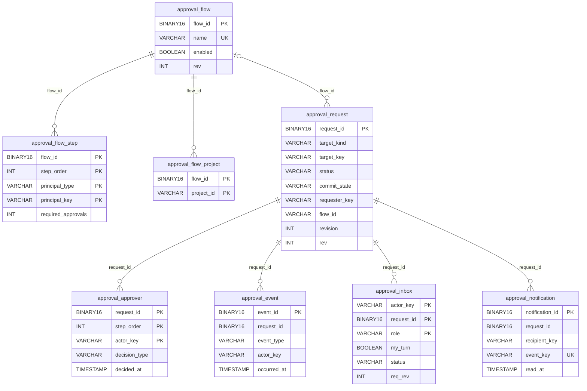
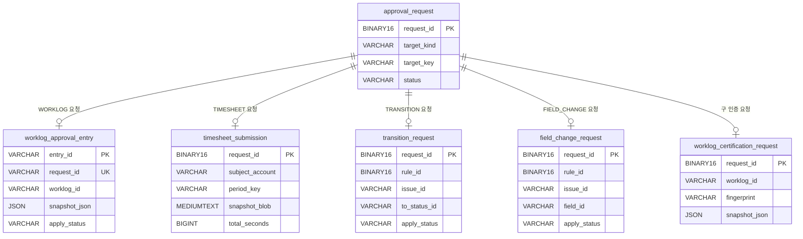
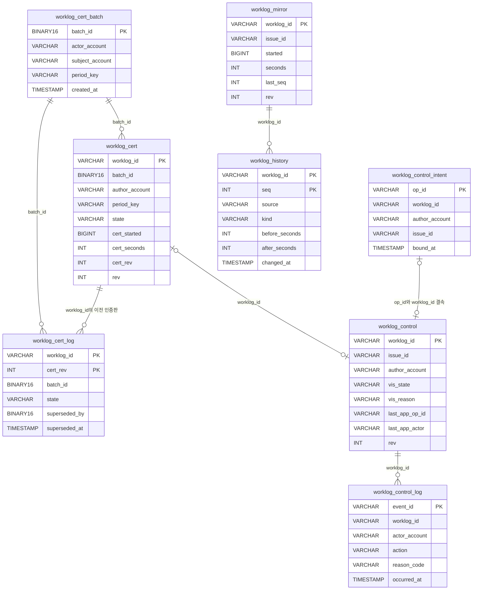
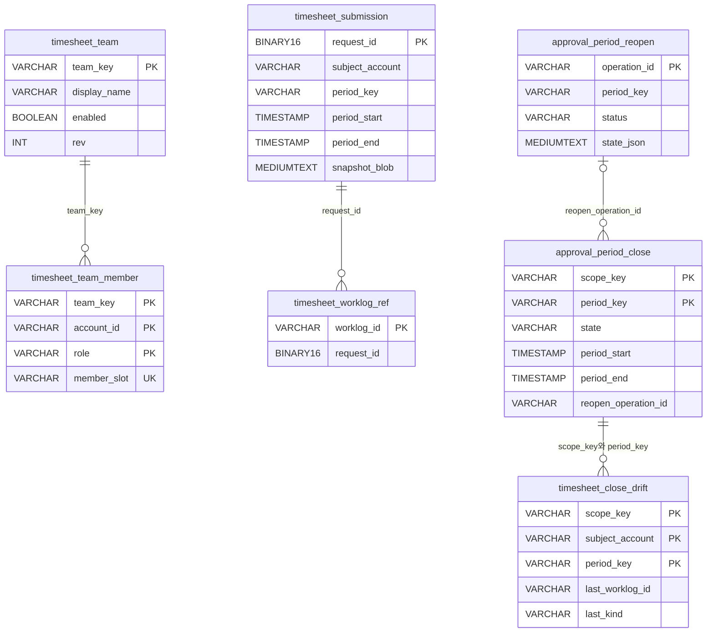
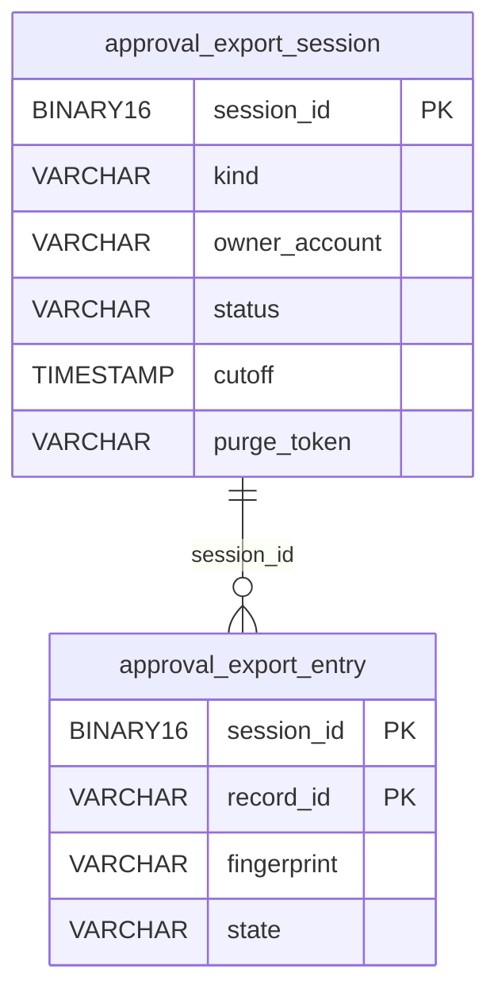

# Moves Approval 데이터베이스 ERD

## 먼저 볼 내용

Approval DB의 중심은 `approval_request`다. 결재자, 결정 이력, 업무함 데이터가 이 요청 ID를 기준으로 연결된다.

Worklog 영역은 역할에 따라 나뉜다.

- `worklog_cert*`: 승인 당시 확정한 Worklog 값
- `worklog_control*`: 승인된 Worklog의 수정·삭제 제한 상태
- `worklog_history`, `worklog_mirror`: Worklog 변경 이력과 마지막 관측값
- `workforce_*`: Workforce와 주고받을 문서의 게시·수신 상태

> 현재 DDL에는 대부분 `FOREIGN KEY` 제약이 없다. 아래 선은 실제 FK가 아니라 `request_id`, `worklog_id`, `batch_id` 등을 서비스가 대조하는 **논리 관계**다.

[전체 구조를 크게 보는 대화형 ERD](diagrams/approval-database-erd.html)

---

## 1. 승인 요청 중심 ERD

### 테이블 역할

| 테이블 | 역할 |
|---|---|
| `approval_request` | 승인 대상, 요청자, 현재 단계, 최종 상태를 보관하는 중심 원장 |
| `approval_approver` | 단계별 결재자와 각 결재자의 결정 상태 |
| `approval_event` | 요청, 승인, 반려, 취소 등 변경 이력을 순서대로 저장 |
| `approval_inbox` | 사용자별 업무함을 빠르게 조회하기 위한 복사본 |
| `approval_notification` | 알림 생성·읽음 상태와 중복 방지 정보 |
| `approval_flow` | 결재선 이름과 기본 설정 |
| `approval_flow_step` | 결재선의 단계와 단계별 사용자·그룹 |
| `approval_flow_project` | 결재선을 사용할 Jira 프로젝트 목록 |

`approval_request`, `approval_approver`, `approval_event`가 승인 감사의 핵심이다. `approval_inbox`는 원장이 아니라 화면 조회를 빠르게 하기 위한 projection이므로 원본에서 다시 만들 수 있다.

---

## 2. 승인 대상별 부속 테이블

한 개의 `approval_request`는 대상 종류에 따라 부속 테이블 하나와 연결된다.

부속 테이블에는 기능별 snapshot과 적용 상태를 둔다. 이 값을 `approval_request`에 모두 넣으면 서로 관계없는 요청이 불필요한 컬럼을 가지게 되고, 실제 적용 작업과 승인 결정의 `rev`가 충돌할 수 있기 때문이다.

`worklog_certification*`은 과거 요청형 인증 모델이다. 현재 일반 인증의 기준 테이블은 `worklog_cert*`이며, 기존 요청형 자료와 호환하기 위해 구 테이블이 남아 있다.

---

## 3. Worklog 인증·잠금·이력 ERD

### 처리 흐름

1. 팀장이 승인하면 `worklog_cert_batch`에 승인 행위자와 대상 기간을 기록한다.
2. 승인된 Worklog별 현재 상태를 `worklog_cert`에 저장한다.
3. 재인증으로 현재 값이 바뀌면 이전 인증판을 `worklog_cert_log`에 남긴다.
4. `worklog_control`이 Jira visibility 적용 상태와 앱 작업자를 관리한다.
5. 통제 판단과 조치는 `worklog_control_log`에 추가만 한다.
6. Worklog 변경은 `worklog_history`에 쌓고, 마지막 관측값은 `worklog_mirror`에 갱신한다.

`worklog_cert.state`가 `CERTIFIED` 또는 `MISMATCH`이면 수정·삭제를 차단한다. Jira property의 `movesApproval.op`는 `worklog_control.last_app_op_id`와 일치할 때만 Approval 작업으로 인정한다.

---

## 4. 타임시트와 기간 잠금 ERD

`timesheet_worklog_ref`는 Jira의 Worklog 삭제 이벤트를 원래 제출 요청과 연결하는 역참조다. `approval_period_close`는 마감 당시 기간과 타임존을 고정하며, 이후 정책이 바뀌어도 과거 마감 범위를 바꾸지 않는다.

---

## 5. 규칙 테이블

| 규칙 | 요청/기록 | 연결 기준 | 역할 |
|---|---|---|---|
| `transition_rule` | `transition_request` | `rule_id`, `request_id` | 특정 상태로 전환하기 전 승인을 요구 |
| `field_change_rule` | `field_change_request` | `rule_id`, `request_id` | 특정 Jira 필드 변경 전 승인을 요구 |
| `field_change_rule` | `field_change_bypass` | `rule_id`, 선택적 `request_id` | 앱 밖에서 직접 변경된 필드의 감사 기록 |
| `worklog_approval_policy` | `worklog_approval_binding` | `project_id`, `flow_id` | 프로젝트와 이슈별 Worklog 결재선 선택 |
| `worklog_policy_issue_override` | `worklog_policy_feature_index` | `project_id`, `issue_id`, scope | 이슈별 정책 덮어쓰기와 기능 활성 범위 검색 |

---

## 6. Workforce 연동과 운영 테이블

| 테이블 | 역할 | 원장 여부 |
|---|---|---|
| `workforce_publish` | Approval이 Workforce에 게시할 property의 outbox와 재시도 상태 | 재생성 가능 |
| `workforce_inbound` | Workforce 서명을 통과한 조직·정책 문서의 검증 캐시 | 마지막 검증값 유지 |
| `workforce_link_log` | 게시·수신 실패와 반복 횟수 | 운영 로그 |
| `approval_job_state` | 일일 작업의 lease, cursor, watermark, 최근 실행 결과 | 작업 상태 |
| `approval_export_session` | 감사 자료 내보내기 세션과 삭제 가능 범위 | 보관 정리 근거 |
| `approval_export_entry` | 내보낸 레코드의 지문과 확인 상태 | 보관 정리 근거 |
| `approval_settings_audit` | 설정 변경 이력 | 감사 원장 |
| `approval_delegation` | 결재 위임자와 유효 기간 | 현재 설정 |
| `approval_pin` | 서명 PIN의 hash·salt와 잠금 상태 | 보안 정보 |
| `approval_signature` | 사용자의 서명 이미지 | 사용자 설정 |
| `approval_project_config` | 프로젝트별 앱 사용 여부와 정책 덮어쓰기 | 현재 설정 |
| `approval_group` | 결재선에서 사용하는 사용자 그룹 | 현재 설정 |

### 내보내기 관계

보관 기간이 지난 감사 데이터를 지울 때는 내보내기가 완료된 범위인지 `approval_export_session`과 `approval_export_entry`로 확인한다.

---

## 7. 핵심 키 정리

| 키 | 연결되는 주요 테이블 | 의미 |
|---|---|---|
| `request_id` | `approval_request`, `approval_approver`, `approval_event`, `approval_inbox`, 각 대상 부속 테이블 | 승인 요청 한 건 |
| `flow_id` | `approval_flow`, `approval_flow_step`, `approval_flow_project`, `approval_request` | 적용한 결재선 |
| `worklog_id` | `worklog_cert`, `worklog_control`, `worklog_history`, `worklog_mirror` | Jira Worklog 한 건 |
| `batch_id` | `worklog_cert_batch`, `worklog_cert`, `worklog_cert_log` | 한 번에 처리한 인증 묶음 |
| `op_id` | `worklog_control_intent`, `worklog_control`, Jira `movesApproval.op` | 앱이 실행한 Worklog 작업 |
| `period_key` | 승인 요청, 타임시트, 인증, 기간 마감 | `2026-10`과 같은 대상 기간 |
| `account_id` 계열 | 팀, 요청자, 결재자, 작성자, 행위자 | Atlassian 사용자 accountId |

## 8. 설계상 주의점

1. DB에서 `FOREIGN KEY`로 막지 않으므로 저장 서비스가 참조 대상의 존재와 소유자를 반드시 확인해야 한다.
2. `approval_inbox`와 `workforce_publish`는 원본이 아니라 조회·게시용 projection이다.
3. `approval_event`, `worklog_cert_log`, `worklog_control_log`, `worklog_history`, `approval_settings_audit`는 감사 이력이므로 일반 수정 경로를 두지 않는다.
4. 현재 상태 테이블의 변경은 `rev = rev + 1`과 기존 `rev` 조건을 사용해 동시 변경 충돌을 막는다.
5. `worklog_certification*`과 `worklog_cert*`가 함께 존재하므로 신규 기능은 어느 인증 모델을 사용하는지 명확히 구분해야 한다.
6. 핵심 승인 테이블은 UUID를 `BINARY(16)`으로 저장하지만 일부 Worklog 테이블은 `VARCHAR(36|64)`로 저장한다. `request_id`와 `flow_id`를 연결할 때 저장소 계층의 `UUID_TO_BIN`·`BIN_TO_UUID` 변환을 사용해야 한다.
