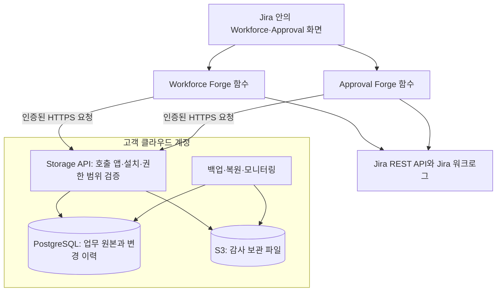
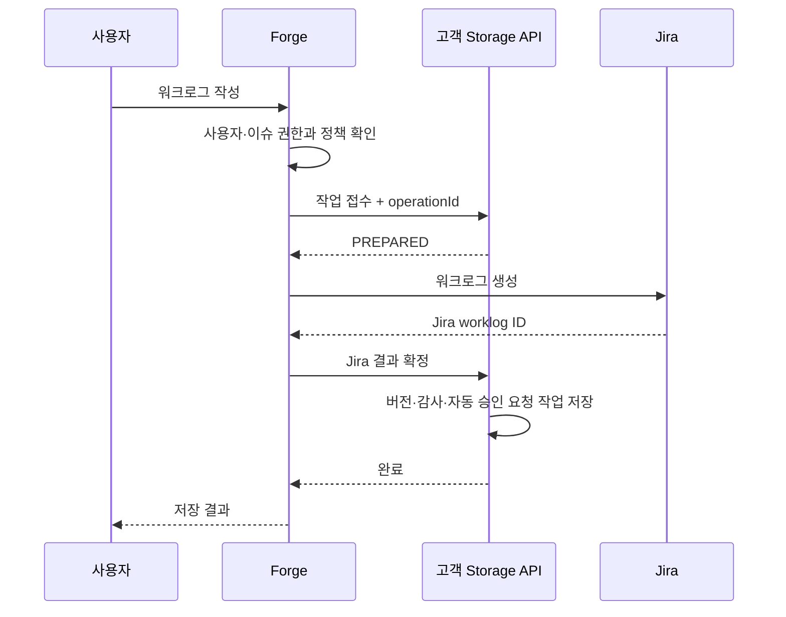

# 고객 소유 외부 저장소를 사용하는 Workforce·Approval 개발 설계

작성일: 2026-10-15  
상태: 신규 개발을 위한 설계 제안. 아직 구현·배포한 기능이 아니다.  
관련 문서: [현재 프로퍼티 방식의 취약점과 제약사항](cloudjira--ENTITY_PROPERTY_DELETION_IMPACT.md)

## 1. 무엇을 만들려는가

고객이 자기 클라우드 계정에 저장소를 만들고, Workforce와 Approval이 그곳에 워크로그·조직·정책·승인·감사 이력을 저장하는 구조를 제안한다. 화면과 업무 처리는 Forge에 두고, 두 앱이 같은 데이터에 접근할 수 있는 HTTPS 저장 API를 고객 환경에 둔다.

이 문서는 기존 데이터를 어떻게 옮길지보다 **처음부터 이 구조로 개발한다면 어디까지 만들어야 하는지**를 설명한다. 감사 파일만 외부에 보관하는 구조보다 범위가 크다. 실시간 조회·쓰기·승인·통계까지 외부 DB를 사용하므로 고객 저장소의 장애가 서비스에 직접 영향을 준다.

권장 구성은 **Forge + 고객 소유 Storage API + PostgreSQL + S3**다. PostgreSQL에는 현재 업무 데이터를, S3에는 장기 보관할 감사 파일과 내보내기 결과를 저장한다. S3 파일만으로 승인 상태와 동시 수정을 관리하지 않는다.

“스토리지만 외부로 뺀다”는 표현에는 설명이 필요하다. 승인 정책, 승인자 선택, Jira 권한 확인은 Forge에 둘 수 있다. 하지만 외부에서는 요청 인증, 고객 구분, DB 트랜잭션, 중복 요청 방지, 파일 검증을 수행해야 한다. 따라서 **외부 DB만 하나 만들면 끝나는 것은 아니며, 작은 저장 전용 서버도 개발·운영해야 한다.**

## 2. 전체 구조와 역할



| 구성 요소 | 맡는 일 |
|---|---|
| Forge 화면·resolver | 사용자 입력, Jira 열람 권한, 본인 여부, 팀 범위, 승인 규칙, 기간 계산 |
| Storage API | Forge 요청 인증, 설치 연결 확인, 허용된 저장 명령만 실행, 트랜잭션·동시성·중복 처리 |
| PostgreSQL | 워크로그의 현재 상태와 버전, 조직, 정책, 승인 요청·결정, 잠금, 감사 이벤트, 동기화 작업 |
| S3 | 압축된 감사 파일, 내보내기 파일, 파일 무결성·보관기간 관리 |
| Jira | Jira 이슈·사용자·권한, Jira에 기록하는 워크로그와 기본 보고서 |
| 고객 운영 담당자 | 인프라 비용, 백업 상태, 네트워크·키 관리, 보관기간, 장애 대응 연락 |
| 제품 개발팀 | API·DB 스키마, 앱의 권한 검증, 버전 호환, 설치 도구, 검증 도구, 제품 장애 분석 |

## 3. 워크로그를 어디에 저장할 것인가

### 권장: Jira 워크로그를 유지하고 외부 DB에 전체 내용과 버전을 저장

Jira의 작업 시간 보고서와 다른 앱이 계속 워크로그를 사용할 수 있도록 Jira에도 기록한다. 외부 DB에는 작성자, 작업 날짜, 시간, 설명, 공개 범위, Jira ID, 입력 경로와 변경 이력을 저장한다. 승인 당시 내용은 별도의 변경 불가 버전으로 남긴다.

여기서 “원본”의 의미를 나눠야 한다. **Jira에서 현재 관찰한 내용은 Jira가 기준이고, 우리 제품의 승인 결정·정책·잠금은 외부 DB가 기준**이다. Jira 내용이 승인 당시와 달라졌다고 승인된 버전을 덮어쓰지 않는다. 차이를 기록하고 집계에서 분리한다.

| 데이터 | 최종 판단 기준 |
|---|---|
| Jira 이슈의 존재·열람 권한 | Jira |
| Jira 워크로그의 현재 내용 | Jira에서 확인한 내용과 확인 시각 |
| 우리 앱이 접수한 작성·수정 요청 | 외부 DB의 작업 기록 |
| 승인된 시간·설명·작성자·기간 | 승인 결정이 참조하는 고정 버전 |
| 승인 여부·마감 잠금 | 외부 DB의 승인·정책·잠금 상태 |
| 통계 | 외부 DB에서 계산하되 원본 불일치·수집 지연을 함께 표시 |

Jira REST API에는 워크로그 생성·수정·삭제·조회와 변경·삭제 목록 조회가 있다. 이를 작성 및 누락 대조에 사용한다. 이 API가 우리 DB와 하나의 트랜잭션으로 묶이는 것은 아니다. [Jira 워크로그 API](https://developer.atlassian.com/cloud/jira/platform/rest/v3/api-group-issue-worklogs/)

### 대안: 우리 앱 전용 워크로그로 운영

Jira에는 워크로그를 만들지 않고 외부 DB에만 저장하는 방식도 가능하다. 승인과 수정 차단을 하나의 DB에서 처리할 수 있어 정합성은 단순해진다. 대신 Jira 기본 작업 시간 합계, 기본 보고서, 타사 앱은 이 기록을 자동으로 알지 못한다. 입력·조회·통계·내보내기를 우리 앱이 모두 제공해야 한다.

현재 제품의 Jira 연동 요구에는 첫 번째 방식이 더 맞다. 다만 **Jira의 모든 편집 경로를 막을 수 있는지와 외부 저장소를 쓰는지는 별개**다. 권한이 있는 사용자가 Jira REST로 직접 바꾸는 것을 외부 DB가 가로막아 주지는 않는다. 사전 차단은 Jira 권한 구성과 앱 서버 검증으로 입증해야 하며, 사후 감지를 사전 차단이라고 안내해서는 안 된다.

## 4. 두 앱이 데이터를 함께 사용하는 방법

두 앱이 상대 앱의 API를 호출하는 대신, 고객 Storage API에 각각 인증해서 접근한다. 이 구조에서는 팀장 목록이나 승인 결과를 Jira 프로퍼티로 복사할 필요가 없다. 같은 DB에서 정해진 범위의 최신 데이터를 조회하면 된다.

하지만 공유 DB가 곧 공유 수정 권한은 아니다. 데이터별 작성 책임을 고정한다.

| 데이터 | 변경 책임 | 다른 앱에 허용할 작업 |
|---|---|---|
| 조직·팀·팀장·프로젝트 연결 | Workforce | Approval의 범위 제한 조회 |
| 승인 정책·요청·결정·잠금 | Approval | Workforce의 상태 조회, 허용된 워크로그 명령 요청 |
| 워크로그 | 공통 저장 명령 | 두 앱 모두 같은 검증·동시성 규칙으로 작성·수정 |
| 감사 이벤트 | 각 명령의 저장 트랜잭션 | 권한 있는 조회·내보내기. 일반 수정·삭제 금지 |

공통 워크로그 정책 계산은 버전이 명시된 공용 패키지로 두 앱이 사용한다. Storage API는 제출된 정책 revision, 워크로그 버전, 잠금·마감 조건을 DB에서 다시 확인한다. Workforce가 승인 데이터를 직접 UPDATE하거나 “이미 검사했다”는 boolean만 보내서 잠금을 건너뛰지 못하게 한다.

따라서 업무 규칙 대부분은 Forge에 있어도, **잠금·마감·현재 승인 상태를 어기는 저장을 거부하는 최종 조건은 저장 계층에도 있어야 한다.** 이 부분까지 Forge의 사전 조회에만 맡기면 조회 직후 승인된 건을 뒤늦은 수정 요청이 덮어쓸 수 있다.

## 5. 고객은 어떻게 연결하는가

### 5.1 고객이 준비할 구성

AWS 기준으로 고객 전용 계정 또는 분리된 프로젝트에 다음을 설치한다. 개발팀은 버전이 고정된 IaC 템플릿과 설치 가이드를 제공하는 것으로 설계한다. 이 문서에 해당 배포 패키지가 이미 구현되어 있다는 뜻은 아니다.

| 항목 | 기본 구성 제안 |
|---|---|
| API | API Gateway + Lambda 또는 고객 표준 컨테이너 서비스 |
| DB | 비공개 네트워크의 관리형 PostgreSQL. 연결 수 제한과 풀링 적용 |
| 파일 저장 | 비공개 S3 버킷. 버전 관리·암호화·Object Lock 검토 |
| 비밀정보 | 고객의 Secret Manager 계열 서비스. DB 비밀번호를 Forge 화면에 입력하지 않음 |
| 네트워크 | Forge에서 접근 가능한 인증된 HTTPS API. DB 포트는 외부 공개하지 않음 |
| 운영 | 백업·시점 복구, API 오류율, 저장 공간, 미완료 작업, 비용 알림 |

“고객 사내망에 DB만 띄우면 되나?”에 대한 답은 아니다. Forge가 고객 VPN에 자동으로 연결되는 구조가 아니다. Forge에서 도달 가능한 API 경로와 인증 체계가 필요하다. 외부 공개 HTTPS가 금지된 고객은 별도 연결 설계의 성립 여부부터 확인해야 한다.

### 5.2 권장 인증: Forge Remote와 설치 단위 연결

Forge 함수가 `invokeRemote`로 선언된 remote를 호출하고, 고객 API가 Forge Invocation Token(FIT)을 검증하는 방식을 기본안으로 둔다. FIT의 서명·만료·발급자·대상 앱을 검증하고, 검증된 app installation과 환경을 고객 DB의 등록 정보에 대조한다. 일반 `fetch`에 이 인증이 자동으로 붙는다고 가정하지 않는다. [Forge 함수에서 remote 호출](https://developer.atlassian.com/platform/forge/remote/calling-from-function/), [FIT 검증 계약](https://developer.atlassian.com/platform/forge/remote/essentials/)

사용자가 요청 본문에 넣은 `tenantId`, `cloudId`, `accountId`만으로 데이터 범위를 정하면 안 된다. API가 신뢰할 수 있는 설치 정보에서 tenant를 결정하고, 실제 사용자는 Forge 서버 문맥에서 얻는다. 사용자 없는 트리거는 시스템 작업으로 구분하며 임의 사용자를 가장하지 않는다.

FIT는 호출 앱·설치에 대한 인증이며 그 자체가 모든 업무 권한을 증명하지는 않는다. 검증된 앱이 Forge 문맥에서 추출한 사용자와 권한 검사 결과를 전달하는 계약을 둔다. 브라우저가 보낸 사용자 ID를 그대로 전달하지 않는다. 시스템 명령은 별도 허용 목록을 사용하고, 사용자 결재 명령을 시스템 권한으로 호출하지 못하게 한다. 저장 API는 이 계약과 DB의 현재 팀·정책·요청 참여 범위를 다시 검사한다.

두 앱의 설치 ID는 다르므로 고객 관리자가 두 설치를 같은 tenant에 연결하는 등록 절차가 필요하다. 한 앱이 아는 고객 ID만 제출해서 다른 앱의 데이터에 접근하게 해서는 안 된다. 최초 연결에는 고객 관리자가 발급한 짧은 유효기간의 1회용 등록 코드와 양쪽 설치 확인을 사용한다. 등록 완료 후 코드는 폐기한다.

### 5.3 설정 화면의 흐름

1. 고객 운영자가 제공된 템플릿으로 인프라를 설치한다.
2. 고객 API의 버전, 연결 주소, 등록 코드를 확인한다.
3. 앱 관리자가 `저장소 연결`에서 지원되는 연결 프로필을 선택하고 등록 코드를 입력한다.
4. 서버가 설치 정보를 검증하고 시험 데이터 쓰기·읽기·정리, 감사 이벤트 기록, DB 스키마 호환 여부를 검사한다. 보존 잠금된 파일은 정리 시험에서 제외한다.
5. Workforce와 Approval을 각각 등록한 뒤, 같은 고객·Jira 사이트·환경에 속하는지 대조한다.
6. 양쪽 모두 정상일 때 연동을 활성화한다. Approval 단독 사용은 별도 모드로 두고 조직 정보가 없다는 사실을 숨기지 않는다.

화면에는 `연결됨 / 점검 필요 / 연결 끊김`, 고객 저장소 이름·리전, API 버전, 마지막 성공 시각, 백업 상태의 확인 시각을 표시한다. 인증 비밀은 다시 노출하지 않는다. 백업 상태를 API가 실제로 확인하지 못했다면 정상이라고 표시하지 않는다.

### 5.4 고객별 주소 설정과 Runs on Atlassian

2026-10-15 공식 문서를 재확인한 결과, Forge는 **Customer-managed egress and remotes**를 제공한다. manifest에 configurable remote를 선언하면 관리자가 설치별 endpoint를 동의 화면에서 설정할 수 있다. 따라서 고객마다 주소가 다르다는 이유만으로 고객별 앱 배포가 반드시 필요한 것은 아니다. 앞선 고정 endpoint 중심 설명을 이 내용으로 정정한다. [고객 관리형 외부 연결](https://developer.atlassian.com/platform/forge/customer-managed-egress-and-remotes/)

외부 저장소 에디션에서는 이 기능을 연결 PoC의 우선 후보로 사용한다. 5.3절의 연결 화면에서 고객 API 주소를 등록하고 Atlassian 관리자 동의를 거친 뒤, 설치 등록 코드로 고객 API와 연결한다. endpoint 접근 동의와 DB tenant 연결 인증은 서로 다른 검사다.

다음 제약은 출시 전에 반영해야 한다.

- Customer-managed egress/remotes를 사용하는 앱은 Runs on Atlassian 대상이 아니다. 고객이 설정을 꺼 두었다고 해당 기능을 포함한 앱 버전이 자격을 얻는 구조가 아니다.
- `permissions.external.configurable.enabled: true`를 production에 활성화하면 이후 버전에서 제거하거나 비활성화할 수 없다고 공식 문서에 명시돼 있다.
- Customer-managed remotes는 공식 data residency 자격에 제한이 있으며 Government Cloud에서는 지원되지 않는다. 고객이 리전을 선택하는 것과 Atlassian의 자격 판정은 별개다.
- 원래부터 고정된 필수 외부 목적지를 관리자 설정 기능으로 우회 선언하면 안 된다. 그런 목적지는 정적 egress/remotes로 선언한다.

위 제약의 근거는 [Customer-managed egress and remotes](https://developer.atlassian.com/platform/forge/customer-managed-egress-and-remotes/)이며, 정적 remote의 목적·인증·버전 변경은 [Remote manifest](https://developer.atlassian.com/platform/forge/manifest-reference/remotes/)를 따른다.

정적 remote와 업무 데이터 외부 전송도 Runs on Atlassian 판정에 영향을 준다. 최종 배포 버전별로 `forge eligibility`를 확인해야 한다. 로컬 기능 플래그만으로 이를 해결할 수 없다. [Runs on Atlassian 자격](https://developer.atlassian.com/platform/forge/runs-on-atlassian-apps/)

### 5.5 두 앱의 단독 판매와 저장소 에디션 분리

Workforce 단독, Approval 단독, 두 앱 연동은 모두 지원할 제품 구성으로 둔다. 본문의 공유 DB 구조는 두 앱이 외부 저장소 연동에 참여할 때의 설계이며, 두 앱을 항상 함께 설치해야 한다는 뜻은 아니다.

| 구성 | 저장 방식과 연동 | 제품 경계 |
|---|---|---|
| Workforce 단독 | 자체 저장소로 조직·공수 관리 | Approval 설치를 요구하지 않음 |
| Approval 단독 | 자체 조직·승인자 설정과 정책 사용 | Workforce 팀 정보 없이도 승인 기능 제공 |
| 두 앱 연동, Approval만 외부 저장 | 조직 수신·승인 결과 전달은 기존 프로퍼티 계약 유지 | Workforce는 외부 연결 기능 없이 운영 가능. 프로퍼티 제약은 남음 |
| 두 앱 모두 외부 저장소 참여 | 고객 Storage API에서 허용된 공통 데이터 조회 | 두 앱 모두 외부 연결·고객 설치 인증 필요 |

Runs on Atlassian 대상 제품과 외부 저장소 제품을 함께 제공하려면, 같은 앱의 설정 토글보다 **별도 app ID·manifest를 가진 에디션**으로 분리하는 방안을 권장한다. 기본 에디션에는 외부 저장소 권한·remote·configurable egress를 넣지 않고, 외부 저장소 에디션에만 넣는다. 코드와 도메인 로직은 공유할 수 있다. Marketplace 등록·라이선스·에디션 전환 절차는 별도 출시 검토 사항이며 자동 승인된다고 가정하지 않는다.

Approval만 외부 저장소 에디션을 제공하면 Workforce까지 외부 연결 앱으로 바꿀 필요는 없다. 각 앱 버전의 자격은 해당 구성으로 검증한다. 다만 실제 고객 환경에서 Approval이 Jira 데이터를 외부로 내보낸다는 사실은 명확히 고지해야 한다. Workforce의 배지를 전체 조합의 데이터 외부 전송 부재를 보장하는 것으로 설명하면 안 된다.

저장소 선택과 Workforce 연동 여부는 서로 독립된 설정으로 둔다. Approval은 `StorageRepository` 구현을 Forge SQL 또는 고객 API로 교체할 수 있게 하되, 한 설치에서 활성 승인 원장은 하나만 사용한다. 운영 도중 저장소를 단순 토글로 바꾸면 승인·잠금이 서로 다른 저장소에 갈라질 수 있으므로 별도 전환 절차가 필요하다. 이 문서의 신규 개발 범위에는 그 전환 구현을 포함하지 않는다.

## 6. DB 설계

모든 업무 키와 조회 인덱스에는 tenant 범위를 포함한다. 고객 전용 DB여도 site·앱 설치·development/production을 구분한다. 앱을 재설치했다고 새 설치에 과거 데이터를 자동 연결하지 않는다.

| 테이블 제안 | 주요 내용 |
|---|---|
| `tenant_installation` | 고객·사이트·앱·환경 연결, 허용 기능, 연결 중지 상태 |
| `team`, `team_member`, `project_link` | 팀장·팀원·연결 이슈 범위, 조직 revision |
| `policy`, `period_lock` | 정책 버전, 시간대, 마감 경계, 관리자 변경 사유 |
| `worklog` | 내부 ID, Jira ID, 작성자, 현재 버전, 원본 상태, 동기화 상태 |
| `worklog_version` | 시간·작업일·설명·공개 범위의 고정 스냅샷, 내용 해시, 출처 |
| `approval_request`, `approval_decision` | 대상 버전, 지정 승인자, 결정자·시각·사유, 요청 상태 |
| `worklog_lock` | 승인·마감 잠금 근거, 잠금 버전, 해제 절차의 참조 |
| `audit_event` | 누가 어떤 명령을 실행했고 무엇이 바뀌었는지, 관찰과 행위 구분 |
| `operation`, `outbox` | 중복 요청 키, 진행 상태, 외부 호출 결과, 재처리·대조 작업 |
| `archive_manifest` | 감사 파일 위치·version ID·해시·건수·범위·검증 결과 |

`worklog_version`과 승인 결정은 일반 업무에서 덮어쓰지 않는다. 수정은 새 버전을 추가하고, 승인은 정확히 그 버전을 참조한다. 재승인도 이전 결정을 지우는 대신 새 요청과 결정을 연결한다.

한 명의 사용자가 다른 고객의 worklog ID를 알아도 접근할 수 없도록 tenant 조건을 모든 조회·변경에 넣고, PostgreSQL RLS를 추가 방어로 검토한다. DB owner·superuser·`BYPASSRLS` 권한은 RLS를 우회할 수 있으므로 앱 실행 계정에는 주지 않는다. [PostgreSQL Row Security](https://www.postgresql.org/docs/current/ddl-rowsecurity.html)

워크로그 설명과 반려 사유에는 개인정보가 들어갈 수 있다. 로그·메트릭에는 원문을 남기지 않고, 일반 조회는 Jira 열람 권한과 워크로그 공개 범위를 다시 확인한다. 삭제된 이슈의 감사 조회는 일반 팀장 조회와 분리한 감사 담당자 권한으로 설계한다.

## 7. 저장 API를 어떻게 개발할 것인가

아래는 제안 API이며 현재 앱에 존재하는 라우트가 아니다. 범용 SQL 실행이나 테이블 전체 CRUD를 외부에 열지 않고, 검증 가능한 업무 저장 단위로 제공한다.

| API 예시 | 역할 |
|---|---|
| `POST /v1/installations/bind` | 1회용 코드와 검증된 설치를 연결 |
| `GET /v1/context` | 호출자의 팀·정책·기능 범위를 버전과 함께 조회 |
| `POST /v1/worklog-operations` | 작성·수정·삭제 작업 접수와 잠금 검사 |
| `POST /v1/worklog-operations/{id}/confirm` | Jira 결과를 확인하고 버전·감사·동기화 상태 확정 |
| `POST /v1/approval-requests` | 정확한 워크로그 버전에 승인 요청 생성 |
| `POST /v1/approval-requests/{id}/decisions` | 현재 요청 상태·승인자·대상 버전 재검증 후 결정 저장 |
| `GET /v1/worklogs`, `GET /v1/audit-events` | 범위 제한 조회, 커서 페이지 처리 |
| `GET /v1/operations/{id}` | 타임아웃 이후 결과 조회 |

변경 명령에는 `operationId`, `expectedVersion`, 필요한 조직·정책 revision을 포함한다. 같은 operation ID와 같은 내용의 재요청에는 기존 결과를 반환하고, 같은 ID로 다른 내용을 보내면 충돌로 거부한다. 버전 충돌은 재조회가 필요한 `409`로 구분한다. 자격 증명·사용자 텍스트를 오류 응답에 넣지 않는다.

승인 결정, 잠금 생성, 감사 이벤트, 후속 작업 등록은 하나의 DB 트랜잭션으로 처리한다. 여러 HTTP 요청을 차례대로 성공시켰다는 사실은 트랜잭션을 대신하지 못한다. [PostgreSQL 트랜잭션](https://www.postgresql.org/docs/current/tutorial-transactions.html)

Forge는 정책을 계산한 뒤 DB 명령에 필요한 버전을 전달한다. 저장 API는 그 버전이 아직 유효한지 확인한다. API 호출 중 팀장이 바뀌거나 마감 시간이 지났으면 이전 판단으로 저장하지 않고 거부·재평가한다. 시간대와 마감 규칙의 버전을 저장하며, 최종 마감 비교는 신뢰하는 서버 시각으로 수행한다.

## 8. 작성·수정·승인은 어떤 순서로 처리하는가

### 8.1 워크로그 작성



Jira와 외부 DB를 동시에 확정할 수는 없다. 따라서 `PREPARED → JIRA_APPLIED → COMMITTED`와 결과를 모르는 `UNKNOWN` 상태를 구분한다. Jira 응답을 받지 못했더라도 생성이 성공했을 수 있으므로 무조건 다시 POST하지 않는다. 저장된 작업 정보와 Jira 결과를 대조한 뒤 이어서 처리한다.

Jira 프로퍼티에 작업 식별자를 보조 표식으로 넣을 수는 있지만, 그것만을 중복 방지의 유일한 증거로 삼지 않는다. 표식은 삭제될 수 있고 Jira 작성자의 귀속도 호출 주체에 영향을 받는다. 내용·작성자·시간만 같은 기록은 서로 다른 정상 입력일 수 있으므로 모호하면 `UNKNOWN`을 유지하고 운영 확인으로 넘긴다.

미완료 작업의 Jira 대조는 Forge worker가 수행하고, 고객 API는 작업 상태·임대 시각·시도 횟수를 보관한다. 최초 요청 직후 큐로 실행하고 실패하면 상한이 있는 지수 백오프로 재시도한다. 일일 보정 작업은 누락된 깨우기를 찾는 보조 수단으로 둔다. 사용자 없는 worker의 Jira 조회는 필요한 범위와 사유를 고정한 앱 권한으로 수행하고 결과를 사용자 응답으로 바로 내보내지 않는다. 원래 사용자 권한이 필요한 쓰기를 worker가 임의로 더 강한 권한으로 재실행하지 않는다.

작업 임대가 만료되면 다른 worker가 대조를 이어받을 수 있지만, Jira 적용 여부를 모르는 업무 잠금까지 시간만 보고 풀지 않는다. 재시도 상한을 넘긴 작업은 관리자 확인 대상으로 남긴다. 원본 대조와 근거가 있는 확정·취소만 허용하며, 이 작업량과 지연은 운영 지표에 포함한다.

### 8.2 수정·삭제와 승인 경합

수정 명령과 승인 명령은 같은 워크로그 행의 버전·진행 중 작업을 검사한다. 수정 작업이 진행 중이면 승인 확정을 잠시 막고, 승인이 먼저 확정되면 수정 접수를 거부한다. 오래된 화면에서 보낸 요청도 동일하게 거부해야 한다.

승인 직전에 Jira의 현재 내용을 확인하고 승인 대상 버전과 다르면 결정을 보류한다. 다만 그 조회 이후 Jira 외부 경로에서 변경되는 경쟁 상태까지 DB 트랜잭션으로 막을 수는 없다. 이를 줄이려면 Jira 편집 권한을 통제하고, 이후 변경은 즉시 불일치로 기록해야 한다. 이 한계를 감춘 “완전한 원자적 승인”은 약속하지 않는다.

일괄 승인은 건별 결과를 반환한다. 한 건의 충돌 때문에 이미 성공한 결정을 다시 만들지 않고, 충돌·권한 변경·원본 불일치가 있는 건만 별도로 보여 준다.

### 8.3 마감·소명·통계

마감 이후의 수정 제한은 화면 버튼뿐 아니라 저장 API에서도 검사한다. 소명 요청은 잠금을 해제하는 동작이 아니다. 기존 승인 버전은 유지하고, 사유와 제안 내용을 별도 요청에 저장한 뒤 정해진 승인 절차를 거친다.

진행 중인 월은 정책에 따라 전체 작성량과 승인량을 함께 보여 준다. 마감된 월의 정산 통계는 승인된 버전을 기준으로 계산한다. Jira 원본이 달라졌거나 수집이 끝나지 않은 기록은 상태를 표시하고, 누락을 0시간으로 확정하지 않는다. 집계 캐시는 재생성 가능한 데이터로 취급하며 승인·감사 원장으로 사용하지 않는다.

## 9. Jira 변경을 놓치지 않는 방법

이벤트를 받으면 현재 Jira 내용을 조회하고 외부 DB와 대조한다. 이벤트 중복·지연·순서 뒤바뀜을 정상적인 운영 상황으로 가정한다. 같은 이벤트의 재처리가 감사 이력과 승인 요청을 중복 생성하지 않도록 고유 키를 둔다.

이벤트가 누락될 가능성에 대비해 변경·삭제 목록과 대상별 재조회를 사용하는 대조 작업을 둔다. 목록이 불완전하거나 Jira 조회 권한이 없으면 “삭제됨”으로 확정하지 않는다. 모든 페이지 처리가 끝나기 전에 완료 시점을 앞당기지 않는다. 큐는 작업을 깨우는 용도로 쓰고 진행 상태와 재시도 정보는 DB에 남긴다.

이슈가 삭제되면 `issue_deleted`, 워크로그가 삭제되면 `source_deleted` 같은 원본 상태를 남기되 승인 스냅샷과 감사 이력을 연쇄 삭제하지 않는다. 일반 사용자의 조회 권한은 여전히 제한하고, 감사 담당자만 별도 권한으로 보존 자료를 확인한다. 실제 삭제 행위자를 확인하지 못했으면 “삭제 관찰”로 기록한다.

## 10. 감사 자료를 오래 보관하는 방법

DB에는 조회에 필요한 기간의 상세 이벤트를 두고, 오래된 이벤트는 압축 파일로 보관한다. 파일에는 스키마 버전, tenant·기간 범위, 이벤트 ID, 작업 ID, 대상 버전, 행위자와 관찰자의 구분, 건수를 포함한다. 파일 목록에는 SHA-256과 S3 version ID를 기록한다.

파일을 올렸다는 응답만으로 DB 자료를 지우지 않는다. **업로드 → 저장된 특정 버전 재조회·해시 확인 → 보관 설정 확인 → 내보낸 ID·내용 대조 → 허용된 오래된 행만 정리** 순서로 처리한다. 도중에 실패하면 DB 기록을 보존한다. 승인 잠금과 현재 판단에 필요한 행은 오래됐다는 이유만으로 정리하지 않는다.

S3 Object Lock은 보존 대상 객체 버전을 보호한다. Compliance 모드는 정해진 기간 동안 강한 삭제 제한을 제공하지만, 같은 키에 새 버전이나 삭제 마커가 생기는 것까지 막는 것은 아니다. 따라서 읽을 때도 보관 당시 version ID를 사용한다. 보관기간을 잘못 설정하면 수정하기 어려우므로 시험 환경에서 확인 후 운영에 적용한다. [S3 Object Lock](https://docs.aws.amazon.com/AmazonS3/latest/userguide/object-lock.html)

파일 키 중복은 조건부 쓰기로 막고, 이미 존재하면 같은 파일인지 확인한다. ETag를 무조건 파일 SHA-256으로 취급하지 않는다. [S3 조건부 쓰기](https://docs.aws.amazon.com/AmazonS3/latest/userguide/conditional-writes.html), [업로드 무결성 확인](https://docs.aws.amazon.com/AmazonS3/latest/userguide/checking-object-integrity-upload.html)

감사 내보내기는 DB 백업을 대신하지 못한다. 운영 DB에는 별도 백업과 시점 복구를 구성하고 복원 훈련을 해야 한다. 해시만 남겼다고 DB 관리자에 의한 기록 교체까지 증명할 수 있는 것도 아니다. 장기 증거가 필요하면 변경 불가 파일, 별도 권한, 서명 키 관리와 외부 보관 증거를 함께 설계한다.

## 11. 장애와 운영 책임

| 상황 | 제품 동작 제안 | 운영자가 할 일 |
|---|---|---|
| 외부 DB/API 중단 | 승인·수정은 보류. 오래된 조회에는 시각과 지연 상태 표시 | 연결·DB·권한 확인. 복구 후 미완료 작업 대조 |
| Jira 성공 후 DB 확정 실패 | 작업을 미완료로 표시. 같은 Jira 생성 요청을 무조건 반복하지 않음 | operation ID로 결과 대조 |
| 파일 저장 실패 | DB 보관 유지, 정리 중단 | 저장 권한·용량·보관 설정 점검 |
| 고객이 API 접근 차단 | 새 업무 처리 중단, 원인과 연결 상태 표시 | 연결 재설정 또는 정상 해제 절차 |
| DB 용량 임계치 접근 | 관리자 알림, 보관 작업 제안, 저장 여유 확보 | 증설·보관기간·파일 내보내기 확인 |
| 앱 한쪽 제거 | 해당 설치 접근 폐기, 다른 앱 범위는 유지 | 공유 데이터의 소유·보존 정책 확인 |
| 계약 종료 | 앱 접근 철회와 데이터 보존을 분리 | 내보내기·보관 의무 확인 후 고객이 삭제 결정 |

외부 DB가 실패했다고 Forge SQL에 임시로 승인 상태를 쓰는 자동 전환은 하지 않는다. 서로 다른 곳에서 승인이 진행되면 어느 상태가 진짜인지 결정할 수 없기 때문이다.

오래된 조회를 제공할 때도 현재 열람 권한 검사는 필요하다. 과거 팀원이었다는 이유로 현재 권한이 없는 기록을 보여 주지 않는다. 권한을 확인할 수 없는 상세·설명·내보내기는 제공하지 않으며, 지연 시각 표시는 권한 검사를 대신하지 않는다.

백업 복원은 특히 주의해야 한다. 복원 시점 이후의 승인이 DB에 없으면, 실제 승인됐던 워크로그가 수정 가능한 것으로 보일 수 있다. 복원 직후에는 읽기 제한 모드로 시작하고 승인·수정·삭제를 중지한다. 보존된 결정 이벤트·작업 기록과 대조해 누락된 잠금을 복원하고 검증한 뒤 쓰기를 재개한다. Jira 현재 내용만으로 누가 무엇을 승인했는지 복원할 수는 없다. 승인 증거가 부족한 대상은 임의로 미승인 처리하지 않고 보류한다.

보안 책임도 분리한다. 고객은 인프라·네트워크·백업·접근 계정을 관리하고, 개발팀은 테넌트 격리·권한 검사·저장 명령의 안전성·호환성을 책임진다. 고객 서버 장애를 제품 화면에서 식별할 수 있도록 요청 ID와 오류 분류를 제공하되 민감한 원문은 로그에 남기지 않는다.

### 고객 환경별 업그레이드와 지원

앱과 고객 API를 항상 같은 순간에 배포할 수는 없다. 연결 응답에 지원 API·스키마 버전을 넣고, 호환되지 않는 변경 명령은 명확히 차단한다. DB 변경은 기존 코드와 함께 사용할 수 있는 필드 추가부터 적용하고, 새 코드 적용과 확인을 거친 뒤 오래된 구조를 정리한다. 배포 실패 시 되돌릴 수 없는 스키마 삭제를 먼저 실행하지 않는다.

고객별로 설치 버전, API 버전, 스키마 버전, 리전, 연결된 앱을 확인할 수 있어야 한다. 지원용 진단 자료에는 요청 ID·오류 코드·처리 시간·미완료 작업 수만 기본 포함하고, 워크로그 설명이나 반려 사유를 자동 수집하지 않는다. 개발팀이 고객 DB에 상시 관리자 접근권을 가지는 것을 전제로 하지 않는다.

### 보관기간·데이터 위치·연결 종료

고객은 운영 DB뿐 아니라 백업·파일·로그의 저장 리전도 선택해야 한다. Jira 데이터 위치와 고객 DB 위치가 같다고 자동 보장되지 않으며, 경유 API까지 포함해 데이터 흐름을 설명해야 한다.

퇴사자 정보 정리와 감사 자료 보존이 충돌할 수 있다. 이름·설명 등 개인 식별 정보와 승인 사실에 필요한 최소 식별자를 구분하고, 삭제·가명처리·보존 예외를 고객 정책에 맞춰 정한다. 긴 Object Lock 보존기간을 먼저 설정한 뒤 나중에 삭제 정책을 맞추려 해서는 안 된다. 보관기간과 삭제 요구의 우선순위는 고객의 보안·개인정보 담당자가 확정할 운영 조건이다.

연결 해제 시에는 먼저 신규 쓰기를 중단하고 진행 중인 작업을 대조한 뒤, 내보내기 확인과 설치 접근 철회를 수행한다. Jira에서 이미 제한한 기록이 있다면 해제 필요 여부와 안전한 해제 경로도 확인해야 한다. 앱 제거 훅 하나가 모든 정리를 끝낸다고 가정하지 않는다. 연결 해제 자체로 고객 DB나 보존 파일을 지우지 않는다.

용량 알림은 예를 들어 70%에서 안내, 85%에서 조치 요청, 95%에서 긴급 대응으로 둘 수 있다. 이는 제안값이며 실제 쓰기 증가율과 복구 시간을 반영해 조정한다. 꽉 찬 뒤에 내보내기 작업을 시작하면 작업 상태조차 저장하지 못할 수 있으므로 여유 공간을 확보해야 한다.

목표 복구시간(RTO)과 허용 데이터 손실시간(RPO)은 고객 계약과 인프라 구성에 맞춰 정한다. 예시로 RTO 4시간·RPO 15분을 목표로 잡을 수 있으나 제품이 현재 보장하는 수치는 아니다. 승인 원장의 손실 허용 여부는 일반 로그보다 엄격하게 결정해야 한다.

## 12. 어떤 저장소가 적합한가

| 후보 | 적합한 경우 | 개발·운영 관점의 주의점 |
|---|---|---|
| 고객 AWS의 관리형 PostgreSQL + S3 | 고객이 데이터·네트워크·보관정책을 직접 통제 | API 서버·DB 연결·백업·모니터링을 함께 운영해야 함 |
| 고객 소유 Supabase 프로젝트 + 파일 저장소 | 빠르게 PostgreSQL·HTTP API 기반 개발을 시작 | 서비스 키의 광범위 권한, RLS, RPC 트랜잭션, 요금제별 백업 조건 검토 |
| 고객 Azure 등의 관리형 PostgreSQL + 객체 저장소 | 고객 표준 클라우드가 이미 정해짐 | 인증·보존 잠금·백업 기능을 해당 제공자의 계약으로 검증 |
| S3 또는 R2만 사용 | 감사 파일·첨부·내보내기 보관 | 워크로그 승인과 다중 행 동시 변경의 운영 DB로는 별도 설계가 필요 |

Supabase는 PostgreSQL 기반 데이터 API를 제공하지만 테이블을 외부에 공개했다고 승인 시스템이 완성되지는 않는다. 여러 행을 함께 바꾸는 저장 명령은 서버 트랜잭션 또는 RPC로 묶어야 한다. 브라우저에 service-role 키를 넣지 않는다. [Supabase 데이터 API](https://supabase.com/docs/guides/api/creating-routes)

초기 검증을 빠르게 할 목적이면 Supabase도 후보지만, 고객 소유 인프라와 감사 보관을 표준 상품으로 제공할 목적이면 고객 AWS 구성부터 기준 구현을 만드는 편이 책임 경계를 설명하기 쉽다. 이는 제품 설계상의 권고이며 특정 고객에게 가장 저렴하다는 뜻은 아니다.

## 13. 200명 기준 용량과 비용

사용자 수만으로 용량을 확정할 수는 없다. 다음은 견적을 위한 가정이다.

| 계산 항목 | 가정·결과 |
|---|---|
| 월 워크로그 수 | 200명 × 20근무일 × 하루 3건 = 12,000건 |
| 현재 워크로그 본문 | 건당 평균 2 KiB라면 월 신규분 약 23.4 MiB |
| 변경·승인 감사 이벤트 | 건당 4개 × 이벤트당 2 KiB라면 월 약 93.8 MiB |
| 두 항목의 합 | 월 약 117.2 MiB, 연 약 1.37 GiB |

이 숫자에는 DB 인덱스, 행 저장 오버헤드, 추가 버전, 조직·정책, 첨부, 백업, 복제본이 없다. 본문이 길거나 수정이 많으면 더 커진다. 위 가정만으로도 1 GiB는 약 8.7개월분이며, 운영 DB가 실제로 버티는 기간은 그보다 짧을 수 있다. 1 GiB가 현재 Forge 계약의 공식 한도라는 의미도 아니다.

운영 DB는 처음부터 이보다 충분히 여유 있게 구성하고, 실제 샘플의 행·인덱스 크기와 30일 증가량으로 다시 산정한다. 사용자 200명보다 동시에 몰리는 조회·일괄 승인·통계 쿼리가 DB 성능을 더 크게 좌우할 수 있다.

월 비용은 다음 항목을 합산한다.

```text
DB 실행 비용 + DB 저장·백업·복제 비용
+ API 실행·요청·네트워크 비용
+ 객체 저장·읽기/쓰기·복원·암호화 키 비용
+ Forge 실행 비용 + 모니터링 비용 + 운영 인력 비용
```

이 규모에서는 파일 몇 GB의 저장료보다 DB의 기본 실행료와 운영 구성이 비용을 좌우하기 쉽다. 개발 검토용 예산은 월 수십 달러부터 시작할 수 있지만, 고가용성 DB·네트워크·백업을 갖춘 고객 운영 환경은 월 수백 달러 이상이 될 수도 있다. 이는 **예산 범위를 설명하기 위한 추정이며 견적이 아니다.** 리전·가용성·DB 크기·보관기간이 정해지면 공식 계산기로 확정한다.

S3는 저장 클래스·리전·요청·전송 등에 따라 비용이 달라진다. R2는 파일 저장 대안으로 비교할 수 있지만 DB 비용을 대신하지 않는다. Supabase도 프로젝트·컴퓨트·백업 등 선택 조건을 함께 확인해야 한다. [S3 요금](https://aws.amazon.com/s3/pricing/), [R2 요금](https://developers.cloudflare.com/r2/pricing/), [Supabase 요금](https://supabase.com/pricing)

## 14. 개발 순서와 완료 기준

마이그레이션 단계 대신 신규 기능을 완성하는 순서다.

1. **고객 연결 PoC:** 두 Forge 앱이 한 고객 API에 FIT로 인증하고, 다른 설치·환경을 차단하는지 확인한다. manifest와 고객별 endpoint 배포 방식을 먼저 확정한다.
2. **저장 계약:** tenant 키, 워크로그 버전, 승인·잠금·감사 트랜잭션, 중복 요청, API 버전 정책을 만든다.
3. **워크로그 수직 구현:** 작성부터 Jira 반영·외부 저장·조회·수정·삭제·타임아웃 복구까지 한 경로를 완성한다.
4. **승인·정책:** 팀장 기본 승인자, 수동 지정, 허용된 자기 승인, 자동 요청, 일괄 결정, 기간 마감, 소명·재승인을 구현한다.
5. **통계·감사:** 승인 버전 기반 집계, 원본 변경·삭제 관찰, 파일 보관·검증, 감사 조회 권한을 구현한다.
6. **고객 설치 패키지:** IaC, 연결 화면, 버전 업그레이드, 진단 명령, 운영·장애·백업 복원 가이드를 제공한다.

각 단계의 완료는 화면 구현 여부만으로 판단하지 않는다. 다음 조건이 증명되어야 운영에 사용할 수 있다.

- 서로 다른 고객·사이트·앱 환경의 데이터가 섞이지 않는다.
- 동시에 수정·승인해도 하나의 올바른 결과만 확정되고 감사 기록이 함께 남는다.
- 승인·마감 이후 앱 경로의 수정·삭제가 거부되며 Jira 우회 경로에 대한 차단 범위와 한계가 문서화된다.
- 응답 유실·중복 이벤트·순서 역전·외부 API 중단에서 중복 워크로그와 중복 승인이 발생하지 않는다.
- 이슈 삭제 후에도 보관 정책에 따른 감사 자료를 별도 권한으로 조회할 수 있다.
- DB 백업과 보관 파일을 실제로 복원해 읽을 수 있다.
- 팀장 변경·연결 해제·설치 제거·키 교체가 과거 권한을 남기지 않는다.

현재 코드의 정책 계산·권한 검사·승인 상태 전이·내용 지문 계산은 재사용 후보지만, 저장 계층을 바꾼 뒤에도 같은 동시성·권한 보장이 유지되는지 다시 검증해야 한다. 기존 [내보내기 세션](../../src/resolver/retention/ExportSessionRepository.js)과 [이력 정리](../../src/resolver/worklogHistory/WorklogHistoryRetentionService.js)의 “내보낸 ID와 내용이 일치하는 행만 정리한다”는 원칙도 이어간다. 사람 소유의 수동 내보내기 세션을 시스템이 사용자로 가장해 확정하는 방식은 사용하지 않는다.

## 15. 이 구조로 해결되는 것과 남는 것

두 앱이 같은 저장 API를 사용하면 조직·승인 정보를 프로퍼티로 전달하면서 생기는 삭제·32 KiB 제한·사본 지연 문제를 줄일 수 있다. 워크로그와 승인 이력을 고객이 직접 보관하고 조회 범위를 확장하기도 쉬워진다.

대신 고객 API와 DB가 업무의 필수 구성 요소가 된다. 테넌트 격리, 운영 장애, DB 관리자의 권한, 백업, 배포 호환성을 제품이 책임 있게 다뤄야 한다. 외부 저장소를 만든다는 이유만으로 Jira의 직접 수정이 막히거나 감사 자료가 자동으로 변경 불가능해지지는 않는다.

따라서 첫 개발의 핵심은 저장 위치 자체보다 **공통 저장 명령, 승인 버전의 고정, 원본과의 대조, 고객 설치 인증, 장애 후 이어서 처리하는 절차**를 함께 완성하는 것이다.
