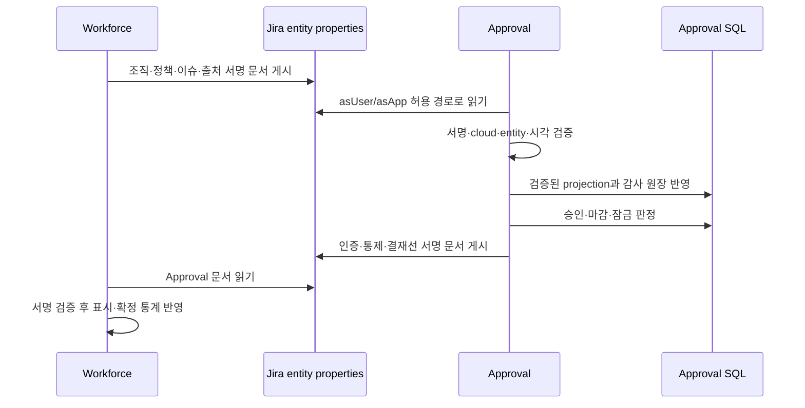

# 설계와 구체 구현

## 1. 바꾸려는 문제와 사용 사례

이전 UI에는 입력안 사전 승인, 이미 작성한 워크로그의 직접 인증, 기간 타임시트, 이슈 상태 승인 등이 함께 드러났다. 사용자는 어느 창구에 입력해야 정상 출처로 인정되는지, 입력 후 누구에게 승인 요청해야 하는지, 승인과 인증 중 무엇이 수정 금지의 근거인지 알기 어려웠다.

이번 흐름은 다음 사례를 기준으로 묶었다. 작성자 김씨가 10월 13일 2시간을 기록하면 Jira 저장을 먼저 마친다. 자동 요청 정책이면 팀장에게 건별 요청이 쌓인다. 팀장이 업무함에서 여러 건을 선택해 승인하면 각 요청의 결정과 잠금이 확정된다. Workforce에는 비동기로 검증 가능한 승인 자료가 게시된다. 아직 열린 월의 운영 통계와 마감 뒤 확정 통계는 같은 원본 시간을 유지하되 포함 조건이 다르다.

팀장이 없는 경우에도 2시간 기록은 사라지지 않는다. 화면은 저장 성공과 승인자 선택 필요를 따로 보여 준다. 김씨는 이 기록의 상세에서 가능한 승인자를 골라 접수한다. 접수 중 오류가 나더라도 새 워크로그를 다시 만들 필요가 없다.

## 2. 설계 순서와 선택 이유

| 판단 | 선택 | 이유·대안의 한계 |
| --- | --- | --- |
| 승인 단위 | 실제 `worklogId` 한 건 | 이슈 하나에 여러 사람·날짜의 기록이 있어 이슈 전체 승인만으로는 수정 가능 대상을 식별하기 어렵다. |
| 승인 시점 | 저장 후 요청 | 작성자의 작업 기록을 먼저 보존하고 접수 장애를 분리한다. 자동 요청과 자동 승인을 혼동하지 않는다. |
| 요청 엔진 | 기존 `WORKLOG_CERTIFICATION` 재사용 | 승인자·결정·업무함·일괄 승인·감사 이벤트를 새 테이블로 중복 구현하지 않는다. UI에서는 “워크로그 승인”으로 표시한다. |
| 잠금 근거 | 현재 Approval SQL 원장 | 큐 게시가 늦거나 프로퍼티가 낡아도 이미 승인된 기록의 수정이 열리면 안 된다. |
| 앱 간 교환 | 사이트·서명·버전을 검증한 문서 | 상대 앱은 Approval SQL을 직접 공유하지 않는다. 출처와 계약 검증 없이 클라이언트 payload를 신뢰하지 않는다. |
| 잠금 정책 | 승인 후 수정·삭제 금지는 고정 | 관리자가 실수로 보호 기능을 꺼 버리는 중복 토글을 없앤다. |
| 비동기 복구 | 기존 큐·아웃박스·리스 재사용 | 새 빈번한 스케줄을 추가하지 않고 실패한 단계만 이어간다. |
| 감사 보관 | 파일 확인 후 명시적 정리 | 용량 경고가 자동 증거 삭제로 이어지지 않게 한다. 현재 승인·출처 근거는 별도 보호한다. |

공식 Forge SQL은 설치별 DB와 SQL 조회를 제공하지만 외래 키 및 cascade delete를 지원하지 않는다. 따라서 앱이 요청·결정·snapshot 관계와 삭제 범위를 직접 관리하는 설계가 필요하다. 이는 공식 제약에 대한 이 프로젝트의 설계 판단이다. [Forge SQL](https://developer.atlassian.com/platform/forge/storage-reference/sql/)

## 3. 실제 책임과 코드 위치

아래 경로는 Approval 저장소 기준이며 `Workforce:` 접두 경로는 형제 `moves-workforce` 저장소 기준이다. 그림은 설명에 필요한 9개 구성요소만 표시하므로 모든 resolver 연결을 그린 호출 그래프는 아니다.

| 계층 | 주된 코드 | 책임 |
| --- | --- | --- |
| 이슈 입력·목록 | `static/ui/src/entries/issue.jsx`, `features/worklog/WorklogTab.jsx`, `WorklogDialog.jsx` | 입력→목록→상세, 저장·접수 결과 분리 |
| 요청·이력 UI | `features/worklog/WorklogApprovalPanel.jsx`, `WorklogApprovalStatus.jsx`, `WorklogDetailModal.jsx` | 서버 can*에 따른 동작, 승인자 선택, 소명, 20회 단위 이전 이력 |
| 설정 UI | `features/settings/WorklogApprovalSettings.jsx`, `settingsNavigation.js` | 요청 시점·마감 시점·승인자 안내, 고급 진단 분리 |
| 요청 서비스 | `src/resolver/worklogCertification/WorklogRequestService.js` | 정상 출처·본인·마감 검사, 후보, 자동·수동·소명, 회차 교체 |
| 승인 엔진 | `src/resolver/approval/ApprovalService.js` | 요청/승인자/결정/이벤트, 조건부 결정, 기존 일괄 처리 |
| 인증 투영 | `src/resolver/worklogCertification/ApprovalCertificationProjection.js` | 승인 원장 결과를 확정 워크로그 인증과 교환 상태에 반영 |
| 통제 | `src/resolver/worklogControl/WorklogControlService.js`, `WorklogControlWorker.js` | 승인·기간 잠금, 수정·삭제, 제한·해제, 재조정 |
| 교환 | `src/resolver/workforce/WorkforcePublisher.js`, `WorkforceCertWake.js` | 아웃박스와 큐에서 서명 문서 게시·재확인 |
| 이력·보관 | `src/resolver/worklogHistory/`, `src/resolver/retention/` | 변경 이력 수집, export, 확인된 범위 정리 |
| 용량 안내 | `src/resolver/storage/StorageService.js`, `features/settings/StorageNotice.jsx` | 테이블 통계 추정, 관리자 경고, 데이터관리 연결 |
| 상대 앱 정책 | Workforce: `src/resolver/approvalLink/`, `static/ui/src/pages/projectDetail/issue/` | 팀장 범위의 이슈 `wa` 정책, 지원 계약 확인 |
| 상대 앱 집계 | Workforce: `src/resolver/approvalLink/ApprovalCertReader.js`, `src/api/jira/worklog/CollabWorklogFetcher.js` | 공개행/허용 숨김행과 인증 교차 검증, 원시간·집계시간 분리 |

## 4. 저장 원장과 데이터 수명

| 자료 | 보존하는 내용 | 무엇의 근거인가 |
| --- | --- | --- |
| `approval_request`, `approval_approver`, `approval_event` | 요청 회차, 요청자, 지정 승인자, 결정, 행위자·시각·사유 | 승인 여부·결정 이력의 원장 |
| `approval_inbox` | 작성자·승인자의 업무 목록 | 조회용 투영, 원장 대체 아님 |
| `worklog_certification`, `worklog_certification_request` | 워크로그와 요청 snapshot 연결 | 현재·과거 요청의 결합 |
| `worklog_cert`, batch/log | 승인된 시간·지문·출처 및 재인증 기록 | 인증·집계와 보호 근거 |
| `worklog_control`, control log, intent | 정상 입력 증명·통제 상태·작업 추적 | 수정·삭제 허가, 출처 유지 |
| `worklog_history`, mirror | 관측된 생성·수정·삭제와 이전 값 일부 | 변경 이력; 완전한 Jira 백업 아님 |
| Jira entity properties | 서명한 조직·정책·인증 문서 | 앱 간 검증 가능한 교환·표시·집계 입력 |

이번 기능에 새 SQL 테이블/마이그레이션을 추가하지 않고 기존 원장을 재사용한다. 승인 snapshot에는 id, 작성자, 시작 시각, 초, 원본 갱신 시각, 지문을 저장한다. 설명은 지문에 반영하지만 원문 전체를 snapshot에 넣지 않는다. 새 `approvalModel:1`은 통제가 변경하는 visibility를 내용 지문에서 제외한다. 이전 모델의 지문을 소급 재해석하지 않는다.

변경 이력의 기본 설명 보관은 지문과 짧은 앞부분이다. `worklogHistoryKeepComment`가 켜져도 각 before/after 텍스트는 최대 4,000코드포인트이며 전체 ADF 원본 보관은 아니다. 이슈 삭제 전에 관측하지 못한 수정·삭제의 행위자나 원문은 나중에 만들어낼 수 없다.

보관 정리는 export 대상과 purge 대상을 구분한다. 현재 승인 근거는 파일로 받을 수 있어야 하며, 파일 다운로드가 가능하다는 사실만으로 서버 잠금 원장을 지울 수 있는 것은 아니다. 일반 이력 12개월/연동 이력 36개월·승인 3년·인증/통제 무기한 설정은 대상 선정 기준이며 자동삭제 약속이 아니다. 활성·확정 승인과 정상 출처 근거를 보호하는 조건이 우선한다.

## 5. 정책 우선순위와 의미

| 질문 | 단독 사용 | Workforce 연동 이슈 |
| --- | --- | --- |
| 언제 요청하는가 | `worklogAutoRequest` 기본 true | 검증된 `wa.autoRequest`가 있으면 우선 |
| 언제 마감하는가 | 사이트 기간·마감 규칙 | 이슈의 `wa.closeDays`와 실제 마감 상태를 함께 반영 |
| 누가 승인하는가 | 현재 팀장 기본, 수동 후보 선택 가능 | 검증된 Workforce 팀장 기본, 수동 후보 선택 가능 |
| 승인 후 수정 가능한가 | 불가 | 불가; `wa.lockApproved`는 true 고정 |
| 어디서 작성하는가 | Approval 이슈 입력 | Approval 이슈 입력 또는 Workforce 앱 내부 정상 생성 |
| 어디서 수정·소명하는가 | Approval 상세 | Approval handoff 상세 |

`wa` 형식은 `{v:1,autoRequest:boolean,lockApproved:true,closeDays:0..90}`다. 이슈 설정을 바꾸는 프로젝트 팀장 권한과 “나의 기록을 승인하는 팀장”은 서로 다른 역할일 수 있다. 설정을 바꾸는 사람이 모든 프로젝트 워크로그의 승인자로 자동 지정되지는 않는다.

실제 잠금은 본인 여부→통제 작업 경합→기간 판정 가능 여부→승인 잠금→기간 잠금→정책 순서의 서버 검사를 따른다. UI 버튼을 숨기는 것은 안내이며 보안 장치의 전부가 아니다.

## 6. 요청·결정 라이프사이클

| 상태/상황 | 서버·화면 동작 | 다음 행동 |
| --- | --- | --- |
| 저장 + 자동 정책 + 승인자 있음 | `PENDING` 접수, 업무함 생성 | 승인자 결정 대기 |
| 승인자 없음 | `NEEDS_APPROVER` | 후보 검색·선택 후 수동 접수 |
| 수동 정책 | `UNSUBMITTED` | 작성자가 승인 요청 |
| 저장 성공 + 접수 실패 | `SUBMISSION_FAILED`와 retry 정보 | 같은 기록에서 재접수; 중복 저장 금지 |
| Workforce 생성 후 관찰 전 | `PROCESSING` | 새로고침·비동기 접수 확인 |
| 아직 누구도 결정하지 않은 대기 요청 | `canChangeApprover`만 노출 | 이전 요청 supersede, 새 회차에 기록 |
| 승인 | 현재 원장으로 즉시 보호, 인증 투영·게시 진행 | 조회 가능, 수정·삭제 금지 |
| 반려 | 사유와 결정자·시각 표시 | 서버가 허용하는 수정/재요청; 같은 지문을 자동 재요청하지 않음 |
| 대기 중 원본 내용 변경 | 기존 요청 만료·새 내용 기준 처리 | 예전 내용을 승인한 것으로 오인하지 않음 |
| 기존 승인 후 소명 | 기존 인증 기준이 저장된 경우 사유 필수, 잠금 유지, 새로운 APPEAL 회차 | 승인자 재검토; 임시 수정권 부여 아님 |
| 삭제/변경 관측 | 상태·이력을 남기고 적격성 재검증 | 과거 승인 사실과 현재 집계 가능 여부 분리 |

승인 상태만 비교하면 부족하다. 인증 지문과 현재 기록의 내용, 정상 출처, 월 마감, 실제 통제 상태를 함께 확인한다. 오래된 직접 인증 자료는 새 건별 승인으로 승격하지 않는다.

마감된 미승인 기록에 새 소명 요청을 만드는 경로는 제공하지 않는다. 마감 후 추가·변경한 내용을 최초 승인으로 우회 수용하지 않기 위해서다. 마감 전에 접수된 PENDING은 원래 저장 지문을 재검증해 승인할 수 있다. 기존 승인 원장만 있고 인증 투영이 완료되지 않았으면 소명도 아직 열지 않는다. 소명 승인은 기존 확정 시간과 지문을 교체하지 않는다.

## 7. 프론트 API 계약

`getWorklogCertification({issueId,worklogId,historyBeforeRevision?})`은 `approval`, `certification`, `canRequest`, `canAppeal`, `canChangeApprover`, `locked`, `lockReason`, `approvalHistory`, `approvalHistoryPage`를 반환한다. UI는 상태 문자열로 권한을 추측하지 않고 서버 can*를 사용한다. 과거 이력은 20회씩 받아 다음 커서 `nextBeforeRevision`으로 이어 붙인다.

`listWorklogApprovalCandidates({issueId,query?})`은 `users`, `defaultApproverIds`, `needsApprover`를 반환한다. 본인은 후보에서 제외하며 현재 이슈를 볼 수 있는 후보만 반환한다. 후보 조회에 실패했을 때 빈 후보를 정상 상태로 취급해 전송하지 않는다.

`requestWorklogApproval({issueId,worklogId,approverId?,reason?})`과 `appealWorklogApproval({issueId,worklogId,approverId?,reason})`은 `{requestId,status,created,locked}`를 반환한다. 소명 사유는 최대 500자이며 빈 값은 전송 전에 안내하고 서버에서도 거부한다.

업무함의 `worklogApproval:{started,seconds,purpose}`는 권한/페이지 필터를 거친 행만 일괄 보강한다. 설명·소명 원문은 목록에 복제하지 않는다. 일괄 승인 응답에서 성공 id만 선택을 해제하며 실패·미처리 건은 남겨 재검토할 수 있게 한다. 성공 후 query factory를 이용해 기록·승인·업무함·이력·타임시트 캐시를 무효화한다.

## 8. 권한 경계와 공식 플랫폼 근거

Forge의 `asUser()`는 호출 사용자의 권한으로, `asApp()`는 앱 사용자 권한으로 동작한다. 앱 권한이 더 넓을 수 있으므로 asApp을 호출했다는 사실은 화면에 데이터를 공개할 허가가 아니다. [Jira authentication](https://developer.atlassian.com/platform/forge/apis-reference/fetch-api-product.requestjira/)

이 프로젝트는 `guardedDefine`·PermissionMap·등록 목록을 통해 resolver 권한을 선언하고, 데이터 계층에서 다시 owner/팀 범위/이슈 가시성을 좁힌다. 숨김 보충은 작성자 본인 또는 현재 팀장 범위와 이슈 열람 권한을 먼저 확인한 다음 author·issueId·worklogId·visibility를 재대조한다. 일반 집계 응답에 타인의 결정자·결정시각·requestId를 싣지 않는다. cost/aggregate/hidden-aggregate 캐시도 분리한다.

이벤트에는 사용자 컨텍스트가 없을 수 있다. 자동 요청은 검증한 실제 작성자를 요청자로 기록하고 시스템 이벤트 actor는 null로 둔다. 트리거에서 임의 principal을 꾸미지 않는다. 필요한 팀장 활성/이슈 접근 검사는 제한된 `AutomaticApproverAccess` 경로로 처리한다. 예외와 사유 allowlist의 최신 목록은 AGENTS.md가 기준이다.

승인자 검색은 실제 이슈를 조회해 id/key를 대조한 뒤 `user/viewissue/search?issueKey=...`를 호출한다. 공식 API에 명시되지 않은 issueId 파라미터를 이슈 권한 범위로 신뢰하지 않는다. `active === true`인 해당 계정만 적격이며, Browse users and groups 권한이 없어서 빈 응답을 받으면 자동 접수하지 않는다. 자동 경로는 후보당 최대 REST 2회, 수동 경로는 호출 사용자 asUser 조회를 사용한다. [공식 사용자 검색 API와 권한](https://developer.atlassian.com/cloud/jira/platform/rest/v3/api-group-user-search/#api-rest-api-3-user-viewissue-search-get)

Entity property는 여러 앱·사용자의 접근이 가능한 공유 영역이며 값 크기 제한도 있다. 따라서 개인키·민감한 설명 원문을 넣지 않고, 서명·사이트·버전·시각을 검증한다. 이 프로젝트는 게시 본문에 별도 약 30KB 예산을 두고 잘림 상태를 명시한다. [Jira entity properties](https://developer.atlassian.com/cloud/jira/platform/jira-entity-properties/)

## 9. 큐·장애·최종 일관성

Forge Async Events는 백그라운드 처리와 재시도를 제공하지만 중복 수신과 재시도 종료를 고려해야 한다. 큐를 유일한 원장으로 삼지 않고 SQL의 처리 상태·리스·커서를 남긴 이유다. [Async Events API](https://developer.atlassian.com/platform/forge/runtime-reference/async-events-api/)

승인 mutation은 원장 갱신과 게시 대상 표시까지 한다. Jira 프로퍼티 PUT와 대조 GET은 큐의 Publisher에서만 한다. 반복 승인은 짧은 깨우기 창에 합치며 리스 경합 재시도도 유한하게 제한한다. 트리거는 부분 적용 후 예외를 던져 중복 부작용을 만들지 않고 기존 리컨실 경로에 복구를 맡긴다. 배치 예산이 끝나면 cursor를 유지하고 미완주 watermark를 전진시키지 않는다.

| 실패 지점 | 유지하는 사실 | 복구 원칙 |
| --- | --- | --- |
| Jira 저장 후 접수 실패 | 실제 워크로그는 있음 | 같은 id로 요청 재시도 |
| 결정 후 인증 투영 실패 | 승인 결정과 잠금은 유효 | 투영을 멱등 재처리 |
| 서명 키/상대 capability 없음 | SQL 승인은 유지 | 관리자 연동 진단·키/버전 준비 후 게시 |
| Jira 429·일시 오류 | 미게시 아웃박스/커서 유지 | bounded retry·다음 리컨실; 동기화 성공으로 표시하지 않음 |
| 이슈 삭제 또는 열람 상실 | 저장 감사 자료는 보관 | 일반 조회와 승인 export는 권한 필터로 제외 가능; 변경 이력의 가린 기본 metadata export와 구분 |
| 저장 공간 부족 | 이미 저장된 승인 근거 보존 | 파일 export·확인·허용 정리, 무차별 DELETE 금지 |

Jira REST의 rate limit은 별도 요청량 제약이다. 429와 Retry-After를 존중해야 하며, 월 비용이 작다는 이유로 순간 대량 호출이 안전한 것은 아니다. [Jira rate limiting](https://developer.atlassian.com/cloud/jira/platform/rate-limiting/)

## 10. 통계의 원시간과 확정시간

Workforce 행은 `claimedSeconds`에 원래 기록 시간, `countableSeconds`와 집계용 `timeSpentSeconds`에 정책상 포함 시간을 둔다. 개별 기록에 2시간이 보여도 확정 통계에서 0시간일 수 있으며, 그 이유를 승인 상태와 집계 제외 표시로 안내한다.

마감 후에는 정상 출처의 승인 확정 시간을 집계한다. 승인 2시간 뒤 외부에서 현재 원문을 3시간으로 바꾸면 표시 시간은 3시간, 확정 집계는 기존 2시간, 상태는 CHANGED다. 증가한 1시간은 자동 인증하지 않는다. 유효한 승인 증명이 없는 기록이나 잘린 게시물의 누락분은 확정 집계에 넣지 않는다. 수동 마감/재개와 이슈별 closeDays도 확인한다. 일반 공개행의 asUser 재조회와, 허용된 숨김 승인분 보충은 다른 경로다. 대시보드·달력·관계 그래프·원가가 Jira 전체 timetracking 합계로 우회하지 않도록 공용 승인 필터를 적용한다. 집계 갱신은 게시/캐시 단계 때문에 지연될 수 있으므로 사이트 실측이 필요하다.

## 11. 검증 전략과 한계

요청/소명 권한, origin, 잠금, 지문, 중복 이벤트, 승인자 변경, pagination, 부분 실패, 게시 계약, 보관 보호를 각 경계에서 테스트한다. 프론트는 서버 can* 없는 동작을 제공하지 않는지, 입력 오류를 보존하는지 확인한다. 같은 구현을 단순 복제한 테스트 대신 실패 뒤 사용자가 다시 진행할 수 있는 조건을 확인한다.

Jest는 실제 Forge webpack 순환 import를 모두 재현하지 않으므로 `check:bundle`을 별도로 실행한다. 앱 전체 build와 Forge lint는 병렬 작성이 끝난 뒤 진행한다. 최종 실행 결과와 실사이트 검증 상태는 [자료 목차](cloudjira--README.md) 및 작업 완료 보고를 기준으로 읽는다.

## 앱 간 연동·API·설명 편집·추가 필드 보완 (2026-10-14)

두 앱의 SQL은 각각의 설치에 격리되어 있으며 상대 DB를 직접 읽지 않는다. 내부 자동 연동은 Jira 사용자·프로젝트·이슈·워크로그 entity property에 서명 문서를 게시하고 검증하는 경로로 고정한다. Approval의 미사용 apiRoute와 전용 adapter·custom scope 정의는 제거했다. 상세 위치와 삭제 수명은 [entity property 연동 설계](cloudjira--ENTITY_PROPERTY_INTEGRATION.md)에 정의한다.

Approval 설정의 수동 3LO 조직 조회 연결과 App REST apiRoute는 제거했다. 승인자 권한 동기화에는 서명 검증된 entity property만 사용한다. 과거 API 검토 내용은 [비활성 API 구현 기록](cloudjira--API_INTEGRATION.md)에 보존한다.

자동 요청은 별도 시스템 경로에서 작성자의 서명된 조직 property를 확인한다. principal 없는 explicit automatic 경로만 고정 사유 asApp 읽기를 허용한다. 5분 캐시·32KiB 상한·계정과 서명 대조를 거치고 원문을 사용자 응답으로 반환하지 않는다. Jira 권한으로 읽기가 거부되면 승인자로 임의 승격하지 않는다.

소명 승인 대상 snapshot은 원래 인증 batch의 승인 내용을 고정한다. 현재 외부 변경 내용은 observation으로만 보관하고 원래 승인 시간을 덮지 않는다. 기존 CERTIFIED/MISMATCH 자료도 새 일반 승인으로 교체할 수 없다. 재처리 실패 행은 다음 순환에서 재시도하되 뒤 정상 행을 계속 처리한다.

설명 편집은 MDXEditor에서 Markdown을 편집하고 저장 직전 검증된 ADF로 변환한다. 미지원 노드/서식은 읽기 전용으로 보존하며 설명을 변경하지 않았다면 update payload에서 comment를 생략한다. 서버는 ADF 구조·길이·깊이·링크를 검증한다. rich editor는 lazy chunk로 분리한다.

Workforce effort field는 Jira originalEstimate/timespent 기반 숫자 3개다. 개별 워크로그 설명·작성자·승인 문서를 읽지 않는다. 기록공수는 원본 Jira 집계이고 승인 확정 통계와 다르다. 조회 시 value function이 계산한 값이 저장되므로 JQL·REST 최신성 한계를 운영 가이드에 명시한다.
