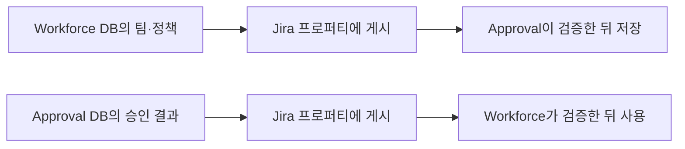

# 현재 프로퍼티 연동 방식의 취약점과 제약사항

작성일: 2026-10-15  
검토 기준: Approval 저장소 `0c52170` 및 당시 작업 트리  
함께 읽을 문서: [고객 소유 외부 저장소 개발 설계](cloudjira--CUSTOMER_MANAGED_STORAGE_DESIGN.md)

후속 검토: [단독·연동 모드를 포함한 전체 분석](cloudjira--PROPERTY_INTEGRATION_FULL_REVIEW.md)

2026-10-15 추가 검증: 원격 문서 누락을 감지한 뒤 원장 내용이 같으면 실제 PUT을 생략하는 경로를 로컬 모의 테스트로 재현했다. 최초 게시 → 원격 조회 null → 누락 감지 → 다음 게시 순서에서 `unchanged: 1`, `published: 0`이었다. 따라서 아래의 재게시 공백은 정적 분석만으로 제기한 가능성을 넘어 해당 테스트 조건에서 확인한 문제다. 실제 사이트 삭제 시험이나 수정 배포는 수행하지 않았다.

## 1. 프로퍼티를 지우면 어떻게 되는가

**프로퍼티를 지웠다고 승인 내역과 감사 이력이 바로 없어지지는 않는다. 하지만 두 앱 사이의 정보 전달이 끊길 수 있다.**

예를 들어 Approval에서 8시간짜리 워크로그를 승인했다고 하자. 승인 사실은 Approval DB에 저장되고, Workforce가 읽을 수 있도록 Jira 프로퍼티에도 결과를 게시한다. 이때 프로퍼티만 지우면 Approval의 승인 기록은 그대로지만, Workforce에서는 승인 결과를 확인하지 못하거나 예전 상태를 보여 줄 수 있다.

즉, 승인 데이터가 남아 있다는 것과 두 앱이 정상 동작한다는 것은 다른 문제다. 승인자 목록, 정책, 입력 경로, 통계 중 무엇을 전달하던 프로퍼티인지에 따라 영향이 달라진다.

이 문서는 현재 코드에서 확인한 방어, 발견한 문제, 아직 검증이 필요한 부분을 설명한다. 실제 고객 사이트에서 삭제 시험을 하거나 수정 사항을 배포한 결과는 아니다.

## 2. 프로퍼티는 공통 DB가 아니다

프로퍼티는 Jira 이슈·프로젝트·사용자·워크로그에 붙는 작은 JSON 문서다. 두 앱이 같은 Forge DB를 사용하는 것이 아니라, 한 앱이 Jira에 써 놓은 문서를 다른 앱이 읽는 방식이다.



문서를 이해하기 위해 용어 세 가지만 구분하면 된다.

| 용어 | 이 문서에서의 의미 |
|---|---|
| 원장 | 앱 DB에 저장된 승인 결정·정책·감사 이력 등 실제 판단 근거 |
| 프로퍼티 | 다른 앱에 전달하기 위해 Jira에 게시한 사본 |
| 수신 캐시 | 상대 앱이 읽고 서명을 확인한 뒤 자기 DB에 보관한 마지막 정보 |

따라서 프로퍼티를 다시 만들려면 원장을 가진 앱이 현재 내용을 다시 게시해야 한다. 상대 앱이 추측해서 승인 결과나 팀장 정보를 만들어 넣어서는 안 된다.

## 3. 왜 삭제나 변경이 가능한가

Jira entity property는 앱만 접근하는 비밀 저장소가 아니다. 공식 문서에 따르면 엔티티를 편집할 수 있는 사용자나 다른 앱이 값을 변경할 수 있고, 앱별로 격리되지 않은 이름 공간을 사용한다. 동시 변경 시 마지막 저장값이 남으며 문서 하나의 크기는 최대 32,768바이트다. 민감정보와 개인정보를 저장하지 말라는 제한도 있다. [Atlassian 공식 문서](https://developer.atlassian.com/cloud/jira/platform/jira-entity-properties/)

현재 방식은 문서에 서명을 붙여 “상대 앱이 만든 올바른 문서인가”를 확인한다. 누군가 팀장이나 승인 시간을 바꿔 넣으면 서명 검증에서 거부하도록 하는 것이다.

그러나 서명에는 한계가 있다. 문서 자체를 지우는 것은 막지 못하고, 문서를 제때 받게 해 주지도 않는다. 또 서명은 암호화가 아니므로 본문이 숨겨지는 것도 아니다. 공개하면 안 되는 내용은 애초에 프로퍼티에 넣지 않아야 한다.

## 4. 현재 코드가 막고 있는 것

### 이미 받은 정보를 삭제만으로 없애지는 않는다

Approval이 정상적으로 검증해 받은 조직·정책 정보는 프로퍼티가 사라졌다고 바로 지우지 않는다. 마지막으로 확인한 값을 유지한다. 코드에서는 이를 `sticky` 처리라고 부른다.

예를 들어 사용자가 자기 팀장 프로퍼티를 지웠을 때, 곧바로 “팀장이 없는 사용자”로 바뀌어 승인 규칙을 피하는 일을 막기 위한 것이다. 정책도 삭제만으로 저장값을 즉시 지우지는 않으며, 검증된 명시적 해제 정보와 구분한다. 다만 저장된 정책이 실제로 적용되는 범위는 유효기간에 따라 달라질 수 있다. 이 차이는 5.4절에서 설명한다.

### 저장된 승인과 작성 출처는 따로 남는다

Approval DB에 저장된 승인 결정은 프로퍼티 DELETE의 직접적인 삭제 대상이 아니다. 정상 입력 경로라는 사실을 이미 DB에 기록한 워크로그도 저장된 출처를 우선 사용하는 경로가 있다.

### 보낸 문서가 없어졌는지 대조한다

Approval의 게시 작업에는 이전에 보낸 문서와 Jira의 현재 문서를 비교하는 기능이 있다. 문서가 없으면 `MISSING_REMOTE`, 내용이 다르면 `TAMPERED`로 분류해 재게시 대상으로 등록한다.

다만 **등록했다고 실제로 복구되는 것은 아니다.** 다음 절의 문제가 남아 있다.

## 5. 현재 방식에서 특히 주의할 문제

### 5.1 삭제를 발견해도 다시 보내지 않을 수 있다

현재 코드는 불필요한 전송을 줄이려고 “DB 내용과 서명 키가 이전과 같으면 전송 생략”이라는 최적화를 사용한다. 삭제 복구가 이 최적화와 충돌할 수 있다.

```text
1. 승인 결과를 Jira에 정상 게시한다.
2. 누군가 그 프로퍼티만 삭제한다.
3. 대조 작업이 삭제를 발견하고 재게시 대상으로 넣는다.
4. 전송 작업은 DB 내용이 이전과 같다고 판단한다.
5. 실제 전송을 생략한다. Jira에는 여전히 문서가 없다.
```

코드를 연결해서 보면 이 경로가 가능하다. 누락을 발견하는 `verifyPublished()`는 `touchMany()`로 대기 상태를 만들지만, 이전 전송 내용과 키는 그대로 둔다. 이후 `drain` 계열의 동일 내용 검사에서 전송이 생략될 수 있다.

이 문제는 코드 검토에서 발견했으며 실사이트에서 재현한 결과는 아니다. 그래도 현재 상태로 “지워져도 다음 스윕에 자동 복구된다”고 안내할 근거는 부족하다.

**보완 방향:** 삭제·변조 복구는 일반 데이터 변경과 구분해야 한다. 이 경우에는 동일 내용이어도 실제 전송하고, Jira에 다시 저장됐는지 확인한 뒤 복구 완료로 처리한다. 정상적으로 해제한 문서를 되살리지 않는 처리도 함께 필요하다.

### 5.2 한 번도 받지 못한 정보는 유지할 수 없다

마지막 정상값을 유지하는 방어는 이전에 정보를 받은 적이 있을 때만 작동한다.

Workforce가 이슈를 연결했지만 Approval이 읽기 전에 연결 프로퍼티가 삭제됐다면, Approval에는 그 이슈가 연결돼 있었다는 근거가 없을 수 있다. 정상 작성 출처 표식도 DB에 관찰되기 전에 사라지면 증명이 어려워진다.

따라서 “프로퍼티가 없으니 미연동 이슈다”, “출처가 없으니 반드시 잘못 입력한 기록이다”라고 즉시 판단하면 안 된다. 연결 대상과 작성 작업의 원장을 대조할 수 있어야 한다. 현재 모든 경로에서 이 구분이 완전하다고 검증된 것은 아니다.

### 5.3 예전 정보를 유지하는 것도 문제가 될 수 있다

팀장이 A에서 B로 바뀌었는데 새 조직 정보가 전달되지 않으면 Approval에는 A가 남을 수 있다. 정보를 지우지 않는 방어가 오히려 오래된 승인 권한을 유지하는 원인이 되는 것이다.

마지막 수신 시각을 보여 주고, 승인 실행 시점에 팀·권한의 최신성을 확인하는 기준이 필요하다. 오래된 정보로 새 권한을 주는 것과 이미 확정된 승인 기록을 유지하는 것은 구분해야 한다.

### 5.4 정책은 시간이 지나면 적용 결과가 달라질 수 있다

정책 캐시는 무조건 영구 적용되지 않는다. 현재 코드는 만료 전, 만료 후 기본 1일 유예, 유예 종료를 구분한다. 만료된 비잠금 설정은 정책 병합에서 제외하는 경로가 있고, 잠긴 설정에는 사용할 수 없다는 상태를 남긴다.

그러므로 삭제 직후 수정이 막혔다고 검증을 끝내면 안 된다. 며칠 뒤 정책이 만료된 상태에서도 마감된 기록을 수정할 수 없는지 확인해야 한다. **이미 승인된 건의 승인 잠금과 정책 설정의 유효기간은 별개의 검사 대상**이다.

### 5.5 승인 내역이 남아도 모든 수정 경로를 막았다는 뜻은 아니다

Approval 화면, Workforce 화면, Jira 기본 기능, Jira REST API는 서로 다른 입력 경로다. Approval DB에 잠금이 있다고 Jira의 모든 요청이 자동으로 그 DB를 거치는 것은 아니다.

앱 서버의 검사와 Jira 권한·공개 범위 설정이 각 경로에서 어떻게 적용되는지 확인해야 한다. 변경 후 발견해서 조치하는 기능은 처음부터 변경을 막는 기능과 다르다. 특히 “승인 또는 마감 이후 수정 불가”라는 요구는 버튼 비활성화만으로 증명할 수 없다.

## 6. 어떤 정보가 사라졌을 때 무엇이 달라지는가

| 사라진 정보 | 사용자가 겪을 수 있는 문제 | 코드에서 확인한 방어와 남은 확인 사항 |
|---|---|---|
| 팀·팀장 정보 | 승인자 목록이 없거나 이전 팀장이 표시됨 | 기존 검증값 유지. 최초 수신과 팀장 변경 이후 권한은 추가 확인 필요 |
| 연결 이슈·정책 | 연결된 이슈인데 정책을 확인하지 못함 | 이전 정책 유지. 첫 수신 전 누락·정책 만료 후 동작은 별도 검증 |
| 승인 결과 | Approval에는 승인됨, Workforce에는 미반영 | 승인 원장은 유지. 누락을 미승인이나 0시간으로 확정하면 안 됨 |
| 쓰기 통제 정보 | Workforce에서 입력·수정 처리가 지연되거나 Approval로 넘어감 | 공통 판정에 `DEFER` 경로가 있음. 모든 호출부가 이를 우회하지 않는지 검증 필요 |
| 결재선 목록 | 설정에서 결재선을 고를 수 없거나 예전 목록이 보임 | 결재선 원장은 남음. 재게시·재조회 필요 |
| 워크로그 작성 출처 | 정상 입력을 확인하지 못하거나 잘못 분류할 위험 | DB에 이미 증명된 출처는 유지. 관찰 전 삭제는 더 위험 |
| 워크로그 점검 결과 | 점검 누락으로 분류됨 | 점검 기능을 선언한 사용자에 대해 `CHECK_MISSING` 처리. 고의 삭제라고 단정할 수 없음 |

조직 정보의 기본 재조회 간격은 5분, 주요 프로젝트·이슈 정보는 1시간이다. 이 숫자는 “그 시간 안에 반드시 복구된다”는 약속이 아니다. 실제 조회가 발생해야 하며 권한·서명·큐·전송 실패에 따라 더 늦어질 수 있다.

## 7. 이슈 자체를 삭제하면 감사 자료는 어떻게 되는가

프로퍼티만 삭제한 경우와 Jira 이슈를 삭제한 경우는 다르다. 이슈가 없으면 그 이슈에 프로퍼티를 다시 게시할 수도 없다. 같은 제목으로 이슈를 만들어도 다른 ID이므로 과거 기록에 자동 연결하면 안 된다.

프로퍼티 삭제 명령 자체가 Approval SQL의 이력을 삭제하지는 않는다. 다만 일반 조회 화면은 Jira 이슈 열람 권한을 다시 확인하므로, 이슈가 삭제되거나 접근 불가해지면 DB에 기록이 남아 있어도 화면에서 보이지 않을 수 있다. 삭제된 이슈의 보존 자료는 별도 감사 조회 권한으로 다뤄야 한다.

또한 “기록이 남는다”는 말을 영구 보존 보장으로 확대하면 안 된다. 보관기간에 따른 정리, 개인정보 처리, 앱 제거, 저장소 손실은 각각 별도 문제다.

삭제 감지 기록도 한계가 있다. “오늘 10시에 확인했더니 프로퍼티가 없었다”는 것은 알 수 있어도, 그것만으로 누가 몇 시에 삭제했는지는 알 수 없다. 현재 연동 로그에는 180일 기준 정리 경로도 있으므로 장기 감사 자료와 같은 것으로 취급하지 않는다.

## 8. 복구할 때 생길 수 있는 부작용

| 대응 방법 | 부작용 | 필요한 기준 |
|---|---|---|
| 예전 정보를 계속 사용 | 이전 팀장·정책이 오래 적용됨 | 최신성 확인, 새 권한 부여 제한 |
| 정보가 없으면 모든 작업 중지 | 일시 장애에도 업무 전체가 멈춤 | 승인·수정과 읽기·진단을 구분 |
| 즉시 무한 재전송 | Jira 요청·SQL·큐·로그 비용 증가 | 대상별 재시도 간격과 처리량 상한 |
| 캐시를 지우고 처음부터 수신 | 과거 검증 정보와 버전 비교 기준 손실 | 원장·마지막 정상값 보존 |
| 오래된 정상 문서를 복사 | 예전 정책으로 되돌아갈 가능성 | 대상·사이트·버전·유효기간·신뢰 키 확인 |
| 복구 중 새 정책 반영 | 오래된 복구 작업이 최신 상태를 덮을 가능성 | 버전 조건부 저장과 최신 작업 보존 |

“안 보인다”는 응답도 삭제와 동일하지 않다. 접근 권한, 엔티티 존재, 통신 실패를 함께 확인해야 한다. 조사 과정에서 권한 없는 사용자의 숨겨진 워크로그를 노출해서는 안 된다.

## 9. 운영자는 어떻게 대응해야 하는가

1. **문제가 난 정보를 특정한다.** 사이트, 이슈·사용자·프로젝트, 프로퍼티 키, 마지막 정상 확인 시각을 찾는다.
2. **삭제인지 조회 실패인지 구분한다.** 통신 오류나 권한 부족을 고의 삭제로 단정하지 않는다.
3. **DB와 마지막 정상 정보를 보존한다.** 승인 내역이나 수신 캐시를 초기화하지 않는다.
4. **정보를 가진 앱에서 다시 게시한다.** 조직·정책은 Workforce, 승인 결과는 Approval이 현재 원장을 기준으로 만든다.
5. **실제로 복구됐는지 확인한다.** 작업 대기 등록만 보지 말고 Jira 문서, 서명, 내용 버전, 상대 앱의 수신 상태를 확인한다.
6. **업무 결과를 확인한다.** 승인자·정책·통계를 대조하고, 승인·마감 기록의 수정·삭제가 여전히 거부되는지 확인한다.

현재 양쪽 앱 전체를 한 번에 복구하는 UI와 복구시간 보장이 검증돼 있다는 뜻은 아니다. 자동 복구 공백을 수정하기 전에는 “기다리면 반드시 해결된다”고 안내하지 않는다.

## 10. 개발에서 먼저 보완할 것

우선은 삭제를 발견한 뒤 실제 재전송까지 완료되는 경로를 고쳐야 한다. 그다음에는 처음 정보를 받기 전의 삭제, 오래된 팀장 정보, 정책 만료 이후에도 승인·마감 제한이 유지되는지 확인해야 한다.

화면에서는 업무 상태와 연동 상태를 분리하는 것이 좋다. 예를 들어 “미승인” 대신 “승인 결과를 확인하지 못했습니다. 마지막 확인: 10:00”이라고 보여 주면 사용자가 실제 반려나 미승인으로 오해하지 않는다. 이는 개선 제안이며 현재 모든 화면에 구현됐다는 뜻은 아니다.

아래는 구현 완료를 판단할 시험 항목이다. 이 문서 작성 중 통과한 테스트 목록은 아니다.

| 시험 | 확인할 결과 |
|---|---|
| 승인 결과 삭제 후 내용 변경 없이 복구 | 실제 전송이 실행되고 상대 앱에서도 확인됨 |
| 정상 연동 해제 후 옛 문서 재생성 | 잘못된 문서를 제거하고 연동을 되살리지 않음 |
| 최초 수신 전 연결·출처 정보 삭제 | 미연동·정상 입력으로 임의 확정하지 않음 |
| 팀장 교체 중 조직 정보 삭제 | 과거 정보만으로 잘못된 신규 결정 권한을 주지 않음 |
| 정책 삭제 후 만료·유예 경과 | 마감된 기록의 수정·삭제 우회가 없음 |
| 승인된 기록을 각 입력 경로에서 수정 | UI와 서버, Jira 원본에서 차단 범위가 입증됨 |
| 복구 중 정책 변경·중복 이벤트 발생 | 최신 상태와 대기 작업을 잃지 않음 |
| 이슈 삭제·권한 박탈·통신 장애 | 원인을 구분하고 보존 자료의 권한을 지킴 |
| 반복 삭제·대량 복구 | 재시도 폭증 없이 처리하고 지연·비용을 측정할 수 있음 |

## 11. 개발자가 확인할 코드

본문은 운영 영향 위주로 설명했다. 세부 동작은 아래 파일에서 확인할 수 있다.

| 확인할 내용 | 코드 |
|---|---|
| 조직·프로젝트 정보의 검증값 유지, `DISAPPEARED` 기록 | [WorkforceInbound](../../src/resolver/workforce/WorkforceInbound.js) |
| 정책 부재와 명시적 해제의 구분 | [WorklogPolicyAuthority](../../src/resolver/worklogPolicy/WorklogPolicyAuthority.js) |
| 정책 만료 후 적용 방식 | [mergePolicy](../../src/domain/worklogPolicy/merge.js) |
| 연동 설정 수신·판정 불가 처리 | [LinkedIssueSettingSource](../../src/resolver/workforce/LinkedIssueSettingSource.js) |
| 호출 시 재조회와 캐시 간격 | [IssueSignalRefresher](../../src/resolver/worklogControl/IssueSignalRefresher.js) |
| 저장된 작성 출처의 우선 사용 | [WorklogControlDetector](../../src/resolver/worklogControl/WorklogControlDetector.js) |
| 자료 부족 시 `DEFER` 처리 | [writeGate](../../src/integration/workforce/writeGate.js) |
| 누락 감지·동일 내용 전송 생략 | [WorkforcePublisher](../../src/resolver/workforce/WorkforcePublisher.js) |
| 재게시 대기·완료 처리의 SQL | [WorkforceLinkRepository](../../src/resolver/workforce/WorkforceLinkRepository.js) |
| 프로퍼티 이름·형식, 점검 누락 | [contract](../../src/integration/workforce/contract.js), [inbound](../../src/integration/workforce/inbound.js) |
| 기존 누락 감지 테스트 | [WorkforcePublisher.test](../../src/resolver/workforce/__test__/WorkforcePublisher.test.js) |

현재 검토는 Approval 코드 중심이다. Workforce의 모든 소비 경로와 실제 설치 권한까지 시험하지 않았으므로, 발견한 위험을 곧바로 재현된 권한 우회 취약점으로 단정하지 않는다. 반대로 검증하지 않은 경로를 안전하다고 보장하지도 않는다.
