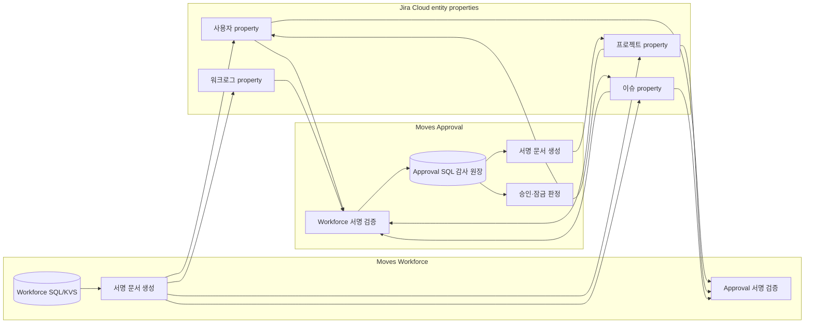

# Workforce–Approval 내부 연동: Jira entity property

> **폐기 기록 (2026-10-19).** 이 문서의 entity property 연동은 workforce-channel-rest 로 **전부 제거**됐다. 현재 두 앱은 페어링된 webtrigger + Ed25519 봉투(행위자 기준)로만 주고받는다 — 설계 `_workspace/workforce-channel-rest/01_architect_design.md`, 규칙은 `CLAUDE.md` 불변식 8·9. 아래 본문은 이전 방식의 기록으로 보존한다.

기준일 2026-10-14. 두 Forge 앱의 자동 연동은 Jira REST로 읽고 쓰는 **서명된 entity property**를 사용한다. App REST API와 3LO token은 내부 연동에 사용하지 않는다. 각 앱의 Forge SQL/KVS는 설치별 전용 저장소이고 상대 앱이 직접 읽을 수 없다.

## 공통 저장소라는 표현의 정확한 의미

entity property는 두 앱이 함께 접근할 수 있는 Jira의 교환 지점이다. 하나의 전역 테이블이 아니라 **Jira entity별 key-value 문서**다. 문서가 붙는 위치에 따라 수명과 범위가 달라진다.

| 위치 | 현재 교환 문서 | 역할 | 대상 삭제의 영향 |
|---|---|---|---|
| 사용자 property | `movesRms.org`, `movesApproval.{YYYY}`, `movesApproval.cert.{YYYY-MM}` | 팀·팀장 능력, 기간 결재 상태, 월 인증 결과 | 이슈 삭제와 무관 |
| 프로젝트 property | `movesRms.policy`, `movesRms.kb`, `movesApproval.ctl`, `movesApproval.flows` | 프로젝트 연동 정책, 통제 설정, 결재선 목록 | 개별 이슈 삭제와 무관 |
| 이슈 property | `movesRms.policy`, `movesRms.issue`, `movesApproval.ctl` | 이슈별 연동·정책 덮어쓰기 | 이슈 삭제 시 함께 사라질 수 있음 |
| 워크로그 property | `movesRms.origin`, `movesApproval.origin`, `movesApproval.op`, `movesRms.check` | 정상 입력 출처, 통제 작업 귀속, 점검 결과 | 워크로그 삭제 시 함께 사라짐 |
| Approval SQL | 요청, 결정, revision, 변경 이력, 통제 로그, 게시 outbox | 승인 판정과 감사 원장 | Jira entity 삭제와 분리해 보존 |

따라서 “이슈에 붙는가?”의 답은 **일부 신호만 그렇다**이다. 팀 구성과 월 승인 결과는 사용자에, 공통 정책과 결재선은 프로젝트에, 입력 출처는 워크로그에 붙는다. 장기 감사 자료는 entity property가 아니라 Approval SQL의 append-only 원장에 둔다.

## Jira 스페이스와 Workforce 프로젝트의 범위

Jira project(화면 명칭 스페이스) 하나의 여러 이슈가 서로 다른 Workforce project UUID에 연결될 수 있다. 따라서 project property는 Workforce project별 정책의 최종 저장 위치가 될 수 없다.

- 이슈의 Workforce project 귀속은 `moves_RMS_projectId` 앱 필드와 `movesRmsLink.projectId`에 둔다. `movesRmsLink`는 표시·조회 힌트이며, Workforce는 자기 SQL의 활성 프로젝트와 앱 필드가 일치하는지 확인한 뒤 서명 신호를 발행한다.
- 개별 연결은 issue property `movesRms.policy`로 증명하고, Workforce project에서 파생된 작성 기간·자동 요청·결재선은 issue property `movesRms.issue`로 게시한다.
- Approval이 계산한 최종 쓰기 규칙은 혼합 연결에서 issue property `movesApproval.ctl`로 게시한다. Workforce 조회는 issue ctl을 project ctl보다 먼저 사용한다.
- project property의 `movesRms.policy(ctl:ALL_ISSUES)`와 `movesApproval.ctl`은 전체 Jira 스페이스가 단일 Workforce project에 무필터로 연결되고 모든 이슈에 같은 규칙을 적용할 때만 공통 문서로 사용한다.
- 이슈 문서가 없거나 만료됐는데 project 문서의 적용 가능성을 확정할 수 없으면 허용으로 추정하지 않고 `DEFER`해야 한다. 비동기 게시 중 남은 project 문서로 잘못 fallback하는지 혼합 연결 수용 시험에서 확인한다.

## 활성 통신 흐름

Approval의 수정·삭제 허가는 **Approval SQL의 현재 상태**로 판정한다. property는 통신과 표시를 위한 복제 문서이며 단독 권한 근거가 아니다. 수신 측은 서명, `cloudId`, entity id, 문서 종류, 발행 시각과 허용 크기를 확인한 뒤에만 반영한다. 서명 검증 전 값은 신뢰하지 않는다.

## 운영 경계

- Jira 공식 문서상 entity property는 앱 전용 비밀 저장소가 아니다. REST API로 접근 가능하므로 token, 개인키, 민감한 설명 원문을 넣지 않는다.
- property 값은 최대 32KB다. 월별 인증 문서는 목록 상한과 byte budget을 적용하고, 잘림 표식이 있으면 누락 건을 승인된 것으로 추정하지 않는다.
- entity property 쓰기는 단일 문서의 last-write-wins 성격이 있으므로, 승인·감사 원장은 SQL에 두고 property는 재게시 가능한 projection으로 취급한다.
- 사용자 화면은 `asUser()`로 읽는다. 사용자 context가 없는 승인 결과 게시와 제한된 trigger 경로만 문서화된 사유로 `asApp()`을 사용한다.
- 게시 실패는 Approval SQL outbox에 남아 다음 reconcile에서 재시도한다. property 게시 성공을 승인 원장 저장 성공과 혼동하지 않는다.

## API의 현재 위치

Approval manifest에는 apiRoute가 없다. `/v1/worklogs/approval`, `/v1/worklogs/history` route와 전용 function·custom scope 정의를 2026-10-14 제거했다. 이미 Atlassian development 환경에 등록한 custom scope 이름은 플랫폼 정책상 삭제할 수 없지만 어떤 manifest route에도 연결되지 않는다. Workforce의 별도 `/v1/organization/teams` apiRoute도 Approval 내부 연동에서는 호출하지 않는다. 현재 Approval 설정에는 Workforce base URL·3LO access token 입력 기능을 노출하지 않으며 outbound resolver와 `api.atlassian.com` backend egress도 없다.

공식 근거:

- [Jira entity properties](https://developer.atlassian.com/cloud/jira/platform/jira-entity-properties/): entity별 key-value, 접근·보안 주의, 앱당 property와 값 크기 제한
- [Forge Jira entity property](https://developer.atlassian.com/platform/forge/manifest-reference/modules/jira-entity-property/): issue·user·project entity type과 JQL index 선언
- [Forge permissions](https://developer.atlassian.com/platform/forge/manifest-reference/permissions/): `external.fetch.backend`가 Forge 함수의 외부 통신 대상을 선언

