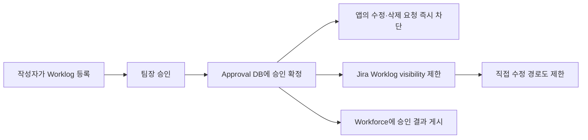
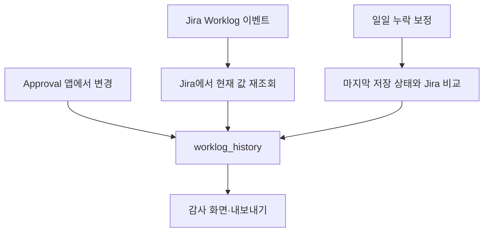

# 승인된 Worklog 잠금과 변경 이력 처리

## 문서 목적

이 문서는 다음 두 가지를 설명한다.

1. 팀장이 승인한 Worklog를 이후에 수정하거나 삭제하지 못하도록 어떻게 막는지
2. Worklog가 언제, 누구에 의해, 어떻게 바뀌었는지 어떻게 기록하는지

여기서 잠그는 대상은 **Jira issue 전체가 아니라 승인된 Worklog**다. 이슈의 제목, 상태, 담당자까지 잠그는 기능은 아니다.

---

## 1. 승인된 Worklog 수정·삭제 차단

### 전체 흐름



팀장이 승인하면 Approval DB가 먼저 승인 상태를 확정한다. 그 뒤에는 앱에서 해당 Worklog를 수정하거나 삭제하려는 요청을 서버가 거부한다. 화면에서 버튼만 숨기는 방식이 아니므로 API를 직접 호출해도 앱 서버의 판정을 통과할 수 없다.

동시에 백그라운드 작업이 Jira Worklog의 `visibility`를 앱 전용 프로젝트 역할로 바꾼다. 목적은 사용자가 Jira 기본 화면이나 다른 경로에서 승인된 기록을 고치는 일을 줄이는 것이다.

### 실제 차단 순서

수정 또는 삭제 요청이 들어오면 서버는 다음 순서로 확인한다.

1. 요청자가 해당 Worklog의 작성자인지 확인한다.
2. 같은 Worklog에 다른 통제 작업이 진행 중인지 확인한다.
3. 입력 가능한 기간인지 확인한다.
4. 이미 승인되었거나 승인 후 값이 달라진 기록인지 확인한다.
5. 해당 월 또는 기간이 마감되었는지 확인한다.
6. Workforce에서 받은 작성 정책을 확인한다.

승인된 기록이면 `WORKLOG_CERTIFIED_LOCKED`, 마감된 기간이면 `WORKLOG_PERIOD_LOCKED`로 거부한다. 승인 여부는 Jira property가 아니라 **Approval DB의 현재 상태**로 판단한다.

### Jira에는 무엇을 기록하나

Jira Worklog에는 다음과 같은 제한을 적용한다.

```json
{
  "visibility": {
    "type": "role",
    "value": "atlassian-addons-project-access"
  },
  "properties": [
    {
      "key": "movesApproval.op",
      "value": { "op": "<UUID>" }
    }
  ]
}
```

`movesApproval.op`는 승인 상태를 저장하는 값이 아니다. Approval이 Jira에 제한을 적용할 때 만든 작업 번호다. 서버는 이 번호가 DB의 `last_app_op_id`와 일치하는지 확인한 뒤, 앱 계정으로 실행된 작업을 실제 요청자와 연결한다.

따라서 누군가 property에 임의의 UUID를 넣어도 Approval DB의 작업 정보와 맞지 않으면 우리 앱의 작업으로 인정하지 않는다.

### 실제로 확인할 값

| 확인 위치 | 값 | 의미 |
|---|---|---|
| `approval_request` | `status = APPROVED` | 승인 요청이 최종 승인됨 |
| `worklog_cert` | `state = CERTIFIED` | 승인 당시의 시간·날짜·내용 기준값이 확정됨 |
| `worklog_cert` | `state = MISMATCH` | 승인 후 현재 값이 승인 당시 값과 달라짐. 수정·삭제는 계속 차단됨 |
| `worklog_control` | `vis_state = RESTRICTED` | Jira의 visibility 제한 적용 완료 |
| Jira Worklog | `visibility.type = role` | 역할 기준 공개 범위가 적용됨 |
| Jira Worklog property | `movesApproval.op.op = <UUID>` | 제한 작업 번호. DB 값과 함께 대조해야 함 |

### 프로퍼티별 저장 위치와 역할

| Property key | 저장 위치 | 작성 앱 | 간단한 역할 |
|---|---|---|---|
| `movesRms.org` | Jira **사용자 property** | Workforce | 사용자의 팀, 팀장, 팀원 범위를 전달한다. |
| `movesApproval.{YYYY}` | Jira **사용자 property** | Approval | 해당 사용자의 연도별 기간 승인 상태를 Workforce에 전달한다. |
| `movesApproval.cert.{YYYY-MM}` | Jira **사용자 property** | Approval | 해당 사용자의 월별 Worklog 승인 결과와 승인된 건 목록을 전달한다. |
| `movesRms.policy` | Jira **프로젝트 property** 또는 **이슈 property** | Workforce | Approval이 관리할 연동 범위와 정책을 알린다. 모든 이슈가 같은 범위일 때만 프로젝트에 저장한다. |
| `movesRms.kb` | Jira **프로젝트 property** | Workforce | 하루 근무 시간, 휴일 등 프로젝트 공통 근무 기준을 전달한다. |
| `movesRms.issue` | Jira **이슈 property** | Workforce | 이슈별 작성 가능 기간, 자동 승인 요청, 결재선 같은 설정을 전달한다. |
| `movesApproval.ctl` | Jira **프로젝트 property** 또는 **이슈 property** | Approval | Workforce가 Worklog 저장 전에 적용할 최종 통제 규칙을 전달한다. 혼합 연결이면 이슈에 저장한다. |
| `movesApproval.flows` | Jira **프로젝트 property** | Approval | Workforce 화면에서 선택할 수 있는 결재선 목록을 전달한다. |
| `movesRms.origin` | Jira **Worklog property** | Workforce | 해당 Worklog가 Workforce의 정상 입력 경로에서 만들어졌음을 표시한다. |
| `movesApproval.origin` | Jira **Worklog property** | Approval | 해당 Worklog가 Approval의 정상 입력 경로에서 만들어졌음을 표시한다. |
| `movesApproval.op` | Jira **Worklog property** | Approval | visibility 제한 같은 통제 작업을 Approval DB의 작업 번호와 연결한다. |
| `movesRms.check` | Jira **Worklog property** | Workforce | 계획 초과, 허용 기간 위반 등 Workforce의 점검 결과를 전달한다. |

저장 위치를 간단히 보면 다음과 같다.

- **사용자 property**: 사람에게 붙는 정보다. 이슈가 삭제되어도 유지된다.
- **프로젝트 property**: Jira 프로젝트 전체에 공통으로 적용할 정보다.
- **이슈 property**: 특정 이슈에만 적용할 정보다. 이슈가 삭제되면 함께 사라진다.
- **Worklog property**: 특정 Worklog의 출처나 작업 번호다. Worklog가 삭제되면 함께 사라진다.
- **Approval SQL**: 실제 승인 상태, 승인자, 변경 이력, 잠금 판단을 보관하는 원장이다.

승인과 잠금의 최종 판단은 property가 아니라 **Approval SQL**을 기준으로 한다. Property는 Workforce와 Approval이 상태를 주고받기 위한 전달 문서다.

### 프로퍼티를 어떻게 인증하나

Jira entity property는 누구나 읽을 수 있거나 수정 권한을 가진 다른 앱이 바꿀 수 있으므로, 값이 있다는 이유만으로 믿지 않는다.

`movesRms.policy`는 Workforce가 Approval에 보내는 **연동 범위와 정책 신호**다. 승인 상태나 잠금 상태를 저장하는 문서가 아니다. 문서에는 다음 값이 들어간다.

```json
{
  "v": 1,
  "typ": "rms.policy",
  "iss": "moves-workforce",
  "cloud": "<cloudId>",
  "ent": {
    "projectId": "<jiraProjectId>",
    "issueId": "<jiraIssueId, 필요한 경우>"
  },
  "iat": 0,
  "exp": 0,
  "kid": "<signing-key-id>",
  "body": {
    "rev": 1,
    "values": {},
    "locks": {}
  },
  "sig": "<signature>"
}
```

Approval은 `iss`, `typ`, `cloud`, 대상 프로젝트·이슈, 유효 시간, `kid`, `sig`, `body.rev`를 확인한다. 이 검증을 통과한 값만 DB에 반영한다. 여기서 실제 인증 수단은 단순한 `auth: true` 같은 필드가 아니라 **`sig` 서명과 양쪽 앱에 등록된 서명 키**다.

양쪽 앱에 같은 API token을 등록한다고 해서 Forge 앱끼리 자동으로 REST 통신할 수 있는 것은 아니다. Jira REST 호출 권한은 각 앱의 Forge 설치 권한과 scope로 결정된다. 앱 사이의 데이터 신뢰는 별도로 공유한 키로 서명을 만들고 검증하는 방식으로 처리한다.

프로젝트 property의 `movesRms.policy`는 그 Jira 프로젝트의 모든 이슈가 같은 Workforce 범위에 들어갈 때만 사용한다. 하나의 Jira 프로젝트 안에서 이슈마다 연결되는 Workforce 프로젝트가 다르면, 각 이슈의 issue property에 `ent.issueId`를 포함해 발행한다.

별도의 [Property 연동 방식 결정 문서](cloudjira--PROPERTY_INTEGRATION_DECISION.md)에 선택 이유, 한계, API 대안과 도입 전 확인 항목을 정리했다.

### 한계와 우려되는 점

1. **Jira issue 자체를 잠그는 기능은 아니다.** 승인된 Worklog의 시간·날짜·설명·삭제를 통제한다.
2. **Jira에는 Worklog 전용 불변 잠금 기능이 없다.** 서버 판정과 `visibility` 제한을 조합해 구현했다.
3. **승인 확정과 visibility 적용은 한 번에 처리되지 않는다.** DB 승인은 즉시 확정되지만 Jira 제한 적용까지 짧은 시간 차이가 생길 수 있다.
4. **권한 설정에 따라 물리적 제한이 실패할 수 있다.** Jira가 `400` 또는 `403`을 반환하면 `FAILED`나 `NOT_EDITABLE` 상태로 남기고 재조정해야 한다.
5. **Jira 관리자, 자동화, 다른 앱의 권한은 별도 검증이 필요하다.** 높은 권한을 가진 계정이 제한을 우회할 수 있는지는 고객 사이트의 permission scheme으로 시험해야 한다.
6. **Jira 기본 Worklog 생성 요청을 모든 경로에서 저장 전에 가로챌 수는 없다.** 다른 경로로 들어온 기록은 이벤트로 발견한 뒤 위반 표시 또는 후속 통제를 적용할 수 있다.
7. **프로퍼티만으로 승인 여부를 판단하지 않는다.** 프로퍼티가 변조되거나 늦게 갱신되어도 Approval DB의 승인 상태를 기준으로 차단한다.

### 검증 방법

| 시험 | 실행 방법 | 기대 결과 |
|---|---|---|
| 앱 수정 차단 | Worklog 승인 후 작성자가 시간 수정 | `WORKLOG_CERTIFIED_LOCKED`, Jira 값이 바뀌지 않음 |
| 앱 삭제 차단 | 승인 후 작성자가 삭제 | `WORKLOG_CERTIFIED_LOCKED`, Worklog가 유지됨 |
| Jira 직접 수정 차단 | 작성자 계정으로 Jira REST `PUT` 실행 | `403` 또는 `404`, 기존 값 유지 |
| Jira 직접 삭제 차단 | 작성자 계정으로 Jira REST `DELETE` 실행 | `403` 또는 `404`, Worklog 유지 |
| 통제 상태 확인 | `worklog_control` 조회 | `vis_state = RESTRICTED` |
| 작업 번호 확인 | Worklog property와 DB를 함께 조회 | `movesApproval.op.op = last_app_op_id` |
| 실패 감지 확인 | 앱의 관련 권한을 제거한 뒤 제한 작업 실행 | 성공으로 표시하지 않고 `FAILED` 또는 `NOT_EDITABLE` 기록 |

직접 수정·삭제 시험은 고객 사이트의 실제 permission scheme으로 해야 한다. 관리자 계정만 사용하면 일반 사용자의 차단 여부를 확인할 수 없다.

---

## 2. Worklog 변경 이력

### 어떤 내용을 기록하나

Worklog의 생성, 수정, 삭제를 다음과 같이 기록한다.

| 구분 | 저장 내용 |
|---|---|
| 대상 | Worklog ID, issue ID, project ID |
| 사람 | 작성자, 변경한 사용자(확인 가능한 경우) |
| 변경 전후 | 작업 날짜, 작업 시간, 설명 지문, 공개 범위 지문 |
| 시각 | 실제 변경 시각, 시스템이 확인한 시각 |
| 출처 | Approval 앱, Jira 이벤트, 보정 작업, 통제 작업 |
| 구분값 | `CREATED`, `UPDATED`, `DELETED`, `BASELINE` |

예를 들어 1시간으로 등록한 Worklog를 2시간으로 바꾼 뒤 삭제했다면, 이력에는 `CREATED`, `UPDATED(1시간 → 2시간)`, `DELETED` 순서로 남는다.

### 이력을 모으는 세 가지 경로



1. **Approval 앱에서 변경한 경우**  
   변경 전 값과 변경 후 값, 요청자를 바로 기록한다. 이 경로가 행위자를 가장 정확하게 알 수 있다.

2. **Jira 기본 화면이나 다른 앱에서 변경한 경우**  
   Jira의 Worklog 생성·수정·삭제 이벤트를 받는다. 이벤트 값 자체를 그대로 믿지 않고, 가능한 경우 Jira REST로 현재 값을 다시 읽어 비교한다.

3. **이벤트를 놓친 경우**  
   일일 보정 작업이 마지막으로 저장한 값과 Jira의 현재 값을 비교한다. 차이가 있으면 `SWEEP` 출처로 이력을 보충한다.

이벤트 처리에서 오류가 나도 Jira 작업을 실패시키거나 반복 재시도를 만들지 않는다. 실패한 건은 일일 보정 작업이 다시 찾는다.

### 어디에 저장하나

- `worklog_history`: 변경 이력을 순서대로 쌓는 원장이다. 일반 변경 경로에서는 기존 행을 수정하지 않는다.
- `worklog_mirror`: Worklog별로 마지막으로 확인한 상태다. 다음 변경에서 이전 값과 비교할 때 사용한다.

같은 이벤트가 여러 번 들어와도 `(worklog_id, seq)`가 같으면 한 번만 저장한다. 동시에 여러 변경이 들어올 때는 `rev`를 확인해 순서가 뒤섞이지 않도록 한다.

Worklog 설명은 기본적으로 원문 전체를 저장하지 않는다. SHA-256 기반 지문과 앞부분만 저장하며, 고객이 원문 보관을 켠 경우에만 정해진 길이 안에서 저장한다. 공개 범위도 원문 대신 지문으로 남긴다.

### 누가 볼 수 있나

- 작성자는 본인의 이력을 볼 수 있다.
- 팀장은 본인 팀원의 이력만 볼 수 있다.
- 앱 관리자는 감사 범위의 이력을 볼 수 있다.
- 조회할 때마다 해당 사용자가 현재 그 Jira issue를 볼 수 있는지 다시 확인한다.
- 제한된 Worklog의 설명은 작성자에게만 보여 준다.

기본 보관 기간은 일반 이력 12개월, Workforce 연동 이력 36개월이다. 보관 기간이 지나도 내보내기가 완료되었다는 확인이 있어야 삭제한다.

### 한계와 우려되는 점

1. **Jira의 공식 변경 원장을 복제한 것은 아니다.** 우리가 관측한 시점의 값을 비교해 만든 이력이다.
2. **짧은 시간에 여러 번 바뀌면 중간 변경이 빠질 수 있다.** 이벤트 사이에 1시간 → 2시간 → 3시간으로 바뀌었는데 마지막 값만 확인하면 1시간 → 3시간으로 기록될 수 있다.
3. **기능을 켜기 전의 과거 이력은 복원할 수 없다.** 처음 발견한 값은 `BASELINE`으로 남긴다.
4. **삭제 전에 이전 상태를 한 번도 저장하지 못했다면 상세 내용을 복원하기 어렵다.** 삭제 사실만 남을 수 있다.
5. **변경한 사용자의 정확도는 경로마다 다르다.** Approval 경로는 정확하지만, Jira 이벤트는 `updateAuthor` 등에 의존하고 보정 작업은 행위자를 알 수 없을 수 있다.
6. **설명 원문은 기본 보관 대상이 아니다.** 개인정보와 저장 용량을 줄이기 위해 지문 중심으로 보관한다.
7. **수집 범위 밖의 Worklog는 기록하지 않는다.** 설정한 프로젝트 또는 Workforce 연동 범위 안의 데이터만 대상이다.
8. **권한이 사라진 이슈는 조회 결과에서 제외될 수 있다.** 이력 행이 있어도 현재 이슈 열람 권한이 없으면 사용자에게 보여 주지 않는다.
9. **데이터 양이 계속 증가한다.** 사용자 수 × Worklog 수 × 변경 횟수 × 보관 기간을 기준으로 저장 용량을 점검해야 한다.

### 검증 방법

한 개의 Worklog로 아래 순서대로 시험한다.

1. 1시간으로 생성한다.
2. 2시간으로 수정한다.
3. 설명을 수정한다.
4. 작업 날짜를 수정한다.
5. Worklog를 삭제한다.

기대 결과는 다음과 같다.

| 확인 항목 | 기대 결과 |
|---|---|
| 변경 순서 | `CREATED` → 시간 `UPDATED` → 설명 `UPDATED` → 날짜 `UPDATED` → `DELETED` |
| 수정 횟수 | `UPDATED` 행의 개수와 실제 수정 횟수가 일치 |
| 변경 전후 값 | `before_seconds`, `after_seconds`, `before_started`, `after_started`가 실제 값과 일치 |
| 사용자 | Approval 앱에서 바꾼 경우 `actor_account`가 요청자와 일치 |
| 시간 | `changed_at`과 `observed_at`이 함께 기록됨 |
| 중복 방지 | 같은 Jira 이벤트를 다시 보내도 같은 이력이 추가되지 않음 |
| 누락 보정 | 이벤트를 의도적으로 놓친 뒤 일일 보정을 실행하면 `source = SWEEP`으로 추가됨 |
| 권한 확인 | 이슈 열람 권한이 없는 사용자는 해당 이력을 볼 수 없음 |
| 보관 정리 | 내보내기 확인 전에는 만료 데이터가 삭제되지 않음 |

---

## 팀장·고객 보고용 설명

팀장이 Worklog를 승인하면 Approval DB에 승인 상태와 당시 값을 확정합니다. 이후 수정·삭제 요청은 서버에서 거부하고, Jira Worklog에는 visibility 제한을 적용해 Jira 기본 경로의 변경도 줄입니다. 승인 여부는 변조 가능한 property가 아니라 Approval DB를 기준으로 판단합니다.

Worklog의 생성·수정·삭제는 Approval 앱 기록, Jira 이벤트, 일일 누락 보정의 세 경로로 수집합니다. 변경 전후 값과 확인 가능한 행위자·시간을 순서대로 저장하며, 조회 시에는 현재 Jira issue 열람 권한을 다시 확인합니다. 다만 Jira에서 매우 짧은 시간에 여러 번 변경되거나 수집 기능을 켜기 전의 과거 이력은 완전히 복원할 수 없습니다.
