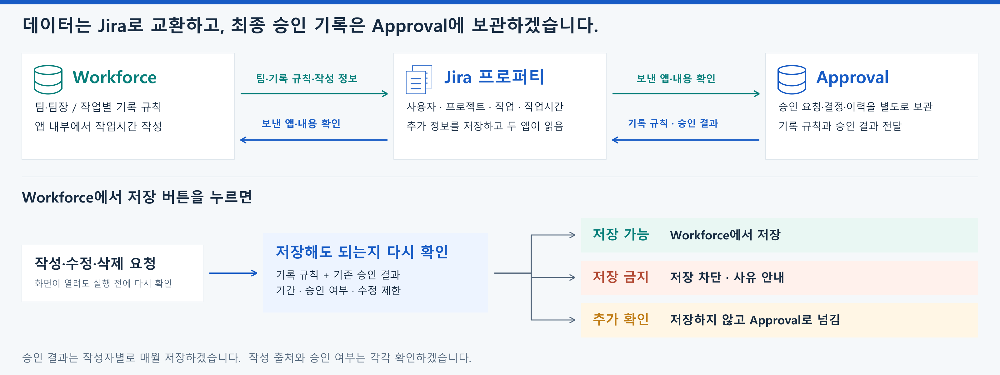

# 작업시간 승인 연동 구성안

> **Workforce에서 기록한 작업시간을 Approval에서 승인하고, 승인 결과를 Workforce에서 함께 확인할 수 있도록 구성하겠습니다.**

## 1. 이렇게 제공하겠습니다

| 구분 | 제공 내용 |
|---|---|
| **작업시간 입력** | Workforce와 Jira의 Approval 화면에서 기록할 수 있도록 하겠습니다. 저장 전 기록 가능 기간과 수정 제한을 확인하겠습니다. |
| **승인 처리** | 팀·팀장 정보를 이용해 승인자를 연결하고, 기록별 승인 요청과 결정을 관리하겠습니다. |
| **결과 확인** | 승인 상태와 승인된 시간을 Workforce에 반영하겠습니다. 승인된 기록의 수정·삭제를 제한하고 승인 당시 시간과 이력을 보관하겠습니다. |
| **승인 상태 표시** | Workforce에서 작업시간을 보여 주는 모든 화면(캘린더·마이워크·작업 목록·분석)에 승인 여부를 함께 표시하겠습니다. 승인되지 않은 기록도 숨기지 않겠습니다. |
| **월 단위 집계** | 이번 달은 승인 대기 중인 기록을 포함해 집계하고, 달이 지나면 지난달은 승인된 시간만 집계하겠습니다. 반려된 기록은 바로 제외하고, 원가는 승인된 시간만 확정 원가로 계산하겠습니다. |
| **승인 후 변경 차단** | 승인된 기록은 Jira 기본 화면·API에서 수정할 수 없도록 공개 범위를 앱 전용으로 바꾸겠습니다. 작성자와 팀장은 Approval·Workforce 화면에서 계속 확인할 수 있습니다. |

## 2. 두 앱은 이렇게 연결하겠습니다

두 앱은 **Jira 공식 API**로 정보를 주고받도록 구성하겠습니다. Jira의 사용자·프로젝트·작업·작업시간 기록에 추가 정보를 붙이는 **프로퍼티** 기능을 사용하겠습니다. [Jira 공식: 프로퍼티 기능](https://developer.atlassian.com/cloud/jira/platform/jira-entity-properties/)

공유된 정보는 전자서명으로 보낸 앱과 내용이 맞는지 확인하겠습니다. 최종 승인 기록은 Approval의 별도 데이터베이스에 보관하겠습니다. Jira 프로퍼티는 권한 있는 사용자나 다른 앱이 변경할 수 있으므로, 공유된 값만으로 승인을 확정하지 않겠습니다. [Jira 공식: 프로퍼티의 접근·변경 특성](https://developer.atlassian.com/cloud/jira/platform/jira-entity-properties/#limitations-of-entity-properties)

Workforce에서 저장할 때는 기록 규칙과 기존 승인 결과를 다시 확인하겠습니다. **저장 가능하면 처리하고, 금지된 요청은 사유를 안내하겠습니다. 추가 확인이 필요하면 저장하지 않고 Approval 화면으로 안내하겠습니다.**

마감·제출 직후처럼 공유 정보가 갱신되기 전의 짧은 시간에 저장된 기록은 Approval이 자체 데이터베이스 기준으로 다시 확인하겠습니다. 규칙에 맞지 않으면 **'규칙 위반 입력'으로 표시하고 집계에서 제외**하며, 작성자의 소명과 승인을 거친 뒤에만 다시 포함하겠습니다.

## 3. 필요한 정보는 여기에 저장하겠습니다

| 정보 | 저장 위치 | 프로퍼티 이름 | 활용 목적 |
|---|---|---|---|
| **팀·팀장** | 사용자 | `movesRms.org` | 누구에게 승인을 요청할지 확인 |
| **작업별 기록 기간** | 이슈(작업) | `movesRms.issue` | 기록 가능한 날짜와 자동 승인 요청 설정 확인 |
| **공통 기록 규칙** | 프로젝트·이슈 | `movesRms.policy` | 적용할 규칙과 고정할 항목 전달 |
| **기록·수정·삭제 제한** | 프로젝트·이슈 | `movesApproval.ctl`의 `wr` | 기간·시간 상한·마감·예외 설정을 저장 직전에 확인 |
| **작성 출처** | 워크로그(작업시간 기록) | `movesRms.origin` / `movesApproval.origin` | Workforce 또는 Approval에서 작성한 기록인지 확인 |
| **기록별 승인 결과** | 작성자 사용자 | `movesApproval.cert.YYYY-MM` | 승인 상태·승인자·승인시각·승인된 시간 전달 |
| **기간별 승인·잠금** | 작성자 사용자 | `movesApproval.YYYY` | 해당 기간의 기록 변경 가능 여부 확인 |

**승인 결과는 작업시간을 작성한 사람의 계정에 월별로 저장하겠습니다.** 예를 들어 10월에 작성한 기록의 승인 결과는 `movesApproval.cert.2026-10`에서 확인할 수 있도록 하겠습니다.

## 4. 적용 후에는 이렇게 확인하겠습니다

**시험 기록 1건을 작성하고, 승인부터 결과 반영까지 같은 기록을 대조하겠습니다.**

| 확인 단계 | 확인할 내용 | 완료 기준 |
|---|---|---|
| **① 작성** | Workforce에서 2시간 기록 | Jira에 같은 작성자·시간의 기록이 생성됨 |
| **② 승인** | Approval에서 승인 | 승인자·승인시각·2시간이 이력에 표시됨 |
| **③ 결과 전달** | 작성자의 월별 프로퍼티 조회 | 같은 기록 번호에 `APPROVED`와 `7200`초가 확인됨 |
| **④ 화면·제한 확인** | Workforce 상태와 수정·삭제 동작 확인 | 승인된 시간이 일치하고 승인분 변경이 제한됨 |
| **⑤ 월 집계 확인** | 이번 달·지난달 기록의 집계 비교 | 이번 달은 미승인 포함, 지난달은 승인분만 집계되고 제외된 시간이 안내됨 |

### 저장된 정보를 직접 확인하는 방법

Jira에 로그인한 뒤 아래 주소를 새 탭에서 열면 저장된 내용을 조회할 수 있습니다. `{사이트}`·`{계정ID}`·`{프로젝트}`·`{이슈}`·`{기록ID}`는 실제 값으로 바꿉니다. 응답의 **`value`가 저장된 내용**입니다.

| 확인 대상 | 조회 주소 |
|---|---|
| 팀·팀장 | `https://{사이트}/rest/api/3/user/properties/movesRms.org?accountId={계정ID}` |
| 기록 제한 | `https://{사이트}/rest/api/3/project/{프로젝트}/properties/movesApproval.ctl` |
| 작성 출처 | `https://{사이트}/rest/api/3/issue/{이슈}/worklog/{기록ID}/properties/movesRms.origin` |
| 월 승인 결과 | `https://{사이트}/rest/api/3/user/properties/movesApproval.cert.2026-10?accountId={계정ID}` |

내 계정 ID는 `/rest/api/3/myself`, 작업시간 기록 번호는 `/rest/api/3/issue/{이슈}/worklog`에서 확인할 수 있습니다. Approval에서 작성한 기록은 출처 프로퍼티 이름을 `movesApproval.origin`으로 바꾸어 조회합니다.

조회에는 대상별 권한이 필요합니다. 다른 사용자의 프로퍼티는 Jira 관리자 권한이 필요하며, 작업시간에 공개 범위 제한이 있으면 직접 조회되지 않을 수 있습니다. 이때는 Approval 화면의 기록과 함께 확인하겠습니다. [Jira 공식: 사용자 조회 권한](https://developer.atlassian.com/cloud/jira/platform/rest/v3/api-group-user-properties/), [프로젝트 조회 권한](https://developer.atlassian.com/cloud/jira/platform/rest/v3/api-group-project-properties/), [작업시간 조회 권한](https://developer.atlassian.com/cloud/jira/platform/rest/v3/api-group-issue-worklog-properties/)

> **검증 완료 기준은 “값이 조회됨”이 아니라 “서명 확인, 승인 이력, 두 앱의 표시 결과가 일치함”으로 잡겠습니다.**
