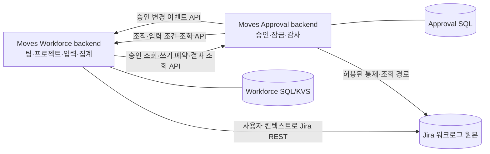
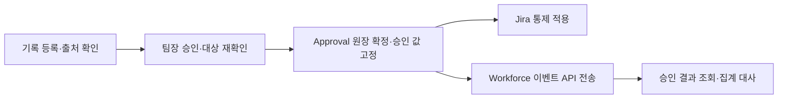
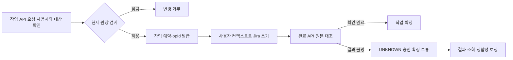
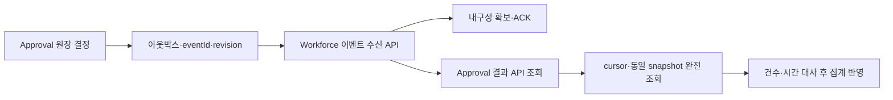

# 스트라드비전 API 연동 승인 아키텍처

Moves Workforce + Moves Approval · 양방향 REST API 제안

> 기준일: 2026-10-15 · 기술 제안 v2.0 · 양방향 REST API 방식

두 앱의 역할 분담, 요구사항별 구현 방식, 현재 근거와 추가 개발 범위, 검증 결과를 정리합니다. 기존 로직의 테스트 결과와 신규 API 통합 시험을 구분하며, 직접 수행할 시험의 실제 결과·판정·증거·실행일은 공란으로 제공합니다.

## 목차

1. 제안 범위와 구현 방향
2. 요구사항별 수행 방안
3. 두 앱의 API 상호 호출 아키텍처
4. 양방향 API 계약
5. API 인증과 사용자 권한
6. 자동 호출과 토큰 수명 관리
7. 등록부터 팀장 승인까지
8. 일괄 승인과 권한 검증
9. 승인과 쓰기를 함께 조정하는 API
10. Jira 직접 경로의 수정과 삭제 통제
11. 기간 마감과 외부 신규 입력 처리
12. 변경 이력과 승인 증거 보존
13. 승인 결과 전달과 집계 API
14. 장애와 중복 요청의 처리
15. SAP 및 사용자 관리 요구의 구현
16. 부가 요구사항 대응
17. 현행 구현과 API 전환 개발 범위
18. 확보한 검증 결과
19. 시연과 고객 검증 증거
20. 구현 및 적용 순서

- 부록 A 수행한 검증 결과와 첨부 증거
- 부록 B 직접 수행할 시험 기록표
- 부록 C 근거 자료 목록

## 01 제안 범위와 구현 방향

**두 앱이 각각 외부 REST API를 제공하고 상대 앱의 API를 호출하는 형태로 제공합니다.**

Workforce는 조직·프로젝트·입력·집계의 원장과 API를, Approval은 승인·잠금·감사의 원장과 API를 제공합니다. 앱 간 데이터 교환과 잠금 확인을 API로 전환합니다. Jira는 실제 워크로그를 저장하며 각 앱의 Forge SQL은 분리된 상태를 유지합니다.

본 제안의 플랫폼 구현 기준은 Forge App REST API(apiRoute)입니다. 사용자 요청에 따라 양방향 API 방식을 채택했으며, 인증·무인 호출·사용자 권한 전달·원자적 쓰기 조정은 아래 설계에 따라 추가 구현하고 실측합니다. 프로퍼티 방식의 현재 구현이 이미 API 방식으로 전환되었다는 뜻은 아닙니다.

승인 단위는 워크로그 한 건, 월은 마감·조회·집계 단위입니다. 핵심 제공 흐름은 작성자 등록, 팀장 승인, 승인된 기록의 변경 제한, 감사 기록과 Workforce 집계 반영입니다.

| 항목 | 제안 기준 |
| --- | --- |
| 앱 간 연동 | 양방향 HTTPS REST API |
| 인증 기준 | Forge apiRoute와 OAuth 2.0 3LO, 설치별 연결 관리 |
| 원장 | 각 앱 SQL. 상대 앱 DB 직접 접근 없음 |
| 현행과 차이 | 프로퍼티 동기화·캐시 판정을 API 조회·작업 조정·이벤트 수신으로 전환 |

근거: S1, S12, S13, W4, W5

## 02 요구사항별 수행 방안

**승인·잠금·감사는 Approval이, 인력·프로젝트·보고는 Workforce가 담당합니다.**

아래 장에서는 핵심 요구의 실제 실행 경계와 증거를 제시합니다. 추가 구현 항목은 이미 구현된 승인 엔진과 구분하여 납품 전 검증 대상에 포함합니다.

| 고객 요구 | 구현 방법과 현재 근거 |
| --- | --- |
| 단순 팀장 승인 | 워크로그별 요청과 승인 당시 값 고정. 지정 승인자의 일괄 결정 구현. 팀장 전용 강제는 보완 대상 |
| 승인 후 수정·삭제 금지 | Approval 서버의 현재 원장 검사 + Jira visibility 제한. 고객 직접 경로 시험 필요 |
| 마감 후 추가·수정·삭제 금지 | 앱 경로에서 기간 판정으로 거부. 외부 신규 생성은 감지·후속 조치로 별도 취급 |
| 변경 이력 감사 | 앱 쓰기 기록 + Jira 이벤트 + 누락 보정으로 변경 전후·행위자·시각 저장 |
| SAP 월별 연동 | 1차 Workforce xlsx 추출. 자동 API는 별도 구현·호출자 권한 검증 후 제공 |
| 사용자 관리 자동화 | 기존 이메일 Import 활용. 팀 매핑·비활성 사용자 보존·자동 동기화는 추가 구현 |
| 미소속자 제한 | Workforce 소속 검사와 Jira 작성 권한 결합. 프로젝트 역할 동기화는 추가 구현 |
| 계획 초과 알림 | 기존 화면 지표 활용. PM 수신 알림은 이벤트·수신자·중복 방지 경로 추가 |
| 휴일·OKR·Outlook | 휴일 수동 관리 활용. 자동 Import·OKR·Outlook은 현행 제공 기능으로 주장하지 않음 |

근거: S1, S3, S4

## 03 두 앱의 API 상호 호출 아키텍처

**업무 데이터의 소유 앱에 직접 질의하고 상대 앱은 필요한 결과만 사용합니다.**

Approval은 Workforce API에서 작성자의 현재 팀·팀장·연결 프로젝트와 입력 조건을 조회합니다. Workforce는 Approval API에서 최신 승인·마감 상태를 조회하고 쓰기 작업을 조정합니다. 승인 결정 후에는 Approval이 Workforce 이벤트 수신 API를 호출하여 집계 갱신을 요청합니다.

실제 호출은 브라우저가 아닌 Forge backend에서 수행합니다. UI에는 API token을 전달하지 않습니다. apiRoute는 각 앱·환경에 속하는 HTTP 진입점입니다. 전용 API 어댑터가 입력을 검증하고 공용 도메인·권한 서비스를 호출하며 SQL 접근은 각 앱 내부에서만 수행합니다.

API를 연다고 상대 앱의 Forge 설치 권한이 자동 전달되지는 않습니다. 각 방향의 연결·토큰·scope를 구성하고 사용자 호출과 시스템 동기화를 구분합니다. API 서버는 현재 원장 기준으로 답하며 상대 앱 응답을 무기한 권한 캐시로 사용하지 않습니다.

프로퍼티는 두 앱의 연동 채널과 승인 판단 근거에서 제외합니다. Jira 워크로그의 visibility와 통제 작업 추적 표식은 별개입니다. 작업 표식이 남더라도 조직·승인 결과를 프로퍼티로 교환하는 구조를 제안하는 것은 아닙니다.

근거: S12, S13, W4, W5

## 04 양방향 API 계약

**다음 경로와 응답 필드는 신규 구현할 계약안이며 현재 제공 완료 API 목록이 아닙니다.**

Workforce의 /v1/organization/teams GET은 현행 manifest에 선언되어 있습니다. 기존 구현은 팀·팀원 상한이 있어 조직 전체의 완전한 동기화 API로 보기 어렵습니다. 나머지 API와 cursor·snapshot·쓰기 조정 계약은 추가 구현합니다. Approval manifest에는 현재 apiRoute가 없습니다.

모든 응답에는 schemaVersion, requestId, data 또는 error를 두고 목록에는 snapshotId·nextCursor·complete를 제공합니다. 오류는 401 인증 실패, 403 권한 거부, 409 상태 충돌, 429 처리량 초과, 503 의존 서비스 확인 불가로 구분합니다. 원본 SQL·token·사용자 본문은 오류에 포함하지 않습니다.

| 제공 앱 / 계약안 | 역할 |
| --- | --- |
| WF GET /v1/organization/members | 계정별 팀·팀장과 조직 revision |
| WF GET /v1/issues/{id}/worklog-context | 연결 프로젝트·소속·현재 입력 조건 |
| WF POST /v1/integration/approval-events | 승인·마감 변경 수신 및 집계 갱신 예약 |
| AP GET /v1/worklogs/approval | 권한 범위 내 건별 승인·잠금 조회 |
| AP POST /v1/worklog-operations | 작성·수정·삭제 예약, opId·만료·상태 반환 |
| AP POST /v1/worklog-operations/{opId}/complete | Jira 실행 결과 통지 및 재조회 확인 |
| AP GET /v1/worklog-operations/{opId} | 시간 초과·중복 재시도 시 처리 결과 확인 |
| AP GET /v1/approval-results | 월·프로젝트별 결과 cursor 조회 |
| AP GET /v1/worklogs/history | 권한 범위 내 변경 이력 조회 |

근거: S12, S13, W4

## 05 API 인증과 사용자 권한

**전송 계정의 인증과 실제 작성자·승인자의 업무 권한을 분리합니다.**

Forge apiRoute의 공식 호출 방식은 OAuth 2.0 3LO입니다. 각 앱의 API 활성화와 scope 동의가 필요합니다. Forge 설치 간 자동 신뢰 또는 client_credentials를 제공한다고 가정하지 않습니다. 연결 설정에 site·app·environment·허용 scope·연결 계정과 만료 상태를 고정하고 임의 URL·다른 사이트·redirect를 차단합니다.

사용자 행동은 실제 로그인 사용자의 검증된 identity에 묶어 처리합니다. 사용자별 3LO 호출은 API 런타임 principal과 현재 사용자 일치를 검증합니다. 전용 연결 계정으로 전달할 경우에는 등록된 상대 앱 backend가 발급한 짧은 수명의 서명 assertion으로 actor·site·audience·operation·본문 해시·nonce를 묶고 수신 앱이 검증하는 위임 계층을 별도로 구현합니다. body의 accountId만으로 사용자로 인정하지 않습니다.

연결 계정의 높은 권한이 실제 사용자의 권한으로 대체되지 않도록 공용 업무 인가에서 작성자·최신 팀장·이슈 열람·프로젝트 범위를 다시 제한합니다. 서버 assertion은 애플리케이션 내 위임 증거이며 Forge asUser가 임의 사용자가 되는 수단이 아닙니다. 사용자 Jira 쓰기는 해당 사용자 컨텍스트를 가진 앱에서 asUser로 수행하고, 그 컨텍스트가 없으면 작업을 보류합니다.

자동 요청·이벤트·정합성 보정은 승인된 연결 계정 grant와 최소 시스템 scope로 호출합니다. 사용자를 위장하지 않고 SYSTEM_SYNC 행위로 기록합니다. 실제 승인 결정은 승인자 UI와 승인자 신원으로만 수행합니다. backend 사용자 컨텍스트 전달·위임 검증·무인 호출은 초기 통합 시험의 필수 관문입니다.

근거: S7, S12, W4, W5

## 06 자동 호출과 토큰 수명 관리

**초기 동의 이후에도 갱신·철회·동시 갱신을 처리하는 연결 모듈을 구현합니다.**

운영은 access token을 수동으로 복사해 붙이는 방식으로 끝내지 않습니다. OAuth callback에서 state와 설치를 대조하고 code를 교환한 뒤 secret 저장소에 보관합니다. offline_access와 refresh grant가 해당 Forge API 연결에서 정상 작동하는지 실측합니다. 연결 계정이 브라우저에 접속하지 않은 큐 실행에서도 호출이 성공해야 합니다.

회전형 refresh token은 연결 단위 갱신 잠금과 revision으로 교체합니다. 여러 worker가 동시에 갱신하지 않도록 하고 반환된 새 refresh token을 유실하지 않게 저장합니다. 동의 철회·계정 비활성·invalid_grant는 재연결 필요로 표시하며 무한 재시도하지 않습니다.

상대 앱 API 장애 시 신규 변경 허가를 발급하지 않습니다. 기존 승인·기간 잠금은 유지합니다. 읽기 화면은 마지막 갱신 시각과 조회 실패를 표시하고 최신 결과인 것처럼 사용하지 않습니다. 전송 누락은 아웃박스와 결과 조회로 복구하며 프로퍼티 방식으로 자동 우회하지 않습니다.

배포 시 양쪽 apiRoute·custom scopes·외부 호출 대상·설치 upgrade를 함께 반영합니다. API 노출 자체의 적격성과 호출·토큰 교환 egress를 포함한 전체 설치의 Runs on Atlassian 적격성은 구분하여 실제 manifest로 확인합니다.

근거: S12, W4, W5, W6

## 07 등록부터 팀장 승인까지

**자동 요청은 승인 대기 접수이며 승인 결정을 대신하지 않습니다.**

작성 시 서버가 이슈 열람·작성 자격, 입력 기간, 통제 규칙을 확인합니다. 정상 입력의 출처 정보를 남기고 설정에 따라 저장 직후 승인 요청을 생성합니다. 연동 모드의 기본 승인자는 Workforce 조직 API에서 확인한 최신 명부에서 구하며, 해당 이슈를 열람할 수 있는 활성 계정인지 확인합니다.

승인 요청에는 대상 worklogId, 이슈, 작성자, 작업일, 시간과 지문을 연결합니다. 승인 결정 시 대상이 여전히 유효한지 재확인하고 지정 승인자만 결정하게 합니다. 이미 결정된 행은 PENDING 조건부 갱신으로 다시 덮어쓰지 않으며 revision으로 동시 결정을 제어합니다.

승인 완료 시 승인 당시 값을 Approval 원장에 고정하고 통제 및 결과 API 전송를 이어갑니다. 반려는 결정자·시각·사유와 함께 이력으로 남깁니다. 승인된 기록의 소명·재승인 요청 자체가 기존 잠금을 해제하지 않습니다.

현행 직접 요청에는 검증된 Workforce 팀장의 자기 승인 경로가 있습니다. 자동 요청의 본인 제외 규칙과 구분합니다. 고객에게 팀장 전용 승인으로 제공하려면 일반 지정 결재자 경로와 일괄 승인에도 동일한 팀 범위를 강제해야 합니다.

근거: S3, S6, S7

## 08 일괄 승인과 권한 검증

**일괄 처리에서도 각 워크로그의 권한과 결정 상태를 개별 검증합니다.**

팀장이 여러 승인 대기 건을 선택하면 서버는 각 요청의 지정 결재자, 대상 이슈 열람 권한, 현재 결정 상태를 검사합니다. 일부 실패가 있으면 성공·실패·미처리 결과를 분리합니다. 재시도는 이미 확정된 결정을 덮어쓰지 않아야 합니다.

현재 일반 업무함 bulkApprove는 지정 결재자를 기준으로 동작합니다. 따라서 ‘팀장만 팀원 기록을 일괄 승인한다’는 고객 요구를 충족하려면 워크로그 대상에 최신 팀장 자격과 팀원 범위를 추가로 강제하고, 단건·일괄·직접 resolver 호출을 같은 규칙으로 묶는 보완을 수행합니다.

시연은 같은 팀 기록 두 건과 권한 없는 기록 한 건을 섞어서 수행합니다. 정상 두 건의 결정자·시간·요청 ID가 기록되고, 권한 없는 건은 거부되며 그 존재 정보도 허용 범위 밖으로 노출되지 않는지 확인합니다.

| 시험 | 확인할 증거 |
| --- | --- |
| 동일 요청 동시 승인·반려 | 최종 결정 하나, 상충하는 두 결과 없음 |
| 비팀장 직접 resolver 호출 | 서버 거부, 원장 변화 없음 |
| 타 팀·열람권 없는 대상 | 목록·상세·일괄·내보내기 모두 같은 범위 |
| 부분 성공 재시도 | 완료 건 보존, 미완료 건만 재처리 |

근거: S3, S7

## 09 승인과 쓰기를 함께 조정하는 API

**승인 여부를 읽은 뒤 따로 저장하는 방식의 경쟁 상태를 쓰기 예약으로 막습니다.**

Workforce의 수정·삭제는 Approval POST /v1/worklog-operations를 호출하여 작성자·이슈·worklogId·변경 전 지문·예상 revision·작업 종류를 검증하고 예약을 얻습니다. Approval은 현재 SQL의 승인·기간 상태를 검사한 뒤 같은 대상에 opId를 claim합니다. 승인 결정 경로도 미완료 작업을 검사하여 변경 중인 기록을 승인하지 않습니다.

허가된 opId는 한 번의 정해진 작업에만 유효합니다. Workforce는 실행 직전 예약의 상태·만료·대상 지문을 확인하고 실제 로그인 사용자 asUser로 Jira 변경을 수행합니다. 완료 API로 결과를 알리고 Approval은 원본을 대조한 뒤 작업을 확정합니다. API body의 완료 주장만 믿고 잠금을 해제하지 않습니다.

예약 만료나 통신 시간 초과만으로 기록을 승인 가능 상태로 되돌리지 않습니다. Jira 실행 여부를 모르면 UNKNOWN으로 두고 신규 쓰기와 승인 확정을 보류합니다. 실행 worker의 종료와 Jira 현재 상태를 확인한 뒤 정리합니다. 이미 날아간 Jira 요청을 예약 만료로 취소할 수 있다는 가정을 하지 않습니다.

이 조정은 새로 구현할 프로토콜입니다. Approval SQL과 Jira REST 사이에 분산 트랜잭션이 생기는 것은 아닙니다. 앱 경로의 경합을 조정하고, Jira 직접 경로는 visibility와 별도 시험으로 통제합니다. 명확한 실패 전 같은 변경을 맹목적으로 재POST하지 않습니다.

근거: S8, S12, W3

## 10 Jira 직접 경로의 수정과 삭제 통제

**기존 승인 기록의 visibility를 제한하고 사용자 계정의 직접 요청으로 차단 효과를 검증합니다.**

Approval의 통제 작업이 Jira 워크로그 visibility를 앱 접근 역할로 제한합니다. 기본 적용 예시는 role 타입의 atlassian-addons-project-access입니다. 이는 워크로그 본문의 공개 범위이며 앱 간 승인 API와 다릅니다. movesApproval.op는 해당 변경을 Approval의 통제 작업 번호와 연결합니다.

공개 범위 제한은 권한과 결합해 기존 기록의 조회·수정·삭제를 제한합니다. 통제 완료는 worklog_control의 RESTRICTED 상태와 Jira 응답을 함께 대조합니다. 시간·설명 등 본문을 불필요하게 다시 쓰지 않고 visibility와 작업 표식만 변경합니다.

승인 저장과 Jira PUT은 하나의 원자적 작업이 아닙니다. 제한 실패·권한 부족·API 전달 대기는 운영 화면에서 별도로 드러내고 재처리해야 합니다. 다른 앱·관리자·Automation의 권한은 일반 작성자와 다르므로 각각 시험합니다.

숨긴 기록은 앱에서 허용된 작성자 또는 팀 범위와 이슈 열람권을 다시 확인한 조회자에게만 보충합니다. 설명은 작성자에게만 표시합니다. 원래부터 제한 공개였던 기록을 임의로 해제하거나 일반 사용자에게 노출하지 않습니다.

| 차단 시험 | 합격 기준 |
| --- | --- |
| 정상 PUT·DELETE 요청 | 권한 거부와 원본 유지 동시 확인 |
| 404 응답 | 같은 기록의 존재를 앱에서 먼저 확인한 경우에만 해석 |
| 400·401·429·5xx | 잘못된 요청·인증 실패·장애이므로 차단 성공 증거에서 제외 |
| 변경 후 원상복구 | 원본 변경이 발생했으므로 강제 잠금 시험 실패 |

근거: S8, S9, W3

## 11 기간 마감과 외부 신규 입력 처리

**건별 승인은 해당 기록을 잠그고, 기간 마감은 기간 내 앱 쓰기를 제한합니다.**

신규 외부 입력을 저장 전에 모든 경로에서 가로채는 기능과, 이미 생성된 위반 기록을 감지·제외하는 기능은 서로 다른 결과입니다. 고객 요구에 대한 제안은 앱 입력 경로의 사전 통제와 외부 경로의 감지·사후 조치를 명확히 구분하여 제시합니다.

Jira 작성 권한은 프로젝트 수준의 작성자 범위를 제한하는 보조 수단입니다. 기간별 동적 잠금 전체를 권한 스킴 하나로 구현하는 것으로 설명하지 않습니다. 고객이 사용하는 직접 입력 경로에서 별도 시험하고 검증된 경로만 차단 보장 범위에 포함합니다.

timeTrackingProvider는 Preview 모듈입니다. 제공자로 선택하면 Jira의 기본 시간 입력 UI를 대체합니다. Tempo 제공자 전환 영향을 시범 프로젝트와 사용자 계정으로 확인한 뒤 적용합니다.

| 경로와 작업 | 수행 방법 및 증명 범위 |
| --- | --- |
| Approval의 마감 기간 추가·수정·삭제 | 현재 기간 상태를 조회하여 Jira 호출 전에 거부 |
| Workforce의 마감 기간 쓰기 | Approval API로 현재 기간 상태 확인·작업 예약. 실패 시 저장 보류 |
| Jira 기본 입력 UI | timeTrackingProvider로 Log work와 작업 로그 탭을 대체 |
| REST·Automation의 신규 생성 | UI 대체로 전면 차단되지 않음. 이벤트 감지와 후속 통제 |
| 기간 밖으로 날짜 이동 | 변경 전·후 기간을 검사하여 닫힌 기간 탈출 우회 방지 |
| 외부 변경·위반 입력 | 출처·지문·현재 DB 규칙 대조 후 위반 및 재확인 대상 표시 |

근거: S1, S8, S9, W2

## 12 변경 이력과 승인 증거 보존

**현재 Jira 값과 승인 당시 값을 함께 보관하여 누가 무엇을 바꾸었는지 설명합니다.**

앱에서 수행한 쓰기는 실제 사용자와 변경 전 값을 알고 있으므로 직접 기록합니다. Jira 생성·수정·삭제 이벤트는 후속 관측을 추가합니다. 누락 보정은 마지막 수집 위치 이후의 변경을 읽어 보완하며, 이벤트 재전송과 보정이 같은 변경을 중복 기록하지 않도록 지문과 순번을 대조합니다.

worklog_history에는 변경 종류, 작업자, 변경 시각과 관측 시각, 이전·이후 시간과 작업일을 기록합니다. worklog_mirror에는 마지막 관측 상태를 유지합니다. 시스템 통제 작업과 사용자 수정을 구분하며 seq를 곧바로 사용자 수정 횟수로 표시하지 않습니다.

승인 원장에는 요청 ID, worklogId, 승인자, 승인 시각, 결정, 승인 당시 시간과 지문을 남깁니다. Jira 원본이 바뀌거나 삭제되면 인증 기준값을 조용히 바꾸지 않고 불일치·삭제를 표시합니다. 소명과 재승인은 별도 이력으로 연결합니다.

수집 이전의 과거 변경, 관측 사이에 발생한 중간 변경, 미러가 없는 삭제의 이전 값은 복원할 수 없습니다. 삭제 행위자가 확인되지 않으면 알 수 없음으로 기록합니다. 설명 원문은 기본 보존 범위로 약속하지 않습니다.

| 시연 입력 | 기대 증거 |
| --- | --- |
| 2시간 생성 → 3시간 → 2시간 → 삭제 | 7200→10800→7200과 삭제 이력, UPDATED 2건 |
| 승인 후 원본 외부 변경 | 승인 당시 시간 유지 + 불일치 표시 |
| 동일 이벤트 재전송 | 이력 중복 없음 |
| 이력 내보내기 | 화면과 파일의 대상·결정자·시간·건수 일치 |

근거: S3, S8, S10

## 13 승인 결과 전달과 집계 API

**승인 변경은 알림 API로 전달하고 완전한 집계 데이터는 원장 조회 API로 가져옵니다.**

Approval 결정 저장 후 전달할 eventId·aggregateId·revision과 아웃박스 상태를 남깁니다. 큐가 Workforce의 approval-events API로 변경 알림을 보냅니다. 수신자는 eventId를 유일하게 처리하고 revision 역행을 거부하며 접수 내구성이 확보된 뒤 ACK를 반환합니다. 통신 실패가 승인 원장의 결정을 취소하지는 않습니다.

Workforce는 이벤트를 근거로 해당 사용자·월·프로젝트의 결과를 Approval 조회 API에서 다시 읽습니다. 목록은 같은 snapshotId의 cursor를 끝까지 따라가고 건수·합계·complete를 대조한 뒤 새 집계로 전환합니다. 한 페이지 누락·중복·다른 snapshot 혼합이면 확정 집계로 사용하지 않습니다.

월 합계·건별 결과는 프로퍼티 32KB 제한에 맞춰 잘라 보내지 않습니다. 대신 API 응답 크기와 실행 시간에 맞춘 페이지를 제공합니다. 숨겨진 조회 상한으로 일부만 받은 결과를 전체로 표시하지 않고 범위·페이지·완전성을 반환합니다.

현행 Workforce 계산의 legacySeconds 경로는 API 전환 시 연결 범위의 승인 기준 집계와 분리합니다. 승인 확인 불가 항목은 확정 집계에 섞지 않습니다. 진행 중 기록 시간과 승인 인정 시간을 함께 표시하고 기준 월의 Jira·Approval·Workforce·SAP 출력 합계를 대사합니다.

근거: S11, S12

## 14 장애와 중복 요청의 처리

**한 번 처리된 결정과 실행 여부가 불명확한 작업을 구분하여 재시도합니다.**

변경 API는 설치·대상·작업 종류별 Idempotency-Key와 본문 해시를 저장합니다. 같은 키·같은 요청은 기존 결과를 반환하고 같은 키에 다른 내용이 오면 409로 거부합니다. eventId 중복 제거와 업무 요청 멱등 처리는 별도 저장 규칙으로 구현합니다.

429·일시적 5xx는 Retry-After 및 지수 backoff와 제한 횟수를 적용합니다. 401은 안전한 token 갱신 후 제한적으로 재시도하고 403은 권한 문제로 멈춥니다. timeout 후 변경 완료 여부가 불명확하면 opId 결과 조회를 우선합니다. 실패 큐·재시도 횟수·최장 대기 시간을 관리자 화면에 표시합니다.

서로의 API를 호출할 때 순환 호출을 만들지 않습니다. 조직·컨텍스트 조회는 자기 원장만 읽고 역방향 승인 조회를 중첩하지 않습니다. 결정 이벤트 수신은 집계 갱신을 예약하며 같은 HTTP 요청 안에서 다시 결정 이벤트를 발행하지 않습니다.

정합성 보정은 원장 revision·아웃박스·수신 ACK를 대조합니다. 커서가 끝나지 않은 보정은 완료 watermark를 전진시키지 않습니다. 승인, Jira 통제 적용, Workforce 반영 상태를 분리해 성공과 대기·실패를 표시합니다.

근거: S8, S12

## 15 SAP 및 사용자 관리 요구의 구현

**기존 파일 기능을 먼저 활용하고 자동화 경로는 별도 구현 단위로 제공합니다.**

SAP 월별 전달은 Workforce의 기존 xlsx 워크로그 추출을 출발점으로 합니다. 승인 기준 전달에는 Approval 결과가 반영된 대상 목록·건수·초 합계를 대사하고, SAP의 사번·프로젝트 코드·기간 필드에 매핑하는 출력 계약을 추가합니다. 기존 파일에 고객 전용 SAP 매핑까지 완성되어 있다고 주장하지 않습니다.

월별 자동 SAP API는 두 앱 상호 호출과 별도 소비자·scope로 제공합니다. Workforce의 승인 반영 결과를 cursor로 전달하고 월 snapshot과 재처리 식별자를 사용합니다. 기존 파일 추출은 활용할 수 있지만 SAP 매핑과 자동 소비자 인증은 추가 구현·시험 범위입니다.

사용자 관리는 기존 이메일 기반 Import를 재사용하고 팀·팀장 매핑과 비활성 상태를 추가하는 방식입니다. 퇴사자를 단순 삭제하지 않고 과거 배정·집계 참조를 보존하는 구조로 개선합니다. Jira 원본 워크로그가 남는 것과 Workforce 집계에 계속 포함되는 것은 별도로 시험합니다.

자동 조직 동기화는 접근 가능한 Jira 그룹·프로젝트 역할을 대상으로 설계합니다. Atlassian 관리자 조직 또는 Teams 전체가 동일한 API로 동기화된다는 전제를 두지 않습니다. 대상별 인증·API 적격성을 확인한 뒤 확정합니다.

| 수행 증명 | 확인값 |
| --- | --- |
| SAP 시험 파일 1개월 | Jira·승인 원장·출력의 건수와 시간 합계, 중복 수신 처리 |
| 신규 사용자 Import | 정상 계정 등록, 미확인 계정 오류 목록 |
| 팀 이동·퇴사 | 새 승인자 반영, 과거 승인·집계 보존 |
| 동기화 권한 회수 | 임의 삭제나 권한 확대 없이 확인 실패 표시 |

근거: S1, S12, S13

## 16 부가 요구사항 대응

**기존 기능을 활용할 부분과 추가 개발할 부분을 나누어 증명합니다.**

부가 요구의 구현 가능성은 기능별 개발 경로로 설명합니다. 코드가 없는 기능에 ‘지원’ 표시를 붙이지 않으며, 고객 시연은 실제 실행 가능한 범위부터 진행합니다. 외부 서비스 자동화는 별도 네트워크·인증 경계가 생기므로 두 앱 내부 API 연동과 분리합니다.

| 요구 | 구현 방향 | 증거 및 시험 |
| --- | --- | --- |
| 프로젝트 미소속자 입력 제한 | Workforce 소속 검사와 Jira Work on work items 권한 결합 | 미소속 계정의 앱·REST 입력 거부 확인. 역할 동기화는 추가 구현 |
| 계획 초과 PM 알림 | 기존 계획 대비 실적 지표에서 초과 이벤트를 만들고 수신자·중복 방지 추가 | 임계치 통과 시 알림 1건, 재처리 중복 없음. 외부 메신저는 별도 연동 |
| 휴일 자동 Import | 기존 수동 휴일 관리에 파일 Import·중복 검사 추가 | 날짜·근무 비율 반영, 재Import 동일 결과 |
| OKR | 현행 승인 엔진과 독립 기능으로 별도 설계 | 이번 핵심 승인·감사 제공 범위에 포함하지 않음 |
| Outlook | 용도별 별도 인증·연동 구현 | 현행 제공 완료로 주장하지 않음 |

근거: S1

## 17 현행 구현과 API 전환 개발 범위

**기존 승인·통제·감사 엔진은 재사용하고 양방향 API 계층과 운영 연결을 구현합니다.**

2026-10-15 기준 Approval HEAD 0c52170, Workforce HEAD 80e7d31 및 현재 작업 트리를 확인했습니다. 제품 코드를 수정하거나 API를 배포하지 않았습니다. Workforce manifest의 조직 조회 apiRoute 선언은 확인했으며 Approval manifest에는 apiRoute가 없습니다.

재사용 대상은 승인 상태 머신·결정 원장·서버 잠금 검사·Jira visibility gateway·변경 이력·기존 화면입니다. 새로 필요한 것은 양쪽 API 어댑터, 설치별 인증·갱신, 조직/결과 cursor, 사용자 위임 인가, 쓰기 예약·결과 확인, 이벤트 수신·ACK와 복구입니다.

기존 151개 로컬 테스트는 이 엔진과 프로퍼티 계약의 일부 로직을 확인한 결과입니다. API 인증·양방향 실제 호출·쓰기 예약·cursor·ACK의 검증 결과로 전용하지 않습니다. 본문과 별첨에서 실행한 결과와 앞으로 수행할 시험을 구분합니다.

| 항목 | 현재 확인 | 전환 작업 |
| --- | --- | --- |
| Workforce 조직 API | manifest 선언 존재 | 완전한 cursor·범위·인증 실측 |
| Approval API | 현행 manifest 미선언 | endpoint·scope·handler 추가 |
| API 인증·무인 호출 | 과거 실험·기록만 있음 | 양방향 token 수명·큐 호출 실측 |
| 쓰기 예약 | 이번 제안 설계 | 동시 승인·수정과 UNKNOWN 복구 구현 |
| 결과 이벤트·목록 | 현행은 프로퍼티 경로 | ACK·revision·snapshot cursor 구현 |

근거: S12, S13

## 18 확보한 검증 결과

**실행한 테스트 결과와 원본 파일을 별첨하고 검증 범위를 명시합니다.**

2026-10-15 17:13:40 KST 시작한 Approval Jest 실행에서 6개 묶음 151개 테스트가 통과했습니다. 작업 트리의 기존 테스트를 선택 실행했으며 실패·건너뛴 테스트는 해당 실행에 없습니다. 정확한 명칭·결과는 첨부 JSON을 기준으로 합니다.

별도로 npm run check:bundle이 통과했습니다. Forge 방식 webpack 번들을 require하여 resolver 등 진입점이 로드되는지 확인했습니다. UI build·전체 회귀·Forge deploy·설치 upgrade·고객 사이트 시험을 이번 실행에서 했다는 뜻은 아닙니다.

두 앱의 상호 API 호출은 아직 실측하지 않았습니다. 신규 API용 검증표에는 절차·기대 결과만 작성하고 실제 결과·판정·증거 칸을 비웠습니다. 과거 기록의 일부 404 확인도 새로운 API 차단 시험 합격으로 사용하지 않습니다.

근거: E1, E2, E3

## 19 시연과 고객 검증 증거

**실제 실행하실 항목은 절차와 기대 결과를 제공하고 결과 기록란은 비워 둡니다.**

동일 시험 프로젝트에 일반 작성자 A, 팀장 B, 다른 팀 C를 준비합니다. 승인 UI·Jira 원본·API 응답·Approval 원장·Workforce 결과를 같은 worklogId·requestId·opId·correlationId로 연결합니다. API token, 개인 설명, 원본 반려 사유는 증거에 포함하지 않습니다.

D 시험은 사용자 화면과 실제 입력 경로에서 수행할 고객 시연입니다. A 시험은 개발 측이 API 구현 후 준비할 통합 검증입니다. 부록의 실제 결과·판정·실행일·증거 칸은 모두 공란입니다. 과거 테스트 결과를 이 칸에 미리 채우지 않습니다.

승인 기록 수정 시험은 정상 요청으로 먼저 편집 가능한 미승인 기록을 대조한 뒤 승인 기록에 시도합니다. 400·401·429·5xx 또는 통신 실패는 잠금 성공으로 간주하지 않습니다. 404는 기록 존재와 권한 범위를 별도로 확인해야 하며 변경 후 원상복구도 차단 성공이 아닙니다.

근거: S9, E1

## 20 구현 및 적용 순서

**API 왕복과 인증 검증을 먼저 통과한 뒤 쓰기 통제와 전체 업무 흐름을 연결합니다.**

1단계는 양쪽 apiRoute·최소 scope·설치별 연결을 준비하고 정상·다른 사이트·잘못된 scope·동의 철회·무인 refresh 호출을 시험합니다. 인증 principal 전달 방식과 위임 사용자 권한을 실측하여 운영 연결 모델을 확정합니다.

2단계는 조직·입력 컨텍스트 조회, Approval 현재 상태 조회, 쓰기 예약·완료·결과 조회를 구현합니다. 승인과 수정이 동시에 들어올 때 하나의 허용된 순서로 처리하고 결과 불명 상태에서는 승인을 확정하지 않는지 검증합니다.

3단계는 결과 이벤트·ACK·cursor 집계와 감사 API를 연결합니다. 중복·순서 역전·페이지 누락·장애 복구를 시험하고 기준 월의 건수·시간 합계를 대사합니다. 사용자 시연 D01~D07 결과와 증거를 채운 뒤 제공 범위를 확정합니다.

기존 프로퍼티 연동은 원장과 승인 이력을 보존하며 단계적으로 중단합니다. 전환 중 결과를 이중으로 집계하지 않고 이전 연동을 장애 fallback으로 사용하지 않습니다. 운영 API 설정·양쪽 앱 버전·연동 모드를 함께 관리합니다. 제품 코드 변경 시 전체 backend·UI 테스트, UI build, Forge lint, check:bundle을 수행합니다.

근거: S12, S13, W4, W5

## 부록 A 수행한 검증 결과와 첨부 증거

**실행 시작: 2026-10-15 17:13:40 KST. 기존 Approval 로직 테스트 6개 묶음, 151개 통과.**

앞선 문서 작성 중 실행한 원본 결과입니다. API 설계로 개정하면서 신규 통합 시험을 수행한 결과가 아닙니다. 실행 당시 Approval HEAD는 `0c52170`, Workforce HEAD는 `80e7d31`이며 미커밋 변경을 포함한 작업 트리 기준입니다.

| 테스트 파일 | 통과 수 | 검증 범위 |
| --- | --- | --- |
| `writeGate.parity.test.js` | 4 | 기존 쓰기 규칙의 대조 |
| `WorklogControlService.test.js` | 34 | 워크로그 통제 서비스 |
| `WorklogRequestService.test.js` | 50 | 건별 승인 요청 |
| `WorklogHistoryService.test.js` | 26 | 변경 이력 조회 |
| `WorklogControlGateway.test.js` | 11 | Jira 통제 게이트웨이 |
| `certificationDoc.test.js` | 26 | 기존 인증 문서 계약 |

`npm run check:bundle`도 통과하여 Forge 방식 webpack 번들의 진입점 로드를 확인했습니다.

`writeGate.parity`와 `certificationDoc`은 기존 프로퍼티 계약에 관련된 검증이며 신규 API 인증·작업 예약·ACK·cursor의 성공 증거가 아닙니다. 테스트 내부의 Jira·저장소 모의 응답도 실사이트의 차단 효과를 입증하지 않습니다. 이번 실행에서 전체 회귀·UI build·배포·설치 upgrade·고객 사이트 시험을 수행하지 않았습니다.

### 첨부 원본

- [전체 검증 원본 ZIP](검증결과_원본첨부.zip)
- [Jest 결과 JSON](evidence/approval-jest-results.json)
- [Jest 실행 로그](evidence/approval-jest-console.log)
- [번들 검증 로그](evidence/approval-bundle-console.log)
- [검증 범위와 실행 명령](evidence/검증범위.txt)
- [SHA256 대조값](evidence/SHA256.txt)

## 부록 B 직접 수행할 시험 기록표

D 항목은 사용자 시연, A 항목은 개발 측 API 통합 시험입니다. 절차와 기대 결과만 작성했습니다. 실제 결과·판정·증거·실행일은 모두 공란입니다.

### D01 사용자 수행

- 절차: A가 2시간 기록 후 B 승인
- 기대 결과: B·승인시각·7200초·requestId 일치

| 실제 결과 | 판정 | 증거 | 실행일 |
| --- | --- | --- | --- |
|  |  |  |  |

### D02 사용자 수행

- 절차: 승인 직후 두 앱에서 수정·삭제 시도
- 기대 결과: 서버 거부와 원본 유지

| 실제 결과 | 판정 | 증거 | 실행일 |
| --- | --- | --- | --- |
|  |  |  |  |

### D03 사용자 수행

- 절차: A의 Jira REST에서 PUT·DELETE·제한 해제
- 기대 결과: 정상 요청 거부와 기록 유지

| 실제 결과 | 판정 | 증거 | 실행일 |
| --- | --- | --- | --- |
|  |  |  |  |

### D04 사용자 수행

- 절차: 기간 마감 후 추가·수정·삭제·날짜 이동
- 기대 결과: 앱 변경 거부. 외부 신규 생성의 감지 결과 별도 기록

| 실제 결과 | 판정 | 증거 | 실행일 |
| --- | --- | --- | --- |
|  |  |  |  |

### D05 사용자 수행

- 절차: 팀장 일괄 승인과 타 팀·비팀장 시도
- 기대 결과: 허용 건만 결정, 타 팀 정보 비노출

| 실제 결과 | 판정 | 증거 | 실행일 |
| --- | --- | --- | --- |
|  |  |  |  |

### D06 사용자 수행

- 절차: 미승인 2시간 생성→3시간→2시간→삭제
- 기대 결과: 이력 전후값·작업자·시각·수정 2회 및 내보내기 일치

| 실제 결과 | 판정 | 증거 | 실행일 |
| --- | --- | --- | --- |
|  |  |  |  |

### D07 사용자 수행

- 절차: 승인 월·프로젝트 집계와 감사 파일 대조
- 기대 결과: Jira·Approval·Workforce 건수·초 합계 일치

| 실제 결과 | 판정 | 증거 | 실행일 |
| --- | --- | --- | --- |
|  |  |  |  |

### A01 개발 수행

- 절차: 두 방향 정상 API 요청·scope 누락·타 사이트 요청
- 기대 결과: 허용 요청 성공, 다른 범위 거부 및 원장 변화 없음

| 실제 결과 | 판정 | 증거 | 실행일 |
| --- | --- | --- | --- |
|  |  |  |  |

### A02 개발 수행

- 절차: 사용자 미접속 큐 호출·token 만료·동시 갱신
- 기대 결과: 갱신 후 호출 성공, token 유실·중복 갱신 충돌 없음

| 실제 결과 | 판정 | 증거 | 실행일 |
| --- | --- | --- | --- |
|  |  |  |  |

### A03 개발 수행

- 절차: body actor 위조·서명 assertion 변조·재사용
- 기대 결과: 행위자 위장 거부, 시스템 grant로 사용자 승인 불가

| 실제 결과 | 판정 | 증거 | 실행일 |
| --- | --- | --- | --- |
|  |  |  |  |

### A04 개발 수행

- 절차: 승인과 수정 동시 실행·Jira 응답 유실
- 기대 결과: 예약 중 승인 보류, UNKNOWN 원본 대조 후 확정

| 실제 결과 | 판정 | 증거 | 실행일 |
| --- | --- | --- | --- |
|  |  |  |  |

### A05 개발 수행

- 절차: 동일 요청 재전송·다른 본문 동일 key·이벤트 순서 역전
- 기대 결과: 중복 결정 없음, 충돌 거부, revision 역행 없음

| 실제 결과 | 판정 | 증거 | 실행일 |
| --- | --- | --- | --- |
|  |  |  |  |

### A06 개발 수행

- 절차: cursor 누락·snapshot 변경·수신 ACK 유실
- 기대 결과: 불완전 집계 확정 금지, 재시도 후 완전 결과 일치

| 실제 결과 | 판정 | 증거 | 실행일 |
| --- | --- | --- | --- |
|  |  |  |  |

### A07 개발 수행

- 절차: API 비활성·grant 철회·429·timeout
- 기대 결과: 잠금 유지·변경 보류·제한 재시도·운영 오류 표시

| 실제 결과 | 판정 | 증거 | 실행일 |
| --- | --- | --- | --- |
|  |  |  |  |

## 부록 C 근거 자료 목록

S 항목은 내부 구현·분석 자료, W 항목은 공식 문서, E 항목은 첨부 실행 결과입니다. 고객 요구는 보관된 내부 미팅 요약을 사용했습니다. 과거 프로퍼티 구현 기록은 재사용할 기능의 근거이며 이번 API 방식 제공 완료를 의미하지 않습니다.

### S1 기존 스트라드비전 요구사항 대응 자료

고객 미팅의 내부 요약 자료. 10월 14~15일 결정으로 변경된 부분은 최신 자료 우선

`_workspace/stradvision-2026-10-13/STRADVISION_RESPONSE.md`

### S3 고객 요구 대응 요약

구현과 고객 적용 완료 경계

`docs/worklog-approval/CUSTOMER_REQUIREMENTS_BRIEF.md`

### S4 프로젝트 제품 기준

워크로그 중심 범위·아키텍처 불변식

`CLAUDE.md`

### S6 워크로그 요청과 쓰기 판정

건별 요청·승인자·자가 승인·쓰기 조건

`src/resolver/worklogCertification/WorklogRequestService.js; src/integration/workforce/writeGate.js`

### S7 일괄 결정 및 권한

일괄 결정의 현재 지정 결재자 기준

`src/resolver/approval/ApprovalService.js; src/permission/PermissionMap.js`

### S8 잠금과 변경 이력 구현

DB 판정·visibility·감사 저장

`docs/worklog-approval/LOCK_AND_HISTORY_IMPLEMENTATION.md; src/resolver/worklogControl/; src/resolver/worklogHistory/`

### S9 검증 가이드

수용 시험·응답 해석·증거 형식

`docs/worklog-approval/CUSTOMER_VERIFICATION_GUIDE.md; docs/worklog-approval/LOCK_VERIFICATION.md`

### S10 변경 이력 수집 요구

고객 감사 요구와 관측 한계

`_workspace/worklog-history/00_input/requirement.md`

### S11 인증 게시와 Workforce 집계

배열 계약·legacySeconds·잘림 경계

`src/integration/workforce/certificationDoc.js; C:/CloudJira/moves-workforce/src/integration/approval/certification.js`

### W2 Atlassian Time tracking provider

2026-10-15 열람. UI 대체와 Preview 상태

[Atlassian Time tracking provider](https://developer.atlassian.com/platform/forge/manifest-reference/modules/jira-time-tracking-provider/)

### W3 Atlassian Issue worklogs REST

2026-10-15 열람. 워크로그 작업의 권한과 visibility

[Atlassian Issue worklogs REST](https://developer.atlassian.com/cloud/jira/platform/rest/v3/api-group-issue-worklogs/)

### S12 기존 API 구현·비활성 기록

과거 구현 근거. 현재 API 제공 완료가 아님

`docs/worklog-approval/API_INTEGRATION.md`

### S13 Workforce API 실측 조사와 현행 manifest

과거 플랫폼 조사와 현재 endpoint 선언을 구분

`C:/CloudJira/moves-workforce/_workspace/api-exposure/API_EXPOSURE.md; 양쪽 manifest.yml`

### W4 Forge app REST APIs

2026-10-15 확인. apiRoute·3LO·Preview

[Forge app REST APIs](https://developer.atlassian.com/platform/forge/app-rest-apis/)

### W5 Access REST APIs exposed by a Forge app

2026-10-15 확인. 사이트 활성화·동의·Bearer 호출

[Access REST APIs exposed by a Forge app](https://developer.atlassian.com/platform/forge/access-rest-apis-exposed-by-a-forge-app/)

### W6 OAuth 2.0 3LO

2026-10-15 확인. state·offline_access·회전형 refresh token

[OAuth 2.0 3LO](https://developer.atlassian.com/cloud/jira/platform/oauth-2-3lo-apps/)

### E1 Jest 원본 결과

2026-10-15 17:13:40 KST 시작. 6 suites / 151 passed

[첨부 파일](evidence/approval-jest-results.json)

### E2 Jest 실행 로그

선택 실행 명령 및 파일 목록 포함

[첨부 파일](evidence/approval-jest-console.log)

### E3 번들 로드 확인 로그

check:bundle OK

[첨부 파일](evidence/approval-bundle-console.log)
