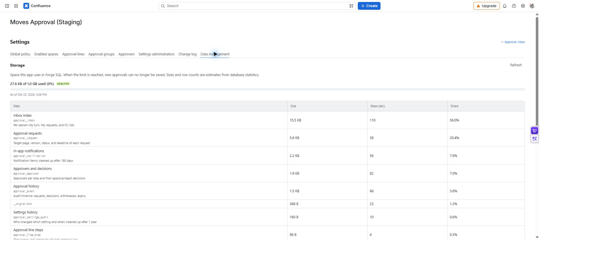

# Retention, export, and change log

[Guide home](cloudjira--index.md) · [한국어](../ko/cloudjira--admin-data.md)

Monitor storage, export finished records past retention, and then clean them up. Available to app administrators. Deletion cannot be undone.

**Location:** Settings → **Data management**. Review administration events in **Change log**.

## Check storage

Compare usage with the limit shown. The current app displays a 1 GiB reference, with warning at 80% and critical at 90%. Sizes and row counts are statistical estimates. Refresh and check the measurement time.

## Export and clean up records

1. Choose retention according to organizational rules: forever, or 1, 3, 5, or 10 years. The default is three years.
2. Check the count and oldest date of records past retention. Open requests are excluded.
3. Select **Export to Excel** and wait for download completion.
4. Open the file and check the **Requests, Approvers, and History** sheets. Store it in the approved records location.
5. Compare the last-export date and count with the file, then select the control to delete the exported records. Recheck the target and confirm deletion.
6. Check the result, remaining count, and **Change log**.

*MA-20 · The storage section shows estimated usage and row counts. Scroll down for retention, export, and deletion controls.*

## Retention and deletion scope

| Data | Handling |
| --- | --- |
| Finished approval records | Never automatically deleted for age alone. Manual deletion is limited to the confirmed export scope. |
| Open requests | Excluded from retention cleanup. |
| Related decisions, history, inbox entries, notifications | Removed with the request. |
| In-app notifications | Automatically cleaned up after 180 days. |
| Settings change log | Automatically cleaned up after one year. |

Records that pass retention after export are outside the old deletion scope. Export again to include them. The inbox list export has different scope and sheets from this retention export.

Once an export is confirmed, any app administrator can delete that scope, not only the one who exported it. Records of pages you cannot view are left out of export and deletion, but records of pages permanently deleted from Confluence (emptied trash or deleted space) are included, with the page title, request note, and rejection or withdrawal reasons left blank.

## Read the change log

Review time, user, area, action, and detail. It records policy, space, line, group, registration, administrator, and retention actions. Request-specific decisions belong in the request's audit timeline instead.

If deletion is unavailable, first check whether export of that range completed. Do not delete before preserving the records you need.
