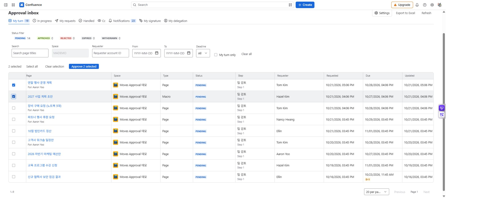

# Approve, reject, and bulk approve

[Guide home](cloudjira--index.md) · [한국어](../ko/cloudjira--decisions.md)

Review the target page and version when your step is active. A step advances when its required count is met; a rejection ends the entire request.

**Requirements:** Page view permission and an active approver or valid delegate role. Set up your [PIN](cloudjira--signature-pin.md) first if required by policy.

## Review and decide

1. Open a request under **Approval inbox → My turn**.
2. Read the request note, target version, current step, and earlier decisions.
3. If the page has changed, use **View changes** to compare versions. For an area request, inspect images and attachments on the source page as well as the text preview.
4. Select **Approve** if you agree. Otherwise select **Reject**, enter a reason, and confirm. A reason is required by default.
5. Enter your PIN if requested, then check that the decision is recorded.

*MA-06 · The widened details dialog keeps the target version, step state, audit trail, and decision controls together.*

## Decision results

| Action | Change | Expected result |
| --- | --- | --- |
| Approve | Records your decision | The next step opens once the required count is met. |
| Pass the final step | Changes the overall status | The request becomes approved. |
| Reject | Changes the overall status | The request ends immediately without waiting for others. |
| Cancel / Back | Closes an unconfirmed dialog | Does not undo an already confirmed decision. |

Rejection reasons remain in request history. With Confluence notifications enabled, page comments may also expose them to other page readers.

## Approve several requests

Under **My turn**, review each page and target version before selecting its checkbox. Use **Approve N selected** to process up to 50 requests. Enter a required PIN once for the batch.

Check the approved and failed counts. For failures, recheck the latest status, permissions, and deadline. Overdue requests cannot be selected. Rejections are handled individually.

*MA-07 · Selection state before bulk approval. Review the per-request success and failure result after processing.*

## When a decision is unavailable or mistaken

Check earlier steps, finished status, deadline, and page permission. Confirmed decisions cannot be reversed. An open request can be withdrawn by its requester and replaced; a finished request requires a new request. See [changes, withdrawal, and resubmission](cloudjira--history-resubmit.md).
