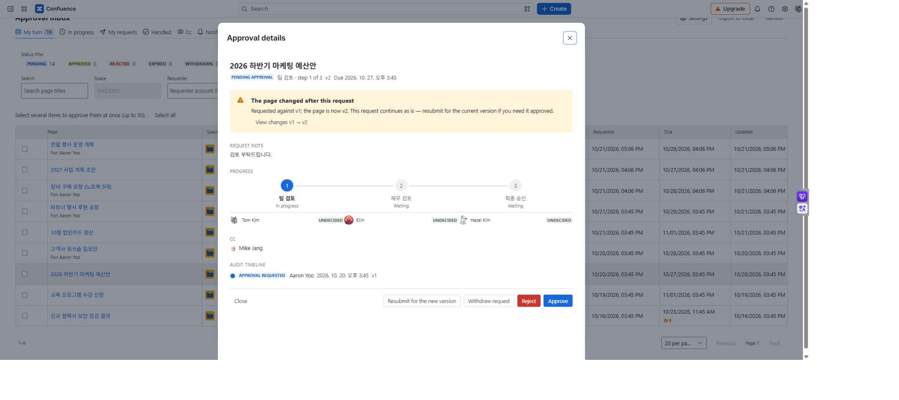

# Changes, withdrawal, resubmission, and version history

[Guide home](cloudjira--index.md) · [한국어](../ko/cloudjira--history-resubmit.md)

Approval records belong to a particular request and version. After editing a page, decide whether to continue the existing review or request approval of the new version.

## Choose the action

| Situation | Existing request | Action |
| --- | --- | --- |
| Page edited during review | Editing alone does not close it | Inspect the changes; resubmit if the new content needs approval. |
| Page edited after approval | The earlier version's record remains | Create a request for the current version. |
| Request is mistaken or unnecessary | Can be withdrawn while open | The requester or a Confluence administrator withdraws it. |
| Rejected, expired, or withdrawn | Cannot be reopened | Review the page and line, then create a new request. |
| Deadline passed but shown as overdue | Decisions are already blocked | A new request expires the overdue request. |

## Resubmit the new version

1. Compare the requested and current versions in approval details. Use **View changes** to inspect differences.
2. Select **Resubmit for the new version**. Current page edit permission is required, including for the original requester.
3. Review the copied approval line, then recheck the deadline, Cc, and note.
4. After submission, check the new target version and first step. The previous request ends; its decisions do not count as decisions on the new request.

*MA-10 · A version mismatch exposes the comparison and resubmission paths without silently changing the original target.*

## Withdraw an open request

Open its details, select **Withdraw request**, enter an optional reason of up to 200 characters, and confirm. Withdrawal cannot be reversed. Being an app settings administrator alone does not allow withdrawal of another person's request.

## Read earlier records

Expand **Approval history by version** to read earlier audit timelines. Check whether the current page is the version that was approved. Expanding history does not change the current detail request or PDF target. An [approval certificate](cloudjira--certificate.md) is available when the request currently shown is finished; verify its request ID and version before keeping it.
