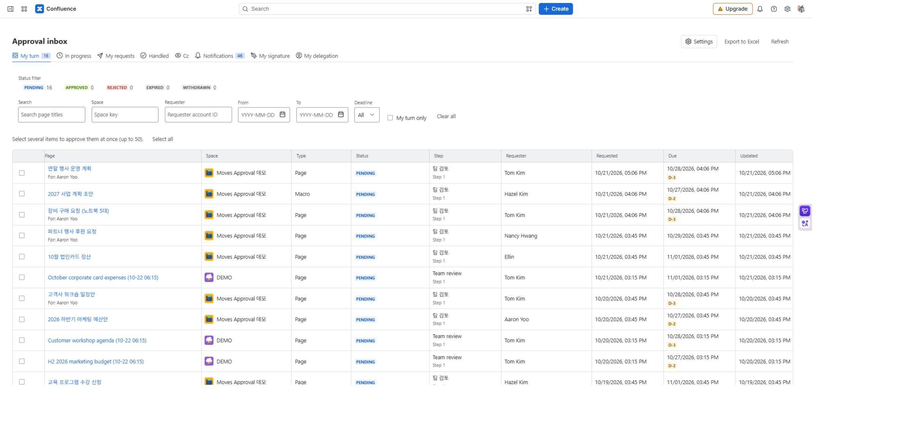

# Approval inbox

[Guide home](cloudjira--index.md) · [한국어](../ko/cloudjira--inbox.md)

Find requests you must decide on, requests you submitted, and requests where you are copied. The inbox also leads to notifications, your signature, and delegation.

**Location:** Confluence **Apps → Moves Approval**.

## Read the screen

| Tab | Requests shown | Next action |
| --- | --- | --- |
| My turn | Requests that you, or someone who delegated to you, can decide now | Open details, review, and decide. |
| In progress | Requests where you are waiting for an earlier step | Check the active step and deadline. |
| My requests | Requests you created | Follow progress and rejection reasons. |
| Handled | Requests you already decided on | Distinguish your decision from the overall result. |
| Cc | Requests where you are copied | Read progress; Cc alone does not allow decisions. |

*MA-05 · Approval inbox from the staging build deployed on October 26, 2026. The list is restricted to requests whose pages the user can view.*

## Find a request

1. Choose the appropriate tab: **My turn** for action, or **My requests** for pages you submitted.
2. Narrow the list by page title, space, requester, and date. Use the due-soon condition for urgent deadlines.
3. Select the **page name** to open the Confluence page. Select elsewhere on the row to open approval details.
4. Use **Show more** for additional rows. If a request is missing, clear filters and check access to the source page.

## Controls and indicators

| Item | Action | Check |
| --- | --- | --- |
| Status, dates, and deadline filters | Change the list query | Active filters can hide requests. |
| Deadline badge | Shows remaining days within three days, due today, or overdue | Overdue requests cannot be decided. |
| Column border | Drag to resize a column | Double-click to restore the default width. |
| Export to Excel | Export up to 5,000 accessible requests matching the tab and filters | Can include requests not yet loaded on screen. |
| Notifications, My signature, My delegation | Open personal features | Settings requires app administration permission. |

## Check the list and export

The Excel file is a request list, not a full backup of individual decisions and audit history. Use [certificates](cloudjira--certificate.md) for finished-request evidence and [data management](cloudjira--admin-data.md) for retention exports.

Only pages you can view appear. If tab counts and visible rows differ, check filters and page permission. Being named on a line does not allow a [decision](cloudjira--decisions.md) before your step opens.
