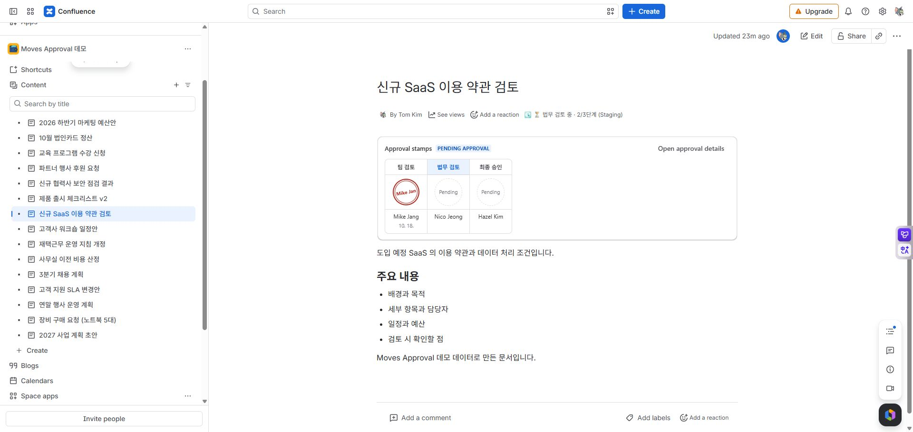

# Approval stamp box

[Guide home](cloudjira--index.md) · [한국어](../ko/cloudjira--stamp-box.md)

Place approval steps, people, and decision dates in the page for readers to inspect. Inserting a stamp box alone neither creates a request nor approves the page.

## Add it to a page

**Automatically:** Select **Add a stamp box to the top of the page** when requesting page approval. An existing box is not duplicated. A new insertion edits the page as the requester, increases its version by one, and targets that new version for approval.

**Manually:** In the page editor, use `/` to insert **Moves Approval Stamps**, then publish. Place it where you want, including in a template. If no request exists, its request button is available to people with edit permission.

*MA-11 · The published stamp box shows request status and step decisions in the page body.*

## Read the stamp box

| Indicator | Meaning | Next check |
| --- | --- | --- |
| Step name | Review order and active stage | Check the required count for multi-person steps. |
| Approval stamp / signature | That person's approval | Read the name and decision date together. |
| Rejection stamp | That person's rejection | Read the reason in details. |
| Waiting | No decision yet | Check whether earlier steps have finished. |
| Delegate indicator | Someone decided on behalf of the approver | Check the actual decision maker in details. |
| Current version not approved | The page changed after approval | Compare approved and current versions. |

Open approval details for all decisions and history. When signature display is disabled, text appears instead of stamps. A page stamp box shows page approval; an area has its own box below that area.

## Missing or empty stamp boxes

A request may have been created even if automatic insertion failed. Check approval details first, then insert manually if needed. A no-request message means the target has no request; it does not by itself indicate a broken macro.

[Create a request](cloudjira--page-approval.md) · [Download a certificate](cloudjira--certificate.md)
