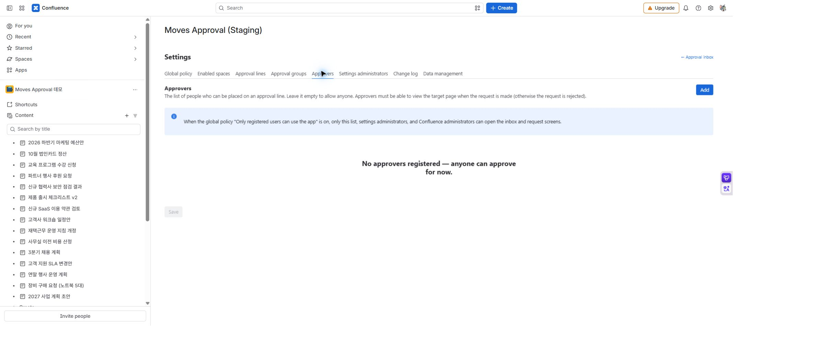
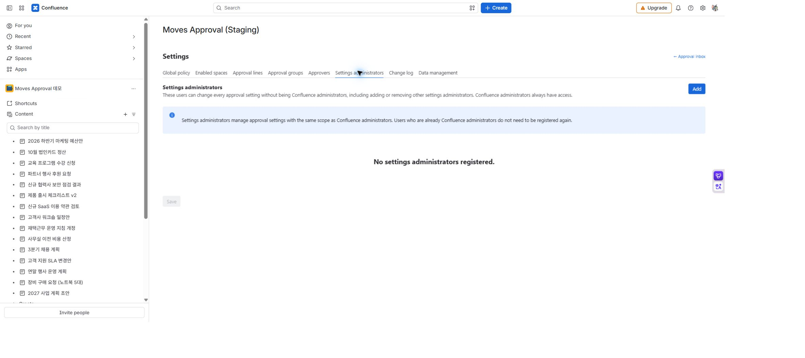

# 사용자·관리자와 접근 권한

[가이드 홈](cloudjira--index.md) · [English](../en/cloudjira--admin-access.md)

앱에 들어올 수 있는 사람, 결재선에 넣을 수 있는 사람, 설정을 바꿀 사람을 구분해 관리합니다. 앱 등록은 Confluence 문서 권한을 대신하지 않습니다.

## 역할 구분

| 역할·명부 | 할 수 있는 일 | 별도로 필요한 것 |
| --- | --- | --- |
| Confluence 관리자 | 모든 앱 설정, 다른 사람의 진행 중 요청 회수 | 실제 문서 작업에는 해당 작업의 권한 확인이 적용됩니다. |
| 설정 관리자 | 모든 앱 설정, 설정 관리자 추가·제거 | 다른 사람의 요청 회수 권한이 자동으로 생기지 않습니다. |
| 승인자 명부 | 명부 사용 시 결재선에 선택 가능한 사용자 | 해당 페이지 보기 권한이 필요합니다. |
| 요청자 | 요청 생성과 자신의 진행 중 요청 회수 | 요청 생성·재상신에는 페이지 편집 권한이 필요합니다. |
| 참조자·열람자 | 접근 가능한 요청의 상태·이력 확인 | 참조만으로 승인·반려할 수 없습니다. |

## 승인자 명부 등록

**설정 → 승인자**에서 사용자를 찾아 추가한 뒤 **승인자 명부 저장**을 누릅니다. 명부가 비어 있으면 승인자 선택을 명부로 제한하지 않습니다. 한 명이라도 등록해 운영하면 명부에 있는 사람만 결재선에 넣을 수 있습니다.

**등록된 사용자만 앱 사용**을 켤 예정이라면 승인자뿐 아니라 요청자도 등록하세요. 이 정책에서는 승인자 명부, 설정 관리자, Confluence 관리자만 업무함과 요청 화면에 접근합니다.

*MA-19A · 이 예시의 명부는 비어 있습니다. 승인자를 등록하려면 추가를 누릅니다. 검색·선택 화면은 그다음에 열립니다.*

*MA-19B · 이 예시에는 등록된 설정 관리자가 없습니다. 추가로 지정할 수 있으며 Confluence 사이트 관리자는 이미 접근 권한이 있습니다.*

## 설정 관리자 등록

**설정 → 설정 관리자**에서 이름을 두 글자 이상 입력해 사용자를 찾고 선택한 뒤 **설정 관리자 저장**을 누릅니다. Confluence 관리자는 별도 등록 없이 사용할 수 있습니다.

## 접근 제한 켜기 전 확인

1. 요청자·승인자를 명부에 등록합니다.
2. 운영 담당자를 설정 관리자로 등록합니다.
3. 일반 계정으로 업무함과 대상 페이지 접근을 확인합니다.
4. 전역 정책의 접근 제한을 켜고, 등록된 계정과 등록되지 않은 계정의 차이를 확인합니다.

설정 화면 접근, 문서 열람, 승인 차례는 서로 다른 조건입니다. 메뉴가 보인다는 이유로 모든 문서나 모든 요청을 처리할 수 있는 것은 아닙니다.
