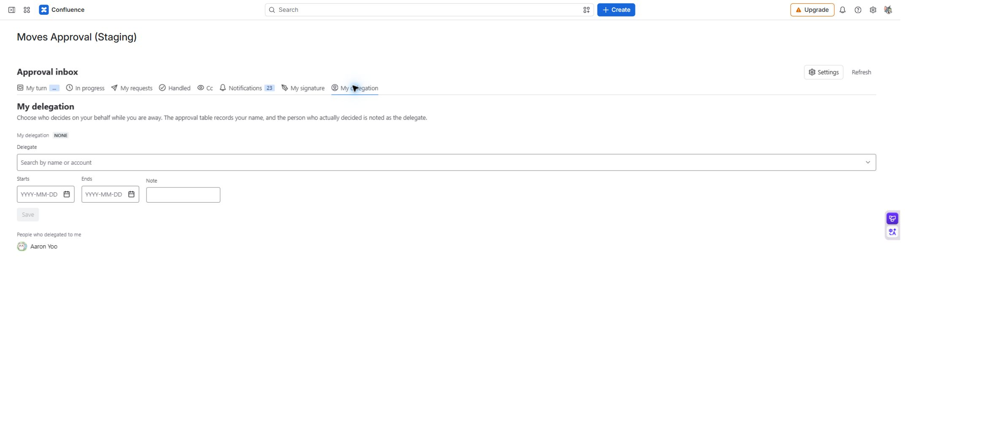

# 결재 위임과 대리 결재

[가이드 홈](cloudjira--index.md) · [English](../en/cloudjira--delegation.md)

휴가나 출장 기간에 내 차례의 결재를 다른 사람이 처리하게 합니다. 관리자가 **결재 위임 허용**을 켠 경우에 사용할 수 있습니다.

**경로:** 승인 업무함 → **내 위임**.

## 위임 등록하기

1. **내가 맡긴 위임**에서 현재 등록 내용을 확인합니다.
2. **대리인**을 고르고 **시작일**·**종료일**을 입력합니다. 필요한 경우 메모를 남깁니다.
3. 저장 후 등록된 대리인과 기간을 다시 확인합니다.
4. 대리인에게 대상 문서를 직접 열 수 있는지 확인하도록 안내합니다. 위임은 Confluence 페이지 권한을 추가하지 않습니다.
5. 예정일보다 일찍 끝내려면 **위임 해제**를 누릅니다.

*MA-09 · 유효한 기간의 위임과 나에게 맡겨진 결재를 같은 화면에서 확인합니다.*

## 대리인으로 처리하기

**나에게 결재를 맡긴 사람**에서 위임 관계를 확인합니다. 유효 기간에는 맡긴 사람의 차례가 **내 차례**에 `대리: 이름`으로 나타납니다. 문서·버전을 검토한 뒤 평소처럼 승인 또는 반려합니다. 맡긴 사람의 요청은 **내 차례**에만 나오고, 진행 중·내 요청·처리한 건·참조 탭에는 내 것만 보입니다.

| 확인할 항목 | 의미 |
| --- | --- |
| 위임 기간 | 현재 시각에 유효해야 대리 결재할 수 있습니다. |
| 결재선의 이름 | 원래 승인자 이름을 유지합니다. |
| 실제 처리자 | 대리 결재자로 함께 기록됩니다. |
| 위임 정책 꺼짐 | 등록된 위임도 효력이 없습니다. |

## 문제 해결

요청이 안 보이면 현재 날짜 → 위임 정책 → 원 승인자의 실제 차례 → 대상 페이지 보기 권한 → 업무함 필터 순으로 확인합니다. 위임했다고 앞 단계가 생략되거나 요청 마감이 연장되지는 않습니다.
