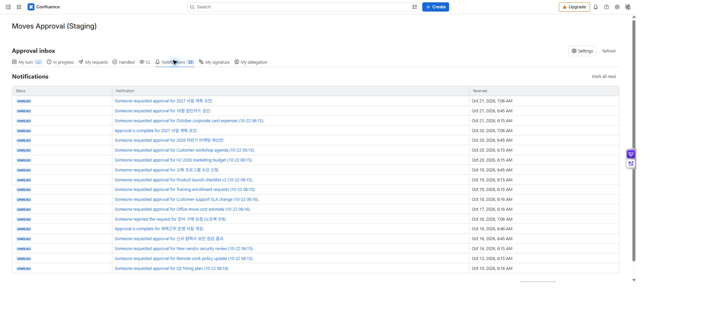

# 참조와 알림

[가이드 홈](cloudjira--index.md) · [English](../en/cloudjira--notifications.md)

참조자는 결정 없이 요청의 진행을 확인하고, 알림은 요청과 결과를 알려 줍니다. 참조 지정이나 알림 수신만으로 원본 페이지의 보기 권한이 생기지는 않습니다.

## 참조자로 확인하기

요청자가 참조로 지정하면 **승인 업무함 → 참조**에서 요청을 찾습니다. 그룹을 참조로 넣은 경우 요청을 저장한 시점의 구성원이 대상이며, 나중에 그룹에 들어온 사용자가 자동으로 추가되지는 않습니다.

참조자에게는 요청 생성·최종 승인·반려·회수·만료의 앱 내 알림이 갑니다. 중간 단계의 승인은 최종 승인과 구분하세요.

## 알림 채널 구분

| 채널 | 위치·동작 | 확인할 점 |
| --- | --- | --- |
| 앱 내 알림 | 업무함의 **알림** | 요청·결과·독촉·마감 임박을 정책에 따라 표시합니다. |
| Confluence 알림 | 대상 페이지의 @멘션 댓글 | 댓글을 작성하는 사용자의 권한이 필요합니다. |
| 이메일 | Confluence가 개인 알림 설정에 따라 발송 | 앱이 이메일을 직접 보내지는 않습니다. |

*MA-13 · 앱 내 알림은 요청·결정 결과를 한곳에 모읍니다. Confluence 댓글 알림은 정책과 댓글 권한이 모두 필요합니다.*

## 언제 누구에게 가나요

| 상황 | 앱 내 알림 | @멘션 댓글 |
| --- | --- | --- |
| 요청 생성 | 모든 승인자·참조자 | 첫 단계 승인자 |
| 다음 단계 시작 | 요청 때 받은 알림과 구분 | 새 단계 승인자 |
| 최종 승인 | 요청자·참조자 | 요청자·참조자 |
| 반려 | 요청자·미결정 승인자·참조자 | 요청자 |
| 만료 | 요청자·미결정 승인자·참조자 | 없음 |
| 독촉·마감 임박 | 지금 차례인 승인자, 마감 임박은 요청자 포함 | 없음 |

자신이 수행한 동작에 대한 알림은 본인에게 보내지 않습니다. 회수는 미결정 승인자·참조자에게 앱 내 알림을 보내며, 요청자가 아닌 사람이 회수하면 요청자도 받습니다.

## 알림을 받지 못했을 때

앱 내 알림 정책 → 알림 종류와 수신 역할 → 현재 차례 → 댓글 작성 권한 → 개인 Confluence 알림 설정 순으로 확인합니다. 댓글 실패만으로 결재가 실패했다고 판단하지 말고 상세의 실제 결정 기록을 확인하세요.

독촉·마감 점검은 하루 한 번 수행됩니다. 마감 이후 결정은 정기 알림이나 상태 정리를 기다리지 않고 차단됩니다. 관리자는 [전역 정책](cloudjira--admin-policy.md)에서 채널과 주기를 정합니다.
