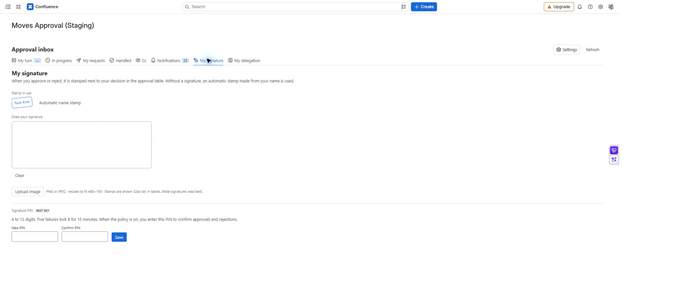

# 내 서명과 PIN

[가이드 홈](cloudjira--index.md) · [English](../en/cloudjira--signature-pin.md)

서명은 결정 옆에 표시할 도장을 정하고, PIN은 정책에 따라 승인·반려를 확정할 때 사용합니다. 서명 이미지 등록과 PIN 등록은 별도입니다.

**경로:** 승인 업무함 → **내 서명**.

## 서명 등록하기

1. **지금 쓰이는 도장**을 확인합니다. 등록된 이미지가 없으면 이름 자동 도장을 사용합니다.
2. **서명 그리기**로 그리거나 **이미지 업로드**로 PNG·JPEG 파일을 고릅니다. 원본은 2MB 이하이며 자동으로 480×160 이하로 줄어듭니다.
3. 미리보기에서 서명이 잘리지 않고 읽히는지 확인한 뒤 저장합니다. 실제 표에서는 높이 32px로 보이므로 가로로 긴 서명이 적합합니다.
4. 저장 후 현재 도장에 반영됐는지 확인합니다. 관리자가 서명 표시를 꺼 놓으면 등록해도 결정 화면에 표시되지 않습니다.

*MA-08 · 서명과 PIN은 별도로 관리합니다. 화면에는 실제 PIN 값이 표시되지 않습니다.*

## PIN 등록·변경하기

| 입력·동작 | 사용 방법 | 확인할 결과 |
| --- | --- | --- |
| 새 PIN·PIN 확인 | 같은 4~12자리 숫자 입력 | 등록됨 상태를 확인합니다. |
| 현재 PIN | 기존 PIN 변경·삭제 시 입력 | 새 PIN 입력만으로 기존 PIN을 바꿀 수 없습니다. |
| PIN 삭제 | 현재 PIN 확인 후 삭제 | 필수 정책에서는 다시 등록해야 결정할 수 있습니다. |

5회 틀리면 15분 동안 잠깁니다. 계속 다른 값을 시도하지 말고 잠금 시간이 지난 뒤 확인하세요. 앱에는 관리자 PIN 초기화 기능이 없습니다. PIN을 잊었다면 사이트 관리자와 지원 채널에 처리 방법을 문의합니다.

## 완료 확인

현재 도장과 PIN 상태를 각각 확인합니다. 서명을 올렸다고 PIN까지 등록된 것은 아닙니다. 실제 결정 방법은 [승인·반려](cloudjira--decisions.md), 문서에 보이는 도장은 [결재란](cloudjira--stamp-box.md)을 참고하세요.
