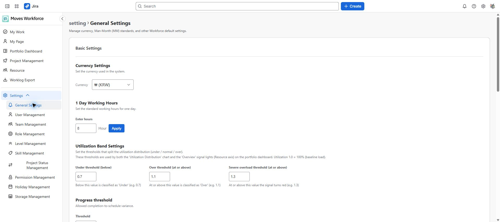
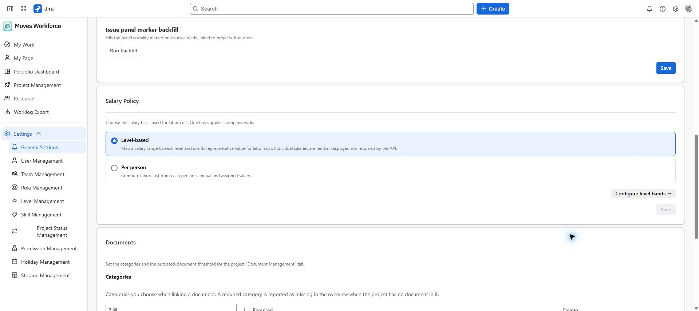

# General settings and reference data

[Guide home](cloudjira--index.md) · [한국어](../ko/cloudjira--admin-settings.md)

> Review draft: English screenshots were captured on the designated staging site on 2026-10-04 and are shared by both language guides. The deployed version and role-specific access and save operations remain under review.

Configure working standards, salary policy, roles, levels, skills, statuses, and holidays. These settings affect calculations and choices across users.

## General settings

General Settings read allows viewing; write allows changes. Review current values and affected reports before changing them.

| Setting | What to check |
|---|---|
| Currency | The organization's amount-display convention |
| Daily working hours | The basis for MD conversion and target time |
| Utilization thresholds | Organizational boundaries for underuse and overload |
| Progress threshold | Tolerance for the gap between completion and schedule progress |
| Salary policy | Individual amounts or level-based amounts |
| Document settings | Classifications, required classes, and the stale-document threshold |

General Settings: currency, daily working hours, and utilization thresholds.

The level-based and per-person salary policy options in General Settings.

## Change salary policy

1. For **Individual** policy, check required annual salaries and project allocation modes and amounts.
2. For **Level-based** policy, decide the levels and annual amounts. Band input fields are hidden under Per person.
3. Read the transition notice, save, and confirm the change. For first-time setup, enter representative amounts or min/max limits in Level Management after switching.
4. Check project cost and dashboard results. Aggregated screens may require another aggregation cycle.

Switching to level-based policy does not delete stored personal amounts. Also check that required personal amounts are ready if switching back. Directly entered project budgets are separate.

## Manage reference data

| Screen | Data managed | What to consider |
|---|---|---|
| Roles | Job roles | Choices used for people and project roles |
| Levels | Person levels and salary bands | Valid lower and upper limits and representative amounts |
| Skills | Shared personal and required-skill dictionary | Reduce duplicate meanings for useful matching |
| Project statuses | Kanban columns and transitions | Existing usage and allowed transitions |
| Holidays | Public holidays and working ratios | Year, dates, and rules such as half-days |

Each screen uses its own read and write permissions. Check separate policies for sensitive values such as level amounts. Before deletion, check existing usage; if deletion is rejected, resolve the reported references first.

## Storage monitoring

Users with Storage Management access can review usage. Coordinate cleanup or recovery with product operations after checking the target and impact. Project and user deletion are separate actions on their management screens; viewing storage usage does not delete data.

When measures change, compare the setting-change time, applied policy, and aggregation time. Saving a setting does not mean every report immediately reflects the same point in time.

<!-- control-reference:start -->

## Buttons, fields, and result checks

Path: Settings → General Settings. Basic settings, salary policy, and document settings save independently on their respective cards. Do not assume saving one card also saves other cards' unsaved inputs.

| Control or field | Function, conditions, and data affected | Result check and recovery |
|---|---|---|
| Currency | Select the organization's display currency. Do not use this as automatic exchange-rate conversion of stored monetary amounts. | Align budget/salary/band units and save the Basic Settings card. |
| Daily hours / Apply / Save | Apply normalizes the entered hours and updates the local selection. Input is normalized in half-hour steps; permanent storage requires Save on Basic Settings. | Check entered/displayed values, save, and reopen to verify. MD, time targets, and capacity calculations can change. |
| Under / over / severe-overload thresholds | These are ratios: 1.0 = 100%; 0.7/1.1/1.3 mean 70%/110%/130%. They classify portfolio distribution and resource signals. | Check organizational policy and threshold order before saving. Changing thresholds does not change logged time. |
| Progress threshold | Enter 0–100 percentage points (%p). It applies to completion-versus-schedule variance; blank input is not a valid zero. | For example, 5 means a 5%p threshold. Resolve validation errors, save, and check classification. |
| Salary policy selection / Save / Change confirmation | Per person uses individual annual/assigned amounts; Level-based uses representative annual bands. Save the selection and confirm Change in the dialog. | Decide the levels and amounts before switching. Band fields are hidden under Per person; for first-time setup, switch to Level-based, enter level amounts, then verify costs and unpriced warnings. Review existing bands before reuse. Stored personal amounts are not deleted, but display/editing is restricted under Level-based. |
| Configure level bands / missing-basis warning | Review levels lacking a band and open Level Management. A missing basis can produce zero labor cost under Level-based. | Do not interpret zero as a free resource. Check project-cost and portfolio update times after switching. |
| Document category add / name / required / delete | Up to 30 categories, names up to 30 characters, without duplicate names. A project lacking a required category is reported as missing it. | Removing a category does not delete Confluence pages. Review existing categorization and save the Documents card. |
| Outdated threshold / document settings Save | Set a 1–3650 day threshold for last modification. Saving document settings stores both categories and the threshold. | Resolve category-count/name/duplicate/day validation errors. Distinguish unavailable metadata from stale content. |
| Run issue-panel marker backfill | This administrative action repairs panel-visibility information on already linked issues; it does not create projects/worklogs for users. | Run with write access and check job state/failure counts. Distinguish accepted execution from completed processing. |
| Storage usage / project / table lists | Inspect storage usage and data distribution in monitoring. Do not treat the current viewer as a general data-reset control. | Follow the separate confirmation flow for actions such as project deletion. Review operational cleanup scope with the product operator. |

<!-- control-reference:end -->

<!-- supplemental-guides:start -->

## Detailed guides

- [Settings](https://dmove-addons.atlassian.net/wiki/spaces/MW/pages/204047432)
- [Settings access and setup order](https://dmove-addons.atlassian.net/wiki/spaces/MW/pages/204047851)
- [People registration and bulk upload](https://dmove-addons.atlassian.net/wiki/spaces/MW/pages/204047498)
- [Team hierarchy and membership](https://dmove-addons.atlassian.net/wiki/spaces/MW/pages/204047539)
- [Job role management](https://dmove-addons.atlassian.net/wiki/spaces/MW/pages/204047571)
- [Levels and salary bands](https://dmove-addons.atlassian.net/wiki/spaces/MW/pages/204047624)
- [Skill dictionary management](https://dmove-addons.atlassian.net/wiki/spaces/MW/pages/204047675)
- [Project statuses and transitions](https://dmove-addons.atlassian.net/wiki/spaces/MW/pages/204047722)
- [Holidays and working days](https://dmove-addons.atlassian.net/wiki/spaces/MW/pages/204047815)

<!-- supplemental-guides:end -->
