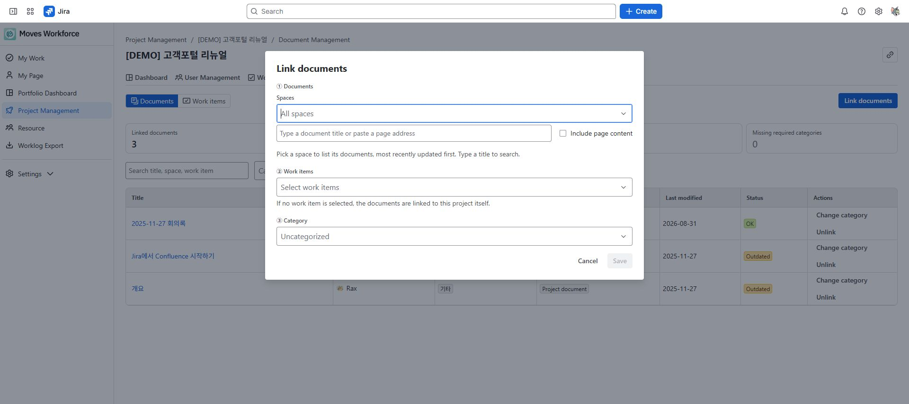

# Confluence 문서 연결

[가이드 홈](cloudjira--index.md) · [English](../en/cloudjira--documents.md)

> 검토 초안: staging에서 문서 관리 탭 제공 여부와 같은 사이트의 Confluence 연결 상태를 확인해야 합니다.

설계서·회의록·산출물을 프로젝트나 Jira 작업에 연결해 필요한 문서를 찾습니다. 이 기능은 Confluence 원문을 수정하거나 복사하는 기능이 아닙니다.

## 필요한 조건

- 프로젝트 관리 읽기로 조회하고, 쓰기로 연결·분류·해제를 수행합니다.
- Jira 작업에 연결할 때는 해당 작업의 편집 권한도 필요합니다.
- 본인의 Confluence 접근 권한으로 검색하고 최신 상태를 확인합니다.

문서 기능에 필요한 Confluence 연결은 앱을 사용하는 사이트에서 준비합니다. **이 가이드를 게시하는 dmove-addons 사이트와 앱 기준인 dmove-staging 사이트는 다릅니다.** 가이드가 다른 사이트에 게시돼 있다는 이유만으로 그 페이지를 앱에서 검색할 수 있는 것은 아닙니다.

<!-- detailed-walkthrough:start -->

## 예시 준비와 연결 창의 항목

**경로:** Jira → Apps → Moves Workforce → 프로젝트 관리 → Demo website launch → **문서 관리(Document Management)**.

같은 사이트의 Confluence에서 본인이 열 수 있는 문서 **Demo release design**을 준비합니다. 프로젝트와 DEMO-12 이슈도 미리 준비해 연결하세요. 이 이름들은 설명용 예시입니다. 실제 문서 제목과 이슈 키로 바꾸면 됩니다. Confluence가 다른 사이트에 있다면 이 절차의 검색 대상이 아닙니다.

| 연결 창 영역 | 무엇을 선택하나 | 결과에 미치는 영향 |
|---|---|---|
| 문서(Documents) | 스페이스·검색어로 찾은 페이지 | 체크한 문서가 연결됩니다. 제목만 보는 것과 선택은 다릅니다. |
| 작업(Work items) | 이 프로젝트에 연결된 Jira 작업 | 비워 두면 프로젝트 전체 문서, 선택하면 해당 작업의 문서입니다. |
| 분류(Category) | 조직에서 준비한 문서 분류 | 목록에서 문서 용도를 구분합니다. 분류가 없으면 미분류로 시작할 수 있습니다. |

### 예시 A: 프로젝트 전체 문서

1. **문서 연결(Link documents)**을 열어 문서 영역에서 스페이스와 제목으로 검색합니다. 결과가 없으면 본문 검색을 사용하거나 Confluence 원본을 직접 열어 접근 권한을 확인합니다.
2. 결과에서 Demo release design을 체크합니다. 선택 수와 선택한 제목을 확인합니다.
3. **작업은 비워 둡니다.** 준비된 분류가 있으면 선택하고 저장합니다.
4. 문서 보기에서 해당 제목과 **프로젝트 문서** 표시를 확인합니다. 특정 이슈의 문서로 연결된 것으로 해석하지 않습니다.
5. 제목을 눌러 Confluence 원본이 열리는지 확인합니다.

### 예시 B: DEMO-12의 작업 문서

1. 다시 문서 연결을 열고 같은 문서를 선택합니다.
2. 이번에는 작업 영역에서 **DEMO-12**를 선택합니다. 키와 제목을 확인하고 분류를 선택한 뒤 저장합니다.
3. 작업 보기에서 DEMO-12를 찾아 문서 링크가 나타나는지 확인합니다. 문서 보기에서도 연결된 작업을 확인합니다.
4. 여러 작업에 연결했다면 작업별 성공·실패 결과를 먼저 확인합니다. 실패한 작업의 편집 권한과 문서 개수 제한을 확인한 뒤 그 대상만 다시 처리합니다.

### 분류 변경과 연결 해제 후 확인

문서 행의 분류 변경 또는 연결 해제를 열고 변경 대상 작업·프로젝트 연결을 확인합니다. 같은 문서가 여러 곳에 연결되어 있다면 어느 연결을 변경하는지 확인한 뒤 저장하세요. 분류 변경 후 해당 행의 분류를, 연결 해제 후 해당 대상에서 링크가 사라졌는지 확인합니다. Confluence 원본을 다시 열어도 그대로 존재해야 합니다. 같은 페이지를 같은 작업에 다시 연결하면 분류가 갱신될 수 있으므로 새 문서가 하나 더 추가되는 것으로 예상하지 않습니다.

<!-- detailed-walkthrough:end -->

## 문서 연결하기

1. 프로젝트 상세의 **문서 관리 → 문서 연결**을 엽니다.
2. Confluence 스페이스·제목·페이지 주소로 문서를 찾습니다. 필요하면 본문 포함 검색을 사용합니다.
3. 문서를 연결할 작업을 선택합니다. 작업을 선택하지 않으면 프로젝트 전체 문서로 연결합니다.
4. 분류를 지정하고 저장합니다.
5. 여러 작업을 골랐다면 작업별 성공·실패 결과를 확인합니다.

문서 연결 창의 문서, 작업과 분류 선택 영역. 작업을 선택하지 않으면 프로젝트 문서로 연결됩니다.

문서 연결 창의 작업 선택 목록. 연결할 작업을 선택하면 해당 작업과 문서를 연결할 수 있습니다.

## 상태 읽기

| 상태 | 의미와 확인 |
|---|---|
| 정상 | 현재 확인 가능한 문서 |
| 오래됨 | 관리자가 정한 기간 동안 수정되지 않은 문서 |
| 끊김 | 삭제되었거나 현재 사용자가 볼 수 없는 문서일 수 있음 |
| 확인 불가 | 연결 장애나 확인 범위 제한 등으로 현재 상태를 판단하지 못함 |

**문서 없는 작업**과 **누락된 필수 분류**는 보완 대상을 찾는 데 사용합니다. 확인 불가를 정상이나 문서 0건으로 해석하지 마세요.

## 변경과 문제 해결

- **분류 변경**과 **연결 해제**는 연결 정보를 바꿉니다. 연결 해제로 Confluence 원문이 삭제되지는 않습니다.
- 기존 문서는 작업당 연결 개수와 한 번에 선택할 수 있는 문서 수에 제한이 있습니다. 제한 안내가 나오면 대상을 줄이고 결과를 확인합니다.
- 일부 작업만 실패하면 Jira 편집 권한과 개수 제한을 확인합니다.
- Confluence 미연결 상태에서는 저장된 제목만 보일 수 있습니다. 새 연결·최신 상태 확인을 위해 관리자에게 연결과 접근 권한을 점검받으세요.
- 동료와 문서 상태가 다르면 같은 Confluence 페이지를 직접 열어 권한 차이를 확인합니다.

<!-- control-reference:start -->

## 버튼·입력 항목과 처리 결과 상세

문서 관리에서 조회·검색·선택과 실제 연결 변경을 구분합니다. 모든 원본 페이지는 앱을 사용하는 Jira와 같은 사이트의 Confluence 접근 권한을 따릅니다.

| 버튼·입력 항목 | 기능·사용 조건·변경 대상 | 결과 확인과 문제 대응 |
|---|---|---|
| 문서 / 작업 보기 | 문서별 연결 목록과 작업별 문서 목록을 전환합니다. 전환만으로 연결 대상은 바뀌지 않습니다. | 프로젝트 문서 표시는 작업 미선택으로 만든 프로젝트 전체 연결을 뜻합니다. |
| 요약 카드·문서 없는 작업 | 연결 문서·문서 없는 작업·오래됨·끊김·필수 분류 누락을 확인합니다. 문서 없는 작업 카드로 해당 작업을 찾을 수 있습니다. | 확인 불가를 문서 0건 또는 정상으로 읽지 않습니다. 부분 조회 안내가 있으면 보이는 범위를 확인합니다. |
| 문서 검색·분류·상태 필터 | 제목·스페이스·작업으로 찾고 분류·상태로 좁힙니다. 현재 연결 목록을 필터링하며 Confluence 페이지를 삭제하지 않습니다. | 결과 없음은 조건 불일치일 수 있으므로 필터를 풀어 비교합니다. |
| 연결 창 스페이스·제목/URL·본문 포함 | 스페이스를 선택하면 최근 수정 문서를 찾고 제목 또는 페이지 주소로 검색합니다. 본문 포함은 검색 범위를 넓힙니다. | 스페이스 목록 조회 실패 시 전체 스페이스 검색 안내를 확인합니다. 같은 계정으로 원본을 열 수 있는지도 확인합니다. |
| 전체 선택·선택 해제·더 보기 | 전체 선택은 현재 불러온 목록에만 적용됩니다. 더 보기는 추가 검색 결과를 불러옵니다. | 선택한 제목·수량을 검토합니다. 한 번 선택 최대 30개와 작업당 총 30개 제한을 구분합니다. |
| 작업·분류·저장 | 작업 미선택은 프로젝트 전체, 선택은 해당 작업의 연결입니다. 준비된 분류를 지정하거나 미분류로 저장합니다. | 작업별 성공·실패를 확인합니다. 기존 문서와 합쳐 제한을 넘는 작업은 따로 실패할 수 있습니다. |
| 제목 열기·최신 상태 | 제목은 Confluence 원본을 엽니다. Healthy·Stale·Broken·Unknown은 현재 사용자 기준 확인 상태입니다. | 최신 확인은 최대 500개 범위입니다. 연결 또는 범위 제한이 있으면 Unknown일 수 있습니다. Broken만으로 원본 삭제를 단정하지 않습니다. |
| 분류 변경·연결 해제 대상 선택 | 현재 연결 대상 전체가 기본 선택됩니다. 일부 작업만 바꾸려면 대상을 해제·재선택한 뒤 저장합니다. | 저장 전 프로젝트 문서 포함 여부도 확인합니다. 해제는 선택한 관계만 제거하고 Confluence 원본을 삭제하지 않습니다. |
| 재시도·Confluence 미연결 | 조회 실패에는 재시도를 사용합니다. 미연결 상태에서는 마지막 저장 제목은 보일 수 있지만 새 연결·최신 상태 확인이 제한됩니다. | 같은 사이트 Confluence 설치·현재 사용자 접근·앱 쓰기와 Jira Edit Issues를 확인합니다. |

<!-- control-reference:end -->

