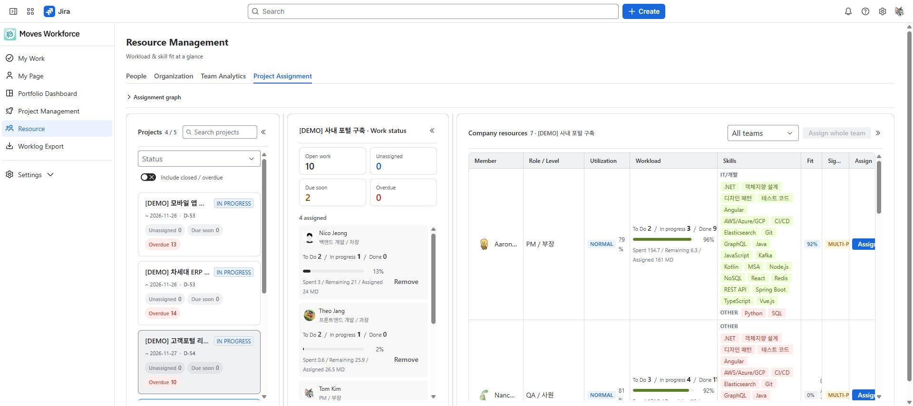
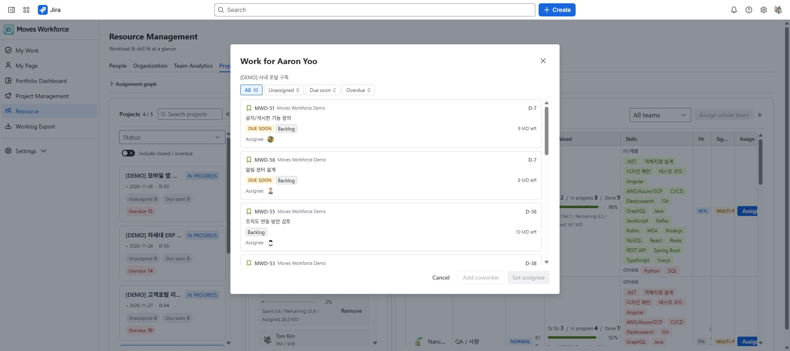

# 자원 관리와 프로젝트 배정

[가이드 홈](cloudjira--index.md) · [English](../en/cloudjira--resources.md)

> 검토 초안: 2026-10-04 지정된 staging의 영어 화면을 촬영했습니다. 화면 이미지는 한·영 가이드가 공통으로 사용합니다. 배포 버전과 역할별 접근·저장 동작은 아직 검증 중입니다.

자원 관리에서 사람의 부하·보유 스킬·조직 소속을 비교하고 프로젝트에 배정합니다. 이름이 같은 권한 세트라도 수정된 설정에 따라 열람 범위가 달라질 수 있습니다.

## 필요한 권한과 범위

자원관리 읽기로 인력 현황을 보고, 편집·배정에는 해당 쓰기 권한이 필요합니다. Jira 담당자 지정에는 Jira 권한도 요구됩니다. 팀·인력 열람 범위는 관리 권한, 프로젝트 범위, 팀장 관계에 따라 결정되며 메뉴가 보인다고 전사 명부 전체를 볼 수 있는 것은 아닙니다.

구체적인 전체·리딩 팀·열람 없음 조건은 [권한과 데이터 조회 범위](cloudjira--admin-permissions.md)의 조직 범위 표를 확인하세요.

## 인력 현황 확인하기

1. 인력 현황에서 마지막 집계 시각을 확인합니다.
2. 팀·역할·등급·스킬 조건으로 후보를 좁힙니다.
3. 가동률·남은 작업량·참여 프로젝트를 함께 비교합니다.
4. 인력을 눌러 상세의 진행 중 작업과 경험을 확인합니다.

가동률은 집계 결과여서 방금 입력한 기록이 바로 반영되지 않을 수 있습니다. **실적 없음**과 **여유 인력**도 구분합니다. 여러 사람이 참여한 이슈의 남은 작업량을 나눈 **내 몫**은 실제 업무 분담과 다른 근사치일 수 있습니다.

## 프로젝트에 배정하기

1. **프로젝트 배정**에서 대상 프로젝트를 선택합니다.
2. 프로젝트 필요 스킬과 후보 보유 스킬을 확인합니다.
3. 적합도와 부하를 함께 비교하고 배정할 사람을 선택합니다.
4. 이슈를 맡길지, 프로젝트 인력으로만 등록할지 확인합니다.
5. 저장 후 프로젝트 인력 명단과 이슈 담당을 각각 확인합니다.

프로젝트 배정 화면에서 프로젝트와 인력 후보의 스킬 적합도·부하를 함께 확인합니다.

후보 인력의 작업 선택 창. All 보기에서 작업을 확인하고 협업자 추가와 담당자 지정을 구분합니다.

스킬 적합도는 등록된 정보의 일치 정도입니다. 실제 숙련도나 가용 시간을 자동 보증하지 않습니다. 후보가 없으면 관리자 인력 등록과 허용된 범위를 확인하세요.

## 팀과 배정 관계도

- 조직 현황은 팀 계층과 구성원을 보는 화면이며 조직 변경은 [팀 관리](cloudjira--admin-people-teams.md)에서 수행합니다.
- 팀 분석은 허용된 조직·프로젝트의 지표를 비교합니다. 하위 팀 포함 여부와 현재 소속 기준을 확인합니다.
- 배정 관계도는 프로젝트 인력 등록 관계를 보여줍니다. 아직 워크로그를 남기지 않은 사람도 표시됩니다.
- 프로젝트 배정 취소가 Jira 이슈 담당 해제까지 자동 수행하는 것으로 가정하지 마세요. 안내된 잔여 작업을 확인합니다.

<!-- control-reference:start -->

## 버튼·입력 항목과 처리 결과 상세

자원 관리는 People·Organization·Team Analytics·Project Assignment를 제공합니다. 화면 명칭이 전사여도 실제 열람 범위는 현재 권한·팀장 범위에 따라 좁혀집니다.

| 버튼·입력 항목 | 기능·사용 조건·변경 대상 | 결과 확인과 문제 대응 |
|---|---|---|
| People·Organization·Team Analytics·Project Assignment | 개인 부하·조직 소속·팀 집계·프로젝트 배정 목적에 따라 탭을 바꿉니다. | 보이는 후보·상세·관계도 모두 허용 범위를 확인합니다. 읽기·쓰기와 REPORT·비용은 별도입니다. |
| 집계 시각·가동률 없음 | 가동률 등 일부 값은 집계 결과입니다. 데이터 없음은 0%와 다릅니다. | 마지막 집계·신선도와 원본 기록을 확인합니다. 모든 자원 수치를 프로젝트 내부 가동률과 동일하다고 보지 않습니다. |

<!-- control-reference:end -->

<!-- supplemental-guides:start -->

## 세부 안내

- [인력 현황 상세](https://dmove-addons.atlassian.net/wiki/spaces/MW/pages/173703169)
- [조직 현황](https://dmove-addons.atlassian.net/wiki/spaces/MW/pages/173146146)
- [전사 팀 분석](https://dmove-addons.atlassian.net/wiki/spaces/MW/pages/173178915)
- [프로젝트 배정 상세](https://dmove-addons.atlassian.net/wiki/spaces/MW/pages/173408318)

<!-- supplemental-guides:end -->
