# Forge 앱 간 통신 실측 가이드 — webtrigger vs apiRoute(3LO)

> 2026-10-19 · 개발 사이트 tom-chkim-dev · 스파이크 앱 `spike-app-channel-callee`(받는 앱) / `spike-app-channel-caller`(부르는 앱)
> 측정 결과 표는 [RESULTS.md](cloudjira--RESULTS.md). 이 문서는 **무엇을, 왜 했는지**를 순서대로 남긴다.

## 0. 무엇을 확인하려 했나

approval ↔ workforce 연동을 entity property 에서 REST 호출로 바꾸려면, **한 Forge 앱의 백엔드가 다른 Forge 앱의 함수를 HTTP 로 부를 수 있는지**가 먼저다. 공식 문서에 이 경우가 없고, 커뮤니티에는 apiRoute 를 다른 Forge 앱에서 부르면 401 이 난다는 미해결 글(2026-04)이 있다. 그래서 실제 앱을 건드리지 않고 작은 앱 두 개로 직접 측정했다.

```
curl ──▶ caller webtrigger(spike-kick) ──▶ [caller 백엔드 fetch, 사용자 컨텍스트 없음] ──▶ callee
                                                                             ├─ webtrigger (spike-wt)
                                                                             └─ apiRoute   (/v1/echo)
```

caller 를 webtrigger 로 깨운 이유: 트리거·스윕처럼 **사용자가 없는 경로**에서도 되는지가 승인 앱에 중요하기 때문이다(caller 의 `principal` 은 실제로 null 이었다).

---

## 1. 스파이크 앱 준비 (CLI)

| 단계 | 명령 | 왜 |
|---|---|---|
| 앱 등록 | `forge register <name> -y -s <developerSpaceId>` | 제품 앱과 과금·권한이 섞이지 않게 **테스트용 Developer Space**(`forge-sample-test-251229`)에 등록. 비대화형에서는 `-s` 가 필수(없으면 프롬프트 오류) |
| custom scope | `forge custom-scopes create -e development -f custom-scopes.yaml` | apiRoute 는 scope 가 있어야 선언 가능. **한 번 만들면 삭제·이름 변경 불가** → 스파이크 앱에서만 만듦 |
| 서명 키 | Node `crypto.generateKeyPairSync('ed25519')` → `forge variables set [--encrypt]` | webtrigger 는 플랫폼 인증이 없어 우리 서명으로 인증해야 한다. 개인키는 caller 에 암호화 변수로, 공개키는 callee 에 |
| 배포·설치 | `forge deploy -e development` / `forge install --site … --product jira` | 변수는 다음 배포부터 반영되므로 변수 설정 뒤 배포 |
| webtrigger URL | `forge webtrigger create -e development -s <site> -p jira -f <key>` | 설치마다 URL 이 다르다. 앱 안에서는 `webTrigger.getUrl(key)` 로 같은 값을 얻는다(실측 W6) |

caller manifest 의 egress: `api.atlassian.com`, `*.atlassian-dev.net`(development webtrigger 도메인). production 도메인은 미측정.

## 2. webtrigger 측정 — 추가 설정 없음

배포 직후 caller 에서 바로 호출했다. 결과: 200, 평균 약 0.2초, Ed25519 검증 성공, 본문 변조 감지, 200KB 전송, 재배포 후 URL 유지. **사람이 할 일이 없다**는 것 자체가 측정 결과다.

---

## 3. apiRoute 측정 — 사람이 해야 하는 설정 4단계

토큰 없이 부르면 curl 이든 caller 백엔드든 **401** 이었다(R0·R1). 플랫폼이 "다른 Forge 앱"이라는 이유로 통과시켜 주지 않는다. 그래서 공식 경로인 3LO 를 그대로 따라갔다.

### 3-1. 사이트에서 App REST API 켜기

**왜:** Forge 앱의 REST API 는 사이트마다 기본 꺼져 있다. 사이트 관리자가 앱별로 켜야 외부 호출을 받는다. 고객 사이트에서도 **고객 관리자가 직접** 해야 하는 작업이다.

admin.atlassian.com → 조직 → 앱 → 사이트 → tom-chkim-dev → **연결된 앱**에서 대상 앱을 찾는다.

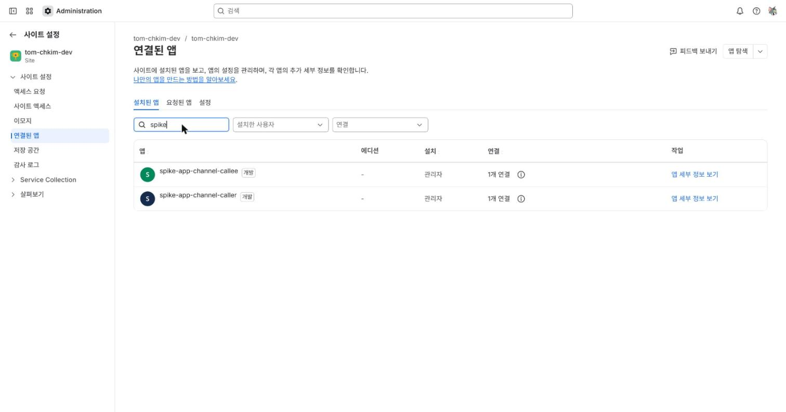

앱 세부 정보 아래쪽의 **앱 REST API** 항목이 "사용 중지" 상태다.

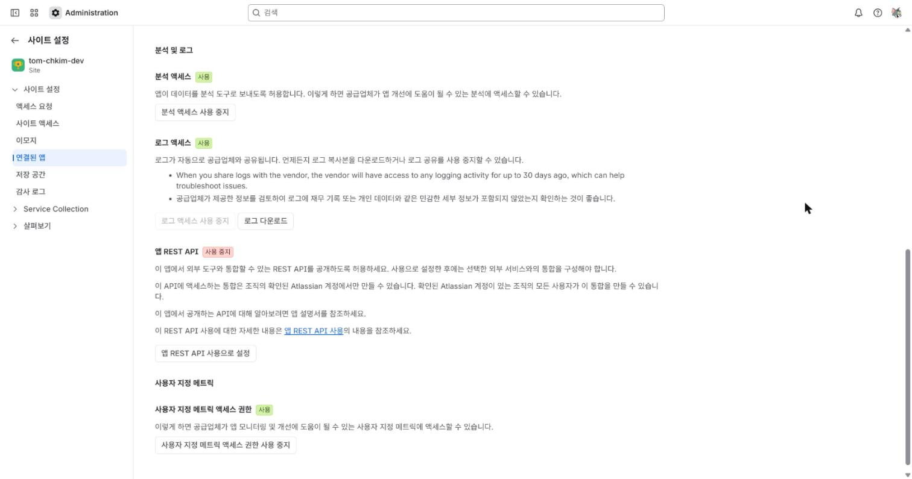

"앱 REST API 사용으로 설정" → 확인.

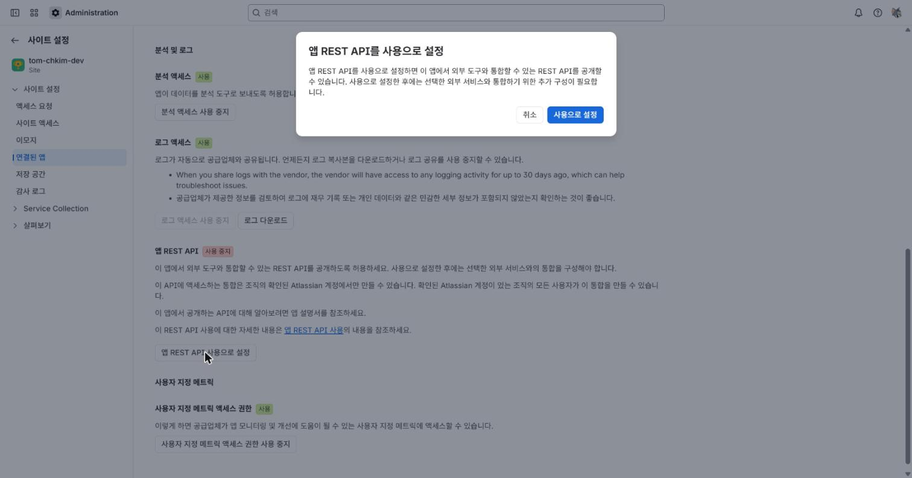

켜지면 이 앱의 **기본 URL**(사이트 gateway 형식)이 나온다. `api.atlassian.com/svc/jira/{cloudId}/apps/{appId}_{envId}` 형식도 같은 함수로 간다(둘 다 실측).

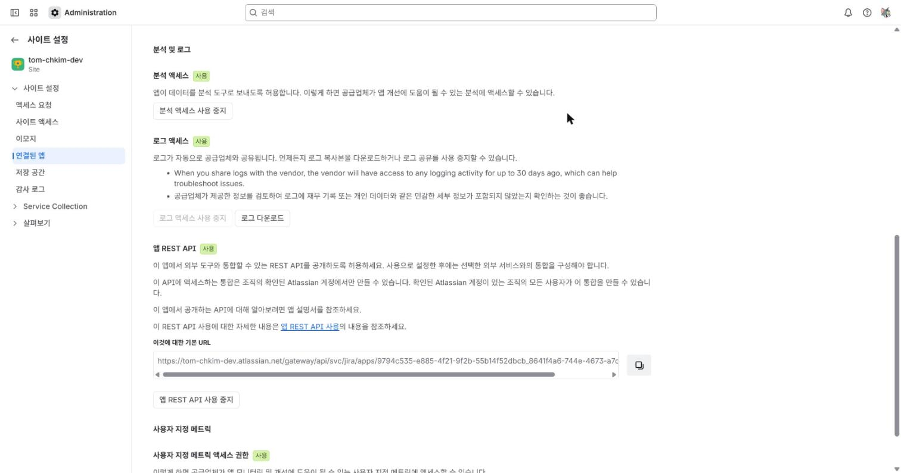

### 3-2. OAuth 2.0(3LO) 앱 만들기

**왜:** apiRoute 는 3LO 액세스 토큰만 받는다. 토큰을 발급할 "클라이언트"가 필요하다.

Developer Console → My apps → Create → **OAuth 2.0 integration**. 접근 유형은 **Resource-level**(사용자가 고른 사이트 하나만)로 했다 — 연동은 한 사이트 안의 일이라 범위를 좁게.

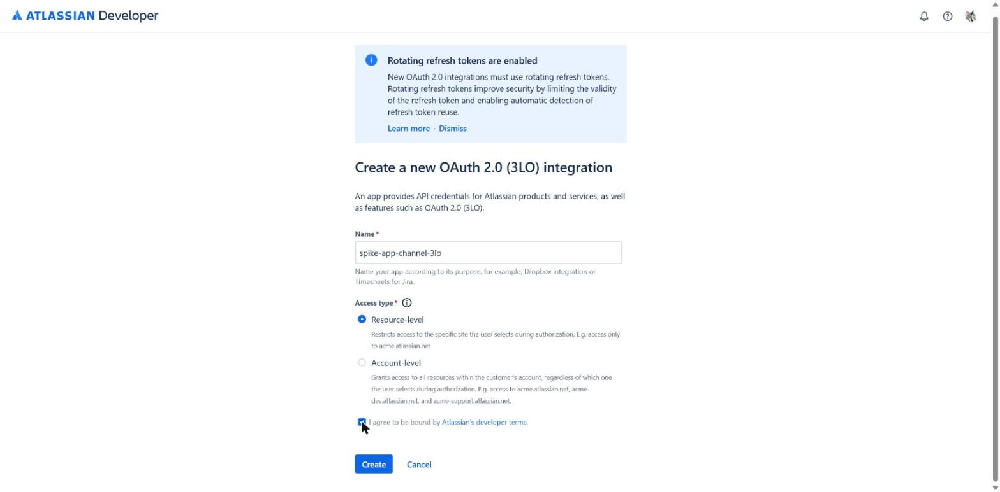

> 화면 상단 안내: **새 OAuth 앱은 refresh token 회전이 강제**된다. 갱신할 때마다 refresh token 도 바뀌므로 저장소를 매번 원자적으로 갈아 끼워야 한다(R4 에서 확인).

### 3-3. 권한(scope) 연결

**왜:** 토큰이 "어느 앱의 어느 scope"를 쓸 수 있는지 OAuth 앱에 미리 등록해야 동의 화면에 나온다.

Permissions → **Add Marketplace or custom app** → 사이트·앱(callee, DEVELOPMENT)·scope(`read:spike-echo:custom`) 선택.

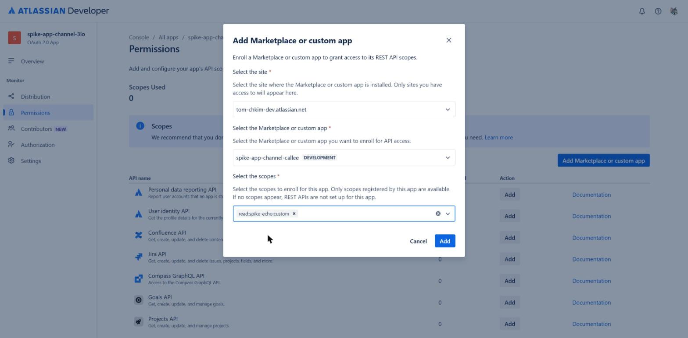

추가 직후 기본 URL 을 보여 준다(닫으면 다시 안 보여 줌. cloudId·appId·envId 로 재구성 가능).

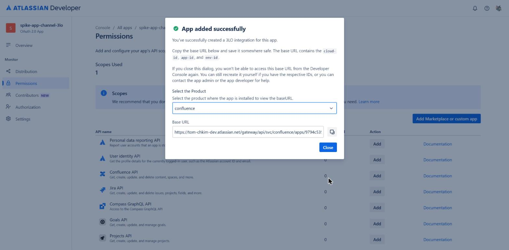

Jira API → Configure → Granular scopes 에서 **`read:forge-app:jira`** 체크 후 Save. 공식 문서가 요구하는 "Forge 앱 데이터 읽기" 권한이다. (바로 아래 `write:forge-app:jira` 와 붙어 있어 잘못 체크하기 쉽다.)

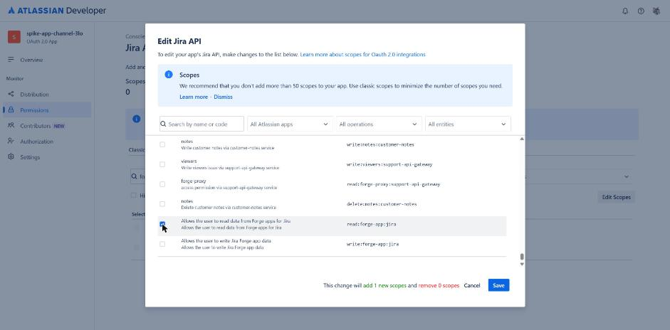

### 3-4. callback URL 과 동의

**왜:** 사용자가 동의하면 Atlassian 이 인가 코드를 callback 으로 돌려준다. 실측용으로 로컬 도우미(`oauth3lo.js`, `localhost:8765`)가 코드를 받아 토큰으로 바꾼다. Client Secret 은 화면에서 읽지 않고 환경변수로만 넘겼다.

Authorization → OAuth 2.0 (3LO) → Callback URL 저장.

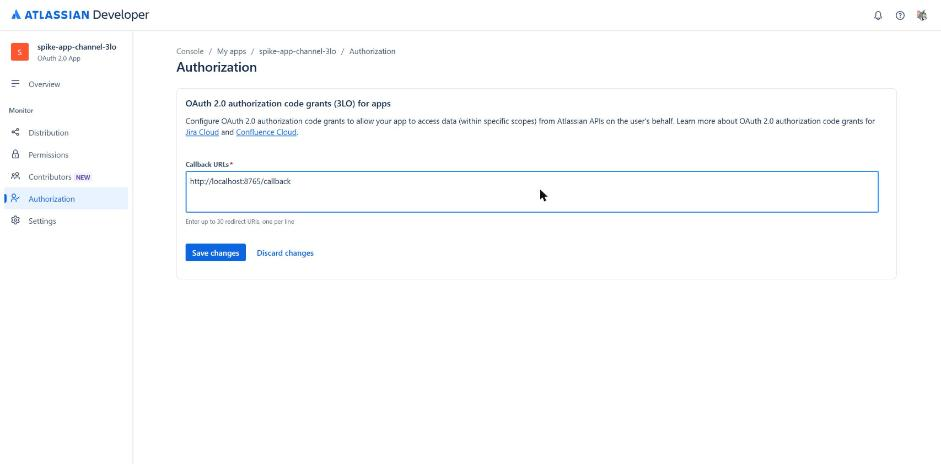

**함정(실측 R0'):** 처음엔 문서대로 `scope=read:spike-echo:custom read:forge-app:jira` 만 넣어 동의 URL 을 만들었다. 동의 화면에 Jira 권한만 나왔고, 토큰으로 부르니 403 `Missing required scopes ... [read:spike-echo:custom]`.

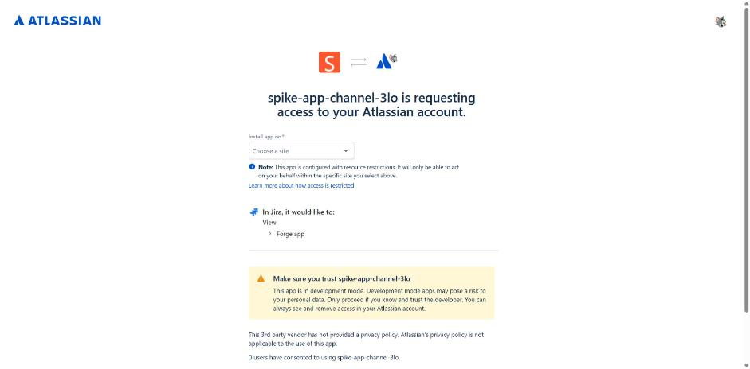

Authorization 페이지 아래 **Authorization URL generator** 의 "Marketplace App" URL 을 보니 끝에 **`sns={appId}.{envId}`** 가 붙어 있었다. 공식 튜토리얼에 없는 파라미터다.

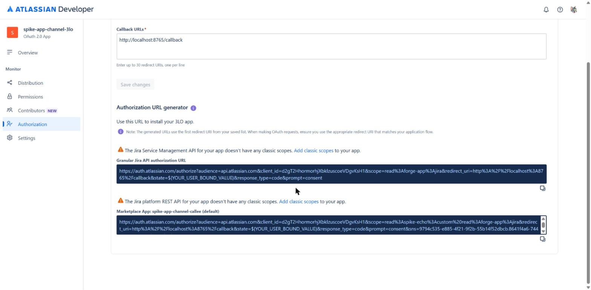

`sns` 를 붙이자 동의 화면에 "In Spike-app-channel-callee … Read spike echo" 가 함께 나왔고, 토큰 scope 가 `{appId}.{envId}:read:spike-echo:custom` 으로 발급됐다.

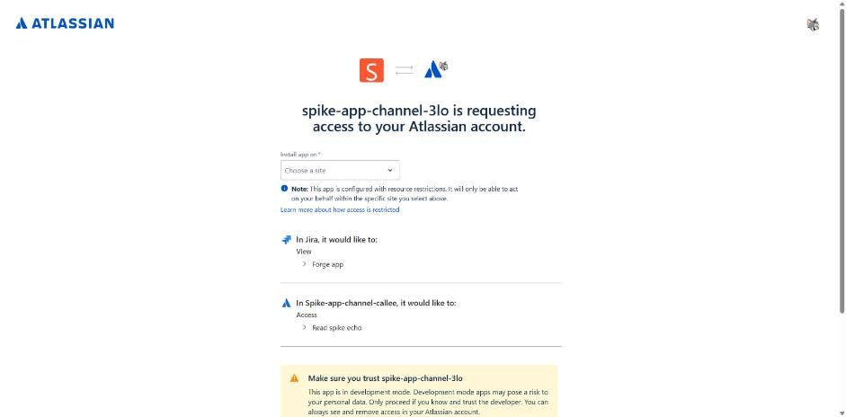

### 3-5. 측정

- curl → 200. caller 백엔드(사용자 없음) → **200, 1.7~1.9초**. 커뮤니티의 401 은 토큰·scope 문제였을 가능성이 크다.
- callee 가 받은 `principal.accountId` = **토큰을 발급한 사람**. 앱 간 호출이어도 "그 사람 권한으로" 실행된다.
- refresh 할 때마다 access·refresh 모두 새 값. 갱신 직후 옛 refresh 도 한 번 더 통과했다(유예 구간으로 보이나 문서 미확인 — 의존하면 안 된다).

---

## 4. 이 결과가 재설계에 주는 의미

| | webtrigger + Ed25519 | apiRoute + 3LO |
|---|---|---|
| 고객 설치 때 할 일 | 없음(앱이 자기 URL 을 상대에게 알려 주면 됨) | 3-1~3-4 전부 **고객 사이트마다** + client secret 보관 |
| 트리거·스윕 | 그대로 | 저장된 refresh token. 토큰 주인이 퇴사·권한 상실하면 연동 정지 |
| 속도 | 약 0.2초 | 약 1.8초 |
| 인증 책임 | 우리(서명·재전송 방지·사이트 대조) | 플랫폼(토큰·scope) + 우리(토큰 보관·회전) |

내부 연동은 webtrigger 가 맞고, apiRoute 는 고객의 외부 시스템이 사용자 권한으로 조회하는 공개 API 에 맞다.
주의: webtrigger 를 쓰더라도 "상대 URL 을 처음 어떻게 알려 주나"는 설계가 필요하다(관리자 붙여넣기 / 일회성 신호 / 고정 위치).

## 5. 정리할 것

- OAuth 앱 `spike-app-channel-3lo` 의 Client Secret 은 대화 기록에 노출됨 → 재발급 또는 앱 삭제
- 스파이크 앱 두 개 제거: `forge uninstall` 후 Developer Console 에서 삭제(custom scope 는 앱과 함께 사라짐)
- 로컬 `.token.json` 삭제
