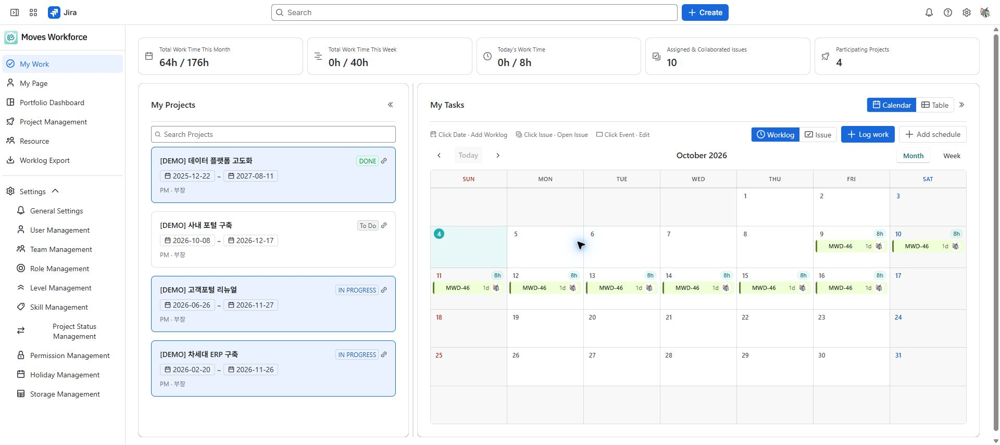
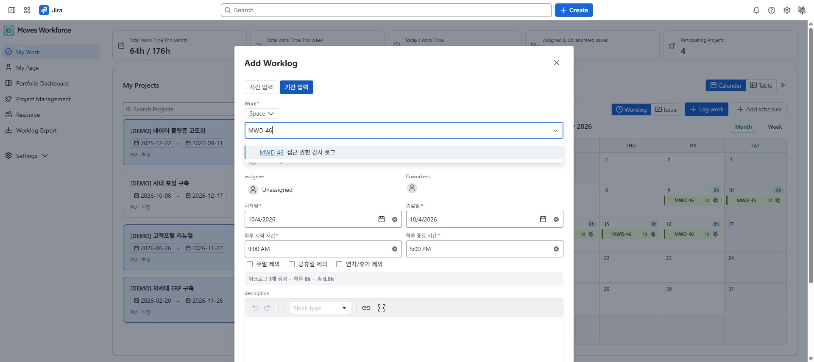

# My Work 사용법

[가이드 홈](codex-experiences--index.md) · [English](../en/codex-experiences--my-work.md)

> 검토 초안: 2026-10-04 지정된 staging의 영어 화면을 촬영했습니다. 화면 이미지는 한·영 가이드가 공통으로 사용합니다. 배포 버전과 역할별 접근·저장 동작은 아직 검증 중입니다.

My Work에서 내 프로젝트, 담당·협업 이슈, 기록한 작업 시간을 확인합니다. 매일 작업 시간을 기록하고 주간 일정을 점검할 때 사용합니다.

## 필요한 권한

앱을 사용할 수 있는 사용자의 본인 업무 화면입니다. Jira 이슈를 볼 권한이 필요하며, 워크로그 작성에는 **Work On Issues**, 본인 기록 수정에는 **Edit Own Worklogs**, 삭제에는 **Delete Own Worklogs**가 필요합니다. 시간 추적도 활성화돼 있어야 합니다.

<!-- detailed-walkthrough:start -->

## 단일 날짜 입력 항목 확인하기

| 항목 | 입력 예시 | 등록 전 확인 |
|---|---|---|
| 작업 | DEMO-12 Write test scenarios | 키와 제목이 실제 수행한 업무의 대상인가 |
| 날짜 | 2026-10-05 | 실제로 일한 날짜인가 |
| 시작·종료 | 09:00 / 12:30 | 종료가 시작보다 뒤이고 계산 시간이 3시간 30분인가 |
| 설명 | 테스트 시나리오 작성 | 나중에 기록을 보는 사람이 업무 내용을 이해할 수 있는가 |

날짜를 선택해 추가 창을 열고 작업과 각 항목을 입력합니다. 등록 후 해당 날짜의 기록을 열어 작업·날짜·시간이 입력과 일치하는지 확인합니다. 휴식 시간을 제외해야 한다면 실제 작업 구간으로 나누어 기록하세요.

### 예시: 같은 작업을 5일에 걸쳐 기록하기

1. 기간 입력과 준비한 이슈를 선택합니다. 2026-10-05부터 2026-10-09까지, 하루 시작·종료는 09:00–12:30으로 입력합니다.
2. 주말·공휴일·휴가 제외 옵션을 확인합니다. 포함 날짜가 5일이면 5건, 합계 17시간 30분입니다. 휴일이나 휴가로 날짜가 제외될 수 있으므로 화면의 미리보기를 최종 기준으로 확인합니다.
3. 포함 날짜·등록 건수·하루 시간·합계가 의도와 맞을 때 등록합니다. 기간 전체가 하나의 기록이 되는 것이 아니라 포함 날짜별로 기록이 만들어집니다.
4. 실패하면 처음부터 생성하지 못했는지, 생성분을 취소했는지, 취소가 불완전한지 오류 안내를 확인합니다. 재시도 전 나의 작업과 Jira 이슈의 워크로그를 새로고침하세요. 앱은 중간 실패 시 생성한 기록을 되돌리지만 취소가 실패하면 일부 기록이 남을 수 있습니다. 취소가 불완전하면 남은 기록의 날짜·시간을 확인하고 올바른 기록은 유지한 채 누락 날짜만 단일 입력합니다. 전체 기간을 다시 등록하려면 본인의 삭제 권한으로 남은 기록을 먼저 정리하고 취소 완료를 확인합니다. 삭제 권한이 없으면 관리자에게 정리를 요청하고 전체 기간을 중복 등록하지 않습니다.

### 기존 기록 수정·삭제하기

표에서 이슈의 워크로그를 펼치거나 캘린더의 기록을 엽니다. 기록자·이슈 키·날짜·시간을 확인한 뒤 수정합니다. 잘못된 날짜·시간 또는 설명을 바꾸고 등록한 뒤 해당 기록과 하루 합계를 확인하세요. 삭제할 때는 그 기록의 삭제 동작을 사용하고 목록에서 사라졌는지 확인합니다. 각각 해당 Jira 권한이 필요하며, 수정 동작이 없다는 이유로 새 기록을 중복 추가하지 않습니다.

<!-- detailed-walkthrough:end -->

## 화면 읽기

| 영역 | 확인할 내용 |
|---|---|
| 요약 | 오늘·이번 주·이번 달의 기록 시간, 담당·협업 이슈와 프로젝트 수 |
| 내 프로젝트 | 참여 프로젝트와 프로젝트에서의 역할·등급 |
| 캘린더 | 월간·주간 단위의 워크로그 또는 이슈 일정 |
| 테이블 | 이슈별 작업 현황과 펼쳐서 보는 워크로그 |

My Work의 기록 시간 요약, 내 프로젝트와 월간 워크로그 캘린더.

목표 시간은 조직의 근무시간·휴일 설정을 사용합니다. 예를 들어 1일 8시간, 근무일 5일이면 주 목표는 40시간입니다. 기록 시간이 목표와 다르다는 사실만으로 근무 성과를 판단하지 마세요.

## 워크로그 추가와 수정

1. 날짜를 선택하거나 워크로그 추가 창을 엽니다.
2. 이슈를 선택합니다. 검색 조건이 남아 있다면 먼저 확인합니다.
3. **시간 입력**에서 작업 날짜와 시작·종료 시각을 입력합니다.
4. 계산된 시간을 확인하고 수행 내용을 적어 저장합니다.
5. 수정할 때는 본인 기록의 수정 버튼을 사용합니다. 삭제할 때는 이슈·날짜·시간을 확인합니다.

여러 날에 같은 작업을 기록하려면 **기간 입력**을 사용합니다. 시작일·종료일, 하루 기록 시간, 주말·공휴일 포함 조건을 확인하고 저장 전 생성될 날짜를 검토하세요. 저장 결과에 실패가 있다면 성공한 기록을 먼저 확인해 중복 등록을 피합니다.

워크로그 추가 창에서 예시 이슈를 선택하고 09:00~12:30을 입력한 상태. 계산 결과는 3시간 30분이며 저장 전 화면입니다.

기간 입력 창의 시작·종료일, 하루 시작·종료 시각과 주말·공휴일·연차 제외 옵션. 저장 전 생성 건수와 총 시간을 확인합니다.

## 캘린더 모드의 차이

| 모드 | 표시하는 것 | 용도 |
|---|---|---|
| 워크로그 | 기록된 작업 시간과 일별 합계 | 언제 얼마나 일했는지 확인 |
| 이슈 | 담당·협업 이슈의 시작일과 기한 | 일정과 마감 확인 |

이슈에 시작일과 기한이 없으면 달력 막대로 표시되지 않을 수 있습니다. **기간 미설정** 목록에서 확인하고 권한 있는 담당자가 작업 일정을 지정합니다. 워크로그를 다른 날짜로 드래그하면 기록 날짜가 바뀌므로 이동 후 날짜를 확인하세요.

## 문제 해결

| 증상 | 확인 순서 |
|---|---|
| 원하는 이슈가 없음 | 검색·스페이스 조건 → 담당·협업 관계 → Jira에서 이슈 열람 가능 여부 |
| 저장 실패 | 날짜·시간 → Jira 시간 추적 → Work On Issues 권한 → 오류 문구 |
| 수정·삭제 버튼이 없음 | 본인 기록인지 → 해당 Jira 수정·삭제 권한 |
| 프로젝트가 없음 | 프로젝트 인력 등록 → 앱의 프로젝트 조회 범위 |

내 기간별 성과와 권한은 [마이페이지](codex-experiences--my-page.md), 전사 추출은 [워크로그 추출](codex-experiences--worklog-export.md)에서 확인합니다.

<!-- control-reference:start -->

## 버튼·입력 항목과 처리 결과 상세

경로: Jira Apps → Moves Workforce → My Work. 이 화면에서는 시간 기록과 개인 일정, Jira 작업 일정을 구분해 사용합니다.

| 버튼·입력 항목 | 기능·사용 조건·변경 대상 | 결과 확인과 문제 대응 |
|---|---|---|
| 캘린더 / 표 | 같은 개인 업무를 일정형 또는 목록형으로 표시합니다. 전환 자체는 워크로그를 생성·삭제하지 않습니다. | 표에서 이슈별 기록을 펼치거나 캘린더의 날짜·기록을 선택해 상세를 확인합니다. |
| 워크로그 / 이슈 모드 | 워크로그는 실제 기록 날짜·시간, 이슈는 시작일·기한을 표시합니다. 같은 월이라도 표시 대상이 다릅니다. | 막대가 없으면 모드를 먼저 확인하고, 이슈 모드에서는 일정 미지정 목록도 확인합니다. |
| 오늘 / 이전·다음 / 월·주 | 기준 날짜와 표시 기간을 이동합니다. 선택한 월·주를 바꾸어도 기록 날짜가 변경되지는 않습니다. | 이동 후 화면의 기간 제목을 확인합니다. 과거 날짜의 기록을 오늘로 오인하지 않습니다. |
| 작업 시간 기록 | 워크로그 추가 창을 엽니다. 선택한 이슈를 조회할 수 있고 Jira Work On Issues 권한과 시간 추적이 필요합니다. | 창을 여는 것만으로 기록되지 않습니다. 입력 후 등록하고 실제 기록을 확인합니다. |
| 작업 검색 / 스페이스 | 키 또는 제목으로 작업을 찾아 선택합니다. 스페이스 조건은 검색 대상을 좁히며 접근 권한을 추가하지 않습니다. | 스페이스를 바꾼 뒤 선택된 이슈를 다시 확인합니다. 결과가 없으면 조건을 풀고 Jira 원본 접근을 확인합니다. |
| 날짜·시작·종료·계산 시간 | 단일 입력에서 종료가 시작보다 뒤여야 합니다. 09:00–12:30은 3시간 30분입니다. 계산 시간은 기록될 시간이며 휴식을 자동 차감하는 입력은 아닙니다. | 휴식을 제외할 때는 구간을 나누고, 저장 후 이슈 키·기록자·날짜·시간을 확인합니다. |
| 기간 입력·제외 옵션 | 시작·종료 날짜와 하루 시작·종료 시간을 지정합니다. 주말·공휴일·휴가 제외 옵션에 따라 포함 날짜와 생성 건수가 달라집니다. | 미리보기 건수·합계를 보고 등록합니다. 중간 실패 시 생성분 취소 결과를 읽고 남은 정상 기록을 제외한 누락 날짜만 다시 입력합니다. |
| 설명 | 수행한 업무를 적습니다. 기존 기록의 설명을 불러오지 못한 상태에서는 내용 손실을 막기 위해 저장이 제한될 수 있습니다. | 오류 상태에서 빈 설명으로 덮어쓰지 말고 다시 불러온 후 수정합니다. |
| 기록 수정·삭제 / 날짜 끌기 | 본인 기록 수정에는 Edit Own Worklogs, 삭제에는 Delete Own Worklogs가 필요합니다. 워크로그 날짜 끌기는 실제 기록 날짜를 변경하는 동작입니다. | 저장 후 기록과 하루 합계를 확인합니다. 잘못된 날짜 이동은 기존 기록을 수정하고 중복 기록을 추가하지 않습니다. |
| 일정 추가·유형 | 워크로그와 별개인 개인 일정입니다. 일정 유형을 선택하면 기본 근무 가능 비율이 설정되며 시작·종료일을 지정합니다. | 종료일이 시작일보다 빠르면 등록할 수 없습니다. 일정 등록만으로 Jira 워크로그가 생성되지는 않습니다. |
| 일정 근무 가능 비율·설명 | 근무 가능한 비율을 입력합니다. 0은 근무 가능 시간 없음, 1은 하루 전체이며 0.5는 절반입니다. 비율은 휴가·가용량 계산 맥락에서 사용됩니다. | 유형을 변경하면 비율도 다시 확인합니다. 기록한 업무시간과 같은 값으로 해석하지 않습니다. |
| 일정 수정·삭제·취소 | 수정은 선택한 본인 일정을 변경하고 삭제는 확인 창을 거쳐 해당 일정을 제거합니다. 취소는 아직 저장하지 않은 입력을 닫습니다. | 삭제 일정은 복구할 수 없습니다. 찾을 수 없음·수정 불가 안내가 나오면 대상과 소유 계정을 확인합니다. |
| 패널 접기·폭 조절 | My Projects/Tasks 패널을 접거나 경계를 끌어 목록·캘린더의 폭을 조절합니다. 경계 두 번 클릭은 기본 폭으로 돌아갑니다. | 표시 공간만 바뀝니다. 접힌 패널은 다시 펼쳐 선택한 작업을 확인합니다. |

등록·수정한 시간은 Jira 워크로그입니다. Jira와 앱에 같은 업무를 각각 입력하지 마세요. 기간 실패의 취소가 불완전하고 본인에게 삭제 권한이 없으면 관리자에게 잔여 기록 정리를 요청합니다.

<!-- control-reference:end -->

