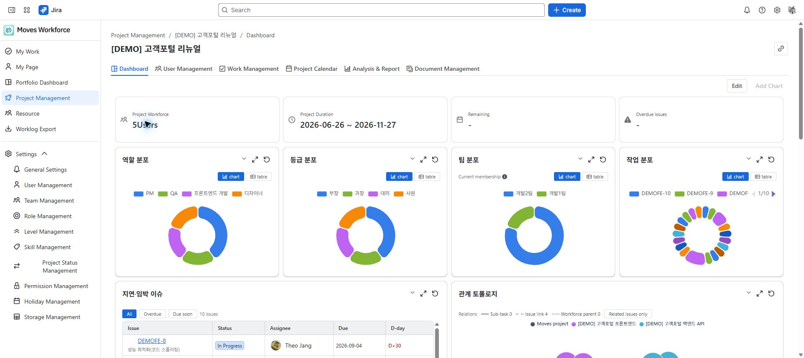

# 프로젝트 대시보드

[가이드 홈](codex-experiences--index.md) · [English](../en/codex-experiences--project-dashboard.md)

> 검토 초안: 2026-10-04 지정된 staging의 영어 화면을 촬영했습니다. 화면 이미지는 한·영 가이드가 공통으로 사용합니다. 배포 버전과 역할별 접근·저장 동작은 아직 검증 중입니다.

프로젝트 대시보드는 한 프로젝트의 요약과 차트를 모아 보는 화면입니다. 팀 회의에서 반복해서 확인할 지표를 배치할 때 사용합니다.

## 필요한 권한

대시보드 읽기로 조회하고, 대시보드 쓰기로 위젯과 배치를 편집합니다. 분석 위젯에는 리포트 읽기, 비용 정보에는 비용 읽기가 추가로 필요합니다. 일부 금액 위젯은 급여 정책에 따라서도 표시가 달라집니다.

## 대시보드 구성하기

1. 프로젝트 상세의 **대시보드**를 엽니다.
2. 요약 지표와 기존 위젯을 확인합니다.
3. 편집 권한이 있으면 편집 모드에서 차트 추가를 엽니다.
4. 회의 목적에 맞는 위젯을 선택하고 위치와 크기를 조정합니다.
5. 저장한 뒤 조회 상태에서 배치와 필터를 확인합니다.

처음에는 작업 상태, 계획 대비 실적, 진척 추이처럼 의사결정에 필요한 위젯부터 선택합니다. 데이터가 없는 위젯은 이슈 연결·추정 시간·워크로그가 준비됐는지 확인하세요.

## 지표를 해석하기 전에

| 확인 사항 | 이유 |
|---|---|
| 프로젝트·기간·필터 | 같은 이름의 지표도 대상이 다르면 결과가 달라짐 |
| 비용 권한·급여 정책 | 숨겨진 금액을 0원으로 해석하면 안 됨 |
| 계획 작업량 | 진척과 계획 대비 지표의 기준이 됨 |
| 위젯 설명 | 집계 방식과 대상 범위를 확인할 수 있음 |

사용자 지정 필터 위젯은 담당자·상태·타입 등 조건에 맞는 이슈를 모읍니다. 결과가 적으면 조건을 하나씩 해제해 원인을 찾습니다.

예시 프로젝트 대시보드의 인력·기간 요약과 분포 위젯.

상세 해석은 [분석 및 리포트](codex-experiences--analytics.md), 여러 프로젝트 비교는 [통합 대시보드](codex-experiences--portfolio.md)를 사용합니다.

<!-- control-reference:start -->

## 버튼·입력 항목과 처리 결과 상세

프로젝트 대시보드는 위젯의 데이터와 배치 설정을 관리합니다. 차트 삭제는 원본 이슈나 워크로그 삭제와 다릅니다.

| 버튼·입력 항목 | 기능·사용 조건·변경 대상 | 결과 확인과 문제 대응 |
|---|---|---|
| 편집·편집 완료 | 편집 모드에서 위젯 위치·크기를 바꾸고 완료 동작으로 변경 레이아웃을 저장합니다. 저장은 해당 프로젝트 대시보드 구성입니다. | 저장 성공 안내와 다시 연 화면의 배치를 확인합니다. 단순히 화면에서 옮긴 상태와 저장 완료를 구분합니다. |
| 차트 추가: 추천·사용자 지정·모두 추가 | 추천 구성을 선택하거나 데이터·차트 유형·이름을 지정합니다. 모두 추가는 현재 권한으로 볼 수 있는 위젯을 추가하고 기존 위젯은 건너뜁니다. | 권한 없는 비용 위젯이 추가되지 않는 것을 오류로 판단하지 않습니다. Heavy 표시는 많은 이슈에서 조회 비용이 큰 위젯입니다. |
| 차트 이름·필터 편집 | 해당 위젯의 이름과 담당자·상태·유형·우선순위·기한·계획 공수 등의 지원 조건을 저장합니다. | 조건 초기화와 저장을 구분합니다. 위젯마다 지원 필터가 다르며 같은 대시보드에서도 집계 대상이 달라질 수 있습니다. |
| 위젯 삭제 | 프로젝트 대시보드의 해당 차트 구성을 제거합니다. Jira 작업이나 급여·워크로그를 삭제하지 않습니다. | 필요하면 같은 위젯을 다시 추가합니다. 원래 이름·필터·배치는 다시 설정해야 할 수 있습니다. |
| 차트 확대·표 전환·툴팁 | 지원 위젯에서 자세히 보거나 차트와 표를 전환합니다. 툴팁은 값·단위·비교 대상을 확인하는 데 사용합니다. | 숫자를 비교하기 전 기간·필터·지표 계산 기준을 확인합니다. 빈 차트와 조회 실패 안내를 구분합니다. |
| 역할 분포 | 프로젝트 참여 인력을 역할(Role) 기준으로 분류하여 구성 비율을 확인합니다. | 위젯 제목·범례·단위를 확인합니다. 같은 프로젝트에서도 인원·작업 수·공수는 서로 다른 지표입니다. |
| 등급 분포 | 인력의 숙련도(Level)별 분포를 통해 팀의 기술 수준과 구성 균형을 파악합니다. | 위젯 제목·범례·단위를 확인합니다. 같은 프로젝트에서도 인원·작업 수·공수는 서로 다른 지표입니다. |
| 급여 분포 | 인건비 구간별 분포를 분석하여 비용 구조와 지출 편중 여부를 확인합니다. | 비용 읽기와 개인 금액을 허용하는 정책이 필요합니다. 등급 기반 정책에서는 개인 급여 분포 위젯을 추가할 수 없습니다. |
| 담당자 분포 | 이슈를 담당자 기준으로 분류하여 업무가 어떻게 분배되어 있는지 확인합니다. | 위젯 제목·범례·단위를 확인합니다. 같은 프로젝트에서도 인원·작업 수·공수는 서로 다른 지표입니다. |
| 작업 분포 | 이슈에 참여하고 있는 인원의 분포를 분석합니다. | 위젯 제목·범례·단위를 확인합니다. 같은 프로젝트에서도 인원·작업 수·공수는 서로 다른 지표입니다. |
| 워크로그 | 이슈 상태 또는 기간 기준으로 작업량의 집중도를 분석합니다. | 위젯 제목·범례·단위를 확인합니다. 같은 프로젝트에서도 인원·작업 수·공수는 서로 다른 지표입니다. |
| 팀 분포 | 프로젝트 참여 인력을 소속 팀 기준으로 분류하여 어느 팀이 얼마나 투입됐는지 확인합니다. | 위젯 제목·범례·단위를 확인합니다. 같은 프로젝트에서도 인원·작업 수·공수는 서로 다른 지표입니다. |
| 상태별 분포 | 이슈를 완료/진행 중/할 일로 나눠 현재 진척 구성을 확인합니다. 건수 기준과 공수 기준을 전환할 수 있습니다. | 위젯 제목·범례·단위를 확인합니다. 같은 프로젝트에서도 인원·작업 수·공수는 서로 다른 지표입니다. |
| 계획 대비 실적 | 계획 공수(MD) 합계와 실제 투입 공수를 비교해 과소·과대 산정을 확인합니다. | 보고서 읽기가 필요합니다. 1MD의 근무시간 기준과 계획 미입력을 확인합니다. |
| 관계 토폴로지 | 프로젝트에 연결된 이슈와 하위 이슈·연결 이슈·워크포스 상위 관계를 관계망으로 봅니다. 원 크기는 투입 시간이라 비용이 큰 이슈가 눈에 띕니다. | 프로젝트 읽기가 필요합니다. 표시된 연결 유형을 확인하고 관계 편집은 작업 관리에서 수행합니다. |
| 지연·임박 이슈 | 기한이 지났거나 곧 마감인 미완료 이슈를 목록으로 보여줍니다. 위험한 순서대로 정렬됩니다. | 위젯 제목·범례·단위를 확인합니다. 같은 프로젝트에서도 인원·작업 수·공수는 서로 다른 지표입니다. |
| 이슈 규모 | 어느 이슈가 가장 큰 작업량을 차지하는지 면적으로 비교합니다. 실투입과 계획을 전환할 수 있습니다. | 위젯 제목·범례·단위를 확인합니다. 같은 프로젝트에서도 인원·작업 수·공수는 서로 다른 지표입니다. |
| 진척 추이 | 계획 누적 공수와 실제 누적 공수를 시간축으로 비교합니다(S-curve). 진척도 탭과 같은 데이터를 씁니다. | 보고서 읽기가 필요합니다. 프로젝트 기간·계획을 확인하며 완료 산출물 비율과 누적 투입을 구분합니다. |
| 비용 소진 | 월별 누적 인건비와 예산선을 비교해 소진 속도를 확인합니다. 비용 탭과 같은 데이터를 씁니다. | 비용 읽기가 필요합니다. 월별 추정 원가이며 회계 지급 내역과 구분합니다. |
| 커스텀 필터 | 담당자·상태·타입·우선순위·기한·산정 조건을 직접 지정해 원하는 이슈만 모아 봅니다. | 위젯 제목·범례·단위를 확인합니다. 같은 프로젝트에서도 인원·작업 수·공수는 서로 다른 지표입니다. |

<!-- control-reference:end -->

