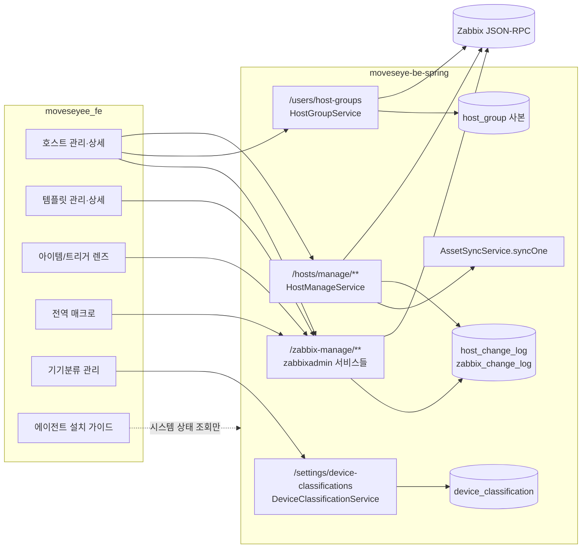

# Zabbix 구성 관리 기능 상세 가이드

> 이 영역은 관리자가 MovesEye 화면에서 "무엇을 감시할 것인가"를 정의하는 쓰기 기능 묶음이다. 호스트·호스트 그룹·템플릿·아이템·트리거·LLD(로우 레벨 디스커버리)·매크로를 Zabbix에 등록·수정·삭제하고, 그 정의가 어디서 와서 어디로 퍼졌는지(전파)를 확인한다. 기기분류 관리, 에이전트 설치 가이드, 구 주소 리다이렉트도 여기서 다룬다. 알림(액션·미디어 타입·사용자 미디어), 점검 기간, 스크립트, 네트워크 디스커버리, 사용자 관리, 구성 현황 대시보드, 모니터링 커버리지는 "Zabbix 운영 관리" 문서의 범위다. 이 문서는 BE `e55948c`·FE `9dfcbe8` 소스를 정적으로 대조해 작성했고, 빌드·서버 기동·Zabbix 호출은 하지 않았다.

## 1. 한눈에 보기

| 기능 | 화면 주소·메뉴 위치 | 상태 | 권한·라이선스 | 한 줄 설명 |
|---|---|---|---|---|
| 호스트 목록·등록·수정·삭제 | `/zabbix-management/host-management` (사이드바 Zabbix 관리 > 호스트 관리, `?tab=host`) | 현재 | 관리자 전용 · 라이선스 게이트 없음 | Zabbix 호스트를 만들고 그룹·Agent 인터페이스·템플릿·프록시·분류·태그·상태를 관리한다 |
| 호스트 상세 드릴다운 | `/zabbix-management/host-management/:hostid?tab=info\|item\|trigger\|discovery\|macro` | 현재 | 관리자 전용 | 호스트 하나를 컨테이너로 삼아 정보·아이템·트리거·LLD·매크로를 탭으로 관리한다 |
| 호스트 그룹 관리 | `/zabbix-management/host-management?tab=group` | 현재 | 조회는 로그인 사용자, 쓰기는 관리자 | 호스트 그룹 생성·이름 변경·소속 호스트 지정·삭제 |
| 분류(device_type)·태그·일괄 분류 | 호스트 등록/수정 폼, 호스트 목록의 선택 막대 | 현재 | 관리자 전용 | 호스트 태그 `device_type`과 임의 태그를 관리하고 여러 호스트의 분류를 한 번에 바꾼다 |
| 템플릿 목록·상세·연결/해제 | `/zabbix-management/template-management`, `/:templateid?tab=…` | 현재 | 관리자 전용 | 템플릿 CRUD와 호스트 연결(link)·해제(unlink)·해제+삭제(clear) |
| 템플릿 그룹 관리 | `/zabbix-management/template-management?tab=template-group` | 현재 | 관리자 전용 | 템플릿 그룹 CRUD |
| 아이템 관리(컨테이너 탭) + 키 선택 | 호스트/템플릿 상세의 아이템 탭 | 부분 | 관리자 전용 | 아이템 CRUD·활성 전환. 유형별 세부 필드는 폼에 없다(4절 ZCF-09) |
| 트리거 관리(컨테이너 탭) | 호스트/템플릿 상세의 트리거 탭 | 부분 | 관리자 전용 | 표현식·심각도·복구 조건 CRUD. 태그·의존성 편집은 없다 |
| LLD 규칙·프로토타입 | 호스트/템플릿 상세의 디스커버리 탭 → 규칙 상세 드로어 | 현재 | 관리자 전용 | 규칙 CRUD·지금 실행, 프로토타입 4종(아이템·트리거·그래프·호스트) CRUD, 실제 생성물 조회 |
| 매크로 관리 | `/zabbix-management/macro-management`(전역), 호스트/템플릿 상세의 매크로 탭 | 현재 | 관리자 전용 | 전역·호스트·템플릿 매크로 CRUD, 상속 계산, 비밀 값 유지 규칙 |
| 아이템 렌즈 / 트리거 렌즈 | `/zabbix-management/item-lens`, `/zabbix-management/trigger-lens` (사이드바 Zabbix 관리 > 아이템 관리 / 트리거 관리) | 현재 | 관리자 전용 | 호스트·템플릿을 가로질러 아이템·트리거를 찾고 정의처·전파 대상 수를 본다 |
| 에이전트 설치 가이드 | `/zabbix-management/agent-install-guide` (메뉴 없음, 호스트 목록 버튼·등록 결과 화면에서 진입) | 현재 | 관리자 전용 | OS별 Zabbix 에이전트 설치 명령을 만들어 보여 준다(FE 전용) |
| 기기분류 관리 | `/setting/device-classification` (관리 콘솔 ⚙) | 현재 | 목록 조회는 로그인 사용자, 변경은 관리자 | 분류 코드의 표시명·색·순서·활성 여부·상각 기본값 관리 |
| 구성 변경 이력(감사 로그) | 전용 화면 없음. API `GET /zabbix-manage/change-logs` | 부분 | 관리자 전용 | 쓰기 성공 시 DB에 기록. 조회는 AI 어시스턴트 도구와 구성 현황 추이만 쓴다 |
| 구 주소 리다이렉트 | `/zabbix-management/configuration`, `/item-template-management`, `/trigger-management`, `/setting/host-management` 등 | 현재 | — | 옛 북마크를 새 드릴다운 주소로 보낸다 |
| 아이템 테스트 실행, 템플릿 가져오기/내보내기, 호스트 대량 수정 | 없음 | 계획 | — | 코드에 구현이 없다(엔진 `ZabbixMethod`에 해당 메서드 없음) |

### 영역 전체 구조

모든 화면이 같은 틀을 따른다. FE 페이지가 TanStack Query 훅으로 `services/*.api.ts`를 부르고, BE 컨트롤러는 첫 줄에서 관리자 여부를 검사한 뒤 서비스로 넘긴다. 서비스는 **서비스 계정 토큰**(`ZabbixUserService.getSuperAdminToken()`)으로 Zabbix JSON-RPC를 호출하고, 쓰기가 성공하면 감사 로그 한 줄을 MovesEye DB에 남긴다. 구성 데이터 자체는 MovesEye DB에 저장하지 않는다(Zabbix가 정본). 예외는 둘이다. 호스트 그룹은 로컬 테이블 `host_group`에 사본을 두고, 기기분류는 메타 정보를 `device_classification` 테이블에 둔다.

## 2. 기능별 상세

### 2.1 호스트 목록·등록·수정·삭제

**무엇을 하는가** — 감시 대상 장비(호스트)를 Zabbix에 등록하고 유지한다. 새 장비를 붙일 때, 장비의 IP·그룹·템플릿을 바꿀 때, 잠시 감시를 끌 때, 장비를 폐기할 때 쓴다.

**화면과 진입 경로**

- 사이드바 Zabbix 관리 > 호스트 관리. 통합 검색(헤더)에서도 "호스트 관리"로 찾을 수 있다.
- 주소 `/zabbix-management/host-management`. 탭은 `?tab=dashboard`(구성 현황 영역의 호스트 대시보드), `?tab=host`(기본), `?tab=group`.
- 목록 상태는 URL 쿼리에 있다: `keyword`, 그룹 ID 목록, 템플릿 ID 목록, `status`, 분류, `offset`, `limit`. 주소를 공유하면 같은 필터가 열린다.
- 호스트명을 누르면 상세 드릴다운(2.2)으로 간다. 아이템·트리거·디스커버리 개수를 누르면 상세의 해당 탭으로 바로 간다. 템플릿 칩을 누르면 템플릿 상세로 간다.

**사용 방법**

1. **등록**: [호스트 등록]을 누른다. 드로어에서 아래를 입력한다.
   - 기술명(host): 영숫자·점·하이픈·밑줄·공백만 허용한다. 대상 서버 `zabbix_agent.conf`의 `Hostname`과 같아야 한다.
   - 표시명(name): 비우면 기술명과 같게 저장된다. 한글을 쓸 수 있다.
   - 그룹: 기존 그룹을 고르거나, 검색어를 입력해 "새 그룹 생성" 항목을 고른다. 하나 이상 필수다.
   - 인터페이스: IP 또는 DNS, 포트(기본 `10050`). **Agent 유형 1개만** 입력받는다. 주소를 비우면 인터페이스 없이 등록된다.
   - 템플릿: 검색해서 여러 개 고른다(검색 결과 상한 50).
   - 모니터링 주체: 서버 또는 프록시. 프록시면 프록시 선택이 필수다.
   - 분류: 기기분류 목록에서 하나. 기본은 "분류되지 않음".
   - 태그: 키·값 쌍을 자유롭게 추가한다. `device_type` 키는 여기서 쓰지 않는다(분류 선택으로만 관리).
   - 활성 여부 스위치.
2. 저장하면 드로어가 결과 화면으로 바뀌고 ping·agent 라이브체크를 자동 실행한다. agent가 닿지 않으면 문제 해결 안내와 [에이전트 설치 가이드] 버튼이 나온다.
3. **수정**: 목록의 [수정] 또는 상세 정보 탭의 [수정]. 같은 폼이 현재 값으로 채워진다. 연결을 뺀 템플릿마다 "연결만 해제"와 "해제하고 데이터 삭제" 중 하나를 고른다. 후자를 고르면 경고가 표시된다.
4. **활성/비활성**: 목록 행의 스위치 또는 상세 정보 탭.
5. **삭제**: [삭제]를 누르고 확인 창에 호스트의 기술명 또는 표시명을 정확히 입력해야 버튼이 켜진다. 서버가 같은 이름을 다시 검사한다.
6. **분류 일괄 지정**: 목록에서 행을 선택하면 막대가 나타난다. 분류를 고르고 [적용]. 일부만 성공하면 실패 건만 선택이 유지된다.

화면에 보이는 값: "Agent" 열은 기본 Agent 인터페이스의 가용 상태(`available` 0=알 수 없음, 1=사용 가능, 2=사용 불가), "프록시" 열은 `monitored_by`(0=서버, 1=프록시, 2=프록시 그룹)와 프록시 이름이다.

**동작 원리**

- FE: `HostTab.tsx`(목록) → `useHostList` → `GET /hosts/manage`. 폼은 `HostFormDrawer.tsx`, 삭제는 `HostDeleteModal.tsx`, 결과 화면은 `HostCreateResultStep.tsx`(`GET /hosts/{hostid}/livecheck` 재사용).
- BE: `HostManageController` → `HostManageService`.
  - **목록**: `host.get`을 `selectHostGroups`·`selectInterfaces`·`selectParentTemplates`·`selectTags`와 `selectItems/Triggers/Discoveries: "count"`로 호출한다. Zabbix에 `limit`을 주지 않고 조건에 맞는 호스트 전부를 받은 뒤 앱 메모리에서 `offset`/`limit`으로 자른다. 페이지 크기는 기본 20, 최대 200으로 고정된다. 호출마다 `proxy.get`으로 프록시 이름 맵을 만든다.
  - **검색**: 검색어가 있으면 기술명과 표시명을 `searchByAny`로 함께 찾는다. 이때 상태 필터는 Zabbix가 아니라 Java에서 거른다(`searchByAny`가 `filter`까지 OR로 묶기 때문).
  - **생성**: 입력 검증 → 새 그룹 즉석 생성(`HostGroupService.createHostGroup`) → 이름 중복 선검사(`host.get filter`) → `host.create` → 감사 로그 → 자산 스냅샷 단건 동기화(`AssetSyncService.syncOne`) → 단건 재조회 응답.
  - **수정**: 현재 호스트 조회 → `host.update`. `groups`·`templates`·`tags`·`interfaces`는 Zabbix가 **보낸 배열로 통째 교체**한다. 폼이 현재 값을 전부 되돌려 보내는 것을 전제로 한다. `tags`를 아예 보내지 않으면(null) 기존 태그가 유지되고 빈 배열이면 전부 지워진다. 인터페이스는 기존 "기본 Agent 인터페이스"의 `interfaceid`를 붙여 제자리 수정한다. `templates_clear`에 담긴 템플릿은 해당 아이템과 수집 데이터까지 지운다.
  - **중복 이름**: 생성·수정 전에 기술명, 그리고 기술명과 다른 표시명을 각각 조회해 겹치면 `HOST_DUPLICATE_NAME`과 기존 호스트 정보를 돌려준다. 폼은 해당 입력란에 "이미 있는 호스트"를 표시한다. 선검사 뒤 Zabbix가 "already exists"로 거부한 경우도 같은 코드로 바꾼다.
  - **삭제**: 현재 호스트의 기술명·표시명과 `confirmName`이 일치할 때만 `host.delete`. 연결된 자산 레코드는 건드리지 않는다.
  - **일괄 분류**: 호스트마다 현재 태그 조회 → `device_type` 태그만 교체 → `host.update` → 감사 로그 → 자산 동기화를 순서대로 반복한다. 실패한 호스트는 사유와 함께 모아 돌려준다.
- 이 서비스의 인벤토리 갱신 메서드(`updateInventoryLocation`, `updateInventoryFields`, `updateFromAsset`)는 지도·자산 화면이 부르는 쓰기 경로다. 넘어온 필드만 `host.update`에 싣고, 태그는 현재 값을 읽어 병합한다.

**주요 API**

| Method | Path | 용도 | 권한 |
|---|---|---|---|
| GET | `/hosts/manage` | 목록(`keyword`, `groupids`, `templateids`, `status`, `limit`≤200, `offset`) | 관리자 |
| GET | `/hosts/manage/{hostid}` | 단건(상세 드릴다운·새로고침 진입) | 관리자 |
| POST | `/hosts/manage` | 생성 | 관리자 |
| PUT | `/hosts/manage/{hostid}` | 수정(`clearTemplateIds` 포함) | 관리자 |
| PATCH | `/hosts/manage/{hostid}/status` | 활성/비활성 | 관리자 |
| PATCH | `/hosts/manage/device-type` | 분류 일괄 변경(부분 실패 허용) | 관리자 |
| DELETE | `/hosts/manage/{hostid}` | 영구 삭제(body `confirmName`) | 관리자 |
| GET | `/hosts/manage/templates` | 템플릿 검색(표시명 부분일치, `limit`) | 관리자 |
| GET | `/hosts/manage/proxies` | 프록시 목록 | 관리자 |

**데이터** — `host_change_log`(Flyway V11, V26에서 `origin`·`origin_ref` 추가). 컬럼: `zabbix_hostid`, `host_name`, `action`(CREATE/UPDATE/ENABLE/DISABLE/DELETE), `payload`(JSONB 요청 요약), `actor`, `origin`(UI/AI), `created_at`. 보존·정리 규칙은 코드에 없다.

**권한·라이선스** — 사이드바는 `userRole`이 ADMIN/SUPER_ADMIN일 때만 메뉴를 보인다. 라우트 가드(`PageWrapper adminOnly`)는 비관리자에게 404를 보인다. BE는 모든 메서드 첫 줄에서 `AdminAccessChecker.requireAdmin`으로 같은 축을 강제한다. 거부 응답은 HTTP 200에 body `code: 403`이다. Zabbix 호출은 서비스 계정 토큰을 쓰므로 호스트 그룹 단위 데이터 범위는 적용되지 않는다(관리자는 전체를 본다).

**빈 값·실패·경계 상태**

- 없는 `hostid`로 상세에 들어가면 "호스트를 찾을 수 없습니다" 안내와 목록 버튼이 나온다.
- 기술명에 허용되지 않는 문자가 있으면 `HOST_INVALID_NAME`, 인터페이스를 보냈는데 주소가 비면 `HOST_INTERFACE_ADDRESS_REQUIRED`, 그룹이 없으면 `HOST_GROUP_REQUIRED`, 프록시 미지정이면 `HOST_PROXY_REQUIRED`, 분류 코드가 활성 목록에 없으면 `INVALID_DEVICE_TYPE`.
- 그 밖의 Zabbix 거부는 "실패" 문구 뒤에 Zabbix 원문을 괄호로 붙여 보여 준다.
- Zabbix 응답 대기 상한은 30초, 응답 크기 상한은 64MiB다(엔진 공통).

**운영 주의**

- 수정 폼은 Agent 인터페이스 1개만 다룬다. SNMP·IPMI·JMX 인터페이스가 있는 호스트는 이 폼으로 수정하지 않는다(4절 ZCF-01).
- 분류 필터는 서버 필터가 아니다. 현재 페이지에 로드된 행만 거른다.
- 그룹·템플릿 필터의 선택지는 현재 페이지에 로드된 호스트에서 모은 값이다.

### 2.2 호스트 상세 드릴다운

**무엇을 하는가** — 호스트 하나를 기준으로 그 호스트의 정보·아이템·트리거·LLD·매크로를 한 화면에서 관리한다. 템플릿 상세(2.5)와 탭 구성이 같다.

**화면과 진입 경로** — `/zabbix-management/host-management/:hostid`. 탭은 `?tab=info`(기본), `item`, `trigger`, `discovery`, `macro`. 탭을 바꾸면 그 탭의 목록 필터(`keyword`, `offset`, `status`, `severity`, 정의처 템플릿)가 초기화된다. 브레드크럼의 `:hostid` 자리는 호스트 표시명으로 바뀐다.

**동작 원리** — `HostDetailPage.tsx`가 `GET /hosts/manage/{hostid}`로 호스트를 받아 각 탭 컴포넌트에 `scope=host`, `targetId`, 기술명, 인터페이스 목록, 연결 템플릿 목록을 넘긴다. 탭 컴포넌트(`ItemManagementTab`, `TriggerManagementTab`, `DiscoveryManagementTab`, `HostMacroTab`)는 템플릿 상세에서도 그대로 쓰인다. 정보 탭(`HostInfoTab.tsx`)에는 수정·삭제·상태 전환·스크립트 실행 버튼과 인터페이스 표(유형·주소·기본 여부·가용성)가 있다.

### 2.3 호스트 그룹 관리

**무엇을 하는가** — 호스트 그룹을 만들고 이름을 바꾸고 소속 호스트를 지정하고 지운다. 호스트 그룹은 사용자 그룹 권한의 경계라서 소속을 바꾸면 그 장비를 볼 수 있는 사용자가 바뀐다.

**화면과 진입 경로** — 호스트 관리의 `?tab=group`. 호스트 등록 폼의 그룹 선택에서도 새 그룹을 즉석으로 만들 수 있다.

**사용 방법**

1. [그룹 생성] → 이름과 소속 호스트(선택)를 입력한다.
2. 행의 [수정] → 이름과 소속 호스트를 바꾼다.
3. 행을 선택해 삭제한다. 삭제하면 그 그룹만 가진 호스트가 생기는 경우 서버가 호스트 이름을 나열하며 거부한다.

**동작 원리**

- 목록·상세는 **MovesEye DB의 `host_group` 사본**을 읽는다(`HostGroupService.listHostGroups`, `getHostGroupById`). 사본에는 그룹명, Zabbix `groupid`, 소속 호스트 목록(JSON)이 들어 있다.
- 사본은 "Zabbix 미러 동기화"(사용자 관리 화면의 동기화 버튼 `POST /users/sync`, 또는 `app.sync.enabled=true`일 때의 주기 실행)가 통째로 다시 만든다. 주기 실행의 기본값은 꺼짐이다.
- 생성: 사본에 같은 이름이 있으면 `HOST_GROUP_EXISTED`. 없으면 `hostgroup.create` → 호스트가 지정됐으면 `hostgroup.massadd` → 사본에 행 추가. 사본 저장이 실패하면 방금 만든 Zabbix 그룹을 지운다.
- 수정: `hostgroup.update`(이름) → 호스트 목록이 비어 있지 않으면 `hostgroup.massupdate`(그룹의 소속 호스트를 보낸 목록으로 교체) → 소속 잠금을 잡은 뒤 사본 갱신.
- 삭제: 사본 기준으로 "삭제 후 그룹이 없는 호스트"를 계산해 있으면 거부 → `hostgroup.delete` → 사본 삭제.
- 수정 모달(`HostGroupDetailModal.tsx`)의 소속 호스트 선택지는 `GET /users/hosts`(Zabbix 실시간)에서 오고, 미리 채워지는 값은 사본에서 온다.

**주요 API**

| Method | Path | 용도 | 권한 |
|---|---|---|---|
| GET | `/users/host-groups` | 목록(사본, `keyword`·정렬·페이지) | 로그인 사용자 |
| GET | `/users/host-groups/{id}` | 단건(사본) | 로그인 사용자 |
| POST | `/users/host-groups` | 생성 | 관리자 |
| PUT | `/users/host-groups/{id}` | 이름·소속 호스트 수정 | 관리자 |
| DELETE | `/users/host-groups` | 다건 삭제(body `ids`) | 관리자 |
| GET | `/users/hosts` | 호스트 선택지 | 로그인 사용자 |

**데이터** — `host_group`(로컬 사본). 동기화가 행을 전부 지우고 다시 넣으므로 로컬 `id`는 동기화마다 바뀔 수 있다. 그룹 변경에 대한 감사 로그는 남지 않는다.

**운영 주의** — 사본이 Zabbix와 어긋난 상태에서 그룹을 수정하면 소속이 사본 기준으로 덮인다(4절 ZCF-02). 그룹을 수정하기 전에 동기화를 먼저 실행한다.

### 2.4 분류(device_type)·태그

**무엇을 하는가** — 호스트를 서버·네트워크·보안 같은 분류로 나누고, 운영에 필요한 임의 태그를 붙인다. 분류는 모니터링·자산·비용 화면의 묶음 기준이다.

**동작 원리**

- 분류의 정본은 **Zabbix 호스트 태그 `device_type`의 값**이다. 읽을 때는 `DeviceTypeResolver`가 `device_type` 태그가 정확히 1개이고 그 값이 활성 분류 코드 중 하나(대소문자 무시)일 때만 그 코드를 돌려준다. 태그가 없거나 2개 이상이거나 값이 활성 코드가 아니면 `notClassified`다.
- 쓸 때는 요청의 `tags`에서 `device_type`을 모두 걷어 내고, `deviceType`이 활성 코드이면서 `notClassified`가 아니면 `device_type` 태그 1개를 붙인다.
- 폼은 분류를 선택 상자로만, 나머지 태그를 키·값 목록으로 다룬다. 수정 시 폼은 `device_type`을 뺀 전체 태그를 항상 배열로 되돌려 보낸다.
- 활성 코드 집합은 `DeviceClassificationRegistry`가 60초 동안 메모리에 캐시한다(2.11).

### 2.5 템플릿 관리(목록·상세·연결/해제)

**무엇을 하는가** — 여러 호스트가 공유하는 수집 구성(아이템·트리거·LLD·매크로 묶음)을 관리하고, 어떤 호스트에 적용할지 정한다.

**화면과 진입 경로**

- 사이드바 Zabbix 관리 > 템플릿 관리. 주소 `/zabbix-management/template-management`. 탭 `?tab=dashboard`(구성 현황 영역), `template`(기본), `template-group`.
- 템플릿을 누르면 `/zabbix-management/template-management/:templateid`. 탭은 호스트 상세와 같은 `info`, `item`, `trigger`, `discovery`, `macro`.

**사용 방법**

1. 목록에서 검색어(기술명 부분일치)와 템플릿 그룹으로 좁힌다. 행에 아이템 수·트리거 수·연결 호스트 수가 보인다.
2. [템플릿 생성]: 기술명, 표시명(선택), 템플릿 그룹(1개 이상 필수), 설명, 상속할 부모 템플릿(선택).
3. 상세 정보 탭에서 수정·삭제한다. 수정으로 바꿀 수 있는 것은 기술명·표시명·설명·소속 그룹이다. 부모 템플릿 연결은 생성 때만 지정한다.
4. 상세 정보 탭의 "호스트 연결"에서 호스트를 검색해 연결한다(검색 결과 상한 50).
5. "연결된 호스트" 목록에서 호스트별로 해제한다. "해제하면서 데이터 삭제" 체크 여부에 따라 동작이 갈린다.
6. 삭제는 확인 체크 후 실행한다. 연결된 호스트가 있으면 그 호스트에서 템플릿이 만든 아이템이 함께 제거된다는 경고가 나온다.

**동작 원리** — `ZabbixTemplateManageService`.

- 목록: `template.get`에 `selectItems/Triggers/Hosts: "count"`를 붙여 조건에 맞는 템플릿 전부를 받고 메모리에서 자른다.
- 상세: `selectHosts`로 연결된 호스트 **전체**(id·이름)와 부모 템플릿을 받는다.
- 연결: `host.massadd`로 각 호스트에 이 템플릿을 **추가**한다(기존 연결 유지). `template.massadd`는 호스트 파라미터를 받지 않아 쓰지 않는다.
- 해제(데이터 유지): `host.massremove{hostids, templateids}`.
- 해제+삭제(clear): 호스트마다 `host.update{templates_clear}`를 순서대로 호출한다.
- 수정: 값이 있는 필드만 보낸다. 그룹 목록을 주면 그 집합으로 교체된다.

**주요 API**

| Method | Path | 용도 | 권한 |
|---|---|---|---|
| GET | `/zabbix-manage/templates` | 목록(`search`, `groupids`, `limit`≤200, `offset`) | 관리자 |
| GET | `/zabbix-manage/templates/{templateid}` | 상세(연결 호스트·부모 템플릿) | 관리자 |
| POST | `/zabbix-manage/templates` | 생성 | 관리자 |
| PUT | `/zabbix-manage/templates/{templateid}` | 수정(부분) | 관리자 |
| DELETE | `/zabbix-manage/templates` | 다건 삭제 | 관리자 |
| POST | `/zabbix-manage/templates/{templateid}/link` | 호스트 연결(body `hostIds`) | 관리자 |
| POST | `/zabbix-manage/templates/{templateid}/unlink` | 호스트 해제(body `hostIds`, `clear`) | 관리자 |
| GET | `/zabbix-manage/template-groups` | 폼 선택지용 템플릿 그룹 검색 | 관리자 |

**데이터** — `zabbix_change_log`(V12, V26)에 `entity_type=TEMPLATE`, `action`은 CREATE/UPDATE/DELETE/LINK/UNLINK. LINK/UNLINK의 `payload`에 `hostIds`(와 `clear`)가 들어간다.

**빈 값·실패·경계 상태** — 없는 템플릿은 `TEMPLATE_NOT_FOUND`. 호스트 ID가 비면 `TEMPLATE_HOST_IDS_REQUIRED`. Zabbix의 검증 거부(-32602)는 HTTP 200 + `code: 400` + Zabbix 원문으로 나오고 화면이 그 문장을 그대로 보여 준다.

### 2.6 템플릿 그룹 관리

템플릿 관리의 `?tab=template-group`. 목록은 그룹명과 포함 템플릿 수(`selectTemplates: "count"`)를 보여 주고, 개수를 누르면 포함 템플릿을 읽기 전용 드로어로 본다. 생성·이름 수정·다건 삭제를 지원한다. 템플릿이 남아 있는 그룹이나 어떤 템플릿의 마지막 그룹은 Zabbix가 삭제를 거부하고, 화면은 Zabbix 원문을 보여 준다. API는 `GET /zabbix-manage/template-groups/list`, `GET/PUT /zabbix-manage/template-groups/{groupid}`, `POST`·`DELETE /zabbix-manage/template-groups`이며 모두 관리자 전용이다. 감사 로그는 `entity_type=TEMPLATE_GROUP`.

### 2.7 아이템 관리(컨테이너 탭)와 키 선택

**무엇을 하는가** — 호스트 또는 템플릿에 수집 항목(아이템)을 만들고 고치고 끄고 지운다.

**화면과 진입 경로** — 호스트/템플릿 상세의 `?tab=item`. 아이템 렌즈(2.10)의 [생성]·행 동작도 같은 폼과 모달을 쓴다. 목록 필터(`keyword`, `status`, 정의처 템플릿, `offset`, `limit`)는 URL 쿼리에 있다.

**사용 방법**

1. 목록에서 이름·키로 검색하고 상태로 거른다. 호스트 상세에서는 "정의처 템플릿"으로 그 템플릿에서 상속된 아이템만 볼 수 있다.
2. [아이템 생성]: 이름, 키, 유형(17종), 값 유형(5종), 수집 주기, 단위, 설명을 입력한다.
   - [키 선택]을 누르면 모달이 열린다. "이 대상의 기존 키" 탭은 같은 호스트/템플릿에 이미 등록된 키를, "키 카탈로그" 탭은 FE에 내장된 Zabbix 7.0 키 목록(약 270개, 유형별 필터·검색)을 보여 준다. 키를 고르면 그 키에 맞는 유형도 함께 채워진다.
   - 호스트에 만들 때 인터페이스가 필요한 유형(Zabbix agent, 단순 검사, IPMI, SSH, Telnet, JMX, SNMP agent)이면 인터페이스 선택이 나온다. 기본값은 "기본(main)" 인터페이스 중 유형 번호가 가장 작은 것이다.
   - 종속 아이템(유형 18)이면 마스터 아이템을 고른다(같은 대상의 아이템 중 이름순 상위 50개).
   - 수집 주기는 트래퍼·SNMP 트랩·종속 유형에서는 숨겨진다.
3. 행의 스위치로 활성/비활성을 바꾼다.
4. [수정]으로 이름·키·유형·값 유형·주기·단위·설명을 바꾼다.
5. 삭제는 경고와 확인 체크 후 실행한다. 여러 건을 선택해 한 번에 지울 수 있다.

화면 표시: "상속" 태그는 템플릿에서 내려온 아이템(`templateid ≠ 0`), "디스커버리" 표시는 LLD가 만든 아이템(`flags = 4`)이다. 상속 아이템은 수정·삭제 버튼이 비활성이고 상태 스위치만 쓸 수 있다. LLD가 만든 아이템은 상태 스위치가 비활성이다.

**동작 원리** — `ZabbixItemManageService`.

- 목록은 `hostid` 또는 `templateid` 중 하나가 반드시 있어야 한다. 둘 다 없으면 `ITEM_TARGET_REQUIRED`로 거부한다(전 호스트 아이템 전량 조회 차단).
- 대상의 아이템 전부를 `item.get`으로 받아 메모리에서 페이지를 자른다. 호스트 범위에서는 페이지에 든 상속 아이템의 정의처 템플릿을 `ZabbixSourceTraceHelper`로 역추적한다(부모 아이템을 깊이마다 1회 조회, 최대 5단계).
- 생성: `item.create`에 `hostid`(호스트든 템플릿이든 같은 파라미터), `name`, `key_`, `type`, `value_type`와 선택 필드(`delay`, `units`, `description`, `master_itemid`, `interfaceid`)를 보낸다. 인터페이스를 지정하지 않았고 호스트 대상이며 인터페이스가 필요한 유형이면 "기본 Agent 인터페이스 → 없으면 첫 인터페이스"를 자동으로 고른다.
- 수정: 비어 있지 않은 필드만 `item.update`에 싣는다.
- 삭제: `item.delete`에 ID 목록을 한 번에 넘긴다.

**주요 API**

| Method | Path | 용도 | 권한 |
|---|---|---|---|
| GET | `/zabbix-manage/items` | 목록(`hostid`\|`templateid` 필수, `sourceTemplateId`, `search`, `status`, `limit`≤200, `offset`) | 관리자 |
| GET | `/zabbix-manage/items/keys` | 대상의 기존 키 목록(`search`, `limit` 기본 50·최대 200) | 관리자 |
| GET | `/zabbix-manage/items/{itemid}` | 단건 | 관리자 |
| POST | `/zabbix-manage/items` | 생성 | 관리자 |
| PUT | `/zabbix-manage/items/{itemid}` | 수정(부분) | 관리자 |
| PATCH | `/zabbix-manage/items/{itemid}/status` | 활성/비활성 | 관리자 |
| DELETE | `/zabbix-manage/items` | 다건 삭제(body `itemIds`) | 관리자 |

**데이터** — `zabbix_change_log`에 `entity_type=ITEM`. 생성 `payload`에는 `target`(대상 ID)·이름·키·유형이, 삭제에는 `itemIds` 전체가 들어가고 `entity_id`에는 첫 번째 ID만 들어간다.

**운영 주의** — 이 폼에는 유형별 세부 필드(HTTP agent의 URL·헤더, SNMP OID, 계산식, 스크립트 본문, 사용자명·비밀번호)와 전처리·태그·보관 기간 입력이 없다. 그런 아이템은 LLD 프로토타입 폼(2.9)에는 있는 입력이므로 화면 간 기능 차이가 있다(4절 ZCF-09). 수정은 보낸 필드만 바꾸므로, Zabbix에서 만든 HTTP agent 아이템의 헤더·인증 정보는 이 화면에서 이름이나 주기를 고쳐도 그대로 유지된다.

### 2.8 트리거 관리(컨테이너 탭)

**무엇을 하는가** — 이상 판정 규칙(트리거)을 만들고 고치고 끄고 지운다. 알람 발생에 직접 영향을 준다.

**화면과 진입 경로** — 호스트/템플릿 상세의 `?tab=trigger`. 트리거 렌즈(2.10)도 같은 폼을 쓴다.

**사용 방법**

1. 목록에서 이름으로 검색하고 심각도·상태로 거른다. 표현식은 사람이 읽는 형태(`expandExpression`)로 보인다.
2. [트리거 생성]: 이름, 문제 조건식, 심각도(0~5), 복구 모드(조건식 재사용 / 별도 복구 조건식 / 복구 없음), 복구 조건식, 수동 종료 허용, 설명, 운영 데이터, URL, 활성 여부.
   - 조건식 입력 아래의 "아이템 키 참조"에서 키를 고르면 `last(/기술명/키)` 조각이 조건식 끝에 붙는다.
   - 조건식의 호스트 자리에는 표시명이 아니라 **기술명**을 쓴다.
3. 조건식 오류는 Zabbix 원문이 폼 위쪽 경고 상자에 그대로 표시된다.
4. 수정에서는 복구 조건식·설명·운영 데이터·URL을 빈 값으로 저장해 지울 수 있다.
5. 상속된 트리거는 수정·삭제·상태 전환·선택이 모두 비활성이다.

**동작 원리** — `ZabbixTriggerManageService`.

- 목록은 `hostid` 또는 `templateid`가 필수다(`TRIGGER_TARGET_REQUIRED`). 대상의 트리거 전부를 받아 메모리에서 자른다.
- 생성 시 `hostId`/`templateId`는 Zabbix로 보내지 않는다. **실제 생성 위치는 조건식 안의 `/호스트/키`가 결정한다.** 화면의 대상과 조건식의 호스트가 다르면 조건식 쪽에 만들어진다.
- 생성·수정에서 Zabbix가 거부하면 메시지를 `TRIGGER_EXPRESSION_INVALID: <Zabbix 원문>`으로 감싸 돌려준다.
- 삭제 대상에 상속 트리거가 하나라도 있으면 Zabbix가 전체를 거부한다.

**주요 API** — `GET /zabbix-manage/triggers`(`hostid`\|`templateid` 필수, `search`, `severity`, `status`), `GET /zabbix-manage/triggers/{triggerid}`(태그 포함 상세), `POST`, `PUT /{triggerid}`, `PATCH /{triggerid}/status`, `DELETE`(body `triggerIds`). 모두 관리자 전용.

**운영 주의** — 일반 트리거의 태그와 의존성(dependencies)은 조회만 되고(상세 응답의 `tags`) 편집 입력이 없다. 트리거 프로토타입(2.9)에서는 둘 다 편집할 수 있다.

### 2.9 LLD 규칙과 프로토타입

**무엇을 하는가** — 디스크·네트워크 인터페이스처럼 장비마다 개수가 다른 대상을 자동으로 찾아 아이템·트리거·그래프·호스트를 만들어 내는 규칙을 관리한다.

**화면과 진입 경로** — 호스트/템플릿 상세의 `?tab=discovery`. 규칙 행을 누르면 상세 드로어가 열리고 "정보", "프로토타입", "발견된 항목"을 본다. 전용 메뉴는 없다.

**사용 방법**

1. 규칙 목록: 이름·키·유형·주기·상태·수집 상태(오류 문구)·생성물 수(호스트 범위에서만)·정의처 템플릿.
2. [규칙 생성/수정]: 이름, 키, 유형(계산·SNMP 트랩 제외), 주기, 인터페이스, 마스터 아이템, 설명, 활성 여부, 유형별 필드(HTTP agent의 `url`·`timeout`·`status_codes`, SNMP의 `snmp_oid`, DB·SSH·Telnet·스크립트의 `params` 등), 그리고 네 개의 고급 탭.
   - **수명**: "더 이상 발견되지 않는 항목을 삭제"와 "비활성화"를 각각 `기간 경과 후(0)` / `하지 않음(1)` / `즉시(2)`로 고른다. 기간은 "기간 경과 후"일 때만 입력한다. 새 규칙의 기본값은 삭제 7일 후, 비활성화 하지 않음이다.
   - **필터**: 조건 목록과 평가 방식(AND/OR·AND·OR·사용자 수식).
   - **LLD 매크로 경로**, **전처리**, **오버라이드**.
3. [지금 실행]: 다음 주기를 기다리지 않고 규칙을 돌린다. 결과는 1~2분 안에 목록과 상세에 반영된다.
4. 프로토타입 탭: 아이템·트리거·그래프·호스트 프로토타입을 추가·수정·삭제한다. 그래프를 제외한 세 종류는 활성/비활성도 바꿀 수 있다.
   - 아이템 프로토타입의 키와 호스트 프로토타입의 기술명에는 `{#매크로}`가 반드시 들어가야 한다.
   - 아이템 프로토타입 폼에는 유형별 필드(HTTP 헤더 포함), 태그, 전처리, 보관 기간, "발견 시 생성 여부"가 있다.
   - 트리거 프로토타입 폼에는 태그와 의존성이 있다.
   - 호스트 프로토타입 폼에는 그룹 연결·그룹 프로토타입·템플릿·인벤토리 모드·태그·매크로·사용자 정의 인터페이스가 있다.
5. 발견된 항목 탭: 이 규칙이 실제로 만든 아이템·트리거·그래프·호스트를 종류별로 본다.

**동작 원리**

- `ZabbixLldManageService`(규칙)와 `ZabbixLldPrototypeManageService`(프로토타입).
- 규칙 상세는 `discoveryrule.get`을 `output: extend`로 받고 필터·매크로 경로·오버라이드·전처리를 함께 조회한다. 응답의 `raw` 필드에 Zabbix 원본 행 전체가 실린다.
- 규칙 수정에서 `filter`·`lld_macro_paths`·`overrides`·`preprocessing`은 **생략하면 유지, 보내면 통째 교체**다. 폼은 넷을 항상 전부 되돌려 보낸다. BE는 필터의 읽기 전용 필드(`eval_formula`, 사용자 수식이 아닐 때의 `formula`·`formulaid`)를 걷어 낸 뒤 전달한다.
- 상속된 규칙(`templateid ≠ 0`)은 수정·삭제를 BE가 `LLD_RULE_INHERITED`로 먼저 거부한다. 상태 전환은 허용한다.
- 폼은 상세가 "지금 편집 중인 규칙"으로 도착하기 전에는 저장을 막고, 편집 대상이 바뀌면 이전 값을 먼저 비운다.
- 호스트 프로토타입 매크로: 기존 비밀 매크로는 값을 새로 입력했을 때만 `value`를 보낸다. `hostmacroid`가 실려 있으면 Zabbix가 기존 매크로 갱신으로 처리해 값이 유지된다.
- 아이템 프로토타입의 인터페이스 자동 선택은 유형에 맞춘다: Zabbix agent→Agent, SNMP→SNMP, IPMI→IPMI, JMX→JMX. 맞는 유형의 인터페이스가 없으면 `LLD_PROTOTYPE_INTERFACE_MISSING`으로 거부한다.
- 생성물 수: 호스트당 한 번 `item.get(filter flags=4, selectDiscoveryRule)`을 불러 규칙별로 센다. 이 보조 조회가 실패하면 목록은 0으로 표시하고 계속 진행한다. 상세의 "발견된 아이템"은 같은 조회가 실패하면 오류를 그대로 돌려준다.
- 생성물 중 트리거·그래프·호스트는 `flags=4` 객체의 부모 프로토타입 ID가 이 규칙의 프로토타입에 속하는지로 가린다. 발견된 호스트는 `host.get(filter flags=4)`를 호스트 범위 없이 조회한 뒤 거른다.
- 지금 실행은 `task.create`(type 6)이다. 서버가 당겨 올 수 없는 유형(능동 에이전트·트래퍼)은 Zabbix가 거부한다.

**주요 API**

| Method | Path | 용도 | 권한 |
|---|---|---|---|
| GET | `/zabbix-manage/discovery-rules` | 목록(`hostid`\|`templateid` 필수) | 관리자 |
| GET | `/zabbix-manage/discovery-rules/{itemid}` | 상세(원본 `raw` 포함) | 관리자 |
| GET | `/zabbix-manage/discovery-rules/{itemid}/prototypes` | 프로토타입 4종 요약 | 관리자 |
| POST | `/zabbix-manage/discovery-rules/{itemid}/execute` | 지금 실행 | 관리자 |
| GET | `/zabbix-manage/discovery-rules/{itemid}/discovered` | 생성된 아이템(`limit` 1~200) | 관리자 |
| GET | `/zabbix-manage/discovery-rules/{itemid}/discovered/{kind}` | 생성된 트리거·그래프·호스트 | 관리자 |
| POST / PUT / PATCH status / DELETE | `/zabbix-manage/discovery-rules[/{itemid}[/status]]` | 규칙 CRUD | 관리자 |
| GET | `/zabbix-manage/discovery-rules/{ruleid}/prototypes/{kind}/{id}` | 프로토타입 원본(편집 폼 채움) | 관리자 |
| POST / PUT | `/zabbix-manage/discovery-rules/{ruleid}/prototypes/{items\|triggers\|graphs\|hosts}[/{id}]` | 프로토타입 생성·수정 | 관리자 |
| PATCH | `/zabbix-manage/discovery-rules/{ruleid}/prototypes/{kind}/{id}/status` | 프로토타입 활성/비활성(그래프 제외) | 관리자 |
| DELETE | `/zabbix-manage/discovery-rules/{ruleid}/prototypes/{kind}` | 프로토타입 다건 삭제(이 규칙 소속만) | 관리자 |

**데이터** — `zabbix_change_log`에 `LLD_RULE`(CREATE/UPDATE/ENABLE/DISABLE/DELETE/EXECUTE), `LLD_PROTOTYPE`(`payload`에 `kind`·`ruleid`). 규칙 수정 `payload`는 필터·오버라이드 본문 대신 변경 여부와 건수만 남긴다.

**운영 주의** — 규칙을 지우면 그 규칙이 만든 아이템·트리거·그래프·호스트가 함께 사라진다. 삭제 확인 창이 이를 안내한다.

### 2.10 매크로 관리

**무엇을 하는가** — `{$SNMP_COMMUNITY}` 같은 사용자 매크로를 전역·템플릿·호스트 단위로 관리한다. 템플릿의 임계값이나 접속 정보를 호스트마다 다르게 주는 수단이다.

**화면과 진입 경로**

- 전역 매크로: 사이드바 Zabbix 관리 > 매크로 관리, `/zabbix-management/macro-management`.
- 호스트/템플릿 매크로: 각 상세의 `?tab=macro`. 표 세 개가 나온다 — 직접 정의한 매크로, 상속된 매크로(템플릿별·단계별), 전역 매크로. 상속·전역 행의 [재정의]를 누르면 같은 이름의 매크로를 이 호스트/템플릿에 만드는 폼이 미리 채워져 열린다.

**사용 방법**

1. 이름은 `{$이름}` 또는 `{$이름:컨텍스트}` 형태이고 이름 부분은 대문자·숫자·밑줄·점만 쓴다.
2. 유형은 텍스트 또는 비밀. Vault 유형은 선택지에 없고, 이미 Vault로 저장된 매크로를 편집할 때만 표시된다.
3. 비밀 매크로를 수정할 때 값 칸을 비워 두면 기존 값이 유지된다. 비밀에서 텍스트로 바꾸면 값 입력이 필수다.
4. 같은 이름의 매크로가 여러 단계에 있으면 실제로 적용되는 것만 굵게 보이고, 더 가까운 단계에 덮인 것은 흐리게 표시된다.

**동작 원리** — `ZabbixMacroManageService`.

- 상속 계산은 Zabbix API에 없어서 BE가 한다. 순서는 호스트 자신 → 1단 템플릿(템플릿 ID 오름차순) → 2단 … → 전역이고, 같은 이름의 첫 등장이 "적용 중"이다. 템플릿 사슬은 최대 16단계까지 따라간다. 이름 비교는 문자열 그대로라서 `{$X}`와 `{$X:"a"}`는 다른 매크로다.
- 비밀 매크로의 값은 Zabbix가 돌려주지 않는다. 응답의 `value`는 null이다. 수정에서 현재도 비밀이고 새 유형도 비밀이며 값이 비어 있으면 `value`를 보내지 않는다.
- 같은 소유자 안에서 이름이 겹치면 `MACRO_DUPLICATE: <이름>`으로 거부한다.
- 호스트 매크로 삭제는 해당 호스트 소속 ID만 받는다. 다른 호스트의 ID가 섞이면 전부 거부한다.
- LLD가 만든 매크로(`automatic=1`)를 수정하면 수동 전환(`automatic=0`)을 함께 보낸다.
- `hostid` 자리에 템플릿 ID를 넣으면 템플릿 매크로로 동작한다(호스트 조회 → 없으면 템플릿 조회).

**주요 API** — `GET/POST /zabbix-manage/macros/global`, `PUT /zabbix-manage/macros/global/{id}`, `DELETE /zabbix-manage/macros/global`(body `ids`), `GET/POST /zabbix-manage/macros/hosts/{hostid}`, `PUT /zabbix-manage/macros/hosts/{hostid}/{hostmacroid}`, `DELETE /zabbix-manage/macros/hosts/{hostid}`. 모두 관리자 전용.

**데이터** — `zabbix_change_log`에 `GLOBAL_MACRO`, `HOST_MACRO`. 값은 기록하지 않고 유형과 바뀐 필드 이름만 남긴다. 삭제는 매크로마다 한 줄씩 남는다.

### 2.11 아이템 렌즈·트리거 렌즈(전파 가시성)

**무엇을 하는가** — "이 아이템/트리거가 어디에서 정의됐고 몇 대에 퍼졌는가"를 호스트·템플릿 경계 없이 찾는다. 템플릿을 고치기 전에 영향 범위를 확인하거나, 특정 키를 쓰는 아이템을 전체에서 찾을 때 쓴다.

**화면과 진입 경로** — 사이드바 Zabbix 관리 > 아이템 관리(`/zabbix-management/item-lens`), 트리거 관리(`/zabbix-management/trigger-lens`). `?tab=dashboard`는 구성 현황 영역의 대시보드이고, 탭 값이 없으면 목록이다. 필터·보기·페이지는 전부 URL 쿼리에 있다.

**사용 방법**

1. 호스트 그룹·호스트·템플릿, 유형(아이템)·심각도(트리거), 상태, 검색어로 좁힌다.
2. 보기를 고른다. **정의**(기본)는 템플릿의 원본 정의와 호스트에 직접 만든 것만 보인다(상속 사본과 LLD 생성분 제외). **전체**는 상속 사본과 LLD 생성분까지 보인다. "원천" 필터(일반/디스커버리 생성)는 전체 보기에서만 쓴다.
3. 각 행의 "정의처"는 `local`(자기 컨테이너에 직접 정의), `template`(어느 템플릿에서 상속), `discovery`(LLD 생성) 중 하나다. "전파" 칩은 템플릿 행에만 나오고 그 템플릿의 정의가 적용되는 호스트 수다. 칩을 누르면 호스트 목록이 팝오버로 뜬다.
4. [생성]을 누르면 대상(호스트 또는 템플릿)을 먼저 고르고 2.7/2.8의 폼이 열린다. 행의 수정·삭제·상태 전환도 같은 API를 쓴다.

**동작 원리** — `ZabbixEntityLensService`(읽기 전용).

- Zabbix API에는 `offset`이 없다. 그래서 두 단계로 페이지를 만든다. ① 필터와 정렬(아이템은 `name`, 트리거는 `description`)을 건 채 **ID만** 받는다(상한 `app.lens.cap`, 기본 50,000). ② 그 ID 목록에서 `[offset, offset+limit)` 구간만 전체 필드로 다시 조회하고 ID 순서대로 되맞춘다.
- `total`은 ID 목록 크기다. ID 목록이 상한에 닿으면 `truncated=true`가 되고 `countOutput`으로 실제 총 건수를 한 번 더 센다. 화면은 "전체 N건 중 상위 M건만 탐색" 배너를 띄운다. `offset+limit`이 상한을 넘는 요청은 `LENS_OFFSET_EXCEEDS_CAP`으로 거부한다.
- 페이지마다 보강 조회를 한다: 템플릿 이름 맵(전 템플릿), 호스트 이름 맵(전 호스트, 아이템 렌즈만), 정의처 역추적(깊이마다 1회), 그리고 페이지에 템플릿 행이 있을 때 전파 맵(전 템플릿의 연결 호스트·부모 템플릿).
- 결과는 캐시하지 않는다. 연결/해제 직후에도 최신 값이 보인다.
- 호스트 ID와 템플릿 ID를 함께 주면 합집합으로 조회한다(Zabbix에서 템플릿도 내부적으로 host라 `hostids`에 합쳐 넣는다).
- FE는 페이지 전환 중 직전 데이터를 유지한다(`keepPreviousData`).

**주요 API** — `GET /zabbix-manage/items/lens`(`groupids`, `hostids`, `templateids`, `search`, `type`, `status`, `origin`, `view`, `limit`≤200, `offset`), `GET /zabbix-manage/triggers/lens`(`severity` 등). 관리자 전용.

**운영 주의** — 상한은 환경변수 `LENS_CAP`으로 바꾼다. 필터의 호스트·그룹 선택지는 호스트 목록 API의 첫 200대에서 만든다(4절 ZCF-08).

### 2.12 에이전트 설치 가이드

**무엇을 하는가** — 감시할 서버에 Zabbix 에이전트를 설치하는 명령을 OS별로 만들어 준다. 호스트를 등록했는데 agent가 닿지 않을 때 이어서 쓰는 화면이다.

**화면과 진입 경로** — `/zabbix-management/agent-install-guide`. 사이드바·통합 검색에는 없다. 호스트 목록의 [에이전트 설치 가이드] 버튼과 등록 결과 화면의 버튼으로 들어간다. 선택 상태(OS, 배포판, 온라인/오프라인, 서버 주소, 호스트 이름)는 URL 쿼리에 있다.

**사용 방법**

1. OS(RHEL 8/9, Ubuntu 20.04/22.04/24.04, Windows, macOS)와 설치 방식(온라인 저장소 / 오프라인 반입)을 고른다.
2. Zabbix 서버 주소와 호스트 이름을 확인·수정한다. 서버 주소 기본값은 연동된 Zabbix API URL의 호스트 부분이다. 프록시를 쓰면 프록시 주소로 고친다.
3. 단계별(내려받기 → 설치 → 설정 → 시작 → 방화벽 → 확인) 명령을 복사해 대상 서버에서 실행한다.

**동작 원리** — BE 추가 없이 FE만으로 동작한다. `useAgentGuideContext`가 `GET /home/system-status` 응답의 Zabbix 데이터 소스 항목에서 엔드포인트와 버전(`apiinfo.version`, 상태가 UP일 때만)을 읽는다. `commandTemplates.ts`가 명령을 조립한다. Linux 패키지 주소는 서버의 전체 버전으로 만들고 저장소 디렉터리 링크를 함께 보여 준다. Windows·macOS는 `{major}-latest` 별칭 파일을 쓴다. 버전을 감지하지 못하면 `7.0`을 기준으로 만들고 배너로 알린다. macOS는 Apple Silicon용 구형 에이전트 패키지만 안내한다.

**운영 주의** — 생성되는 명령은 설정 파일의 `Server`·`ServerActive`·`Hostname` 세 줄을 바꾸고 10050 포트를 여는 데까지다. 암호화(TLS/PSK) 설정은 안내하지 않는다. 외부 저장소(`repo.zabbix.com`, `cdn.zabbix.com`) 주소를 그대로 쓰므로 폐쇄망에서는 오프라인 반입 방식을 쓴다.

### 2.13 기기분류 관리

**무엇을 하는가** — 호스트·자산 화면에서 쓰는 분류 체계(코드·표시명·색·순서·활성 여부)와 분류별 감가상각 기본값을 관리한다.

**화면과 진입 경로** — 헤더 ⚙ 관리 콘솔 > 기기분류 관리, `/setting/device-classification`.

**사용 방법**

1. [분류 추가]: 코드(소문자로 시작, 영숫자·밑줄·하이픈, 최대 64자, 대소문자 무시 중복 검사), 표시명(한/영), 색(AntD 태그 색 12종), 활성 여부, 상각 방식·내용연수 기본값.
2. 수정: 코드는 바꿀 수 없다. 기본 분류(서버·네트워크·보안·데이터베이스·하드웨어·분류되지 않음)는 표시명·색·순서·상각 기본값만 바꿀 수 있고 비활성·삭제는 안 된다.
3. 순서: 위/아래 이동 후 저장하면 10 간격으로 다시 매긴다.
4. 삭제: 먼저 이 코드를 `device_type` 태그로 쓰는 호스트 수를 보여 준다. 사용 중이어도 삭제할 수 있다.
5. 상각 기본값을 바꾸면 영향받는 자산 수와 "과거 기간 수치도 소급 반영된다"는 확인 창이 뜬다.

**동작 원리**

- `DeviceClassificationService`가 `device_classification` 테이블을 CRUD한다. 이 테이블은 코드의 **메타 정보만** 갖는다. 어떤 호스트가 어떤 분류인지는 Zabbix 호스트 태그에 있다.
- 폴백은 세 겹이다. ① BE `DeviceClassificationRegistry`: 테이블이 비었거나 조회가 실패하면(이전 스냅샷도 없으면) 정적 6종을 쓴다. ② BE 읽기 규칙: 활성 코드가 아닌 태그 값은 `notClassified`로 읽는다. ③ FE `useDeviceClassifications`: 목록 응답이 비었거나 실패하면 정적 6종과 기존 번역 키로 그린다. 모르는 코드는 "분류되지 않음"의 라벨·색으로 표시한다.
- 레지스트리는 60초 TTL의 인스턴스 메모리 캐시이고, CRUD 직후 같은 인스턴스에서 즉시 비운다. FE 목록 캐시는 10분이다.
- 사용 호스트 수는 `InventoryPort.listHosts`로 전 호스트의 태그를 받아 값이 코드와 정확히 같은 것을 센다. 집계가 실패하면 0을 돌려준다.

**주요 API**

| Method | Path | 용도 | 권한 |
|---|---|---|---|
| GET | `/settings/device-classifications` | 목록(`activeOnly`) | 로그인 사용자 |
| POST | `/settings/device-classifications` | 생성 | 관리자 |
| PUT | `/settings/device-classifications/{id}` | 수정 | 관리자 |
| PUT | `/settings/device-classifications/order` | 순서 일괄 저장 | 관리자 |
| GET | `/settings/device-classifications/{id}/usage` | 사용 호스트 수 | 관리자 |
| GET | `/settings/device-classifications/{id}/cost-impact` | 상각 기본값 영향 자산 수 | 관리자 |
| DELETE | `/settings/device-classifications/{id}` | 삭제 | 관리자 |

**데이터** — `device_classification`(V13: `code` UNIQUE, `name`, `name_en`, `color`, `sort_order`, `is_system`, `active`, 이후 버전에서 상각 기본값 컬럼 추가). 기본 6종이 시드된다. 변경 감사 로그는 없다(애플리케이션 로그에 info 한 줄).

### 2.14 구성 변경 이력(감사 로그)

**무엇을 하는가** — 누가 언제 어떤 구성을 바꿨는지 남긴다. 알람이 난 시점 근처에 설정 변경이 있었는지 추적하는 근거다.

**동작 원리**

- 이 영역의 모든 쓰기 서비스가 Zabbix 호출이 **성공한 뒤** 한 줄을 저장한다. 저장이 실패하면 warn 로그만 남기고 본 동작은 성공으로 끝난다.
- 호스트 변경은 `host_change_log`, 그 밖(아이템·템플릿·템플릿 그룹·트리거·LLD 규칙·LLD 프로토타입·전역/호스트 매크로와 운영 관리 영역의 액션·미디어 타입·점검·스크립트·사용자 미디어·네트워크 디스커버리)은 `zabbix_change_log`에 쌓인다.
- 저장 직전에 `ChangeLogOriginListener`가 출처(`UI` 또는 `AI`)와 AI 대화 ID를 채운다.
- 조회 `GET /zabbix-manage/change-logs`(`from`, `to`, `hostId`, `entityType`, `limit` 기본 50·최대 200)는 두 테이블에서 각각 최신순 `limit`건을 읽어 메모리에서 합친다. 기간을 주지 않으면 최근 7일이다.
- 이 조회 API를 부르는 FE 화면은 없다. AI 어시스턴트의 장애 분석 도구와, 구성 현황 대시보드의 일자별 추이(DB 집계 `trend`)가 쓴다.

**데이터** — `host_change_log`(V11), `zabbix_change_log`(V12), 출처 컬럼(V26). 보존 기간·정리 배치는 없다.

### 2.15 구 주소 리다이렉트

`routes/zabbix-legacy-redirect.ts`의 `mapLegacyConfigUrl`이 옛 세 계보의 주소를 새 드릴다운 주소로 바꾼다.

| 옛 주소 | 새 주소 |
|---|---|
| `/zabbix-management/configuration?tab=item\|trigger\|discovery&scope=…&targetId=…` | 대상이 있으면 호스트/템플릿 상세의 해당 탭. 검색어·상태·심각도·페이지는 유지 |
| 같은 주소인데 `targetId`가 없음 | 범위에 맞는 목록(호스트 목록 또는 템플릿 목록) |
| `/zabbix-management/configuration?tab=template\|template-group` | 템플릿 관리 목록의 같은 탭. `templateDetailId`가 있으면 템플릿 상세 정보 탭 |
| `/zabbix-management/item-template-management?templateId=…` | 템플릿 상세의 아이템 탭 |
| `/zabbix-management/trigger-management?…` | 호스트/템플릿 상세의 트리거 탭 |
| `/setting/host-management` | `/zabbix-management/host-management` |
| `/setting/zabbix-info`, `/zabbix-management/connection-info` | `/setting/integrations?provider=zabbix`(데이터 소스 연동 화면) |

## 3. 공통 동작과 설정

**권한 판정 축** — 이 영역의 모든 변경 API와 대부분의 조회 API는 `AdminAccessChecker.requireAdmin`(JWT의 `userRole`이 ADMIN 또는 SUPER_ADMIN)을 메서드 첫 줄에서 검사한다. 역할 권한 매트릭스(`DmovePermissionsKey`)는 이 화면들에 적용되지 않는다. 거부는 HTTP 200 + body `code: 403`이고, 변경 요청에서는 FE 서비스 계층이 이를 예외로 바꿔 "권한이 없습니다"를 띄운다. 예외적으로 `GET /users/host-groups`, `GET /users/host-groups/{id}`, `GET /users/hosts`, `GET /settings/device-classifications`는 로그인 사용자 전원에게 열려 있다(다른 화면의 필터·라벨에 필요).

**Zabbix 호출 계정** — 전부 서비스 계정 토큰이다. 토큰은 Redis에 60초 TTL로 캐시된다. 호스트 그룹 쓰기만 요청자의 토큰을 우선 쓰고 없으면 서비스 계정으로 떨어진다.

**설정 키**

| 키 | 기본값 | 뜻 |
|---|---|---|
| `app.lens.cap` (`LENS_CAP`) | 50000 | 렌즈 ID 목록 상한 |
| `app.sync.enabled` (`SYNC_ENABLED`) | false | 호스트 그룹 사본을 포함한 Zabbix 미러 동기화의 주기 실행 |
| `zabbix.call.max-response-bytes` | 64MiB | Zabbix 응답 1회 크기 상한 |
| (코드 상수) 응답 대기 | 30초 | Zabbix RPC 응답 시간 상한 |
| (코드 상수) 목록 `limit` | 기본 20, 최대 200 | 호스트·템플릿·아이템·트리거·LLD·렌즈 목록 공통 |
| (코드 상수) 분류 레지스트리 TTL | 60초 | 활성 분류 코드 캐시 |

**캐시와 갱신** — BE는 이 영역의 조회 결과를 캐시하지 않는다(분류 레지스트리 제외). FE는 TanStack Query 기본 `staleTime` 60초를 쓰고, 변경이 성공하면 관련 쿼리 키를 무효화해 다시 읽는다. 자동 폴링은 없다.

**스케줄러** — 이 영역 전용 배치는 없다. 호스트 그룹 사본은 사용자 동기화 잡이 함께 갱신한다.

**다중 인스턴스** — 분류 레지스트리는 인스턴스별 메모리라서 다른 인스턴스는 최대 60초 동안 이전 코드 집합으로 검증·분류한다. 그 밖의 상태는 Zabbix와 DB에 있다.

**응답 규약** — 업무 오류는 HTTP 200 + body의 `code`/`errorCode`/`message`로 온다. 401만 실제 상태 코드다. Zabbix의 검증 거부(-32602 계열)는 `code: 400`과 Zabbix 원문 메시지로 전달된다.

## 4. 문제점 및 보완점 분석

| ID | 제목 | 중요도 | 유형 | 증거 수준 | 상태 |
|---|---|---|---|---|---|
| ZCF-01 | 호스트 수정이 Agent 인터페이스 1개만 보내 SNMP 등 다른 인터페이스를 교체 대상으로 만든다 | 높음 | 정확성 | 코드 확인(전송 내용) · Zabbix 반응은 추론 | 신규 |
| ZCF-02 | 호스트 그룹 수정이 낡은 로컬 사본의 호스트 목록으로 그룹 소속을 교체한다 | 높음 | 정확성 | 코드 확인 · Zabbix 반응은 추론 | 신규 |
| ZCF-03 | 전체 교체 방식 수정에 동시 편집 감지가 없다(호스트·LLD 규칙) | 중간 | 정확성 | 코드 확인 | 신규 |
| ZCF-04 | 비활성·삭제·미등록 분류의 `device_type` 태그가 호스트 폼 저장 때 사라진다 | 중간 | 정확성 | 코드 확인 | 신규 |
| ZCF-05 | 변경 이력의 호스트 필터가 아이템·트리거 변경을 놓치고, 상한을 자른 뒤에 거른다 | 중간 | 정확성 | 코드 확인 | 신규 + 기존 백로그-유효(X9) |
| ZCF-06 | 호스트 관리 목록이 매 요청 전 호스트를 받아 메모리에서 자른다 | 중간 | 규모 | 코드 확인 · 영향은 추론 | 기존 백로그-유효(H14) |
| ZCF-07 | 렌즈가 페이지마다 ID 5만 건 정렬과 전 호스트·전 템플릿 맵을 다시 만든다 | 중간 | 규모 | 코드 확인 · 영향은 추론 | 기존 백로그-유효(E11) |
| ZCF-08 | 렌즈 필터의 호스트 선택지가 200대로 조용히 잘리고, 호스트 목록 필터는 현재 페이지 기준이다 | 중간 | 사용성 | 코드 확인 | 신규(F9 정정) + 기존 백로그-유효(F8) |
| ZCF-09 | 일반 아이템 폼에 유형별 필수 입력과 인터페이스 유형 맞춤이 없다 | 중간 | 미완성 | 코드 확인 · Zabbix 반응은 추론 | 신규 |
| ZCF-10 | 감사 로그에 빠지는 변경이 있고 조회 화면·보존 정책이 없다 | 중간 | 보안 | 코드 확인 | 신규 |
| ZCF-11 | 일괄 분류·템플릿 연결/해제에 건수 상한이 없고 중간 실패 시 기록이 남지 않는다 | 중간 | 실패처리 | 코드 확인 | 기존 백로그-유효(H15·E15) + 신규 |
| ZCF-12 | 템플릿 목록·상세가 전량 조회이고 검색 기준이 화면마다 다르다 | 중간 | 규모 | 코드 확인 | 기존 백로그-유효(E23·F10) + 신규 |
| ZCF-13 | LLD "발견된 호스트"가 전 호스트를 훑고, `/discovered/{kind}`의 `limit`·`offset`을 검증하지 않는다 | 중간 | 규모 | 코드 확인 | 신규 |
| ZCF-14 | 아이템·템플릿 수정에서 값을 비워 지울 수 없다 | 낮음 | 정확성 | 코드 확인 | 신규 |
| ZCF-15 | 상속 트리거의 상태 전환을 화면이 막는다(아이템과 다름) | 낮음 | 사용성 | 코드 확인 · Zabbix 허용 여부는 추론 | 신규 |
| ZCF-16 | 트리거 태그·의존성 편집이 없고, 모든 Zabbix 거부가 "표현식 오류"로 표시된다 | 낮음 | 미완성 | 코드 확인 | 신규 |
| ZCF-17 | 상속된 비밀 매크로를 재정의할 때 빈 값으로 저장할 수 있다 | 낮음 | 정확성 | 코드 확인 | 신규 |
| ZCF-18 | 호스트 생성이 실패해도 즉석 생성한 그룹이 남는다 | 낮음 | 실패처리 | 코드 확인 | 신규 |
| ZCF-19 | 프록시 그룹으로 감시되는 호스트를 폼이 올바로 다루지 못한다 | 낮음 | 정확성 | 추론 | 신규 |
| ZCF-20 | 에이전트 설치 가이드가 URL 쿼리 값을 셸 명령에 그대로 넣는다 | 낮음 | 보안 | 코드 확인 | 신규 |
| ZCF-21 | 분류 사용 수 집계가 실패하면 0으로 보이고 대소문자 규칙이 읽기와 다르다 | 낮음 | 실패처리 | 코드 확인 | 신규 |
| ZCF-22 | LLD 규칙 상세 응답에 Zabbix 원본 전체(접속 비밀번호 포함)가 실리고 `extra`가 임의 필드를 통과시킨다 | 낮음 | 보안 | 코드 확인 | 신규 |
| ZCF-23 | 쓰이지 않는 코드와 화면이 없는 API가 남아 있다 | 낮음 | 미완성 | 코드 확인 | 신규 |
| — | 아이템·트리거 목록의 무범위 전량 조회(E10) | — | 규모 | 코드 확인 | 해소됨 |
| — | LLD 수명 값 반전·폼 잔존 값·비밀 매크로 소실·헤더 직렬화·인터페이스 선택·필수 입력·조회 실패 은폐(R1~R7) | — | 정확성 | 코드 확인 | 해소됨 |
| — | 호스트 관리 목록의 서비스 계정 토큰 사용에 따른 권한 우회(S3 중 해당 부분) | — | 보안 | 코드 확인 | 해소된 것으로 판단 |

### ZCF-01. 호스트 수정이 Agent 인터페이스 1개만 보내 SNMP 등 다른 인터페이스를 교체 대상으로 만든다

**중요도: 높음 · 유형: 정확성 · 증거: 코드 확인(전송 내용) / Zabbix 반응은 추론**

- 현상: 수정 폼은 "기본 Agent 인터페이스가 없으면 첫 번째 인터페이스"의 주소·포트를 입력란에 채운다. 저장하면 주소가 있을 때 항상 `interface` 객체를 보낸다. BE는 이를 `type=1`(Agent), `main=1`인 인터페이스 **1개짜리 배열**로 `host.update.interfaces`에 싣는다. 기존 기본 Agent 인터페이스가 있을 때만 그 `interfaceid`를 붙인다. Zabbix 7.0 API 문서상 `host.update`의 `interfaces`는 현재 인터페이스를 대체하며 목록에 없는 인터페이스는 제거된다.
- 영향(추론 포함): ① Agent와 SNMP 인터페이스를 함께 가진 호스트를 이 폼에서 저장하면(그룹 하나만 바꿔도) SNMP 인터페이스가 제거 대상이 된다. 그 인터페이스를 쓰는 아이템이 있으면 Zabbix가 거부해 저장 자체가 실패하고, 없으면 조용히 지워질 수 있다. ② SNMP 인터페이스만 있는 네트워크 장비는 SNMP 주소·포트(161)가 Agent 인터페이스로 새로 만들어지는 요청이 나간다. 네트워크·보안 분류 장비가 주로 해당한다. AI 어시스턴트의 호스트 수정 도구도 IP를 바꿀 때 같은 BE 경로를 탄다. 런타임에서 재현하지는 않았다.
- 보완 제안: BE `update`에서 요청의 Agent 인터페이스를 현재 인터페이스 배열에 **병합**해 전체를 보낸다(다른 유형은 `interfaceid`와 함께 그대로 유지). 대안은 `hostinterface.update`/`hostinterface.create`로 Agent 인터페이스만 따로 고치는 것이다. 병합은 호출 수가 같고, 분리는 다른 필드와의 원자성이 깨진다. FE는 Agent 인터페이스가 없을 때 다른 유형의 주소를 채우지 않는다. 다중 인터페이스 편집을 지원하기 전까지는 정보 탭에 "이 폼은 Agent 인터페이스만 수정한다"는 안내를 둔다.
- 완료 조건: Agent+SNMP 호스트와 SNMP 전용 호스트를 각각 폼에서 그룹만 바꿔 저장했을 때 `host.get`의 인터페이스 목록이 저장 전과 같다. `HostManageServiceTest`에 다중 인터페이스 사례가 추가된다.
- 근거: `moveseyee_fe/src/pages/zabbix-management/host-management/HostFormDrawer.tsx:182`, `:301`, `moveseye-be-spring/src/main/java/com/dmove/moveseye/host/manage/HostManageService.java:210`, `:707`, `:733`, `:877`, `moveseye-be-spring/src/main/java/com/dmove/moveseye/host/manage/dto/HostInterfaceReqDto.java`, `_workspace/designs/devdesign_host-registration.md`(58행 "Agent 인터페이스 1개만… SNMP·IPMI·JMX는 2차")

### ZCF-02. 호스트 그룹 수정이 낡은 로컬 사본의 호스트 목록으로 그룹 소속을 교체한다

**중요도: 높음 · 유형: 정확성 · 증거: 코드 확인 / Zabbix 반응은 추론**

- 현상: 그룹 수정 모달은 `GET /users/host-groups/{id}`로 받은 소속 호스트를 폼에 채운다. 이 값은 MovesEye DB의 `host_group` 사본이다. 저장하면 이름과 함께 그 호스트 목록을 그대로 보낸다. BE는 목록이 비어 있지 않으면 `hostgroup.massupdate`를 호출하고, 엔진 구현은 `groups=[이 그룹]`, `hosts=[보낸 목록]`을 보낸다. Zabbix 문서상 이 호출은 그룹의 호스트를 보낸 목록으로 대체한다. 사본은 미러 동기화에서만 갱신되고 주기 동기화의 기본값은 꺼짐이다. 호스트 등록·수정(`HostManageService`)은 Zabbix의 그룹 소속만 바꾸고 사본의 호스트 목록은 고치지 않는다.
- 영향(추론 포함): 마지막 동기화 이후 호스트 등록 화면·Zabbix 화면·자동 등록 액션으로 그룹에 들어온 호스트가 있는 상태에서 그룹 이름만 바꿔 저장해도, 그 호스트들이 그룹에서 빠진다. 그 그룹이 유일한 그룹인 호스트가 있으면 Zabbix가 거부해 실패로 끝나지만, 다른 그룹도 가진 호스트는 조용히 빠진다. 호스트 그룹은 사용자 권한의 경계이므로 담당자가 장비를 못 보게 되거나 알람 범위가 바뀐다. 사본이 비어 있는 그룹은 `massupdate`를 건너뛰므로 영향이 없다. 런타임에서 재현하지는 않았다.
- 보완 제안: ① 모달의 소속 호스트를 사본이 아니라 Zabbix 실시간 값(`hostgroup.get selectHosts`)으로 채운다. ② 이름만 바뀐 경우 `hosts`를 보내지 않는다(FE가 변경 여부를 판단하거나 BE가 현재 값과 비교). ③ 소속 변경은 추가분 `hostgroup.massadd`와 제거분 `hostgroup.massremove`의 차이 호출로 바꾼다. ①만 하면 동시 변경 창이 남고, ③까지 하면 전체 교체 의미 자체가 사라진다. ④ 호스트 등록·수정 성공 뒤 사본의 호스트 목록을 갱신하거나 그룹 탭의 "호스트" 열을 실시간 조회로 바꾼다.
- 완료 조건: 동기화 이후 새 호스트를 그룹 G에 등록하고 G의 이름만 바꿔 저장했을 때 새 호스트가 G에 남아 있다. 그룹 탭의 호스트 열에 방금 등록한 호스트가 보인다.
- 근거: `moveseyee_fe/src/components/Modal/HostGroupDetailModal.tsx:28`, `:62`, `:78`, `moveseye-be-spring/src/main/java/com/dmove/moveseye/user/HostGroupService.java:164`, `:185`, `:321`, `moveseye-be-spring/engine-zabbix/src/main/java/com/dmove/moveseye/zabbix/hostgroup/ZabbixHostGroupServiceImpl.java:65`, `moveseye-be-spring/src/main/java/com/dmove/moveseye/zabbixadmin/sync/ZabbixSyncServiceImpl.java:266`, `moveseye-be-spring/src/main/resources/application.yml:114`, `_workspace/planning/tasks_zm-157-후속.md`(후속 1번 — 사본 id 재부여 문제는 기록돼 있으나 이 소속 덮어쓰기는 없다)

### ZCF-03. 전체 교체 방식 수정에 동시 편집 감지가 없다(호스트·LLD 규칙)

**중요도: 중간 · 유형: 정확성 · 증거: 코드 확인**

- 현상: 호스트 목록의 [수정]은 목록 조회 결과의 행 객체를 그대로 폼에 넘긴다. 폼은 그 스냅샷의 그룹·템플릿·태그를 채우고 저장 때 전부 되돌려 보낸다. BE는 수정 직전에 현재 호스트를 조회하지만 인터페이스 ID를 찾는 데만 쓰고, 요청 값과 현재 값이 어긋났는지 비교하지 않는다. LLD 규칙 수정도 필터·매크로 경로·전처리·오버라이드를 폼이 연 시점의 값으로 통째 교체한다. 버전·수정 시각 같은 조건이 요청에 없다.
- 영향: 두 관리자가 같은 호스트를 열어 한 명은 태그를, 다른 한 명은 템플릿을 고치면 나중에 저장한 쪽이 먼저 저장한 쪽의 변경을 되돌린다. Zabbix 화면이나 AI 어시스턴트가 사이에 바꾼 값도 같다. 목록 캐시가 60초까지 유효하므로 혼자 작업해도 다른 탭에서 바꾼 직후에는 낡은 행으로 폼이 열릴 수 있다. 감사 로그에는 두 건 모두 "UPDATE 성공"으로 남는다.
- 보완 제안: ① 폼을 열 때 단건 API로 최신 값을 다시 읽는다(상세 정보 탭은 이미 단건 조회 결과를 쓴다). ② 요청에 "폼을 연 시점의 그룹·템플릿·태그 지문"을 실어 BE가 현재 값과 다르면 `HOST_CHANGED_SINCE_LOAD`로 거부한다. Zabbix 객체에는 버전 필드가 없으므로 지문 비교가 현실적이다. ③ 최소한으로는 BE가 요청에 없는 태그·템플릿이 "폼을 연 뒤 추가된 것"인지 알 수 없다는 점을 화면에 안내한다.
- 완료 조건: A가 폼을 연 뒤 B가 태그를 추가하고, A가 다른 필드를 바꿔 저장하면 거부되거나 B의 태그가 유지된다.
- 근거: `moveseyee_fe/src/pages/zabbix-management/host-management/HostTab.tsx:217`, `moveseyee_fe/src/pages/zabbix-management/host-management/HostFormDrawer.tsx:185`, `:281`, `moveseye-be-spring/src/main/java/com/dmove/moveseye/host/manage/HostManageService.java:198`, `:211`, `:219`, `moveseye-be-spring/src/main/java/com/dmove/moveseye/zabbixadmin/ZabbixLldManageService.java:289`, `moveseyee_fe/src/lib/react-query/query.instance.ts:6`

### ZCF-04. 비활성·삭제·미등록 분류의 `device_type` 태그가 호스트 폼 저장 때 사라진다

**중요도: 중간 · 유형: 정확성 · 증거: 코드 확인**

- 현상: BE는 `device_type` 태그 값이 활성 코드가 아니면(삭제·비활성된 분류, Zabbix에서 직접 넣은 값, 같은 키가 2개인 경우) 호스트의 분류를 `notClassified`로 돌려준다. 수정 폼은 그 값을 분류 선택에 채우고, 일반 태그 목록에서는 `device_type`을 뺀다. 저장하면 BE는 요청 태그에 `device_type`이 없고 분류가 `notClassified`이므로 `device_type` 태그 없이 전체 태그를 교체한다. 일괄 분류 변경과 자산 편집 반영도 현재 `device_type` 태그를 걷어 내고 다시 붙이는 같은 규칙을 쓴다.
- 영향: 분류를 비활성화하거나 지운 뒤 해당 호스트를 이 폼에서 한 번이라도 저장하면(다른 필드만 바꿔도) Zabbix의 원래 태그가 없어진다. 나중에 분류를 다시 활성화하거나 같은 코드로 재등록해도 그 호스트는 분류되지 않음으로 남는다. 기존 가이드와 화면 안내의 "삭제해도 호스트 태그는 남고 다시 등록하면 복구된다"는 이 경로에서는 성립하지 않는다.
- 보완 제안: BE `applyTags`에서 분류가 `notClassified`이고 현재 호스트의 `device_type` 태그가 "활성 코드가 아닌 값"이면 그 태그를 보존한다(사용자가 분류를 명시적으로 바꾼 경우와 구분하려면 요청에 "분류 변경 없음" 표시를 두거나, 폼이 원래 태그 값을 숨은 필드로 되돌려 보낸다). 화면에는 "등록되지 않은 분류 값: storage"처럼 원래 값을 보여 준다.
- 완료 조건: 분류 X를 비활성화 → X 태그를 가진 호스트의 표시명만 수정 → X 재활성화 후 그 호스트가 X로 표시된다.
- 근거: `moveseye-be-spring/src/main/java/com/dmove/moveseye/common/util/DeviceTypeResolver.java`(resolve), `moveseye-be-spring/src/main/java/com/dmove/moveseye/host/manage/HostManageService.java:604`, `:616`, `:642`, `:819`, `moveseyee_fe/src/pages/zabbix-management/host-management/HostFormDrawer.tsx:198`, `:293`, `moveseye-be-spring/src/main/java/com/dmove/moveseye/setting/classification/DeviceClassificationService.java`(클래스 주석 "삭제/비활성해도 호스트 태그는 잔존")

### ZCF-05. 변경 이력의 호스트 필터가 아이템·트리거 변경을 놓치고, 상한을 자른 뒤에 거른다

**중요도: 중간 · 유형: 정확성 · 증거: 코드 확인**

- 현상: `hostId`를 주면 `zabbix_change_log` 행은 `payload` 안의 `hostid`/`hostId`/`hostIds` 키로만 그 호스트 관련 여부를 판정한다. 그런데 아이템·트리거 생성 기록은 대상 ID를 `target` 키로 남기고, 수정·상태 전환·삭제 기록에는 호스트 정보가 아예 없다. 따라서 호스트 필터로 조회하면 아이템·트리거 변경은 한 건도 나오지 않는다. 걸리는 것은 호스트 자체 변경, LLD 규칙 생성, 템플릿 연결/해제, 호스트 매크로뿐이다. 또한 필터는 최신순 `limit`건(최대 200)을 읽은 **뒤에** 적용된다.
- 영향: 이 API를 호스트 필터로 부르는 곳은 AI 어시스턴트의 장애 분석 도구다. 결과가 비면 "이 기간에 구성 변경이 없으니 원인에서 제외하라"는 문구를 답에 붙인다. 알람 직전에 그 호스트의 트리거 임계값이나 아이템을 바꾼 경우가 정확히 이 누락에 해당한다. 변경이 많은 주에는 상한 때문에 호스트 자체 변경도 빠질 수 있다(기존 감사 X9).
- 보완 제안: ① 아이템·트리거·LLD 서비스의 모든 기록 `payload`에 `hostId`(템플릿이면 `templateId`)를 일관된 키로 넣는다. 수정·삭제는 호출 전에 조회한 현재 객체의 `hostid`를 쓴다. ② 근본적으로는 `zabbix_change_log`에 `host_id` 컬럼과 인덱스를 추가하고 DB에서 필터·페이징한다(새 Flyway 버전). ③ 그 전까지 AI 도구의 "변경 없음" 문구에 "아이템·트리거 변경은 포함되지 않을 수 있다"는 단서를 단다.
- 완료 조건: 호스트 H의 트리거를 수정한 뒤 `GET /zabbix-manage/change-logs?hostId=H`에 그 건이 나온다. 201건 이상 쌓인 기간에서도 H의 변경이 빠지지 않는다. `ChangeLogServiceTest`에 실제 서비스가 남기는 `payload` 모양을 쓰는 사례가 추가된다.
- 근거: `moveseye-be-spring/src/main/java/com/dmove/moveseye/zabbixadmin/ChangeLogService.java:40`, `:61`, `:116`, `moveseye-be-spring/src/main/java/com/dmove/moveseye/zabbixadmin/ZabbixItemManageService.java:410`, `:420`, `:333`, `moveseye-be-spring/src/main/java/com/dmove/moveseye/zabbixadmin/ZabbixTriggerManageService.java:335`, `moveseye-ai/src/main/java/com/dmove/moveseyeai/tool/alert/TriageTools.java:90`, `:258`, `_workspace/analysis/audit_scale-5000-hosts.md`(X9)

### ZCF-06. 호스트 관리 목록이 매 요청 전 호스트를 받아 메모리에서 자른다

**중요도: 중간 · 유형: 규모 · 증거: 코드 확인 / 영향은 추론**

- 현상: `GET /hosts/manage`는 `host.get`에 `limit` 없이 그룹·인터페이스·부모 템플릿·태그 하위 조회와 아이템·트리거·디스커버리 개수 3종을 붙여 조건에 맞는 호스트 전부를 받는다. 그 뒤 20건(최대 200건)만 응답한다. 요청마다 `proxy.get`도 한 번 부른다. 캐시는 없다. 페이지를 넘길 때마다, 필터를 바꿀 때마다 같은 전량 조회가 반복된다.
- 영향(추론): 호스트 5,000대·아이템 1,000만 가정에서는 한 번의 목록 조회가 5,000대의 하위 객체와 개수 집계를 요구한다. 응답 대기 상한(30초)이나 응답 크기 상한에 걸리면 목록이 실패한다. 렌즈 화면의 필터 선택지(ZCF-08)와 AI 어시스턴트의 호스트 목록·리포트 도구도 같은 API를 쓴다.
- 보완 제안: 렌즈와 같은 ID-슬라이스 방식으로 바꾼다. ① 필터·정렬을 건 채 `hostid`만 받는다. ② 페이지 구간의 ID만 하위 조회와 개수를 붙여 다시 받는다. 검색어+상태 조합은 지금처럼 Java 후처리가 필요하므로 1단계 출력에 `status`를 포함한다. 프록시 이름 맵은 짧은 TTL로 캐시한다.
- 완료 조건: 합성 5,000대 환경에서 목록 한 페이지의 Zabbix 응답 행 수가 페이지 크기 수준이고, 페이지 전환 시간이 호스트 수에 비례하지 않는다.
- 근거: `moveseye-be-spring/src/main/java/com/dmove/moveseye/host/manage/HostManageService.java:82`, `:115`, `:120`, `:122`, `_workspace/analysis/audit_scale-5000-hosts.md`(H14)

### ZCF-07. 렌즈가 페이지마다 ID 5만 건 정렬과 전 호스트·전 템플릿 맵을 다시 만든다

**중요도: 중간 · 유형: 규모 · 증거: 코드 확인 / 영향은 추론**

- 현상: 렌즈 한 페이지를 그릴 때마다 ① 이름 정렬된 ID 목록을 최대 5만 건 받고 ② 상한에 닿으면 `countOutput`으로 전체를 다시 세고 ③ 전 템플릿의 ID·이름, ④ 전 호스트의 ID·이름(아이템 렌즈), ⑤ 템플릿 행이 있으면 전 템플릿의 연결 호스트 목록을 받는다. 캐시가 없어 페이지를 넘길 때마다 전부 반복한다. 범위 필터 없이도 조회할 수 있다.
- 영향(추론): 기본 "정의" 보기는 상속 사본과 LLD 생성분을 빼므로 건수가 크게 줄지만, 템플릿 1,000개 규모에서는 정의만으로 상한을 넘을 수 있다. "전체" 보기에서 1,000만 건을 이름으로 정렬해 5만 건을 뽑는 조회가 페이지마다 Zabbix DB에 걸린다. 상한을 넘은 뒤쪽 4.99만 건 밖은 탐색할 수 없다(설계된 제한).
- 보완 제안: ID 목록과 이름·전파 맵을 "필터 조합 + 요청자" 키로 수십 초 캐시한다(공용 `RedisCache`). 연결/해제 쓰기가 성공하면 해당 캐시를 지운다. "전체" 보기는 범위 필터(그룹·호스트·템플릿 중 하나)를 요구한다. 호스트 이름은 페이지에 등장한 `hostid`만 조회한다.
- 완료 조건: 같은 필터에서 2페이지로 넘어갈 때 Zabbix 호출이 페이지 구간 조회 1~2회로 줄어든다. 범위 없는 "전체" 보기 요청이 안내와 함께 거부된다.
- 근거: `moveseye-be-spring/src/main/java/com/dmove/moveseye/zabbixadmin/ZabbixEntityLensService.java:110`, `:123`, `:138`, `:211`, `:330`, `:367`, `moveseye-be-spring/src/main/java/com/dmove/moveseye/zabbixadmin/ZabbixSourceTraceHelper.java:38`, `_workspace/analysis/audit_scale-5000-hosts.md`(E11)

### ZCF-08. 렌즈 필터의 호스트 선택지가 200대로 조용히 잘리고, 호스트 목록 필터는 현재 페이지 기준이다

**중요도: 중간 · 유형: 사용성 · 증거: 코드 확인**

- 현상: 렌즈의 호스트·그룹 필터 선택지는 `GET /hosts/manage?limit=1000`으로 만든다. BE는 `limit`을 200으로 줄인다. 따라서 이름순 앞 200대와 그 호스트들이 속한 그룹만 선택지에 나온다. 잘렸다는 표시는 없다. 호스트 관리 목록의 그룹·템플릿 필터 선택지도 현재 페이지(기본 20대)에 로드된 호스트에서 모은다. 분류 필터는 현재 페이지 행만 거르고 전체 건수 자리에 걸러진 행 수를 넣는다.
- 영향: 호스트가 200대를 넘는 환경에서 렌즈를 특정 호스트나 그룹으로 좁힐 수 없는 경우가 생긴다. 호스트 목록에서는 다른 페이지에만 있는 그룹·템플릿을 필터로 고를 수 없고, 분류 필터를 켜면 페이지네이션이 한 페이지로 줄어 나머지 호스트가 없는 것처럼 보인다.
- 보완 제안: 필터 선택지는 가벼운 전용 조회로 바꾼다. 그룹은 `GET /users/host-groups`, 템플릿은 `GET /hosts/manage/templates`(이미 사용), 호스트는 검색형 선택(입력 시 조회)으로 바꾼다. 분류 필터는 BE에서 처리한다(Zabbix `tags` 필터로 `device_type` 값 일치를 걸고, "분류되지 않음"은 태그 없음 조건과 후처리를 조합).
- 완료 조건: 호스트 300대 환경에서 렌즈의 호스트 필터로 이름순 250번째 호스트를 고를 수 있다. 호스트 목록에서 분류 필터를 켠 상태의 전체 건수가 실제 해당 분류 호스트 수와 같다.
- 근거: `moveseyee_fe/src/hooks/useZabbixLens.ts:67`, `moveseyee_fe/src/constants/zabbix-lens.ts:30`, `moveseye-be-spring/src/main/java/com/dmove/moveseye/host/manage/dto/ManagedHostListReqDto.java:49`, `moveseyee_fe/src/pages/zabbix-management/host-management/HostTab.tsx:141`, `:147`, `:533`, `_workspace/analysis/audit_scale-5000-hosts.md`(F8·F9 — F9는 "1,000건"으로 적혀 있으나 실제로는 BE 상한 200에 걸린다)

### ZCF-09. 일반 아이템 폼에 유형별 필수 입력과 인터페이스 유형 맞춤이 없다

**중요도: 중간 · 유형: 미완성 · 증거: 코드 확인 / Zabbix 반응은 추론**

- 현상: 아이템 폼의 유형 선택에는 17종이 다 나오지만, 요청 DTO와 `item.create` 파라미터에는 이름·키·유형·값 유형·주기·단위·설명·마스터 아이템·인터페이스만 있다. HTTP agent의 URL, SNMP OID, 계산식·스크립트·DB·SSH·Telnet의 `params`, IPMI 센서 같은 필드가 없다. 인터페이스 자동 선택은 유형과 무관하게 "기본 Agent → 첫 인터페이스"이고, 폼의 기본 선택도 정렬상 Agent가 먼저다. LLD 규칙·프로토타입 쪽은 같은 문제를 유형별 필드와 유형별 인터페이스 매핑으로 이미 고쳤다.
- 영향(추론 포함): Zabbix 7.0은 해당 유형에서 이 필드들을 필수로 요구하므로 HTTP agent·SNMP agent·계산·스크립트·DB 모니터·SSH·Telnet·IPMI 아이템은 이 폼으로 만들 수 없고 Zabbix 원문 오류가 뜬다. 선택은 되는데 저장이 안 되는 유형이 절반 가까이다. 전처리·태그·보관 기간도 지정할 수 없어 템플릿을 MovesEye 화면만으로 작성하기 어렵다.
- 보완 제안: 아이템 프로토타입 폼의 유형별 필드 정의와 `extra` 전달 방식, BE의 `REQUIRED_INTERFACE_BY_ITEM_TYPE`을 일반 아이템에도 적용한다(두 폼이 한 정의를 공유). 그 전까지는 지원하지 않는 유형을 선택지에서 빼거나 "Zabbix 화면에서 생성" 안내를 붙인다. 수정은 지금처럼 보낸 필드만 바꾸는 방식을 유지해야 기존 헤더·비밀번호가 보존된다.
- 완료 조건: 17종 각각에 대해 폼에서 생성이 성공하거나, 선택지에서 빠져 있다. Agent+SNMP 호스트에서 SNMP 아이템을 인터페이스 미지정으로 만들면 SNMP 인터페이스가 붙는다.
- 근거: `moveseyee_fe/src/constants/zabbix-item-template.ts:45`, `:95`, `moveseyee_fe/src/pages/zabbix-management/item-template-management/ItemFormDrawer.tsx:237`, `:386`, `moveseye-be-spring/src/main/java/com/dmove/moveseye/zabbixadmin/dto/ItemCreateReqDto.java`, `moveseye-be-spring/src/main/java/com/dmove/moveseye/zabbixadmin/ZabbixItemManageService.java:51`, `:238`, `:342`, `moveseye-be-spring/src/main/java/com/dmove/moveseye/zabbixadmin/ZabbixLldPrototypeManageService.java:497`, `moveseyee_fe/src/pages/zabbix-management/discovery/LldRuleFormDrawer.tsx:57`, [LLD 관리 검수 정정](../../%EA%B0%9C%EC%84%A0-%EC%9D%B4%EB%A0%A5/solutions--ZM-93-LLD-%EA%B4%80%EB%A6%AC-%EA%B2%80%EC%88%98-%EC%A0%95%EC%A0%95.md)(R5·R6)

### ZCF-10. 감사 로그에 빠지는 변경이 있고 조회 화면·보존 정책이 없다

**중요도: 중간 · 유형: 보안 · 증거: 코드 확인**

- 현상: ① 호스트 그룹 생성·수정·삭제(`HostGroupService`)와 기기분류 생성·수정·삭제·순서 변경(`DeviceClassificationService`)은 변경 이력 테이블에 기록하지 않는다. ② 아이템·트리거·템플릿·템플릿 그룹·LLD 규칙의 다건 삭제는 `entity_id`에 첫 번째 ID만, `entity_name`은 비워 한 줄만 남긴다(전체 ID는 `payload`에 있음). ③ 기록 저장이 실패하면 warn 로그만 남고 변경은 성공한다. ④ 기록을 사람이 보는 화면이 없다. ⑤ 두 테이블에 보존 기간이나 정리 배치가 없다. ⑥ 수정 기록의 `payload`는 요청 요약이라 변경 전 값이 없다.
- 영향: 권한 경계인 호스트 그룹의 소속 변경과, 분류 체계 변경(비용 상각 기본값 포함)을 사후에 추적할 수 없다. 삭제된 아이템·트리거의 이름을 이력에서 확인할 수 없다. 관리자가 "누가 바꿨나"를 화면에서 확인할 방법이 없다.
- 보완 제안: 호스트 그룹과 기기분류 쓰기에 같은 패턴의 기록을 추가한다(엔티티 유형 `HOST_GROUP`, `DEVICE_CLASSIFICATION`). 다건 삭제는 삭제 전에 이름을 조회해 건별로 남긴다(매크로·프로토타입 삭제가 이미 그렇게 한다). 호스트 상세에 "변경 이력" 탭 또는 관리 콘솔에 이력 화면을 둔다. 보존 기간을 정해 스케줄러 잡으로 정리한다.
- 완료 조건: 그룹 이름 변경·분류 삭제 후 `GET /zabbix-manage/change-logs`에 해당 건이 나온다. 아이템 3개를 한 번에 지우면 이름이 있는 기록 3건이 남는다.
- 근거: `moveseye-be-spring/src/main/java/com/dmove/moveseye/user/HostGroupService.java:93`, `:164`, `:230`, `moveseye-be-spring/src/main/java/com/dmove/moveseye/setting/classification/DeviceClassificationService.java`(create/update/delete — `log.info`만), `moveseye-be-spring/src/main/java/com/dmove/moveseye/zabbixadmin/ZabbixItemManageService.java:333`, `moveseye-be-spring/src/main/java/com/dmove/moveseye/zabbixadmin/ZabbixTemplateManageService.java:172`, `moveseye-be-spring/src/main/java/com/dmove/moveseye/host/manage/HostManageService.java:885`, `moveseye-be-spring/src/main/resources/db/migration/V11__host_change_log.sql`, `V12__zabbix_change_log.sql`, `_workspace/designs/devdesign_host-registration.md`(81행 "이력 조회 UI는 2차")

### ZCF-11. 일괄 분류·템플릿 연결/해제에 건수 상한이 없고 중간 실패 시 기록이 남지 않는다

**중요도: 중간 · 유형: 실패처리 · 증거: 코드 확인**

- 현상: 분류 일괄 변경은 호스트마다 조회 → `host.update` → 감사 로그 → 자산 동기화(조회 1회 포함)를 한 요청 안에서 순서대로 반복한다. `hostIds` 개수 제한이 없다. 템플릿 "해제+데이터 삭제"는 호스트마다 `host.update`를 반복하는데, 중간에 하나가 실패하면 예외로 끝나서 이미 처리된 호스트에 대한 UNLINK 기록이 남지 않는다. 연결·해제의 `hostIds`에도 상한이 없다.
- 영향: 수백 대를 선택해 분류를 바꾸면 한 HTTP 요청이 수백~천 회의 Zabbix 호출을 직렬로 수행해 브라우저나 프록시의 시간 초과에 걸릴 수 있다(추론). 해제+삭제가 중간에 실패하면 일부 호스트의 수집 데이터는 이미 지워졌는데 이력에는 아무것도 없다.
- 보완 제안: 요청당 건수 상한(예: 100)을 두고 FE가 나눠 보낸다. 분류 일괄 변경은 처음에 대상 호스트의 태그를 한 번에 조회한다(`host.get hostids`). 해제+삭제는 호스트별 성공·실패를 모아 부분 성공으로 응답하고 성공 건을 기록한다(분류 일괄 변경의 응답 형태 재사용).
- 완료 조건: 상한을 넘는 요청이 명확한 코드로 거부된다. 해제+삭제 5대 중 3번째가 실패하면 응답에 성공 2·실패 1·미처리 2가 구분되고 성공 2건의 기록이 남는다.
- 근거: `moveseye-be-spring/src/main/java/com/dmove/moveseye/host/manage/HostManageService.java:313`, `moveseye-be-spring/src/main/java/com/dmove/moveseye/zabbixadmin/ZabbixTemplateManageService.java:180`, `:209`, `:229`, `_workspace/analysis/audit_scale-5000-hosts.md`(H15·E15)

### ZCF-12. 템플릿 목록·상세가 전량 조회이고 검색 기준이 화면마다 다르다

**중요도: 중간 · 유형: 규모 · 증거: 코드 확인**

- 현상: 템플릿 목록은 `limit` 없이 전 템플릿을 개수 3종과 함께 받아 메모리에서 자른다. 템플릿 상세는 연결된 호스트 전체를 받아 FE가 목록으로 그린다(가상 스크롤 없음). 렌즈의 전파 팝오버도 같은 상세 API를 쓴다. 템플릿 목록의 검색은 기술명(`host`)만, 호스트 등록 폼과 렌즈 필터의 템플릿 검색은 표시명(`name`)만 본다.
- 영향: 템플릿 1,000개·한 템플릿에 호스트 5,000대가 연결된 환경에서 목록과 상세가 느려지고 상세 화면이 5,000행을 한 번에 그린다(추론). 기술명과 표시명이 다른 템플릿은 화면에 따라 검색되거나 안 된다.
- 보완 제안: 목록은 ID-슬라이스로, 상세의 연결 호스트는 개수와 페이지 조회로 나눈다. 검색은 두 화면 모두 기술명·표시명을 함께 찾는다(호스트 목록의 `searchByAny` 방식).
- 완료 조건: 연결 호스트가 많은 템플릿 상세가 개수와 첫 페이지만 조회한다. 표시명으로 템플릿 목록을 검색할 수 있다.
- 근거: `moveseye-be-spring/src/main/java/com/dmove/moveseye/zabbixadmin/ZabbixTemplateManageService.java:57`, `:68`, `:95`, `moveseye-be-spring/engine-zabbix/src/main/java/com/dmove/moveseye/zabbix/template/ZabbixTemplateServiceImpl.java:25`, `moveseyee_fe/src/pages/zabbix-management/item-template-management/TemplateInfoTab.tsx:269`, `_workspace/analysis/audit_scale-5000-hosts.md`(E23·F10)

### ZCF-13. LLD "발견된 호스트"가 전 호스트를 훑고, `/discovered/{kind}`의 `limit`·`offset`을 검증하지 않는다

**중요도: 중간 · 유형: 규모 · 증거: 코드 확인**

- 현상: 규칙이 만든 호스트 조회는 `host.get(filter flags=4, selectHostDiscovery)`를 호스트 범위 없이 불러 전체 "발견된 호스트"를 받은 뒤 부모 프로토타입으로 거른다. 트리거·그래프도 해당 호스트의 `flags=4` 전부를 받아 거른다. 이 엔드포인트는 `limit`·`offset`을 그대로 스트림에 넘긴다. 아이템용 `/discovered`는 1~200으로 고정한다.
- 영향: 가상화 환경처럼 발견된 호스트가 많은 설치본에서 드로어를 열 때마다 전량 조회가 일어난다(추론). `offset`에 음수를 주면 `Stream.skip`이 예외를 던져 일반 오류로 응답한다. `limit`을 크게 주면 걸러진 전체가 한 번에 나간다.
- 보완 제안: 컨트롤러에서 `limit` 1~200, `offset` 0 이상으로 고정한다. 발견된 호스트는 먼저 이 규칙의 호스트 프로토타입 ID를 구한 뒤, 프로토타입이 없으면 조회하지 않는 현재 분기를 유지하면서 `host.get`에 부모 프로토타입 조건을 걸 수 있는지(Zabbix 7.0 파라미터) 확인한다. 불가능하면 ID만 받아 거른 뒤 페이지 구간만 다시 조회한다.
- 완료 조건: `offset=-1` 요청이 400 계열 업무 오류 또는 0으로 보정된다. 발견된 호스트 조회의 Zabbix 응답이 페이지 크기 수준이다.
- 근거: `moveseye-be-spring/src/main/java/com/dmove/moveseye/zabbixadmin/ZabbixLldManageController.java:108`, `:122`, `moveseye-be-spring/src/main/java/com/dmove/moveseye/zabbixadmin/ZabbixLldManageService.java:594`, `:623`, `:636`

### ZCF-14. 아이템·템플릿 수정에서 값을 비워 지울 수 없다

**중요도: 낮음 · 유형: 정확성 · 증거: 코드 확인**

- 현상: 아이템 수정에서 FE는 빈 단위·설명을 `undefined`로 보내고, BE도 빈 문자열을 건너뛴다. 템플릿 수정의 설명·표시명도 같다. 트리거와 LLD 규칙은 빈 문자열을 "지움"으로 전달하도록 이미 처리돼 있다.
- 영향: 잘못 넣은 단위나 설명을 화면에서 지울 수 없다. 저장은 성공으로 표시되지만 값이 그대로다.
- 보완 제안: 지울 수 있는 필드(단위·설명)는 트리거 서비스의 `putIfProvided`처럼 "null이면 무시, 빈 문자열이면 지움"으로 바꾸고 FE는 빈 문자열을 보낸다.
- 완료 조건: 단위를 비우고 저장하면 Zabbix의 `units`가 빈 값이 된다.
- 근거: `moveseyee_fe/src/pages/zabbix-management/item-template-management/ItemFormDrawer.tsx:221`, `moveseye-be-spring/src/main/java/com/dmove/moveseye/zabbixadmin/ZabbixItemManageService.java:286`, `:447`, `moveseye-be-spring/src/main/java/com/dmove/moveseye/zabbixadmin/ZabbixTemplateManageService.java:144`, `moveseye-be-spring/src/main/java/com/dmove/moveseye/zabbixadmin/ZabbixTriggerManageService.java:186`

### ZCF-15. 상속 트리거의 상태 전환을 화면이 막는다(아이템과 다름)

**중요도: 낮음 · 유형: 사용성 · 증거: 코드 확인 / Zabbix 허용 여부는 추론**

- 현상: 상속 아이템은 상태 스위치를 쓸 수 있지만 상속 트리거는 스위치가 비활성이다. BE는 상태 전환 요청을 막지 않고 Zabbix로 넘긴다.
- 영향: 특정 호스트에서만 시끄러운 템플릿 트리거를 끄는 흔한 운영 작업을 MovesEye에서 할 수 없다. Zabbix는 호스트에 상속된 트리거의 상태 변경을 허용하는 것으로 알고 있으나 이번에 실행해 확인하지는 않았다.
- 보완 제안: Zabbix 7.0에서 상속 트리거의 `status` 변경이 허용되는지 확인한 뒤, 허용되면 스위치만 풀고 수정·삭제 차단은 유지한다.
- 완료 조건: 상속 트리거를 호스트에서 비활성화한 결과가 Zabbix에 반영되거나, 불가하다는 근거가 문서에 남는다.
- 근거: `moveseyee_fe/src/pages/zabbix-management/trigger-management/TriggerManagementTab.tsx:229`, `moveseyee_fe/src/pages/zabbix-management/item-template-management/ItemManagementTab.tsx:305`, `moveseye-be-spring/src/main/java/com/dmove/moveseye/zabbixadmin/ZabbixTriggerManageService.java:210`

### ZCF-16. 트리거 태그·의존성 편집이 없고, 모든 Zabbix 거부가 "표현식 오류"로 표시된다

**중요도: 낮음 · 유형: 미완성 · 증거: 코드 확인**

- 현상: 트리거 생성·수정 DTO에 태그와 의존성이 없다. 상세 응답은 태그를 돌려주지만 폼에 입력이 없다. 생성·수정에서 발생한 모든 업무 오류를 `TRIGGER_EXPRESSION_INVALID`로 감싸므로 이름 중복이나 상속 트리거 수정 거부도 표현식 오류 상자에 표시된다.
- 영향: 태그 기반 알림 액션 조건이나 트리거 의존성으로 알람 폭주를 줄이는 구성은 Zabbix 화면에서 해야 한다. 오류 원인이 표현식이 아닐 때 사용자가 표현식을 고치려 든다.
- 보완 제안: 트리거 프로토타입 폼의 태그·의존성 입력을 일반 트리거에도 붙인다(수정 시 전체 교체이므로 상세에서 읽어 되돌려 보낸다). 오류는 프로토타입 서비스처럼 메시지에 expression 관련 문구가 있을 때만 표현식 오류로 분류한다.
- 완료 조건: 트리거에 태그를 추가·삭제할 수 있고, 이름 중복 오류가 일반 오류로 표시된다.
- 근거: `moveseye-be-spring/src/main/java/com/dmove/moveseye/zabbixadmin/dto/TriggerCreateReqDto.java`, `moveseye-be-spring/src/main/java/com/dmove/moveseye/zabbixadmin/ZabbixTriggerManageService.java:196`, `:257`, `moveseye-be-spring/src/main/java/com/dmove/moveseye/zabbixadmin/ZabbixLldPrototypeManageService.java:199`

### ZCF-17. 상속된 비밀 매크로를 재정의할 때 빈 값으로 저장할 수 있다

**중요도: 낮음 · 유형: 정확성 · 증거: 코드 확인**

- 현상: 상속·전역 매크로의 [재정의]는 이름·유형·값을 미리 채워 생성 폼을 연다. 비밀 매크로는 값이 조회되지 않으므로 값 칸이 비어 있다. 값 필수 검사는 "수정 중 비밀→텍스트 전환"일 때만 걸려 있어, 생성에서는 빈 값의 비밀 매크로가 그대로 저장된다.
- 영향: 템플릿의 SNMP 커뮤니티나 비밀번호 매크로를 호스트에서 재정의하려다 값을 넣지 않고 저장하면, 빈 값의 호스트 매크로가 템플릿 값을 가려 수집이 실패한다.
- 보완 제안: 생성 폼에서 유형이 비밀이면 값을 필수로 한다. 재정의 안내문에 "비밀 값은 다시 입력해야 한다"를 넣는다.
- 완료 조건: 비밀 매크로 재정의 폼에서 값을 비운 채 저장할 수 없다.
- 근거: `moveseyee_fe/src/pages/zabbix-management/macro-management/MacroFormDrawer.tsx:71`, `:95`, `:172`, `moveseyee_fe/src/pages/zabbix-management/macro-management/HostMacroTab.tsx:55`

### ZCF-18. 호스트 생성이 실패해도 즉석 생성한 그룹이 남는다

**중요도: 낮음 · 유형: 실패처리 · 증거: 코드 확인**

- 현상: 생성 흐름은 새 그룹을 먼저 만들고(Zabbix와 로컬 사본) 그 다음에 이름 중복 선검사와 `host.create`를 한다. 뒤 단계가 실패해도 그룹은 되돌리지 않는다. 수정 흐름도 같다.
- 영향: 중복 이름 등으로 등록이 실패하면 빈 호스트 그룹이 Zabbix와 사본에 남는다. 다시 시도하면 사본의 같은 이름을 재사용하므로 중복 생성은 없다.
- 보완 제안: 이름 중복 선검사와 입력 검증을 그룹 생성 앞으로 옮긴다. `host.create` 실패 시 이번 요청에서 만든 그룹을 지운다.
- 완료 조건: 새 그룹 이름과 중복 호스트명으로 등록을 시도한 뒤 그 그룹이 Zabbix에 없다.
- 근거: `moveseye-be-spring/src/main/java/com/dmove/moveseye/host/manage/HostManageService.java:156`, `:170`, `:668`

### ZCF-19. 프록시 그룹으로 감시되는 호스트를 폼이 올바로 다루지 못한다

**중요도: 낮음 · 유형: 정확성 · 증거: 추론**

- 현상: 폼의 모니터링 주체는 서버·프록시 두 가지다. `monitored_by=2`(프록시 그룹)인 호스트를 열면 어느 쪽도 선택되지 않은 채 프록시 선택이 나오고, 저장하면 BE가 `monitored_by=2`와 `proxyid`를 보낸다. Zabbix 7.0에서 프록시 그룹은 `proxy_groupid`로 지정한다.
- 영향: 프록시 그룹을 쓰는 설치본에서 해당 호스트 수정이 Zabbix 거부로 실패하거나 감시 주체가 바뀔 수 있다. 실행해 확인하지 않았다. AI 어시스턴트의 호스트 수정 도구는 프록시 감시 호스트를 아예 거부한다.
- 보완 제안: 응답에 `proxy_groupid`를 포함하고, 프록시 그룹 호스트는 주체 변경 없이 그대로 유지하도록 `monitored_by`·프록시 필드를 보내지 않는 분기를 둔다.
- 완료 조건: 프록시 그룹 호스트의 표시명만 수정했을 때 감시 주체가 유지된다.
- 근거: `moveseyee_fe/src/pages/zabbix-management/host-management/HostFormDrawer.tsx:534`, `moveseye-be-spring/src/main/java/com/dmove/moveseye/host/manage/HostManageService.java:748`, `:797`

### ZCF-20. 에이전트 설치 가이드가 URL 쿼리 값을 셸 명령에 그대로 넣는다

**중요도: 낮음 · 유형: 보안 · 증거: 코드 확인**

- 현상: 서버 주소와 호스트 이름은 URL 쿼리에서 읽어 `sed -e 's|^Server=.*|Server=<값>|'`과 `echo 'Hostname=<값>'` 안에 그대로 끼워 넣는다. 작은따옴표·세로 막대·세미콜론을 거르거나 이스케이프하지 않는다.
- 영향: 조작된 쿼리가 든 링크를 받은 관리자가 화면의 명령을 복사해 대상 서버에서 `sudo`로 실행하면 의도하지 않은 명령이 섞일 수 있다. 화면에 명령이 보이므로 눈으로 확인할 수는 있다. 정상 사용에서도 호스트 이름에 작은따옴표가 있으면 명령이 깨진다.
- 보완 제안: 서버 주소는 호스트명·IP 문자 집합으로, 호스트 이름은 Zabbix 기술명 허용 문자(영숫자·점·하이픈·밑줄·공백)로 검증하고 어긋나면 자리 표시자로 되돌린다. 등록 결과 화면에서 넘어올 때는 방금 등록한 호스트의 기술명을 쿼리로 넘겨 준다(현재는 넘기지 않는다).
- 완료 조건: `?hostname=a';id;'`로 열었을 때 명령에 그 문자열이 들어가지 않는다.
- 근거: `moveseyee_fe/src/pages/zabbix-management/agent-install-guide/AgentInstallGuidePage.tsx:51`, `moveseyee_fe/src/pages/zabbix-management/agent-install-guide/commandTemplates.ts:102`, `:256`, `moveseyee_fe/src/pages/zabbix-management/host-management/HostCreateResultStep.tsx:94`

### ZCF-21. 분류 사용 수 집계가 실패하면 0으로 보이고 대소문자 규칙이 읽기와 다르다

**중요도: 낮음 · 유형: 실패처리 · 증거: 코드 확인**

- 현상: 삭제 확인에 쓰는 사용 호스트 수는 전 호스트의 태그를 받아 센다. 조회가 실패하면 예외를 삼키고 0을 돌려준다. 세는 기준은 태그 값과 코드의 정확한 일치인데, 분류를 읽는 규칙은 대소문자를 무시한다. 활성 코드 캐시는 인스턴스별 메모리(60초)다.
- 영향: Zabbix가 응답하지 않는 순간에 삭제 확인 창이 "사용 중 0대"로 표시된다. 태그 값이 `Server`인 호스트는 화면에서 서버로 분류되지만 사용 수에는 잡히지 않는다. 인스턴스가 여러 개면 분류 추가 직후 다른 인스턴스가 최대 60초 동안 그 코드를 `INVALID_DEVICE_TYPE`으로 거부할 수 있다.
- 보완 제안: 집계 실패를 0과 구분해 응답한다(예: `affectedHosts: null` + 사유). 세는 기준을 읽기 규칙과 맞춘다. 다중 인스턴스가 필요해지면 캐시 무효화를 Redis로 전파한다.
- 완료 조건: Zabbix 오류 시 삭제 확인 창이 "사용 수를 확인하지 못했다"를 표시한다.
- 근거: `moveseye-be-spring/src/main/java/com/dmove/moveseye/setting/classification/DeviceClassificationService.java:249`, `:257`, `moveseye-be-spring/src/main/java/com/dmove/moveseye/setting/classification/DeviceClassificationRegistry.java:32`, `moveseye-be-spring/src/main/java/com/dmove/moveseye/common/util/DeviceTypeResolver.java`

### ZCF-22. LLD 규칙 상세 응답에 Zabbix 원본 전체(접속 비밀번호 포함)가 실리고 `extra`가 임의 필드를 통과시킨다

**중요도: 낮음 · 유형: 보안 · 증거: 코드 확인**

- 현상: 규칙 상세는 `output: extend` 행 전체를 `raw`로 돌려준다. DB 모니터·SSH·Telnet·JMX 규칙의 `password` 같은 필드가 평문으로 포함되고, 폼은 이를 입력란에 다시 채운다. 규칙·프로토타입의 생성·수정 요청은 `extra` 맵의 모든 키를 Zabbix 파라미터에 먼저 깔고 이름 붙은 필드로 덮는다. 키 허용 목록이 없다.
- 영향: 관리자 전용 API이고 Zabbix 화면도 같은 값을 보여 주므로 권한 상승은 아니다. 다만 응답이 브라우저 개발자 도구·프록시 로그에 남을 수 있고, `extra`로 화면이 의도하지 않은 필드를 바꿀 수 있다.
- 보완 제안: `raw`에서 자격증명 필드를 빼고 "값 있음" 표시만 준다(매크로의 비밀 유지 규칙과 같은 방식으로 빈 값이면 미전송). `extra`는 유형별 허용 키 목록으로 거른다.
- 완료 조건: SSH 규칙 상세 응답에 `password` 값이 없다. 허용 목록 밖의 `extra` 키가 무시되거나 거부된다.
- 근거: `moveseye-be-spring/src/main/java/com/dmove/moveseye/zabbixadmin/ZabbixLldManageService.java:109`, `:149`, `:222`, `:268`, `moveseye-be-spring/src/main/java/com/dmove/moveseye/zabbixadmin/ZabbixLldPrototypeManageService.java:81`, `moveseyee_fe/src/pages/zabbix-management/discovery/LldRuleFormDrawer.tsx:141`

### ZCF-23. 쓰이지 않는 코드와 화면이 없는 API가 남아 있다

**중요도: 낮음 · 유형: 미완성 · 증거: 코드 확인**

- 현상: `pages/zabbix-management/ZabbixInfo.tsx`는 라우트에 연결돼 있지 않다(연동 정보는 데이터 소스 연동 화면으로 옮겨졌고 옛 주소는 리다이렉트된다). `GET /zabbix-manage/change-logs`는 FE에서 부르지 않는다. `/discovered` 엔드포인트의 Swagger 설명은 "item.get discoveryids"라고 적혀 있지만 구현은 `flags=4`와 `selectDiscoveryRule`을 쓴다(서비스 주석이 그 이유를 설명한다).
- 영향: 유지보수 시 혼동. 기능 영향은 없다.
- 보완 제안: `ZabbixInfo.tsx`를 지우고 Swagger 설명을 구현에 맞춘다. 변경 이력 화면은 ZCF-10에서 다룬다.
- 완료 조건: 미참조 파일이 없고 Swagger 설명이 구현과 일치한다.
- 근거: `moveseyee_fe/src/pages/zabbix-management/ZabbixInfo.tsx`, `moveseyee_fe/src/routes/routes.tsx:1050`, `moveseye-be-spring/src/main/java/com/dmove/moveseye/zabbixadmin/ZabbixLldManageController.java:119`, `moveseye-be-spring/src/main/java/com/dmove/moveseye/zabbixadmin/ZabbixLldManageService.java:540`

### 재확인 결과 — 해소된 기존 기록

- **아이템·트리거 목록의 무범위 전량 조회(감사 E10)** — 해소됨. 두 목록 모두 호스트·템플릿이 없으면 `ITEM_TARGET_REQUIRED`/`TRIGGER_TARGET_REQUIRED`로 거부한다. 근거: `moveseye-be-spring/src/main/java/com/dmove/moveseye/zabbixadmin/ZabbixItemManageService.java:68`, `ZabbixTriggerManageService.java:65`.
- **LLD 검수 R1~R7** — 해소됨. 수명 상수(0/1/2), 폼 대상 전환 시 초기화와 저장 차단, 호스트 프로토타입 비밀 매크로 유지, 헤더 직렬화, 유형별 인터페이스 선택, 유형별 필수 입력, 상세 조회 실패 전파가 현재 코드에 있다. 근거: `moveseyee_fe/src/constants/zabbix-discovery.ts:30`, `moveseyee_fe/src/pages/zabbix-management/discovery/LldRuleFormDrawer.tsx:102`, `:205`, `moveseye-be-spring/src/main/java/com/dmove/moveseye/zabbixadmin/ZabbixLldPrototypeManageService.java:341`, `:497`, `ZabbixLldManageService.java:203`, [개선 기록](../../%EA%B0%9C%EC%84%A0-%EC%9D%B4%EB%A0%A5/solutions--ZM-93-LLD-%EA%B4%80%EB%A6%AC-%EA%B2%80%EC%88%98-%EC%A0%95%EC%A0%95.md). 일반 아이템 폼에는 같은 종류의 문제가 남아 있다(ZCF-09).
- **호스트 관리 목록의 서비스 계정 토큰 사용(감사 S3 중 해당 부분)** — 해소된 것으로 판단. 현재 `GET /hosts/manage`는 관리자가 아니면 403이므로 비관리자가 AI 도구를 거쳐도 도달하지 못한다. 관리자가 Zabbix 권한 범위와 무관하게 전체를 보는 것은 설계다. 어느 커밋에서 닫혔는지는 확인하지 않았다. 근거: `moveseye-be-spring/src/main/java/com/dmove/moveseye/host/manage/HostManageController.java:66`.

## 5. 기존 문서와의 차이 (drift)

| 기존 문서 | 문서의 서술 | 현재 코드 | 조치 제안 |
|---|---|---|---|
| [호스트 관리](../%ED%99%94%EB%A9%B4%EB%B3%84/%EC%9E%90%EB%B9%85%EC%8A%A4-%EA%B4%80%EB%A6%AC/solutions--%ED%98%B8%EC%8A%A4%ED%8A%B8-%EA%B4%80%EB%A6%AC.md) | 상세가 "네 개 탭"(정보/인터페이스·아이템·트리거·디스커버리) | 매크로 탭이 추가돼 5개. 목록에는 대시보드 탭도 있다 | 탭 표 갱신 |
| 같은 문서 | 등록 시 "인터페이스(IP/DNS, 포트, agent/SNMP 등)" | 폼은 Agent 인터페이스 1개만 입력받는다 | 문구 정정 + ZCF-01 주의 추가 |
| 같은 문서 | "제품 화면은 현재 값을 읽어 전체를 다시 보내는 방식으로 막고 있다" | 태그·템플릿·그룹은 맞다. 인터페이스(ZCF-01)와 호스트 그룹 소속(ZCF-02), 비활성 분류 태그(ZCF-04)는 예외다 | 예외 명시 |
| 같은 문서 | 에이전트 설치 가이드·중복 이름 안내·분류 일괄 지정 언급 없음 | 세 기능 모두 구현돼 있다 | 절 추가 |
| [템플릿 관리](../%ED%99%94%EB%A9%B4%EB%B3%84/%EC%9E%90%EB%B9%85%EC%8A%A4-%EA%B4%80%EB%A6%AC/solutions--%ED%85%9C%ED%94%8C%EB%A6%BF-%EA%B4%80%EB%A6%AC.md) | 경로 `/zabbix-management/item-template-management` | 그 주소는 리다이렉트 전용이다. 실제는 `/zabbix-management/template-management` | frontmatter `route`와 본문 경로 정정 |
| 같은 문서 | 상세 탭 4개 | 매크로 탭 포함 5개 | 갱신 |
| [아이템 관리](../%ED%99%94%EB%A9%B4%EB%B3%84/%EC%9E%90%EB%B9%85%EC%8A%A4-%EA%B4%80%EB%A6%AC/solutions--%EC%95%84%EC%9D%B4%ED%85%9C-%EA%B4%80%EB%A6%AC.md) | 필터로 범위를 좁힌다(선택지 제한 언급 없음) | 호스트·그룹 선택지는 앞 200대 기준(ZCF-08) | 제약 추가 |
| [트리거 관리](../%ED%99%94%EB%A9%B4%EB%B3%84/%EC%9E%90%EB%B9%85%EC%8A%A4-%EA%B4%80%EB%A6%AC/solutions--%ED%8A%B8%EB%A6%AC%EA%B1%B0-%EA%B4%80%EB%A6%AC.md) | "트리거는 상속되면 읽기 전용" | 화면이 그렇게 막고 있는 것은 맞다. BE는 상태 전환을 막지 않는다(ZCF-15) | 근거를 "화면 정책"으로 명시 |
| [기기분류 관리](../%ED%99%94%EB%A9%B4%EB%B3%84/%EC%84%A4%EC%A0%95/solutions--%EA%B8%B0%EA%B8%B0%EB%B6%84%EB%A5%98-%EA%B4%80%EB%A6%AC.md) | "사이드바 설정 > 기기분류 관리" | 설정은 헤더 ⚙ 관리 콘솔로 옮겨졌다 | 진입 경로 정정 |
| 같은 문서 | "같은 코드를 다시 등록하면 복구된다(태그가 보존돼 있기 때문)" | 그 사이 호스트 폼·일괄 분류·자산 편집으로 저장된 호스트는 태그가 지워진다(ZCF-04) | 조건 추가 |
| `_workspace/guides/guide_zabbix-management.md` | 사용자 관리 경로 `/zabbix-management/user-management` | 설정으로 이동했고 그 주소는 리다이렉트다(운영 관리 문서 범위) | 해당 문서에서 정정 |
| `_workspace/analysis/audit_scale-5000-hosts.md` F9 | "렌즈 필터 옵션용 호스트 1,000건" | FE는 1,000을 요청하지만 BE가 200으로 줄인다 | 수치 정정 |
| `moveseye-be-spring/src/main/java/com/dmove/moveseye/zabbixadmin/ChangeLogService.java` 주석 | "아이템·트리거 생성 시 hostId를 payload에 남긴다" | 실제 키는 `target`이다(ZCF-05) | 코드 수정 시 주석도 함께 |

## 6. 검증 상태와 미확인 사항

**이번에 확인한 방법** — BE `e55948c`, FE `9dfcbe8`, AI 서버 소스를 읽어 화면 → 훅 → API 클라이언트 → 컨트롤러 → 서비스 → 엔진 클라이언트 순으로 대조했다. 기존 가이드·계약·설계·감사 문서와 비교했다. 빌드, 테스트 실행, 서버 기동, HTTP 호출, Zabbix 호출, 브라우저 렌더는 하지 않았다.

**확인하지 못한 것**

- ZCF-01·ZCF-02의 Zabbix 실제 반응(인터페이스·그룹 소속이 조용히 빠지는지, 거부되는지). Zabbix 7.0 API 문서의 "대체" 의미와 코드가 보내는 파라미터를 근거로 썼다. dev Zabbix에는 SNMP 인터페이스 호스트가 필요하다.
- ZCF-09의 유형별 필수 필드 거부, ZCF-15의 상속 트리거 상태 변경 허용 여부, ZCF-19의 프록시 그룹 동작.
- 호스트 5,000대·아이템 1,000만 규모에서의 실제 응답 시간(ZCF-06·07·12·13). 개발 환경은 호스트 76대 수준으로 기록돼 있다.
- 상속 아이템을 수정할 때 변경하지 않은 `key_`·`type`을 함께 보내는 것이 Zabbix에서 허용되는지(화면은 상속 아이템 수정을 막고 있어 정상 경로에서는 발생하지 않는다).
- LLD가 만든 아이템의 수정·삭제 버튼이 활성인 상태에서 Zabbix가 어떻게 응답하는지.
- 호스트 삭제 후 MovesEye 쪽 참조(네트워크 맵 노드, 지오맵, APM 호스트 연결, 저장된 리포트)의 처리. 자산은 스냅샷을 보존하도록 돼 있는 것만 확인했다.
- 감가상각 기본값 컬럼을 추가한 Flyway 버전 번호(비용 영역).

**과거 검증 기록 위치** — `_workspace/verification/e2e_host-registration.md`, `e2e_item-template-mgmt.md`, `e2e_trigger-mgmt.md`, `e2e_host-classification-tags.md`, `qa_drilldown-restructure.md`, `_workspace/reviews/review_host-duplicate-name.md`, `review_agent-install-guide.md`, `review_zm-93-lld-codex.md`. 드릴다운 재구성과 렌즈는 당시 런타임 검증이 남아 있었다고 기록돼 있다.

## 7. 관련 문서

- [기능별 상세 가이드 색인](solutions--MovesEye-%EA%B8%B0%EB%8A%A5%EB%B3%84-%EC%83%81%EC%84%B8-%EA%B0%80%EC%9D%B4%EB%93%9C.md) · [전 제품 문제점·보완점 종합 리포트](../../%EA%B0%9C%EC%9A%94/solutions--%EC%A0%84-%EC%A0%9C%ED%92%88-%EB%AC%B8%EC%A0%9C%EC%A0%90-%EB%B3%B4%EC%99%84%EC%A0%90-%EC%A2%85%ED%95%A9-%EB%A6%AC%ED%8F%AC%ED%8A%B8.md)

화면별 가이드

- [호스트 관리](../%ED%99%94%EB%A9%B4%EB%B3%84/%EC%9E%90%EB%B9%85%EC%8A%A4-%EA%B4%80%EB%A6%AC/solutions--%ED%98%B8%EC%8A%A4%ED%8A%B8-%EA%B4%80%EB%A6%AC.md)
- [템플릿 관리](../%ED%99%94%EB%A9%B4%EB%B3%84/%EC%9E%90%EB%B9%85%EC%8A%A4-%EA%B4%80%EB%A6%AC/solutions--%ED%85%9C%ED%94%8C%EB%A6%BF-%EA%B4%80%EB%A6%AC.md)
- [아이템 관리](../%ED%99%94%EB%A9%B4%EB%B3%84/%EC%9E%90%EB%B9%85%EC%8A%A4-%EA%B4%80%EB%A6%AC/solutions--%EC%95%84%EC%9D%B4%ED%85%9C-%EA%B4%80%EB%A6%AC.md)
- [트리거 관리](../%ED%99%94%EB%A9%B4%EB%B3%84/%EC%9E%90%EB%B9%85%EC%8A%A4-%EA%B4%80%EB%A6%AC/solutions--%ED%8A%B8%EB%A6%AC%EA%B1%B0-%EA%B4%80%EB%A6%AC.md)
- [기기분류 관리](../%ED%99%94%EB%A9%B4%EB%B3%84/%EC%84%A4%EC%A0%95/solutions--%EA%B8%B0%EA%B8%B0%EB%B6%84%EB%A5%98-%EA%B4%80%EB%A6%AC.md)

개선 기록

- [LLD 관리 검수 정정](../../%EA%B0%9C%EC%84%A0-%EC%9D%B4%EB%A0%A5/solutions--ZM-93-LLD-%EA%B4%80%EB%A6%AC-%EA%B2%80%EC%88%98-%EC%A0%95%EC%A0%95.md)

계약(BE↔FE)

- [호스트 등록](../../../06-API-%EA%B3%84%EC%95%BD/solutions--API-%EA%B3%84%EC%95%BD-%ED%98%B8%EC%8A%A4%ED%8A%B8-%EB%93%B1%EB%A1%9D-%EA%B4%80%EB%A6%AC-%28Host-Registration-Management%29.md)
- [호스트 분류·태그](../../../06-API-%EA%B3%84%EC%95%BD/solutions--API-%EA%B3%84%EC%95%BD-%ED%98%B8%EC%8A%A4%ED%8A%B8-%EB%B6%84%EB%A5%98%28device_type%29-%EC%9E%84%EC%9D%98-%ED%83%9C%EA%B7%B8-CRUD.md)
- [아이템·템플릿 관리](../../../06-API-%EA%B3%84%EC%95%BD/solutions--API-%EA%B3%84%EC%95%BD-Zabbix-%EC%95%84%EC%9D%B4%ED%85%9C-%ED%85%9C%ED%94%8C%EB%A6%BF-%EA%B4%80%EB%A6%AC-%28item-template-mgmt%29.md)
- [트리거 관리](../../../06-API-%EA%B3%84%EC%95%BD/solutions--API-%EA%B3%84%EC%95%BD-%ED%8A%B8%EB%A6%AC%EA%B1%B0-%EA%B4%80%EB%A6%AC-%28Zabbix-%EA%B4%80%EB%A6%AC-%ED%8A%B8%EB%A6%AC%EA%B1%B0-%EA%B4%80%EB%A6%AC%29.md)
- [매크로](../../../06-API-%EA%B3%84%EC%95%BD/solutions--API-%EA%B3%84%EC%95%BD%EC%84%9C-%EC%82%AC%EC%9A%A9%EC%9E%90-%EB%A7%A4%ED%81%AC%EB%A1%9C-%EA%B4%80%EB%A6%AC-%28%EC%A0%84%EC%97%AD-%ED%98%B8%EC%8A%A4%ED%8A%B8-%ED%85%9C%ED%94%8C%EB%A6%BF%29.md)
- [전파 렌즈](../../../06-API-%EA%B3%84%EC%95%BD/solutions--API-%EA%B3%84%EC%95%BD-%EC%A0%84%ED%8C%8C%28propagation%29-%EA%B0%80%EC%8B%9C%EC%84%B1-%EC%97%94%ED%8B%B0%ED%8B%B0-%EB%A0%8C%EC%A6%88-%28BE-moveseye-be-spring%29.md)
- [기기분류](../../../06-API-%EA%B3%84%EC%95%BD/solutions--API-%EA%B3%84%EC%95%BD-%EA%B8%B0%EA%B8%B0%EB%B6%84%EB%A5%98%28Device-Classification%29-%EC%84%A4%EC%A0%95-%EA%B4%80%EB%A6%AC.md)
- [LLD 정정](../../../06-API-%EA%B3%84%EC%95%BD/solutions--LLD-%EA%B2%B0%ED%95%A8-%EC%88%98%EC%A0%95-%EA%B3%84%EC%95%BD-2026-09-08.md)
- [디스커버리(LLD·네트워크)](../../../06-API-%EA%B3%84%EC%95%BD/solutions--API-%EA%B3%84%EC%95%BD%EC%84%9C-%EB%94%94%EC%8A%A4%EC%BB%A4%EB%B2%84%EB%A6%AC-%28%EB%84%A4%ED%8A%B8%EC%9B%8C%ED%81%AC-LLD%29.md)

설계·안내

- [호스트 등록 설계](../../../02-%EC%84%A4%EA%B3%84/solutions--MovesEye-%EA%B0%9C%EB%B0%9C-%EC%84%A4%EA%B3%84-%ED%98%B8%EC%8A%A4%ED%8A%B8-%EB%93%B1%EB%A1%9D-%EA%B4%80%EB%A6%AC-%28Host-Registration-Management%29.md)
- [드릴다운 재구성 설계](../../../02-%EC%84%A4%EA%B3%84/solutions--%EC%84%A4%EA%B3%84-Zabbix-%EA%B4%80%EB%A6%AC-%EC%99%84%EC%A0%84-%EC%BB%A8%ED%85%8C%EC%9D%B4%EB%84%88-%EB%93%9C%EB%A6%B4%EB%8B%A4%EC%9A%B4-%EC%9E%AC%EA%B5%AC%EC%84%B1-%28A%EC%95%88-B%EC%95%88-%ED%9B%84%EA%B3%84%29.md)
- [전파 렌즈 설계](../../../02-%EC%84%A4%EA%B3%84/solutions--%EC%84%A4%EA%B3%84-%EC%A0%84%ED%8C%8C%28propagation%29-%EA%B0%80%EC%8B%9C%EC%84%B1-%EC%97%94%ED%8B%B0%ED%8B%B0-%EB%A0%8C%EC%A6%88-%28%EB%93%9C%EB%A6%B4%EB%8B%A4%EC%9A%B4-A%EC%95%88-%EC%9C%84-%EC%A6%9D%EB%B6%84%29.md)
- [기기분류 설계](../../../02-%EC%84%A4%EA%B3%84/solutions--%EC%82%AC%EC%9A%A9%EC%9E%90-%ED%99%95%EC%A0%95-%EA%B2%B0%EC%A0%95-%282026-07-22-%EA%B5%AC%ED%98%84-%EA%B8%B0%EC%A4%80%29.md)
- [에이전트 설치 가이드 설계](../../../02-%EC%84%A4%EA%B3%84/solutions--%EC%84%A4%EA%B3%84%EC%84%9C-Zabbix-%EC%97%90%EC%9D%B4%EC%A0%84%ED%8A%B8-%EC%84%A4%EC%B9%98-%EA%B0%80%EC%9D%B4%EB%93%9C-%28Agent-Install-Guide%29.md)
- [Zabbix 관리 메뉴 안내](../../../05-%EC%9E%91%EC%97%85-%EA%B0%80%EC%9D%B4%EB%93%9C/solutions--Zabbix-%EA%B4%80%EB%A6%AC-%EB%A9%94%EB%89%B4-%ED%95%98%EC%9C%84-%ED%8E%98%EC%9D%B4%EC%A7%80%EB%B3%84-%EA%B8%B0%EB%8A%A5-%EC%95%88%EB%82%B4.md)
- [Zabbix 7.0 API 메서드 표](../../../04-%EB%B6%84%EC%84%9D-%EA%B0%90%EC%82%AC/solutions--Zabbix-7.0-API-%EB%A9%94%EC%84%9C%EB%93%9C-%EC%A1%B0%EC%82%AC%ED%91%9C-%28ZM-159-C4%29.md)

감사·백로그

- [대용량 전수 감사](../../../04-%EB%B6%84%EC%84%9D-%EA%B0%90%EC%82%AC/solutions--%EB%8C%80%EC%9A%A9%EB%9F%89-%EB%8C%80%EB%B9%84-%EC%A0%84%EC%88%98-%EA%B0%90%EC%82%AC-%ED%98%B8%EC%8A%A4%ED%8A%B8-5000%EB%8C%80-%EC%95%84%EC%9D%B4%ED%85%9C-1000%EB%A7%8C.md)
- [대용량 호출 방어 후속](../../../03-%EA%B8%B0%ED%9A%8D-%EB%B0%B1%EB%A1%9C%EA%B7%B8/solutions--ZM-159-%ED%9B%84%EC%86%8D-%EB%82%A8%EC%9D%80-%EC%9E%91%EC%97%85-%EC%A0%95%EB%B3%B8.md)
- [권한 수정 후속](../../../03-%EA%B8%B0%ED%9A%8D-%EB%B0%B1%EB%A1%9C%EA%B7%B8/solutions--ZM-157-%EC%9D%B4%EC%96%B4%EC%84%9C-%ED%95%98%EA%B8%B0-%EC%9D%B8%EC%88%98%EC%9D%B8%EA%B3%84.md)

## 변경 이력

| 날짜 | 변경 |
|---|---|
| 2026-10-06 | 최초 작성 — 소스 정적 대조 기준 |
