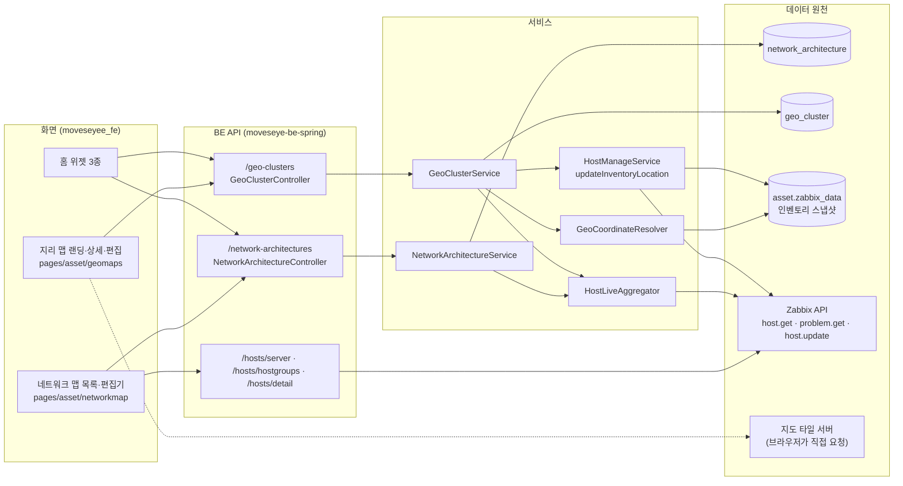

# 네트워크 맵과 지리 맵 기능 상세 가이드

> 네트워크 맵은 운영자가 논리 구성도를 직접 그리고 노드에 실제 호스트를 연결해 "상태가 얹힌 구성도"를 만드는 작도 도구다. 지리 맵은 호스트를 지도 위 실제 위치에 놓아 지역별 분포와 문제를 보는 화면이다. 이 문서는 두 기능의 화면·사용법·내부 동작(저장 모델, 잠금, 상태 조회, 좌표 원천)을 기능 단위로 설명하고, 현재 소스에서 확인한 문제점과 보완점을 함께 기록한다. 검증은 BE `e55948c`·FE `9dfcbe8` 소스의 정적 대조로 했다. 서버 기동·API 호출·브라우저 렌더는 이번에 실행하지 않았다.

## 1. 한눈에 보기

### 1.1 기능 목록

| 기능 | 화면 주소·메뉴 위치 | 상태 | 권한·라이선스 | 한 줄 설명 |
|---|---|---|---|---|
| 네트워크 맵 목록 | `/monitoring/network-map` · 사이드바 "운영 관제" 그룹의 최상위 항목 "네트워크 맵" | 현재 | 로그인 사용자 전원. 라이선스 조건 없음 | 구성도 목록·이름 검색·생성·삭제 |
| 네트워크 맵 편집 모드 | `/monitoring/network-map/:id` 에서 [편집] | 현재 | 로그인 사용자 전원(저장·삭제·대표 지정 포함) | 호스트·도형·텍스트·그룹 배치, 연결선, 속성, 정렬, 자동 저장 |
| 네트워크 맵 뷰 모드 탐색 | `/monitoring/network-map/:id` (기본 진입 모드) | 현재 | 로그인 사용자 전원 | 검색·포커스·도달 범위·경로·영향 전파·유형 범례 |
| 네트워크 맵 상태 오버레이 | 편집기 화면 전체(뷰·편집 공통) | 부분 | 조회 사용자의 Zabbix 권한 범위 | 호스트 노드의 가용성 점과 문제 수 뱃지. 자동 갱신 없음 |
| 네트워크 맵 내보내기·프레젠테이션 | 뷰 모드 상단 바 | 현재 | 로그인 사용자 전원 | PNG/SVG 저장, 전체화면 |
| 네트워크 맵 구 주소 리다이렉트 | `/asset/network-map`, `/asset/network-map/:id` | 현재 | — | 새 주소로 이동(`:id`·쿼리 보존) |
| 지리 맵 랜딩(클러스터링 맵) | `/asset/geo-map` · 사이드바 "자산과 구성" > 자산 관리 > 지리 맵 | 현재 | 로그인 사용자 전원 | 전 클러스터의 호스트 핀과 링크, 클러스터 목록·생성·삭제 |
| 지리 맵 클러스터 상세 | `/asset/geo-map/:id` | 현재 | 로그인 사용자 전원 | 한 클러스터의 지도, 필터, 탐색, 핀 상세, PNG, 전체화면, 2D/3D |
| 지리 맵 클러스터 편집 | `/asset/geo-map/:id/edit` | 현재 | 문서 편집은 로그인 사용자 전원, 좌표 편집은 관리자 전용 | 호스트 배치·링크·이름 변경·좌표 편집 |
| 호스트 좌표 편집 | 편집 화면의 핀 드래그·위경도 입력·지도 클릭 배치 | 현재 | 관리자 전용(`ADMIN`·`SUPER_ADMIN`). BE 강제 | Zabbix 호스트 인벤토리 `location_lat`/`location_lon` 을 직접 갱신 |
| 홈 위젯 3종 | 홈 화면(`map_summary`, `main_network_map`, `main_geo_map`) | 현재 | 홈 화면 조건을 따름 | 맵 요약 수치, 대표 네트워크 맵·대표 지리 맵 미리보기 |
| 구 지도 화면(맵뷰·서버 위치) | `/asset/mapview`, `/asset/serverlocation` (메뉴 없음, 주소 직접 입력만) | 보류 | 로그인 사용자 전원 | 지리 맵으로 대체된 이전 화면. 라우트만 남아 있음(4절 MAP-15) |

소스에 없는 기능 두 가지를 밝혀 둔다.

- 맵 복제: 목록과 편집기 어디에도 맵을 통째로 복제하는 기능과 API가 없다. 편집 모드의 노드 복사·붙여넣기만 있다.
- 자동 배치: 노드를 자동으로 배열하는 기능이 없다. 선택한 노드의 정렬·균등 분배 툴바만 있다.

### 1.2 구조

두 기능은 같은 설계를 공유한다.

- 맵 한 장이 DB의 행 하나다. 노드·연결·화면 위치를 통째로 `jsonb` 한 컬럼(`diagram_json`)에 저장한다. 노드를 개별 테이블로 나누지 않는다.
- 맵에 연결된 호스트 ID 목록(`linked_hostids`)은 저장할 때 서버가 문서에서 다시 뽑아 만든다. 클라이언트가 보낸 값은 쓰지 않는다.
- 호스트 상태(가용성·문제 수)는 문서에 저장하지 않는다. 화면이 별도 API로 받아 그림 위에 얹는다.
- 동시 편집은 서버 `updatedAt` 문자열 비교(낙관적 잠금)로 막는다.
- 지리 맵만의 차이: 좌표를 문서에 저장하지 않는다. 문서에는 호스트 ID만 있고 위도·경도는 조회할 때마다 자산 스냅샷의 Zabbix 인벤토리 값에서 읽는다.

## 2. 기능별 상세

### 2.1 네트워크 맵 목록

- **무엇을 하는가** — 저장된 구성도 목록을 보고 새 구성도를 만들거나 지운다.
- **화면과 진입 경로**
  - 주소 `/monitoring/network-map`.
  - 사이드바: "운영 관제" 그룹에서 "모니터링"과 같은 단계의 최상위 항목이다. 모바일 메뉴도 같은 위치다.
  - 메뉴 검색(헤더): "네트워크 맵"으로 검색된다. 도움말 키는 `asset_network_map` 이다.
  - 홈 "맵 요약" 위젯의 네트워크 맵 개수, 홈 "대표 네트워크 맵" 위젯의 이동 버튼에서도 들어온다.
  - 구 주소 `/asset/network-map` 과 `/asset/network-map/:id` 는 새 주소로 바뀐다(2.7).
- **사용 방법**
  1. 검색창에 이름 또는 설명 일부를 입력한다. 필터는 URL query `keyword` 로 유지된다.
  2. [아키텍처 생성]을 누르고 이름(필수, 화면 입력 상한 200자)과 설명을 입력한다. 생성 직후 편집기로 이동한다.
  3. 행의 이름을 누르면 편집기(뷰 모드)가 열린다.
  4. 행의 [삭제]는 확인 대화상자를 거쳐 즉시 지운다.
  - 표 열: 이름(대표 맵은 금색 "메인" 태그), 설명, 크기(노드 수·연결 수), 수정 시각, 수정한 사용자.
- **동작 원리**
  - `NetworkMapListPage` → `useNetworkMapList` → `GET /network-architectures` → `NetworkArchitectureService.getList` → `findAllByOrderByIsMainDescUpdatedAtDesc`.
  - 서버는 전체 행을 한 번에 돌려준다. 페이지 나눔과 서버 검색이 없다. 검색은 받은 목록을 화면에서 이름·설명 부분 일치로 거른다.
  - 정렬은 서버가 정한다. 대표 맵이 맨 위, 그다음 최근 수정순이다.
  - 노드 수는 호스트·도형·텍스트·그룹을 모두 합한 수다.
- **주요 API**

| Method | Path | 용도 | 권한 |
|---|---|---|---|
| GET | `/network-architectures` | 목록 `{items,total}` | 로그인 사용자 |
| POST | `/network-architectures` | 빈 구성도 생성(이름 필수) | 로그인 사용자 |
| DELETE | `/network-architectures/{id}` | 물리 삭제 | 로그인 사용자 |

- **빈 값·실패·경계 상태**
  - 목록이 비면 빈 표가 나온다.
  - 삭제 실패는 "실패" 토스트만 띄운다.
  - 이름 중복은 허용된다. 같은 이름의 맵이 여러 개 생길 수 있다.
- **운영 주의** — 삭제는 물리 삭제이고 복구 수단과 삭제 기록이 없다(4절 MAP-11).

### 2.2 네트워크 맵 편집 모드

- **무엇을 하는가** — 캔버스에 노드를 놓고 연결선을 그어 구성도를 만든다.
- **화면과 진입 경로** — `/monitoring/network-map/:id` 는 항상 뷰 모드로 열린다. 상단 바의 [편집]을 누르면 편집 모드가 된다. 편집 여부는 URL에 남지 않는다.
- **사용 방법**
  1. 왼쪽 팔레트에서 항목을 클릭하거나 캔버스로 끌어다 놓는다.
     - 호스트: 검색어(이름·IP·OS)와 호스트 그룹으로 찾는다. 결과는 최대 50건이다.
     - 도형: 유형 6종(클라이언트·네트워크·서버·데이터·모니터링·CI/CD)과 클라이언트 프리셋 5종.
     - 텍스트: 테두리 없는 글자 노드.
     - 그룹 박스: 다른 노드 뒤에 깔리는 영역 상자.
  2. 노드 가장자리 연결점(상하좌우 4곳)에서 다른 노드로 끌어 연결선을 만든다. 어느 연결점에서든 시작과 도착이 된다. 같은 노드끼리는 연결되지 않는다.
  3. 노드나 선을 선택하면 오른쪽 속성 패널이 바뀐다.
     - 노드: 라벨, 유형(프리셋 또는 자유 입력), 이모지, 테두리색·배경색·글자색, 글자 크기, 이모지 크기, 폭·높이, 설명(메모).
     - 연결선: 라벨, 글자 크기, 출발·도착 포트 표기, 색, 화살표 방향(없음·정방향·역방향·양방향), 실선/점선, 경로(직각 꺾은선/직선), 꺾임 간격(8~400px, 기본 20).
     - 그룹: [그룹에 넣기]·[그룹에서 빼기]·[그룹 해제]. 드래그로는 그룹에 들어가지 않는다. 버튼으로만 넣고 뺀다.
     - 겹침 순서: 맨 앞·앞으로·뒤로·맨 뒤.
     - 아무것도 선택하지 않으면 구성도 이름·설명을 고친다.
  4. 노드를 2개 이상 선택하면 캔버스 위 정렬 툴바가 켜진다. 정렬 6종(좌·가로 중앙·우·상·세로 중앙·하)과 균등 분배 2종(가로·세로)이다. 그룹 안의 노드는 정렬 대상에서 빠진다.
  5. 단축키: Ctrl/Cmd+C 복사, Ctrl/Cmd+V 붙여넣기(16px씩 비껴 붙음), Ctrl/Cmd+Z 실행 취소, Ctrl/Cmd+Shift+Z 또는 Ctrl/Cmd+Y 다시 실행. 입력 칸에 커서가 있으면 가로채지 않는다.
  6. [저장]을 누르거나 자동 저장을 기다린다. 상단에 "저장됨 · 시:분:초"가 표시된다.
  7. [Set as main]은 이 구성도를 대표로 지정한다. 대표는 전체에서 1개뿐이고 이전 대표는 자동 해제된다.
  8. [보기]로 뷰 모드로 돌아간다.
- **동작 원리**
  - 캔버스는 React Flow(`@xyflow/react`)다. 노드 종류는 `host`·`shape`·`group` 3종이다. 텍스트 노드는 `shape` 에 `data.variant="text"` 를 붙인 변형이다(서버가 종류를 3종만 허용한다).
  - 저장 본문은 `serializeDiagram` 이 만든다. 선택·드래그·측정 크기 같은 일시 상태는 버리고 위치(정수 반올림)·크기·스타일·`zIndex`·부모·화살표를 남긴다. 격자 맞춤은 16px이다.
  - 호스트 노드는 추가하는 순간의 `hostid`·이름·IP를 노드 데이터에 복사해 둔다. 이후 Zabbix에서 이름이 바뀌어도 노드 라벨은 따라 바뀌지 않는다.
  - 실행 취소는 편집이 400ms 멈출 때 스냅샷 1개를 쌓고 최대 50단계를 보관한다. 선택만 바뀐 변경은 쌓지 않는다. 화면 이동·확대는 실행 취소 대상이 아니다.
  - 자동 저장은 60초 간격 타이머다(`NETMAP_AUTOSAVE_INTERVAL_MS`). 편집 모드이고, 미저장 변경이 있고, 저장 중이 아니고, 충돌로 멈춘 상태가 아닐 때만 저장한다.
  - 저장 순서(서버): 낙관적 잠금 검사 → 이름·설명 반영 → 직렬화 크기 1MB 검사 → 구조 검증 → 호스트 ID 재추출 → `saveAndFlush` → 새 `updatedAt` 을 응답.
  - 화면은 저장 전에도 크기를 잰다. 1MB(1,048,576바이트)를 넘으면 요청을 보내지 않는다.
- **주요 API**

| Method | Path | 용도 | 권한 |
|---|---|---|---|
| GET | `/network-architectures/{id}` | 상세(`diagramJson`, `linkedHostids`, `updatedAt`) | 로그인 사용자 |
| PATCH | `/network-architectures/{id}` | 이름·설명·다이어그램 부분 수정, `baseUpdatedAt` 동봉 | 로그인 사용자 |
| PATCH | `/network-architectures/{id}/main` | 대표 지정(기존 대표 해제) | 로그인 사용자 |
| GET | `/hosts/server?keyword=&groupids=&offset=0&limit=50` | 팔레트 호스트 검색(서버 모니터링 목록 API 재사용) | 로그인 사용자 |
| GET | `/hosts/hostgroups?offset=0&limit=500` | 팔레트 호스트 그룹 선택지 | 로그인 사용자 |

- **데이터**
  - 테이블 `network_architecture` (Flyway `V7__network_architecture.sql`).
  - 주요 컬럼: `name`, `description`, `diagram_json jsonb`(`nodes`·`edges`·`viewport`), `linked_hostids jsonb`(서버 파생), `is_main`(부분 유니크 인덱스로 최대 1개), `created_by`·`updated_by`, `created_at`·`updated_at`.
  - 보존·정리 규칙 없음. 삭제는 물리 삭제다.
- **권한·라이선스**
  - 메뉴·라우트·검색에 권한 조건이 없다. BE도 전 엔드포인트가 로그인 사용자면 통과한다. 구성도를 문서로 보고 일반 사용자 편집을 허용한 설계다.
  - 누가 만들고 고쳤는지는 `created_by`·`updated_by` 에 사용자 이름으로 남는다.
  - 팔레트 호스트 검색과 상태 조회는 사용자의 Zabbix 권한 범위에서만 결과가 나온다. Zabbix와 연결되지 않은 일반 계정은 팔레트에 호스트가 나오지 않는다.
- **빈 값·실패·경계 상태**
  - 동시 편집 충돌(`NETMAP_CONFLICT`): 수동 저장이면 대화상자가, 자동 저장이면 상단 경고 띠가 뜨고 자동 저장이 멈춘다. 선택지는 [서버 버전 불러오기](내 변경 폐기)와 [내 변경으로 덮어쓰기](상대 변경 폐기) 둘이다. 부분 병합은 없다.
  - 크기 초과(`NETMAP_TOO_LARGE`)·구조 오류(`NETMAP_INVALID_DIAGRAM`): 수동 저장은 전용 안내를 띄운다. 자동 저장은 안내 없이 다음 주기에 다시 시도한다.
  - 없는 ID: "찾을 수 없음" 안내와 목록 이동 버튼.
  - 브라우저 새로고침·탭 닫기: 미저장 변경이 있으면 브라우저 경고가 뜬다. [목록] 버튼도 확인을 받는다. 사이드바나 브라우저 뒤로 가기로 떠날 때는 경고가 없다(4절 MAP-09).
- **운영 주의**
  - 팔레트 호스트 검색은 기기 분류가 "서버" 하나로 지정된 호스트만 돌려준다. 스위치·라우터 같은 네트워크 장비는 호스트 노드로 추가할 수 없다(4절 MAP-02).
  - 서버 시간대는 UTC여야 한다. `updatedAt` 을 UTC로 표기해 내려 주기 때문이다. 컨테이너 이미지는 `-Duser.timezone=UTC` 로 고정돼 있다.

### 2.3 네트워크 맵 뷰 모드 탐색

- **무엇을 하는가** — 그려 둔 구성도에서 노드를 찾고, 연결을 따라 영향 범위와 경로를 본다.
- **화면과 진입 경로** — 편집기의 기본 모드다. 캔버스 왼쪽 위에 탐색 패널, 왼쪽 아래에 범례, 오른쪽 위에 미니맵, 오른쪽 아래에 확대·축소 컨트롤이 있다.
- **사용 방법**
  1. 검색: 라벨·IP·호스트 ID·유형으로 찾는다. 결과는 최대 8건이다. 고르면 그 노드로 화면이 이동하고 포커스된다.
  2. 포커스: 노드를 클릭하면 그 노드와 바로 이웃(1단계)만 또렷하게 남고 나머지는 흐려진다. 같은 노드를 다시 클릭하면 해제된다.
  3. 도달 범위: 포커스한 상태에서 ↑(업스트림: 이 노드로 들어오는 쪽), ↓(다운스트림: 이 노드에서 나가는 쪽), ↕(양방향)을 누른다. 끝까지 따라간 전체 범위가 강조된다.
  4. 경로: 경로 버튼을 누른 뒤 시작 노드와 끝 노드를 차례로 클릭한다. 방향을 지킨 최단 경로를 먼저 찾고, 없으면 방향을 무시하고 다시 찾는다. 몇 단계(홉)인지 표시한다.
  5. 영향 전파: 번개 버튼의 숫자는 "미가용이거나 문제가 열린 호스트 노드" 수다. 누르면 그 노드들의 다운스트림 전체가 강조된다. 해당 노드가 없으면 버튼이 꺼져 있다.
  6. 범례: 유형별 노드 수를 보여 준다. 항목을 누르면 그 유형만 강조된다. 8개를 넘으면 "+N"으로 접힌다. 그룹 박스와 텍스트 노드는 세지 않는다.
  7. 호스트 노드에 마우스를 올리면 메모·가용성·문제 수와 OS·IP·호스트 그룹·위치·가동 시간이 뜬다.
  8. 단축키: `/` 검색, `Esc` 해제, `F` 전체화면, `0` 전체 보기, `+`·`-` 확대·축소.
- **동작 원리**
  - 계산은 전부 브라우저에서 한다(`explore.ts` 의 `computeReach`·`computePath`·`computeImpact`·`collectLegend`). 서버 호출이 없다.
  - 방향은 연결선을 **그린 방향**(출발 노드 → 도착 노드)이다. 속성 패널에서 고른 화살표 표시 방향은 계산에 쓰이지 않는다(4절 MAP-08).
  - 탐색 상태는 노드 데이터에 쓰지 않고 별도 컨텍스트로 전달한다. 그래서 탐색은 미저장 표시와 실행 취소 기록을 건드리지 않는다.
  - 호버 메타데이터는 마우스를 올린 순간에만 `GET /hosts/detail/{hostid}` 를 부르고 60초 동안 재사용한다.
- **권한·라이선스** — 로그인 사용자 전원.
- **빈 값·실패·경계 상태**
  - 경로가 없으면 "경로 없음"을 표시한다.
  - 뷰 모드에는 호스트 모니터링 화면으로 가는 링크가 없다. 링크는 편집 모드 속성 패널에만 있다(4절 MAP-16).
  - 탐색 상태(포커스·경로)는 URL에 남지 않는다. 새로고침하면 사라진다.

### 2.4 네트워크 맵 상태 오버레이

- **무엇을 하는가** — 호스트 노드에 현재 가용성과 문제 수를 얹어 보여 준다.
- **화면에 보이는 값**
  - 상태 점: 초록=가용, 빨강=미가용, 회색=알 수 없음. 미가용이면 노드 테두리와 배경도 장애색이 된다.
  - 숫자 뱃지: 그 호스트의 문제 수. 색은 가장 심각한 문제의 등급 색이다. 0이면 뱃지가 없다.
  - 같은 호스트를 여러 노드로 놓았으면 모든 노드에 같은 값이 표시된다.
- **동작 원리**
  - `useNetworkMapLive` → `GET /network-architectures/{id}/live` → `NetworkArchitectureService.getLive` → `HostLiveAggregator`.
  - 대상은 그 구성도의 `linked_hostids` 다. 호스트가 0개면 Zabbix를 부르지 않고 빈 배열을 준다.
  - Zabbix 호출은 고정 횟수다. 가용성은 `host.get` 1회, 문제는 `problem.get` 1회와 문제를 호스트에 귀속시키기 위한 `trigger.get` 이다. 호스트 수만큼 반복하지 않는다.
  - 가용성 판정: 호스트의 인터페이스 중 하나라도 가용이면 가용, 가용이 없고 미가용이 있으면 미가용, 그 외(인터페이스 없음·전부 미상)는 알 수 없음.
  - 문제 수는 Zabbix `problem.get` 을 `recent=true` 로 부른 결과의 개수다. 방금 해소돼 Zabbix가 "최근 문제"로 아직 보여 주는 건도 포함된다(4절 MAP-06).
  - 조회 주체는 로그인 사용자다. 관리자는 시스템 토큰으로, 일반 사용자는 본인 Zabbix 토큰으로 조회한다.
  - **갱신 방식**: 자동 갱신이 없다. 화면 진입 때 1회 조회하고 이후에는 상단 [상태 새로고침]을 눌러야 다시 조회한다. 브라우저에 보관된 이전 조회 결과가 있으면 진입 때도 다시 조회하지 않는다(4절 MAP-05).
- **주요 API**

| Method | Path | 용도 | 권한 |
|---|---|---|---|
| GET | `/network-architectures/{id}/live` | `[{hostid, available, openProblemCount, worstSeverity}]` | 로그인 사용자 |
| GET | `/hosts/detail/{hostid}` | 호버 메타데이터(OS·IP·그룹·위치·가동 시간) | 로그인 사용자 |

- **빈 값·실패·경계 상태**
  - Zabbix 조회가 실패해도 오류를 내지 않는다. 가용성은 전부 "알 수 없음", 문제 수는 0으로 내려온다. 화면에는 실패 안내가 없다(4절 MAP-07).
  - Zabbix에서 삭제됐거나 조회 권한이 없는 호스트도 "알 수 없음·문제 0"으로 보인다.
  - 실시간 트래픽·사용률 값은 오버레이에 없다. 연결선의 포트 표기는 사람이 입력한 글자다.

### 2.5 네트워크 맵 내보내기·프레젠테이션·다크 모드

- **무엇을 하는가** — 구성도를 이미지로 저장하거나 전체화면으로 띄운다.
- **사용 방법**
  1. 뷰 모드 상단 [내보내기]에서 PNG 또는 SVG를 고른다. 파일 이름은 구성도 이름이다(파일에 못 쓰는 문자는 `_`, 최대 80자).
  2. [프레젠테이션] 또는 `F` 키로 전체화면에 들어간다. `Esc` 로 나온다.
- **동작 원리**
  - 캔버스의 노드 영역만 그림으로 만든다(`html-to-image`). 미니맵·컨트롤·탐색 패널은 빠진다.
  - 모든 노드를 감싸는 경계에 여백 48px을 더해 크기를 정한다. 긴 변이 8,192px을 넘으면 비율을 지켜 줄인다. PNG는 2배 해상도로 만든다.
  - 웹폰트는 그림에 넣지 않는다. 저장된 그림의 글자는 시스템 글꼴로 바뀐다.
  - 저장 시점의 상태 오버레이와 탐색 강조가 그대로 찍힌다.
  - 전체화면은 편집기 영역을 브라우저 전체화면으로 올리고 50ms 뒤 전체 보기로 맞춘다.
  - 다크 모드는 헤더의 테마 전환을 따른다. 유형 색·미니맵·캔버스 배경이 테마별 값으로 바뀐다. 사용자가 노드에 직접 지정한 색은 테마와 무관하게 유지된다.
- **빈 값·실패·경계 상태**
  - 노드가 하나도 없으면 "내보낼 내용이 없음" 경고를 띄운다.
  - 전체화면에서도 상태는 자동 갱신되지 않는다.

### 2.6 대표 맵과 홈 위젯

- **무엇을 하는가** — 대표로 지정한 맵을 홈에서 바로 본다.
- **동작 원리**
  - 대표 지정은 네트워크 맵은 편집 모드 상단 바, 지리 맵은 상세 화면 상단 바에서 한다. 서버는 한 트랜잭션에서 기존 대표를 모두 해제한 뒤 대상을 지정한다.
  - "대표 네트워크 맵" 위젯은 목록에서 `isMain` 인 맵을 찾아 상세와 상태를 조회하고 읽기 전용 캔버스로 그린다. 이동·확대만 된다.
  - "대표 지리 맵" 위젯은 같은 방식으로 지도를 그린다. 핀을 누르면 상세 화면으로 간다.
  - "맵 요약" 위젯은 홈 요약 API가 주는 지리 클러스터 수, 문제 있는 클러스터 수, 가장 심각한 등급, 네트워크 맵 수를 보여 준다. BE `HomeService` 가 `GeoClusterService.getOverviewLive` 와 네트워크 맵 행 수를 묶어 만든다.
  - 대표가 없으면 위젯은 안내와 이동 버튼만 보여 준다.

### 2.7 네트워크 맵 구 주소 리다이렉트

- **무엇을 하는가** — 예전에 공유된 링크를 살린다.
- **동작 원리**
  - `/asset/network-map` → `/monitoring/network-map`, `/asset/network-map/:id` → `/monitoring/network-map/:id`.
  - `LegacyNetworkMapRedirect` 가 `:id` 와 쿼리 문자열을 그대로 붙여 `replace` 이동한다. 뒤로 가기 기록에 구 주소가 남지 않는다.
  - 화면 파일의 폴더(`pages/asset/networkmap`)와 도움말 키(`asset_network_map`)는 이전 이름 그대로다.

### 2.8 지리 맵 랜딩(클러스터링 맵)

- **무엇을 하는가** — 저장된 모든 클러스터의 호스트를 한 지도에 보고, 클러스터를 만들거나 지운다. 클러스터는 "지도 위 호스트 배치 문서" 한 장이다(예: 본사, 대전 IDC, 전국 지점망).
- **화면과 진입 경로**
  - 주소 `/asset/geo-map`. 사이드바 "자산과 구성" > 자산 관리 > 지리 맵. 모바일 메뉴도 같다.
  - 홈 "맵 요약" 위젯의 지리 클러스터 수에서도 들어온다.
- **사용 방법**
  1. 왼쪽 패널에서 클러스터를 이름·설명으로 검색한다.
  2. 클러스터 행을 누르면 지도가 그 클러스터의 대표 지점으로 이동한다(확대 단계 최소 9).
  3. [열기]는 상세 화면으로 간다. 휴지통은 확인을 거쳐 삭제한다.
  4. [클러스터 생성]은 이름·설명을 받아 빈 문서를 만들고 편집 화면으로 간다.
  5. 지도의 핀을 누르면, 여러 호스트가 뭉친 핀은 갈라져 보이도록 확대되고, 더 갈라지지 않는 핀은 그 클러스터 상세로 이동한다.
  6. 새로고침 아이콘은 핀 색(문제 등급)을 다시 조회한다.
- **화면에 보이는 값**
  - 핀 안의 숫자: 그 핀에 묶인 호스트 수.
  - 핀 색: 그 핀에 걸친 **클러스터 전체**의 가장 심각한 문제 등급 색. 문제가 없거나 조회하지 못하면 회색이다.
  - 핀에 마우스를 올리면 클러스터 이름, 호스트 수, 위도·경도가 뜬다.
  - 선: 각 클러스터 문서의 링크. 라벨과 두 지점 사이 거리가 표시된다.
- **동작 원리**
  - `useGeoClusterList` → `GET /geo-clusters`. 응답 한 건마다 호스트 수, 링크 수, 대표 지점(`centroid`), 멤버 좌표 목록(`points`), 링크 목록(`links`)이 들어 있다.
  - 좌표는 `GeoCoordinateResolver` 가 모든 클러스터의 호스트 ID를 모아 `asset.linked_hostid IN (...)` 한 번으로 읽는다. Zabbix를 부르지 않는다.
  - 대표 지점은 멤버 좌표 평균에 가장 가까운 **실제 멤버 좌표**다. 평균 지점 자체를 쓰지 않는다.
  - 핀 뭉침은 화면 확대 단계에 따라 브라우저가 계산한다. 화면에서 72px에 해당하는 실제 거리 안의 호스트를 묶되 10km를 넘는 거리는 어떤 확대 단계에서도 묶지 않는다. 뭉친 핀의 위치도 평균에 가장 가까운 실제 호스트 좌표다.
  - 핀 색은 `useGeoClusterOverviewLive` → `GET /geo-clusters/live` 로 받는다. 서버는 클러스터마다 Zabbix `problem.get` 을 1회씩 부른다(4절 MAP-12).
  - 랜딩 지도는 항상 기본 위치(경도 127.0, 위도 37.5, 확대 6)에서 시작한다. 랜딩의 화면 위치는 저장하지 않는다.
- **주요 API**

| Method | Path | 용도 | 권한 |
|---|---|---|---|
| GET | `/geo-clusters` | 목록(배열). 클러스터별 `points`·`links`·`centroid` 포함 | 로그인 사용자 |
| GET | `/geo-clusters/live` | 클러스터별 `{clusterId, worstSeverity, openProblemCount}` | 로그인 사용자 |
| POST | `/geo-clusters` | 빈 클러스터 생성 | 로그인 사용자 |
| DELETE | `/geo-clusters/{id}` | 물리 삭제 | 로그인 사용자 |

- **빈 값·실패·경계 상태**
  - 클러스터가 없으면 왼쪽 패널에 빈 안내가 나온다.
  - 좌표가 있는 멤버가 하나도 없는 클러스터는 지도에 핀이 없고 목록에만 있다.
  - 지도 타일을 불러오지 못하면 오류 안내만 뜨고 핀과 링크도 그려지지 않는다(2.12, 4절 MAP-03).

### 2.9 지리 맵 클러스터 상세

- **무엇을 하는가** — 한 클러스터의 호스트 위치와 상태를 보고 탐색한다. 읽기 전용이다.
- **화면과 진입 경로** — `/asset/geo-map/:id`. 랜딩의 [열기]·핀 클릭, 홈 "대표 지리 맵" 위젯에서 들어온다.
- **사용 방법**
  1. 왼쪽 필터: 심각도(6단계 다중 선택), "링크 표시", "문제 있는 것만".
  2. 핀 클릭: 뭉친 핀은 확대된다. 호스트 1대짜리 핀은 탐색 포커스가 된다. 같은 지점에 여러 대가 있는 핀은 오른쪽 서랍(핀 상세)이 열린다.
  3. 핀 상세 서랍: "문제" 탭(문제가 있는 호스트), "호스트" 탭(가용성·문제 수·최악 등급, 10건씩), "자산" 탭(자산 화면 링크).
  4. 지도 위 탐색 패널·범례·단축키는 네트워크 맵 뷰 모드와 같은 부품이다(2.3). 범례 축은 호스트의 첫 번째 호스트 그룹이다.
  5. 상단 바: [내보내기] — PNG만, [프레젠테이션], 2D/3D 전환, [상태 새로고침], [Set as main], [편집].
- **화면에 보이는 값**
  - 핀 색: 그 핀에 묶인 호스트들의 가장 심각한 문제 등급 색. 문제가 없으면 회색이다.
  - 핀의 문제 뱃지: 묶인 호스트의 문제 수 합.
  - 호버: 첫 호스트의 이름·가용성·위도·경도·호스트 그룹과 핀의 문제 수.
  - 링크 라벨: 사용자가 넣은 라벨과 두 호스트 사이 거리.
- **동작 원리**
  - `useGeoClusterDetail` → `GET /geo-clusters/{id}`. 응답의 `resolvedHosts` 에 멤버별 이름·호스트 그룹·위도·경도·`hasCoordinate` 가 들어 있다. 화면은 문서의 호스트 ID와 이 목록을 결합해 핀을 만든다.
  - `useGeoClusterLive` → `GET /geo-clusters/{id}/live`. 네트워크 맵 상태 오버레이와 같은 집계를 쓴다(2.4). 자동 갱신이 없는 점도 같다.
  - 처음 열 때 배치된 호스트 전체가 보이도록 화면을 맞춘다(여백 80px, 최대 확대 12).
  - 3D는 지도를 50도 기울인 보기다. 3D에서는 링크를 곡선으로 그린다. 건물 입체 표시는 없다.
  - 링크는 핀 위치가 아니라 호스트의 실제 좌표로 그린다. 한 핀에 뭉친 호스트 사이의 링크도 보존된다.
  - 필터로 숨긴 호스트가 끝점인 링크는 그리지 않는다. 도달·경로 계산에는 숨긴 호스트도 포함한다.
- **주요 API**

| Method | Path | 용도 | 권한 |
|---|---|---|---|
| GET | `/geo-clusters/{id}` | 상세(`diagramJson`, `linkedHostids`, `resolvedHosts`) | 로그인 사용자 |
| GET | `/geo-clusters/{id}/live` | 호스트별 가용성·문제 수·최악 등급 | 로그인 사용자 |
| PATCH | `/geo-clusters/{id}/main` | 대표 지정 | 로그인 사용자 |

- **빈 값·실패·경계 상태**
  - 배치는 됐는데 좌표를 읽지 못한 호스트가 있으면 상단에 "N개 호스트는 인벤토리 좌표가 없어 지도에 표시되지 않습니다" 경고가 뜬다.
  - 없는 ID 또는 조회 실패: "찾을 수 없음" 안내.
  - 필터·선택·탐색 상태는 URL에 남지 않는다.
  - 핀 상세 "자산" 탭의 [자산 열기] 링크는 현재 잘못된 자산으로 이동할 수 있다(4절 MAP-01).

### 2.10 지리 맵 클러스터 편집

- **무엇을 하는가** — 클러스터에 호스트를 넣고 빼고, 호스트 사이에 링크를 긋는다.
- **화면과 진입 경로** — `/asset/geo-map/:id/edit`. 상세의 [편집] 또는 생성 직후.
- **사용 방법**
  1. 왼쪽 팔레트 "호스트" 탭: 검색어를 입력하고 Enter로 찾는다. 호스트 그룹으로도 거른다. [추가]를 누르면 그 호스트의 좌표 위치에 핀이 생긴다. 이미 넣은 호스트는 "배치됨" 태그가 붙고 [다시 추가]가 된다.
  2. 팔레트 "호스트 그룹" 탭: 그룹을 고르고 [그룹 멤버 추가]를 누른다. 좌표가 있는 멤버만 들어가고 "N개 추가, M개 제외(좌표 없음)"가 표시된다.
  3. 좌표가 없는 호스트(관리자만): [지도에서 위치 지정]을 누른 뒤 지도를 클릭하거나 위도·경도를 직접 입력한다. 그 값이 호스트 좌표로 기록되고 문서에 들어간다.
  4. 링크: 핀을 선택하고 오른쪽 패널에서 [링크 시작]을 누른 뒤 상대 핀을 클릭한다. [검색으로 연결]은 배치된 호스트 이름 목록에서 상대를 고른다.
  5. 링크를 선택하면 라벨·색·실선/점선을 바꾸거나 지운다.
  6. 핀을 우클릭하면 메뉴가 뜬다: 좌표 편집, 이 위치에 호스트 추가, 제거.
  7. 제목을 클릭해 이름을 바꾼다(100자 이내). 이름 변경은 즉시 저장된다.
  8. [저장]을 눌러 문서를 저장한다. 자동 저장은 없다.
- **동작 원리**
  - 저장 본문은 `{hosts:[{hostid}], links:[{id,source,target,label,color,lineStyle}], viewport:{longitude,latitude,zoom,bearing,pitch}}` 다. 좌표는 넣지 않는다.
  - 서버 저장 순서: 낙관적 잠금 → 크기 1MB → 구조 검증(`hosts`·`links` 배열, 호스트마다 `hostid`) → 호스트 ID 재추출 → **배치된 모든 호스트가 좌표를 가졌는지 검사** → 저장.
  - 좌표 없는 호스트가 하나라도 있으면 저장 전체가 거부된다(`GEOMAP_HOST_NO_COORDINATE`, 위반 호스트 ID 목록 동봉).
  - 팔레트 후보는 `GET /geo-clusters/host-candidates` 다. 원천은 MovesEye 자산 테이블이다. 조건은 "제외되지 않았고 `linked_hostid` 가 있는 자산"이고, 검색은 자산 이름·Zabbix 호스트명·표시명 부분 일치다. 결과는 이름순 최대 500건이다. 같은 호스트에 자산이 둘이면 좌표가 있는 쪽 하나만 준다.
  - 충돌(`GEOMAP_CONFLICT`)이 나면 상단 경고 띠에 [새로고침](서버 버전으로 교체)과 [덮어쓰기]가 나온다. 덮어쓰기는 `baseUpdatedAt` 없이 다시 저장한다.
- **주요 API**

| Method | Path | 용도 | 권한 |
|---|---|---|---|
| PATCH | `/geo-clusters/{id}` | 이름·설명·다이어그램 부분 수정 | 로그인 사용자 |
| GET | `/geo-clusters/host-candidates?keyword=&groupId=` | 팔레트 후보(최대 500건) | 로그인 사용자 |
| GET | `/hosts/hostgroups?offset=0&limit=500` | 호스트 그룹 선택지 | 로그인 사용자 |
| PATCH | `/geo-clusters/host-coordinate` | 호스트 좌표 편집(2.11) | 관리자 |

- **데이터**
  - 테이블 `geo_cluster` (Flyway `V8__geo_cluster.sql`). 컬럼 구성은 `network_architecture` 와 같다. `diagram_json` 기본값은 빈 `hosts`·`links` 와 한국 중심 화면 위치다.
  - 좌표 조회용 인덱스 `idx_asset_linked_hostid` (Flyway `V14__asset_linked_hostid_index.sql`, `linked_hostid IS NOT NULL` 부분 인덱스).
- **권한·라이선스**
  - 문서 편집(호스트 넣기·빼기, 링크, 이름, 저장, 삭제, 대표 지정)은 로그인 사용자 전원이다.
  - 좌표를 새로 쓰는 동작은 관리자만 한다. 비관리자에게는 핀 드래그, 좌표 입력 칸, 지도 클릭 배치, "이 위치에 호스트 추가"가 꺼져 있고, 좌표 없는 호스트를 추가하려 하면 관리자 전용 안내가 뜬다.
  - 후보와 `resolvedHosts` 는 자산 테이블에서 오므로 사용자의 Zabbix 호스트 그룹 권한과 무관하게 전체가 보인다. 자산 목록 화면과 같은 범위다.
- **빈 값·실패·경계 상태**
  - 후보가 0건이면 자산 동기화가 한 번도 돌지 않았을 가능성이 가장 높다. 자산의 `linked_hostid` 는 동기화가 채운다.
  - 배치돼 있는데 좌표가 사라진 호스트가 있으면 상단 경고 띠에 [첫 호스트 배치] — 관리자 전용 — 와 [모두 제거]가 나온다. 이 호스트를 처리하지 않으면 저장이 계속 거부된다.
  - 미저장 변경이 있을 때 [목록] 버튼과 브라우저 새로고침은 확인을 받는다. 사이드바 이동은 확인이 없다(4절 MAP-09).
  - 클러스터 설명은 생성할 때만 입력할 수 있다. 편집 화면에 설명 수정 칸이 없다(4절 MAP-17).

### 2.11 호스트 좌표 편집

- **무엇을 하는가** — 지도에서 호스트의 위치를 바꾼다. 바뀌는 곳은 지도 문서가 아니라 **Zabbix 호스트 인벤토리**다.
- **사용 방법** (관리자)
  1. 편집 화면에서 호스트 1대짜리 핀을 끌어 놓는다. 놓는 즉시 저장된다.
  2. 또는 핀을 선택하고 오른쪽 패널에 위도·경도(소수 6자리)를 입력해 저장한다.
  3. 또는 핀 우클릭 > "이 위치에 호스트 추가"로 다른 호스트를 같은 지점에 올린다. 대상 호스트의 기존 좌표가 이 지점으로 바뀐다는 경고가 대화상자에 표시된다.
  - 여러 호스트가 뭉친 핀은 끌 수 없다.
- **동작 원리**
  1. `PATCH /geo-clusters/host-coordinate` `{hostid, lat, lng}`.
  2. 컨트롤러가 관리자 여부를 검사한다.
  3. `GeoClusterService.updateHostCoordinate` 가 값을 검사한다. 위도 -90~90, 경도 -180~180, 유한한 수가 아니면 `GEOMAP_INVALID_COORDINATE`.
  4. `HostManageService.updateInventoryLocation` 이 좌표를 소수 6자리로 반올림해 Zabbix `host.update` 로 `location_lat`·`location_lon` 을 쓴다. 시스템 토큰을 쓴다.
  5. 호스트의 인벤토리 모드가 "사용 안 함"이면 "수동"으로 바꿔 함께 저장한다. "자동"은 그대로 둔다.
  6. 호스트 변경 이력(`host_change_log`)에 기록한다.
  7. `AssetSyncService.syncOne` 이 그 호스트의 자산 스냅샷을 즉시 다시 읽어 온다.
  8. 스냅샷에서 좌표를 다시 해석해 응답한다. 화면은 응답 값을 핀 위치로 쓴다.
- **영향 범위**
  - 같은 호스트를 쓰는 모든 클러스터, 자산 화면, Zabbix 화면의 좌표가 함께 바뀐다.
  - 되돌리기 기능이 없다. 이전 좌표로 되돌리려면 다시 입력해야 한다.
- **권한·라이선스** — 관리자 전용. BE가 강제하고 FE도 같은 기준으로 입력 수단을 숨긴다.
- **빈 값·실패·경계 상태**
  - Zabbix에 없는 호스트: `HOST_NOT_FOUND` → "좌표 저장 실패" 안내.
  - Zabbix 기록은 됐는데 자산 스냅샷에서 좌표가 돌아오지 않으면 "저장됐지만 자산 스냅샷에 아직 반영되지 않았습니다" 안내가 뜬다. 스냅샷에 이전 좌표가 남아 있는 경우의 동작은 4절 MAP-04 참조.

### 2.12 지도 표시와 타일 원천

- **무엇을 하는가** — 지리 맵 세 화면과 홈 위젯의 바탕 지도를 그린다.
- **동작 원리**
  - 지도 엔진은 MapLibre GL이다(`MapCanvas`).
  - 지도 스타일 주소의 기본값은 공개 서비스 OpenFreeMap의 `liberty` 스타일이다(`GEOMAP_DEFAULT_STYLE_URL`). API 키가 필요 없다.
  - 스타일과 타일은 **사용자의 브라우저**가 그 주소로 직접 요청한다. MovesEye 서버를 거치지 않는다.
  - 주소는 FE 빌드 환경 변수 `VITE_GEOMAP_STYLE_URL` 로 바꾼다. 빌드할 때 번들에 고정되므로 설치 후 화면이나 서버 설정으로는 바꿀 수 없다.
- **오프라인·폐쇄망에서의 동작**
  - 브라우저가 스타일 주소에 닿지 못하면 지도 위에 "지도 타일을 불러오지 못했습니다. 네트워크 또는 스타일 URL을 확인하세요." 오류와 사유가 뜬다.
  - 이때 핀과 링크도 그려지지 않는다. 핀·링크 레이어는 지도 로드가 끝난 뒤에만 붙기 때문이다. 왼쪽 클러스터 목록과 호스트 수는 계속 보인다.
  - 폐쇄망에서 쓰려면 내부망에 타일 서버와 스타일 파일을 두고, 그 주소를 넣어 FE를 다시 빌드해야 한다.
- **운영 주의** — 외부 공개 서비스에 의존하므로 그 서비스의 장애·정책 변경이 지리 맵 전체에 영향을 준다.

### 2.13 자산과의 연결 지점

- 지리 맵의 좌표·이름·호스트 그룹은 전부 자산 테이블의 Zabbix 스냅샷(`asset.zabbix_data`)에서 읽는다. 자산 동기화가 이 스냅샷을 만든다.
- 스케줄러 잡 `asset_sync` 는 기본으로 켜져 있고 60분 간격, "추가+갱신" 모드다(Flyway `V15__scheduler_setting.sql`). Zabbix에서 직접 고친 좌표는 다음 동기화 뒤에 지도에 반영된다. 자산 목록의 수동 동기화로 앞당길 수 있다.
- 관리 대상에서 제외된 자산은 팔레트 후보에 나오지 않는다. 이미 배치된 호스트는 제외된 뒤에도 좌표가 계속 해석된다.
- 직접 등록한 자산(`source=custom`)도 `linked_hostid` 로 호스트에 연결돼 있으면 후보가 된다.
- 네트워크 맵은 자산 테이블을 쓰지 않는다. 호스트 검색·상태·호버 정보를 모두 Zabbix에서 직접 읽는다.

## 3. 공통 동작과 설정

### 3.1 저장 모델과 서버 검증

| 항목 | 네트워크 맵 | 지리 맵 |
|---|---|---|
| 문서 구성 | `nodes`·`edges`·`viewport{x,y,zoom}` | `hosts`·`links`·`viewport{longitude,latitude,zoom,bearing,pitch}` |
| 서버 구조 검증 | `nodes`·`edges` 배열 필수, 노드 종류 ∈ {`host`,`shape`,`group`}, `host` 노드는 `data.hostid`(또는 최상위 `hostid`) 필수 | `hosts`·`links` 배열 필수, 호스트마다 `hostid` 필수 |
| 추가 검증 | 없음 | 배치된 모든 호스트가 좌표를 가져야 저장 |
| 크기 상한 | 직렬화 1,048,576바이트 | 같음 |
| 그 외 필드 | 서버가 해석하지 않고 그대로 보존 | 같음 |
| 오류 코드 | `NETMAP_NOT_FOUND`·`NETMAP_CONFLICT`·`NETMAP_INVALID_DIAGRAM`·`NETMAP_TOO_LARGE` | `GEOMAP_NOT_FOUND`·`GEOMAP_CONFLICT`·`GEOMAP_INVALID_DIAGRAM`·`GEOMAP_TOO_LARGE`·`GEOMAP_HOST_NO_COORDINATE`·`GEOMAP_INVALID_COORDINATE` |

업무 오류는 HTTP 200에 본문 `status:"error"` 와 `errorCode` 로 내려온다. FE 서비스 계층이 변경 요청의 응답을 검사해 예외로 바꾼다(`NetworkMapApiError`, `GeoMapApiError`).

### 3.2 낙관적 잠금

1. 화면은 상세 응답의 `updatedAt` 문자열(예: `2026-07-15T05:13:45.076Z`)을 그대로 보관한다.
2. 저장할 때 그 값을 `baseUpdatedAt` 으로 보낸다.
3. 서버는 현재 `updated_at` 을 같은 형식 문자열로 만들어 비교한다. 다르면 `*_CONFLICT` 다.
4. `baseUpdatedAt` 이 없거나 비어 있으면 검사를 건너뛴다.
5. 저장 응답의 새 `updatedAt` 을 다음 저장의 기준으로 쓴다. 대표 지정도 `updatedAt` 을 바꾸므로 그 응답 값으로 기준을 바꾼다.

### 3.3 상태 조회 공통

- 두 맵과 자산 화면이 `HostLiveAggregator` 하나를 쓴다. 가용성 문자열은 `available`·`unavailable`·`unknown`, 등급은 `"0"`~`"5"` 문자열이다.
- Zabbix 호출은 DB 트랜잭션 밖에서 한다.
- 실패하면 예외 대신 안전한 기본값(알 수 없음·0·등급 없음)을 준다.
- FE 조회 설정: 상태 조회는 `staleTime: Infinity`, 창 포커스 재조회 끔. 상세 조회는 `staleTime: 0`. 팔레트 검색 30초, 호스트 그룹 목록 60초, 호버 메타데이터 60초.

### 3.4 설정·캐시·배치

| 구분 | 이름 | 내용 |
|---|---|---|
| BE 설정 키 | 없음 | `application*.yml` 에 두 기능 전용 키가 없다. 크기 상한 1MB, 후보 상한 500건은 코드 상수다 |
| FE 빌드 변수 | `VITE_GEOMAP_STYLE_URL` | 지도 스타일 주소. 비우면 OpenFreeMap 기본값 |
| FE 상수 | `NETMAP_AUTOSAVE_INTERVAL_MS` | 네트워크 맵 자동 저장 간격 60,000ms |
| FE 상수 | `GEOMAP_CLUSTER_CELL_PX`·`GEOMAP_CLUSTER_MAX_DISTANCE_KM` | 핀 뭉침 기준 72px, 상한 10km |
| Redis 캐시 | `HOST_LIST:server:{사용자}:{그룹}` | 네트워크 맵 팔레트가 쓰는 서버 목록 스냅샷, 30초. 서버 모니터링 화면과 공유 |
| 스케줄러 잡 | `asset_sync` | 지리 맵 좌표 원천을 갱신. 기본 60분 간격. 두 기능 전용 잡은 없다 |
| 스타일 | 화면 테마 | 헤더 테마 전환을 따른다. 지도 타일은 스타일 그대로다 |

### 3.5 다중 인스턴스

- 맵 문서와 잠금 기준은 DB에 있다. 서버 메모리에 두는 상태가 없으므로 인스턴스가 여러 대여도 저장·충돌 판정이 같다.
- 30초 서버 목록 캐시는 Redis에 있어 인스턴스 간에 공유된다.

### 3.6 테스트 자산

- BE 단위 테스트: `NetworkArchitectureServiceTest`(22)·`NetworkDiagramValidatorTest`(9)·`GeoClusterServiceTest`(25)·`GeoCoordinateResolverTest`(8)·`GeoDiagramValidatorTest`(7)·`GeoClusterControllerAccessTest`(3).
- FE 단위·화면 테스트: `src/__tests__/` 에 네트워크 맵·지리 맵 이름으로 시작하는 파일 41개(직렬화, 실행 취소, 정렬, 겹침 순서, 그룹, 클립보드, 탐색, 내보내기, 충돌, 자동 저장, 좌표, 핀 뭉침, 링크, 구 주소 리다이렉트 등).

## 4. 문제점 및 보완점 분석

### 4.1 요약

| ID | 제목 | 중요도 | 유형 | 증거 수준 | 상태 |
|---|---|---|---|---|---|
| MAP-01 | 지리 맵 핀 상세의 [자산 열기]가 호스트 ID를 자산 번호 자리에 넣는다 | 높음 | 정확성 | 코드 확인 | 신규 |
| MAP-02 | 네트워크 맵 팔레트가 "서버" 분류 호스트만 찾는다 | 높음 | 미완성 | 코드 확인 | 신규 |
| MAP-03 | 타일 주소에 닿지 못하면 지리 맵의 핀까지 안 그려지고, 주소는 빌드 때만 바꿀 수 있다 | 높음 | 운영 | 코드 확인 | 기존 기록-유효(영향 범위는 신규) |
| MAP-04 | 좌표 편집이 Zabbix에는 기록되고 스냅샷은 그대로일 때 이전 좌표로 "성공"을 띄운다 | 중간 | 정확성 | 코드 확인 | 신규 |
| MAP-05 | 상태 오버레이가 자동 갱신되지 않고 조회 시각 표시가 없다 | 중간 | 정확성 | 코드 확인 | 기존 기록-유효(캐시 재사용은 신규) |
| MAP-06 | "문제 수"에 최근 해소된 문제와 억제된 문제가 포함된다 | 중간 | 정확성 | 코드 확인 | 신규 |
| MAP-07 | 조회 실패·권한 없음이 "정상"과 같은 모양으로 보인다 | 중간 | 실패처리 | 코드 확인 | 신규 |
| MAP-08 | 도달·영향 분석이 화살표 표시 방향이 아니라 그린 방향을 따른다 | 중간 | 정확성 | 코드 확인 | 신규 |
| MAP-09 | 미저장 변경이 경고 없이 사라지는 경로가 있다 | 중간 | 사용성 | 코드 확인 | 신규 |
| MAP-10 | 낙관적 잠금이 검사와 저장 사이를 막지 못하고, 기준값 없이 저장하면 검사를 건너뛴다 | 중간 | 정확성 | 코드 확인(동시 경합은 추론) | 신규 |
| MAP-11 | 로그인 사용자 누구나 맵을 지울 수 있고 삭제 기록·복구 수단이 없다 | 중간 | 보안 | 코드 확인 | 기존 기록-유효(의도된 예외, 감사 부재는 신규) |
| MAP-12 | 지리 맵 요약 상태가 클러스터 수만큼 Zabbix를 순차 호출한다 | 중간 | 규모 | 코드 확인 | 기존 백로그-유효 |
| MAP-13 | 지리 맵이 전 멤버 좌표와 자산 스냅샷을 통째로 싣고 핀을 DOM으로 그린다 | 중간 | 규모 | 코드 확인(체감 지연은 추론) | 신규 |
| MAP-14 | 후보 500건 상한이 알림 없이 잘려 그룹 일괄 추가가 누락된다 | 중간 | 정확성 | 코드 확인 | 신규 |
| MAP-15 | 구 지도 화면이 주소로 열리고, 호출할 API가 없으며, 소스에 지도 토큰이 박혀 있다 | 중간 | 미완성 | 코드 확인 | 기존 기록-유효 |
| MAP-16 | 네트워크 맵 뷰 모드에 호스트 화면으로 가는 길이 없고 노드 라벨이 낡는다 | 낮음 | 사용성 | 코드 확인 | 신규 |
| MAP-17 | 지리 맵 편집·표시의 자잘한 공백(설명 수정, 랜딩 핀 색, 중복 배치, 미가용 표시) | 낮음 | 사용성 | 코드 확인 | 신규 |
| MAP-18 | 핀 드래그가 확인 없이 원천 좌표를 바꾼다 | 낮음 | 사용성 | 코드 확인 | 신규 |
| MAP-19 | 수정 API의 입력 검증이 비어 있다 | 낮음 | 정확성 | 코드 확인 | 신규 |
| MAP-20 | 메뉴 위치·화면 상태 공유의 불일치 | 낮음 | 사용성 | 코드 확인 | 신규 |
| MAP-21 | 검증 공백(비관리자 런타임, 전체화면, 내보낸 파일 내용, 네트워크 맵 접근 테스트) | 낮음 | 미완성 | 기존 기록 | 기존 기록-유효 |
| MAP-22 | 네트워크 맵 상태 조회가 호스트마다 Zabbix를 부르던 문제 | — | 규모 | 코드 확인 | 해소됨 |

### MAP-01. 지리 맵 핀 상세의 [자산 열기]가 호스트 ID를 자산 번호 자리에 넣는다

**중요도: 높음 · 유형: 정확성 · 증거: 코드 확인**

- 현상: 핀 상세 서랍 "자산" 탭의 링크가 `/asset/list/{hostid}` 로 만들어진다. 자산 상세 라우트는 `/asset/list/:id` 이고 BE `GET /assets/{id}` 는 자산 테이블의 기본 키로 찾는다. Zabbix 호스트 ID와 자산 기본 키는 다른 값이다. 상세 응답의 `resolvedHosts` 에는 자산 기본 키가 들어 있지 않다.
- 영향: 링크를 누르면 그 숫자를 기본 키로 가진 **다른 자산**이 열리거나 "찾을 수 없음"이 된다. 사용자는 다른 자산의 정보를 해당 호스트의 것으로 읽을 수 있다. 호스트 ID가 자산 수보다 크면 항상 "찾을 수 없음"이다.
- 보완 제안: `ResolvedHostDto` 에 자산 ID를 추가하고(같은 호스트에 자산이 둘이면 좌표를 가진 쪽) 링크를 그 값으로 만든다. 자산이 없으면 링크를 그리지 않는다. 대안은 자산 목록을 `linked_hostid` 검색으로 여는 것인데, 목록 API가 그 필터를 지원하는지 먼저 확인해야 한다.
- 완료 조건: 자산 기본 키와 호스트 ID가 다른 데이터에서 [자산 열기]가 그 호스트의 자산 상세를 연다. 자산이 없는 호스트는 링크가 없다. 화면 테스트 1건이 이를 고정한다.
- 근거: `moveseyee_fe/src/pages/asset/geomaps/components/PinDetailPanel.tsx:149`, `moveseyee_fe/src/constants/routes.ts:468`, `moveseye-be-spring/src/main/java/com/dmove/moveseye/asset/AssetController.java:91`, `moveseye-be-spring/src/main/java/com/dmove/moveseye/asset/AssetService.java:177`, `moveseye-be-spring/src/main/java/com/dmove/moveseye/geomap/dto/ResolvedHostDto.java:13`

### MAP-02. 네트워크 맵 팔레트가 "서버" 분류 호스트만 찾는다

**중요도: 높음 · 유형: 미완성 · 증거: 코드 확인**

- 현상: 팔레트 호스트 검색은 서버 모니터링 목록 API `GET /hosts/server` 를 재사용한다. 이 API는 기기 분류 태그 `device_type` 이 정확히 1개이고 값이 `server` 인 호스트만 돌려준다. 편집기에는 호스트를 추가하는 다른 경로가 없다.
- 영향: 스위치·라우터·방화벽처럼 분류가 `network` 인 호스트, 분류가 없거나 둘 이상인 호스트는 호스트 노드로 넣을 수 없다. 네트워크 구성도에서 네트워크 장비의 가용성·문제 수를 볼 수 없다. 도형으로 대신 그리면 상태가 붙지 않고 영향 전파의 출발점도 되지 않는다. 데이터 오류는 아니지만 화면의 주 용도를 막으므로 높음으로 둔다.
- 보완 제안: 팔레트 검색을 분류와 무관한 호스트 검색으로 바꾼다. 후보는 헤더 전역 검색이 쓰는 `GET /hosts/search`(이름·IP 부분 일치)다. 호스트 그룹 필터가 필요하면 그 EP에 그룹 조건을 더한다. 서버 목록 API는 사용률·문제 집계까지 계산하므로 검색 용도로는 부담도 크다.
- 완료 조건: 분류가 `network` 인 호스트와 분류 없는 호스트가 팔레트에서 검색되고 노드로 추가된다. 추가한 노드에 상태 오버레이가 붙는다.
- 근거: `moveseyee_fe/src/hooks/useNetworkMap.ts:77`, `moveseyee_fe/src/services/host-monitoring.api.ts:53`, `moveseye-be-spring/src/main/java/com/dmove/moveseye/host/HostService.java:1616`, `moveseye-be-spring/src/main/java/com/dmove/moveseye/host/HostService.java:1300`, `moveseye-be-spring/src/main/java/com/dmove/moveseye/host/HostService.java:1626`

### MAP-03. 타일 주소에 닿지 못하면 지리 맵의 핀까지 안 그려지고, 주소는 빌드 때만 바꿀 수 있다

**중요도: 높음 · 유형: 운영 · 증거: 코드 확인**

- 현상: 지도 스타일 주소 기본값은 인터넷의 공개 서비스다. 핀·링크 레이어는 지도의 `load` 이벤트 뒤(`ready`)에만 렌더된다. 스타일을 받지 못하면 `load` 가 오지 않아 오류 안내만 남는다. 주소를 바꾸는 수단은 FE 빌드 변수 `VITE_GEOMAP_STYLE_URL` 하나다. 이 변수는 `.env.example` 과 설치·배포 문서에 없다.
- 영향: 인터넷이 막힌 설치 환경에서는 지리 맵 랜딩·상세·편집·홈 위젯이 전부 빈 지도와 오류만 보인다. 호스트 위치와 문제 색을 볼 수 없다. 고치려면 내부 타일 서버 구축과 FE 재빌드가 필요하다. 설치형 폐쇄망이 주 배포 형태이므로 높음으로 둔다. 인터넷이 되는 환경에서도 사용자의 브라우저가 외부 서비스에 직접 접속한다.
- 보완 제안: ① 스타일 주소를 런타임 설정으로 올린다(BE 설정 EP 또는 `index.html` 주입 값). ② 스타일 로드 실패 때도 핀·링크를 그릴 수 있도록 빈 스타일(배경색만)로 폴백한다. ③ 설치 문서에 내부 타일 서버 구성과 변수 설명을 넣는다. ②는 MapLibre 좌표계만 있으면 되므로 타일 없이도 상대 위치는 보인다.
- 완료 조건: 스타일 주소를 막은 브라우저에서 핀·링크와 "배경 지도 없음" 안내가 함께 보인다. 재빌드 없이 주소를 바꿀 수 있다. 설치 문서에 절차가 있다.
- 근거: `moveseyee_fe/src/constants/geoMap.ts:17`, `moveseyee_fe/src/pages/asset/geomaps/map/MapCanvas.tsx:21`, `moveseyee_fe/src/pages/asset/geomaps/map/MapCanvas.tsx:128`, `moveseyee_fe/src/pages/asset/geomaps/map/MapCanvas.tsx:155`, 기존 기록 [지리 맵 화면 가이드](../%ED%99%94%EB%A9%B4%EB%B3%84/%EC%9E%90%EC%82%B0-%EA%B4%80%EB%A6%AC/solutions--%EC%A7%80%EB%A6%AC-%EB%A7%B5.md)·[자주 묻는 질문](../solutions--%EC%9E%90%EC%A3%BC-%EB%AC%BB%EB%8A%94-%EC%A7%88%EB%AC%B8.md)

### MAP-04. 좌표 편집이 Zabbix에는 기록되고 스냅샷은 그대로일 때 이전 좌표로 "성공"을 띄운다

**중요도: 중간 · 유형: 정확성 · 증거: 코드 확인**

- 현상: 좌표 편집은 ① Zabbix `host.update` ② 자산 스냅샷 단건 동기화 ③ 스냅샷 재해석 순서다. ②는 실패해도 예외를 던지지 않고 로그만 남긴다. 자산이 "제외" 상태이면 ②는 갱신을 건너뛴다. ③은 스냅샷에 남아 있는 **이전 좌표**를 그대로 응답한다. FE는 응답에 좌표가 있으면 성공 토스트를 띄우고 핀을 응답 좌표로 옮긴다.
- 영향: 조건(제외된 자산의 호스트가 이미 배치돼 있음, 또는 단건 동기화 일시 실패)이 맞으면 관리자는 "성공"을 보지만 핀은 원래 자리로 돌아간다. Zabbix 인벤토리는 새 좌표로 바뀌어 있다. 제외 자산은 주기 동기화도 건너뛰므로 불일치가 계속 남는다.
- 보완 제안: 응답 좌표가 요청 좌표(6자리 반올림)와 다르면 FE가 "저장됐지만 반영되지 않음" 경고로 바꾼다. BE는 Zabbix 기록 결과(`updateInventoryLocation` 의 반환값)와 스냅샷 반영 여부를 응답에 함께 준다. 제외 자산에 대해서는 좌표 편집을 거부하거나 인벤토리 스냅샷만 갱신하는 경로를 둔다.
- 완료 조건: 제외 자산의 호스트 좌표를 편집했을 때 성공 토스트가 뜨지 않고 사유가 표시된다. 단건 동기화를 실패시킨 테스트에서 응답이 "미반영"을 알린다.
- 근거: `moveseye-be-spring/src/main/java/com/dmove/moveseye/geomap/GeoClusterService.java:243`, `moveseye-be-spring/src/main/java/com/dmove/moveseye/asset/AssetSyncService.java:140`, `moveseye-be-spring/src/main/java/com/dmove/moveseye/asset/AssetSyncService.java:219`, `moveseyee_fe/src/pages/asset/geomaps/GeoMapClusterEditorPage.tsx:373`, `moveseyee_fe/src/pages/asset/geomaps/GeoMapClusterEditorPage.tsx:377`

### MAP-05. 상태 오버레이가 자동 갱신되지 않고 조회 시각 표시가 없다

**중요도: 중간 · 유형: 정확성 · 증거: 코드 확인**

- 현상: 상태 조회 훅 3개가 `staleTime: Infinity`, 창 포커스 재조회 끔으로 설정돼 있다. 주기 조회가 없다. 같은 맵의 조회 결과가 브라우저에 남아 있으면(홈 위젯이 같은 키를 쓰거나 최근에 열었던 맵) 화면에 다시 들어와도 조회하지 않는다. 화면에 "언제 조회한 상태인지"가 없다.
- 영향: 전체화면으로 띄워 둔 맵은 장애가 나도 색이 바뀌지 않는다. 사용자는 오래된 상태를 현재 상태로 읽는다. "진입 때 1회 조회"라는 기대도 캐시가 남아 있으면 지켜지지 않는다.
- 보완 제안: 뷰 모드와 전체화면에서 주기 조회를 켠다(예: 60초, 탭이 보일 때만). 편집 모드는 지금처럼 수동으로 둔다. 조회 시각을 상단 바에 표시한다. 진입 때는 항상 다시 조회하도록 `refetchOnMount: "always"` 를 준다. 주기 조회는 Zabbix 호출을 늘리므로 MAP-12와 함께 판단한다.
- 완료 조건: 전체화면에서 호스트에 문제가 생기면 설정한 주기 안에 뱃지가 바뀐다. 조회 시각이 보인다. 홈을 거쳐 맵에 들어오면 상태 요청이 새로 나간다.
- 근거: `moveseyee_fe/src/hooks/useNetworkMap.ts:47`, `moveseyee_fe/src/hooks/useGeoMap.ts:38`, `moveseyee_fe/src/hooks/useGeoMap.ts:62`, `moveseyee_fe/src/lib/react-query/query.instance.ts`, 설계 기록 [네트워크 맵 설계](../../../02-%EC%84%A4%EA%B3%84/solutions--MovesEye-%EA%B0%9C%EB%B0%9C-%EC%84%A4%EA%B3%84-Network-Maps-%28%EB%84%A4%ED%8A%B8%EC%9B%8C%ED%81%AC-%EC%95%84%ED%82%A4%ED%85%8D%EC%B2%98-%EC%9E%91%EB%8F%84%29.md)(1차 폴링 없음)

### MAP-06. "문제 수"에 최근 해소된 문제와 억제된 문제가 포함된다

**중요도: 중간 · 유형: 정확성 · 증거: 코드 확인**

- 현상: 상태 집계는 `AlertQuery.liveForEntities`·`byEntitiesWithOwner` 를 쓰고 둘 다 "최근 해소분 포함"이다. Zabbix 어댑터는 이를 `problem.get` 의 `recent: true` 로 보낸다. 억제 제외 조건은 붙지 않는다. 집계는 해소 여부를 가리지 않고 개수와 최악 등급을 센다. 화면 라벨은 "오픈 문제"다.
- 영향: 문제가 해소된 직후에도 Zabbix가 "최근 문제"로 보여 주는 동안(Zabbix 표시 설정 시간) 노드 뱃지·핀 색·영향 전파 출발점에 남는다. 점검으로 억제한 문제도 붉게 보인다. 이벤트 화면의 열린 문제 수와 숫자가 다를 수 있다.
- 보완 제안: 맵 상태 집계에서 해소 시각이 있는 문제를 빼고, 억제된 문제는 빼거나 별도 표기한다. "방금 해소됨"을 보여 주려는 의도라면 개수와 분리해 흐린 표시로 둔다.
- 완료 조건: 해소된 문제만 가진 호스트는 뱃지 0, 영향 전파 대상 아님. 억제된 문제의 처리 규칙이 문서와 화면 도움말에 적혀 있다.
- 근거: `moveseye-be-spring/engine-api/src/main/java/com/dmove/moveseye/engine/model/alert/AlertQuery.java:127`, `moveseye-be-spring/engine-api/src/main/java/com/dmove/moveseye/engine/model/alert/AlertQuery.java:135`, `moveseye-be-spring/engine-zabbix/src/main/java/com/dmove/moveseye/zabbix/alert/ZabbixAlertAdapter.java:994`, `moveseye-be-spring/src/main/java/com/dmove/moveseye/common/live/HostLiveAggregator.java:119`, `moveseyee_fe/src/pages/asset/networkmap/explore.ts:192`

### MAP-07. 조회 실패·권한 없음이 "정상"과 같은 모양으로 보인다

**중요도: 중간 · 유형: 실패처리 · 증거: 코드 확인**

- 현상: Zabbix 조회가 실패하면 서버는 가용성 빈 맵, 문제 0건을 준다. Zabbix와 연결되지 않은 일반 계정도 같은 경로로 떨어진다. 지리 맵 핀은 문제 등급으로만 색을 정하므로 "문제 없음"과 "조회 실패"가 같은 회색이다. 핀 집계에 `hasUnavailable` 값을 계산해 두지만 핀 그리기에 쓰지 않아 미가용 호스트도 문제가 없으면 회색이다. 네트워크 맵은 점이 회색(알 수 없음)으로 바뀌지만 실패 안내가 없다. 지리 맵 랜딩 요약도 실패 시 등급 없음·0건이다.
- 영향: Zabbix 장애나 토큰 만료 중에 지리 맵은 "전부 문제 없음"처럼 보인다. 에이전트가 죽은 호스트가 지도에서 눈에 띄지 않는다.
- 보완 제안: 상태 응답에 조회 성공 여부를 싣는다(예: `degraded` 표시 또는 호스트별 상태 `unknown` 구분). FE는 실패 시 상단에 안내를 띄우고 핀을 "알 수 없음" 전용 모양으로 그린다. 문제 없음은 초록 계열, 미가용은 테두리 강조로 구분한다.
- 완료 조건: Zabbix 연결을 끊은 상태에서 지리 맵과 네트워크 맵에 "상태를 가져오지 못함" 안내가 뜨고 핀·노드가 정상과 다른 모양이다. 미가용 호스트만 있는 핀이 구분된다.
- 근거: `moveseye-be-spring/src/main/java/com/dmove/moveseye/common/live/HostLiveAggregator.java:79`, `moveseye-be-spring/src/main/java/com/dmove/moveseye/common/live/HostLiveAggregator.java:143`, `moveseye-be-spring/src/main/java/com/dmove/moveseye/common/metric/CallerContexts.java`, `moveseyee_fe/src/pages/asset/geomaps/map/pinElement.ts:13`, `moveseyee_fe/src/pages/asset/geomaps/geoAggregate.ts:190`, `moveseyee_fe/src/pages/asset/geomaps/map/HostPinLayer.tsx`

### MAP-08. 도달·영향 분석이 화살표 표시 방향이 아니라 그린 방향을 따른다

**중요도: 중간 · 유형: 정확성 · 증거: 코드 확인**

- 현상: 탐색의 인접 관계는 연결선의 `source`→`target` 만 본다. 속성 패널의 화살표 방향은 `markerStart`·`markerEnd` 표시만 바꾼다. "역방향"은 출발 쪽에 화살표를 그리지만 `source`·`target` 은 그대로다. 연결점이 양방향이라 어느 쪽에서 끌기 시작했는지가 방향이 된다.
- 영향: 화살표를 역방향·양방향·없음으로 바꾼 선에서는 "다운스트림"과 "영향 전파" 결과가 그림의 화살표와 반대이거나 한쪽만 잡힌다. 장애 영향 범위를 잘못 읽을 수 있다.
- 보완 제안: 인접 관계를 만들 때 화살표 상태를 반영한다. 역방향은 뒤집고, 양방향·없음은 양쪽으로 잇는다. 또는 역방향을 고르면 `source`·`target` 자체를 바꾼다. 지리 맵 링크는 방향 개념이 없으므로 양방향으로 취급하는지도 함께 정한다.
- 완료 조건: 화살표 4종 각각에 대해 다운스트림·영향 전파 결과가 그림의 화살표와 일치하는 단위 테스트가 있다.
- 근거: `moveseyee_fe/src/pages/asset/networkmap/explore.ts:30`, `moveseyee_fe/src/pages/asset/networkmap/explore.ts:37`, `moveseyee_fe/src/pages/asset/networkmap/edgeMarkers.ts:24`

### MAP-09. 미저장 변경이 경고 없이 사라지는 경로가 있다

**중요도: 중간 · 유형: 사용성 · 증거: 코드 확인**

- 현상:
  - 두 편집기 모두 이탈 보호가 브라우저 `beforeunload` 와 상단 [목록] 버튼 확인뿐이다. 사이드바·브레드크럼·브라우저 뒤로 가기 같은 앱 안 이동은 막지 않는다. 리포트 관리 화면(`pages/setting/ReportManagement.tsx`)은 `useBlocker` 로 앱 안 이동을 막지만 맵 편집기에는 없다.
  - 네트워크 맵에서 편집→보기로 바꾸면 "미저장" 태그가 사라지고(편집 모드에서만 표시) 자동 저장 타이머가 멈춘다. 미저장 변경은 메모리에만 남는다.
  - 네트워크 맵 자동 저장은 크기 초과·구조 오류·네트워크 오류를 안내 없이 넘긴다. "저장됨 · 시각"이 갱신되지 않는 것 말고는 신호가 없다.
  - 지리 맵은 자동 저장이 없다.
- 영향: 편집 중 메뉴를 눌러 다른 화면으로 가면 마지막 자동 저장 이후(최대 60초) 또는 마지막 수동 저장 이후의 작업이 사라진다. 자동 저장이 계속 실패하는 줄 모르고 오래 작업할 수 있다.
- 보완 제안: 두 편집기에 `useBlocker` 기반 이탈 확인을 넣는다. 보기 전환 시 미저장이면 먼저 저장하거나 태그를 유지한다. 자동 저장이 연속 실패하면 상단에 경고를 띄운다. 지리 맵에도 같은 자동 저장을 넣을지 정한다.
- 완료 조건: 미저장 상태에서 사이드바를 누르면 확인 대화상자가 뜬다. 보기 전환 뒤에도 미저장 여부가 보인다. 자동 저장 실패가 화면에 표시된다.
- 근거: `moveseyee_fe/src/pages/asset/networkmap/NetworkMapEditorPage.tsx:353`, `moveseyee_fe/src/pages/asset/networkmap/NetworkMapEditorPage.tsx:1168`, `moveseyee_fe/src/pages/asset/networkmap/NetworkMapEditorPage.tsx:1093`, `moveseyee_fe/src/pages/asset/networkmap/NetworkMapEditorPage.tsx:1117`, `moveseyee_fe/src/pages/asset/networkmap/components/NetworkMapTopBar.tsx:112`, `moveseyee_fe/src/pages/asset/geomaps/GeoMapClusterEditorPage.tsx:177`, `moveseyee_fe/src/pages/asset/geomaps/GeoMapClusterEditorPage.tsx:612`

### MAP-10. 낙관적 잠금이 검사와 저장 사이를 막지 못하고, 기준값 없이 저장하면 검사를 건너뛴다

**중요도: 중간 · 유형: 정확성 · 증거: 코드 확인(동시 경합은 추론)**

- 현상:
  - 서버는 행을 읽어 `updatedAt` 문자열을 비교한 뒤 저장한다. 엔티티에 `@Version` 이 없고 행 잠금도 없다.
  - `baseUpdatedAt` 이 없으면 검사를 건너뛴다. 지리 맵의 [덮어쓰기]는 기준값을 비워 보낸다.
  - 대표 지정이 `updatedAt` 을 바꾼다. 다른 사용자가 그 맵을 편집 중이면 다음 저장이 충돌로 판정된다. 실제 다이어그램 변경은 없다.
  - 충돌 해소는 전체 폐기 또는 전체 덮어쓰기뿐이다.
- 영향: (추론) 두 저장 요청이 거의 동시에 도착하면 둘 다 검사를 통과하고 나중 것이 앞의 것을 덮는다. 자동 저장이 있는 네트워크 맵에서 두 사람이 같은 맵을 편집할 때 가능성이 생긴다. 기준값 없는 API 호출은 언제나 덮어쓴다. 대표 지정으로 생긴 충돌에서 [서버 버전 불러오기]를 고르면 불필요하게 내 작업을 잃는다.
- 보완 제안: `@Version` 컬럼을 추가하거나 `UPDATE ... WHERE id=? AND updated_at=?` 조건부 갱신으로 원자화한다. 다이어그램을 싣는 수정에는 `baseUpdatedAt` 을 필수로 하고, 강제 덮어쓰기는 명시 플래그로 분리한다. 대표 지정은 `updated_at` 을 올리지 않는 벌크 갱신으로 바꾼다.
- 완료 조건: 같은 기준값으로 동시에 보낸 두 저장 중 하나만 성공하는 통합 테스트가 있다. 대표 지정 뒤 다른 세션의 저장이 충돌로 판정되지 않는다.
- 근거: `moveseye-be-spring/src/main/java/com/dmove/moveseye/networkmap/NetworkArchitectureService.java:97`, `moveseye-be-spring/src/main/java/com/dmove/moveseye/networkmap/NetworkArchitectureService.java:178`, `moveseye-be-spring/src/main/java/com/dmove/moveseye/networkmap/NetworkArchitectureService.java:136`, `moveseye-be-spring/src/main/java/com/dmove/moveseye/networkmap/domain/NetworkArchitecture.java:79`, `moveseye-be-spring/src/main/java/com/dmove/moveseye/geomap/GeoClusterService.java:338`, `moveseyee_fe/src/pages/asset/geomaps/GeoMapClusterEditorPage.tsx:534`

### MAP-11. 로그인 사용자 누구나 맵을 지울 수 있고 삭제 기록·복구 수단이 없다

**중요도: 중간 · 유형: 보안 · 증거: 코드 확인**

- 현상: 두 컨트롤러의 생성·수정·삭제·대표 지정에 관리자 검사가 없다(좌표 편집만 예외). 삭제는 `deleteById` 물리 삭제다. 삭제 시 감사 기록을 남기지 않는다. `created_by`·`updated_by` 는 행과 함께 사라진다. 변경 이력(버전)도 없다. 후보 목록과 `resolvedHosts`, 네트워크 맵 문서의 호스트 이름·IP는 사용자의 호스트 그룹 범위와 무관하게 전원에게 보인다.
- 영향: 읽기 전용으로 쓰려던 일반 계정이 실수 또는 고의로 대표 구성도를 지우거나 덮어쓸 수 있다. 누가 지웠는지 확인할 수 없고 되살릴 수 없다. 편집 개방 자체는 설계에서 정한 예외이지만 삭제 추적과 복구는 설계에 없다.
- 보완 제안: 삭제를 관리자 또는 작성자로 제한하거나, 소프트 삭제(휴지통)와 감사 로그를 둔다. 최소한 삭제·대표 지정·덮어쓰기를 서버 로그와 감사 테이블에 남긴다. 역할 편집 화면에 "맵 편집" 권한 칸을 둘지는 제품 결정이 필요하다.
- 완료 조건: 삭제한 사용자·시각·대상 이름이 조회 가능한 곳에 남는다. 일반 계정의 삭제 정책이 문서에 적혀 있고 접근 테스트가 그 정책을 고정한다.
- 근거: `moveseye-be-spring/src/main/java/com/dmove/moveseye/networkmap/NetworkArchitectureController.java:84`, `moveseye-be-spring/src/main/java/com/dmove/moveseye/networkmap/NetworkArchitectureService.java:117`, `moveseye-be-spring/src/main/java/com/dmove/moveseye/geomap/GeoClusterController.java:105`, `moveseye-be-spring/src/main/java/com/dmove/moveseye/geomap/GeoClusterService.java:153`, `moveseye-be-spring/src/main/java/com/dmove/moveseye/geomap/GeoCoordinateResolver.java:87`, 기존 기록 [권한 강제 계약](../../../06-API-%EA%B3%84%EC%95%BD/solutions--ZM-157-%EA%B3%84%EC%95%BD-%EC%97%AD%ED%95%A0-%EA%B6%8C%ED%95%9C%28%EC%97%AD%ED%95%A0-%ED%8E%B8%EC%A7%91-%ED%99%94%EB%A9%B4%29-BE-%EA%B0%95%EC%A0%9C-%EB%A7%A4%ED%95%91%ED%91%9C.md)(맵은 권한 칸 없음 — 의도된 예외)

### MAP-12. 지리 맵 요약 상태가 클러스터 수만큼 Zabbix를 순차 호출한다

**중요도: 중간 · 유형: 규모 · 증거: 코드 확인**

- 현상: `getOverviewLive` 는 클러스터 목록을 돌며 클러스터마다 `problemAgg`(Zabbix `problem.get` 1회)를 순서대로 부른다. 랜딩 진입, 새로고침 버튼, 홈 요약(`HomeService.safeMap`)이 이 경로를 쓴다.
- 영향: 클러스터가 수십 개면 랜딩 핀 색 조회가 그만큼 느려지고 Zabbix 호출이 늘어난다. MAP-05의 주기 조회를 넣으면 부담이 곱해진다.
- 보완 제안: 모든 클러스터의 호스트 ID 합집합으로 `problemAggByHost` 를 1회 호출하고 서버에서 클러스터별로 다시 묶는다. 랜딩 핀 색을 지점 단위로 줄 수 있게 되는 부수 효과도 있다(MAP-17).
- 완료 조건: 클러스터 수와 무관하게 요약 상태 1회 조회의 Zabbix 호출 수가 고정된다. 단위 테스트가 호출 횟수를 검증한다.
- 근거: `moveseye-be-spring/src/main/java/com/dmove/moveseye/geomap/GeoClusterService.java:182`, `moveseye-be-spring/src/main/java/com/dmove/moveseye/home/HomeService.java:136`, 기존 기록 [대용량 전수 감사](../../../04-%EB%B6%84%EC%84%9D-%EA%B0%90%EC%82%AC/solutions--%EB%8C%80%EC%9A%A9%EB%9F%89-%EB%8C%80%EB%B9%84-%EC%A0%84%EC%88%98-%EA%B0%90%EC%82%AC-%ED%98%B8%EC%8A%A4%ED%8A%B8-5000%EB%8C%80-%EC%95%84%EC%9D%B4%ED%85%9C-1000%EB%A7%8C.md) H11

### MAP-13. 지리 맵이 전 멤버 좌표와 자산 스냅샷을 통째로 싣고 핀을 DOM으로 그린다

**중요도: 중간 · 유형: 규모 · 증거: 코드 확인(체감 지연은 추론)**

- 현상:
  - 목록 API는 모든 클러스터의 모든 멤버 좌표와 링크를 한 응답에 싣는다. 페이지 나눔이 없다.
  - 좌표 해석은 `findByLinkedHostidIn` 으로 자산 엔티티 전체(인벤토리 `jsonb` 포함)를 읽는다. 좌표 두 값만 필요한데 스냅샷 전량을 적재한다. `IN` 목록 길이 제한도 없다.
  - 핀 뭉침은 호스트마다 기존 묶음 전부와 거리를 재는 방식이다. 확대 단계가 바뀔 때마다 다시 계산한다.
  - 핀은 MapLibre DOM 마커다. 화면 밖 핀을 걸러 내지 않는다.
  - "멤버 500 초과 경고" 상수(`GEOMAP_LARGE_MEMBER_WARN`)와 화면 쪽 크기 사전 검사 상수(`GEOMAP_DIAGRAM_MAX_BYTES`)는 정의만 있고 쓰이지 않는다.
- 영향: (추론) 한 클러스터에 수천 대를 넣거나 클러스터 합계가 수천 대가 되면 랜딩 진입이 느려지고 확대·축소 때 끊긴다. 서버는 요청마다 자산 스냅샷 수천 건을 메모리에 올린다.
- 보완 제안: 좌표만 읽는 전용 조회(`jsonb` 경로 추출 projection)를 둔다. 목록 응답에서 `points` 를 분리하거나 상한을 둔다. 핀은 GeoJSON 소스와 레이어(엔진 내장 클러스터링)로 바꾼다. 500대 초과 경고를 실제로 띄운다.
- 완료 조건: 호스트 5,000대를 가정한 데이터에서 목록 응답 시간과 랜딩 확대·축소 프레임이 정한 기준 안에 든다. 경고 상수가 화면에서 동작한다.
- 근거: `moveseye-be-spring/src/main/java/com/dmove/moveseye/geomap/GeoClusterService.java:76`, `moveseye-be-spring/src/main/java/com/dmove/moveseye/geomap/GeoCoordinateResolver.java:125`, `moveseyee_fe/src/pages/asset/geomaps/geoAggregate.ts`(`clusterHosts`), `moveseyee_fe/src/pages/asset/geomaps/map/HostPinLayer.tsx`, `moveseyee_fe/src/constants/geoMap.ts:51`, `moveseyee_fe/src/constants/geoMap.ts:79`, 설계 기록 [지리 맵 설계](../../../02-%EC%84%A4%EA%B3%84/solutions--Geo-Maps-%28%EC%A7%80%EB%A6%AC-%EB%A7%B5%29-%EA%B0%9C%EB%B0%9C-%EC%84%A4%EA%B3%84%EC%84%9C-v1.md) §4

### MAP-14. 후보 500건 상한이 알림 없이 잘려 그룹 일괄 추가가 누락된다

**중요도: 중간 · 유형: 정확성 · 증거: 코드 확인**

- 현상: 후보 API는 이름순 500건에서 자른다. 응답은 배열뿐이라 "더 있음"을 알릴 자리가 없다. 호스트 그룹 일괄 추가는 이 응답에서 좌표 있는 것만 넣고 "N개 추가, M개 제외(좌표 없음)"를 띄운다. 일괄 추가는 이미 배치된 호스트를 거르지 않아 같은 그룹을 두 번 넣으면 중복 배치된다. 호스트 그룹 선택지도 500개에서 잘린다.
- 영향: 멤버가 500대를 넘는 그룹은 이름순 뒤쪽이 조용히 빠진다. 요약 문구의 "제외"는 좌표 없는 것만 세므로 누락을 알 수 없다. 검색 목록도 500건에서 끊기지만 안내가 없다.
- 보완 제안: 응답을 `{items, truncated, total}` 형태로 바꾸거나 헤더로 절단 여부를 알린다. 그룹 일괄 추가는 상한 없는 전용 경로(호스트 ID와 좌표 유무만 반환)를 쓰거나 절단 시 경고한다. 일괄 추가에서 이미 배치된 호스트는 건너뛴다.
- 완료 조건: 600대짜리 그룹을 일괄 추가하면 전부 들어가거나 "500건까지만 추가됨"이 표시된다. 같은 그룹을 두 번 추가해도 호스트 수가 늘지 않는다.
- 근거: `moveseye-be-spring/src/main/java/com/dmove/moveseye/geomap/GeoCoordinateResolver.java:31`, `moveseye-be-spring/src/main/java/com/dmove/moveseye/asset/repository/AssetRepository.java:68`, `moveseyee_fe/src/pages/asset/geomaps/components/ElementPalette.tsx:45`, `moveseyee_fe/src/pages/asset/geomaps/GeoMapClusterEditorPage.tsx:356`, `moveseyee_fe/src/hooks/useGeoMap.ts:96`

### MAP-15. 구 지도 화면이 주소로 열리고, 호출할 API가 없으며, 소스에 지도 토큰이 박혀 있다

**중요도: 중간 · 유형: 미완성 · 증거: 코드 확인**

- 현상:
  - `/asset/mapview`(`MapViewList`)와 `/asset/serverlocation`(`ServerLocationList`) 라우트가 권한 조건 없이 남아 있다. 메뉴에는 없다.
  - 두 화면은 `/server-locations` API를 부른다. 현재 BE 소스에 이 경로의 컨트롤러가 없다.
  - 두 화면 소스에 Mapbox 접근 토큰이 문자열로 들어 있다.
  - Git이 추적하는 `.env.example`·`.env.server` 에 MapTiler 키 값이 들어 있다. 이 키는 구 지도 부품(`3DMapChart`)이 쓴다.
- 영향: 주소를 아는 사용자가 깨진 화면을 연다. 토큰과 키가 저장소와 배포 번들을 통해 노출된다. 클라이언트용 공개 토큰이어도 사용량 도용과 약관 문제가 생길 수 있다. 지리 맵 설계는 이 화면들을 "라우트 존치 후 후속 정리"로 남겼고 정리는 아직 하지 않았다.
- 보완 제안: 두 라우트와 화면 파일, `server-location` 서비스·타입, 쓰이지 않는 지도 부품을 제거한다. 구 주소는 `/asset/geo-map` 으로 리다이렉트한다. 토큰과 키는 폐기(재발급)하고 예시 파일에서 값을 지운다. `mapbox-gl` 의존성이 다른 곳에서 쓰이는지 확인 후 뺀다.
- 완료 조건: 두 주소가 지리 맵으로 이동한다. 저장소 전체 검색에서 토큰·키 문자열이 나오지 않는다. 해당 토큰이 공급자 쪽에서 폐기됐다.
- 근거: `moveseyee_fe/src/routes/routes.tsx:1222`, `moveseyee_fe/src/pages/asset/MapViewList.tsx:29`, `moveseyee_fe/src/pages/asset/ServerLocationList.tsx:25`, `moveseyee_fe/src/services/server-location.api.ts:4`, `moveseyee_fe/.env.example:2`, `moveseyee_fe/.env.server:2`, 설계 기록 [지리 맵 설계](../../../02-%EC%84%A4%EA%B3%84/solutions--Geo-Maps-%28%EC%A7%80%EB%A6%AC-%EB%A7%B5%29-%EA%B0%9C%EB%B0%9C-%EC%84%A4%EA%B3%84%EC%84%9C-v1.md) §3.1

### MAP-16. 네트워크 맵 뷰 모드에 호스트 화면으로 가는 길이 없고 노드 라벨이 낡는다

**중요도: 낮음 · 유형: 사용성 · 증거: 코드 확인**

- 현상: 호스트 모니터링 상세 링크는 편집 모드 속성 패널에만 있다. 뷰 모드 탐색 패널은 `onOpenDetail` 을 받지 않아 [상세] 버튼이 없다(지리 맵은 있다). 호스트 노드의 이름·IP는 추가 시점 값의 복사본이다. Zabbix에서 삭제된 호스트의 노드는 "알 수 없음"으로만 보이고 "없는 호스트" 표시가 없다.
- 영향: 문제 뱃지를 보고 원인을 보려면 편집 모드로 들어가거나 호스트를 따로 검색해야 한다. 이름이 바뀐 호스트는 구성도와 다른 화면의 이름이 달라진다.
- 보완 제안: 뷰 모드 포커스 카드에 호스트 상세·문제 목록 링크를 넣는다. 상태 응답에 현재 호스트 이름과 존재 여부를 실어 라벨 불일치와 삭제된 호스트를 표시한다.
- 완료 조건: 뷰 모드에서 호스트 노드를 포커스하면 호스트 상세로 가는 버튼이 있다. 삭제된 호스트 노드가 구분된다.
- 근거: `moveseyee_fe/src/pages/asset/networkmap/NetworkMapEditorPage.tsx:1342`, `moveseyee_fe/src/pages/asset/networkmap/components/NetworkMapPropertyPanel.tsx:845`, `moveseyee_fe/src/pages/asset/networkmap/NetworkMapEditorPage.tsx:432`

### MAP-17. 지리 맵 편집·표시의 자잘한 공백

**중요도: 낮음 · 유형: 사용성 · 증거: 코드 확인**

- 현상:
  - 클러스터 설명은 생성 대화상자에서만 입력한다. 편집 화면에 수정 칸이 없다. BE `PATCH` 는 설명 수정을 지원한다.
  - 랜딩 핀 색은 그 핀이 속한 클러스터 전체의 최악 등급이다. 서울 핀이 부산 호스트의 문제로 붉어질 수 있다.
  - 같은 호스트를 두 번 배치하면 핀 안의 숫자는 2가 되고 목록의 호스트 수는 1이다.
  - 충돌 띠의 [새로고침]은 실패를 처리하지 않는다(예외가 잡히지 않는다).
  - 팔레트 그룹 박스, 클러스터 선택 배경 등 일부 색이 테마 토큰이 아닌 고정 값이다.
- 영향: 설명을 고치려면 API를 직접 부르거나 클러스터를 다시 만들어야 한다. 랜딩에서 문제 지점을 잘못 짚을 수 있다.
- 보완 제안: 편집 화면에 설명 칸을 넣는다. MAP-12의 호스트별 집계로 랜딩 핀 색을 지점 단위로 바꾼다. 핀 숫자는 고유 호스트 수로 센다. [새로고침]에 실패 안내를 넣는다.
- 완료 조건: 각 항목이 화면에서 확인된다.
- 근거: `moveseyee_fe/src/pages/asset/geomaps/components/CreateClusterModal.tsx`, `moveseyee_fe/src/pages/asset/geomaps/GeoMapClusteringPage.tsx:98`, `moveseyee_fe/src/pages/asset/geomaps/geoAggregate.ts`(`aggregateInto`), `moveseyee_fe/src/pages/asset/geomaps/GeoMapClusterEditorPage.tsx:596`

### MAP-18. 핀 드래그가 확인 없이 원천 좌표를 바꾼다

**중요도: 낮음 · 유형: 사용성 · 증거: 코드 확인**

- 현상: 관리자가 편집 화면에서 호스트 1대짜리 핀을 끌어 놓으면 `dragend` 에서 바로 좌표 편집 API를 부른다. 확인 단계와 되돌리기가 없다. 문서 저장 여부와 무관하게 즉시 반영된다.
- 영향: 지도를 옮기려다 핀을 잡아 끌면 그 호스트의 Zabbix 인벤토리 좌표가 바뀐다. 다른 클러스터와 자산 화면의 위치도 함께 바뀐다. 이전 값은 호스트 변경 이력에서 찾아 다시 입력해야 한다.
- 보완 제안: 드래그 후 "이 위치로 저장" 확인을 받거나, 저장 직후 "되돌리기" 토스트로 이전 좌표를 한 번에 복구하게 한다. 드래그를 기본으로 끄고 "좌표 편집" 전환을 켰을 때만 허용하는 방법도 있다.
- 완료 조건: 실수로 끈 핀을 한 번의 동작으로 원래 좌표로 되돌릴 수 있다.
- 근거: `moveseyee_fe/src/pages/asset/geomaps/map/HostPinLayer.tsx:170`, `moveseyee_fe/src/pages/asset/geomaps/GeoMapClusterEditorPage.tsx:769`

### MAP-19. 수정 API의 입력 검증이 비어 있다

**중요도: 낮음 · 유형: 정확성 · 증거: 코드 확인**

- 현상: 수정 요청 DTO에 제약이 없다. 이름을 빈 문자열이나 공백으로 보내면 그대로 저장된다(생성은 `@NotBlank`). 이름·설명 길이 상한이 서버에 없다. 화면은 생성 때 200자, 지리 맵 이름 변경 때 100자로 서로 다르게 막는다. 네트워크 맵 상단 바의 이름 입력은 길이 제한이 없다. 좌표 편집 API는 대상 호스트가 어느 클러스터의 멤버인지 확인하지 않는다(관리자 전용이므로 권한 문제는 아니다).
- 영향: API를 직접 부르면 이름 없는 맵이 생긴다. 화면마다 허용 길이가 달라 긴 이름이 한쪽에서만 입력된다.
- 보완 제안: 수정 DTO의 이름에 "값이 있으면 공백 불가"와 길이 상한을 넣고 FE 상한을 하나로 맞춘다.
- 완료 조건: 공백 이름 수정이 검증 오류로 거부된다. 세 입력 지점의 길이 상한이 같다.
- 근거: `moveseye-be-spring/src/main/java/com/dmove/moveseye/networkmap/dto/UpdateNetworkArchitectureReqDto.java:23`, `moveseye-be-spring/src/main/java/com/dmove/moveseye/networkmap/domain/NetworkArchitecture.java:84`, `moveseye-be-spring/src/main/java/com/dmove/moveseye/geomap/dto/UpdateGeoClusterReqDto.java:24`, `moveseyee_fe/src/pages/asset/networkmap/components/NetworkMapTopBar.tsx:99`

### MAP-20. 메뉴 위치·화면 상태 공유의 불일치

**중요도: 낮음 · 유형: 사용성 · 증거: 코드 확인**

- 현상:
  - 사이드바에서 네트워크 맵은 모니터링과 같은 단계의 최상위 항목이다. 메뉴 검색 항목의 상위는 여전히 "모니터링"(`parentKey: "monitoring"`)이고 주소도 `/monitoring/` 아래다.
  - 화면 파일 폴더(`pages/asset/networkmap`)와 도움말 키(`asset_network_map`)는 자산 시절 이름이다.
  - 편집·뷰 모드, 탐색 포커스·경로, 지리 맵 필터·선택 핀이 URL에 없다. 링크를 공유하거나 새로고침하면 기본 상태로 돌아간다.
  - 편집기 소스의 자동 저장 주석은 "10초 주기"인데 상수는 60초다.
- 영향: 검색 결과의 경로 표시와 사이드바 위치가 다르다. "이 장애 영향 범위를 보라"는 링크를 만들 수 없다.
- 보완 제안: 검색 항목의 상위를 사이드바와 맞춘다. 포커스 노드·모드·필터를 query로 올린다. 주석을 상수와 맞춘다.
- 완료 조건: 검색 결과 경로와 사이드바 위치가 같다. 포커스 상태의 주소를 새 탭에서 열면 같은 노드가 포커스된다.
- 근거: `moveseyee_fe/src/layouts/app/SideNav.tsx:248`, `moveseyee_fe/src/constants/navSearchEntries.ts:108`, `moveseyee_fe/src/pages/asset/networkmap/NetworkMapEditorPage.tsx:1079`, `moveseyee_fe/src/constants/networkMap.ts:343`

### MAP-21. 검증 공백

**중요도: 낮음 · 유형: 미완성 · 증거: 기존 기록**

- 현상: 과거 검증 기록에 다음이 "미검증"으로 남아 있다. 비관리자 계정의 런타임 동작(네트워크 맵), 전체화면 진입, 내보낸 PNG/SVG의 실제 픽셀 내용, 실제 마우스 드래그 편집. BE에는 지리 맵 컨트롤러 접근 테스트(3건)는 있지만 네트워크 맵 컨트롤러 접근 테스트는 없다. 이번 문서 작성에서도 런타임을 실행하지 않았다.
- 영향: 권한 정책을 바꿀 때(MAP-11) 네트워크 맵 쪽 회귀를 잡을 장치가 없다.
- 보완 제안: `NetworkArchitectureControllerAccessTest` 를 추가해 현재 정책(전원 허용)을 고정한다. 전체화면·내보내기는 수동 점검 항목으로 릴리스 체크리스트에 넣는다.
- 완료 조건: 접근 테스트가 있고, 수동 점검 결과가 검증 문서에 기록된다.
- 근거: [네트워크 맵 E2E](../../../08-%EA%B2%80%EC%A6%9D-QA/solutions--E2E-%EB%9F%B0%ED%83%80%EC%9E%84-%EA%B2%80%EC%A6%9D-%EB%84%A4%ED%8A%B8%EC%9B%8C%ED%81%AC-%EB%A7%B5%28Network-Maps%29.md), [네트워크 맵 개선 검수 인계](../../../07-%EA%B2%80%EC%88%98-%EB%A6%AC%EB%B7%B0/solutions--%EA%B2%80%EC%88%98-%EC%9A%94%EC%B2%AD-%EB%84%A4%ED%8A%B8%EC%9B%8C%ED%81%AC-%EB%A7%B5-archify%EC%8B%9D-%EA%B0%9C%EC%84%A0-%28ZM-132-FE-%EC%A0%84%EC%9A%A9%29.md), [지리 맵 탐색 검수 인계](../../../07-%EA%B2%80%EC%88%98-%EB%A6%AC%EB%B7%B0/solutions--%EA%B2%80%EC%88%98-%EC%9A%94%EC%B2%AD-%EC%A7%80%EB%A6%AC-%EB%A7%B5-archify%EC%8B%9D-%ED%83%90%EC%83%89-%28ZM-135-FE-%EC%A0%84%EC%9A%A9%29.md), `moveseye-be-spring/src/test/java/com/dmove/moveseye/geomap/GeoClusterControllerAccessTest.java`

### MAP-22. 네트워크 맵 상태 조회가 호스트마다 Zabbix를 부르던 문제 (해소됨)

**증거: 코드 확인 · 상태: 해소됨**

- 과거 현상: 대용량 감사 H5는 네트워크 맵 상태 조회가 호스트마다 `problem.get` 을 불러 500대에서 50~150초가 걸린다고 기록했다.
- 현재 코드: `getLive` 는 `availabilityByHost` 1회와 `problemAggByHost` 1회로 조회한다. 호스트 수만큼 반복하지 않는다.
- 근거: `moveseye-be-spring/src/main/java/com/dmove/moveseye/networkmap/NetworkArchitectureService.java:155`, [대용량 전수 감사](../../../04-%EB%B6%84%EC%84%9D-%EA%B0%90%EC%82%AC/solutions--%EB%8C%80%EC%9A%A9%EB%9F%89-%EB%8C%80%EB%B9%84-%EC%A0%84%EC%88%98-%EA%B0%90%EC%82%AC-%ED%98%B8%EC%8A%A4%ED%8A%B8-5000%EB%8C%80-%EC%95%84%EC%9D%B4%ED%85%9C-1000%EB%A7%8C.md) H5

## 5. 기존 문서와의 차이 (drift)

| 기존 문서 | 문서의 서술 | 현재 코드 | 조치 제안 |
|---|---|---|---|
| [화면 가이드: 네트워크 맵](../%ED%99%94%EB%A9%B4%EB%B3%84/%EC%9E%90%EC%82%B0-%EA%B4%80%EB%A6%AC/solutions--%EB%84%A4%ED%8A%B8%EC%9B%8C%ED%81%AC-%EB%A7%B5.md) | 메뉴 "자산 관리 > 맵 > 네트워크 맵", 경로 `/asset/network-map` | 사이드바 최상위 "네트워크 맵"(운영 관제 그룹), 경로 `/monitoring/network-map[/:id]`. 구 경로는 리다이렉트 | 메뉴 경로·주소 갱신, 문서 위치를 모니터링 폴더로 옮길지 결정 |
| 같은 문서 | 편집기 기능으로 배치·연결·그룹·설명·자동 저장만 소개 | 뷰 모드 탐색(검색·도달·경로·영향 전파·범례), PNG/SVG 내보내기, 전체화면, 실행 취소, 복사·붙여넣기, 정렬 툴바가 있음 | 기능 추가 반영 |
| 같은 문서 | "저장 전 이탈 시 경고가 뜬다" | 브라우저 새로고침·탭 닫기와 [목록] 버튼에서만 뜬다. 사이드바 이동은 경고 없음 | 조건을 정확히 적기(MAP-09) |
| 같은 문서 | 자동 저장 주기 언급 없음 | 60초 간격, 편집 모드에서만 | 주기 명시 |
| [화면 가이드: 지리 맵](../%ED%99%94%EB%A9%B4%EB%B3%84/%EC%9E%90%EC%82%B0-%EA%B4%80%EB%A6%AC/solutions--%EC%A7%80%EB%A6%AC-%EB%A7%B5.md) | 메뉴 "자산 관리 > 맵 > 지리 맵" | "자산 관리 > 지리 맵"(맵 묶음 해체) | 메뉴 경로 갱신 |
| 같은 문서 | 클러스터 상세에 "가용성: 클러스터 내 호스트 정상 비율" | 비율 표시가 없다. 핀별 문제 수·등급 색과 호스트별 가용성 표가 있다 | 표 수정 |
| 같은 문서 | 좌표 없는 호스트 안내가 "화면 하단"에 나오고, 좌표를 잃으면 "지도에서 접근할 수 없어 목록을 통해 찾아야 한다" | 안내는 상단 경고 띠다. 편집 화면 경고 띠에 [첫 호스트 배치]·[모두 제거]가 있다 | 문구 수정 |
| 같은 문서 | "폐쇄망에서는 지도 배경이 표시되지 않을 수 있다" | 배경뿐 아니라 핀·링크도 그려지지 않는다. 주소는 빌드 변수로만 바꾼다 | 영향 범위와 대응 절차 보강(MAP-03) |
| 같은 문서 | 상세 화면의 탐색·내보내기·전체화면·2D/3D 언급 없음 | 모두 구현돼 있음 | 기능 추가 반영 |
| [화면 가이드 목차](../%ED%99%94%EB%A9%B4%EB%B3%84/solutions--MovesEye-%ED%99%94%EB%A9%B4%EB%B3%84-%EA%B0%80%EC%9D%B4%EB%93%9C.md) | "자산 관리 > 맵 > 네트워크 맵 / 지리 맵" | 위와 같음 | 목차 갱신 |
| [관리자 가이드](../solutions--%EA%B4%80%EB%A6%AC%EC%9E%90-%EA%B0%80%EC%9D%B4%EB%93%9C.md) | 맵 데이터 위치를 "자산 관리 > 지도"로 안내 | 네트워크 맵은 모니터링 쪽 최상위, 지리 맵은 자산 관리 직속 | 위치 갱신 |
| [문제 해결](../solutions--%EB%AC%B8%EC%A0%9C-%ED%95%B4%EA%B2%B0.md)·[관리자 가이드](../solutions--%EA%B4%80%EB%A6%AC%EC%9E%90-%EA%B0%80%EC%9D%B4%EB%93%9C.md) | Zabbix와 연결되지 않은 계정도 "네트워크 맵은 그대로 쓸 수 있다" | 도형 작도와 저장은 된다. 호스트 검색·상태·호버 정보는 Zabbix 권한이 있어야 나온다 | 범위를 나눠 적기 |
| [API 계약: 지리 맵](../../../06-API-%EA%B3%84%EC%95%BD/solutions--API-%EA%B3%84%EC%95%BD-Geo-Maps%28%EC%A7%80%EB%A6%AC-%EB%A7%B5-MapLibre-%ED%98%B8%EC%8A%A4%ED%8A%B8-%EB%B0%B0%EC%B9%98-%EC%9E%91%EB%8F%84%29.md) | §0 "이 도메인은 권한 거부가 없다" | `PATCH /geo-clusters/host-coordinate` 는 관리자 전용 | 계약 §0·#10 갱신 |
| 같은 문서 | #1 목록 항목에 `points`·`links` 없음, `centroid` 는 "평균" | 응답에 `points`·`links` 가 있고 `centroid` 는 평균에 가장 가까운 실제 멤버 좌표 | 타입·설명 갱신 |
| [네트워크 맵 설계](../../../02-%EC%84%A4%EA%B3%84/solutions--MovesEye-%EA%B0%9C%EB%B0%9C-%EC%84%A4%EA%B3%84-Network-Maps-%28%EB%84%A4%ED%8A%B8%EC%9B%8C%ED%81%AC-%EC%95%84%ED%82%A4%ED%85%8D%EC%B2%98-%EC%9E%91%EB%8F%84%29.md) | 메뉴 "자산 관리 > 지도", 자동 저장·실행 취소·내보내기·복사는 "2차 로드맵(미구현)" | 메뉴 이동, 네 항목 모두 구현됨. 버전 이력·Zabbix 맵 가져오기·템플릿은 미구현 | 설계서에 현황 주석 |
| [지리 맵 설계](../../../02-%EC%84%A4%EA%B3%84/solutions--Geo-Maps-%28%EC%A7%80%EB%A6%AC-%EB%A7%B5%29-%EA%B0%9C%EB%B0%9C-%EC%84%A4%EA%B3%84%EC%84%9C-v1.md) | §4 화면 밖 핀 걸러 내기, 엔진 내장 클러스터링, 500대 초과 경고 | 셋 다 미구현. 자체 거리 기반 뭉침만 있음 | 설계서에 현황 주석(MAP-13) |
| 편집기 소스 주석 | "자동 저장(10초 주기)" | 상수 60,000ms | 주석 수정(MAP-20) |

## 6. 검증 상태와 미확인 사항

- **이번에 확인한 방법**: BE `e55948c`·FE `9dfcbe8` 소스를 화면 → 훅 → 서비스 → 컨트롤러 → 서비스 → 저장소·어댑터 순서로 읽어 대조했다. 기존 화면 가이드·계약·설계·검증 기록과 비교했다.
- **실행하지 않은 것**: 빌드, 테스트, 서버 기동, API 호출, 브라우저 렌더, DB 조회.
- **미확인 사항**
  - MAP-01: 실제 데이터에서 호스트 ID와 같은 번호의 자산이 있는지, 열리는 화면이 무엇인지 런타임으로 보지 않았다.
  - MAP-03: 스타일 주소가 막힌 브라우저에서의 실제 화면. 코드상 핀 레이어가 `ready` 뒤에만 붙는다는 점만 확인했다.
  - MAP-05: 캐시 보관 시간은 라이브러리 기본값(조회 훅에 별도 지정 없음)으로 판단했다. 홈 위젯과 편집기 사이의 실제 재사용 동작은 실행해 보지 않았다.
  - MAP-06: Zabbix가 "최근 문제"로 돌려주는 기간은 Zabbix 서버 설정에 달려 있다. 값은 확인하지 않았다.
  - MAP-10: 동시 저장 경합은 코드 구조에서의 추론이다. 재현하지 않았다.
  - MAP-13: 수천 대 규모의 응답 시간과 화면 끊김은 측정하지 않았다.
  - MAP-15: `/server-locations` 컨트롤러가 BE 소스에 없다는 것은 검색으로 확인했다. 구 화면이 실제로 어떤 오류를 띄우는지는 보지 않았다. 토큰·키가 현재 유효한지도 확인하지 않았다.
  - 홈 요약의 캐시 수명과 키는 홈 영역 문서의 범위다. 여기서는 맵 요약이 `getOverviewLive` 를 쓴다는 점만 확인했다.
  - 지도 엔진의 줌·확대 계산, 링크 곡선(`arc.ts`), 정렬·겹침 순서 계산의 수치 정확성은 단위 테스트 파일의 존재만 확인했다.
- **과거 검증 기록**
  - [네트워크 맵 정적 QA](../../../08-%EA%B2%80%EC%A6%9D-QA/solutions--QA-%EB%84%A4%ED%8A%B8%EC%9B%8C%ED%81%AC-%EB%A7%B5%28Network-Maps%29-BE-FE-%EA%B2%BD%EA%B3%84%EB%A9%B4-%EC%A0%95%ED%95%A9%EC%84%B1-%28%EC%A0%95%EC%A0%81-%EA%B5%90%EC%B0%A8-%EA%B2%80%EC%A6%9D%29.md), [네트워크 맵 E2E](../../../08-%EA%B2%80%EC%A6%9D-QA/solutions--E2E-%EB%9F%B0%ED%83%80%EC%9E%84-%EA%B2%80%EC%A6%9D-%EB%84%A4%ED%8A%B8%EC%9B%8C%ED%81%AC-%EB%A7%B5%28Network-Maps%29.md)
  - [지리 맵 정적 QA](../../../08-%EA%B2%80%EC%A6%9D-QA/solutions--QA-Geo-Maps-%EA%B2%BD%EA%B3%84%EB%A9%B4-%EC%A0%95%ED%95%A9%EC%84%B1%28%EC%A0%95%EC%A0%81-shape-%EB%8C%80%EC%A1%B0%29.md), [지리 맵 E2E](../../../08-%EA%B2%80%EC%A6%9D-QA/solutions--E2E-Geo-Maps%28%EC%A7%80%EB%A6%AC-%EB%A7%B5%29-%EB%9F%B0%ED%83%80%EC%9E%84-%ED%96%89%EC%9C%84-%EA%B2%80%EC%A6%9D.md)
  - [네트워크 맵 개선 검수 인계](../../../07-%EA%B2%80%EC%88%98-%EB%A6%AC%EB%B7%B0/solutions--%EA%B2%80%EC%88%98-%EC%9A%94%EC%B2%AD-%EB%84%A4%ED%8A%B8%EC%9B%8C%ED%81%AC-%EB%A7%B5-archify%EC%8B%9D-%EA%B0%9C%EC%84%A0-%28ZM-132-FE-%EC%A0%84%EC%9A%A9%29.md), [지리 맵 탐색 검수 인계](../../../07-%EA%B2%80%EC%88%98-%EB%A6%AC%EB%B7%B0/solutions--%EA%B2%80%EC%88%98-%EC%9A%94%EC%B2%AD-%EC%A7%80%EB%A6%AC-%EB%A7%B5-archify%EC%8B%9D-%ED%83%90%EC%83%89-%28ZM-135-FE-%EC%A0%84%EC%9A%A9%29.md)

## 7. 관련 문서

- [기능별 상세 가이드 색인](solutions--MovesEye-%EA%B8%B0%EB%8A%A5%EB%B3%84-%EC%83%81%EC%84%B8-%EA%B0%80%EC%9D%B4%EB%93%9C.md) · [전 제품 문제점·보완점 종합 리포트](../../%EA%B0%9C%EC%9A%94/solutions--%EC%A0%84-%EC%A0%9C%ED%92%88-%EB%AC%B8%EC%A0%9C%EC%A0%90-%EB%B3%B4%EC%99%84%EC%A0%90-%EC%A2%85%ED%95%A9-%EB%A6%AC%ED%8F%AC%ED%8A%B8.md)

- 화면별 가이드: [네트워크 맵](../%ED%99%94%EB%A9%B4%EB%B3%84/%EC%9E%90%EC%82%B0-%EA%B4%80%EB%A6%AC/solutions--%EB%84%A4%ED%8A%B8%EC%9B%8C%ED%81%AC-%EB%A7%B5.md), [지리 맵](../%ED%99%94%EB%A9%B4%EB%B3%84/%EC%9E%90%EC%82%B0-%EA%B4%80%EB%A6%AC/solutions--%EC%A7%80%EB%A6%AC-%EB%A7%B5.md), [자산 목록](../%ED%99%94%EB%A9%B4%EB%B3%84/%EC%9E%90%EC%82%B0-%EA%B4%80%EB%A6%AC/solutions--%EC%9E%90%EC%82%B0-%EB%AA%A9%EB%A1%9D.md), [홈](../%ED%99%94%EB%A9%B4%EB%B3%84/solutions--%ED%99%88.md)
- 운영·지원: [관리자 가이드](../solutions--%EA%B4%80%EB%A6%AC%EC%9E%90-%EA%B0%80%EC%9D%B4%EB%93%9C.md), [문제 해결](../solutions--%EB%AC%B8%EC%A0%9C-%ED%95%B4%EA%B2%B0.md), [자주 묻는 질문](../solutions--%EC%9E%90%EC%A3%BC-%EB%AC%BB%EB%8A%94-%EC%A7%88%EB%AC%B8.md)
- 기술 참조: [API 카탈로그](../../%EA%B8%B0%EC%88%A0/solutions--API-%EC%B9%B4%ED%83%88%EB%A1%9C%EA%B7%B8.md), [데이터 모델](../../%EA%B8%B0%EC%88%A0/solutions--%EB%8D%B0%EC%9D%B4%ED%84%B0-%EB%AA%A8%EB%8D%B8.md)
- 설계: [네트워크 맵 설계](../../../02-%EC%84%A4%EA%B3%84/solutions--MovesEye-%EA%B0%9C%EB%B0%9C-%EC%84%A4%EA%B3%84-Network-Maps-%28%EB%84%A4%ED%8A%B8%EC%9B%8C%ED%81%AC-%EC%95%84%ED%82%A4%ED%85%8D%EC%B2%98-%EC%9E%91%EB%8F%84%29.md), [지리 맵 설계](../../../02-%EC%84%A4%EA%B3%84/solutions--Geo-Maps-%28%EC%A7%80%EB%A6%AC-%EB%A7%B5%29-%EA%B0%9C%EB%B0%9C-%EC%84%A4%EA%B3%84%EC%84%9C-v1.md)
- 계약: [네트워크 맵 API 계약](../../../06-API-%EA%B3%84%EC%95%BD/solutions--API-%EA%B3%84%EC%95%BD-%EB%84%A4%ED%8A%B8%EC%9B%8C%ED%81%AC-%EB%A7%B5%28Network-Maps-%EB%84%A4%ED%8A%B8%EC%9B%8C%ED%81%AC-%EC%95%84%ED%82%A4%ED%85%8D%EC%B2%98-%EC%9E%91%EB%8F%84%29.md), [지리 맵 API 계약](../../../06-API-%EA%B3%84%EC%95%BD/solutions--API-%EA%B3%84%EC%95%BD-Geo-Maps%28%EC%A7%80%EB%A6%AC-%EB%A7%B5-MapLibre-%ED%98%B8%EC%8A%A4%ED%8A%B8-%EB%B0%B0%EC%B9%98-%EC%9E%91%EB%8F%84%29.md), [권한 강제 계약](../../../06-API-%EA%B3%84%EC%95%BD/solutions--ZM-157-%EA%B3%84%EC%95%BD-%EC%97%AD%ED%95%A0-%EA%B6%8C%ED%95%9C%28%EC%97%AD%ED%95%A0-%ED%8E%B8%EC%A7%91-%ED%99%94%EB%A9%B4%29-BE-%EA%B0%95%EC%A0%9C-%EB%A7%A4%ED%95%91%ED%91%9C.md)
- 감사·백로그: [대용량 전수 감사](../../../04-%EB%B6%84%EC%84%9D-%EA%B0%90%EC%82%AC/solutions--%EB%8C%80%EC%9A%A9%EB%9F%89-%EB%8C%80%EB%B9%84-%EC%A0%84%EC%88%98-%EA%B0%90%EC%82%AC-%ED%98%B8%EC%8A%A4%ED%8A%B8-5000%EB%8C%80-%EC%95%84%EC%9D%B4%ED%85%9C-1000%EB%A7%8C.md)

## 변경 이력

| 날짜 | 변경 |
|---|---|
| 2026-10-06 | 최초 작성 — 소스 정적 대조 기준 |
