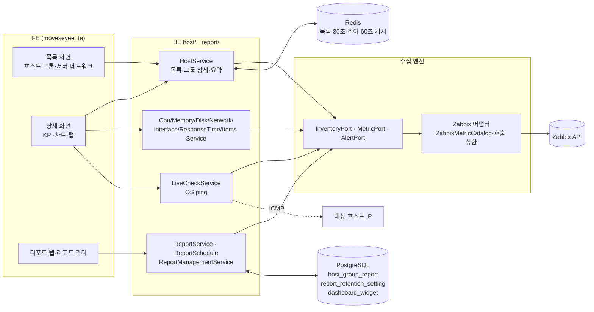

# 인프라 모니터링(호스트 그룹·서버·네트워크) 기능 상세 가이드

> 이 영역은 운영자가 Zabbix가 수집한 호스트 상태를 **그룹 → 호스트 → 자원(CPU·메모리·디스크·트래픽·인터페이스)** 순서로 좁혀 보는 화면 묶음이다. 호스트 그룹 목록·상세(리소스 추이, 위험 호스트, 알림 추이, 호스트 목록, 주/월 리포트), 서버 모니터링 목록·상세, 네트워크 모니터링 목록·상세, 헬스체크(ping·agent), 차트 조회 방식(원시/시간 요약 선택, 증분 조회), 리포트 보존 설정의 인프라 부분, DB·GPU "준비 중" 화면을 다룬다. 이벤트/알림 화면, Zabbix 쓰기 관리, 클라우드(EC2), APM은 범위 밖이다. 모든 내용은 **소스 정적 대조**(BE `e55948c`, FE `9dfcbe8`)로 확인했고 서버 기동·HTTP 호출·브라우저 렌더는 하지 않았다.

## 1. 한눈에 보기

### 1.1 기능 목록

| 기능 | 화면 주소·메뉴 위치 | 상태 | 권한·라이선스 | 한 줄 설명 |
|---|---|---|---|---|
| 호스트 그룹 목록 | `/monitoring/host-group` · 사이드바 모니터링 > 호스트 그룹 | 현재 | 역할 권한 `HOST_GROUP` 보기(FE). 목록 API는 역할 권한 미적용(공유 EP) | 그룹별 호스트 수와 기기분류 분포 표 + 전체 인프라 KPI |
| 호스트 그룹 상세 | `/monitoring/host-group/:id?tab=…` | 현재 | `HOST_GROUP` 보기(FE·BE) | KPI(가용성·건강도) + 5개 탭 |
| └ 리소스 추이 탭 | `tab=resource-trend`(기본) | 현재 | 〃 | CPU·메모리·디스크·트래픽 상위 10개 호스트 시계열, 디스크 현황 막대·마운트 표 |
| └ 위험 호스트 탭 | `tab=top-hosts` | 현재 | 〃 | 호스트별 상태·건강값·활성 알람 수 + 헬스체크 버튼 |
| └ 알림 추이 탭 | `tab=alert-trend` | 현재 | 〃 | 최근 7일 고정, 심각도별 발생 건수 막대 + 최근 100건 |
| └ 호스트 목록 탭 | `tab=host-list` | 현재 | 〃 | 기기분류별 호스트 수와 호스트 이름(클릭 시 호스트 정보 모달) |
| └ 리포트 탭 | `tab=report` | 현재 | `HOST_GROUP` 보기 + 그룹 가시성(BE) | 주간·월간 자원/알람 스냅샷, PDF·Excel 내보내기 |
| 헬스체크(ping·agent) | 위험 호스트 탭의 행 버튼 | 현재 | `HOST_GROUP` 보기(BE) | BE가 직접 ICMP ping + Zabbix agent 인터페이스 가용성 |
| 서버 모니터링 목록 | `/monitoring/server-monitoring` · 사이드바 모니터링 > 서버 모니터링 | 현재 | `SERVER_MONITORING` 보기(FE). 목록 API는 역할 권한 미적용(공유 EP) | `device_type=server` 호스트의 현재 사용률 표 |
| 서버 상세 대시보드 | `/monitoring/server-monitoring/:id` | 현재 | `SERVER_MONITORING` 보기(FE), 상세 API는 서버 또는 네트워크 보기 | KPI 6종 + 기본 차트(CPU·메모리·디스크·네트워크·이벤트) + 커스텀 차트 |
| 서버 자원별 상세 | `/monitoring/server-monitoring/:id/{cpu\|memory\|disk\|network\|list-event}` | 현재 | 〃 | 요약 카드 + 세부 차트(내보내기·인쇄·표 보기) |
| 디스크 사용 상세(하위 경로) | `/monitoring/server-monitoring/:id/:graph/:detail` | 부분 | `SERVER_MONITORING` 보기 | 라우트는 있으나 화면 안에 진입 링크가 없다(4절 MON-17) |
| 네트워크 모니터링 목록 | `/monitoring/network-monitoring` · 사이드바 모니터링 > 네트워크 모니터링 | 현재 | `NETWORK_MONITORING` 보기(FE·BE) | `device_type=network` 호스트의 CPU·메모리·응답시간·손실률·세션·인터페이스 수 |
| 네트워크 상세 대시보드 | `/monitoring/network-monitoring/:id` | 현재 | `NETWORK_MONITORING` 보기(FE), 상세 API는 서버 또는 네트워크 보기 | 인터페이스 상태·CPU·응답시간·인터페이스 TOP 5·세션·이벤트 |
| 네트워크 자원별 상세 | `/monitoring/network-monitoring/:id/{cpu-memory\|interface-status\|interface-top-5\|response-time\|sessions\|list-event}` | 현재 | 〃 | 요약 + 세부 차트/표 |
| 커스텀 차트(호스트 공용 위젯) | 서버·네트워크 상세의 "커스텀 차트" 탭 | 현재 | 보기: 서버 또는 네트워크 보기 + 호스트 가시성, 편집: 편집 권한 | 사용자가 고른 아이템의 시계열 차트. 그 호스트를 보는 모든 사용자가 공유 |
| 수집 정보 보기 | 서버·네트워크 목록의 "보기" 버튼(모달) | 현재 | 서버 또는 네트워크 보기(BE) | 호스트에 연결된 템플릿과 아이템·최신값 전체 |
| 차트 자동 갱신 주기 | 서버·네트워크 자원별 상세 화면 상단 | 현재 | 없음(브라우저 설정) | 끔·30초·1분(기본)·3분 |
| 최근 본 항목 | 그룹·서버·네트워크 목록 상단 | 현재 | 없음(브라우저 저장) | 유형별 최근 5개, 24시간 유지 |
| 헤더 전역 검색(호스트) | 화면 상단 검색 | 현재 | 역할 권한 미적용(공유 EP) | 호스트 이름·IP 부분 일치, 최대 20건 |
| 리포트 관리(호스트 그룹 탭) | `/setting/report-management` · 관리 콘솔(⚙) > 운영 | 현재 | 관리자(ADMIN·SUPER_ADMIN) | 저장된 그룹 리포트 목록·삭제, 보존 기간 설정 |
| DB 모니터링 | `/database-monitoring/` · 사이드바 최상위 | 계획 | 라이선스 기능 `DB_MONITORING` | "준비 중" 안내만 표시 |
| GPU 모니터링 | `/gpu-monitoring/` · 사이드바 최상위 | 계획 | 라이선스 기능 `GPU_MONITORING` | "준비 중" 안내만 표시 |

### 1.2 전체 구조

모든 화면은 같은 흐름을 탄다. FE 화면이 `services/host-monitoring.api.ts`(일부 `interface.api.ts`)로 BE를 부르고, BE `host/` 패키지의 서비스가 **수집 엔진 포트**(`InventoryPort`·`MetricPort`·`AlertPort`)에 질문하며, Zabbix 어댑터(`engine-zabbix`)가 그것을 Zabbix JSON-RPC(`host.get`·`item.get`·`history.get`·`trend.get`·`problem.get`·`event.get`)로 바꾼다. 리포트만 자체 DB(`host_group_report`)에 스냅샷을 저장한다.

BE 패키지 구성은 다음과 같다(`moveseye-be-spring/src/main/java/com/dmove/moveseye/host/`).

| 하위 패키지 | 역할 | 주요 클래스 |
|---|---|---|
| (루트) | 목록·그룹 상세·호스트 요약·검색·인터페이스 표 | `HostController`(`/hosts`), `HostService`(2,241줄), `HostVisibilityChecker`, `HostGroupVisibilityChecker` |
| `cpu/` `memory/` `disk/` `network/` `responsetime/` `hostinterface/` `items/` | 호스트 1대의 자원별 요약·라인 차트 | 각 `*Controller`(`/host/{id}/…`, `/session/{id}/…`, `/interface/{id}/…`), `*Service` |
| `livecheck/` | 헬스체크 | `LiveCheckService`, `OsPingExecutor`, `IpValidator` |
| `domain/` `repository/` | 리포트 스냅샷·보존 설정·커스텀 위젯 엔티티 | `HostGroupReport`, `ReportRetentionSetting`, `DashboardWidget` |
| `manage/` `coverage/` `snapshot/` | 호스트 등록 관리·모니터링 커버리지(이 문서 범위 밖 — Zabbix 관리 영역) | `HostManageService`, `MonitoringCoverageService` |

리포트 로직은 `report/` 패키지(`ReportService`, `ReportSchedule`, `ReportManagementService`, `ReportPeriod`)에 있다.

## 2. 기능별 상세

### 2.1 호스트 그룹 목록

- **무엇을 하는가** — 내가 볼 수 있는 호스트 그룹을 표로 보고, 그룹 상세로 들어가는 출발점이다. 표는 그룹별 **호스트 수와 기기분류 분포**(서버·네트워크·보안·데이터베이스·하드웨어·미분류)를 보여 준다. 그룹별 알람 수·정상 비율은 이 표에 없다.
- **화면과 진입 경로** — 사이드바 모니터링 > 호스트 그룹, 주소 `/monitoring/host-group`. 검색어·정렬·페이지는 URL query(`keyword`·`sortBy`·`sortDirection`·`offset`·`limit`)에 실린다. 검색 팔레트(`navSearchEntries`)에도 등록돼 있다. 카드 보기(`HostGroupCardView`)는 화면에서 숨겨져 있다.
- **사용 방법**
  1. 상단 KPI 5칸을 본다: 호스트 그룹 수, 총 호스트(가용 호스트 수), 가용성(%), 건강도(/100), 활성 알람(심각도별 분해).
  2. 검색창에 그룹 이름 일부를 입력한다(대소문자 무시, 부분 일치).
  3. 그룹 이름을 눌러 상세로 간다. "최근 본 항목"에서 최근에 연 그룹으로 바로 갈 수도 있다.
- **동작 원리**
  - 표: `HostGroupTableView` → `GET /hosts/hostgroups` → `HostService.getHostGroup`. 그룹 전체(`InventoryPort.listGroups`) + 전 그룹 호스트 1회 조회(태그·그룹 포함)로 스냅샷을 만들고, **사용자별 30초 Redis 캐시**(키 `HOST_LIST:groups:{principal}`)에 넣는다. 검색·정렬·페이징은 캐시 뒤에서 요청마다 계산한다.
  - 기기분류 집계는 호스트의 `device_type` 태그가 **정확히 1개**일 때 그 값을 소문자로 쓴다. 태그가 없거나 2개 이상이면 미분류다.
  - 응답의 `safetyPercentage`(100)·`alerts`(0,0,0)·`statusCounts`(빈 값)는 형식 유지를 위한 **고정 기본값**이다. 목록 화면은 이 값을 쓰지 않는다.
  - KPI 스트립: `HostGroupListKpiStrip` → 홈 요약 API(`/home/summary`)를 재사용한다. 가용성·건강도는 **전체 호스트 기준**이며 표의 검색·페이지와 무관하다.
- **주요 API**

| Method | Path | 용도 | 권한 |
|---|---|---|---|
| GET | `/hosts/hostgroups` | 그룹 목록(검색·정렬·페이징, `selectedId`) | 로그인. 역할 권한 미적용(서버·네트워크 목록 필터, 문제 목록, 자산·지도 화면이 함께 쓰는 공유 EP) |
| GET | `/home/summary` | KPI 스트립(홈 영역 소유) | 홈 영역 문서 참조 |

- **권한·라이선스** — 메뉴와 라우트는 역할 권한 `HOST_GROUP` 보기로 가린다. 데이터 범위는 Zabbix 사용자 토큰이 정한다(관리자는 시스템 토큰, 연동 사용자는 본인 Zabbix 권한 범위의 그룹만). Zabbix 미연동 비관리자는 Zabbix 조회 시점에 HTTP 200 + 본문 `code:403`으로 거부된다.
- **빈 값·실패·경계 상태** — 그룹이 0개면 빈 표다. BE 정렬은 `name`·`totalHosts`·`safetyPercentage`만 지원한다. 그 밖의 열(서버·네트워크 등)의 정렬 화살표를 눌러도 순서가 바뀌지 않는다(MON-15).
- **운영 주의** — 그룹 구성(호스트 추가·태그 변경)은 최대 30초 뒤에 목록에 반영된다.

### 2.2 호스트 그룹 상세 — KPI 헤더와 공통 틀

- **무엇을 하는가** — 그룹 한 개의 현재 건강 상태를 숫자 4개로 요약하고, 아래 5개 탭으로 추이·위험 호스트·알림·구성·리포트를 본다.
- **화면과 진입 경로** — `/monitoring/host-group/:id`. 활성 탭은 URL `tab`(`resource-trend`·`top-hosts`·`alert-trend`·`host-list`·`report`)에, 기간은 `period`(초) 또는 `from`·`to`에 실린다. 기간 버튼은 12시간(기본)·1일·7일이며 1시간 버튼은 없다(리소스 추이가 시간당 요약을 쓰기 때문). 진입 시 "최근 본 항목"에 그룹이 기록된다.
- **사용 방법** — KPI 헤더 값의 뜻은 다음과 같다.

| KPI | 계산식 | 근거 |
|---|---|---|
| 가용성(%) | Zabbix 인터페이스 중 하나라도 `available=1`인 호스트 수 ÷ 전체 호스트 수 × 100. 인터페이스가 없는 호스트는 비가용 | `HostService.calculateGroupHealthKpi` |
| 건강도(/100) | 호스트별 점수의 평균. 점수 = 그 호스트의 **가장 심각한 활성 알람 등급**으로 결정(알람 없음·미분류·정보 100, 경고 70, 보통 40, 높음 20, 재해 0). 비가용 호스트는 0 | `HEALTH_SCORE_BY_STATUS` |
| 건강도 등급 | 80 이상 양호, 50 이상 주의, 그 미만 위험 | `HostGroupKpiHeader.getHealthGrade` |
| 총 호스트 수 | 그룹 소속 호스트 수 | |
| 활성 알람 | 그룹 활성 알람 중 **경고 이상**(warning + average 이상) 건수. 정보·미분류 등급은 빠진다 | `getActiveAlarmCount` |

- **동작 원리** — `GET /hosts/{groupid}` → `HostService.getHostGroupDetail`. 그룹 1건 + 그룹 호스트(태그) + 그룹 활성 알람(`AlertPort.listActive`) + 호스트별 최고 심각도(활성 알람 2차 조회) + 호스트별 메모리·디스크 최신값을 한 번에 계산한다. 캐시는 없고 FE 기본 `staleTime` 60초만 적용된다. 응답의 `recentlyViewedHosts`(기기분류별 호스트 사용률)는 현재 화면이 쓰지 않으며 그 안의 `cpuUsage`는 항상 0이다.
- **주요 API**

| Method | Path | 용도 | 권한 |
|---|---|---|---|
| GET | `/hosts/{groupid}` | 그룹 상세 KPI | `HOST_GROUP` 보기 |

- **빈 값·실패·경계 상태** — 호스트가 0대인 그룹은 가용성·건강도가 100으로 나온다. 볼 수 없는 그룹 id는 `HOST_NOT_FOUND`다. 빈 그룹의 100%는 "문제 없음"이 아니라 "판정 대상 없음"이다.

### 2.3 리소스 추이 탭

- **무엇을 하는가** — 그룹 호스트의 CPU·메모리·디스크 사용률(%)과 트래픽(bps)을 시간 축으로 본다. 한 번에 **값이 높은 상위 10개 호스트만** 그린다.
- **사용 방법**
  1. 지표(CPU·메모리·디스크·트래픽)와 집계(평균·최대)를 고른다.
  2. 기간은 화면 상단의 공유 기간(12시간·1일·7일 또는 직접 지정)을 따른다.
  3. 디스크를 고르면 시계열(막대) 아래에 **현재값 섹션**(호스트별 사용률 막대 + 호스트를 골라 보는 마운트별 표)이 추가된다.
- **동작 원리**
  - `useGroupResourceTrend` → `GET /hosts/{groupid}/resource-trend?metric=&agg=&from=&to=` → `HostService.getGroupResourceTrend`. 자동 폴링은 없다(기간을 바꿀 때만 조회).
  - 데이터 원천은 항상 **Zabbix trends(시간당 min/max/avg)** 다. 1시간 미만 구간은 버킷이 없어 빈 차트가 된다.
  - 호스트를 묶음으로 나눠 조회한다(CPU·메모리 200대, 디스크 50대, 트래픽 10대씩, `ResourceTrendQuery.hostChunkSize`). 묶음마다 상위 10개 후보만 남겨 메모리 사용을 제한한다.
  - 아이템 선택: CPU는 `system.cpu.util`·`system.hw.cpu.util`, 메모리는 `vm.memory.utilization`·`vm.memory.size[pused]`·`system.hw.mem.pused`, 디스크는 `vfs.fs.size[…]`와 `vfs.fs.dependent.size[…]` 양쪽의 `pused`, 트래픽은 `net.if.in[…]`·`net.if.out[…]` 중 errors·dropped·discards·packets 등 부가 지표를 뺀 것.
  - 호스트 대표값: 같은 시각에 아이템이 여러 개면 CPU·메모리·디스크는 평균(집계가 최대면 최대), **트래픽은 전 인터페이스 in+out 합**이다. 호스트 순위는 평균 집계면 기간 평균, 최대 집계면 기간 최대로 매긴다.
  - 결과는 사용자·그룹·지표·집계·기간별 60초 Redis 캐시(키 `host-group:resource-trend:{principal}:…`)에 저장한다. 빈 결과는 캐시하지 않는다.
  - 디스크 현재값 섹션: `GET /hosts/{groupid}/disk/current`(`DiskService.getGroupCurrent`)가 그룹 호스트 전체의 마운트 합산 사용량·용량·가중 사용률을 주고, 호스트를 고르면 `GET /host/{hostid}/disk/detail`이 마운트별 표를 준다. 둘 다 같은 원천(`vfs.fs.dependent[<mount>,data]` JSON 우선, 없으면 `vfs.fs.size[<mount>,*]`)을 써서 막대와 표가 일치한다.
- **주요 API**

| Method | Path | 용도 | 권한 |
|---|---|---|---|
| GET | `/hosts/{groupid}/resource-trend` | 상위 10개 호스트 시계열 | `HOST_GROUP` 보기 |
| GET | `/hosts/{groupid}/disk/current` | 호스트별 현재 디스크 요약 | `HOST_GROUP` 보기 |
| GET | `/host/{id}/disk/detail` | 마운트별 현재 용량·inode | `HOST_GROUP`·`SERVER_MONITORING`·`NETWORK_MONITORING` 중 하나 |

- **빈 값·실패·경계 상태** — 해당 아이템이 없는 호스트는 차트에 나타나지 않는다. 디스크 데이터가 없는 호스트는 현황 응답에 `pused=null`로 포함되고 막대에서는 빠진다. trends 조회가 엔진 예산(호출 2,000회·120초)을 넘으면 오류로 끝나며 부분 결과를 그리지 않는다.
- **운영 주의** — 트래픽 단위는 bps(초당 비트, 1000 진법 표기)다. 디스크 현황 막대는 그룹의 전체 호스트를 한 차트에 그린다.

### 2.4 위험 호스트 탭과 헬스체크

- **무엇을 하는가** — 그룹 호스트를 건강값이 낮은 순으로 나열하고, 의심되는 호스트를 그 자리에서 ping·agent로 확인한다.
- **사용 방법**
  1. 표는 기본으로 건강값 오름차순(가장 위험한 호스트가 위)이다. 이름·상태·건강값·활성 알람 열을 눌러 정렬한다(서버 정렬, URL `sortBy`·`sortDirection`).
  2. 행의 "헬스체크" 버튼을 누르면 그 행의 Ping·Agent 칸이 채워진다. 다시 누르면 재측정한다. 결과 배지에 마우스를 올리면 확인 시각이 나온다.
- **화면 값의 뜻**

| 열 | 값 | 뜻 |
|---|---|---|
| 상태 | `OK` 또는 심각도 | 활성 알람이 없으면 OK, 있으면 가장 높은 등급 |
| 건강값 | 0~100 | 2.2절 건강도 점수와 같은 표. 비가용 호스트는 0 |
| 활성 알람 | 건수 | 그 호스트에 걸린 활성 알람 전체(등급 무관) |
| Ping | Alive(왕복 ms)·Dead·Unknown | **BE 서버가 대상 IP로 직접 보낸 ICMP** 결과 |
| Agent | Available·Unavailable·Unknown | Zabbix가 기록한 agent 인터페이스 가용성 |

- **동작 원리**
  - 표: `GET /hosts/{groupid}/top-hosts` → `HostService.getGroupTopHosts`. 그룹 호스트 + 활성 알람 조회 2회(최고 심각도·건수) + `icmpping` 최신값 1회를 합쳐 전체를 만든 뒤 정렬·페이징한다. 응답에는 `agentHealth`·`interfaceHealth`·`icmpHealth`(Zabbix `icmpping` 아이템 기준)도 들어 있지만 현재 표는 이 세 값을 쓰지 않고 헬스체크 결과만 보여 준다.
  - 헬스체크: `GET /hosts/{hostid}/livecheck` → `LiveCheckService.liveCheck`. 대상 IP는 agent 인터페이스 주소 → 대표 인터페이스 주소 → 첫 인터페이스 주소 순으로 고른다. IPv4/IPv6 형식 검증을 통과한 값만 `OsPingExecutor`에 넘긴다. Windows는 `ping -n 2 -w 2000`, 그 외는 `ping -c 2 -W 2`를 셸 없이 인자 배열로 실행하고 종료 코드 0이면 alive다.
  - FE는 같은 호스트의 버튼·Ping·Agent 세 칸이 하나의 쿼리(`HOST_LIVE_CHECK`, 자동 재시도·포커스 재조회 없음)를 공유해 호출은 1회다.
- **주요 API**

| Method | Path | 용도 | 권한 |
|---|---|---|---|
| GET | `/hosts/{groupid}/top-hosts` | 호스트별 상태 표(`offset`·`limit`·`sortBy=health\|severity\|alerts\|name`) | `HOST_GROUP` 보기 |
| GET | `/hosts/{hostid}/livecheck` | ping + agent 즉시 확인 | `HOST_GROUP` 보기 |

- **빈 값·실패·경계 상태** — IP가 형식에 맞지 않거나(DNS 이름만 등록된 호스트 등) ping 실행 자체가 실패하면 Ping은 Unknown이다. agent 인터페이스가 없으면 Agent는 Unknown이다. 호출이 실패하면 두 칸에 "실패" 배지가 뜬다.
- **운영 주의** — ping은 **BE가 실행되는 서버(컨테이너)에서 대상 호스트로** 나간다. BE와 대상 사이 방화벽이 ICMP를 막으면 대상이 살아 있어도 Dead다. BE 실행 환경에 `ping` 실행 파일과 ICMP 권한이 있어야 한다(MON-11).

### 2.5 알림 추이 탭

- **무엇을 하는가** — 그룹에서 **발생한** 알람(해결된 것 포함)을 심각도별 스택 막대로 보고, 최근 발생 알람을 표로 확인한다.
- **사용 방법** — 기간은 화면 상단 기간과 무관하게 **최근 7일 고정**이다(탭을 연 시각 기준, 자동 갱신 없음). 막대나 툴팁 링크, 표의 행을 누르면 같은 그룹·기간·심각도로 걸러진 문제 목록(이력 모드)으로 이동한다.
- **동작 원리**
  - `useGroupAlertTrend` → `GET /hosts/{groupid}/alert-trend?from=&to=` → `HostService.getGroupAlertTrend`.
  - 버킷 크기는 기간이 1일 이하면 1시간, 그보다 길면 1일이다. 버킷 경계는 epoch를 버킷 크기로 내림한 값이라 **UTC 기준**이다(1일 버킷은 UTC 00:00~24:00).
  - 건수는 행을 받지 않고 `AlertPort.countHistory`로 센다. 버킷마다 총계를 먼저 세고, 0이 아닌 버킷만 등급 5개를 따로 센 뒤 나머지 한 등급은 뺄셈으로 구한다(7일이면 최대 48회 조회).
  - 하단 표는 같은 기간의 최근 100건(`ALERT_EVENT_LIMIT`)이다. 한 알람에 호스트가 여럿이면 첫 호스트 이름만 보인다.
  - 사용자·그룹·기간별 60초 Redis 캐시. 요청 기간이 93일을 넘거나 `to < from`이면 `INVALID_DATE`로 거절한다.
- **주요 API**

| Method | Path | 용도 | 권한 |
|---|---|---|---|
| GET | `/hosts/{groupid}/alert-trend` | 버킷별 심각도 건수 + 총계 + 최근 100건 | `HOST_GROUP` 보기 |

- **빈 값·실패·경계 상태** — 알람이 없어도 버킷 골격은 0으로 채워진다. 기간 총계가 0인 심각도는 범례에서 빠진다.

### 2.6 호스트 목록 탭

- **무엇을 하는가** — 그룹 구성을 기기분류별로 본다. 행 하나가 기기분류 하나이고, 호스트 수와 호스트 이름 목록이 붙는다.
- **사용 방법** — 호스트 이름을 누르면 호스트 정보 모달(`HostDetailModal`)이 열린다. 기기분류·호스트 수 열로 정렬한다.
- **동작 원리** — `GET /hosts/device-type/{groupid}` → `HostService.getDeviceTypeSummary`. 분류 판정은 기기분류 레지스트리(설정 > 기기분류 관리의 활성 코드, 비어 있으면 기본 6종)를 쓰는 `DeviceTypeResolver`다. 행 순서는 레지스트리의 정렬 순서를 따른다.
- **주요 API**

| Method | Path | 용도 | 권한 |
|---|---|---|---|
| GET | `/hosts/device-type/{groupid}` | 기기분류별 호스트 수·이름 | `HOST_GROUP` 보기 |
| GET | `/hosts/detail/{hostid}` | 호스트 정보 모달·상세 헤더 | 로그인(공유 EP) |

- **빈 값·실패·경계 상태** — 이 탭은 URL에 기간이 준비된 뒤에만 조회한다(초기 깜빡임 방지). 한국어 화면에서 "호스트 수" 열 제목이 "프로세스"로 표시된다(MON-17).

### 2.7 리포트 탭(주간·월간 그룹 리포트)

- **무엇을 하는가** — 마감된 주(월~일)·월 단위로 그룹의 자원 사용 요약과 알람 요약을 **저장된 스냅샷**으로 본다. 정기 보고 자료를 PDF·Excel로 내려받는다.
- **사용 방법**
  1. 주간·월간을 고른다. 목록은 최근 8주 또는 6개월이다(진행 중인 기간은 없다).
  2. 기간을 고르면 자원 요약(CPU·메모리·디스크·트래픽의 평균·최대·최소), 호스트별 비교, 심각도별 알람 건수, 알람 상위 10개 호스트가 나온다.
  3. "내보내기"에서 PDF(화면 영역을 그대로 변환) 또는 Excel(자원 요약·알람 통계 시트)을 받는다. 내보내기는 FE에서 만든다(BE 호출 없음). Excel의 트래픽 값은 화면과 같은 bps 표기다.
- **동작 원리**
  - 생성 경로는 둘이다.
    - **배치**: `report_weekly`(기본 매주 월 03:00), `report_monthly`(기본 매월 1일 03:30). `ReportSchedule`이 시스템 권한으로 전 그룹의 직전 기간을 순서대로 계산해 저장(upsert)한다. 실행 요약은 `ok=N fail=M`이고, 한 건도 성공하지 못하면 실패로 기록된다.
    - **조회 시 백필**: `GET /hosts/{groupid}/reports`가 최근 N개 마감 기간을 돌며 저장본이 없으면 **그 자리에서 계산해 저장**한다(`ReportService.ensureReport`). 그래서 배치가 돌기 전의 그룹도 리포트가 나오고, 처음 열 때 응답이 느리다.
  - 기간 경계는 **UTC**다. 주간은 월요일 00:00 UTC부터 다음 월요일 00:00 UTC 직전까지다.
  - 자원 요약: 리소스 추이와 같은 `ResourceTrendQuery`(trends)를 쓴다. 호스트별 평균은 시간 버킷 평균의 평균, 최대·최소는 버킷 max·min의 극값이다. 그룹 값은 버킷마다 호스트 평균을 다시 평균한다(트래픽만 호스트 합).
  - 알람 요약: 기간 내 발생 알람을 `AlertPort.scanHistory`로 끝까지 흘려 읽어 심각도 총계와 호스트별 건수(첫 호스트 기준, 상위 10개)를 만든다. 끝까지 읽지 못하면 저장하지 않고 오류로 끝낸다.
  - FE는 목록 응답이 상세 본문을 모두 담고 있어 상세 API를 따로 부르지 않는다.
- **주요 API**

| Method | Path | 용도 | 권한 |
|---|---|---|---|
| GET | `/hosts/{groupid}/reports?periodType=WEEK\|MONTH&limit=` | 최근 N개 기간(본문 포함), 없으면 백필 | `HOST_GROUP` 보기 + 그룹 가시성 |
| GET | `/hosts/{groupid}/reports/detail?periodType=&periodStart=` | 단일 기간. **FE 미사용** | 〃 |

- **데이터** — `host_group_report`(Flyway V3): `group_id`, `period_type`(WEEK·MONTH), `period_start`, `period_end`, `resource`·`alerts`·`hosts`(jsonb), `host_count`, `created_at`. `(group_id, period_type, period_start)` 유일. 보존은 2.13절의 정리 배치가 맡는다.
- **권한·라이선스** — 저장본은 Zabbix를 거치지 않으므로 `HostGroupVisibilityChecker`가 요청마다 "이 사용자가 이 그룹을 볼 수 있는가"를 사용자 토큰으로 확인한다. 확인이 실패하거나 Zabbix 오류가 나면 거부한다(관리자는 확인 없이 통과).
- **빈 값·실패·경계 상태** — 미마감 기간의 상세 요청은 `REPORT_PERIOD_NOT_CLOSED`다. 호스트가 없는 그룹은 자원이 전부 null, 알람 0건인 스냅샷이 저장된다. Zabbix trends 보존 기간보다 오래된 기간을 백필하면 자원이 비어 있는 스냅샷이 저장된다.
- **운영 주의** — 스냅샷은 한 번 저장되면 다시 계산하지 않는다(리포트 관리에서 삭제하면 다음 조회 때 다시 만들어진다). 백필은 **조회한 사용자의 Zabbix 권한**으로 계산된다(MON-03).

### 2.8 서버 모니터링 목록

- **무엇을 하는가** — `device_type` 태그가 정확히 `server` 하나인 호스트의 현재 상태와 사용률을 한 표에서 본다.
- **화면과 진입 경로** — 사이드바 모니터링 > 서버 모니터링, `/monitoring/server-monitoring`. URL query: `groupids`(그룹 필터), `status`(심각도 필터), `keyword`, `sortBy`, `sortDirection`, `offset`, `limit`.
- **사용 방법**
  1. 상단 KPI 4칸: 총 호스트, 장애(재해+높음), 경고(보통+경고), 정상·기타(정보+미분류). 검색·그룹 필터를 반영하고 상태 필터는 반영하지 않은 모집단이다.
  2. 그룹 필터·상태 필터·검색(이름·IP·OS 부분 일치)으로 좁힌다.
  3. 호스트 이름을 눌러 상세로 간다. "보기"를 누르면 수집 정보 모달이 열린다.
- **화면 값의 뜻과 원천**

| 열 | 원천(Zabbix 아이템 키) | 비고 |
|---|---|---|
| 호스트 상태 | 그 호스트의 활성 알람 중 최고 심각도 | **활성 알람이 없으면 "미분류"** 로 표시된다(MON-07) |
| 호스트 OS | 인벤토리 OS | |
| CPU 사용량 | `system.cpu.util` 최신값 | 아이템이 없으면 0 |
| 메모리 사용량 | `vm.memory.utilization` 최신값 | 아이템이 없으면 0 |
| 디스크 사용량 | `vfs.fs.size[/,pused]` 최신값(루트 마운트, 폴백 없음) | Windows·dependent 계열만 가진 호스트는 0 |
| 인바운드·아웃바운드 트래픽 | `net.if.in[…]`·`net.if.out[…]` 중 **둘째 파라미터가 `bytes`인 아이템**의 합 | 그런 아이템이 없는 환경은 항상 0(MON-01) |
| 프로세스 | `proc.num[]` 최신값 | |

- **동작 원리** — `GET /hosts/server` → `HostService.getServers`. Zabbix 조회(호스트 2회 + 최신값 3회 + 활성 알람 1회)를 **사용자 × 그룹 필터별 30초 스냅샷**(키 `HOST_LIST:server:{principal}:{groupids|all}`)으로 캐시하고, 검색·상태 필터·정렬·페이징은 요청마다 계산한다. 응답의 `numberOfHosts`는 그룹 필터와 무관한 전체 서버 수, `totalInbound`·`totalOutbound`는 **현재 페이지 행의 합**이다. FE는 URL에 기간 파라미터가 없으면 주기 재조회를 하지 않는다(화면 진입·창 포커스 때 재조회, `staleTime: 0`).
- **주요 API**

| Method | Path | 용도 | 권한 |
|---|---|---|---|
| GET | `/hosts/server` | 서버 목록 | 로그인. 역할 권한 미적용(네트워크 맵 편집기의 호스트 검색이 함께 쓰는 공유 EP) |
| GET | `/hosts/{hostid}/collected-info` | 수집 정보 모달(템플릿·아이템 전체) | 서버 또는 네트워크 보기 |
| POST | `/users/sync` | 표 우측 "동기화" 버튼 | 관리자 |

- **빈 값·실패·경계 상태** — BE 정렬 키는 `hostName`·`cpuUsage`·`memoryUsage`·`diskUsage`·`trafficInbound`·`trafficOutbound`다. 화면에서는 사용률·트래픽 열의 정렬이 꺼져 있고, 상태·IP·OS 열은 정렬 화살표가 있으나 BE가 지원하지 않아 순서가 바뀌지 않는다(MON-15).
- **운영 주의** — 표 우측의 "동기화" 버튼과 시각은 **메트릭 신선도가 아니라** Zabbix 사용자·그룹 미러 동기화다(MON-14). 서버로 보이려면 호스트에 `device_type=server` 태그가 정확히 1개 있어야 한다.

### 2.9 서버 상세 대시보드

- **무엇을 하는가** — 호스트 1대의 현재 상태(KPI)와 자원별 추이를 한 화면에 모은다.
- **화면과 진입 경로** — `/monitoring/server-monitoring/:id`. 상단 헤더(이름·IP·OS·업타임 등, `GET /hosts/detail/{hostid}`), KPI 스트립, "기본 차트"·"커스텀 차트" 탭으로 구성된다. 진입 시 "최근 본 항목"에 기록된다. 기간은 기본 차트 탭 안의 기간 선택(1시간 기본·12시간·1일·7일·직접 지정)이며 URL `period` 또는 `from`·`to`에 실린다.
- **사용 방법**
  1. KPI 6칸을 본다: CPU·메모리·디스크 사용률(70 이상 주의, 90 이상 위험 색), 트래픽(인바운드 / 아웃바운드), 활성 알람(건수·최고 심각도·등급별 분해, 눌러서 문제 목록으로), 인터페이스(가용 수 / 전체 수).
  2. 기본 차트 5칸을 본다: CPU 사용률, 메모리 사용률, 디스크(파티션별 사용량), 네트워크(BPS·PPS 전환), 이벤트 목록.
  3. 각 차트 카드에서 자원별 상세(2.10절, 주소 `…/:id/{cpu|memory|disk|network|list-event}`)로 이동한다. 이벤트 카드의 "기본 정보"·"서비스"·"로그" 버튼은 모달을 연다.
- **동작 원리**
  - KPI: `GET /hosts/{hostid}/summary` → `HostService.getSummary`. 사용률·트래픽은 서버 목록과 같은 계산(`fetchHostItemsMap`), 활성 알람은 그 호스트의 `listActive` 결과를 등급별로 센다. 태그에서 `device_type`은 빼고 보여 준다.
  - 업타임: `system.hw.uptime`이 0이거나 없으면 `system.uptime`으로 폴백한다.
  - 기본 차트: 2.11절의 차트 조회 방식을 따른다. CPU·메모리·네트워크는 증분 조회, 디스크 카드는 `GET /host/{id}/disk/summary`다.
  - 이벤트 카드와 모달은 이벤트 영역 API가 원천이다: 목록 `ListEventsTable`(이벤트 서비스), 모달 `GET /event/{id}/events/basic-information`·`/service-details`·`/logs`.
  - 커스텀 차트: `GET/POST/PATCH/DELETE /host/{id}/widgets…`(`WidgetsController`, 테이블 `dashboard_widget`, Flyway V2)와 `GET /host/{id}/items/history?itemids=`(`ItemsService`). 위젯은 호스트 단위로 저장돼 그 호스트를 보는 모든 사용자가 공유한다. 수치형 아이템(value_type 0·3)만 그린다.
- **주요 API**

| Method | Path | 용도 | 권한 |
|---|---|---|---|
| GET | `/hosts/detail/{hostid}` | 헤더 정보 | 로그인(공유 EP) |
| GET | `/hosts/{hostid}/summary` | KPI 스트립 | 서버 또는 네트워크 보기 |
| GET | `/host/{id}/cpu/line-charts/incremental` 등 | 기본 차트(2.11절) | 서버 또는 네트워크 보기 |
| GET | `/host/{id}/disk/summary` | 디스크 카드 | 서버 또는 네트워크 보기 |
| GET·POST·PATCH·DELETE | `/host/{id}/widgets`, `/widgets/layout`, `/widgets/{widgetId}` | 커스텀 차트 | 보기/편집 권한 + 호스트 가시성 |
| GET | `/host/{id}/items/history` | 커스텀 차트 데이터 | 서버 또는 네트워크 보기 |

- **빈 값·실패·경계 상태** — KPI의 사용률은 아이템이 없어도 0.0으로 나온다(값 없음과 0을 구분하지 않는다, MON-07). 디스크 카드는 `linux.disk.partition.list` 아이템이 없는 호스트에서 비어 있다(MON-09).

### 2.10 서버 자원별 상세(CPU·메모리·디스크·네트워크·이벤트)

주소는 `/monitoring/server-monitoring/:id/:graph`다. 왼쪽에 요약 카드(현재값과 기간 최소·최대·평균), 오른쪽에 차트가 있다. 차트는 내보내기·인쇄·표 보기 버튼을 갖는다. 화면 상단에 기간 선택과, 상대 기간일 때 "차트 자동 갱신" 선택(끔·30초·1분·3분)이 있다.

| `:graph` | 요약 API | 차트 종류 | 아이템 키와 단위 |
|---|---|---|---|
| `cpu` | `GET /host/{id}/cpu/summary` | 사용률, 구성(nice·system·iowait·interrupt 누적) | `system.cpu.util`, `system.cpu.util[,nice\|system\|iowait\|interrupt]`(%). 모델명 `cpu.model.name`, CPU 수 `system.cpu.num`, 코어 수 `cpu.core.count` |
| `memory` | `GET /host/{id}/memory/summary`(메모리·스왑 2건) | 메모리 사용률 + 사용량 구성(buffers·cached·free·used) / 스왑 카드를 누르면 스왑 사용률 + 스왑 사용량 | `vm.memory.utilization`(%), `vm.memory.size[…]`(바이트→MB), 스왑 `system.swap.size[,pused\|total\|used\|free]` |
| `disk` | `GET /host/{id}/disk/summary`(파티션 목록) | 파티션을 골라 사용률·사용량·여유량, 디스크 I/O | `vfs.fs.size[<mount>,…]`(없으면 `vfs.fs.dependent.size[…]`), `iostat.summary[<disk>,r/s\|rB/s]` |
| `network` | `GET /host/{id}/network/summary`(인터페이스 목록) | 인터페이스를 골라 BPS In/Out(+합계), PPS In/Out | 요약 `net.if.in[<if>]`·`net.if.out[<if>]`, 차트 `net.if.in[<if>,bytes]`·`[<if>,packets]` |
| `list-event` | (이벤트 영역) | 호스트의 이벤트 표(검색·정렬) | 이벤트 서비스 |

- **요약 통계의 계산**
  - 기간이 1시간을 **넘으면** trends(시간 버킷)로, 1시간 이하면 원시값으로 계산한다(`AdaptiveSeriesQuery.statsSeries`, 문턱 3,600초 초과). trends가 비어 있으면 원시값으로 폴백한다.
  - 최소·최대는 버킷 min·max의 극값이라 정확하다. **평균은 시간 버킷 평균의 단순 평균**이라 버킷별 표본 수가 다르면 원시 평균과 조금 다르다.
  - 메모리 사용률은 `vm.memory.size[pused]`(없으면 `vm.memory.pused`)를 쓰고, 그 값이 0이거나 없으면 사용량÷전체로 계산한다. 스왑도 같은 규칙(`system.swap.size[,pused]`)이다.
  - 네트워크 요약의 현재·최소·최대·평균은 BE가 bps 원값을 1,024로 나눠 보낸다. 화면은 현재값을 bps 포맷으로 다시 표시한다(MON-01의 단위 항목 참조).
- **빈 값·실패·경계 상태** — 요약 API가 빈 배열이면 "데이터 없음" 카드가 나온다. CPU 아이템이 없으면 OS "N/A", 값 0으로 응답한다. 디스크 여유량 아이템이 없으면 전체−사용으로 계산한다.

### 2.11 차트 조회 방식(원시/요약 선택, 증분 조회, 자동 갱신)

- **무엇을 하는가** — 호스트 상세의 시계열 차트가 Zabbix에서 얼마나, 어떤 해상도로 읽을지 정하는 공통 규칙이다.
- **원시(history)와 시간 요약(trends) 선택** — `AdaptiveSeriesQuery`가 맡는다.

| 용도 | 문턱 | 문턱 미만 | 문턱 이상 |
|---|---|---|---|
| 라인 차트(`chartSeries`) | 48시간(`CHART_TREND_THRESHOLD_SECONDS`) | 원시값(history) | trends의 시간당 **평균**. trends가 하나도 없으면 원시값으로 폴백 |
| 구간 통계(`statsSeries`) | 1시간 초과(`STATS_TREND_THRESHOLD_SECONDS`) | 원시값 | trends의 min·max·avg. 없으면 원시값으로 폴백 |
| 인터페이스 상태 차트 | 6시간 초과(`InterfaceService.STATE_TREND_THRESHOLD_SECONDS`) | 원시값 | trends의 **max**(그 시간의 가장 나쁜 상태) |
| 커스텀 차트(`ItemsService`) | 48시간 | 원시값. 끝까지 못 읽으면 버리고 trends | trends 직행. trends가 없는 아이템만 원시값 |

- **증분 조회**(CPU·메모리·네트워크 라인 차트만)
  1. FE(`useIncrementalChartData`)가 첫 요청은 `knownThrough` 없이 전체 구간을 받는다.
  2. 이후 갱신마다 직전 응답의 `nextKnownThrough`를 `knownThrough`로 보낸다. BE(`IncrementalChartQuery`)는 `knownThrough − 120초`부터 `min(to, knownThrough + 30분)`까지만 조회한다. 120초 겹침은 늦게 도착한 값을 보충하기 위한 것이다.
  3. 목표 시각까지 남았으면 응답의 `hasMore=true`이고 FE가 바로 다음 조각을 요청한다(오래 비활성이던 탭이 한 번에 긴 구간을 읽지 않게 한다).
  4. FE는 받은 조각을 시리즈(type + 인터페이스) × 시각으로 병합하고, 표시 범위 시작보다 오래된 점을 버린다.
  5. 표시 범위가 48시간 이상이면 BE가 `knownThrough`를 무시하고 매번 전체(trends)를 다시 읽는다(요약과 원시가 섞이지 않게).
  6. 탭이 다시 보이거나 네트워크가 복구되면 즉시 한 번 갱신한다.
- **동시 요청 합치기** — 같은 사용자·호스트·차트 종류·요청 범위의 증분 요청이 동시에 오면 `SingleFlightExecutor`가 한 번만 조회하고 결과를 나눈다. 키에 사용자(principal)가 들어가 다른 사용자와는 합쳐지지 않는다. 실행이 끝나면 키가 사라지므로 캐시가 아니다.
- **자동 갱신 주기** — `useMonitoringChartRefresh`. 기본 1분, 선택지는 끔·30초·1분·3분이다. 브라우저 localStorage(키 `dmove:monitoring-chart-refresh:{사용자 id}`)에 저장되고 계정·서버에는 저장되지 않는다. 상대 기간(`period`)일 때만 동작하며, 직접 지정한 기간(`from`·`to`)은 갱신하지 않는다.
- **증분을 쓰지 않는 차트** — 디스크, 응답시간, 세션, 인터페이스 상태, 커스텀 차트는 갱신 때마다 선택 구간 전체를 다시 읽는다. 디스크·응답시간·세션 차트는 위 자동 갱신 주기를 따르고, 인터페이스 상태 카드와 요약 카드는 3분 주기다. 응답시간은 구간 길이와 무관하게 항상 원시값이다(MON-10).
- **네트워크 차트의 인터페이스 선택** — 인터페이스를 지정하지 않으면(서버 상세 개요 카드) 현재 트래픽(in+out) 상위 10개 인터페이스만 그린다(`LINE_CHART_DEFAULT_IFACES`). 인터페이스를 지정하면 첫 두 종류(In·Out)를 가장 가까운 시각끼리 더한 `SUM` 시리즈가 추가된다.
- **주요 API**

| Method | Path | 용도 | 권한 |
|---|---|---|---|
| GET | `/host/{id}/cpu/line-charts/incremental` | CPU 증분(`types`·`from`·`to`·`knownThrough`) | 서버 또는 네트워크 보기 |
| GET | `/host/{id}/memory/line-charts/incremental` | 메모리 증분 | 〃 |
| GET | `/host/{id}/network/line-charts/incremental` | 네트워크 증분(`ifaces` 선택) | 〃 |
| GET | `/host/{id}/{cpu\|memory\|network}/line-charts` | 전체 구간 조회. **FE는 증분 EP를 쓰므로 미사용** | 〃 |
| GET | `/host/{id}/disk/line-charts` | 디스크 차트(`partition`·`device`) | 〃 |
| GET | `/host/{id}/response-time/line-charts` · `/summary` | 응답시간·손실률 | 〃 |
| GET | `/session/{id}/summary` · `/session/{id}/history` | 세션 수 | 〃 |
| GET | `/interface/{id}/interface/status` · `/interface/line-charts` | 인터페이스 상태 | 〃 |

- **빈 값·실패·경계 상태** — 증분 응답의 `coverage`는 현재 항상 `COMPLETE`다(포트가 원시 상한 도달 여부를 이 경로에 전달하지 않는다). 증분 차트는 데이터가 없어도 x축에 요청한 시작·끝 시각을 남긴다.

### 2.12 네트워크 모니터링(목록·상세)

- **무엇을 하는가** — `device_type` 태그가 정확히 `network` 하나인 장비의 상태와 지표를 본다. 구조는 서버 모니터링과 같고 지표가 다르다.
- **목록** — `/monitoring/network-monitoring`, `GET /hosts/hosts-network`(`HostService.getHostNetwork`). URL query는 `groupId`·`status`·`keyword`(이름·IP·모델)·`sortBy`(`name`·`ip`·`networkModel`)다. 캐시가 없어 요청마다 전 호스트(태그)를 읽고 네트워크 장비만 거른 뒤, 지표 6종을 지표당 1회씩 조회한다.

| 열 | 원천(Zabbix 아이템 키) |
|---|---|
| 모델 | `system.hw.model` |
| CPU 사용량 | `system.hw.cpu.util` |
| 메모리 사용량 | `system.hw.mem.pused` |
| 응답 시간 | `icmppingsec` 최신값(Zabbix 단위는 초) — 화면은 이 수에 "ms"를 붙인다(MON-05) |
| 패킷 손실 | `icmppingloss`(%) |
| 세션 수 | `system.hw.session.num` |
| 인터페이스 수 | `net.if.in[…]` 형태(파라미터가 있는) 아이템의 개수 |

- **상세 대시보드** — `/monitoring/network-monitoring/:id`. 서버 상세와 같은 틀(헤더·KPI 스트립·기본/커스텀 탭)에 다음 카드가 들어간다.

| 카드 | API | 내용 |
|---|---|---|
| 인터페이스 상태 | `GET /interface/{id}/interface/status` | 전체·UP·DOWN·관리자 DOWN 수. 전체 수는 `net.if.discovery` 배열 길이 → `ifNumber` → UP+DOWN 순으로 정한다 |
| CPU | CPU 증분 차트 | `system.cpu.util`(서버와 같은 키, MON-08) |
| 응답 시간·패킷 손실 | `GET /host/{id}/response-time/line-charts` | `icmppingsec`·`icmppingloss` 원시값 |
| 인터페이스 TOP 5 | `GET /hosts/interfaces/{hostid}` | 인터페이스별 상태·속도(Mbps)·BPS·PPS·오류, 기본 정렬 총 BPS |
| 세션 | `GET /session/{id}/summary`·`/history` | `system.hw.session.num` |
| 이벤트 | (이벤트 영역) | 호스트 이벤트 표 |

- **자원별 상세**(`/:id/:graph`)
  - `interface-status`: UP·DOWN·관리자 DOWN **포트 수**의 시계열. `ifOperStatus[<if>]`(1=UP, 2=DOWN), `ifAdminStatus[<if>]`(2=관리자 DOWN)를 시각별로 센다. 6시간 이하는 원시값, 초과는 시간 요약의 max로 센다. 원시 조회가 잘리면 요약으로 한 번 대체하고, 그것도 없으면 빈 차트다.
  - `interface-top-5`: 인터페이스 전체 표(검색·상태 필터·정렬·페이징). 값은 기간 내 history의 **가장 최근 값**이다. 행 앞의 `+` 아이콘을 누르면 `GET /hosts/interfaces/{hostid}/graph/{interfaceid}`로 BPS In/Out 그래프를 연다.
  - `cpu-memory`: CPU 요약 + 메모리 요약, CPU 사용률·메모리 사용률(`vm.memory.size[pused]` 계열) 차트.
  - `response-time`: 응답시간·손실률의 최대·평균과 차트.
  - `sessions`: 세션 항목별 현재·최소·최대·평균과 차트.
- **빈 값·실패·경계 상태** — 인터페이스 아이템이 없는 장비는 표가 비어 있다. 인터페이스 그래프는 `…bytes…` 키가 하나도 없으면 `WIDGET_NOT_FOUND` 오류다. 인터페이스 상태 차트가 요약으로 대체되거나 조회가 불완전해도 화면에 표시가 없다(MON-10).
- **운영 주의** — `system.hw.*`·`ifOperStatus[…]`·`system.hw.session.num` 키는 Zabbix 기본 템플릿의 키가 아니다. 이 화면의 값은 해당 키를 가진 템플릿이 장비에 연결돼 있어야 채워진다.

### 2.13 리포트 관리 — 호스트 그룹 리포트 부분

- **무엇을 하는가** — 관리자가 저장된 그룹 리포트를 확인·삭제하고 자동 삭제(보존) 기간을 정한다.
- **화면과 진입 경로** — 관리 콘솔(⚙) > 운영 > 리포트 관리, `/setting/report-management`. 탭은 URL `tab`으로 고른다(호스트 그룹 탭, APM 라이선스가 있으면 APM 탭). APM 탭은 APM 영역 문서가 다룬다.
- **사용 방법**
  1. 목록에서 그룹·주기별 저장 리포트를 본다(기간 시작일 최신순).
  2. 행을 골라 삭제한다. 삭제한 기간이 최근 8주/6개월 안이면 그 그룹의 리포트 탭을 다시 열 때 재생성된다.
  3. 보존 설정: 사용 여부, 주간 보존 주 수(1~520, 기본 52), 월간 보존 개월 수(1~120, 기본 24).
- **동작 원리** — `ReportManagementController`(`/admin/reports`) → `ReportManagementService`. 목록은 호스트 그룹 리포트와 APM 리포트를 합쳐 정렬·페이징한다(`ReportListAssembler`). 그룹 이름은 시스템 권한으로 Zabbix 그룹을 1회 조회해 붙이고, 실패하면 그룹 id를 그대로 보여 준다. 정리 배치 `report_cleanup`(기본 매일 04:00)이 `period_start`가 기준일(오늘 UTC − 보존 기간)보다 이른 스냅샷을 지운다. 호스트 그룹과 APM의 보존 스위치는 독립이다.
- **주요 API**

| Method | Path | 용도 | 권한 |
|---|---|---|---|
| GET | `/admin/reports` | 저장 리포트 목록(`type`·`periodType`·`groupId`·페이징) | 관리자 |
| DELETE | `/admin/reports` | 선택 삭제(본문 `ids`=호스트 그룹, `apmIds`=APM) | 관리자 |
| GET·PUT | `/admin/reports/retention` | 호스트 그룹 리포트 보존 설정 | 관리자 |

- **데이터** — `report_retention_setting`(Flyway V4, V66에서 APM 열 추가): 단일 행(id=1) `enabled`·`week_retention_weeks`·`month_retention_months`. 행이 없으면 기본값(사용·52주·24개월)으로 동작한다.
- **운영 주의** — 정리 배치는 라이선스가 만료돼도 돈다. 스케줄러에서 `report_cleanup`이 꺼져 있으면 보존 설정과 무관하게 지워지지 않는다. 주간 보존을 8주 미만으로 줄이면 정리 배치가 지운 기간을 리포트 탭 조회가 다시 만든다(MON-04).

### 2.14 최근 본 항목과 헤더 검색

- **최근 본 항목** — 그룹·서버·네트워크 상세에 들어갈 때 브라우저 localStorage(키 `dmove:recently-viewed:{사용자 id}`)에 기록한다. 유형별 최대 5개, 24시간이 지나면 사라진다. 서버에는 저장하지 않으므로 다른 브라우저·기기와 공유되지 않는다. 목록 화면 상단(`showRecentlyView`)에 노출된다.
- **헤더 전역 검색** — `GET /hosts/search?keyword=&limit=`(`HostService.searchHosts`). 전 호스트(태그·그룹 포함)를 한 번 읽어 이름(대소문자 무시)·인터페이스 주소 부분 일치로 거르고 이름순 상위 N건(기본 10, 최대 20)을 준다. 캐시가 없다.

### 2.15 DB 모니터링·GPU 모니터링(준비 중)

- **상태** — 계획. 화면(`DatabaseMonitoring.tsx`·`GpuMonitoring.tsx`)은 제목과 "준비 중입니다" 문구만 그린다. BE API가 없다.
- **진입 경로** — 사이드바 **최상위** 항목(모니터링 메뉴의 하위가 아니다), `/database-monitoring/`, `/gpu-monitoring/`. 검색 팔레트에도 있다.
- **권한·라이선스** — 역할 권한 키는 없다. 라이선스 기능 `DB_MONITORING`·`GPU_MONITORING`이 없으면 사이드바 항목이 잠금 표시가 되고, 주소로 들어가면 "준비 중" 대신 라이선스 안내(`UpsellPanel`)가 나온다.

## 3. 공통 동작과 설정

### 3.1 데이터 범위와 권한 판정

| 축 | 판정 위치 | 내용 |
|---|---|---|
| 역할 권한(화면 단위) | FE `PageWrapper permissionKey`, BE `DmovePermissionChecker.requireView/requireAnyView` | `HOST_GROUP`·`SERVER_MONITORING`·`NETWORK_MONITORING`. 호스트 상세 계열 API는 서버 또는 네트워크 중 하나면 통과 |
| 공유 EP(역할 권한 미적용) | 설계 결정 | `/hosts/hostgroups`·`/hosts/server`·`/hosts/detail/{id}`·`/hosts/search` — 다른 화면(문제 목록 필터, 지도, 홈 위젯)이 함께 써서 역할 권한을 걸지 않았다 |
| 데이터 범위(대상 단위) | Zabbix 사용자 토큰 | `CallerContexts.from`이 관리자(ADMIN·SUPER_ADMIN)는 시스템 토큰, Zabbix 연동 사용자는 본인 토큰, 미연동 비관리자는 거부 컨텍스트로 바꾼다. Zabbix가 그 토큰의 권한 범위로 호스트·그룹을 거른다 |
| 저장 데이터 접근 | `HostGroupVisibilityChecker`·`HostVisibilityChecker` | Zabbix를 거치지 않는 저장본(그룹 리포트, 호스트 위젯)은 대상 단위로 한 번 더 확인 |
| 권한 거부 응답 | 전역 | HTTP 200 + 본문 `code:403`. 401은 실제 상태 코드 |

### 3.2 캐시와 갱신 주기

| 대상 | 위치 | 수명 | 키 축 |
|---|---|---|---|
| 그룹 목록 스냅샷 | Redis `HOST_LIST:groups:` | 30초 | 사용자 |
| 서버 목록 스냅샷 | Redis `HOST_LIST:server:` | 30초 | 사용자 × 그룹 필터 |
| 그룹 리소스 추이 | Redis `host-group:resource-trend:` | 60초 | 사용자·그룹·지표·집계·from·to |
| 그룹 알림 추이 | Redis `host-group:alert-trend:` | 60초 | 사용자·그룹·from·to |
| FE 쿼리 기본 | React Query | `staleTime` 60초(서버·네트워크 목록은 0) | 쿼리 키 |
| 상세 요약 카드, 인터페이스 상태 카드, 인터페이스 TOP 5 표 | FE `usePeriodTimes`(기본값) | 상대 기간이면 3분마다 from·to를 다시 계산해 재조회 | — |
| 호스트 상세 라인 차트 전체(`useChartOption` 사용: CPU·메모리·네트워크·디스크·응답시간·세션) | FE `useMonitoringChartRefresh` | 끔·30초·1분(기본)·3분. 증분 조회는 CPU·메모리·네트워크만이고 나머지는 주기마다 전체 구간 재조회 | 브라우저별 |
| 네트워크 목록, 그룹 상세 KPI, 위험 호스트, 헤더 검색 | 캐시 없음 | 요청마다 Zabbix 조회 | — |

이 영역 화면은 SSE를 쓰지 않는다. SSE는 알림 벨·문제 목록(이벤트 영역)만 쓴다.

### 3.3 Zabbix 호출 상한(엔진 공통)

`ZabbixCallLimits`가 기동 시 읽는다. 설정하지 않으면 아래 기본값이다.

| 설정 키 | 기본값 | 뜻 |
|---|---|---|
| `zabbix.call.max-history-rows` | 100,000 | 원시 시계열 1건이 메모리에 보유할 점 수 |
| `zabbix.call.max-held-rows` | 10,000 | 모아서 돌려주는 조회의 보유 행 수 |
| `zabbix.call.max-total-rows` | 500,000 | 논리 조회 1건이 받는 행 수 |
| `zabbix.call.max-scan-rows` | 2,000,000 | 흘려보내는 스캔이 받는 행 수 |
| `zabbix.call.max-calls` | 2,000 | 논리 조회 1건의 RPC 수 |
| `zabbix.call.deadline-ms` | 120,000 | 논리 조회 1건의 전체 시간 |
| `zabbix.call.max-response-bytes` | 64MiB | RPC 1회 응답 크기 |
| `zabbix.call.policy.{method}.max-ids·max-rows·window-seconds` | `trend.get` 500·100,000·86,400 / `history.get` 200·10,000·3,000 / `item.get` 50·50,000 / `host.get` 500·10,000 | 메서드별 1회 호출 크기와 기간 분할 창 |

`policy.history.get.max-rows`가 `max-history-rows` 이상이면 기동이 실패한다. trends 조회는 불완전하면 오류로 끝나고, 원시 조회는 불완전하면 "잘림"으로 표시돼 소비자가 버리거나 요약으로 바꾼다.

### 3.4 스케줄러 잡

| 잡 키 | 기본 주기 | 하는 일 | 실패 기록 |
|---|---|---|---|
| `report_weekly` | 매주 월 03:00 | 전 그룹의 지난 주 리포트 계산·저장 | 요약 `ok= fail=`. 전부 실패면 실패 |
| `report_monthly` | 매월 1일 03:30 | 전 그룹의 지난 달 리포트 계산·저장 | 〃 |
| `report_cleanup` | 매일 04:00 | 보존 기간 지난 스냅샷 삭제 | 요약 `deleted= hostGroup= apm=` |

주기는 스케줄러 설정 화면에서 바꾼다. 실행은 DB lease(`scheduler_lease`, TTL 30분, 연장 없음)로 인스턴스 간 중복을 막는다. 컨테이너 시간대는 UTC로 고정돼 있어(`-Duser.timezone=UTC`) 위 시각과 리포트 기간 경계는 UTC 기준이다.

### 3.5 환경 의존과 다중 인스턴스

- **아이템 키 의존** — 화면 값은 `ZabbixMetricCatalog`에 등록된 키가 호스트에 있어야 채워진다. 키가 없으면 0 또는 빈 차트다(오류가 아니다).
- **기기분류 태그** — 서버·네트워크 목록 소속은 `device_type` 태그가 정확히 1개이고 값이 `server`/`network`(소문자 비교)일 때만 인정한다. 그룹 목록의 분류 집계, 그룹 상세의 분류, 호스트 목록 탭의 분류는 서로 다른 판정 함수를 쓴다(레지스트리 검증 여부·부분 일치 여부가 다르다).
- **ping 실행 환경** — 헬스체크는 BE 프로세스가 OS `ping`을 실행한다.
- **다중 인스턴스** — Redis 캐시와 DB lease는 인스턴스 간 공유된다. 증분 차트의 동시 요청 합치기(`SingleFlightExecutor`)는 **인스턴스 안에서만** 동작한다. 차트 자동 갱신 설정과 최근 본 항목은 브라우저에만 있다.

## 4. 문제점 및 보완점 분석

### 4.1 요약

| ID | 제목 | 중요도 | 유형 | 증거 수준 | 상태 |
|---|---|---|---|---|---|
| MON-01 | 호스트 단위 트래픽 화면이 `net.if.in[<if>,bytes]` 계열 키에만 의존해, 그 키가 없는 환경에서 0·빈 차트가 된다 | 높음 | 정확성 | 코드 확인 | 신규 |
| MON-02 | 스왑 사용률·사용량 차트의 값 변환과 단위 표기가 서로 뒤바뀌어 있다 | 높음 | 정확성 | 코드 확인 | 신규 |
| MON-03 | 그룹 리포트 백필이 조회한 사용자의 Zabbix 권한으로 계산돼 공용 스냅샷으로 영구 저장된다 | 높음 | 정확성·보안 | 코드 확인 | 신규(관련 기존 기록 있음) |
| MON-04 | 리포트 목록 `limit`·상세 `periodStart`에 상한·검증이 없고, 보존 정리와 백필이 서로 되돌린다 | 중간 | 규모 | 코드 확인 | 기존 백로그-유효(H20) + 신규 |
| MON-05 | 응답 시간(초 단위 원값)을 변환 없이 "ms"로 표기한다 | 중간 | 정확성 | 코드 확인 | 신규 |
| MON-06 | 상세 요약 카드의 FE 쿼리 키에 호스트 id가 없어 호스트를 바꾼 직후 이전 호스트 값이 보인다 | 중간 | 정확성 | 코드 확인 | 신규 |
| MON-07 | 값 없음을 0으로, 알람 없음을 "미분류"로 표시해 정상·미수집·낮은 값을 구분할 수 없다 | 중간 | 실패처리 | 코드 확인 | 신규 |
| MON-08 | 네트워크 장비의 목록과 상세가 CPU·메모리에 서로 다른 아이템 키를 쓴다 | 중간 | 정확성 | 코드 확인(영향은 추론) | 신규 |
| MON-09 | 디스크 요약·I/O 차트가 특정 키에 의존하고 일부 값 변환·이름이 실제와 다르다 | 중간 | 정확성 | 코드 확인 | 신규 |
| MON-10 | 조회가 잘리거나 요약으로 대체돼도 화면에 표시가 없다(인터페이스 상태·응답시간·증분 차트) | 중간 | 실패처리 | 코드 확인 | 기존 백로그-유효 + 신규 |
| MON-11 | 헬스체크 ping이 BE 실행 이미지의 `ping`·ICMP 권한에 의존하고 타임아웃 가드가 출력 읽기 뒤에 있다 | 중간 | 운영 | 코드 확인(이미지 내용은 추론) | 신규 |
| MON-12 | 전 호스트를 읽어 앱에서 거르는 조회와 사용자별 스냅샷이 남아 있다 | 중간 | 규모 | 코드 확인 | 기존 백로그-유효(H9·H12·H13·H23) |
| MON-13 | 리포트·알림 추이의 기간 경계가 UTC 고정이고, 리포트 배치는 그룹 순차·잠금 연장 없음이다 | 중간 | 운영 | 코드 확인 | 기존 백로그-유효(H8) + 신규 |
| MON-14 | 모니터링 화면의 "동기화" 버튼·시각이 메트릭이 아니라 사용자 미러 동기화이며 비관리자는 실패한다 | 낮음 | 사용성 | 코드 확인 | 신규 |
| MON-15 | 정렬·갱신 UI와 실제 동작이 어긋난다 | 낮음 | 사용성 | 코드 확인 | 신규 |
| MON-16 | "활성 알람" 수의 정의가 화면마다 다르다 | 낮음 | 사용성 | 코드 확인 | 신규 |
| MON-17 | 진입점 없는 라우트·죽은 코드·미사용 응답 필드·번역 키 충돌이 남아 있다 | 낮음 | 미완성 | 코드 확인 | 신규 |
| MON-18 | 숨은 탭 폴링, 그룹 디스크 막대 전 호스트, 리포트 목록 본문 크기 | 낮음 | 규모 | 코드 확인 | 기존 백로그-유효(F13·F14·F16) |
| MON-19 | 조회 기간·열거형 파라미터 입력 검증이 엔진 예산에만 기대고 있다 | 낮음 | 보안 | 코드 확인(응답 코드는 미확인) | 신규 |

이미 해소된 것으로 확인한 기존 감사 항목은 4.3절에 따로 정리했다.

### 4.2 항목별 상세

### MON-01. 호스트 단위 트래픽 화면이 `net.if.in[<if>,bytes]` 계열 키에만 의존해, 그 키가 없는 환경에서 0·빈 차트가 된다
**중요도: 높음 · 유형: 정확성 · 증거: 코드 확인**
- 현상: 트래픽을 다루는 코드가 두 갈래다. 네트워크 요약 카드는 `net.if.in[<if>]`(파라미터 1개, bps) 아이템만 쓰고, 그룹 리소스 추이·그룹 리포트는 `net.if.in[…]` 중 errors·dropped 등 부가 지표를 뺀 전부를 쓴다(파라미터 1개짜리 bps 아이템 포함). 반면 ① 서버 목록과 호스트 KPI의 인바운드·아웃바운드 합계는 둘째 파라미터가 `bytes`인 아이템만 더하고, ② 서버·네트워크 상세의 BPS/PPS 라인 차트는 `net.if.in[<if>,bytes]`·`[<if>,packets]`를 조회하며, ③ 인터페이스 TOP 5 표와 인터페이스 그래프는 키에 `bytes`·`packets`·`errors` 문자열이 든 아이템만 읽는다. `HostService` 주석과 `engine-zabbix/CLAUDE.md`는 개발용 Zabbix에 `[...,bytes]` 아이템이 한 건도 없어 서버 목록 트래픽이 항상 0이라고 적고 있다. 단위 해석도 엇갈린다. 호스트 KPI는 `bytes` 아이템의 합계를 bps로 포맷하고, 서버 목록은 숫자를 단위 없이 그대로 보여 준다. 네트워크 요약 카드는 BE가 bps 원값을 1,024로 나눠 보낸 값을 FE가 다시 bps로 포맷해 **실제의 1/1,024로 표시**한다(FE 주석은 "raw bps"라고 전제한다). 상세 차트는 1,024로 나눈 값에 "KBs"를 붙인다.
- 영향: `[<if>,bytes]` 형태의 아이템이 없는 설치본(Zabbix 기본 Linux·Windows·SNMP 템플릿만 쓰는 경우로 추정)에서는 서버 목록의 트래픽 두 열과 호스트 KPI의 트래픽이 항상 0이고, 상세 네트워크 차트는 비며, 인터페이스 그래프는 오류다. 같은 호스트가 그룹 리소스 추이에서는 트래픽 값이 나온다. 운영자는 "트래픽 없음"으로 오독할 수 있다.
- 보완 제안: 트래픽의 기준 아이템을 한 가지로 정한다. 권장은 그룹 화면과 같은 `net.if.in[<if>]`(bps) 기준으로 호스트 화면을 맞추고 `[…,bytes]`는 있으면 보조로만 쓰는 것이다. 값이 바뀌는 계약 변경이므로 변경 이력에 "0에서 실값으로 바뀜"을 적는다. 동시에 표시 단위를 `formatBitrate`(bps, 1000 진법) 하나로 통일하고 BE의 `bytesToKB` 변환을 제거한다. 대안으로 `[…,bytes]` 전제를 유지하려면 설치 가이드에 필수 템플릿으로 명시하고, 아이템이 없을 때 0이 아니라 "수집 안 함"으로 표시한다.
- 완료 조건: `net.if.in["eth0"]`만 가진 호스트에서 서버 목록·호스트 KPI·상세 네트워크 차트·인터페이스 표가 그룹 리소스 추이와 같은 자릿수의 값을 같은 단위로 보여 준다. 단위 테스트에 "bytes 서브키 없음" 호스트 사례가 있다.
- 근거: `moveseye-be-spring/src/main/java/com/dmove/moveseye/host/HostService.java:1647`(주석), `:1680-1687`(sub=bytes만 합산), `:339-349`·`:1948-1952`(인터페이스 그래프·표의 `bytes` 포함 조건), `moveseye-be-spring/src/main/java/com/dmove/moveseye/host/network/NetworkService.java:344-347`(차트 키), `:154`(bytesToKB), `moveseye-be-spring/engine-zabbix/src/main/java/com/dmove/moveseye/zabbix/metric/ZabbixMetricCatalog.java:236-239`·`:272-279`, `moveseyee_fe/src/components/Dashboard/HostDetailKpiStrip.tsx:96`, `moveseyee_fe/src/pages/monitoring/server-monitoring/ServerMonitoring.tsx:94-96`, `moveseyee_fe/src/hooks/chart/useNetworkChart.ts:23`, `moveseyee_fe/src/components/GrapthIndicator/GrapthIndicator.tsx:137-142`(요약 카드의 `formatBitrate`)

### MON-02. 스왑 사용률·사용량 차트의 값 변환과 단위 표기가 서로 뒤바뀌어 있다
**중요도: 높음 · 유형: 정확성 · 증거: 코드 확인**
- 현상: 메모리 상세에서 스왑 카드를 누르면 "스왑 사용률" 차트는 `SWAP_UTILIZATION`, "스왑 사용량" 차트는 `SWAP_USAGE`를 요청한다. BE는 `SWAP_UTILIZATION`을 `system.swap.size[,pused]`(%)로, `SWAP_USAGE`를 `system.swap.size[,used]`(바이트)로 매핑한다. 그런데 "값 그대로 내보내는 유형" 판정(`isFloat`)이 `UTILIZATION`·`PUSED`만 포함해, **퍼센트 값인 `SWAP_UTILIZATION`이 바이트→MB 변환(÷1,048,576)** 을 거친다. FE는 반대로 `SWAP_UTILIZATION`의 축 단위를 MB, `SWAP_USAGE`의 축 단위를 %로 지정한다.
- 영향: 스왑 사용률 차트는 0에 가까운 수(예: 35%가 약 0.00003)가 "MB" 축에 그려지고, 스왑 사용량 차트는 MB 값이 "%" 축에 그려진다. 스왑을 쓰는 모든 서버의 메모리 상세에서 발생한다. 스왑 요약 카드(`/memory/summary`)의 사용률은 별도 계산이라 영향이 없다.
- 보완 제안: BE `isFloat`에 `SWAP_UTILIZATION`을 추가하고, FE `useMemoryChart`의 두 단위를 맞바꾼다(`SWAP_UTILIZATION`=%, `SWAP_USAGE`=MB). 유형별 "단위"를 BE 응답에 실어 FE가 하드코딩하지 않게 하면 재발을 막는다.
- 완료 조건: `MemoryService` 단위 테스트가 `SWAP_UTILIZATION` 점 값이 입력 퍼센트와 같음을 검증한다. 화면에서 스왑 사용률 차트가 0~100 범위의 %로, 사용량 차트가 MB로 표시된다.
- 근거: `moveseye-be-spring/src/main/java/com/dmove/moveseye/host/memory/MemoryService.java:125`·`:136`·`:149-151`, `moveseyee_fe/src/hooks/chart/useMemoryChart.ts:18-29`, `moveseyee_fe/src/pages/monitoring/server-monitoring/MemoryMonitoringDetail.tsx:53-54`

### MON-03. 그룹 리포트 백필이 조회한 사용자의 Zabbix 권한으로 계산돼 공용 스냅샷으로 영구 저장된다
**중요도: 높음 · 유형: 정확성·보안 · 증거: 코드 확인**
- 현상: `GET /hosts/{groupid}/reports`는 저장본이 없는 마감 기간을 `ReportService.ensureReport(ctx, …)`로 계산해 저장한다. 이때 `ctx`는 요청자의 컨텍스트(`CallerContexts.from(currentUser)`)다. 계산은 그 사용자 토큰으로 본 그룹 호스트·trends·알람만 포함한다. 저장된 스냅샷에는 누구의 권한으로 만들었는지 표시가 없고, 이후 같은 그룹·기간을 조회하는 모든 사용자(관리자 포함)에게 그대로 반환된다. 배치는 시스템 권한으로 직전 기간 1개만 만들기 때문에, 그보다 과거 기간과 배치가 실패·미실행한 기간은 처음 조회한 사용자가 만든다.
- 영향: Zabbix에서 그룹의 일부 호스트만 볼 수 있는 사용자가 먼저 리포트 탭을 열면 호스트·자원·알람이 빠진 리포트가 정본이 된다(조건: 그룹 단위가 아닌 세부 권한·태그 필터로 그룹 내 가시성이 갈리는 설치본). 반대 방향으로, 관리자가 만든 스냅샷에는 제한 사용자가 볼 수 없는 호스트 이름·사용률이 들어 있을 수 있다 — 이 방향은 기존 기록에 있다.
- 보완 제안: 백필을 항상 시스템 컨텍스트로 계산하고(배치와 동일), 응답 단계에서 요청자의 가시 호스트로 `hosts`·알람 상위 호스트를 거른다. 대안은 요청 스레드에서 백필하지 않고 "생성 중" 상태를 돌려준 뒤 배치/비동기 작업이 시스템 권한으로 만드는 것이다(응답 계약 변경 필요). 최소 조치로는 비관리자 요청일 때 백필을 건너뛰고 저장본만 반환한다.
- 완료 조건: 제한 사용자와 관리자가 같은 그룹·기간을 어떤 순서로 조회해도 저장된 스냅샷의 `hostCount`가 그룹 전체 호스트 수와 같다. 제한 사용자의 응답에는 본인이 볼 수 있는 호스트만 들어 있다. 이를 검증하는 통합 테스트가 있다.
- 근거: `moveseye-be-spring/src/main/java/com/dmove/moveseye/host/HostController.java:269-279`, `moveseye-be-spring/src/main/java/com/dmove/moveseye/report/ReportService.java:245-250`·`:330-345`·`:353-367`, `moveseye-be-spring/src/main/java/com/dmove/moveseye/report/ReportSchedule.java:90-103`, 관련 기록 [`tasks_zm-157-후속.md`](../../../03-%EA%B8%B0%ED%9A%8D-%EB%B0%B1%EB%A1%9C%EA%B7%B8/ZM-157-%EC%9D%B4%EC%96%B4%EC%84%9C-%ED%95%98%EA%B8%B0-%EC%9D%B8%EC%88%98%EC%9D%B8%EA%B3%84.md) 8번 항목

### MON-04. 리포트 목록 `limit`·상세 `periodStart`에 상한·검증이 없고, 보존 정리와 백필이 서로 되돌린다
**중요도: 중간 · 유형: 규모 · 증거: 코드 확인**
- 현상: `GetGroupReportsReqDto.limit`에는 검증 애너테이션이 없다. 계약서는 범위를 1~52로 적었지만 코드는 받은 값만큼 과거 기간을 돌며 없는 기간마다 trends 조회 4종과 알람 스캔을 실행하고 행을 저장한다. 상세의 `periodStart`도 임의 날짜를 받아 그 주·월의 스냅샷을 만들어 저장한다. 같은 그룹·기간을 두 요청이 동시에 백필하면 둘 다 계산하고, 유일 제약 충돌 처리 코드는 없다. 또 FE는 항상 최근 8주를 요청하므로, 주간 보존을 8주 미만으로 설정하면 정리 배치가 지운 기간을 다음 조회가 다시 계산해 저장한다.
- 영향: 호스트 그룹 보기 권한이 있는 사용자가 큰 `limit`으로 호출하면 요청 스레드와 Zabbix 호출을 오래 점유하고 `host_group_report` 행이 그만큼 늘어난다(추론: 기간당 계산은 엔진 예산 120초 안에서 끝나지만 기간 수에는 상한이 없다). 보존을 짧게 둔 설치본은 리포트 탭을 열 때마다 느린 백필이 반복된다.
- 보완 제안: `limit`을 1~52로 제한하고 넘으면 400 계열 오류로 거절한다. `periodStart`는 "마감됐고 보존 기간 안"일 때만 백필한다. 백필은 그룹·기간 단위로 합치고(`SingleFlightExecutor` 또는 DB advisory lock), 유일 제약 충돌은 저장본 재조회로 처리한다. 목록 백필 범위를 보존 기간과 교집합으로 제한한다.
- 완료 조건: `limit=1000` 요청이 거절된다. 보존 4주 설정에서 리포트 탭을 열어도 5~8주 전 기간이 새로 저장되지 않는다. 동시 요청 2건이 계산 1회로 끝난다.
- 근거: `moveseye-be-spring/src/main/java/com/dmove/moveseye/host/dto/GetGroupReportsReqDto.java:16`, `moveseye-be-spring/src/main/java/com/dmove/moveseye/host/dto/GetGroupReportDetailReqDto.java:16`, `moveseye-be-spring/src/main/java/com/dmove/moveseye/report/ReportService.java:297-318`·`:353-379`, [`contract_group-report.md`](../../../06-API-%EA%B3%84%EC%95%BD/API-%EA%B3%84%EC%95%BD-%ED%98%B8%EC%8A%A4%ED%8A%B8-%EA%B7%B8%EB%A3%B9-%EC%A3%BC%EB%B3%84-%EC%9B%94%EB%B3%84-%EB%A6%AC%ED%8F%AC%ED%8A%B8-%28group-report%29.md) 36행, [`audit_scale-5000-hosts.md`](../../../04-%EB%B6%84%EC%84%9D-%EA%B0%90%EC%82%AC/%EB%8C%80%EC%9A%A9%EB%9F%89-%EB%8C%80%EB%B9%84-%EC%A0%84%EC%88%98-%EA%B0%90%EC%82%AC-%ED%98%B8%EC%8A%A4%ED%8A%B8-5000%EB%8C%80-%EC%95%84%EC%9D%B4%ED%85%9C-1000%EB%A7%8C.md) H20

### MON-05. 응답 시간(초 단위 원값)을 변환 없이 "ms"로 표기한다
**중요도: 중간 · 유형: 정확성 · 증거: 코드 확인**
- 현상: 네트워크 목록의 응답 시간 열은 BE가 준 `icmppingsec` 최신값 원문에 `toFixed(2)`를 하고 "ms"를 붙인다. 카탈로그는 이 지표의 단위를 `s`(초)로 등록했고 BE는 변환하지 않는다. 응답시간 차트도 축 단위를 `ms`로 지정하지만 값은 원값 그대로다.
- 영향: `icmppingsec`가 초 단위인 환경(Zabbix 기본 동작)에서 2.3ms 응답이 "0.00ms"로 보인다. 차트 축 숫자도 1,000배 작다. 응답 지연 판단에 쓰는 유일한 수치라 오독 가능성이 높다. 아이템에 ms로 바꾸는 전처리가 걸린 환경에서는 문제가 없다(환경 미확인).
- 보완 제안: 아이템의 `units`를 응답에 싣고(포트의 `LatestValue.unit`이 이미 갖고 있다) FE가 `s`면 ×1,000 해서 ms로 표시한다. 또는 BE가 ms로 정규화한 필드를 추가한다.
- 완료 조건: 단위가 `s`인 `icmppingsec=0.0023`이 목록에 "2.30ms", 차트 축에 2.3으로 표시된다.
- 근거: `moveseyee_fe/src/pages/monitoring/network-monitoring/NetworkMonitoring.tsx:85`, `moveseyee_fe/src/hooks/chart/useResponseTimeChart.ts:26`, `moveseye-be-spring/src/main/java/com/dmove/moveseye/host/HostService.java:1323`·`:1331-1333`, `moveseye-be-spring/engine-zabbix/src/main/java/com/dmove/moveseye/zabbix/metric/ZabbixMetricCatalog.java:310-311`, `moveseye-be-spring/src/main/java/com/dmove/moveseye/host/responsetime/ResponseTimeService.java:68-76`

### MON-06. 상세 요약 카드의 FE 쿼리 키에 호스트 id가 없어 호스트를 바꾼 직후 이전 호스트 값이 보인다
**중요도: 중간 · 유형: 정확성 · 증거: 코드 확인**
- 현상: 메모리 요약(`MEMORY_MONITORING_DETAIL`), 디스크·네트워크 요약 카드 목록(`ListGraphIndicator`), 응답시간 요약(`NETWORK_MONITORING_RESPONSE_TL`)의 React Query 키가 `[키 이름, from, to]`뿐이고 호스트 id가 없다. 전역 `staleTime`은 60초이고 상대 기간의 from·to는 분 단위로 내림되며 3분마다만 바뀐다. 직접 지정 기간은 from·to가 고정이다.
- 영향: 두 호스트의 같은 상세 화면을 연달아 열 때 쿼리 키가 같아지는 조건에서 발생한다. 상대 기간은 from·to가 화면을 연 시각의 분 단위 내림이라 **같은 분 안에** 호스트 A → B로 이동한 경우이고, 직접 지정 기간은 from·to가 고정이라 **60초 안에** 이동한 경우다. 이때 캐시가 신선하다고 판단돼 재조회 없이 A의 요약 카드가 B 화면에 표시되고, 다음 기간 갱신(상대 기간은 최대 3분) 또는 재조회 계기가 올 때까지 유지된다. 직접 지정 기간에서 60초가 지난 뒤 이동하면 A의 값이 먼저 보였다가 재조회 결과로 바뀐다. 차트(증분 훅)는 키에 id가 있어 정상이므로 그동안 카드와 차트가 서로 다른 호스트를 가리킨다.
- 보완 제안: 네 쿼리 키에 호스트 id를 추가한다. `ListGraphIndicator`는 `queryKey`를 받는 쪽에서 id를 붙인다.
- 완료 조건: 두 호스트를 연속으로 열었을 때 두 번째 화면에서 요약 API가 새로 호출되고 값이 그 호스트 것이다. 키 구성을 검증하는 테스트가 있다.
- 근거: `moveseyee_fe/src/pages/monitoring/server-monitoring/MemoryMonitoringDetail.tsx:37`, `moveseyee_fe/src/pages/monitoring/network-monitoring/CpuMemoryMonitoringDetail.tsx:42`, `moveseyee_fe/src/components/GrapthIndicator/ListGraphIndicator.tsx:41`, `moveseyee_fe/src/pages/monitoring/network-monitoring/ResponseTLDetail.tsx:20-24`, `moveseyee_fe/src/lib/react-query/query.instance.ts:6`

### MON-07. 값 없음을 0으로, 알람 없음을 "미분류"로 표시해 정상·미수집·낮은 값을 구분할 수 없다
**중요도: 중간 · 유형: 실패처리 · 증거: 코드 확인**
- 현상: 서버 목록과 호스트 KPI의 CPU·메모리·디스크·트래픽은 아이템이 없으면 `HostUsage.EMPTY`(전부 0)로 채워진다. CPU 요약은 아이템이 없으면 현재값 0, 메모리 요약도 0이다. 호스트 상태는 활성 알람이 없으면 `NOT_CLASSIFIED`로 응답해, 화면에서 "미분류" 등급 알람이 걸린 호스트와 같은 배지로 보인다(위험 호스트 탭만 `OK`를 따로 쓴다). 빈 그룹의 가용성·건강도는 100이다.
- 영향: 에이전트가 죽어 값이 수집되지 않는 서버가 "CPU 0%"로, 문제 없는 서버가 "미분류"로 보인다. 목록 KPI의 "정상·기타" 칸이 정보·미분류 알람 호스트와 무알람 호스트를 합친다.
- 보완 제안: 사용률 필드를 null 허용으로 바꿔 "값 없음"은 `-`로 표시한다(응답 계약 변경: `ServerMonitoringDto`·`HostSummaryResDto`). 호스트 상태에 `OK`를 도입해 무알람과 미분류 알람을 가른다(위험 호스트 탭의 선례). 최신값의 수집 시각(`LatestValue.epoch`)이 오래됐으면 "오래된 값" 표시를 붙인다.
- 완료 조건: 아이템이 없는 호스트의 사용률이 `-`로, 무알람 호스트가 정상 배지로 표시된다. KPI 스트립이 무알람 호스트 수를 따로 보여 준다.
- 근거: `moveseye-be-spring/src/main/java/com/dmove/moveseye/host/HostService.java:1631-1634`·`:1721-1722`·`:1747`·`:81-82`, `moveseye-be-spring/src/main/java/com/dmove/moveseye/host/cpu/CpuService.java`(`getSummary`의 빈 응답 분기), `moveseyee_fe/src/pages/monitoring/components/HostStatusKpiStrip.tsx:25-29`

### MON-08. 네트워크 장비의 목록과 상세가 CPU·메모리에 서로 다른 아이템 키를 쓴다
**중요도: 중간 · 유형: 정확성 · 증거: 코드 확인(영향은 추론)**
- 현상: 네트워크 목록의 CPU·메모리는 `system.hw.cpu.util`·`system.hw.mem.pused`다. 네트워크 상세의 CPU 차트와 CPU 요약은 서버와 같은 `CpuService`(`system.cpu.util`)를, 메모리 차트는 `vm.memory.size[pused]`→`vm.memory.pused`를 쓴다. 상세 경로에는 `system.hw.*` 키로의 폴백이 없다.
- 영향: `system.hw.*` 키만 가진 장비는 목록에는 CPU·메모리 값이 있는데 상세의 CPU 카드·CPU/메모리 상세 차트가 비거나 0으로 나온다(추론: 장비의 실제 키 구성에 따라 달라지며 런타임 미확인).
- 보완 제안: 카탈로그에 "CPU 사용률"·"메모리 사용률"의 폴백 체인(`system.cpu.util` → `system.hw.cpu.util` 등)을 가진 항목을 두고 네트워크 상세가 그것을 쓰게 한다. 서버 화면의 값이 바뀌지 않도록 서버 경로는 기존 정확 키를 유지한다.
- 완료 조건: `system.hw.cpu.util`만 가진 장비의 상세 CPU 차트와 요약이 목록과 같은 값을 보여 준다.
- 근거: `moveseye-be-spring/src/main/java/com/dmove/moveseye/host/HostService.java:1320-1325`, `moveseye-be-spring/src/main/java/com/dmove/moveseye/host/cpu/CpuService.java`(`UTIL`·`metricRefFor`), `moveseye-be-spring/src/main/java/com/dmove/moveseye/host/memory/MemoryService.java:148`, `moveseyee_fe/src/pages/monitoring/network-monitoring/NetworkMonitoringDetail.tsx`, `moveseyee_fe/src/pages/monitoring/network-monitoring/CpuMemoryMonitoringChart.tsx`

### MON-09. 디스크 요약·I/O 차트가 특정 키에 의존하고 일부 값 변환·이름이 실제와 다르다
**중요도: 중간 · 유형: 정확성 · 증거: 코드 확인**
- 현상: ① 디스크 요약(`/disk/summary`)은 `linux.disk.partition.list`(lsblk 텍스트) 아이템이 없으면 즉시 빈 배열을 돌려주고, 있어도 `vfs.fs.size[…]` 계열만 읽는다(dependent 계열 폴백 없음). 같은 호스트의 디스크 상세 표(`/disk/detail`)와 라인 차트는 dependent 계열까지 읽는다. ② "디스크 I/O" 차트는 `RW_IOPS`·`RW_BPS`를 요청하는데 BE는 둘 다 **읽기** 아이템(`iostat.summary[<disk>,r/s]`·`[,rB/s]`)만 조회한다(코드 주석이 원본 버그 보존이라고 적고 있다). FE는 이 차트의 단위를 %로 지정한다. ③ 값 그대로 내보내는 유형 목록(`FLOAT_TYPES`)에 큐 길이·대기 시간·읽기/쓰기 율·시간 유형이 없어 이 유형들은 ÷1,048,576 변환을 거친다(현재 이 유형을 요청하는 화면 `DiskIODetail`은 어디서도 쓰이지 않는다).
- 영향: Windows 호스트나 lsblk 아이템이 없는 호스트는 서버 상세의 디스크 카드와 디스크 상세의 파티션 목록이 비어 있다(그룹 화면의 디스크 표에는 값이 있다). "디스크 I/O" 차트는 읽기 값만 "RW"라는 이름으로 % 축에 그린다.
- 보완 제안: 디스크 요약의 파티션 목록을 `/disk/detail`과 같은 원천(dependent 우선·size 폴백)에서 만들고 lsblk는 디바이스 이름을 붙이는 보조로만 쓴다. I/O 차트는 읽기·쓰기를 별도 시리즈로 내고 단위를 IOPS·B/s로 표기한다. `FLOAT_TYPES`에 바이트가 아닌 유형을 모두 넣는다.
- 완료 조건: dependent 계열만 가진 호스트와 Windows 호스트의 디스크 카드에 파티션이 나온다. I/O 차트에 읽기·쓰기 두 선이 올바른 단위로 나온다.
- 근거: `moveseye-be-spring/src/main/java/com/dmove/moveseye/host/disk/DiskService.java:78-81`·`:363-388`·`:462-464`·`:477-479`, `moveseyee_fe/src/hooks/chart/useDiskChart.ts:35-40`, `moveseyee_fe/src/constants/host-monitoring.ts`(`IO_DISK_DATA_CHART`), 관련 계약 [`contract_disk-detail.md`](../../../06-API-%EA%B3%84%EC%95%BD/API-%EA%B3%84%EC%95%BD-%EB%94%94%EC%8A%A4%ED%81%AC-%EC%83%81%EC%84%B8-%28Disk-Detail%29.md)

### MON-10. 조회가 잘리거나 요약으로 대체돼도 화면에 표시가 없다(인터페이스 상태·응답시간·증분 차트)
**중요도: 중간 · 유형: 실패처리 · 증거: 코드 확인**
- 현상: ① 인터페이스 상태 차트는 원시 조회가 불완전하면 시간 요약(그 시간의 최악 상태)으로 바꾸거나 빈 결과를 내고 로그만 남긴다. 응답에 완전성·해상도 정보가 없다. ② 응답시간 요약·차트는 기간과 무관하게 원시값을 `querySeries`로 읽는데, 이 메서드는 잘림 여부를 버린다. 보유 상한(기본 10만 점)을 넘는 긴 직접 지정 기간에서는 일부 구간만 그려진다(1분 주기 기준 한 지표 약 69일, 요약은 두 지표 합산 약 34일부터). ③ 증분 차트 응답의 `coverage`는 항상 `COMPLETE`여서 원시 조회가 잘린 경우에도 커서가 전진한다(48시간 미만·인터페이스 10개 이하라는 현재 조건에서는 상한에 닿기 어렵다 — 추론).
- 영향: 운영자가 "데이터 없음", "가져오지 못함", "요약으로 대체됨"을 구분할 수 없다. 인터페이스 차트의 요약 대체는 값의 뜻이 바뀐다.
- 보완 제안: 응답 DTO에 `complete`·`resolution`(RAW/HOURLY)·`stopReason`을 추가하고 FE에 안내 배너를 둔다(문제 목록 이력 모드의 잘림 안내와 같은 방식). 응답시간은 `AdaptiveSeriesQuery`로 옮겨 48시간 이상은 trends를 쓴다. 증분 경로는 `querySeriesResult`로 바꿔 불완전하면 `PARTIAL`을 내고 커서를 전진시키지 않는다.
- 완료 조건: 인터페이스 상태 차트가 요약으로 대체될 때 화면에 그 사실이 표시된다. 90일 응답시간 차트가 전 구간을 그린다. 불완전 응답에서 `nextKnownThrough`가 비어 있다.
- 근거: `moveseye-be-spring/src/main/java/com/dmove/moveseye/host/hostinterface/InterfaceService.java`(`getInterfaceLineCharts`의 경고 로그 3곳), `moveseye-be-spring/src/main/java/com/dmove/moveseye/host/responsetime/ResponseTimeService.java:48`·`:68`, `moveseye-be-spring/src/main/java/com/dmove/moveseye/common/response/IncrementalLineChartResDto.java`(`coverage = "COMPLETE"` 고정), [`backlog_zm-159-후속.md`](../../../03-%EA%B8%B0%ED%9A%8D-%EB%B0%B1%EB%A1%9C%EA%B7%B8/ZM-159-%ED%9B%84%EC%86%8D-%EB%82%A8%EC%9D%80-%EC%9E%91%EC%97%85-%EC%A0%95%EB%B3%B8.md) 2·3번

### MON-11. 헬스체크 ping이 BE 실행 이미지의 `ping`·ICMP 권한에 의존하고 타임아웃 가드가 출력 읽기 뒤에 있다
**중요도: 중간 · 유형: 운영 · 증거: 코드 확인(이미지 내용은 추론)**
- 현상: `OsPingExecutor`는 OS의 `ping` 명령을 실행하고, 실행 파일이 없거나 권한이 없으면 예외를 잡아 `unknown`을 돌려준다. BE `Dockerfile`의 실행 단계는 `eclipse-temurin:17-jre`에 JAR만 복사하며 `ping` 패키지를 설치하는 줄이 없다. 또 프로세스 출력 전체를 먼저 읽은 뒤(`readOutput`) 4초 타임아웃(`waitFor`)을 건다. 출력 읽기는 프로세스가 끝나야 반환되므로 타임아웃은 사실상 작동하지 않는다. 호출 수 제한이 없어 요청 하나가 요청 스레드와 자식 프로세스 하나를 최대 수 초 점유한다.
- 영향: 기본 이미지에 `ping`이 없다면(추론 — 이미지 내용을 확인하지 않았다) 컨테이너 배포에서 모든 호스트의 Ping이 Unknown이다. ping이 비정상적으로 멈추면 요청이 타임아웃 없이 매달린다(정상적인 `-c 2 -W 2`는 수 초 안에 끝난다).
- 보완 제안: 실행 이미지에 `iputils-ping`을 설치하고 컨테이너에 ICMP 권한(`NET_RAW` 또는 `ping_group_range`)을 부여하는 절차를 설치 가이드에 넣는다. 출력 읽기를 별도 스레드로 옮기거나 `waitFor` 뒤에 읽는다. 사용자별·전체 동시 실행 수를 제한한다. Unknown의 이유(실행 불가/IP 형식 아님)를 응답에 싣는다.
- 완료 조건: 배포 이미지에서 살아 있는 호스트의 헬스체크가 Alive와 왕복 시간을 돌려준다. 응답 없는 ping 대역으로 호출해도 4초 안에 Dead가 온다.
- 근거: `moveseye-be-spring/src/main/java/com/dmove/moveseye/host/livecheck/OsPingExecutor.java:72-74`, `moveseye-be-spring/Dockerfile:23-25`, [`contract_host-livecheck.md`](../../../06-API-%EA%B3%84%EC%95%BD/API-%EA%B3%84%EC%95%BD-%ED%98%B8%EC%8A%A4%ED%8A%B8-%EB%8B%A8%EA%B1%B4-%EB%9D%BC%EC%9D%B4%EB%B8%8C%EC%B2%B4%ED%81%AC-%28host-livecheck%29.md)

### MON-12. 전 호스트를 읽어 앱에서 거르는 조회와 사용자별 스냅샷이 남아 있다
**중요도: 중간 · 유형: 규모 · 증거: 코드 확인**
- 현상: ① 헤더 검색은 키 입력마다 전 호스트(태그·그룹 포함)를 읽고 캐시가 없다. ② 네트워크 목록은 캐시 없이 전 호스트를 읽어 태그로 거르고 지표 6종을 따로 조회한다. ③ 서버 목록 스냅샷은 사용자 × 그룹 필터마다 전 호스트 조회 2회를 포함한다. ④ 호스트별 최고 심각도·알람 수 계산이 호스트 × 알람 이중 반복이다. ⑤ 그룹 목록 스냅샷은 사용자마다 전 그룹·전 호스트를 다시 계산한다. ⑥ 인터페이스 표는 최신값만 필요한데 기간 history를 읽는다(내림차순으로 최신을 지키도록 보완됨).
- 영향: 호스트 5,000대·동시 사용자 다수 조건에서 Zabbix `host.get` 대량 응답이 사용자 수만큼 반복된다(추론: 감사 문서의 계산값, 부하 시험 미실시).
- 보완 제안: 시스템 권한으로 만든 공용 인벤토리 스냅샷을 두고 사용자별 가시 호스트 집합으로 거른다(감사 로드맵 3단계). 검색은 Zabbix `search` 파라미터를 포트에 추가해 소스에서 거른다. 알람 매칭은 알람→호스트 맵을 한 번 만들어 조회한다.
- 완료 조건: 합성 부하(5,000호스트)에서 목록·검색의 Zabbix 호출 수와 응답 시간이 목표 안에 든다. 부하 시험 설계는 `_workspace/designs/devdesign_load-test-synthetic-mock.md`를 따른다.
- 근거: `moveseye-be-spring/src/main/java/com/dmove/moveseye/host/HostService.java:1786-1792`(검색), `:1196-1199`·`:1329-1335`(네트워크 목록), `:1610-1615`(서버 스냅샷), `:1714-1723`·`:932-939`(이중 반복), `:1399-1409`(그룹 스냅샷), `:1909-1914`(인터페이스 표), [`audit_scale-5000-hosts.md`](../../../04-%EB%B6%84%EC%84%9D-%EA%B0%90%EC%82%AC/%EB%8C%80%EC%9A%A9%EB%9F%89-%EB%8C%80%EB%B9%84-%EC%A0%84%EC%88%98-%EA%B0%90%EC%82%AC-%ED%98%B8%EC%8A%A4%ED%8A%B8-5000%EB%8C%80-%EC%95%84%EC%9D%B4%ED%85%9C-1000%EB%A7%8C.md) H9·H12·H13·H19·H23

### MON-13. 리포트·알림 추이의 기간 경계가 UTC 고정이고, 리포트 배치는 그룹 순차·잠금 연장 없음이다
**중요도: 중간 · 유형: 운영 · 증거: 코드 확인**
- 현상: 리포트 기간은 `LocalDate.now(UTC)`와 UTC 자정으로 자른다. 알림 추이의 1일 버킷도 epoch 내림이라 UTC 자정 기준이다. 한국 시간 사용자에게 "주간"은 월요일 09:00부터, 하루 막대는 09:00~다음 날 09:00이다. 화면에는 시간대 안내가 없다. 리포트 배치는 그룹을 하나씩 순서대로 계산하며, 스케줄러 잠금은 TTL 30분에 연장이 없다.
- 영향: 주간 보고서의 기준 시각이 업무 주와 9시간 어긋난다. 그룹이 수백 개이거나 Zabbix가 느려 배치가 30분을 넘기면 다른 인스턴스가 같은 배치를 시작할 수 있다(추론: 다중 인스턴스 배포일 때).
- 보완 제안: 리포트 기준 시간대를 설정값으로 두고(기본 설치본 시간대) 스냅샷에 시간대를 기록한다. 기존 스냅샷과 섞이지 않도록 전환 시점을 명시한다. 최소 조치로 화면에 "UTC 기준" 표기를 넣는다. 배치는 잠금 연장(heartbeat)을 넣거나 그룹 묶음 단위로 나눈다.
- 완료 조건: 리포트 화면과 내보낸 파일에 기간의 시간대가 표시된다. 30분을 넘는 배치가 중복 실행되지 않는다.
- 근거: `moveseye-be-spring/src/main/java/com/dmove/moveseye/report/ReportPeriod.java`(`resolve`), `moveseye-be-spring/src/main/java/com/dmove/moveseye/report/ReportService.java:357`, `moveseye-be-spring/src/main/java/com/dmove/moveseye/report/ReportSchedule.java:90-110`, `moveseye-be-spring/src/main/java/com/dmove/moveseye/host/HostService.java:1088-1094`, `moveseye-be-spring/CLAUDE.md`(스케줄러 lease 항목), [`audit_scale-5000-hosts.md`](../../../04-%EB%B6%84%EC%84%9D-%EA%B0%90%EC%82%AC/%EB%8C%80%EC%9A%A9%EB%9F%89-%EB%8C%80%EB%B9%84-%EC%A0%84%EC%88%98-%EA%B0%90%EC%82%AC-%ED%98%B8%EC%8A%A4%ED%8A%B8-5000%EB%8C%80-%EC%95%84%EC%9D%B4%ED%85%9C-1000%EB%A7%8C.md) H8

### MON-14. 모니터링 화면의 "동기화" 버튼·시각이 메트릭이 아니라 사용자 미러 동기화이며 비관리자는 실패한다
**중요도: 낮음 · 유형: 사용성 · 증거: 코드 확인**
- 현상: 서버·네트워크 목록과 호스트 상세 상단의 동기화 버튼은 `useSyncUser`로 `POST /users/sync`(Zabbix 사용자·그룹 미러 동기화)를 부른다. 이 EP는 관리자 전용이라 비관리자가 누르면 실패 토스트가 뜬다. 옆에 표시되는 시각은 모든 응답에 붙는 전역 `syncTime`(그 동기화의 마지막 실행 시각)이다.
- 영향: 운영자가 이 시각을 "차트·목록 데이터의 기준 시각"으로, 버튼을 "데이터 새로고침"으로 오해한다.
- 보완 제안: 모니터링 화면에서는 버튼을 "새로고침"(쿼리 재조회)으로 바꾸고, 시각은 응답의 데이터 기준 시각(스냅샷 생성 시각 또는 최신값 수집 시각)으로 바꾼다. 사용자 동기화 버튼은 사용자 관리 화면에만 둔다.
- 완료 조건: 비관리자가 모니터링 목록에서 누를 수 있는 버튼이 모두 성공한다. 표시 시각의 의미가 툴팁에 적혀 있다.
- 근거: `moveseyee_fe/src/pages/monitoring/server-monitoring/ServerMonitoring.tsx:144-146`·`:167`, `moveseyee_fe/src/components/Dashboard/MonitoringDetailDashboard.tsx`(SyncTime 주석), `moveseye-be-spring/src/main/java/com/dmove/moveseye/user/UserController.java:477-479`

### MON-15. 정렬·갱신 UI와 실제 동작이 어긋난다
**중요도: 낮음 · 유형: 사용성 · 증거: 코드 확인**
- 현상: ① 그룹 목록의 서버·네트워크·보안·데이터베이스·하드웨어·미분류 열은 정렬 가능으로 표시되지만 BE는 `name`·`totalHosts`·`safetyPercentage`만 정렬한다. ② 서버 목록의 상태·IP·OS 열도 같은 상태이고, 반대로 BE가 지원하는 사용률·트래픽 정렬은 화면에서 꺼져 있다. ③ 서버·네트워크 상세의 첫 화면(대시보드)에는 차트 자동 갱신 선택이 없고 자원별 상세 화면에만 있다(설정 자체는 공통 적용). ④ 서버·네트워크 목록은 URL에 기간이 없어 주기 재조회가 없다.
- 영향: 사용률 높은 순 정렬이 불가능해 이상 호스트를 찾으려면 페이지를 넘겨야 한다.
- 보완 제안: 지원하지 않는 열의 정렬 표시를 끄고, 사용률·트래픽 정렬을 켠다. 대시보드에도 갱신 주기 선택을 노출하고, 목록에 30초 캐시 수명에 맞춘 주기 재조회 옵션을 둔다.
- 완료 조건: 정렬 화살표가 있는 모든 열에서 순서가 실제로 바뀐다.
- 근거: `moveseyee_fe/src/pages/monitoring/host-group/HostGroupTableView.tsx:35-45`, `moveseye-be-spring/src/main/java/com/dmove/moveseye/host/HostService.java:1468-1474`·`:1727-1741`, `moveseyee_fe/src/pages/monitoring/server-monitoring/ServerMonitoring.tsx:74-109`, `moveseyee_fe/src/layouts/monitoring/DetailLayout.tsx`(`showTimeFilter`)

### MON-16. "활성 알람" 수의 정의가 화면마다 다르다
**중요도: 낮음 · 유형: 사용성 · 증거: 코드 확인**
- 현상: 그룹 상세 KPI의 활성 알람은 경고 이상만 센다. 위험 호스트 탭의 호스트별 활성 알람과 호스트 KPI는 전 등급을 센다. 그룹 목록 KPI는 홈 요약의 값(이벤트 사본 기준)을 쓴다.
- 영향: 같은 그룹의 KPI 합과 호스트별 합이 맞지 않는다는 문의가 생긴다.
- 보완 제안: "활성 알람"은 전 등급으로 통일하고, 경고 이상만 센 값은 "주의 이상" 같은 다른 이름을 쓴다.
- 완료 조건: 그룹 KPI의 활성 알람 수가 위험 호스트 탭의 호스트별 수와 같은 기준으로 설명된다(툴팁 포함).
- 근거: `moveseyee_fe/src/pages/monitoring/host-group/HostGroupKpiHeader.tsx:57-59`, `moveseye-be-spring/src/main/java/com/dmove/moveseye/host/HostService.java:2045-2060`·`:923-942`

### MON-17. 진입점 없는 라우트·죽은 코드·미사용 응답 필드·번역 키 충돌이 남아 있다
**중요도: 낮음 · 유형: 미완성 · 증거: 코드 확인**
- 현상: ① `/monitoring/server-monitoring/:id/:graph/:detail` 라우트(`DiskDetailGraph`)는 등록돼 있으나 이 주소로 가는 링크가 FE에 없다. 이 화면은 `DetailLayout` 밖이라 호스트 헤더도 없다. ② `DiskIODetail`·`HostGroupCardView`는 어디서도 쓰지 않는다. ③ `/host/{id}/{cpu|memory|network}/line-charts`(비증분)와 `/hosts/{groupid}/reports/detail`은 FE가 호출하지 않는다. ④ 그룹 상세 응답의 `recentlyViewedHosts`(호스트별 사용률, CPU는 항상 0)와 위험 호스트 응답의 `agentHealth`·`interfaceHealth`·`icmpHealth`는 화면이 쓰지 않는다. ⑤ 번역 키 `number_of_hosts`의 한국어가 "프로세스"(서버 목록의 프로세스 수 열 용)인데 그룹 상세 호스트 목록 탭의 호스트 수 열도 같은 키를 쓴다. ⑥ CPU 차트 유형 `JOWAIT`와 `IOWAIT`가 같은 키로 매핑된다.
- 영향: 유지보수 시 어느 것이 살아 있는 계약인지 판단이 어렵다. ⑤는 한국어 화면에서 열 제목이 틀리게 보인다.
- 보완 제안: 미사용 화면·라우트를 제거하거나 진입점을 만든다. 미사용 응답 필드는 계약서에 "폐기 예정"으로 적고 다음 계약 변경 때 뺀다. 호스트 수 열에 별도 번역 키를 준다.
- 완료 조건: 호스트 목록 탭의 열 제목이 "호스트 수"로 표시된다. 미사용 목록이 계약서에 반영돼 있다.
- 근거: `moveseyee_fe/src/routes/routes.tsx:456-464`, `moveseyee_fe/src/pages/monitoring/server-monitoring/DiskIODetail.tsx`, `moveseyee_fe/src/pages/monitoring/host-group/HostGroup.tsx`(카드 뷰 숨김 주석), `moveseyee_fe/src/locales/kr.json:3857`, `moveseyee_fe/src/pages/monitoring/host-group/HostGroupDetail.tsx:122`, `moveseye-be-spring/src/main/java/com/dmove/moveseye/host/HostService.java:2065-2068`·`:2104`

### MON-18. 숨은 탭 폴링, 그룹 디스크 막대 전 호스트, 리포트 목록 본문 크기
**중요도: 낮음 · 유형: 규모 · 증거: 코드 확인**
- 현상: `usePeriodTimes`의 `setInterval`은 탭이 숨겨져도 from·to를 갱신해 새 쿼리 키로 요청을 만든다. 그룹 디스크 현황은 그룹 전체 호스트를 한 응답·한 막대 차트에 담는다. 리포트 목록은 기간마다 전 호스트의 자원 요약을 포함한다(8주 × 호스트 수).
- 영향: 호스트가 수천 대인 그룹에서 응답과 렌더가 커진다(추론).
- 보완 제안: 탭이 숨겨지면 주기를 멈춘다. 디스크 현황은 상위 N개 + 페이징으로 바꾼다. 리포트 목록은 요약만 주고 호스트 본문은 선택한 기간만 조회한다(이미 있는 상세 EP 활용).
- 완료 조건: 숨은 탭에서 요청이 나가지 않는다. 1,000호스트 그룹의 디스크 현황 응답이 상한 건수 이내다.
- 근거: `moveseyee_fe/src/hooks/usePeriodTimes.ts:42-45`, `moveseye-be-spring/src/main/java/com/dmove/moveseye/host/disk/DiskService.java:121-154`, `moveseye-be-spring/src/main/java/com/dmove/moveseye/report/ReportService.java:353-367`, [`audit_scale-5000-hosts.md`](../../../04-%EB%B6%84%EC%84%9D-%EA%B0%90%EC%82%AC/%EB%8C%80%EC%9A%A9%EB%9F%89-%EB%8C%80%EB%B9%84-%EC%A0%84%EC%88%98-%EA%B0%90%EC%82%AC-%ED%98%B8%EC%8A%A4%ED%8A%B8-5000%EB%8C%80-%EC%95%84%EC%9D%B4%ED%85%9C-1000%EB%A7%8C.md) F13·F14·F16

### MON-19. 조회 기간·열거형 파라미터 입력 검증이 엔진 예산에만 기대고 있다
**중요도: 낮음 · 유형: 보안 · 증거: 코드 확인(응답 코드는 미확인)**
- 현상: 기간 상한 검증은 알림 추이(93일)와 증분 조회(`from < to`)에만 있다. 리소스 추이·라인 차트·요약 API는 `from=0` 같은 값도 받아 엔진 예산(호출 2,000회·120초)에 닿을 때까지 조회한다. 차트 유형은 `Enum.valueOf`로 바로 변환해 잘못된 값에 대한 전용 오류 처리가 없다.
- 영향: 로그인한 사용자가 잘못된 기간으로 Zabbix와 요청 스레드를 최대 120초 점유할 수 있다.
- 보완 제안: 공통 기간 검증(시작<끝, 최대 길이)을 `DateRangeFilterDto`에 두고, 유형 파라미터는 검증 실패 시 명시적 400 계열 오류를 낸다.
- 완료 조건: `from=0` 요청이 Zabbix 호출 없이 즉시 거절된다.
- 근거: `moveseye-be-spring/src/main/java/com/dmove/moveseye/common/response/DateRangeFilterDto.java`, `moveseye-be-spring/src/main/java/com/dmove/moveseye/host/HostService.java:1084-1087`, `moveseye-be-spring/src/main/java/com/dmove/moveseye/host/memory/dto/MemoryMetricsLineChartReqDto.java:24`

### 4.3 기존 감사 항목 중 해소를 확인한 것

[`audit_scale-5000-hosts.md`](../../../04-%EB%B6%84%EC%84%9D-%EA%B0%90%EC%82%AC/%EB%8C%80%EC%9A%A9%EB%9F%89-%EB%8C%80%EB%B9%84-%EC%A0%84%EC%88%98-%EA%B0%90%EC%82%AC-%ED%98%B8%EC%8A%A4%ED%8A%B8-5000%EB%8C%80-%EC%95%84%EC%9D%B4%ED%85%9C-1000%EB%A7%8C.md)(2026-09-16)의 모니터링 관련 항목을 현재 코드로 다시 확인한 결과다.

| 감사 ID | 내용 | 현재 상태 | 근거 |
|---|---|---|---|
| S1 | Zabbix 미연동 사용자가 시스템 권한으로 조회 | 해소됨 | `CallerContexts.from`이 `unlinked()`를 반환 |
| S2 | 그룹 자원·알림 추이 캐시 키에 사용자 구분 없음 | 해소됨 | `HostService.java:966-967`·`:1075-1076` 키에 principal 포함 |
| X2 | 증분 병합 키가 type뿐이라 인터페이스 값이 섞임 | 해소됨 | `moveseyee_fe/src/hooks/chart/incrementalChartData.ts`의 `seriesKey`(type+iface) |
| H1 | trend.get 상한·분할 없음 | 해소됨 | `ResourceTrendQuery.hostChunks`, `ZabbixCallLimits` 정책, 선별 predicate |
| H2·H3·H4 | 그룹 알람 이력을 행 전체로 수신 | 해소됨 | 알림 추이 `countHistory`, 리포트·그룹 문제 요약 `scanHistory`, 그룹 문제 상세는 건수만 |
| H6·F2 | 네트워크 차트가 인터페이스 × 유형마다 조회·전 인터페이스 렌더 | 해소됨 | `NetworkService` 상위 10개 인터페이스·묶음 1회 조회 |
| H7 | 인터페이스 상태 차트 원시 고정으로 최근 구간 소실 | 부분 해소 | 6시간 초과는 요약(max). 대체 사실 표시는 미구현(MON-10) |
| H8·H9·H12·H13·H19·H20·H23·F13·F14·F16 | 4.2절 참조 | 여전히 유효 | MON-04·MON-12·MON-13·MON-18 |
| F6 | 인터페이스 상태 차트 수십만 점 | 미확인 | BE가 시각별 건수로 집계해 주지만 FE 렌더 부하는 실물 미확인(개발 환경에 해당 아이템 없음) |

## 5. 기존 문서와의 차이 (drift)

| 기존 문서 | 문서의 서술 | 현재 코드 | 조치 제안 |
|---|---|---|---|
| [`../pages/모니터링/호스트-그룹.md`](../%ED%99%94%EB%A9%B4%EB%B3%84/%EB%AA%A8%EB%8B%88%ED%84%B0%EB%A7%81/%ED%98%B8%EC%8A%A4%ED%8A%B8-%EA%B7%B8%EB%A3%B9.md) | 목록에서 "문제 수와 정상 비율을 그룹끼리 비교" | 목록 표는 호스트 수와 기기분류 분포만 보여 준다. 그룹별 알람·정상 비율은 응답의 고정 기본값이고 화면에 없다 | 목록 설명을 실제 열로 교체 |
| 〃 | 탭: 리소스 추이·알람 추이·호스트 목록(호스트와 현재 상태)·호스트 분류·리포트 | 탭은 리소스 추이·위험 호스트(top-hosts)·알림 추이·호스트 목록(기기분류별 표)·리포트다. "호스트와 현재 상태"는 위험 호스트 탭이다 | 탭 표 수정, 헬스체크 설명 추가 |
| 〃 | "리포트 탭의 데이터는 배치가 생성한다" | 조회 시 백필로도 생성된다. 최근 기간이 비어 있으면 진행 중인 기간이기 때문이다 | 백필·UTC 경계 설명 추가 |
| [`../pages/모니터링/서버-모니터링.md`](../%ED%99%94%EB%A9%B4%EB%B3%84/%EB%AA%A8%EB%8B%88%ED%84%B0%EB%A7%81/%EC%84%9C%EB%B2%84-%EB%AA%A8%EB%8B%88%ED%84%B0%EB%A7%81.md) | 목록에 "조회 기간 — 집계 구간을 바꾼다" | 목록에는 기간 선택이 없고 값은 전부 현재값이다 | 문구 삭제 |
| 〃 | "사용률이 높은 순으로 정렬해 이상 후보를 찾는다" | 사용률 열은 화면에서 정렬이 꺼져 있다 | 흐름 수정 또는 MON-15 반영 후 유지 |
| 〃 | 상세 영역에 인터페이스·응답 시간·라이브 체크 | 서버 상세에는 없다. 응답 시간·인터페이스는 네트워크 상세, 헬스체크는 호스트 그룹 상세의 위험 호스트 탭에 있다 | 영역 표 수정 |
| [`../pages/모니터링/네트워크-모니터링.md`](../%ED%99%94%EB%A9%B4%EB%B3%84/%EB%AA%A8%EB%8B%88%ED%84%B0%EB%A7%81/%EB%84%A4%ED%8A%B8%EC%9B%8C%ED%81%AC-%EB%AA%A8%EB%8B%88%ED%84%B0%EB%A7%81.md) | 목록에 "조회 기간" | 목록에는 기간 선택이 없다 | 문구 삭제 |
| [`../pages/모니터링/준비-중인-모니터링.md`](../%ED%99%94%EB%A9%B4%EB%B3%84/%EB%AA%A8%EB%8B%88%ED%84%B0%EB%A7%81/%EC%A4%80%EB%B9%84-%EC%A4%91%EC%9D%B8-%EB%AA%A8%EB%8B%88%ED%84%B0%EB%A7%81.md) | 사이드바 "모니터링 > DB 모니터링 / GPU 모니터링", 누르면 준비 중 문구 | 두 항목은 사이드바 최상위다. 라이선스 기능이 없으면 메뉴가 잠기고 주소 진입 시 라이선스 안내가 먼저 나온다 | 위치와 잠금 동작 추가 |
| [`../pages/설정/리포트-관리.md`](../%ED%99%94%EB%A9%B4%EB%B3%84/%EC%84%A4%EC%A0%95/%EB%A6%AC%ED%8F%AC%ED%8A%B8-%EA%B4%80%EB%A6%AC.md) | "사이드바 설정 > 리포트 관리" | 관리 콘솔(⚙) > 운영 > 리포트 관리. 호스트 그룹·APM 탭(`?tab=`)으로 나뉜다 | 메뉴 위치·탭 반영 |
| 〃 | "보존 기간을 정하지 않으면 무한 누적" | 기본값이 사용·52주·24개월이다. 설정 행이 없어도 기본값으로 정리한다 | 기본값 명시 |
| 〃 | "배치가 생성한 리포트", 목록이 비면 생성 배치 확인 | 리포트 탭 조회로도 생성된다. 삭제한 최근 기간은 다시 만들어진다 | 백필 동작 추가 |
| [`../../technical/모니터링-갱신과-SSE.md`](../../%EA%B8%B0%EC%88%A0/%EB%AA%A8%EB%8B%88%ED%84%B0%EB%A7%81-%EA%B0%B1%EC%8B%A0%EA%B3%BC-SSE.md) | §3 "차트는 선택 구간 전체를 다시 요청", §6 증분 조회를 개선 제안으로 서술, "상대 기간 차트의 기본 3분 갱신" | CPU·메모리·네트워크 라인 차트는 증분 조회가 구현돼 있고 갱신 주기는 사용자 선택(기본 1분)이다. 전체 재요청은 디스크·응답시간·세션·인터페이스 상태·요약 카드에 남아 있다 | §3·§6을 현재/잔여로 갱신 |
| [`contract_group-report.md`](../../../06-API-%EA%B3%84%EC%95%BD/API-%EA%B3%84%EC%95%BD-%ED%98%B8%EC%8A%A4%ED%8A%B8-%EA%B7%B8%EB%A3%B9-%EC%A3%BC%EB%B3%84-%EC%9B%94%EB%B3%84-%EB%A6%AC%ED%8F%AC%ED%8A%B8-%28group-report%29.md) | `limit` 범위 1~52 | 코드에 범위 검증이 없다 | 코드 수정(MON-04) 후 계약 유지 |

## 6. 검증 상태와 미확인 사항

- **이번에 한 것** — BE `host/`·`report/`·`common/metric`·`common/concurrent`·`common/response`, 엔진 `ZabbixMetricCatalog`·`ZabbixMetricAdapter`·`ZabbixCallLimits`·`MetricPort`, FE `pages/monitoring/`·`hooks/chart/`·`components/Dashboard/`·`layouts/monitoring/`·`services/host-monitoring.api.ts`를 읽고 화면 → API → 서비스 → 포트 → Zabbix 키를 따라 대조했다. 기존 가이드·계약·감사·백로그와 비교했다.
- **하지 않은 것** — 빌드, 테스트 실행, 서버 기동, HTTP 호출, 브라우저 렌더, DB 조회.
- **미확인 사항**
  - MON-01·MON-05·MON-08·MON-09의 실제 영향 범위는 설치본 Zabbix의 아이템 키·단위 구성에 달려 있다. 운영 Zabbix의 키 목록을 확인하지 않았다.
  - MON-02의 화면 표시는 코드상 확정이지만 실제 렌더를 보지 않았다.
  - MON-11의 실행 이미지 안 `ping` 존재 여부와 컨테이너 ICMP 권한을 확인하지 않았다.
  - MON-19에서 잘못된 열거형 값의 실제 HTTP 응답 코드를 확인하지 않았다(`GlobalExceptionHandler` 미대조).
  - 인터페이스 상태 차트는 개발용 Zabbix에 해당 아이템이 없어 과거에도 실물 확인이 되지 않았다(백로그 기록).
  - 커스텀 차트(위젯)의 서비스 구현 세부, `HostDetailModal`·`HostCollectedInfoModal`의 화면 구성은 API 수준까지만 확인했다.
  - 홈 요약(`/home/summary`)·이벤트 표·호스트 등록 관리·모니터링 커버리지는 다른 영역 문서의 범위라 원천만 적었다.
  - 규모 관련 수치(호출 수·응답 크기)는 코드와 감사 문서의 계산값이며 부하 시험으로 확인된 값이 아니다.
- **과거 검증 기록 위치** — [`INDEX_zabbix-performance.md`](../../../00-%EB%AC%B8%EC%84%9C-%EC%A7%80%EB%8F%84/%EC%9E%90%EB%B9%85%EC%8A%A4-%EC%84%B1%EB%8A%A5-%EC%9E%91%EC%97%85%EA%B5%B0-%EB%AC%B8%EC%84%9C-%EC%A7%80%EB%8F%84-%28ZM-123-ZM-93-ZM-136%29.md), [`INDEX_zm-159-scale-call-guard.md`](../../../00-%EB%AC%B8%EC%84%9C-%EC%A7%80%EB%8F%84/%EB%8C%80%EC%9A%A9%EB%9F%89-%ED%98%B8%EC%B6%9C-%EB%B0%A9%EC%96%B4-%EC%9E%91%EC%97%85%EA%B5%B0-%EB%AC%B8%EC%84%9C-%EC%A7%80%EB%8F%84-%28ZM-159%29.md).

## 7. 관련 문서

- [기능별 상세 가이드 색인](solutions--MovesEye-%EA%B8%B0%EB%8A%A5%EB%B3%84-%EC%83%81%EC%84%B8-%EA%B0%80%EC%9D%B4%EB%93%9C.md) · [전 제품 문제점·보완점 종합 리포트](../../%EA%B0%9C%EC%9A%94/solutions--%EC%A0%84-%EC%A0%9C%ED%92%88-%EB%AC%B8%EC%A0%9C%EC%A0%90-%EB%B3%B4%EC%99%84%EC%A0%90-%EC%A2%85%ED%95%A9-%EB%A6%AC%ED%8F%AC%ED%8A%B8.md)

- 화면별 가이드: [호스트 그룹](../%ED%99%94%EB%A9%B4%EB%B3%84/%EB%AA%A8%EB%8B%88%ED%84%B0%EB%A7%81/solutions--%ED%98%B8%EC%8A%A4%ED%8A%B8-%EA%B7%B8%EB%A3%B9.md) · [서버 모니터링](../%ED%99%94%EB%A9%B4%EB%B3%84/%EB%AA%A8%EB%8B%88%ED%84%B0%EB%A7%81/solutions--%EC%84%9C%EB%B2%84-%EB%AA%A8%EB%8B%88%ED%84%B0%EB%A7%81.md) · [네트워크 모니터링](../%ED%99%94%EB%A9%B4%EB%B3%84/%EB%AA%A8%EB%8B%88%ED%84%B0%EB%A7%81/solutions--%EB%84%A4%ED%8A%B8%EC%9B%8C%ED%81%AC-%EB%AA%A8%EB%8B%88%ED%84%B0%EB%A7%81.md) · [준비 중인 모니터링](../%ED%99%94%EB%A9%B4%EB%B3%84/%EB%AA%A8%EB%8B%88%ED%84%B0%EB%A7%81/solutions--%EC%A4%80%EB%B9%84-%EC%A4%91%EC%9D%B8-%EB%AA%A8%EB%8B%88%ED%84%B0%EB%A7%81.md) · [리포트 관리](../%ED%99%94%EB%A9%B4%EB%B3%84/%EC%84%A4%EC%A0%95/solutions--%EB%A6%AC%ED%8F%AC%ED%8A%B8-%EA%B4%80%EB%A6%AC.md) · [스케줄러](../%ED%99%94%EB%A9%B4%EB%B3%84/%EC%84%A4%EC%A0%95/solutions--%EC%8A%A4%EC%BC%80%EC%A4%84%EB%9F%AC.md)
- 기술 문서: [모니터링 갱신과 SSE](../../%EA%B8%B0%EC%88%A0/solutions--%EB%AA%A8%EB%8B%88%ED%84%B0%EB%A7%81-%EA%B0%B1%EC%8B%A0%EA%B3%BC-SSE.md) · [모니터링 데이터처리 개념](../../%EA%B8%B0%EC%88%A0/solutions--%EB%AA%A8%EB%8B%88%ED%84%B0%EB%A7%81-%EB%8D%B0%EC%9D%B4%ED%84%B0%EC%B2%98%EB%A6%AC-%EA%B0%9C%EB%85%90.md) · [자빅스 부하 절감 아키텍처](../../%EA%B8%B0%EB%8A%A5/solutions--%EC%9E%90%EB%B9%85%EC%8A%A4-%EB%B6%80%ED%95%98-%EC%A0%88%EA%B0%90-%EC%95%84%ED%82%A4%ED%85%8D%EC%B2%98.md)
- 개선 기록: [ZM-124·126 호출 병합과 캐시](../../%EA%B0%9C%EC%84%A0-%EC%9D%B4%EB%A0%A5/solutions--ZM-124-126-%ED%98%B8%EC%B6%9C-%EB%B3%91%ED%95%A9%EA%B3%BC-%EC%BA%90%EC%8B%9C.md) · [ZM-129 커넥션 풀과 호출 계측](../../%EA%B0%9C%EC%84%A0-%EC%9D%B4%EB%A0%A5/solutions--ZM-129-%EC%BB%A4%EB%84%A5%EC%85%98-%ED%92%80%EA%B3%BC-%ED%98%B8%EC%B6%9C-%EA%B3%84%EC%B8%A1.md) · [ZM-130·131 차트 조회 다이어트](../../%EA%B0%9C%EC%84%A0-%EC%9D%B4%EB%A0%A5/solutions--ZM-130-131-%EC%B0%A8%ED%8A%B8-%EC%A1%B0%ED%9A%8C-%EB%8B%A4%EC%9D%B4%EC%96%B4%ED%8A%B8.md) · [ZM-136 차트 증분 조회](../../%EA%B0%9C%EC%84%A0-%EC%9D%B4%EB%A0%A5/solutions--ZM-136-%EC%B0%A8%ED%8A%B8-%EC%A6%9D%EB%B6%84-%EC%A1%B0%ED%9A%8C.md)
- 계약: [그룹 모니터링](../../../06-API-%EA%B3%84%EC%95%BD/solutions--API-%EA%B3%84%EC%95%BD-%ED%98%B8%EC%8A%A4%ED%8A%B8-%EA%B7%B8%EB%A3%B9%EB%B3%84-%EB%AA%A8%EB%8B%88%ED%84%B0%EB%A7%81-%28Phase-0-Phase-A%29.md) · [그룹 리포트](../../../06-API-%EA%B3%84%EC%95%BD/solutions--API-%EA%B3%84%EC%95%BD-%ED%98%B8%EC%8A%A4%ED%8A%B8-%EA%B7%B8%EB%A3%B9-%EC%A3%BC%EB%B3%84-%EC%9B%94%EB%B3%84-%EB%A6%AC%ED%8F%AC%ED%8A%B8-%28group-report%29.md) · [그룹 리포트 호스트별](../../../06-API-%EA%B3%84%EC%95%BD/solutions--API-%EA%B3%84%EC%95%BD-%28%EC%A6%9D%EB%B6%84%29-%EA%B7%B8%EB%A3%B9-%EB%A6%AC%ED%8F%AC%ED%8A%B8-%ED%98%B8%EC%8A%A4%ED%8A%B8%EB%B3%84-%EC%9E%90%EC%9B%90-%EC%82%AC%EC%9A%A9%EB%A5%A0-%28group-report-hosts%29.md) · [헬스체크(livecheck)](../../../06-API-%EA%B3%84%EC%95%BD/solutions--API-%EA%B3%84%EC%95%BD-%ED%98%B8%EC%8A%A4%ED%8A%B8-%EB%8B%A8%EA%B1%B4-%EB%9D%BC%EC%9D%B4%EB%B8%8C%EC%B2%B4%ED%81%AC-%28host-livecheck%29.md) · [헬스체크(healthcheck)](../../../06-API-%EA%B3%84%EC%95%BD/solutions--API-%EA%B3%84%EC%95%BD-%ED%98%B8%EC%8A%A4%ED%8A%B8-%EA%B7%B8%EB%A3%B9-%EC%83%81%EC%84%B8-%ED%98%B8%EC%8A%A4%ED%8A%B8-%EB%AA%A9%EB%A1%9D-%28Top-Hosts%29-%ED%97%AC%EC%8A%A4%EC%B2%B4%ED%81%AC-3%EC%A2%85-%EC%B6%94%EA%B0%80.md) · [디스크 현황](../../../06-API-%EA%B3%84%EC%95%BD/solutions--API-%EA%B3%84%EC%95%BD-%EA%B7%B8%EB%A3%B9-%ED%98%B8%EC%8A%A4%ED%8A%B8%EB%B3%84-%ED%98%84%EC%9E%AC-%EB%94%94%EC%8A%A4%ED%81%AC-%EC%9A%94%EC%95%BD-%28disk-current%29.md) · [디스크 상세](../../../06-API-%EA%B3%84%EC%95%BD/solutions--API-%EA%B3%84%EC%95%BD-%EB%94%94%EC%8A%A4%ED%81%AC-%EC%83%81%EC%84%B8-%28Disk-Detail%29.md) · [차트 증분](../../../06-API-%EA%B3%84%EC%95%BD/solutions--ZM-138-API-%EA%B3%84%EC%95%BD-%EB%AA%A8%EB%8B%88%ED%84%B0%EB%A7%81-%EC%B0%A8%ED%8A%B8-%EC%9E%90%EB%8F%99-%EA%B0%B1%EC%8B%A0-%EC%A6%9D%EB%B6%84-%EC%A1%B0%ED%9A%8C.md) · [리포트 관리](../../../06-API-%EA%B3%84%EC%95%BD/solutions--API-%EA%B3%84%EC%95%BD-%EB%A6%AC%ED%8F%AC%ED%8A%B8-%EA%B4%80%EB%A6%AC-%28report-management%29.md) · [역할 권한 매핑](../../../06-API-%EA%B3%84%EC%95%BD/solutions--ZM-157-%EA%B3%84%EC%95%BD-%EC%97%AD%ED%95%A0-%EA%B6%8C%ED%95%9C%28%EC%97%AD%ED%95%A0-%ED%8E%B8%EC%A7%91-%ED%99%94%EB%A9%B4%29-BE-%EA%B0%95%EC%A0%9C-%EB%A7%A4%ED%95%91%ED%91%9C.md)
- 감사·백로그: [대용량 전수 감사](../../../04-%EB%B6%84%EC%84%9D-%EA%B0%90%EC%82%AC/solutions--%EB%8C%80%EC%9A%A9%EB%9F%89-%EB%8C%80%EB%B9%84-%EC%A0%84%EC%88%98-%EA%B0%90%EC%82%AC-%ED%98%B8%EC%8A%A4%ED%8A%B8-5000%EB%8C%80-%EC%95%84%EC%9D%B4%ED%85%9C-1000%EB%A7%8C.md) · [ZM-159 후속](../../../03-%EA%B8%B0%ED%9A%8D-%EB%B0%B1%EB%A1%9C%EA%B7%B8/solutions--ZM-159-%ED%9B%84%EC%86%8D-%EB%82%A8%EC%9D%80-%EC%9E%91%EC%97%85-%EC%A0%95%EB%B3%B8.md) · [ZM-157 후속](../../../03-%EA%B8%B0%ED%9A%8D-%EB%B0%B1%EB%A1%9C%EA%B7%B8/solutions--ZM-157-%EC%9D%B4%EC%96%B4%EC%84%9C-%ED%95%98%EA%B8%B0-%EC%9D%B8%EC%88%98%EC%9D%B8%EA%B3%84.md)

## 변경 이력

| 날짜 | 변경 |
|---|---|
| 2026-10-06 | 최초 작성 — 소스 정적 대조 기준 |
