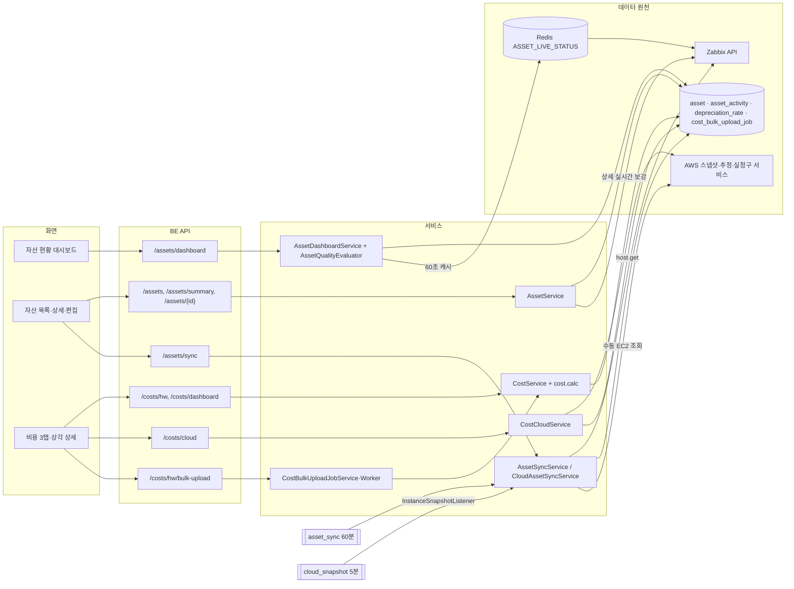

# 자산 관리와 비용 기능 상세 가이드

> 자산 관리 영역은 "우리가 무엇을 얼마나 갖고 있고, 그 기록이 얼마나 믿을 만하며, 거기에 돈이 얼마나 드는가"를 답한다. Zabbix 호스트와 AWS EC2 인스턴스를 자산 대장으로 끌어와 소유자·생애주기·비용 같은 업무 정보를 덧붙이고, 감가상각 계산과 클라우드 월 추정액을 한 메뉴에서 보여 준다. 이 문서는 자산 현황 대시보드, 자산 목록·상세·편집, Zabbix·AWS 동기화, 비용 3탭(대시보드·HW·Cloud), 일괄 업로드, 상각 스케줄 상세, 그리고 라우트에만 남은 레거시 화면 2개를 다룬다. 네트워크 맵·지리 맵과 AWS 비용 수집 자체는 범위 밖이며 연결 지점만 적는다. 모든 내용은 2026-10-06 소스(BE `e55948c`, FE `9dfcbe8`)를 정적으로 대조한 결과이고, 서버 기동·API 호출·브라우저 확인은 하지 않았다.

## 1. 한눈에 보기

### 1.1 기능 목록

| 기능 | 화면 주소·메뉴 위치 | 상태 | 권한·라이선스 | 한 줄 설명 |
|---|---|---|---|---|
| 자산 현황 대시보드 | `/asset/dashboard` · 사이드바 자산 관리 > 대시보드 | 현재 | 로그인 사용자 전원 · 라이선스 게이트 없음 | 구성·생애주기·데이터 품질·실시간 상태·최근 변화를 한 화면에 집계 |
| 자산 목록 | `/asset/list` · 자산 관리 > 목록 · 전역 검색 | 현재 | 조회 전원 / 버튼은 관리자 | 필터·검색·정렬·제외/복원 |
| 자산 상세 | `/asset/list/:id` · 목록 행 이름 링크 | 현재 | 조회 전원 / 편집·보관은 관리자 | 자산 1건의 속성·연결 호스트·실시간 상태·이력 |
| 자산 생성·편집 모달 | 목록 [자산 생성] · 상세 [편집] | 현재 | 관리자 | MovesEye 전용 자산 등록, "Zabbix에도 생성/반영", 연결 해제 |
| 수동 동기화 | 목록 [동기화] · 비용 Cloud 탭 [지금 동기화] | 현재 | 관리자 · AWS 소스는 `awsResources.view` + AWS 자격증명 | Zabbix 호스트·EC2 인스턴스를 자산으로 가져오기 |
| 자산 자동 동기화 배치 `asset_sync` | 관리 콘솔 > 스케줄러 | 현재 | 관리자(스케줄러 화면) | 기본 60분 주기 Zabbix → 자산 갱신, 선택적 역기록 |
| 클라우드 자산 자동 등록 | 화면 없음(`cloud_snapshot` 배치에 연결) | 현재 | AWS 자격증명 필요 | 5분 스냅샷 배치가 받은 EC2 목록으로 `source=cloud` 자산 upsert |
| 비용 — HW 탭(기본 탭) | `/asset/cost` 또는 `?tab=hw` · 자산 관리 > 비용 · 전역 검색 | 현재 | 조회 전원 / 편집·업로드는 관리자 | 자산별 상각·유지보수·리스 비용 목록, KPI, 인라인 편집 |
| 비용 미입력 큐 | `/asset/cost?tab=hw&costView=incomplete` | 현재 | 조회 전원 | 취득가액·취득일이 없어 계산이 불완전한 자산 |
| 비용 일괄 업로드 | HW 탭 [일괄 업로드] | 현재 | 관리자 | 템플릿 내려받기 → 채워 올리기(비동기 작업) |
| 비용 내보내기 | HW 탭 [내보내기] | 부분 | 조회 전원 | 조회 조건 결과를 xlsx로 저장(현재 100행까지만 나옴 — 4절 AST-02) |
| 상각 스케줄 상세 | `/asset/cost/hw/:assetId` · HW 목록·대시보드·자산 상세 링크 | 현재 | 조회 전원 / 편집은 관리자 | 자산 1건의 상각 파라미터·장부가액 추이·연차별 표 |
| 비용 — 대시보드 탭 | `/asset/cost?tab=dashboard` | 현재 | 조회 전원(클라우드 카드는 `awsResources.view`) | 총 취득원가·기간 총비용·향후 12개월·검토 후보 |
| 비용 — Cloud 탭 | `/asset/cost?tab=cloud` · 전역 검색 "클라우드 비용" | 현재 | `cloudInfraMonitoring.awsResources.view` + AWS 자격증명 | EC2 월 추정액(USD), 낭비 항목, 실청구 대조, 자산 등록 여부 |
| 구 클라우드 비용 주소 | `/cloud-infra-monitoring/cost` | 현재(리다이렉트) | 없음 | Cloud 탭으로 조건 없이 이동 |
| 저장된 뷰(savedView) | URL query `savedView=`로만 | 부분 | 조회 전원 | 목록 프리셋 4종. API는 있으나 화면 진입 UI가 없음 |
| 서버 위치 목록(레거시) | `/asset/serverlocation` · 메뉴 없음 | 보류 | 로그인만 | 구 프로토타입. 호출하는 BE API가 없음 |
| 맵 뷰 목록(레거시) | `/asset/mapview` · 메뉴 없음 | 보류 | 로그인만 | 구 프로토타입. 구 응답 형식을 전제로 해 동작하지 않음 |
| 비용 예산 | 없음 | 보류 | — | 설계 단계에서 제외. 테이블·API·화면 모두 없음 |

사이드바의 자산 관리 묶음은 대시보드 · 목록 · 비용 · 지리 맵 네 항목이다(`moveseyee_fe/src/layouts/app/SideNav.tsx:449-483`). 관리 콘솔(⚙)에는 자산 전용 항목이 없고, 자산과 맞닿는 설정은 스케줄러(`asset_sync`)와 기기분류 관리(상각 기본값)다. 전역 검색에는 목록·비용·클라우드 비용·지리 맵이 등록돼 있고 자산 현황 대시보드는 등록돼 있지 않다.

### 1.2 전체 구조

핵심 원칙은 세 가지다.

1. **화면은 MovesEye DB만 읽는다.** Zabbix·AWS는 동기화 시점에만 읽어 `asset` 테이블에 스냅샷으로 저장한다. 예외는 자산 상세의 실시간 패널과 대시보드의 실시간 섹션(Zabbix 조회)과 비용 Cloud 탭(AWS 추정 서비스)이다.
2. **편집 소유권이 소스마다 갈린다.** 동기화가 채우는 값은 동기화만 고치고, 사용자가 채우는 값은 동기화가 건드리지 않는다.
3. **비용 수치는 저장하지 않고 조회할 때마다 다시 계산한다.** 상각 파라미터를 바꾸면 과거 기간 수치도 함께 바뀐다.

## 2. 기능별 상세

### 2.1 자산 모델과 편집 소유권

**무엇을 하는가** — 자산 1건은 `asset` 테이블의 1행이고, 출처(`source`)가 세 가지다.

| source | 만들어지는 경로 | upsert 기준 키 | 화면 표기 |
|---|---|---|---|
| `zabbix` | Zabbix 동기화(수동·배치·호스트 등록 직후 단건) | `zabbix_hostid`(부분 유니크) | Zabbix |
| `custom` | 자산 생성 모달(MovesEye 전용) | 없음 | MovesEye |
| `cloud` | 클라우드 동기화(5분 배치·수동) | `cloud_resource_id` = EC2 instanceId(부분 유니크) | AWS |

**필드별 소유권** — 아래 표는 "누가 그 값을 쓰는가"다. 소유자가 아닌 쪽이 쓰려 하면 BE가 거부한다.

| 필드 | zabbix 자산 | custom 자산 | cloud 자산 |
|---|---|---|---|
| `name`, `zabbix_data`(호스트·그룹·인터페이스·인벤토리·태그), `inventory_mode` | 동기화 | 사용자 | 동기화(`name`은 Name 태그, 없으면 instanceId) |
| `device_type`(기기유형) | 동기화(호스트 태그 `device_type`에서 파생) | 사용자 | 생성 시 `server` 고정, 이후 사용자 |
| `coverage`(커버리지) | 동기화(호스트 상태가 활성이면 `monitored`) | 항상 `unmonitored` | 연결 호스트가 있으면 `monitored` |
| `deployment_status`(배포 상태) | 인벤토리 `deployment_status`, 없으면 `deployed` | 인벤토리 입력값, 없으면 `deployed` | EC2 상태에서 파생 |
| `resource_type` | 인벤토리 `type` | 사용자 | `ec2` 고정 |
| `linked_hostid`(연결 호스트) | `zabbix_hostid`와 같은 값 | 사용자 | 자동 매칭 + 사용자 수정·해제 |
| `lifecycle_status`(생애주기), `owner_name`(소유자), `custom_properties`, `notes` | 사용자 | 사용자 | 사용자(단 종료·소실 시 동기화가 `retired`로 강제) |
| `cost_data`(비용 입력값) | 사용자 | 사용자 | 편집 불가(상각 대상 아님) |
| `cloud_data` | 사용자(수동 입력 10칸) | 사용자 | 동기화 |

거부 응답은 `ASSET_ZABBIX_READ_ONLY`, `ASSET_CLOUD_READ_ONLY`, `ASSET_COST_NOT_APPLICABLE`이다. BE는 이 영역의 업무 오류를 HTTP 200 + 본문 `{status:"error", code, errorCode}`로 내린다.

**EC2 상태 → 배포 상태 매핑** — `running`=deployed, `stopped`·`stopping`=maintenance, `pending`=planned, `shutting-down`·`terminated`·`missing`=retired, 그 밖=deployed(`moveseye-be-spring/src/main/java/com/dmove/moveseye/asset/cloud/CloudAssetDerivation.java:49-60`).

**삭제는 제외(soft delete)** — 자산은 물리 삭제하지 않는다. `excluded=true`로 표시하면 목록 기본 조회·대시보드·비용 모집단에서 빠지고, 동기화는 그 자산을 건너뛴다. 복원하면 다시 대상이 된다.

**낙관적 잠금** — `asset.version` 컬럼(V37)으로 같은 행의 동시 수정을 검출한다. 충돌하면 HTTP 200 + 본문 `code:409, errorCode:"ASSET_CONFLICT"`가 나간다.

**데이터** — `asset`(V5 생성, V6 분류·비용·클라우드 컬럼, V14 `linked_hostid` 부분 인덱스, V36 `cloud_resource_id`, V37 `version`), `asset_activity`(V5, `asset_id`에 FK·인덱스, 변경 내역은 `changes` jsonb `[{field, before, after}]`).

### 2.2 자산 목록

**무엇을 하는가** — 전체 자산을 조건으로 좁혀 보고, 상세로 들어가거나 제외·복원한다. 관리자는 여기서 동기화와 자산 생성을 시작한다.

**화면과 진입 경로** — `/asset/list`. 사이드바 자산 관리 > 목록, 전역 검색 "목록", 자산 현황 대시보드의 모든 차트·태그 클릭(조건이 URL query로 실려 온다). 필터·검색·정렬·페이지는 전부 URL query에 있어 주소를 공유하면 같은 목록이 열린다.

**사용 방법**

1. 상단 요약 카드에서 전체(제외 포함)·모니터링·미모니터링·생애주기 검토 수와 마지막 동기화 시각을 본다.
2. 검색 대상(자산명·시리얼·태그·소유자)을 고르고 검색어를 넣는다.
3. 필터를 건다: 기기유형, 호스트 그룹, 커버리지, 생애주기, 배포 상태, 소유자, 소스(Zabbix·MovesEye·AWS), 품질 사유(9종), 제외 자산 표시 여부.
4. 컬럼 머리글로 정렬한다. 기본 정렬은 최근 변경순(`updatedAt` 내림차순)이다.
5. 관리자는 행 끝 [제외]/[복원], 상단 [동기화]·[자산 생성]을 쓴다.

목록 컬럼은 자산명(+소스 배지), 기기유형, 호스트 그룹(2개까지 표시 후 `+n`), 위치(AWS 자산은 리전), 소유자, 커버리지, 생애주기, 배포 상태다.

**동작 원리**

- `AssetListPage` → `useAssetList` → `GET /assets` → `AssetService.getList` → `AssetRepository.search`(native SQL, jsonb 검색 포함).
- 페이지 크기 기본 20, 최대 100(`SearchAssetListDto.safeLimit`). offset은 임의 값을 그대로 적용한다.
- 검색은 부분 일치(ILIKE)다. BE가 받는 검색 대상은 `name|host|group|serial|tag|owner` 6종이고 화면은 그중 `name|serial|tag|owner` 4종만 노출한다. `owner` 검색은 Zabbix 인벤토리 `poc_1_name`을 본다.
- 호스트 그룹·소유자 필터는 정확 일치다.
- **품질 사유 필터(`qualityTag`)** 는 SQL 조건이 아니다. BE가 제외되지 않은 전 자산을 메모리에 올려 대시보드와 같은 판정기(`AssetQualityEvaluator`)로 해당 자산 id 집합을 만든 뒤 `id IN (...)`으로 건다. 그래서 대시보드가 표시한 건수와 목록 total이 일치한다. 정의되지 않은 태그명은 `ASSET_INVALID_QUALITY_TAG`로 거부되고, 화면은 안내 후 그 조건만 URL에서 걷어낸다.
- 저장된 뷰(`savedView`)는 BE에 프리셋 4종이 있다: `unmonitored`(커버리지 미모니터링), `public_access`(`cloud_data.exposure`가 `exposed`로 시작), `hardware_eol`(생애주기 `expired`), `ownership`(소유자 비어 있음). 화면에는 이 프리셋을 고르는 UI가 없다.
- 요약 카드는 `GET /assets/summary`가 답한다. `total`·Zabbix 수·MovesEye 수는 제외 자산을 포함하고, 모니터링·미모니터링·생애주기 검토는 제외 자산을 뺀다.

**주요 API**

| Method | Path | 용도 | 권한 |
|---|---|---|---|
| GET | `/assets` | 목록(필터·검색·정렬·페이지) | 로그인 |
| GET | `/assets/summary` | 요약 카드 | 로그인 |
| DELETE | `/assets/{id}` | 제외. `deleteFromZabbix=true`는 `ASSET_ZABBIX_DELETE_NOT_SUPPORTED`로 거부(FE 미사용 파라미터) | 관리자 |
| PATCH | `/assets/{id}/restore` | 복원 | 관리자 |

**권한·라이선스** — 조회는 로그인 사용자 전원이다. 역할 편집 화면에 자산용 권한 칸이 없고 라우트에도 `permissionKey`가 없다. 변경 API는 `AdminAccessChecker.requireAdmin`(userRole이 ADMIN 또는 SUPER_ADMIN)으로 막는다. 데이터 범위는 사용자별 호스트 그룹 범위와 무관하게 전체 자산이다.

**빈 값·실패·경계 상태** — 값이 없는 칸은 `-`로 표시한다. 제외 자산은 기본으로 숨겨지고 '제외 포함'을 고르면 흐리게 표시된다. 품질 사유 판정 결과가 0건이면 BE가 쿼리를 보내지 않고 빈 페이지를 돌려준다.

### 2.3 자산 상세

**무엇을 하는가** — 자산 1건의 모든 속성과 현재 모니터링 상태, 변경 이력을 본다.

**화면과 진입 경로** — `/asset/list/:id`. 목록의 자산명, 대시보드 작업 큐·문제 자산 표·최근 활동, 비용 상각 상세의 [자산 상세 열기]에서 들어온다. 탭 없이 한 페이지에 카드가 세로로 놓인다.

**화면 구성**

| 영역 | 내용 |
|---|---|
| 레코드 헤더 | 소스 배지, 제외 표시, 분류 경로(기기유형 / 세부 기종 / 소유자 / 연결 호스트명), 커버리지·생애주기·배포 상태. 관리자에게 [보관(제외)]/[복원]·[편집] |
| 요약 바 | 자산 ID, 자산 태그(인벤토리 `tag` 또는 `asset_tag`), 세부 기종, 연결 호스트(서버 모니터링 상세 링크), 위치, 소유자 |
| 속성 그룹(왼쪽) | HW 정보 7칸 · HW 날짜 3칸 · 비용 정보 11칸(상각 상세 링크) · 위치 8칸 · 네트워크 3칸. `cloud_data`가 있으면 AWS 식별·인스턴스·네트워크·동기화 4그룹 추가. 각 그룹 제목에 채워진 칸 수 표시 |
| 커스텀 속성 | 사용자 정의 key/value와 비고 |
| 모니터링 커버리지(오른쪽) | 커버리지, 연결 호스트, 호스트 ID, 상태(Healthy·Degraded·Unavailable·Unknown), 그룹, 마지막 수집 시각, 열린 문제 수, [연결 호스트 열기] |
| 이력(오른쪽) | 최신 20건 타임라인: 동작(생성·수정·제외·복원·동기화 메모), 시각, 수행자, 필드별 변경 전 → 후 |

AWS 자산의 계정·ARN 칸은 "미수집"으로 표시된다. EC2 응답에서 계정 식별자를 받아 오는 경로가 아직 없어 BE가 일부러 비워 둔다.

**동작 원리**

- `GET /assets/{id}` → `AssetService.getDetail`. DB에서 자산과 최근 이력 5건을 읽고, **source가 zabbix인 자산에 한해** Zabbix에서 실시간 값을 보강한다: 호스트 1건 조회(그룹·마지막 수집 시각 포함) + 그 호스트의 활성 문제 목록(최대 50건 표시, 개수는 전체).
- 상태 4값은 `HostLiveAggregator.statusOf` 규칙이다: 인터페이스 가용성이 unavailable이면 Unavailable, available이 아니면 Unknown, available이고 활성 문제가 1건 이상이면 Degraded, 0건이면 Healthy.
- Zabbix 조회가 하나라도 실패하면 실시간 블록 전체가 `null`로 오고 화면은 나머지를 그대로 그린다.
- 이력 타임라인은 `GET /assets/{id}/activities?limit=20&offset=0`을 따로 부른다. BE는 limit 1~100을 받는다.
- 상세 조회는 캐시 유효 시간 0으로 화면에 들어올 때마다 다시 읽는다.

**주요 API**

| Method | Path | 용도 | 권한 |
|---|---|---|---|
| GET | `/assets/{id}` | 상세 + 실시간 보강 + 최근 이력 5건 | 로그인 |
| GET | `/assets/{id}/activities` | 이력 목록(limit·offset) | 로그인 |

**빈 값·실패·경계 상태** — 없는 id는 `ASSET_NOT_FOUND`이고 화면은 "자산을 찾을 수 없음" 안내를 띄운다. 실시간 블록이 없을 때 상태·그룹·마지막 수집은 `-`, 열린 문제 수는 0으로 표시된다(4절 AST-18).

### 2.4 자산 생성·편집·제외·복원

**무엇을 하는가** — 모니터링 대상이 아닌 자산을 직접 등록하고, 동기화 자산에 업무 정보를 덧붙이며, 필요하면 Zabbix 원천에도 반영한다.

**화면과 진입 경로** — 목록 [자산 생성], 상세 [편집]. 같은 모달(`AssetFormModal`)이 생성·편집을 겸한다. 관리자에게만 버튼이 보인다.

**사용 방법 — 생성**

1. 자산명(필수), 비고, 소유자를 넣는다.
2. "Zabbix에도 생성"을 끄면 MovesEye 전용(custom) 자산이 된다.
3. 켜면 Zabbix 호스트 생성 입력이 열린다: 기술명(필수, 영숫자·점·하이픈·밑줄·공백만), 호스트 그룹(필수), 접속 방식(IP/DNS)과 주소, 포트(기본 10050), 템플릿, 프록시, 상태.
4. 기기유형, 세부 기종, 연결 호스트 ID, 생애주기, 배포 상태, HW·위치·네트워크(인벤토리) 칸, 비용 정보, AWS 자산 옵션(체크 시 10칸), 커스텀 속성을 채운다.
5. 저장하면 상세 화면으로 이동한다.

**사용 방법 — 편집**

- Zabbix 자산은 이름·인벤토리·기기유형이 잠겨 있다. "Zabbix에도 반영" 스위치를 켜면 잠금이 풀리고, 해당 칸 라벨에 반영 대상 표식이 붙는다. 세부 기종과 연결 호스트 ID는 스위치를 켜도 잠긴 채다.
- AWS 자산은 이름·인벤토리·세부 기종·AWS 칸이 잠겨 있고, 비용 칸 대신 그 인스턴스의 월 추정 카드가 나온다. 기기유형·연결 호스트·생애주기·소유자·비고·커스텀 속성은 편집된다.
- 연결 호스트를 끊으려면 칸을 비우는 것이 아니라 **[연결 해제]** 를 눌러 확인한 뒤 저장한다. 저장 전까지는 "해제 예약" 표시와 취소 링크가 보인다.
- 커스텀 속성의 key는 중복될 수 없다(`ASSET_DUPLICATE_PROPERTY_KEY`).

**동작 원리**

- 생성(일반): `POST /assets` → `AssetService.create`. source는 `custom`으로 강제된다. 커버리지는 `unmonitored`, 생애주기 기본 `active`, 배포 상태는 인벤토리 `deployment_status` 또는 `deployed`. 생성 이력 1건을 남긴다.
- 생성("Zabbix에도 생성"): `AssetService.createInZabbix`가 호스트 등록 관리와 같은 경로(`HostManageService.create`)로 Zabbix 호스트를 만든다. 그 안에서 단건 동기화가 자산을 자동 등록하고, 이어서 소유자·생애주기·비용·AWS 옵션·커스텀 속성·비고를 그 자산에 얹는다. Zabbix 생성이 실패하면 자산도 만들어지지 않는다.
- 편집: `PATCH /assets/{id}`는 부분 수정이다. `null`은 "변경 없음"을 뜻한다. 소스별 분기는 2.1의 소유권 표를 따른다. 변경 전후를 필드 단위로 비교해 달라진 것만 이력에 남긴다.
- 편집의 비용 칸은 자산 PATCH에 싣지 않고 `PATCH /costs/hw/{id}`로 따로 보낸다(검증·정규화·이력 확보). 자산 저장이 성공한 뒤 비용 저장이 실패하면 경고만 띄우고 모달은 닫힌다.
- "Zabbix에도 반영": 자산 저장 트랜잭션이 커밋된 뒤 `AssetService.writeToZabbix`가 `HostManageService.updateFromAsset`을 부른다. 나가는 값은 표시명, 인벤토리(소유자는 `poc_1_name`으로, 폼의 인벤토리 칸은 그대로), 기기유형(호스트 태그 `device_type`, 다른 태그는 보존)이다. 인벤토리 모드가 비활성(-1)이면 수동(0)으로 바꾼 뒤 쓴다. 이후 단건 동기화가 스냅샷을 다시 채운다. 반영이 실패하면 `ASSET_ZABBIX_WRITE_FAILED`가 나가고, 자산 쪽 편집 내용은 이미 저장돼 있다.
- 연결 해제: 요청 본문 `clearFields:["linkedHostid"]`. 허용 목록 밖 값은 `ASSET_INVALID_CLEAR_FIELD`로 거부한다. AWS 자산은 `cloud_data.link_basis="manual_cleared"` 표식을 함께 심어 IP 근거 재연결을 막는다. Zabbix 자산의 해제는 다음 동기화가 되돌린다.
- 제외: `DELETE /assets/{id}` → `excluded=true` + 이력. 복원: `PATCH /assets/{id}/restore`.

**주요 API**

| Method | Path | 용도 | 권한 |
|---|---|---|---|
| POST | `/assets` | 생성(`createInZabbix=true`면 Zabbix 호스트 선생성) | 관리자 |
| PATCH | `/assets/{id}` | 수정(`writeToZabbix`, `clearFields` 포함) | 관리자 |
| DELETE | `/assets/{id}` | 제외 | 관리자 |
| PATCH | `/assets/{id}/restore` | 복원 | 관리자 |

**빈 값·실패·경계 상태** — 자산명 누락 `ASSET_NAME_REQUIRED`, Zabbix 기술명 문자 위반·인터페이스 주소 누락은 해당 칸 아래에 표시된다. 권한이 없으면 "권한이 없습니다" 안내가 뜬다.

**운영 주의** — "Zabbix에도 생성/반영"과 역기록은 로그인 사용자의 권한이 아니라 Zabbix 슈퍼어드민 토큰으로 쓴다. 호스트 변경 감사 로그(`host_change_log`)에 기록이 남는다.

### 2.5 Zabbix 동기화

**무엇을 하는가** — Zabbix에 등록된 호스트를 자산으로 가져오고, 이미 있는 자산의 스냅샷(이름·그룹·인터페이스·인벤토리·태그)과 파생값을 최신으로 맞춘다.

**세 가지 경로**

| 경로 | 시점 | 범위 | 모드 |
|---|---|---|---|
| 수동 | 목록 [동기화] 모달 | 전체 또는 고른 호스트 그룹 | 추가+갱신(`add_update`) 또는 추가만(`add_only`) |
| 배치 `asset_sync` | 기본 60분 간격, 스케줄러에서 변경 | 전체 | 옵션 `mode`(기본 `add_update`) |
| 단건 | MovesEye에서 호스트를 생성·수정·상태 변경·분류 변경·좌표 수정한 직후 | 그 호스트 1대 | 추가+갱신 고정 |

**사용 방법(수동)**

1. 목록에서 [동기화]를 누른다.
2. 소스를 고른다: Zabbix(기본 선택), AWS(자격증명과 권한이 있을 때만 활성). 둘 다 해제하면 실행 버튼이 비활성이다.
3. 모드를 고른다.
4. 필요하면 호스트 그룹을 고른다. 그룹은 Zabbix 소스에만 적용된다.
5. 실행하면 "추가 n · 갱신 n" 결과가 뜬다. AWS를 함께 돌렸으면 그 결과가 이어 붙는다.

**동작 원리**

- `POST /assets/sync` → `AssetSyncService.sync`. 요청에 `sources` 필드가 없으면 `["zabbix"]`로 처리하고, 빈 배열은 `ASSET_SYNC_NO_SOURCE`, 알 수 없는 값은 `ASSET_INVALID_SYNC_SOURCE`로 거부한다.
- Zabbix 조회는 2단계다: `host.get`으로 hostid만 받고, 상세(그룹·인터페이스·인벤토리 전체·태그)는 500개씩 나눠 받는다(`HOST_DETAIL_CHUNK = 500`).
- 조회가 끝난 뒤 DB 반영은 **하나의 쓰기 트랜잭션**이다. 도중에 실패하면 전부 되돌린다. Zabbix 조회가 실패하면 DB는 건드리지 않는다.
- 호스트마다: 자산이 없으면 생성(+이력), 제외된 자산이면 건너뜀, `add_only`면 건너뜀, 그 외에는 스냅샷과 파생값(기기유형·커버리지·배포 상태·세부 기종·연결 호스트)을 덮어쓴다. 소유자·생애주기·비용·커스텀 속성·비고는 건드리지 않는다.
- 갱신은 이력에 남기지 않는다. 생성만 남는다.
- **Zabbix에서 사라진 호스트는 처리하지 않는다.** 자산 행은 마지막 스냅샷 그대로 남는다.
- 기기유형은 호스트 태그 `device_type`의 값을 기기분류 레지스트리의 활성 code와 대조해 정한다. 맞는 것이 없으면 `notClassified`다.
- 배치는 Zabbix 슈퍼어드민 토큰으로 돈다.

**역기록 옵션(`writeBackToZabbix`, 기본 꺼짐)** — 배치 옵션을 켜면 동기화 직후 제외되지 않은 Zabbix 자산을 훑어, MovesEye 값이 있고 인벤토리와 다른 것만 Zabbix에 되돌려 쓴다. 대상은 소유자 → `poc_1_name`, 배포 상태 → `deployment_status` 두 칸이다. MovesEye 값이 비어 있으면 쓰지 않는다. 호스트 1대의 실패가 나머지를 막지 않으며, 실행 요약에 `writeBack: updated=n failed=n`이 실린다.

**주요 API**

| Method | Path | 용도 | 권한 |
|---|---|---|---|
| POST | `/assets/sync` | 수동 동기화(`mode`, `groupIds`, `sources`) | 관리자 |

**운영 주의**

- 배치 키 `asset_sync`, 시드 값은 활성·60분·`{"mode":"add_update","writeBackToZabbix":false}`(V15).
- 실행 이력은 성공도 남기며 최근 100건을 보존한다(`SchedulerRunLogPolicy`).
- 지리 맵은 자산 스냅샷의 좌표만 읽으므로, 자산이 한 번도 동기화되지 않은 설치본에서는 지리 맵 호스트 후보가 0건이다.

### 2.6 클라우드 자산(EC2) 등록과 호스트 연결

**무엇을 하는가** — AWS EC2 인스턴스를 사람이 입력하지 않아도 자산으로 등록하고, 같은 장비를 가리키는 Zabbix 호스트와 자동으로 이어 준다.

**경로**

- 자동: 클라우드 스냅샷 배치(`cloud_snapshot`, 기본 5분)가 리전별로 받아 둔 인스턴스 목록을 `CloudAssetSyncService`에 넘긴다. AWS 추가 호출은 없다.
- 수동: 동기화 모달에서 AWS를 고르면 EC2 조회를 1회 돌린 뒤 같은 upsert를 탄다.

**동작 원리**

- 기준 키는 instanceId다. 새 인스턴스는 `source=cloud`, 기기유형 `server`, 세부 기종 `ec2`로 생성된다.
- `cloud_data`에는 리전·가용 영역·인스턴스 타입·플랫폼·아키텍처·상태·가동 시작 시각·VPC·서브넷·보안 그룹(쉼표 문자열)·사설/공인 IP·DNS·노출 여부(`exposed:public-ip` 또는 `private`)·Name 태그·전체 태그·최초 관측 시각·연결 근거가 들어간다. 계정과 ARN은 채우지 않는다.
- **값이 실제로 바뀐 자산만 저장한다.** 바뀐 것이 없으면 이력도 `updated_at`도 건드리지 않고, 관측 시각(`last_synced_at`)만 한 번의 일괄 UPDATE로 찍는다.
- **사라진 인스턴스**: 조회에 성공한 리전에 속한 자산이 이번 회차에 안 보이면 상태를 `missing`으로, 배포 상태·생애주기를 `retired`로 바꾸고 이력을 남긴다. 조회에 실패한 리전의 자산은 손대지 않는다. 물리 삭제·자동 제외는 하지 않는다.
- **생애주기 복구**: 동기화가 `retired`로 내린 자산에는 `cloud_data.lifecycle_forced_by_sync` 표식이 붙는다. 인스턴스가 다시 보이면 그 표식이 있는 자산만 `active`로 되돌린다. 사용자가 직접 `retired`로 바꾼 자산은 되돌리지 않고, 사용자가 생애주기를 고치면 표식이 지워진다.
- **호스트 연결**: `Ec2ZabbixMatcher`가 근거 `INSTANCE_ID_EXACT`(호스트명 또는 태그의 instanceId) 또는 `IP_EXACT`(주소 일치)로 호스트를 찾는다. 매칭 실패는 해제가 아니어서 기존 연결을 유지한다. 이미 연결된 대상을 다른 호스트로 바꾸는 것은 `INSTANCE_ID_EXACT`일 때만이다. 사용자가 해제한 연결(`manual_cleared`)은 IP 근거로는 다시 붙지 않는다.
- **사용자가 만든 같은 리소스**: custom 자산의 `cloud_data.resource_id`가 같은 instanceId면 새 cloud 자산을 만들지 않고 건너뛰며, 그 custom 자산 이력에 동기화 메모(`synced`)를 한 번만 남긴다.
- 제외된 cloud 자산은 되살리지 않는다.
- 배치와 수동 동기화가 겹쳐도 같은 JVM 안에서는 upsert가 직렬화되고, 유니크 위반·잠금 충돌이 나면 1회 재시도한다.

**수동 동기화 응답의 `cloud.reason`**

| 값 | 뜻 | 화면 안내 |
|---|---|---|
| `null` | 정상 | 추가·갱신·소실 건수 |
| `AWS_NOT_CONFIGURED` | 자격증명 미등록 | 설정에서 등록 안내 |
| `AWS_UNAVAILABLE` | 자격증명 해석 실패 또는 전 리전 조회 실패 | 저장된 키를 다시 입력하라는 안내 |
| `SYNC_FAILED` | AWS 조회는 됐고 저장 단계 실패 | 저장 실패 안내 |
| `PARTIAL_REGIONS` | 일부 리전 실패 | 건수 + 실패 리전 이름 |

클라우드 구간이 실패해도 요청 전체는 성공 응답이고 Zabbix 구간 결과는 유지된다.

**권한·라이선스** — AWS 소스 체크박스는 `awsResources.view` 권한이 있고 AWS 자격증명이 준비됐을 때만 활성이다. BE는 동기화 API 전체를 관리자 전용으로 막는다.

### 2.7 자산 현황 대시보드

**무엇을 하는가** — 관리 대상 자산의 구성·생애주기·기록 품질·현재 상태를 집계해 "지금 무엇을 손봐야 하는지"를 보여 준다. 금액은 다루지 않는다.

**화면과 진입 경로** — `/asset/dashboard`, 사이드바 자산 관리의 첫 항목. 필터 6축(기기유형·호스트 그룹·소유자·생애주기·소스·커버리지)은 URL query다. 필터가 걸리면 "n건 기준" 안내가 뜬다.

**화면 구성과 값의 뜻**

| 영역 | 내용 |
|---|---|
| 머리 | 집계 대상 건수, 마지막 동기화 시각(24시간 이상 지났으면 경고 아이콘), [새로고침], [목록 열기] |
| KPI 6개 | 관리 자산(소스별·제외 수), 모니터링 커버리지 %, 미분류, 소유자 미지정, 생애주기 검토(사용 중이 아닌 자산), 데이터 완성도 평균 % |
| A. 구성 | 기기분류별, 소스×커버리지(Zabbix 모니터링/미모니터링·MovesEye 연결/미연결·AWS 연결/미연결), 호스트 그룹 상위 10, OS 계열 7구간, 소유자 상위 10 |
| B. 생애주기 | 상태별(사용 중·예정·폐기·만료·기타), 취득연도별(내용연수 경과 수 포함, 취득일 미상 수 별도), 만료 구간(경과·30일·60일·90일·그 이후·미상) |
| C. 데이터 품질 | 완성도 10항목 채움률(낮은 순), 관리 작업 큐(사유 태그가 있는 자산, 응답 상한 50건·전체 건수 별도) |
| D. 실시간 | 모니터링 자산의 Healthy·Degraded·Unavailable·Unknown 분포, 문제 있는 자산 상위 10 |
| E. 최근 변화 | 최근 30일 일별 활동 추이(생성·수정·제외·복원), 최근 활동 10건 |

차트 조각·태그·KPI를 누르면 같은 조건이 걸린 자산 목록으로 이동하거나 해당 섹션으로 스크롤된다.

**완성도 10항목** — 기기분류, 소유자, 위치(인벤토리 `location` → `site_city` → `site_address_a`), 시리얼(`serialno_a`), 벤더·모델(둘 다), OS, 취득일(등록일 추정은 미입력으로 셈), 취득가액, 만료일, 좌표(`location_lat`·`location_lon` 둘 다). 가중치는 균등이다. AWS 자산은 이 평균의 모수에서 빠진다.

**사유 태그 9종**

| 태그 | 판정 |
|---|---|
| `unclassified` | 기기유형이 없거나 `notClassified` |
| `classification_tag_mismatch` | Zabbix 자산에 `device-type`·`devicetype` 같은 유사 키만 있고 정본 키 `device_type`이 없음 |
| `owner_missing` | 소유자가 비어 있음 |
| `host_unlinked` | 연결 호스트가 없음 |
| `host_disabled` | Zabbix 호스트 상태가 비활성 |
| `inventory_disabled` | 인벤토리 모드가 -1(AWS 자산 제외) |
| `inventory_sparse` | 인벤토리 5항목 중 1개 이하만 채움(인벤토리 비활성·AWS 자산 제외) |
| `cost_missing` | 취득가액 또는 취득일이 없거나 무효(AWS 자산 제외) |
| `expired` | 만료일이 오늘보다 이전(오늘 만료는 경과가 아님) |

**동작 원리**

- `GET /assets/dashboard` → `AssetDashboardService.getDashboard`. 제외되지 않은 전 자산을 메모리에 올려 자산마다 품질 판정을 한 뒤 순수 함수(`AssetDashboardAggregator`)로 센다. 취득일·만료일·취득가액은 비용 계산과 같은 해석기(`CostParamResolver`)를 쓴다.
- 필터 후보값(소유자·그룹)은 필터 적용 전 모집단에서 뽑는다.
- 호스트 그룹 차트는 한 자산이 여러 그룹에 속하므로 합계가 자산 수보다 크다.
- 취득연도는 등록일로 추정한 취득일을 세지 않는다. AWS 자산은 취득일 대신 가동 시작 시각의 연도를 쓴다.
- OS 계열은 인벤토리 `os` 문자열의 부분 일치 규칙으로 접는다(windows → linux 계열 → unix 계열 → 네트워크 OS → 하이퍼바이저 순, 첫 일치). 어디에도 안 맞는 원문 상위 5개가 응답에 실린다.
- **실시간 섹션**: 커버리지가 `monitored`이고 연결 호스트가 있는 자산의 hostid 전체에 대해 가용성 조회 1회 + 문제 집계 조회 1회를 한다. 결과는 Redis 키 `ASSET_LIVE_STATUS:{사용자}`에 60초 캐시한다. 조회가 실패하면 캐시하지 않고 이 섹션만 `null`로 내려 화면이 "실시간 상태를 가져오지 못했습니다" 카드를 그린다. 스냅샷에 없는 호스트는 Unknown으로 센다.
- 활동 추이는 `asset_activity`를 일·동작별로 집계하고 0건인 날도 축에 남긴다. 최근 활동에는 변경 필드 이름만 싣고 값은 싣지 않는다.
- 화면 쪽 캐시 유효 시간은 60초다.

**주요 API**

| Method | Path | 용도 | 권한 |
|---|---|---|---|
| GET | `/assets/dashboard` | 전 섹션 집계(필터 6축) | 로그인 |

**빈 값·실패·경계 상태** — "미입력·미지정·미상" 조각은 0건이어도 표시된다. 자산이 0건이면 모든 수치가 0이다.

### 2.8 비용 계산 규칙(감가상각 엔진)

비용 화면의 모든 숫자는 이 규칙으로 조회 시점에 계산된다. 계산 코드는 DB를 모르는 순수 계층(`cost/calc`)이다.

**모집단** — 제외되지 않은 자산 중 source가 `cloud`가 아닌 것. AWS 자산은 상각 대상이 아니며 Cloud 탭이 따로 답한다.

**입력값과 폴백 순서**

| 항목 | 1순위 | 2순위 | 3순위 | 없을 때 |
|---|---|---|---|---|
| 취득가액 | `cost_data.purchase_cost` | — | — | 상각 불가(사유 표시) |
| 취득일 | `cost_data.acquisition_date` | 인벤토리 `date_hw_purchase` | 인벤토리 `date_hw_install` | 자산 등록일로 추정 + "취득일 없음" 사유 |
| 만료일 | `cost_data.expiry_date` | 인벤토리 `date_hw_expiry` | — | 만료 지표에서 제외 |
| 상각방법 | `cost_data.depreciation_method` | 기기분류 기본값 | — | 정액법 |
| 내용연수 | `cost_data.useful_life_years`(2~15) | 기기분류 기본값 | — | 5년 |
| 잔존가액 | `cost_data.residual_value` | — | — | 0원 |
| 수동 연 상각액 | `cost_data.depreciation_cost` | — | — | 계산값 사용 |

- 금액은 원 단위 정수다. 문자열로 저장된 구 데이터는 콤마·공백·`₩`·`원`·`$`를 떼고 읽으며, "4,500만원" 같은 한글 단위는 무효로 본다.
- 날짜는 `yyyy-MM-dd`, `yyyy.MM.dd`, `yyyy/MM/dd`, `yyyyMMdd`, `yyyy-MM`(1일로 간주)을 받는다.

**정액법** — 월 상각비 = (취득가액 − 잔존가액) ÷ (내용연수 × 12). 취득월을 1개월로 넣고, 마지막 달에 반올림 오차를 정산해 잔존가액만 남긴다.

**정률법** — 연차는 역년이 아니라 취득월 기준 12개월 단위다. 연 상각비 = 그 연차 기초 미상각잔액 × 상각률, 월 상각비 = 연 상각비 ÷ 12. 상각률은 `depreciation_rate` 테이블(2년 0.777 · 3년 0.632 · 4년 0.528 · 5년 0.451 · 6년 0.394 · 7년 0.349 · 8년 0.313 · 9년 0.284 · 10년 0.259 · 11년 0.239 · 12년 0.221 · 13년 0.206 · 14년 0.193 · 15년 0.182)에서 읽는다. 최종 연차에는 남은 잔액 전부를 12개월로 나눠 상각해 내용연수 안에 끝낸다. 그래서 마지막 해 상각비가 직전 해보다 커지는 것이 정상이다.

**수동 연 상각액** — 월 = 값 ÷ 12로 취득가액이 소진될 때까지 상각한다(최대 1,200개월). 내용연수보다 일찍 소진되면 경고(`manual_exceeds_purchase`)가 붙는다. 취득가액 없이 수동 연액만 있으면 월 비용은 내되 장부가액·상각누계액은 표시하지 않는다.

**상각 상태** — `notStarted`(취득월 이전), `active`, `completed`(종료월 이후 또는 취득가액이 잔존가액 이하), `notApplicable`(취득가액 문제로 계산 불가).

**유지보수비·리스료의 기간 배분**

| 주기 | 기간 금액 |
|---|---|
| `monthly` | 금액 × 기간 개월 수 |
| `yearly` | (금액 ÷ 12) × 기간 개월 수 |
| `onetime` | 금액 ÷ (내용연수 × 12)를 취득월부터 그 개월 수 동안 배분 |
| 미지정 | 연액으로 가정 + 경고 `*_period_assumed_yearly` |

월액·연액 주기는 취득일이나 만료일로 구간을 자르지 않는다.

**기간과 비교** — 조회 기간은 월 단위(`yyyy-MM` ~ `yyyy-MM`, 기본 당월)다. 직전 동일 길이 기간과 비교해 변화율(%)을 낸다. 직전 값이 0이면 변화율은 비어 있고 화면은 '신규'로 표기한다.

**소급 재계산** — 계산 결과를 저장하지 않으므로, 내용연수·상각방법·기기분류 기본값·제외 여부를 바꾸면 과거 기간 수치가 함께 바뀐다. 화면 머리의 "기준 시각"이 그 계산 시점이다. 유지보수비·리스료도 변경 이력이 없어 과거 월에 현재 값을 그대로 적용한다.

**우선순위 점수** — 자산마다 아래 점수를 더해 50점 이상 high, 25점 이상 medium, 그 미만 low로 표시한다.

| 조건 | 점수 |
|---|---|
| 변화율 20% 초과 / 10% 초과 | 30 / 15 |
| 만료까지 30일 이내(이미 경과 포함) / 90일 이내 | 25 / 10 |
| 소유자 또는 연결 호스트 없음 | 10 |
| 취득가액 문제로 상각 불가 | 15 |
| 기간 비용이 모집단 상위 10% | 10 |

### 2.9 비용 — HW 탭

**무엇을 하는가** — 자산별 비용을 목록으로 보고 그 자리에서 비용 정보를 채운다. 비용 화면의 기본 탭이다.

**화면과 진입 경로** — `/asset/cost`(탭 미지정 시 HW) 또는 `?tab=hw`. 기간·필터·정렬·페이지·미입력 뷰 여부가 모두 URL query다.

**사용 방법**

1. 머리에서 기간을 고른다: 당월(기본)·전월·최근 3개월·사용자 지정(월 범위). 기간 옆 태그에 실제 구간, 툴팁에 비교 구간이 나온다.
2. KPI를 본다: HW 총비용(상각+유지보수+리스), 변화율, 예상 비용(HW는 결정적 계산이라 총비용과 같음), 만료 임박(90일 이내, 이미 만료 포함), 비용 정보 미입력 건수.
3. 위젯을 본다: 만료 구간 30/60/90일, 생애주기별·소유자별 비용, 상각방법 분포(정액·정률·완료·계산 불가). 도넛 조각을 누르면 아래 목록에 그 필터가 걸린다.
4. 갱신·교체 후보 5건(만료일 빠른 순)을 본다.
5. 목록을 필터한다: 기기유형, 소유자, 위치, 벤더, 생애주기, 상각방법, 비용 정보 상태(완료·미입력), 우선순위, 제외 자산 표시. 검색은 자산명 부분 일치다.
6. 관리자는 행의 편집 버튼으로 비용 정보를 고친다. 저장하면 그 행만 다시 계산된 값으로 바뀌고, KPI에는 "새로고침 필요" 표시가 붙는다.
7. 미입력 KPI를 누르면 미입력 큐로 전환된다. 큐는 자산명 오름차순 고정이고 사유(취득가액 없음·무효·0·음수, 취득일 없음·무효, 상각률 없음)를 보여 준다.
8. [내보내기]로 현재 조건의 결과를 xlsx로 받는다.

**동작 원리**

- `GET /costs/hw` → `CostService.getHwList`. 모집단 전 자산의 스케줄을 계산한 뒤 메모리에서 필터 → 우선순위 산정 → 정렬 → 페이지 자르기를 한다. 페이지 크기 기본 20, 최대 100.
- KPI·위젯은 필터가 적용된 모집단 기준이며 제외 자산은 항상 뺀다. '제외 포함'을 켜면 제외 자산이 행으로만 나온다.
- 정렬 키는 `totalCost`(기본)·`name`·`deviceType`·`owner`·`lifecycle`·`purchaseCost`·`acquisitionDate`·`expiryDate`·`bookValue`·`periodDepreciation`·`priority`다.
- 인라인 편집: `PATCH /costs/hw/{assetId}?periodStart=&periodEnd=`. 허용 필드는 12개(취득가액·유지보수비·리스료·수동 연 상각액·잔존가액·상각방법·내용연수·취득일·만료일·유지보수 주기·리스 주기·통화)다. 그 밖의 키는 `COST_UNKNOWN_FIELD`로 거부한다. 값을 지우려면 `clearFields`에 필드명을 싣는다. 금액은 원 단위 정수로, 날짜는 `yyyy-MM-dd`로 정규화해 저장하고 변경 내역을 자산 이력에 남긴다.
- 각 행에는 장부가액 미니 추이(연 1점 + 종점, 최대 16점)가 실린다.
- 내보내기는 같은 `GET /costs/hw`를 `limit=1000`으로 다시 불러 18개 컬럼을 xlsx로 만든다. 금액은 숫자로 내보낸다.

**주요 API**

| Method | Path | 용도 | 권한 |
|---|---|---|---|
| GET | `/costs/hw` | 목록 + KPI + 위젯 + 기간 정보 | 로그인 |
| GET | `/costs/hw/incomplete` | 미입력 큐 | 로그인 |
| PATCH | `/costs/hw/{assetId}` | 비용 정보 편집, 응답은 재계산된 1행 | 관리자 |

**검증 오류 코드** — `COST_INVALID_AMOUNT`(음수), `COST_INVALID_DEPRECIATION_METHOD`, `COST_INVALID_USEFUL_LIFE`(2~15 밖), `COST_INVALID_DATE`, `COST_INVALID_COST_PERIOD`, `COST_INVALID_QUERY_PERIOD`(시작 > 끝 또는 형식 오류), `ASSET_COST_NOT_APPLICABLE`(AWS 자산).

**빈 값·실패·경계 상태** — 조회가 실패하면 탭 상단에 오류 안내가 뜬다. 장부가액을 모르는 자산(취득가액 없음)은 그 칸이 비어 있고 0으로 표시하지 않는다. 갱신·교체 후보가 없으면 표 대신 안내 문구가 나온다.

### 2.10 비용 — 일괄 업로드

**무엇을 하는가** — 자산 대장 스프레드시트의 비용 값을 한 번에 넣는다.

**사용 방법**

1. HW 탭 머리 또는 미입력 큐의 [일괄 업로드]를 누른다.
2. [템플릿 내려받기]로 현재 자산이 미리 채워진 xlsx를 받는다. 데이터 시트와 입력 안내 시트로 구성된다.
3. 비용 칸을 채운다. `assetId`는 고치지 않는다. `name`·`deviceType`은 참고용이라 업로드 때 무시된다. 빈 칸은 "변경 없음"이다.
4. 파일(xlsx 또는 csv, 10MB 이하)을 올린다. 접수되면 진행률이 표시된다.
5. 끝나면 성공·실패 건수와 실패 행의 줄 번호·자산·사유가 나온다. 실패 행만 고쳐 다시 올린다.

**동작 원리**

- 템플릿: `GET /costs/hw/template`이 UTF-8 BOM CSV를 준다. 화면이 서식 있는 xlsx로 감싼다. 저장된 값 중 다시 올려도 검증을 통과하는 값만 채우고 무효 원문은 빈 칸으로 둔다.
- 업로드: 화면이 xlsx를 CSV로 바꿔 `POST /costs/hw/bulk-upload`(multipart `file`)로 보낸다. BE는 파일을 `cost_bulk_upload_job`에 저장하고 `jobId`만 즉시 돌려준다.
- 처리: 전용 스레드 풀(기본 1, 최대 2, 대기열 32)이 작업을 집어 행마다 인라인 편집과 같은 검증·저장 경로를 탄다. **행 단위로 커밋**하므로 실패 행이 성공 행을 되돌리지 않는다.
- 파일 수준 거부: 빈 파일 `COST_UPLOAD_EMPTY`, `assetId` 컬럼이 없거나 템플릿 밖 컬럼이 있으면 `COST_UPLOAD_INVALID_HEADER`, 10MB 초과.
- 행 수준 실패: `assetId`가 숫자가 아님, 없는 자산, 제외된 자산(`COST_ASSET_EXCLUDED`), AWS 자산, 값 검증 실패.
- 동시 실행 제한: 한 사용자당 진행 중(queued·running) 작업 1개. 겹치면 `COST_UPLOAD_ALREADY_RUNNING`, 대기열이 차면 `COST_UPLOAD_QUEUE_FULL`.
- 진행 추적: 화면이 `GET /costs/hw/bulk-upload/{jobId}`를 10초마다 조회하고 10분이 지나면 자동 조회를 멈춘 뒤 수동 확인 버튼을 준다. 새로고침으로 jobId를 잃어도 `GET /costs/hw/bulk-upload/current`로 내 최근 작업을 되찾는다(끝난 작업은 완료 후 10분 안에서만 되살린다).
- 작업은 요청한 사용자만 조회할 수 있다. 결과는 완료 후 24시간 조회 가능하고, 만료 7일 뒤 매시 15분 정리 작업이 행을 지운다.
- 생존 신호: 행을 처리할 때마다 `heartbeat_at`을 갱신한다. 서버 기동 시 신호가 5분 넘게 끊긴 running 작업을 `COST_UPLOAD_JOB_INTERRUPTED`로 종결하고, queued 작업은 다시 실행한다.

**주요 API**

| Method | Path | 용도 | 권한 |
|---|---|---|---|
| GET | `/costs/hw/template` | 템플릿 CSV(응답 래퍼 없는 첨부) | 관리자 |
| POST | `/costs/hw/bulk-upload` | 작업 접수 | 관리자 |
| GET | `/costs/hw/bulk-upload/current` | 내 최근 작업 | 관리자 |
| GET | `/costs/hw/bulk-upload/{jobId}` | 진행률·결과 | 관리자(본인 작업만) |

**데이터** — `cost_bulk_upload_job`(V18, V19 `heartbeat_at`). 상태는 `queued → running → succeeded|failed` 단방향이다. 진행 중 작업의 요청자 유일성은 부분 유니크 인덱스가 보장한다.

**운영 주의** — 값을 지우는 것은 CSV로 할 수 없다(빈 칸 = 변경 없음). 지우려면 인라인 편집을 쓴다.

### 2.11 비용 — 상각 스케줄 상세

**무엇을 하는가** — 자산 1건의 상각이 어떤 값으로 어떻게 계산됐는지 확인하고 고친다.

**화면과 진입 경로** — `/asset/cost/hw/:assetId`. HW 목록의 자산명, 비용 대시보드 검토 후보, 자산 상세의 비용 정보 그룹 링크에서 들어온다. `/asset/cost/hw`는 HW 탭으로 돌아간다.

**화면 구성**

| 영역 | 내용 |
|---|---|
| 머리 | [자산 상세 열기], 관리자에게 [비용 정보 수정] |
| 안내 | 상각 불가 사유, 경고 목록 |
| 상각 파라미터 | 취득가액, 취득일(출처: 수동·인벤토리 구매일·인벤토리 설치일·등록일 추정), 상각방법과 내용연수(출처: 자산별·기기분류 기본값·전역 기본값), 잔존가액, 정률법 상각률, 당월 상각비, 통화 |
| 장부가액 추이 | 월별 장부가액·상각누계액 그래프, 오늘·만료일 표시선 |
| 연차별 스케줄 | 역년 단위 표(기초 장부가액·연 상각비·누계·기말 장부가액·개월 수, 부분 연도 표시)와 월 단위 내역 |

**동작 원리** — `GET /costs/hw/{assetId}/depreciation` → `CostService.getDepreciationDetail`. 기간 파라미터 없이 당월 기준으로 계산한다. AWS 자산은 `ASSET_COST_NOT_APPLICABLE`로 거부되며, 화면은 요청 전에 자산 소스를 확인해 "상각 대상이 아님" 안내와 Cloud 탭 링크를 띄운다.

**주요 API**

| Method | Path | 용도 | 권한 |
|---|---|---|---|
| GET | `/costs/hw/{assetId}/depreciation` | 파라미터·출처·연차·월 시퀀스·편집 초기값 | 로그인 |

### 2.12 비용 — 대시보드 탭

**무엇을 하는가** — 자산 비용 전체를 지출 관점으로 요약하고 먼저 검토할 자산을 뽑아 준다.

**화면과 진입 경로** — `/asset/cost?tab=dashboard`. 기간 머리는 HW 탭과 같고, 필터는 소유자·기기유형·생애주기·위치·벤더·비용 정보 상태·우선순위다. 후보값은 BE가 필터 적용 전 모집단에서 뽑아 준다.

**화면 구성과 값의 뜻**

| 항목 | 뜻 |
|---|---|
| 총 취득원가 | 모집단 취득가액 합 |
| 이번 기간 총 자산비용 | 상각 + 유지보수 + 리스의 합(상각비만이 아님). 상각과 유지보수·리스 내역 병기 |
| 전기 대비 | 직전 같은 길이 기간과의 증감액·변화율. 직전 기간도 현재 설정으로 다시 계산한 값 |
| 향후 12개월 예상 비용 | 기준월 다음 달부터 12개 월의 합 |
| 연간 유지비 | 향후 12개월의 유지보수 + 리스 |
| 비용 정보 미입력 | 미입력 자산 수 |
| 클라우드 월 추정(USD) | 월말 예상액, 인스턴스 수, 실청구 누적. 권한과 AWS 자격증명이 있을 때만 |
| 월별 비용 | 기준월 포함 과거 12개월 + 이후 12개월의 상각·유지보수·리스 |
| 비용 구성 | 상각·유지보수·리스 비중 |
| 기기분류별·소유자별 | 기간 총비용 분포. 조각을 누르면 HW 탭 목록에 그 필터가 걸림 |
| 만료 현황 | 경과 / 30일·60일·90일 이내(누적, 경과 제외) |
| 비용 증가 기여 | 직전 기간보다 늘어난 자산 상위 5 |
| 잔여 가치 추이 | 과거 12개월 + 미래 60개월의 장부가액 합, 전부 소진되는 달. 장부가액을 모르는 자산은 빼고 제외 건수를 함께 표시 |
| 검토 후보 | 자산당 1행 + 사유 태그: 비용 미입력, 상각 완료인데 계속 비용 발생, 비용 급증(변화율 10% 초과), 만료 경과, 만료 임박(90일), 소유자 미지정, 호스트 미연결. 우선순위 점수 내림차순 |

**동작 원리**

- `GET /costs/dashboard` → `CostService.getDashboard`. HW 탭과 같은 모집단·필터·계산 경로를 쓴다.
- 클라우드 카드는 컨트롤러가 응답에 덧붙인다. `awsResources.view` 권한이 없거나, AWS 자격증명이 없거나, 조회가 실패하면 그 칸만 `null`이고 나머지는 정상으로 내려간다.
- **원화 금액과 달러 금액은 합산하지 않는다.** 클라우드 카드는 별도 카드로만 놓인다.

**주요 API**

| Method | Path | 용도 | 권한 |
|---|---|---|---|
| GET | `/costs/dashboard` | KPI·위젯·검토 후보·필터 후보·기간·클라우드 요약 | 로그인(클라우드 부분은 `awsResources.view`) |

### 2.13 비용 — Cloud 탭

**무엇을 하는가** — EC2 인스턴스별 이번 달 추정 비용과 낭비 항목을 보고, 그 인스턴스가 자산으로 등록됐는지 확인한다.

**화면과 진입 경로** — `/asset/cost?tab=cloud`. 전역 검색 "클라우드 비용", 자산 상세·편집 모달의 클라우드 비용 링크, 구 주소 `/cloud-infra-monitoring/cost`의 리다이렉트로 들어온다.

**사용 방법**

1. 요약에서 이번 달 누적 추정, 월말 예상, 낭비 월액, 인스턴스 수(자산 등록·미등록)를 본다.
2. 리전·상태·소유자·자산 등록 여부로 표를 거른다. **요약 숫자는 필터와 무관하게 전체 기준**이고, 필터가 걸리면 그 사실이 안내된다.
3. 인스턴스 표에서 가동 시간, 시간당 단가, 컴퓨트 누적, EBS 용량·월액, 월말 예상, 연결된 자산을 본다.
4. 미등록 인스턴스가 있으면 관리자가 [지금 동기화]로 AWS 소스가 선택된 동기화 모달을 연다.
5. 낭비 표(중지 인스턴스의 EBS, 미부착 EBS, 미사용 EIP)와 실청구 대조 카드를 본다.

**동작 원리**

- `GET /costs/cloud` → `CostCloudService.getCloudCosts`. 금액은 계산하지 않고 AWS 추정 서비스(`CloudCostEstimateService`)와 실청구 조회 서비스(`CloudCostQueryService`)의 결과에 자산을 붙이고 필터를 건다.
- 자산 조인은 instanceId = `asset.cloud_resource_id`다. 제외된 자산도 "등록됨"으로 보고 제외 여부를 함께 싣는다.
- 실청구 상태는 세 가지다: `ok`(이번 달 적재분 합계), `disabled`(유료 조회 옵션 꺼짐), `unavailable`(켜졌으나 적재분 없음 또는 조회 실패). 추정 대비 차이 %는 실청구가 0이 아닐 때만 계산한다.
- 단건 조회(`resourceId=`)에서는 그 인스턴스에 귀속되는 낭비(`STOPPED_INSTANCE_EBS`)만 남긴다. 자산 편집 모달의 월 추정 카드가 이 경로를 쓴다.
- 금액은 전부 USD 온디맨드 추정이다.

**주요 API**

| Method | Path | 용도 | 권한 |
|---|---|---|---|
| GET | `/costs/cloud` | 추정 + 자산 조인 + 실청구 요약(필터 `region`·`state`·`owner`·`assetLinked`·`resourceId`) | `cloudInfraMonitoring.awsResources.view` + AWS 자격증명(`CLOUD_NOT_CONFIGURED`) |

**빈 값·실패·경계 상태** — 권한이 없으면 "권한 없음" 안내, 자격증명이 없으면 설정 링크가 있는 안내, 조회 실패면 재시도 버튼이 있는 오류 카드가 나온다. 일부 리전 실패나 가격 조회 불가는 경고 띠로 표시된다.

### 2.14 레거시 화면 — 서버 위치 목록·맵 뷰 목록

| 화면 | 주소 | 호출 API | 현재 상태 |
|---|---|---|---|
| 서버 위치 목록(`ServerLocationList.tsx`) | `/asset/serverlocation` | `/server-locations` CRUD | BE에 해당 API가 없다. 화면은 열리지만 목록·등록·수정·삭제가 모두 실패한다 |
| 맵 뷰 목록(`MapViewList.tsx`) | `/asset/mapview` | `/assets`(구 응답 형식 전제), `PUT /assets/{id}`, `/server-locations` | 현재 `/assets` 응답과 필드가 다르고 `PUT`은 BE에 없다. 정상 동작하지 않는다 |

두 화면 모두 사이드바·모바일 메뉴·전역 검색 어디에도 없고 주소를 직접 넣어야 열린다. 지도 표시에 외부 Mapbox 서비스를 쓴다. 위치 관리 기능은 지리 맵(`/asset/geo-map`)이 대체했다.

### 2.15 맵과의 연결 지점

- 지리 맵은 좌표를 따로 저장하지 않고 자산 스냅샷의 인벤토리 `location_lat`·`location_lon`을 `linked_hostid`로 찾아 읽는다. 제외된 자산의 좌표도 계속 해석한다. 지리 맵에서 좌표를 고치면 Zabbix 인벤토리에 쓰고 단건 동기화로 자산 스냅샷을 바로 갱신한다.
- 홈 화면의 자산 카드는 `GET /assets/summary`와 같은 집계를 쓴다.

## 3. 공통 동작과 설정

**권한 축**

| 대상 | 판정 | 거부 시 |
|---|---|---|
| 자산·HW 비용 조회 | 로그인 + 방문자 ID 검사 | 401 |
| 자산·비용 변경, 동기화, 일괄 업로드 | `AdminAccessChecker.requireAdmin`(userRole이 ADMIN 또는 SUPER_ADMIN) | HTTP 200 + 본문 `code:403` |
| 비용 Cloud 탭, 대시보드의 클라우드 카드 | `DmovePermissionChecker`의 `cloudInfraMonitoring.awsResources.view` | Cloud 탭은 본문 `code:403`, 카드는 생략 |

화면의 관리자 버튼 노출은 `useIsUserRoleAdmin`으로 같은 축을 본다. 라이선스 에디션 게이트는 이 영역에 없다.

**스케줄러 잡**

| 잡 키 | 기본 | 하는 일 | 옵션 |
|---|---|---|---|
| `asset_sync` | 활성, 60분 간격 | Zabbix → 자산 추가·갱신 | `mode`(`add_update`\|`add_only`), `writeBackToZabbix`(기본 false) |
| `cloud_snapshot` | 활성, 5분 간격 | EC2 스냅샷 수집 후 클라우드 자산 upsert를 호출 | 클라우드 영역 문서 참조 |

두 잡은 스케줄러 임대(`scheduler_lease`)로 여러 인스턴스 중 하나에서만 돈다. 일괄 업로드 만료 정리(매시 15분)는 스케줄러 화면에 나오지 않는 내부 주기 작업이며 인스턴스마다 돈다.

**캐시**

| 위치 | 키·수명 | 내용 |
|---|---|---|
| Redis | `ASSET_LIVE_STATUS:{사용자 식별자}`, 60초 | 대시보드 실시간 스냅샷. 실패 결과는 저장하지 않음 |
| 브라우저(TanStack Query) | 기본 60초, 자산 상세·상각 상세는 0초 | 조회 결과 |
| 브라우저 localStorage | `cost.bulkUpload.jobId` | 진행 중 업로드 작업 id |

자산 목록·요약·대시보드 집계·비용 계산에는 서버 캐시가 없다. 요청마다 DB에서 읽어 계산한다.

**설정 값**

| 값 | 위치 | 기본 |
|---|---|---|
| 업로드 파일 크기 상한 | `application.yml` `spring.servlet.multipart.max-file-size` | 10MB |
| 정률법 상각률표 | DB `depreciation_rate`(V17 시드) | 2~15년 14행 |
| 기기분류별 상각 기본값 | DB `device_classification.default_depreciation_method`·`default_useful_life_years` | 정액법·5년 |
| 비용 계산 기준 시계 | `CostClockConfig`(JVM 기본 시간대). 배포 이미지는 `-Duser.timezone=UTC` 고정 | UTC |
| AWS 자격증명 | 설정 > 클라우드 인프라 정보(없으면 환경변수 → IAM 체인) | 없음 |

코드 상수로 고정된 값: 목록 페이지 최대 100, 동기화 상세 조회 묶음 500, 대시보드 작업 큐 50건·문제 자산 10건·최근 활동 10건·활동 추이 30일, 동기화 지연 경고 24시간, 업로드 스레드 1~2·대기열 32·생존 신호 만료 5분·결과 보존 24시간, 우선순위 점수와 임계값.

**시간 표기** — API의 시각은 `yyyy-MM-dd'T'HH:mm:ss.SSS'Z'` 형식이다. 동기화 시각은 UTC로 저장하고, 생성·수정 시각은 JVM 시간대 기준으로 저장한다. 서버가 UTC로 떠 있어야 표기가 일치한다.

**다중 인스턴스** — 배치는 임대로 단일 실행된다. 클라우드 자산 upsert의 직렬화 잠금은 JVM 안에서만 유효하고, 인스턴스 간 경합은 유니크 제약 + 1회 재시도로 수렴시킨다. 일괄 업로드 작업은 DB 조건부 UPDATE로 한 인스턴스만 집는다.

**AI 어시스턴트** — AI 서버에 자산 도구 7종(목록·상세·대시보드·공백 목록·수정·제외·동기화)과 비용 도구 3종(자산 비용·비용 대시보드·미입력 목록)이 있다. 사용자의 쿠키를 그대로 전달해 같은 BE API를 부르므로 권한 판정은 위 표와 같다.

**화면 도움말** — `asset_dashboard`, `asset_list`, `asset_cost`, `asset_cost_schedule` 네 키가 등록돼 있다(`moveseyee_fe/src/constants/page-guide.ts`).

## 4. 문제점 및 보완점 분석

### 4.1 요약

| ID | 제목 | 중요도 | 유형 | 증거 수준 | 상태 |
|---|---|---|---|---|---|
| AST-01 | 자산·HW 비용 조회에 역할 권한과 호스트 그룹 범위가 없다 | 높음 | 보안 | 코드 확인 | 기존 기록 확장(L-F1)·유효 |
| AST-02 | HW 비용 내보내기가 100행에서 경고 없이 잘린다 | 높음 | 정확성 | 코드 확인 | 신규 |
| AST-03 | Zabbix에서 삭제된 호스트의 자산이 계속 '모니터링됨'으로 남는다 | 높음 | 정확성 | 코드 확인 | 기존 백로그-유효 |
| AST-04 | 매시 동기화가 전 Zabbix 자산의 수정 시각을 갱신해 '최근 변경' 정렬이 무의미해진다 | 중간 | 정확성·규모 | 코드 확인 | 기존 백로그-유효(H17) + 신규 영향 |
| AST-05 | 소유자·생애주기·기기유형을 폼에서 비워도 지워지지 않는다 | 중간 | 정확성 | 코드 확인 | 신규 |
| AST-06 | 소유자 검색과 소유자 필터·컬럼이 서로 다른 데이터를 본다 | 중간 | 정확성 | 코드 확인 | 기존 백로그-유효 |
| AST-07 | 기기분류 차트의 '미분류'와 목록·대시보드의 `deviceType=notClassified` 필터 집합이 다르다 | 중간 | 정확성 | 코드 확인 | 기존 백로그-유효(L-B2) + 신규 영향 |
| AST-08 | 그룹·소유자·위치·벤더 필터 후보가 현재 페이지 행에서만 만들어진다 | 중간 | 사용성 | 코드 확인 | 신규 |
| AST-09 | 합계는 원화로 고정인데 자산별 통화 입력이 열려 있다 | 중간 | 정확성 | 코드 확인 | 신규(설계 미확정 항목) |
| AST-10 | 유지보수·리스 비용이 취득 전·만료 후·폐기 자산에도 계상된다 | 중간 | 정확성 | 코드 확인 | 기존 기록-유효(설계 한계) |
| AST-11 | 일괄 업로드 작업이 'running'으로 고착되면 그 사용자의 재업로드가 막힌다 | 중간 | 실패처리 | 코드 확인 | 신규 |
| AST-12 | 일괄 업로드 중 예상 밖 예외 1건이 작업 전체를 실패로 끝내고 행별 결과를 잃는다 | 중간 | 실패처리 | 코드 확인 | 신규 |
| AST-13 | 두 대시보드가 조회 실패를 '0'으로 그린다 | 중간 | 실패처리 | 코드 확인 | 신규 |
| AST-14 | 대시보드·품질 필터·비용 계산이 요청마다 전 자산을 메모리에 올린다 | 중간 | 규모 | 코드 확인 | 기존 기록-유효 |
| AST-15 | `asset_activity`에 보존 정책과 시각 인덱스가 없다 | 중간 | 운영·규모 | 코드 확인 | 기존 백로그-유효(H27) |
| AST-16 | 레거시 화면 2개가 라우트에 남아 있고 지도 토큰이 소스에 박혀 있다 | 중간 | 미완성·보안 | 코드 확인 | 기존 백로그-유효(S4) + 신규 |
| AST-17 | "Zabbix에도 생성"에서 인벤토리 입력이 버려지고 부분 생성이 남을 수 있다 | 중간 | 정확성 | 코드 확인 | 신규 |
| AST-18 | AWS·MovesEye 자산 상세에서 연결 호스트명이 비고 문제 수가 0으로 보인다 | 중간 | 실패처리·사용성 | 코드 확인 | 신규 |
| AST-19 | 역기록 배치가 호스트마다 순차 쓰기 + 재조회를 한다 | 중간 | 규모 | 코드 확인 | 기존 백로그-유효(H16) |
| AST-20 | Zabbix 동기화가 단일 트랜잭션이라 동기화 중 편집과 충돌하면 회차 전체가 되돌려진다 | 낮음 | 운영 | 추론 | 신규 |
| AST-21 | '만료' 지표의 정의가 화면마다 다르다 | 낮음 | 사용성 | 코드 확인 | 기존 백로그-유효(G-5) |
| AST-22 | 분류성 입력값과 자산 PATCH 경로의 `costData`를 서버가 검증하지 않는다 | 낮음 | 정확성 | 코드 확인 | 기존 백로그-유효(L-B3) |
| AST-23 | 비용의 '오늘'과 동기화 지연 판정이 서버 시간대에 의존한다 | 낮음 | 정확성·운영 | 코드 확인 | 신규(L-B1 관련) |
| AST-24 | 변경 후 일부 화면 캐시가 무효화되지 않는다 | 낮음 | 사용성 | 코드 확인 | 기존 백로그-유효(L-F4) + 신규 |
| AST-25 | 진입점 누락과 쓰이지 않는 코드가 남아 있다 | 낮음 | 미완성 | 코드 확인 | 신규 |
| AST-26 | 상세 화면의 이력 20건 고정·링크 대상·배지 색 | 낮음 | 사용성 | 코드 확인 | 신규 |
| AST-27 | Zabbix 동기화로 바뀐 값은 이력에 남지 않고 배치 생성 이력의 행위자 종류가 `user`다 | 낮음 | 운영 | 코드 확인 | 기존 기록-유효(설계 결정) |

### 4.2 기존 감사 항목 재확인

`_workspace/analysis/audit_assets-full-2026-07-13.md`의 항목을 현재 코드로 다시 확인했다.

| 항목 | 당시 지적 | 현재 | 근거 |
|---|---|---|---|
| MEDIUM 1 | offset이 limit 배수로 내림 | 해소됨 | `moveseye-be-spring/src/main/java/com/dmove/moveseye/asset/AssetService.java:116`, `:193`(`OffsetBasedPageRequest`) |
| MEDIUM 2 | 계약 문서가 V6 미반영 | 해소됨(이후 추가분은 5절) | `_workspace/contract_assets-core.md` v2 |
| MEDIUM 3 | 트랜잭션 안에서 Zabbix 호출 | 해소됨 | `AssetSyncService.java:91-104`, `AssetService.java:177-185` |
| MEDIUM 4 | 레거시 화면과 쿼리 키 공유 | 해소됨 | `moveseyee_fe/src/constants/queryKey.ts:359` |
| L-B1 | 생성·수정 시각은 JVM 시간대, 동기화 시각만 UTC | 여전히 유효 | AST-23 |
| L-B2 | custom 자산 기기유형 기본값이 null | 여전히 유효 | AST-07 |
| L-B3 | 분류성 입력 서버 무검증 | 여전히 유효 | AST-22 |
| L-B4 | 제외·복원 멱등성 없음 → 중복 이력 | 여전히 유효 | `AssetService.java:415-434`(현재 상태 확인 없이 이력 기록) |
| L-B5 | 동시 동기화 시 유니크 위반이 일반 예외 | 여전히 유효(추론) | Zabbix 구간에는 재시도·직렬화가 없다. cloud 구간만 처리(`CloudAssetSyncService.java:186-200`) |
| L-B6 | 상세 실시간 보강이 호스트 전체 아이템 로드 | 미확인 | 조회가 포트(`InventoryPort`, `HostInclude.LAST_CHECK`)로 바뀌어 내부 비용을 이번에 추적하지 않았다 |
| L-B7 | `synced` 동작이 생성되지 않는 죽은 값 | 해소됨 | 클라우드 동기화 메모가 사용(`AssetActivityService.java:51-55`) |
| L-F1 | 자산 라우트에 `permissionKey` 없음 | 여전히 유효 | AST-01 |
| L-F2 | 필터 변경 시 offset 미초기화 | 해소됨 | `moveseyee_fe/src/hooks/useTableFilter.ts:39` |
| L-F3 | 커스텀 속성 key 중복 검사에 trim 미적용 | 여전히 유효 | `moveseyee_fe/src/pages/asset/components/AssetFormModal.tsx:140-148` |
| L-F4 | 동기화 후 상세·이력 캐시 미무효화 | 여전히 유효 | AST-24 |
| L-F5 | 저장된 뷰 바가 진입마다 카운트 4회 조회 | 해소됨(바 자체가 없어짐) | AST-25 |

### 4.3 항목별 상세

### AST-01. 자산·HW 비용 조회에 역할 권한과 호스트 그룹 범위가 없다

**중요도: 높음 · 유형: 보안 · 증거: 코드 확인**

- 현상: `/assets`의 조회 API 5개와 `/costs/hw`, `/costs/dashboard`, `/costs/hw/incomplete`, `/costs/hw/{id}/depreciation`은 로그인 여부만 본다. 역할 권한 판정기에 자산용 키가 없고(`DmovePermissionKey`에는 모니터링·이벤트·AWS 6개만 있다), FE 라우트에도 `permissionKey`가 없다. 응답은 사용자별 호스트 그룹 범위로 걸러지지 않은 전체 자산이다. 자산 스냅샷은 슈퍼어드민 토큰(배치) 또는 관리자 토큰(수동)으로 수집된다. 이력 API는 변경 전후 값 전체(비용 포함)를 돌려준다.
- 영향: 호스트 그룹 범위가 제한된 사용자도 자산 목록·상세로 범위 밖 호스트의 이름·그룹·IP·인벤토리·태그와 EC2의 사설·공인 IP·보안 그룹·노출 여부, 전 자산의 취득가액·유지보수비를 볼 수 있다. 사이드바에서 메뉴를 숨길 방법도 없다. 모니터링·이벤트 화면은 권한과 범위를 강제하므로 이 영역만 우회로가 된다. 이것이 의도된 예외인지는 권한 강제 계약서에 적혀 있지 않다(맵 화면만 의도된 예외로 명시).
- 보완 제안: (가) 자산·비용용 권한 칸(view/edit)을 역할 템플릿·판정기·FE 라우트·검색·AI 도구에 함께 추가한다. (나) 범위 강제는 두 방안이 있다 — 조회 시 사용자의 가시 호스트 집합으로 `linked_hostid`를 거르는 방식은 정확하지만 요청마다 Zabbix 조회가 필요하고, 자산을 "전사 대장"으로 규정해 범위 제한 사용자에게는 메뉴 자체를 주지 않는 방식은 단순하지만 부분 열람이 불가능하다. (다) 어느 쪽이든 결정을 계약서에 명시한다.
- 완료 조건: 권한이 없는 역할의 계정으로 위 API를 직접 호출했을 때 본문 `code:403`이 나오고, 범위 제한 계정에서 범위 밖 호스트의 자산이 응답에 없음을 통합 테스트로 고정한다.
- 근거: `moveseye-be-spring/src/main/java/com/dmove/moveseye/asset/AssetController.java:63-108`, `moveseye-be-spring/src/main/java/com/dmove/moveseye/cost/CostController.java:67-72`, `:79-93`, `:113-129`, `moveseye-be-spring/src/main/java/com/dmove/moveseye/auth/security/DmovePermissionKey.java`, `moveseyee_fe/src/routes/routes.tsx:1165-1199`, `moveseyee_fe/src/enums/user-roles.ts:78`(쓰이지 않는 `ASSET` 키), `_workspace/contract_zm-157-permission-enforcement.md` 2.6절.

### AST-02. HW 비용 내보내기가 100행에서 경고 없이 잘린다

**중요도: 높음 · 유형: 정확성 · 증거: 코드 확인**

- 현상: 내보내기 버튼은 `GET /costs/hw`를 `limit=1000`으로 부른다. BE는 limit을 최대 100으로 잘라 100행만 돌려준다. 화면은 받은 행 수가 1000 이상일 때만 "잘렸다"는 경고를 띄우므로, 100행만 담긴 파일이 아무 안내 없이 저장된다. 응답의 `total`은 쓰지 않는다.
- 영향: 비용 대상 자산이 100건을 넘는 설치본에서 내보낸 파일은 현재 정렬 기준 앞 100건만 담는다. 이 파일로 부서별 비용 배분이나 결산 자료를 만들면 합계가 틀린다. 사용자는 누락을 알 수 없다.
- 보완 제안: BE에 내보내기 전용 경로(또는 `limit` 상한을 올린 플래그)를 두고 상한을 명시한다. FE는 `total`과 받은 행 수를 비교해 다르면 경고한다. 대안으로 FE가 100건씩 끝까지 이어 받는 방법이 있으나 요청마다 전 자산을 다시 계산하므로(AST-14) 자산 수에 비례해 느려진다.
- 완료 조건: 자산 101건 이상인 환경에서 내보낸 파일의 행 수가 목록 `total`과 같거나, 다르면 화면에 절단 경고가 뜬다. 이 경계를 FE 테스트로 고정한다.
- 근거: `moveseyee_fe/src/pages/asset/cost/components/CostExportButton.tsx:34-38`, `:93-97`, `moveseyee_fe/src/constants/cost.ts:350`, `moveseye-be-spring/src/main/java/com/dmove/moveseye/cost/dto/SearchCostHwDto.java:76-81`, `moveseye-be-spring/src/main/java/com/dmove/moveseye/cost/CostService.java:138-140`, `_workspace/contract_asset-cost.md`(limit 1~100 클램프).

### AST-03. Zabbix에서 삭제된 호스트의 자산이 계속 '모니터링됨'으로 남는다

**중요도: 높음 · 유형: 정확성 · 증거: 코드 확인**

- 현상: Zabbix 동기화는 이번에 받아 온 호스트만 순회한다. Zabbix에 더 이상 없는 호스트의 자산은 갱신도 표시도 하지 않는다. MovesEye의 호스트 삭제 기능도 연결 자산을 건드리지 않는다. 그 자산은 마지막 스냅샷의 `coverage=monitored`, 호스트 상태 활성 그대로 남는다. 클라우드 자산은 사라지면 `missing`으로 표시하는 처리가 있지만 Zabbix 자산에는 대응 처리가 없다.
- 영향: 호스트를 삭제할 때마다 대시보드의 모니터링 커버리지와 관리 자산 수가 실제보다 크게 나오고, 그 자산은 `host_disabled`·`host_unlinked` 태그에도 걸리지 않아 작업 큐에 오르지 않는다. 실시간 섹션에서는 Unknown으로만 세어진다. 비용 모집단에도 계속 남는다. 누적될수록 대장 전체의 신뢰도가 떨어진다.
- 보완 제안: 전체 범위(그룹 미지정) 동기화가 성공했을 때에 한해, 응답에 없던 Zabbix 자산을 "소실"로 표시한다(커버리지 `unmonitored` + 사유 태그 신설 + 이력). 그룹을 지정한 동기화와 조회 실패 회차에서는 판정하지 않는다. 호스트 삭제 API는 삭제 직후 해당 자산을 같은 상태로 바꾼다. 자동 제외까지 할지는 결정이 필요하다 — 자동 제외는 대장이 깨끗해지지만 비용·이력 추적 대상에서 조용히 빠진다.
- 완료 조건: Zabbix에서 호스트를 지운 뒤 전체 동기화를 한 번 돌리면 그 자산의 커버리지가 바뀌고 대시보드 작업 큐에 사유가 표시된다. 그룹 지정 동기화에서는 다른 그룹 자산이 소실로 바뀌지 않는다.
- 근거: `moveseye-be-spring/src/main/java/com/dmove/moveseye/asset/AssetSyncService.java:37`, `:161-232`, `moveseye-be-spring/src/main/java/com/dmove/moveseye/host/manage/HostManageService.java:274-279`, 대비: `moveseye-be-spring/src/main/java/com/dmove/moveseye/asset/cloud/CloudAssetSyncService.java:420-457`, `_workspace/designs/devdesign_assets-core.md` 8절(2차 로드맵 "사라진 호스트 감지").

### AST-04. 매시 동기화가 전 Zabbix 자산의 수정 시각을 갱신해 '최근 변경' 정렬이 무의미해진다

**중요도: 중간 · 유형: 정확성·규모 · 증거: 코드 확인**

- 현상: `add_update` 동기화는 값이 같아도 자산마다 `applySnapshot`으로 `last_synced_at`을 새 시각으로 바꾸고 저장한다. 엔티티가 변경으로 판정돼 `updated_at`과 `version`이 함께 올라간다. `asset_sync`는 기본 60분마다 이 모드로 돈다. 목록의 기본 정렬은 `updated_at` 내림차순이다. 클라우드 동기화는 같은 문제를 피하려고 "바뀐 자산만 저장 + 관측 시각은 일괄 UPDATE"로 구현돼 있다.
- 영향: 동기화가 한 번 돌면 Zabbix 자산 전부의 수정 시각이 같아져, 기본 목록이 사실상 id 역순으로 보이고 사람이 방금 고친 자산이 위로 올라오지 않는다. 호스트 5천 대면 매시 5천 건의 jsonb 포함 UPDATE가 발생한다. 이력에는 남지 않으므로 무엇이 실제로 바뀌었는지 추적할 방법이 없다.
- 보완 제안: 스냅샷·파생값을 기존 값과 비교해 달라진 자산만 저장하고, 관측 시각은 클라우드와 같이 일괄 UPDATE로 분리한다(`AssetRepository.touchLastSyncedAt`과 같은 방식). 비교 비용은 메모리에서 끝나므로 쓰기 감소 효과가 더 크다.
- 완료 조건: Zabbix 쪽 변경이 없는 상태에서 동기화를 두 번 돌렸을 때 `asset.updated_at`과 `version`이 변하지 않고 `last_synced_at`만 바뀐다.
- 근거: `moveseye-be-spring/src/main/java/com/dmove/moveseye/asset/AssetSyncService.java:223-228`, `moveseye-be-spring/src/main/java/com/dmove/moveseye/asset/domain/Asset.java:165-167`, `:230-236`, `moveseye-be-spring/src/main/java/com/dmove/moveseye/asset/dto/SearchAssetListDto.java:37`, `moveseye-be-spring/src/main/resources/db/migration/V15__scheduler_setting.sql`, 대비: `moveseye-be-spring/src/main/java/com/dmove/moveseye/asset/repository/AssetRepository.java:93-106`, `_workspace/analysis/audit_scale-5000-hosts.md`(H17).

### AST-05. 소유자·생애주기·기기유형을 폼에서 비워도 지워지지 않는다

**중요도: 중간 · 유형: 정확성 · 증거: 코드 확인**

- 현상: 편집 모달은 빈 값을 `null`로 바꿔 보낸다(`ownerName || null`, `lifecycleStatus || null`, `deviceType || null`). BE에서 `null`은 "변경 없음"이라 기존 값이 유지된다. 비우는 전용 경로(`clearFields`)는 연결 호스트 하나만 지원한다. 저장은 성공으로 끝나고 성공 메시지가 뜬다.
- 영향: 잘못 넣은 소유자를 지우거나 담당자가 없어진 자산을 '미지정'으로 되돌릴 수 없다. 사용자는 저장됐다고 보지만 상세에는 이전 값이 그대로다. 소유자 미지정 집계와 작업 큐가 실제와 어긋난다. 생애주기·기기유형 셀렉트에는 지우기(x) 버튼이 있어 지울 수 있는 것처럼 보인다.
- 보완 제안: `clearFields` 허용 목록에 `ownerName`을 추가하고 폼이 "원래 값이 있었는데 비웠다"를 감지해 싣는다. 생애주기는 비울 이유가 없으므로 셀렉트의 지우기 버튼을 없앤다. 기기유형(custom·AWS 자산)은 `notClassified` 선택으로 대체하도록 안내한다.
- 완료 조건: 소유자가 있는 자산을 열어 소유자 칸을 비우고 저장하면 상세·목록에서 `-`로 보이고 이력에 변경이 남는다.
- 근거: `moveseyee_fe/src/pages/asset/components/AssetFormModal.tsx:393-395`, `:428`, `:468`, `:857-862`, `moveseye-be-spring/src/main/java/com/dmove/moveseye/asset/domain/Asset.java:280-307`, `moveseye-be-spring/src/main/java/com/dmove/moveseye/asset/dto/UpdateAssetReqDto.java:80-102`.

### AST-06. 소유자 검색과 소유자 필터·컬럼이 서로 다른 데이터를 본다

**중요도: 중간 · 유형: 정확성 · 증거: 코드 확인**

- 현상: 검색 대상 '소유자'는 Zabbix 인벤토리의 `poc_1_name`을 부분 일치로 찾는다. 목록의 소유자 컬럼과 소유자 필터는 MovesEye가 소유한 `owner_name`을 쓴다. 두 값은 "Zabbix에도 반영"이나 역기록 옵션(기본 꺼짐)을 쓸 때만 같아진다.
- 영향: 화면에서 소유자를 넣은 자산을 소유자 검색으로 찾으면 나오지 않는다. 반대로 Zabbix 인벤토리에만 담당자가 적힌 자산은 검색에는 나오는데 소유자 컬럼은 `-`다. custom·AWS 자산은 인벤토리가 없어 소유자 검색에 걸리지 않는다.
- 보완 제안: 소유자 검색을 `owner_name` 부분 일치로 바꾸고 인벤토리 담당자는 보조 조건(OR)으로 둔다. 인벤토리 담당자를 소유자 초기값으로 가져오는 일회성 옵션을 동기화에 추가하면 초기 데이터 공백도 줄어든다.
- 완료 조건: `owner_name`만 채워진 자산이 소유자 검색 결과에 나온다. 실제 SQL을 도는 통합 테스트로 고정한다.
- 근거: `moveseye-be-spring/src/main/java/com/dmove/moveseye/asset/repository/AssetRepository.java:167`, `:185`, `moveseye-be-spring/src/main/java/com/dmove/moveseye/asset/dto/AssetListItemDto.java`(`owner` = `getOwnerName()`), `_workspace/verification/qa_assets-demo-reshape.md`.

### AST-07. 기기분류 차트의 '미분류'와 `deviceType=notClassified` 필터 집합이 다르다

**중요도: 중간 · 유형: 정확성 · 증거: 코드 확인**

- 현상: 대시보드 집계는 기기유형이 비어 있는 자산과 `notClassified`인 자산을 모두 '미분류'로 센다. 반면 목록과 대시보드의 `deviceType` 필터는 컬럼 값 정확 일치라 `NULL`인 자산을 빼놓는다. custom 자산은 기기유형을 고르지 않으면 `NULL`로 저장된다. 기기분류 차트의 '미분류' 막대를 누르면 `deviceType=notClassified`로 이동한다.
- 영향: 기기유형이 비어 있는 자산이 있으면 차트의 미분류 건수보다 착지한 목록의 건수가 적다. KPI '미분류' 타일은 품질 태그(`qualityTag=unclassified`)로 이동해 일치하므로, 같은 화면의 두 진입점이 서로 다른 건수를 보여 준다.
- 보완 제안: 차트의 미분류 막대 클릭을 `qualityTag=unclassified`로 바꾼다(가장 작은 수정). 근본적으로는 생성 시 기기유형 기본값을 `notClassified`로 저장하고 기존 `NULL`을 마이그레이션으로 채운다.
- 완료 조건: 기기유형이 `NULL`인 자산이 1건 이상 있는 상태에서 차트의 미분류 건수와 클릭 후 목록 total이 같다.
- 근거: `moveseye-be-spring/src/main/java/com/dmove/moveseye/asset/dashboard/AssetDashboardAggregator.java:147-152`, `moveseye-be-spring/src/main/java/com/dmove/moveseye/asset/dashboard/AssetDashboardService.java:127`, `moveseye-be-spring/src/main/java/com/dmove/moveseye/asset/repository/AssetRepository.java:162`, `moveseye-be-spring/src/main/java/com/dmove/moveseye/asset/AssetService.java:235`, `moveseyee_fe/src/pages/asset/dashboard/AssetDashboardPage.tsx:483`.

### AST-08. 그룹·소유자·위치·벤더 필터 후보가 현재 페이지 행에서만 만들어진다

**중요도: 중간 · 유형: 사용성 · 증거: 코드 확인**

- 현상: 자산 목록의 호스트 그룹·소유자 필터와 비용 HW 탭의 소유자·위치·벤더 필터는 지금 화면에 내려온 한 페이지(기본 20행)의 값으로 선택지를 만든다. 두 대시보드는 BE가 전체 모집단에서 뽑은 후보(`filterOptions`)를 쓴다.
- 영향: 현재 페이지에 없는 그룹이나 소유자는 선택지에 나오지 않아 고를 수 없다. 필터를 하나 걸면 선택지가 그 결과 안의 값으로 더 줄어든다. 자산이 많을수록 필터가 사실상 쓸 수 없게 된다. 대시보드 차트 클릭으로 들어오는 경로만 우회로다.
- 보완 제안: `/assets`·`/costs/hw` 응답에 대시보드와 같은 `filterOptions`를 싣거나 후보 전용 가벼운 API를 둔다. 호스트 그룹은 기존 호스트 그룹 목록 API를 쓰는 방법도 있으나 자산이 없는 그룹까지 나온다.
- 완료 조건: 2페이지 이후에만 있는 소유자·그룹이 1페이지의 필터 선택지에 나온다.
- 근거: `moveseyee_fe/src/pages/asset/AssetListPage.tsx:190-203`, `:220-251`, `moveseyee_fe/src/pages/asset/cost/CostHwTab.tsx:210-231`, 대비: `moveseye-be-spring/src/main/java/com/dmove/moveseye/asset/dashboard/AssetDashboardService.java:141-151`, `moveseye-be-spring/src/main/java/com/dmove/moveseye/cost/CostService.java:191-196`.

### AST-09. 합계는 원화로 고정인데 자산별 통화 입력이 열려 있다

**중요도: 중간 · 유형: 정확성 · 증거: 코드 확인**

- 현상: 비용 편집 API와 업로드 템플릿은 `currency` 값을 8자 이내 아무 문자열이나 받는다. 계산과 집계는 통화를 보지 않고 숫자를 그대로 더한다. HW 탭은 KPI 통화를 "현재 페이지 첫 행의 통화"로 정하고, 표의 각 행은 자기 통화 기호로 표시한다. 대시보드 탭은 원화로 고정 표기한다. 금액 문자열 파서는 `$` 기호를 떼고 숫자만 읽는다.
- 영향: 업로드 파일에 `USD` 행이 섞이면 달러 금액이 원화 합계에 1:1로 더해진다. 정렬에 따라 첫 행이 달러 자산이면 KPI 전체가 달러 기호로 표시된다. 인라인 편집 화면에는 통화 칸이 없어 한 번 들어간 값을 화면에서 고치기 어렵다. 조건은 사용자가 원화 외 통화를 입력하는 경우다.
- 보완 제안: 환산 정책이 정해지기 전까지 `currency`를 `KRW`만 허용하도록 검증기에서 막고 템플릿의 통화 컬럼을 읽기 전용 안내로 바꾼다. 다중 통화가 필요하면 기준 통화와 고정 환율 설정을 먼저 만든 뒤 집계 단계에서 환산한다.
- 완료 조건: `currency=USD`로 편집·업로드하면 검증 오류가 난다. 또는 환산 설정이 있고 KPI가 기준 통화 한 가지로만 표시된다.
- 근거: `moveseye-be-spring/src/main/java/com/dmove/moveseye/cost/CostDataValidator.java:116-122`, `moveseye-be-spring/src/main/java/com/dmove/moveseye/cost/CostService.java:208-212`, `:790`, `moveseye-be-spring/src/main/java/com/dmove/moveseye/cost/calc/CostValueParser.java:78-82`, `moveseyee_fe/src/pages/asset/cost/CostHwTab.tsx:131`, `_workspace/designs/devdesign_asset-cost.md` 4절(통화 처리 미확정).

### AST-10. 유지보수·리스 비용이 취득 전·만료 후·폐기 자산에도 계상된다

**중요도: 중간 · 유형: 정확성 · 증거: 코드 확인**

- 현상: 월액·연액 주기의 유지보수비·리스료는 기간 개월 수만 곱한다. 취득일 이전 달, 만료일 이후 달, 생애주기가 `retired`인 자산에도 같은 금액이 들어간다. 모집단에서 빠지는 조건은 제외(`excluded`)와 AWS 자산뿐이다. 과거 12개월 추이도 현재 저장된 금액을 그대로 과거에 적용한다.
- 영향: 올해 들인 자산의 유지보수비가 작년 추이에도 나타나고, 계약이 끝난 자산의 비용이 향후 12개월 예상과 연간 고정비에 계속 잡힌다. 폐기 처리(`retired`)만 하고 제외하지 않으면 비용이 사라지지 않는다. 화면의 소급 재계산 안내가 이 성격을 설명하지만, 금액이 실제 지출과 다르다는 점은 운영자가 알고 써야 한다.
- 보완 제안: 유지보수·리스에 시작일·종료일(없으면 취득일·만료일)을 입력받아 구간 밖 달은 0으로 계산한다. 폐기 자산의 반복 비용을 뺄지 여부는 정책 결정이 필요하다 — 빼면 지출 예측이 정확해지고, 두면 "폐기했는데 계약이 남아 있는" 자산을 드러내는 신호가 유지된다.
- 완료 조건: 취득월이 기준월보다 뒤인 자산의 과거 월 유지보수비가 0이고, 종료일이 지난 계약이 향후 예상에 잡히지 않는다.
- 근거: `moveseye-be-spring/src/main/java/com/dmove/moveseye/cost/CostService.java:795-841`(특히 `:824-827`), `:285-287`, `:687-699`, `_workspace/designs/devdesign_asset-cost.md` 2.7절.

### AST-11. 일괄 업로드 작업이 'running'으로 고착되면 그 사용자의 재업로드가 막힌다

**중요도: 중간 · 유형: 실패처리 · 증거: 코드 확인**

- 현상: 끊긴 작업을 실패로 종결하는 정리는 서버 기동 시 한 번만 돌고, 마지막 생존 신호가 5분 넘게 지난 작업만 대상이다. 처리 중 프로세스가 죽고 5분 안에 다시 뜨면 그 작업은 대상에서 빠진 채 `running`으로 남고, 이후 주기적으로 다시 확인하는 코드가 없다. 접수 단계의 "진행 중 작업 있음" 판정은 만료 시각을 보지 않는다.
- 영향: 해당 사용자는 `COST_UPLOAD_ALREADY_RUNNING`만 받고 새 업로드를 할 수 없다. 화면은 10분 뒤 자동 조회를 멈추고 수동 확인만 남긴다. 풀리는 시점은 다음 서버 재기동(신호가 5분 넘게 지난 뒤) 또는 만료 7일 뒤 정리 작업이 행을 지울 때다. 조건은 업로드 처리 중 서버가 중단되고 빠르게 재기동되는 경우다.
- 보완 제안: 끊긴 작업 정리를 기동 시 1회가 아니라 주기 작업(예: 만료 정리와 같은 매시 작업)에서도 실행한다. 조건부 UPDATE라 여러 인스턴스에서 돌아도 안전하다.
- 완료 조건: `running` 상태이고 생존 신호가 5분 넘게 지난 작업이 재기동 없이도 일정 시간 안에 `failed`로 바뀌고, 그 뒤 같은 사용자가 새 업로드를 접수할 수 있다.
- 근거: `moveseye-be-spring/src/main/java/com/dmove/moveseye/cost/CostBulkUploadJobService.java:52-54`, `:118-129`, `:142-145`, `moveseye-be-spring/src/main/java/com/dmove/moveseye/cost/repository/CostBulkUploadJobRepository.java:31`, `:77-88`.

### AST-12. 일괄 업로드 중 예상 밖 예외 1건이 작업 전체를 실패로 끝내고 행별 결과를 잃는다

**중요도: 중간 · 유형: 실패처리 · 증거: 코드 확인**

- 현상: 행 처리 함수는 업무 오류(`ApiError`)만 잡아 실패 행으로 기록한다. 그 밖의 예외(낙관적 잠금 충돌, DB 오류 등)는 행 루프 밖으로 나가 작업 전체가 `COST_UPLOAD_JOB_FAILED`로 종결된다. 그때까지 커밋된 행은 그대로 남고, 행별 결과 목록은 저장되지 않는다.
- 영향: 사용자는 "작업 실패"만 보고 어느 행까지 반영됐는지 알 수 없다. 같은 파일을 다시 올리면 값이 같으므로 결과는 수렴하지만, 원인 행을 찾을 단서가 없다. 조건은 업로드 도중 같은 자산을 다른 경로(동기화·다른 편집)가 수정하거나 DB 오류가 나는 경우다.
- 보완 제안: 행 처리에서 모든 예외를 잡아 그 행을 실패로 기록하고 계속 진행한다. 잠금 충돌은 1회 재시도 후 실패 처리한다.
- 완료 조건: 특정 행에서 비업무 예외를 강제로 일으킨 테스트에서 작업이 `succeeded`로 끝나고 그 행만 실패로 보고된다.
- 근거: `moveseye-be-spring/src/main/java/com/dmove/moveseye/cost/CostBulkUploadService.java:245-274`, `moveseye-be-spring/src/main/java/com/dmove/moveseye/cost/CostBulkUploadJobWorker.java:41-66`.

### AST-13. 두 대시보드가 조회 실패를 '0'으로 그린다

**중요도: 중간 · 유형: 실패처리 · 증거: 코드 확인**

- 현상: 자산 현황 대시보드와 비용 대시보드 탭은 조회 훅에서 데이터·로딩 상태만 꺼내 쓰고 오류 상태를 쓰지 않는다. 요청이 실패하면 KPI와 차트가 전부 0으로 그려진다. 자산 현황 대시보드는 여기에 더해 "실시간 상태를 가져오지 못했습니다" 카드가 뜬다. 비용 HW 탭과 Cloud 탭은 오류 안내를 띄운다.
- 영향: 서버 오류나 잘못된 기간 파라미터 상황에서 사용자는 "자산 0건, 비용 0원"으로 읽는다. 자산 현황 대시보드에서는 전체 실패가 Zabbix 문제처럼 보인다.
- 보완 제안: 두 화면에 HW 탭과 같은 오류 띠와 재시도 버튼을 넣고, 오류일 때는 KPI·차트를 그리지 않는다.
- 완료 조건: API를 실패로 대역한 화면 테스트에서 오류 안내가 보이고 0 값 KPI가 렌더되지 않는다.
- 근거: `moveseyee_fe/src/pages/asset/dashboard/AssetDashboardPage.tsx:144`, `moveseyee_fe/src/pages/asset/cost/CostDashboardTab.tsx:61`, 대비: `moveseyee_fe/src/pages/asset/cost/CostHwTab.tsx`(오류 안내 구현).

### AST-14. 대시보드·품질 필터·비용 계산이 요청마다 전 자산을 메모리에 올린다

**중요도: 중간 · 유형: 규모 · 증거: 코드 확인**

- 현상: 자산 현황 대시보드, 목록의 품질 사유 필터, 비용 HW 목록·대시보드·미입력 큐, 템플릿 생성은 모두 `assetRepository.findAll()`로 jsonb 포함 전 행을 읽어 자바에서 계산한다. 서버 캐시가 없다. 비용 편집 1건의 응답을 만들 때도 전 자산을 다시 계산한다. 품질 사유 필터는 목록 페이지를 넘길 때마다 전 자산을 다시 판정한다. 비용 대시보드는 자산 수 × (과거 12 + 미래 12 + 번다운 72)개월 반복 계산을 한다.
- 영향: 설계가 전제한 규모(자산 1만 건 이하)에서는 동작하지만, 호스트 5천 대 설치본에서 여러 사용자가 대시보드를 열면 요청마다 수천 행의 jsonb 역직렬화와 스케줄 계산이 반복된다(추론: 응답 시간과 힙 사용량은 실측하지 않았다).
- 보완 제안: 1단계로 조회 전용 집계 결과에 짧은 서버 캐시(예: 필터 조합별 30~60초, 자산·기기분류 변경 시 무효화)를 둔다. 2단계로 목록·집계에 필요한 컬럼만 읽는 투영 쿼리로 바꾸고, 비용 편집 응답은 해당 자산만 계산한다(우선순위의 "상위 10%" 임계는 캐시된 값을 쓴다).
- 완료 조건: 자산 5천 건 합성 데이터에서 대시보드·HW 목록 응답 시간과 힙 증가량을 측정해 목표치를 정하고 통과한다.
- 근거: `moveseye-be-spring/src/main/java/com/dmove/moveseye/asset/dashboard/AssetDashboardService.java:74-76`, `moveseye-be-spring/src/main/java/com/dmove/moveseye/asset/quality/AssetQualityEvaluator.java:74-86`, `moveseye-be-spring/src/main/java/com/dmove/moveseye/cost/CostService.java:581-591`, `:687-699`, `:296-343`, `_workspace/designs/devdesign_asset-dashboard.md`(메모리 집계 전제).

### AST-15. `asset_activity`에 보존 정책과 시각 인덱스가 없다

**중요도: 중간 · 유형: 운영·규모 · 증거: 코드 확인**

- 현상: 이력 테이블의 인덱스는 `asset_id` 하나다. 대시보드의 30일 추이는 `created_at >= :from` 조건으로 집계한다. 이력을 지우는 코드나 배치가 없다. 비용 편집·업로드는 변경 전후의 `cost_data` 전체를 JSON 문자열로 남기고, 자산 편집은 인벤토리 스냅샷 전체를 전후 값으로 남길 수 있다.
- 영향: 이력이 쌓일수록 대시보드 진입마다 전체 스캔이 길어진다(추론). 대량 업로드를 반복하면 행당 이력이 1건씩 늘어난다.
- 보완 제안: `created_at` 인덱스를 추가하고, 보존 기간 설정과 정리 배치를 둔다. 이력의 전후 값은 바뀐 키만 남기도록 줄인다.
- 완료 조건: 추이 쿼리가 인덱스를 타는 실행 계획을 확인하고, 보존 기간이 지난 이력이 정리 배치로 지워진다.
- 근거: `moveseye-be-spring/src/main/resources/db/migration/V5__asset.sql`, `moveseye-be-spring/src/main/java/com/dmove/moveseye/asset/repository/AssetActivityRepository.java:38-45`, `moveseye-be-spring/src/main/java/com/dmove/moveseye/cost/CostService.java:573-576`, `_workspace/analysis/audit_scale-5000-hosts.md`(H27).

### AST-16. 레거시 화면 2개가 라우트에 남아 있고 지도 토큰이 소스에 박혀 있다

**중요도: 중간 · 유형: 미완성·보안 · 증거: 코드 확인**

- 현상: `/asset/serverlocation`과 `/asset/mapview`가 라우트에 등록돼 있고 로그인만 하면 열린다. 서버 위치 화면이 부르는 `/server-locations` API는 BE에 없다. 맵 뷰 화면은 구 응답 형식과 `PUT /assets/{id}`를 전제로 한다. 두 파일 모두 외부 지도 서비스의 액세스 토큰을 소스에 직접 적어 두었다.
- 영향: 주소를 아는 사용자가 열면 실패하는 화면을 본다. 토큰은 빌드 산출물에 그대로 실려 배포되고, 폐쇄망 설치본에서는 외부 지도 호출 자체가 되지 않는다. 구 화면이 남아 있어 "어느 것이 위치 관리 화면인가"가 코드상 모호하다.
- 보완 제안: 두 라우트를 지리 맵으로 리다이렉트하고 화면·서비스·타입(`asset-legacy.api.ts`, `server-location.api.ts`, 관련 타입·쿼리 키)을 제거한다. 토큰은 폐기(재발급)한다.
- 완료 조건: 두 주소가 지리 맵으로 이동하고, 소스 전체 검색에서 지도 액세스 토큰 문자열이 나오지 않는다.
- 근거: `moveseyee_fe/src/routes/routes.tsx:1222-1229`, `moveseyee_fe/src/pages/asset/ServerLocationList.tsx:25`, `moveseyee_fe/src/pages/asset/MapViewList.tsx:29`, `moveseyee_fe/src/services/server-location.api.ts:4`, `moveseyee_fe/src/services/asset-legacy.api.ts`, `_workspace/analysis/audit_scale-5000-hosts.md`(S4·X3).

### AST-17. "Zabbix에도 생성"에서 인벤토리 입력이 버려지고 부분 생성이 남을 수 있다

**중요도: 중간 · 유형: 정확성 · 증거: 코드 확인**

- 현상: 생성 모달은 "Zabbix에도 생성"을 켜도 HW·위치·네트워크 입력 칸을 그대로 보여 준다. 그러나 이 경로에서 BE는 호스트 생성 파라미터(기술명·그룹·인터페이스·템플릿·프록시·상태·기기유형)와 사용자 소유 필드만 쓰고, 폼의 인벤토리 값은 Zabbix에도 자산에도 쓰지 않는다. 또 호스트 생성 직후의 자산 자동 등록은 실패해도 예외를 내지 않는데, 그 다음 단계가 자산을 못 찾으면 `ASSET_NOT_FOUND`로 실패한다.
- 영향: 사용자가 입력한 시리얼·위치·좌표가 저장 성공 후 사라진다. 자동 등록이 실패한 경우에는 Zabbix에 호스트만 만들어지고 화면은 실패를 보고하며, 같은 이름으로 다시 시도하면 중복 호스트 오류가 난다(조건: 호스트 생성 직후 Zabbix 재조회 또는 DB 반영 실패).
- 보완 제안: 호스트 생성 뒤 인벤토리 입력이 있으면 `updateFromAsset`과 같은 경로로 Zabbix 인벤토리에 쓴다. 자산을 못 찾으면 단건 동기화를 한 번 더 시도하고, 그래도 실패하면 "호스트는 생성됨, 자산 등록은 다음 동기화에 반영"으로 부분 성공을 명시해 돌려준다.
- 완료 조건: "Zabbix에도 생성"으로 만든 자산 상세에 입력한 인벤토리 값이 보인다. 자동 등록 실패를 대역한 테스트에서 응답이 부분 성공으로 구분된다.
- 근거: `moveseye-be-spring/src/main/java/com/dmove/moveseye/asset/AssetService.java:345-364`, `moveseye-be-spring/src/main/java/com/dmove/moveseye/asset/AssetSyncService.java:126-143`, `moveseye-be-spring/src/main/java/com/dmove/moveseye/host/manage/dto/HostCreateReqDto.java:24-63`, `moveseyee_fe/src/pages/asset/components/AssetFormModal.tsx:330-374`, `:875-901`.

### AST-18. AWS·MovesEye 자산 상세에서 연결 호스트명이 비고 문제 수가 0으로 보인다

**중요도: 중간 · 유형: 실패처리·사용성 · 증거: 코드 확인**

- 현상: 상세 응답의 연결 호스트명은 자산의 Zabbix 스냅샷에서 뽑는다. AWS 자산과 custom 자산은 스냅샷이 비어 있어, 연결 호스트 ID가 있어도 이름이 `null`이다. 실시간 보강은 source가 zabbix인 자산만 한다. 화면은 실시간 블록이 없을 때 상태를 `-`로 두면서 열린 문제 수는 녹색 `0`으로 표시한다.
- 영향: 호스트에 연결된 EC2 자산의 상세에서 연결 호스트 칸이 `-`로 보여 연결되지 않은 것처럼 읽힌다(아래 호스트 ID와 버튼은 나온다). Zabbix 조회가 실패했을 때도 문제 수가 `0`으로 보여 "문제 없음"으로 오독된다. 대시보드는 연결된 AWS 자산의 실시간 상태를 세므로 두 화면이 어긋난다.
- 보완 제안: 연결 호스트가 있는 모든 자산에 실시간 보강을 적용하고, 이름은 실시간 응답의 호스트명으로 채운다. 실시간 블록이 없으면 문제 수도 `-`로 표시한다.
- 완료 조건: 연결된 AWS 자산 상세에 호스트명·상태·문제 수가 나오고, Zabbix 조회 실패를 대역했을 때 문제 수 칸이 `0`이 아니다.
- 근거: `moveseye-be-spring/src/main/java/com/dmove/moveseye/asset/AssetService.java:182-183`, `moveseye-be-spring/src/main/java/com/dmove/moveseye/asset/dto/AssetDetailDto.java:72-75`, `moveseyee_fe/src/pages/asset/components/AssetMonitoringCoveragePanel.tsx:54-64`, `:85-87`, `moveseyee_fe/src/pages/asset/AssetDetailPage.tsx:223-235`.

### AST-19. 역기록 배치가 호스트마다 순차 쓰기 + 재조회를 한다

**중요도: 중간 · 유형: 규모 · 증거: 코드 확인**

- 현상: 역기록 옵션을 켜면 배치가 제외되지 않은 Zabbix 자산 전부를 읽어, 값이 다른 호스트마다 인벤토리 쓰기 1회를 순차 호출한다. 그 쓰기 경로는 호스트 현재 값 조회, 감사 로그 기록, 단건 동기화(재조회 + 트랜잭션)를 포함한다. 상한이나 묶음 처리가 없다.
- 영향: 처음 켰을 때나 소유자를 대량 입력한 직후에는 대상이 수천 대가 될 수 있고, 한 회차에 Zabbix 호출이 호스트당 여러 번 나간다. 배치 임대 시간(30분)을 넘기면 다음 회차와 겹칠 수 있다(추론). 평상시에는 값이 같으면 건너뛰므로 부담이 작다.
- 보완 제안: 회차당 쓰기 상한을 두고 나머지는 다음 회차로 넘긴다. 쓰기 후 단건 동기화를 생략하고 스냅샷의 해당 키만 직접 갱신한다.
- 완료 조건: 대상 1천 대 상황에서 한 회차의 Zabbix 호출 수와 소요 시간이 상한 안에 든다.
- 근거: `moveseye-be-spring/src/main/java/com/dmove/moveseye/asset/AssetSyncJob.java:89-114`, `moveseye-be-spring/src/main/java/com/dmove/moveseye/host/manage/HostManageService.java:387-408`, `_workspace/analysis/audit_scale-5000-hosts.md`(H16).

### AST-20. Zabbix 동기화가 단일 트랜잭션이라 동기화 중 편집과 충돌하면 회차 전체가 되돌려진다

**중요도: 낮음 · 유형: 운영 · 증거: 추론**

- 현상: Zabbix 동기화의 DB 반영은 전 호스트를 한 트랜잭션에서 처리한다. 자산에는 낙관적 잠금 버전이 있다. 동기화가 자산을 읽은 뒤 커밋하기 전에 사용자가 그중 한 자산을 저장하면, 동기화의 해당 UPDATE가 버전 불일치로 실패하고 트랜잭션 전체가 되돌려진다(코드상 경로는 확인, 실제 발생은 미확인).
- 영향: 그 회차의 추가·갱신이 모두 반영되지 않고, 수동 동기화면 사용자에게 충돌 응답(`ASSET_CONFLICT`)이 나간다. 다음 회차에 다시 반영되므로 데이터 손실은 아니다. 자산이 많을수록 트랜잭션이 길어져 가능성이 커진다.
- 보완 제안: 충돌 시 클라우드 동기화처럼 1회 재시도한다. AST-04의 "바뀐 자산만 저장"을 적용하면 충돌 대상 자체가 크게 줄어든다.
- 완료 조건: 동기화 중 편집을 끼워 넣는 통합 테스트에서 동기화가 성공하고 사용자 편집도 유지된다.
- 근거: `moveseye-be-spring/src/main/java/com/dmove/moveseye/asset/AssetSyncService.java:101-104`, `:161-232`, `moveseye-be-spring/src/main/java/com/dmove/moveseye/asset/domain/Asset.java:157-159`, `moveseye-be-spring/src/main/java/com/dmove/moveseye/common/exception/GlobalExceptionHandler.java:442-449`.

### AST-21. '만료' 지표의 정의가 화면마다 다르다

**중요도: 낮음 · 유형: 사용성 · 증거: 코드 확인**

- 현상: 비용 HW 탭의 만료 구간과 '만료 임박' KPI는 이미 만료된 자산을 포함하는 누적값이다. 비용 대시보드는 경과를 따로 세고 30·60·90일을 누적으로 센다. 자산 현황 대시보드는 경과·30·60·90·그 이후·미상을 서로 겹치지 않게 센다. 또 생애주기 상태 `expired`(사용자가 고르는 값)와 품질 태그 `expired`(만료일 경과)는 다른 개념인데 이름이 같다.
- 영향: 탭이나 화면을 옮기면 "90일 이내" 숫자가 달라 보인다. 각 화면의 도움말에는 정의가 적혀 있다.
- 보완 제안: HW 탭을 대시보드 정의(경과 분리)로 맞추고, 누적/배타 중 하나로 통일한다. 품질 태그 라벨을 "만료일 경과"로 구분한다.
- 완료 조건: 같은 모집단에서 세 화면의 경과 건수와 30일 이내 건수가 같은 정의로 일치한다.
- 근거: `moveseye-be-spring/src/main/java/com/dmove/moveseye/cost/CostService.java:1034-1037`, `:1046-1063`, `:382-401`, `moveseye-be-spring/src/main/java/com/dmove/moveseye/asset/dashboard/AssetDashboardAggregator.java:435-462`, `_workspace/designs/gapanalysis_cost-dashboard.md`(G-5).

### AST-22. 분류성 입력값과 자산 PATCH 경로의 `costData`를 서버가 검증하지 않는다

**중요도: 낮음 · 유형: 정확성 · 증거: 코드 확인**

- 현상: 자산 생성·수정 API는 기기유형·생애주기·세부 기종·소유자·비고에 허용값·길이 검증이 없다. `costData`는 자유 형식 맵으로 받아 기존 값을 통째로 바꾼다. 비용 전용 API의 화이트리스트 검증은 이 경로에 적용되지 않는다. 화면은 편집 시 비용을 전용 API로 보내므로 영향이 없지만, API를 직접 부르는 호출자(AI 도구 포함)는 임의 값을 넣을 수 있다.
- 영향: 목록 필터와 대시보드에 정의되지 않은 생애주기 값("기타")이나 등록되지 않은 기기유형 조각이 생길 수 있다. 무효 비용 값은 읽을 때 걸러져 미입력 큐로 드러난다.
- 보완 제안: 생애주기는 허용값 4종, 기기유형은 활성 분류 code로 검증하고, 자산 API의 `costData`는 비용 검증기를 거치게 하거나 수정 경로에서 받지 않는다.
- 완료 조건: 허용값 밖의 생애주기로 PATCH하면 검증 오류가 난다.
- 근거: `moveseye-be-spring/src/main/java/com/dmove/moveseye/asset/dto/UpdateAssetReqDto.java:29-61`, `moveseye-be-spring/src/main/java/com/dmove/moveseye/asset/AssetService.java:277-278`, `:320-321`, `moveseye-be-spring/src/main/java/com/dmove/moveseye/cost/CostDataValidator.java:31-33`.

### AST-23. 비용의 '오늘'과 동기화 지연 판정이 서버 시간대에 의존한다

**중요도: 낮음 · 유형: 정확성·운영 · 증거: 코드 확인**

- 현상: 비용·품질 판정의 기준 시계는 JVM 기본 시간대다. 배포 이미지는 UTC로 고정한다. 그래서 한국 시간 기준 매일 00:00~09:00에는 서버의 '오늘'이 하루 전이고, 매월 1일 같은 시간대에는 상각 상세의 "당월"이 전월이다. 목록 기간은 브라우저 시계로 정해 보내므로 화면과 서버의 "이번 달"이 그 9시간 동안 다를 수 있다. 한편 동기화 지연 경고는 UTC로 저장된 동기화 시각과 JVM 시간대의 현재 시각을 시간대 없이 비교하므로, 서버를 UTC가 아닌 시간대로 띄우면(개발 환경) 그 차이만큼 일찍 또는 늦게 뜬다.
- 영향: 만료 임박 판정이 하루, 당월 상각비 표기가 월 초 9시간 동안 어긋난다. 금액 계산 자체는 월 단위라 영향이 작다.
- 보완 제안: 기준 시간대를 설정값(설치본의 업무 시간대)으로 두고 비용·품질 판정이 그 시간대의 날짜를 쓰게 한다. 지연 판정은 두 값을 같은 시간대(UTC)로 맞춰 비교한다.
- 완료 조건: 고정 시계 테스트에서 한국 시간 1일 08:00에 상각 상세의 당월이 그 달로 계산된다.
- 근거: `moveseye-be-spring/src/main/java/com/dmove/moveseye/cost/CostClockConfig.java:14-17`, `moveseye-be-spring/Dockerfile:41`, `moveseye-be-spring/src/main/java/com/dmove/moveseye/asset/dashboard/AssetDashboardAggregator.java:113-114`, `moveseye-be-spring/src/main/java/com/dmove/moveseye/asset/dashboard/AssetDashboardService.java:70-71`, `moveseyee_fe/src/hooks/useCostPeriod.ts:27-45`.

### AST-24. 변경 후 일부 화면 캐시가 무효화되지 않는다

**중요도: 낮음 · 유형: 사용성 · 증거: 코드 확인**

- 현상: 동기화 성공 후 목록·요약·대시보드·Cloud 탭은 무효화하지만 자산 상세·이력은 하지 않는다(상세는 유효 시간 0이라 다시 들어오면 갱신된다). 비용 편집과 일괄 업로드 완료 후에는 HW 목록·미입력 큐·상각 상세·자산 상세를 무효화하지만 비용 대시보드와 자산 현황 대시보드(취득가액·만료일 완성도, `cost_missing` 건수)는 하지 않는다.
- 영향: 비용을 채운 직후 대시보드 탭으로 가면 최대 60초 동안 이전 숫자가 보인다.
- 보완 제안: 비용 변경 성공 시 두 대시보드 쿼리 키를 함께 무효화한다.
- 완료 조건: 비용 편집 직후 대시보드 탭의 미입력 건수가 줄어 있다.
- 근거: `moveseyee_fe/src/hooks/useAsset.ts:95-106`, `:158-168`, `moveseyee_fe/src/hooks/useCost.ts:198-217`, `:366-371`.

### AST-25. 진입점 누락과 쓰이지 않는 코드가 남아 있다

**중요도: 낮음 · 유형: 미완성 · 증거: 코드 확인**

- 현상:
  - 전역 검색에 자산 현황 대시보드 항목이 없다(목록·비용·클라우드 비용·지리 맵만 등록).
  - 저장된 뷰 4종은 BE와 FE 상수·훅(`useSavedViewCount`, `ASSET_SAVED_VIEWS`)이 있으나 화면에 고르는 UI가 없다.
  - BE 검색 대상 `host`·`group`은 화면에서 고를 수 없다.
  - `DELETE /assets/{id}`의 `deleteFromZabbix` 파라미터는 항상 미지원 오류다.
  - 업로드 작업 저장소의 `claimTerminal`, `findStaleRunning`은 운영 코드에 호출처가 없다(테스트가 "호출되지 않음"만 확인).
  - FE 권한 enum의 `ASSET` 키는 어디서도 쓰이지 않는다.
- 영향: 검색으로 대시보드를 찾을 수 없다. 쓰이지 않는 코드가 "기능이 있다"는 오해를 만든다.
- 보완 제안: 검색 항목을 추가한다. 저장된 뷰는 목록 상단 칩으로 살리거나 API·상수를 함께 제거한다. 나머지는 정리한다.
- 완료 조건: 전역 검색에서 "대시보드"로 자산 현황 대시보드가 나오고, 위 식별자들이 사용처를 갖거나 삭제된다.
- 근거: `moveseyee_fe/src/constants/navSearchEntries.ts:317-350`, `moveseyee_fe/src/hooks/useAsset.ts:39-44`, `moveseyee_fe/src/constants/asset.ts`(`ASSET_SEARCH_FIELDS`, `ASSET_SAVED_VIEWS`), `moveseye-be-spring/src/main/java/com/dmove/moveseye/asset/AssetService.java:415-418`, `moveseye-be-spring/src/main/java/com/dmove/moveseye/cost/repository/CostBulkUploadJobRepository.java:44-49`, `:132-139`, `moveseyee_fe/src/enums/user-roles.ts:78`.

### AST-26. 상세 화면의 이력 20건 고정·링크 대상·배지 색

**중요도: 낮음 · 유형: 사용성 · 증거: 코드 확인**

- 현상: 상세의 이력은 최신 20건만 부르고 더 보기·페이지가 없다(BE는 페이지를 지원). 연결 호스트 링크와 버튼은 기기유형과 무관하게 서버 모니터링 상세로 간다. 상세 헤더의 소스 배지는 Zabbix가 아니면 모두 같은 색이라 AWS 자산이 목록의 배지 색(주황)과 다르다.
- 영향: 오래된 이력을 화면에서 볼 수 없다. 네트워크 장비 자산의 링크가 서버 화면으로 열리고, 서버 모니터링 권한이 없는 사용자는 권한 거부 화면을 본다.
- 보완 제안: 이력에 더 보기를 붙이고, 링크 대상을 기기유형으로 분기하며, 배지 색을 목록과 같은 상수로 맞춘다.
- 완료 조건: 21번째 이력이 화면에서 보이고, 네트워크 유형 자산의 링크가 네트워크 모니터링 상세로 열린다.
- 근거: `moveseyee_fe/src/pages/asset/AssetDetailPage.tsx:73-77`, `:164`, `:226`, `moveseyee_fe/src/pages/asset/components/AssetMonitoringCoveragePanel.tsx:56`, `:91`.

### AST-27. Zabbix 동기화로 바뀐 값은 이력에 남지 않고 배치 생성 이력의 행위자 종류가 `user`다

**중요도: 낮음 · 유형: 운영 · 증거: 코드 확인**

- 현상: Zabbix 동기화는 자산 생성만 이력에 남기고 갱신은 남기지 않는다. 배치가 만든 자산의 생성 이력은 행위자 종류가 `user`로 기록된다(클라우드 배치는 `system`).
- 영향: Zabbix에서 이름·그룹·상태가 바뀐 시점을 자산 이력으로 추적할 수 없다. 이력을 행위자 종류로 걸러 보면 배치 생성분이 사람 작업으로 분류된다.
- 보완 제안: AST-04의 변경 감지와 함께 "바뀐 필드 이름"만 이력에 남긴다. 배치 경로는 행위자 종류를 `system`으로 넘긴다.
- 완료 조건: Zabbix에서 호스트 표시명을 바꾸고 동기화하면 자산 이력에 `name` 변경이 `system`으로 남는다.
- 근거: `moveseye-be-spring/src/main/java/com/dmove/moveseye/asset/AssetSyncService.java:217`, `:223-228`, `moveseye-be-spring/src/main/java/com/dmove/moveseye/asset/AssetActivityService.java:26-28`, `moveseye-be-spring/src/main/java/com/dmove/moveseye/asset/AssetSyncJob.java:58`.

## 5. 기존 문서와의 차이 (drift)

| 기존 문서 | 문서의 서술 | 현재 코드 | 조치 제안 |
|---|---|---|---|
| [자산 목록](../%ED%99%94%EB%A9%B4%EB%B3%84/%EC%9E%90%EC%82%B0-%EA%B4%80%EB%A6%AC/solutions--%EC%9E%90%EC%82%B0-%EB%AA%A9%EB%A1%9D.md) | 메뉴 "자산 관리 > 자산 목록" | 메뉴 라벨은 "목록"이고 자산 관리의 첫 항목은 "대시보드" | 메뉴 경로 수정 |
| 같은 문서 | 소스 필터 값 `Zabbix` / `MovesEye` | AWS(`cloud`)가 추가됨. 필터에 "품질 사유" 9종도 추가됨 | 필터 표 갱신 |
| 같은 문서 | 상세가 "이력 탭으로 구성" | 탭 없이 한 페이지의 카드 구성. 이력은 오른쪽 타임라인 20건 | 서술 수정 |
| 같은 문서 | "원천 필드를 고쳐도 다음 동기화가 덮어쓴다" | Zabbix 자산의 원천 필드는 기본 잠금이고 "Zabbix에도 반영"을 켜면 Zabbix에 쓴다 | "Zabbix에도 생성/반영", 연결 해제 절 추가 |
| 같은 문서 | 동기화는 사용자가 실행 | `asset_sync` 배치가 기본 60분마다 자동 실행, 호스트 변경 직후 단건 동기화, EC2는 5분 배치로 자동 등록 | 자동 동기화 설명 추가 |
| 같은 문서 | 검색 대상 설명 없음 | 자산명·시리얼·태그·소유자 4종, 소유자 검색은 인벤토리 담당자 기준(AST-06) | 검색 설명 추가 |
| [비용](../%ED%99%94%EB%A9%B4%EB%B3%84/%EC%9E%90%EC%82%B0-%EA%B4%80%EB%A6%AC/solutions--%EB%B9%84%EC%9A%A9.md) | "CSV 템플릿을 내려받아 업로드" | 화면은 xlsx 템플릿을 내려 주고 xlsx·csv 업로드를 받는다(BE와는 CSV로 통신) | 파일 형식 설명 수정 |
| 같은 문서 | 탭 설명 3줄, 클라우드는 "클라우드 사용 비용" | 기본 탭은 HW. Cloud 탭은 USD 추정·낭비·실청구 대조·자산 등록 여부이고 권한 축이 다름. 구 주소는 이 탭으로 리다이렉트 | Cloud 탭 절 보강 |
| 같은 문서 | 내보내기·미입력 큐·우선순위·갱신 후보 언급 없음 | 모두 구현돼 있음. 내보내기는 100행 절단(AST-02) | 기능 추가 기술 |
| 같은 문서 | AWS 자산 언급 없음 | AWS 자산은 상각 대상에서 제외되고 편집·업로드가 거부됨 | 주의 절 추가 |
| `moveseye-docs/guides/pages/자산-관리/` | 자산 현황 대시보드 문서 없음 | `/asset/dashboard`가 자산 관리의 첫 화면 | 화면별 가이드 신규 작성 |
| `_workspace/contract_assets-core.md` (v2) | `writeToZabbix` 언급 없음, 소스는 zabbix·custom 중심 | `writeToZabbix`·`clearFields`·`qualityTag`·`cloud` 소스·`cloudResourceId`·`region` 필드가 코드에 있음(일부는 다른 계약서에 분산) | 코어 계약서를 현재 DTO 기준으로 재산출하거나 분산 위치를 색인 |
| `_workspace/designs/devdesign_assets-core.md` | Zabbix 쓰기·자동 동기화 배치는 2차 로드맵 | 호스트 생성·인벤토리 반영·`asset_sync` 배치·역기록이 구현됨. "사라진 호스트 감지"만 미구현 | 로드맵 상태 갱신 |
| `_workspace/designs/devdesign_asset-cost.md` | HW 모집단은 제외 자산만 뺀다, 예산 화면(M2), `V18__cost_budget`·`V19__cloud_cost` | 모집단에서 AWS 자산도 제외. 예산은 없음. V18·V19는 일괄 업로드 작업 테이블에 쓰임 | 개정 이력에 반영 여부 확인 |
| `moveseyee_fe/CLAUDE.md` | "자산 관리 (`/asset`) — Asset Host (`/asset/hosts`) 구현 중", 향후 추가 예정 | `/asset/hosts` 라우트는 없고 대시보드·목록·상세·비용이 구현돼 있음 | 프로젝트 개요 갱신 |
| `moveseyee_fe/src/constants/routes.ts:478` 주석 | 서버 위치·맵 뷰는 "라우트 존치" | 호출 API가 없어 동작하지 않음(AST-16) | 주석과 라우트 정리 |
| `moveseye-be-spring/src/main/java/com/dmove/moveseye/asset/domain/Asset.java:130` 주석 | `cloud_data`는 "사용자 소유" | AWS 자산에서는 동기화 소유 | 주석 수정 |

## 6. 검증 상태와 미확인 사항

**이번에 확인한 방법** — BE `asset/`·`cost/` 패키지 전 파일과 관련 Flyway(V5·V6·V14·V15·V17·V18·V19·V36·V37), FE `pages/asset/`(네트워크 맵·지리 맵 제외)·관련 서비스·훅·상수·라우트·사이드바·검색 등록을 읽어 대조했다. 빌드·테스트·서버 기동·API 호출·DB 조회는 하지 않았다.

**확인하지 못한 것**

- 런타임 동작 전부: 실제 Zabbix·AWS 응답, 브라우저 렌더, 차트 표시, 업로드·내보내기 파일 내용.
- 규모 수치: 자산 수천 건에서의 대시보드·비용 응답 시간과 메모리(AST-14), 동기화 트랜잭션 소요 시간(AST-20), 역기록 회차 소요 시간(AST-19).
- 실시간 조회의 내부 비용: `HostLiveAggregator`가 호스트 수천 대를 한 번에 넘길 때의 분할·상한, 상세의 마지막 수집 시각 조회가 읽는 범위(기존 감사 L-B6).
- 동기화 모달의 호스트 그룹 선택값이 Zabbix groupid와 같은 축인지(선택 컴포넌트가 목록 API의 `id`를 그대로 보낸다).
- `GET /assets/{id}` 등 조회 API에 대한 범위 제한 계정의 실제 응답(AST-01은 코드에 판정이 없다는 사실까지만 확인).
- AI 서버의 자산·비용 도구가 보내는 요청 본문(존재만 확인).
- Cloud 탭이 의존하는 추정·실청구 서비스의 계산 정확성(클라우드 영역 범위).
- 화면 문구(i18n)의 영어 번역 누락 여부.

**과거 검증 기록 위치**

- 자산 코어: `_workspace/verification/qa_assets-core.md`, `_workspace/verification/qa_assets-demo-reshape.md`, `_workspace/analysis/audit_assets-full-2026-07-13.md`
- 자산 현황 대시보드: `_workspace/qa_asset-dashboard.md`, `_workspace/e2e_asset-dashboard.md`, `_workspace/review_asset-dashboard.md`
- 자산×클라우드: `_workspace/qa_asset-cloud.md`, `_workspace/e2e_asset-cloud.md`, `_workspace/review_asset-cloud.md`
- 비용: `_workspace/verification/qa_asset-cost.md`, `_workspace/verification/e2e_asset-cost.md`, `_workspace/verification/qa_cost-dashboard.md`, `_workspace/verification/e2e_cost-dashboard.md`
- 일괄 업로드 경합: BE 통합 테스트 `CostBulkUploadJobConcurrencyIT`(`moveseye-be-spring/CLAUDE.md` 1절 기록)

## 7. 관련 문서

- [기능별 상세 가이드 색인](solutions--MovesEye-%EA%B8%B0%EB%8A%A5%EB%B3%84-%EC%83%81%EC%84%B8-%EA%B0%80%EC%9D%B4%EB%93%9C.md) · [전 제품 문제점·보완점 종합 리포트](../../%EA%B0%9C%EC%9A%94/solutions--%EC%A0%84-%EC%A0%9C%ED%92%88-%EB%AC%B8%EC%A0%9C%EC%A0%90-%EB%B3%B4%EC%99%84%EC%A0%90-%EC%A2%85%ED%95%A9-%EB%A6%AC%ED%8F%AC%ED%8A%B8.md)

**화면별 가이드**

- [자산 목록](../%ED%99%94%EB%A9%B4%EB%B3%84/%EC%9E%90%EC%82%B0-%EA%B4%80%EB%A6%AC/solutions--%EC%9E%90%EC%82%B0-%EB%AA%A9%EB%A1%9D.md)
- [비용](../%ED%99%94%EB%A9%B4%EB%B3%84/%EC%9E%90%EC%82%B0-%EA%B4%80%EB%A6%AC/solutions--%EB%B9%84%EC%9A%A9.md)
- [지리 맵](../%ED%99%94%EB%A9%B4%EB%B3%84/%EC%9E%90%EC%82%B0-%EA%B4%80%EB%A6%AC/solutions--%EC%A7%80%EB%A6%AC-%EB%A7%B5.md)
- [네트워크 맵](../%ED%99%94%EB%A9%B4%EB%B3%84/%EC%9E%90%EC%82%B0-%EA%B4%80%EB%A6%AC/solutions--%EB%84%A4%ED%8A%B8%EC%9B%8C%ED%81%AC-%EB%A7%B5.md)
- [기기분류 관리](../%ED%99%94%EB%A9%B4%EB%B3%84/%EC%84%A4%EC%A0%95/solutions--%EA%B8%B0%EA%B8%B0%EB%B6%84%EB%A5%98-%EA%B4%80%EB%A6%AC.md)
- [스케줄러](../%ED%99%94%EB%A9%B4%EB%B3%84/%EC%84%A4%EC%A0%95/solutions--%EC%8A%A4%EC%BC%80%EC%A4%84%EB%9F%AC.md)

**설계**

- [자산 코어 설계](../../../02-%EC%84%A4%EA%B3%84/solutions--%EC%9E%90%EC%82%B0%EA%B4%80%EB%A6%AC-Assets-%EA%B0%9C%EB%B0%9C-%EC%84%A4%EA%B3%84%EC%84%9C-%28v2%29.md)
- [자산 비용 설계](../../../02-%EC%84%A4%EA%B3%84/solutions--MovesEye-%EA%B0%9C%EB%B0%9C-%EC%84%A4%EA%B3%84-%EC%9E%90%EC%82%B0-%EA%B4%80%EB%A6%AC-%EB%B9%84%EC%9A%A9-%28Cost-Monitoring%29.md)
- [자산 현황 대시보드 설계](../../../02-%EC%84%A4%EA%B3%84/solutions--MovesEye-%EA%B0%9C%EB%B0%9C-%EC%84%A4%EA%B3%84-%EC%9E%90%EC%82%B0-%EA%B4%80%EB%A6%AC-%EC%9E%90%EC%82%B0-%ED%98%84%ED%99%A9-%EB%8C%80%EC%8B%9C%EB%B3%B4%EB%93%9C-%28Asset-Overview-Dashboard%29.md)
- [자산×클라우드 설계](../../../02-%EC%84%A4%EA%B3%84/solutions--MovesEye-%EA%B0%9C%EB%B0%9C-%EC%84%A4%EA%B3%84-%EC%9E%90%EC%82%B0-%EA%B4%80%EB%A6%AC-x-%ED%81%B4%EB%9D%BC%EC%9A%B0%EB%93%9C%28AWS%29-%ED%86%B5%ED%95%A9-%ED%81%B4%EB%9D%BC%EC%9A%B0%EB%93%9C-%EC%9E%90%EC%82%B0-%EB%B9%84%EC%9A%A9-%ED%83%AD-%EC%9D%B4%EC%A0%84-%28ZM-119%29.md)
- [비용 대시보드 격차 분석](../../../02-%EC%84%A4%EA%B3%84/solutions--%EC%84%A4%EA%B3%84-%EA%B2%A9%EC%B0%A8-%EB%B6%84%EC%84%9D-%EC%9E%90%EC%82%B0-%EB%B9%84%EC%9A%A9%28Cost%29-%EA%B8%B0%ED%9A%8D-%EC%A0%95%EB%B3%B8-vs-%EA%B5%AC%ED%98%84.md)

**계약**

- [자산 코어 계약](../../../06-API-%EA%B3%84%EC%95%BD/solutions--API-%EA%B3%84%EC%95%BD-%EC%9E%90%EC%82%B0%EA%B4%80%EB%A6%AC%28Assets%29-%EC%BD%94%EC%96%B4-%28V6-%EB%8D%B0%EB%AA%A8-%EA%B0%9C%ED%8E%B8-%EB%B0%98%EC%98%81%29.md)
- [자산 데모 개편 계약](../../../06-API-%EA%B3%84%EC%95%BD/solutions--API-%EA%B3%84%EC%95%BD-%EC%9E%90%EC%82%B0%EA%B4%80%EB%A6%AC%28Assets%29-%EB%8D%B0%EB%AA%A8-%EA%B0%9C%ED%8E%B8-Phase-1-%28v2-%ED%99%95%EC%9E%A5%29.md)
- [자산 현황 대시보드 계약](../../../06-API-%EA%B3%84%EC%95%BD/solutions--API-%EA%B3%84%EC%95%BD-%EC%9E%90%EC%82%B0-%ED%98%84%ED%99%A9-%EB%8C%80%EC%8B%9C%EB%B3%B4%EB%93%9C-%28GET-assets-dashboard%29.md)
- [자산×클라우드 계약](../../../06-API-%EA%B3%84%EC%95%BD/solutions--API-%EA%B3%84%EC%95%BD-%EC%9E%90%EC%82%B0-%EA%B4%80%EB%A6%AC-x-%ED%81%B4%EB%9D%BC%EC%9A%B0%EB%93%9C-%ED%86%B5%ED%95%A9-%28ZM-119-BE-M1%29.md)
- [자산 비용 계약](../../../06-API-%EA%B3%84%EC%95%BD/solutions--API-%EA%B3%84%EC%95%BD-%EC%9E%90%EC%82%B0-%EB%B9%84%EC%9A%A9%28Cost%29-M1-%28HW-%ED%83%AD-%EC%83%81%EA%B0%81-%EC%97%94%EC%A7%84%29.md)
- [권한 강제 계약](../../../06-API-%EA%B3%84%EC%95%BD/solutions--ZM-157-%EA%B3%84%EC%95%BD-%EC%97%AD%ED%95%A0-%EA%B6%8C%ED%95%9C%28%EC%97%AD%ED%95%A0-%ED%8E%B8%EC%A7%91-%ED%99%94%EB%A9%B4%29-BE-%EA%B0%95%EC%A0%9C-%EB%A7%A4%ED%95%91%ED%91%9C.md)

**계획·감사**

- [비용 대시보드 작업 계획](../../../03-%EA%B8%B0%ED%9A%8D-%EB%B0%B1%EB%A1%9C%EA%B7%B8/solutions--%EC%9E%91%EC%97%85-%EA%B3%84%ED%9A%8D-%EC%9E%90%EC%82%B0-%EB%B9%84%EC%9A%A9-M2-%28Dashboard-%ED%83%AD%29.md)
- [비용 대시보드 작업 기록](../../../03-%EA%B8%B0%ED%9A%8D-%EB%B0%B1%EB%A1%9C%EA%B7%B8/solutions--%EC%9E%91%EC%97%85-%EA%B8%B0%EB%A1%9D-%EC%9E%90%EC%82%B0-%EB%B9%84%EC%9A%A9-M2-%EB%8C%80%EC%8B%9C%EB%B3%B4%EB%93%9C-%28S1-S2%29.md)
- [자산 전수 검사(2026-07-13)](../../../04-%EB%B6%84%EC%84%9D-%EA%B0%90%EC%82%AC/solutions--%EC%9E%90%EC%82%B0%EA%B4%80%EB%A6%AC%28assets-core%29-%ED%92%80%EC%8A%A4%ED%83%9D-%EC%A0%84%EC%88%98-%EA%B2%80%EC%82%AC-2026-07-13.md)
- [대용량 전수 감사](../../../04-%EB%B6%84%EC%84%9D-%EA%B0%90%EC%82%AC/solutions--%EB%8C%80%EC%9A%A9%EB%9F%89-%EB%8C%80%EB%B9%84-%EC%A0%84%EC%88%98-%EA%B0%90%EC%82%AC-%ED%98%B8%EC%8A%A4%ED%8A%B8-5000%EB%8C%80-%EC%95%84%EC%9D%B4%ED%85%9C-1000%EB%A7%8C.md)

## 변경 이력

| 날짜 | 변경 |
|---|---|
| 2026-10-06 | 최초 작성 — 소스 정적 대조 기준 |
