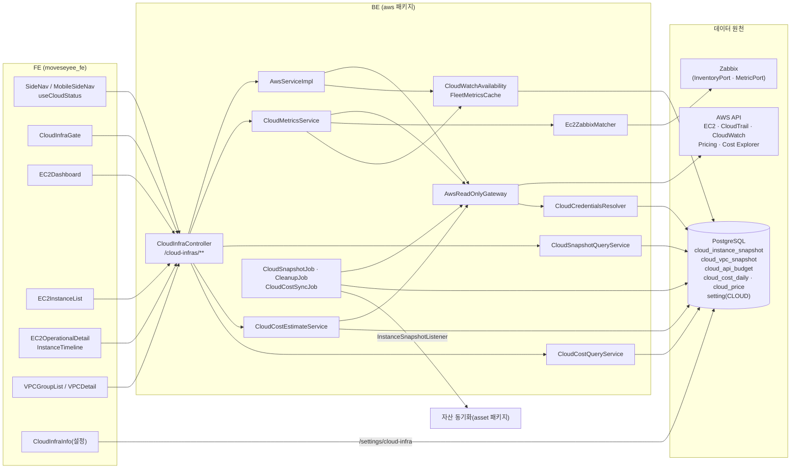

# 클라우드 인프라 모니터링(AWS) 기능 상세 가이드

> AWS 계정의 EC2·VPC를 온프레미스 장비와 같은 제품 안에서 보려는 운영자·클라우드 담당자를 위한 영역이다. 무료 조회 API(`Describe*`)만으로 인벤토리·상태 이력·노출 진단을 만들고, CloudWatch 지표와 Cost Explorer 실청구액은 관리자가 명시적으로 켠 경우에만 호출한다. 이 문서는 클라우드 인프라 화면 5개, 설정 화면 1개, 수집 배치 3개, 그리고 그 뒤의 자격증명·예산·캐시 동작을 다룬다. 자산 화면의 Cloud 탭은 범위 밖이며 클라우드가 넘겨주는 데이터만 적는다. 모든 내용은 BE `e55948c`·FE `9dfcbe8` 소스를 정적으로 대조해 썼고, 서버 기동·AWS 실호출·브라우저 확인은 하지 않았다.

## 1. 한눈에 보기

| 기능 | 화면 주소·메뉴 위치 | 상태 | 권한·라이선스 | 한 줄 설명 |
|---|---|---|---|---|
| 클라우드 기능 게이팅 | 사이드바 `클라우드 인프라 모니터링` 그룹 전체, `/cloud-infra-monitoring/**` 진입 가드 | 현재 | `awsResources.view` + AWS 자격증명 존재 | 자격증명이 없으면 메뉴를 잠그고 화면 대신 설정 안내를 그린다 |
| 설정 > 클라우드 인프라 | `/setting/cloud-infra-info` · 관리 콘솔 `데이터 소스` 그룹 | 현재 | 관리자(ADMIN·SUPER_ADMIN) | Access Key 등록, 수집 리전 범위, 유료 기능 스위치, 연결 테스트 |
| AWS 클라우드 개요 | `/cloud-infra-monitoring/ec2-dashboard` · 사이드바 첫 항목 | 현재 | `awsResources.view` | 전 리전 EC2 위험 등급 집계, 커버리지, 플릿 상태 추이, 실청구액·낭비 카드 |
| EC2 목록 | `/cloud-infra-monitoring/ec2-list` | 현재 | `awsResources.view` | 인스턴스 목록, 모니터링 소스, 플릿 지표 컬럼, 상세 드로어 |
| EC2 상세(운영 상세·통합 타임라인) | `/cloud-infra-monitoring/ec2-list/:instanceId?region=` + 목록 드로어 | 현재 | `awsResources.view` | 상태 점검·예정 이벤트·볼륨·보안 그룹 + 성능 시계열·상태 밴드·변경 마커 |
| VPC 그룹 목록 | `/cloud-infra-monitoring/vpc-group-list` | 현재 | `awsResources.view` | VPC 목록, 소속 EC2 수, VPC별 평균 CPU(플릿) |
| VPC 상세(노출 진단·진단 추이) | `/cloud-infra-monitoring/vpc-group-list/:vpcId?region=` + 목록 드로어 | 현재 | `awsResources.view` | 서브넷·라우트·게이트웨이·보안 그룹과 인터넷 노출 진단, 진단 건수 추이 |
| CloudTrail 변경 이력 | EC2·VPC 상세 안의 카드, 타임라인 마커 | 현재 | `awsResources.view` | 최근 90일 관리 이벤트 중 해당 리소스 것 최대 50건 |
| 모니터링 소스 매트릭스 | 화면 없음(목록 `모니터링` 컬럼·상세 출처 배지로 노출) | 현재 | — | Zabbix 에이전트 값 우선, 품질 미달이면 CloudWatch 폴백 |
| 플릿 지표(CloudWatch) | 개요·목록·VPC 목록의 지표 영역 | 현재(기본 꺼짐) | 관리자가 설정에서 켬 | 실행 중 인스턴스 CPU·네트워크·EBS I/O와 CloudWatch 알람 |
| 상태 스냅샷 수집·보존 | 화면 없음(관리 콘솔 스케줄러에서 주기 조정) | 현재 | 유효 라이선스(수집), 무관(정리) | 5분마다 인스턴스 상태, 30분마다 VPC 구성을 DB에 적재, 30일 보존 |
| 클라우드 비용(추정·실청구) | 화면 본체는 `자산 관리 > 비용 > Cloud 탭`(범위 밖). 개요에 실청구액·낭비 카드 | 현재 | `awsResources.view`, 실청구는 옵트인 | 온디맨드 단가 × 가동시간 추정, Cost Explorer 일 배치 |
| 구 클라우드 비용 주소 | `/cloud-infra-monitoring/cost` | 현재(리다이렉트 전용) | 없음 | `자산 관리 > 비용?tab=cloud`로 쿼리를 보존해 이동 |
| 홈 위젯 `cloud_fleet` | 홈 위젯 추가 목록(기본 세트 밖) | 현재 | BE는 `awsResources.view` 강제 | CPU 상위 5·활성 알람 수·낭비 리소스 요약 |
| 자산 연계 | 화면 없음 | 현재 | — | 스냅샷 배치가 EC2 목록을 자산 동기화로 넘긴다 |
| 구 EC2 지표 상세 | 주소 없음. `GET /cloud-infras/ec2`, `EC2InstanceDetail.tsx` | 보류(미사용 잔존) | — | CloudWatch 8지표 화면의 흔적. 응답은 항상 빈 시계열 |
| AWS 외 클라우드, 다중 AWS 계정 | 없음 | 계획 | — | 설정이 1건이라 계정 1개만 연결된다 |

### 전체 구조

화면 조회는 대부분 AWS를 **요청 시점에 직접** 호출한다. DB에서 읽는 것은 상태 이력(스냅샷), 실청구액, 단가 캐시, 월 호출 예산뿐이다.

## 2. 기능별 상세

### 2.1 클라우드 기능 게이팅

**무엇을 하는가** — AWS 자격증명이 없는 설치본에서 클라우드 화면이 오류로 비는 대신, 메뉴를 잠그고 설정으로 안내한다.

**화면과 진입 경로**

- 사이드바 그룹 `클라우드 인프라 모니터링` 아래에 `AWS 클라우드 개요`, `EC2 목록`, `VPC 그룹 목록` 세 항목이 있다. 모바일 사이드바도 같은 구성이다. 중간 단계 `AWS 리소스`는 없다.
- 그룹은 `awsResources.view` 권한이 있을 때만 보인다. 권한이 있고 자격증명이 없으면 세 항목이 비활성으로 보이고 첫 항목에 "설정 > 클라우드 인프라에서 AWS 자격증명을 먼저 입력하세요" 안내가 붙는다.
- 헤더 검색에는 `VPC 그룹 목록`, `AWS 클라우드 개요`, `EC2 목록`이 `awsResources` 권한 조건으로 등록돼 있다.
- 주소를 직접 입력하면 `PageWrapper(awsResources)` → `CloudInfraGate` 순으로 판정한다. 자격증명이 없으면 "AWS 자격증명이 필요합니다" 카드와 설정 이동 버튼이 나온다.

**동작 원리**

1. FE `useCloudStatus`가 `GET /cloud-infras/status`를 호출한다. 사이드바는 권한이 있을 때만 호출한다.
2. BE `CloudStatusService.status()`는 `CloudCredentialsResolver.source()`로 자격증명 출처만 판정한다. 이 판정은 AWS API를 호출하지 않는다.
3. 출처는 세 값이다. `SETTING`은 설정 화면에 저장된 키, `ENVIRONMENT`는 환경변수·IAM 역할 등 AWS 표준 자격증명 체인, `NONE`은 어디에도 없음이다.
4. 응답은 `state`(`ready`/`unconfigured`), `source`, `settingPresent`, `paidFeatures`(`costExplorer`·`fleetMetrics`)다.
5. FE는 상태 조회가 끝났고 `state`가 `ready`가 아닐 때만 잠근다. 조회 중에는 잠그지 않는다.
6. BE의 자원 조회 엔드포인트는 모두 첫머리에서 `requireConfigured()`를 호출한다. 자격증명이 없으면 `CLOUD_NOT_CONFIGURED` 오류로 답한다.

**주요 API**

| Method | Path | 용도 | 권한 |
|---|---|---|---|
| GET | `/cloud-infras/status` | 메뉴·진입 가드용 상태 | `awsResources.view` |

**권한·라이선스** — `awsResources`는 기본값이 관리자 유형에만 `view=true`다. 일반 역할은 역할 편집 화면에서 켜야 한다(V27이 기존 역할에 `view=false`로 추가). BE는 `/cloud-infras/**` 전 엔드포인트에서 `DmovePermissionChecker.requireView`로 강제하며 관리자는 우회한다. 라이선스 기능 플래그는 걸려 있지 않다.

**빈 값·실패·경계 상태** — 상태 조회 요청 자체가 실패해도 FE는 `ready`가 아니라고 보고 잠금·안내 카드를 그린다(문구는 "자격증명 필요"로 같다).

**운영 주의** — "자격증명이 있다"까지만 본다. 키가 틀렸거나 권한이 없으면 메뉴는 열리고 화면 안에서 실패한다. 실제 확인은 설정 화면의 연결 테스트로 한다.

### 2.2 설정 > 클라우드 인프라

**무엇을 하는가** — AWS Access Key를 등록해 클라우드 메뉴를 열고, 백그라운드 수집 리전과 유료 기능 사용 여부를 정한다.

**화면과 진입 경로** — 헤더 ⚙(관리 콘솔) > `데이터 소스` 그룹 > `클라우드 인프라`. 주소는 `/setting/cloud-infra-info`. 관리자 전용 라우트다. 같은 그룹의 `데이터 소스 관리` 화면에는 AWS 항목이 없다.

**사용 방법**

1. `Access Key ID`를 입력한다. 영문·숫자만, 최대 20자, 필수다.
2. `Secret Key`를 입력한다. 최대 40자다. 이미 설정에 저장된 키가 있으면 비워 둘 수 있고, 비우면 기존 값이 유지된다.
3. `수집 범위`에서 백그라운드 수집이 조회할 리전을 고른다. 비우면 계정에 활성화된 리전 전체다. 선택지는 자격증명이 준비된 뒤에만 채워진다.
4. `확장 기능` 스위치 두 개를 필요하면 켠다. 켜는 순간 비용 고지 창이 뜨고, 확인해야 스위치가 켜진다. 실제 반영은 `저장`을 눌러야 된다.
5. `저장`을 누른다.
6. `연결 테스트`를 누른다. **입력 중인 값이 아니라 저장된 값**으로 AWS를 1회 호출한다. 성공하면 조회된 리전 수가, 실패하면 AWS가 준 오류 원문이 표시된다.

화면 상단 상태 표시는 `미설정`, `활성 · 설정 값`, `활성 · 환경 자격증명` 세 가지다. 환경 자격증명으로 동작 중이면 별도 안내가 나온다.

| 스위치 | 저장 키 | 켰을 때 | 껐을 때(기본) |
|---|---|---|---|
| 실청구액 연동 | `paidFeatures.costExplorer` | 일 배치가 Cost Explorer를 호출해 일별·서비스별 청구액을 적재 | 배치가 건너뜀. 실청구액 카드는 잠금 표시 |
| CloudWatch 지표 수집 | `paidFeatures.fleetMetrics` | 개요·목록·VPC 목록의 플릿 지표, 상세 성능 시계열, CloudWatch 알람을 조회 | CloudWatch를 전혀 부르지 않음. 성능 지표는 Zabbix 에이전트가 붙은 인스턴스만 |

**동작 원리**

- 조회는 `GET /settings/cloud-infra`, 저장은 `POST /settings/cloud-infra`다. 둘 다 `AdminAccessChecker.requireAdmin`을 통과해야 한다.
- 저장 값은 `setting` 테이블의 `type=CLOUD` 행 1건, `value` JSON이다. 키는 `username`(Access Key ID), `password`(Secret Key), `type`(`AWS`), `paidFeatures`, `collectionRegions`다.
- `password`는 `SettingSecretCodec`이 AES-256-GCM으로 암호화해 `enc:v1:` 접두 문자열로 저장한다. 암호화 키는 `CREDENTIAL_ENCRYPTION_KEY`다. 조회 응답에서는 비밀값이 제거된다.
- 요청에 `password`가 없거나 공백이면 `SettingService.mergeSecrets`가 저장된 값을 그대로 유지한다. 저장된 값도 없으면 `SETTING_PASSWORD_REQUIRED`로 거부한다.
- 유료 스위치와 수집 범위는 "비우면 유지" 규칙이 없다. 요청에 없으면 꺼짐·전체로 저장되므로 FE가 매번 현재 값을 실어 보낸다.
- `collectionRegions`는 최대 64개, 각 항목은 `^[a-z]{2}(-[a-z]+)+-\d+$` 형식이어야 한다. 실제 활성 리전인지는 저장 시 확인하지 않고 수집 시점에 교집합을 뜬다.
- 저장 트랜잭션이 커밋된 뒤 `FleetMetricsCache.invalidate()`가 호출돼 플릿 지표 캐시가 비워진다. FE는 클라우드 관련 쿼리 캐시를 전부 무효화한다.
- 연결 테스트는 `POST /cloud-infras/test-connection`이다. `ec2:DescribeRegions`를 1회 호출한다. AWS 인증 실패도 HTTP 200이며 바디의 `ok=false`, `reason`에 사유가 담긴다.

**주요 API**

| Method | Path | 용도 | 권한 |
|---|---|---|---|
| GET | `/settings/cloud-infra` | 저장된 설정 조회(비밀값 제외) | 관리자 |
| POST | `/settings/cloud-infra` | 자격증명·수집 범위·유료 스위치 저장 | 관리자 |
| POST | `/cloud-infras/test-connection` | 저장된 자격증명으로 AWS 1회 호출 | 관리자 |
| GET | `/cloud-infras/regions` | 수집 범위 선택지(활성 리전 전체) | `awsResources.view` |

**권한·라이선스** — 역할 권한 표의 `settings.cloudInfraInfo` 체크박스는 이 화면을 여닫지 않는다. 관리자 여부로만 판정한다.

**빈 값·실패·경계 상태**

- 저장 실패는 "클라우드 인프라 업데이트 실패" 한 줄로 표시된다. BE 오류 사유는 화면에 나오지 않는다.
- 자격증명이 준비되지 않으면 수집 범위 선택과 연결 테스트 버튼이 비활성이다.
- 설정한 수집 리전이 전부 활성 목록에서 빠지면(옵트인 해제 등) 수집은 전체로 돌아가지 않고 빈 채로 건너뛴다. 배치 요약에 `skipped: no collection region`이 남는다.

**운영 주의**

- `CREDENTIAL_ENCRYPTION_KEY`가 없으면 BE가 기동하지 않는다. 키를 잃으면 저장된 Secret Key를 복호화할 수 없으므로 화면에서 다시 입력해야 한다.
- 설정에 키가 저장돼 있으면 환경변수·IAM 역할보다 **항상 우선**한다.
- 저장된 자격증명을 지우는 기능은 없다. 다른 키로 덮어쓰는 것만 된다.

### 2.3 AWS 클라우드 개요

**무엇을 하는가** — 계정 전체 EC2가 지금 어떤 상태인지를 등급으로 집계해 보여 준다. 개별 인스턴스를 찾기 전에 "지금 봐야 할 것이 있는가"를 판단하는 화면이다.

**화면과 진입 경로** — 사이드바 `클라우드 인프라 모니터링 > AWS 클라우드 개요`, 주소 `/cloud-infra-monitoring/ec2-dashboard`. URL query는 `regions`(쉼표 구분, 최대 20개)와 `range`(`1h`·`6h`·`24h`·`7d`, 기본 `1h`)다. 두 값 모두 주소에 남아 공유·새로고침이 된다.

**사용 방법**

1. 상단 리전 필터로 범위를 좁힌다. 비우면 활성 리전 전체다.
2. 오른쪽 구간 선택(`1h`~`7d`)으로 추이·플릿 지표의 시간창을 바꾼다.
3. 카드 5개를 본다: `전체 인스턴스`, `위험`, `주의`, `정상`, `활성 알람`.
4. `모니터링 커버리지` 카드에서 인스턴스가 어떤 소스로 감시되는지 대수를 본다.
5. `우선 확인할 리소스` 표(최대 10건)에서 정상이 아닌 인스턴스와 사유를 본다.

| 영역 | 내용 | 값의 출처 |
|---|---|---|
| 요약 카드 | 등급별 대수, 활성 알람 수 | 요청 시점 EC2 API(+플릿 지표) |
| 모니터링 커버리지 | `Zabbix 에이전트`·`CloudWatch`·`CloudWatch 꺼짐`·`수집 불가`·`미관측` 대수 | 소스 매트릭스(2.6) |
| 플릿 상태 추이 | 수집 회차별 등급 대수 누적 영역 차트 | 스냅샷 DB |
| 클라우드 비용(실청구액) | 일별 청구액 막대, 월 누계, 서비스 상위 5 | `cloud_cost_daily`. 옵트인 꺼짐이면 잠금 카드 |
| 우선 확인할 리소스 | 등급 높은 순 10건. 사유·평균 CPU | 요청 시점 EC2 API(+플릿 지표) |
| CPU 사용률 상위 | 상위 5대, 80% 이상 강조 | 플릿 지표(옵트인) |
| 활성 알람 | `ALARM`·`INSUFFICIENT_DATA` 상태 알람 최대 50건 | CloudWatch `DescribeAlarms`(옵트인) |
| 네트워크 트래픽 상위 | 수신+송신 bytes/sec 상위 5대 | 플릿 지표(옵트인) |
| 낭비 진단 | 미부착 EBS·미사용 EIP·중지 인스턴스의 EBS 상위 5건과 월 추정액 | `GET /cloud-infras/cost-estimate` |
| 수집 상태 | 리전별 `EC2`·`CloudWatch`·`Alarm` 상태와 사유 | 응답의 `collection.regions` |

**동작 원리**

- FE는 `GET /cloud-infras/overview`와 `GET /cloud-infras/cost-estimate`를 각각 10분마다 다시 호출한다. 실청구액 카드는 `GET /cloud-infras/costs`를 호출한다.
- BE `AwsServiceImpl.overview()`는 리전마다 `DescribeInstances`와 `DescribeInstanceStatus`를 부른다. 리전 작업은 요청마다 새로 만든 스레드 풀(최대 16개)에서 병렬로 돈다.
- 등급 판정은 `Ec2StatusRules.classify`가 한다. 순서가 규칙이다.

| 순서 | 조건 | 등급 |
|---|---|---|
| 1 | 인스턴스 상태가 `stopped` | `stopped`(중지) |
| 2 | 상태 점검 문자열이 있고 `2/2 checks passed`가 아님 | `critical`(위험) |
| 3 | 인스턴스 상태가 `pending` | `warning`(주의) |
| 4 | 상태 점검 문자열이 없음 | `unobserved`(미수집) |
| 5 | 그 밖 | `healthy`(정상) |

- 플릿 지표가 켜져 있으면 등급을 **올리는 방향으로만** 다시 판정한다. CloudWatch 알람이 `ALARM`이면 위험, `INSUFFICIENT_DATA`면 주의, 평균 CPU가 80% 이상이면 주의다. 중지 인스턴스는 대상이 아니다.
- 사유 코드는 `EC2_STATUS_CHECK_FAILED`, `EC2_STATE_<상태>`, `CPU_HIGH`, `CLOUDWATCH_ALARM`, `CLOUDWATCH_ALARM_INSUFFICIENT_DATA`다.
- 플릿 상태 추이는 `cloud_instance_snapshot`을 수집 회차(`run_at`)·등급으로 묶어 센다. AWS를 호출하지 않는다.
- `summary.lastCollectedAt`은 응답을 만든 시각이다.

**주요 API**

| Method | Path | 용도 | 권한 |
|---|---|---|---|
| GET | `/cloud-infras/overview?regions=&range=` 또는 `from=&to=`(ISO 시각, 최대 7일) | 개요 전체 | `awsResources.view` |
| GET | `/cloud-infras/cost-estimate` | 낭비 진단·추정 비용 | `awsResources.view` |
| GET | `/cloud-infras/costs` | 실청구액 요약 | `awsResources.view` |
| GET | `/cloud-infras/regions` | 리전 필터 선택지 | `awsResources.view` |
| GET | `/cloud-infras/ec2-dashboard?regions=` | 리전·유형·상태별 집계. **FE가 호출하지 않는다** | `awsResources.view` |

**빈 값·실패·경계 상태**

- 리전 하나의 EC2 조회가 실패하면 그 리전은 `collection.regions`에 `ec2: unavailable (EC2_UNAVAILABLE)`로 남고 집계에서 빠진다. 화면에 "일부 수집 실패" 경고가 뜬다.
- CloudWatch 스위치가 꺼져 있으면 `cloudWatch`·`alarms`가 `disabled (PAID_FEATURE_OFF)`로 내려오고 CPU·네트워크 상위와 알람은 빈 목록이다. 0으로 채우지 않는다.
- 월 예산이 소진되면 `disabled (BUDGET_EXHAUSTED)`, 권한이 없으면 `unavailable (CLOUDWATCH_ACCESS_DENIED)`다.
- 리전에 실행 중 인스턴스가 20대를 넘으면 앞의 20대만 조회하고 `partial (FLEET_CAP)` 안내가 뜬다. 데이터포인트가 없는 인스턴스가 있으면 `partial (NO_DATAPOINTS)`다.
- 낭비 합계가 `null`이면(단가 미조회) `-`로 표시한다.
- `regions`가 21개 이상이거나 `range`·`from`·`to` 조합이 틀리면 `INVALID_QUERY`다.

**운영 주의** — 이 화면을 열어 두면 사용자 1명당 10분마다 "조회 리전 수 × 2회"(개요)와 "수집 범위 리전 수 × 3회"(추정 비용)의 EC2 조회가 나간다. 무료지만 계정의 API 호출 한도를 함께 쓴다.

### 2.4 EC2 목록

**무엇을 하는가** — 개별 인스턴스를 찾고, 각 인스턴스가 무엇으로 감시되는지와 최근 1시간 지표를 한 줄에서 본다.

**화면과 진입 경로** — 사이드바 `EC2 목록`, 주소 `/cloud-infra-monitoring/ec2-list`. URL query는 `regions`, `vpcIds`, 검색어다. VPC 그룹 목록의 `EC2 인스턴스 수` 링크가 `vpcIds`와 `regions`를 채워 이 화면으로 넘어온다.

**사용 방법**

1. 리전·VPC 필터와 검색(이름, ID, 가용 영역)으로 좁힌다.
2. 상단 카드에서 `전체 EC2`, `실행 중`, `상태 점검 실패` 대수를 본다.
3. 인스턴스 ID를 누르면 오른쪽 패널에 상세(2.5)가 열린다. 패널의 `페이지로 보기`가 전용 주소로 넘긴다.

| 컬럼 | 뜻·단위 |
|---|---|
| 상태 확인 | `2/2 checks passed`, `1/2 checks failed`, `0/2 checks failed`. 시스템 점검과 인스턴스 점검 중 `ok`인 개수 |
| 모니터링 | 소스 매트릭스 5값(2.6) |
| CPU | 최근 1시간 평균(%)과 스파크라인. 80% 이상 강조 |
| 네트워크 | 수신 ↓ · 송신 ↑, bytes/sec |
| 디스크 | 읽기 R · 쓰기 W, bytes/sec(EBS 기준) |
| 그 밖 | 인스턴스 이름·ID·상태·유형, 리전, 가용 영역, VPC 이름·ID, 보안 그룹 이름 |

지표 컬럼이 값이 아닐 때는 사유를 글자로 보여 준다: `CloudWatch 꺼짐`(스위치 꺼짐), 실행 중 아님, 데이터 없음, 수집 저하(예산·권한·상한).

**동작 원리**

- `GET /cloud-infras/ec2s`가 리전마다 `DescribeInstances`, `DescribeInstanceStatus`, `DescribeVpcs`(이름 조회)를 호출해 **전체를 한 번에** 돌려준다. BE 페이징은 없고 검색·정렬·페이지 나눔은 브라우저가 한다.
- VPC 필터는 리전 조회가 끝난 뒤 BE에서 걸러낸다. 리전 필터는 조회할 리전 자체를 줄인다.
- 플릿 지표는 개요와 같은 리전 캐시(시간창 `1h`)를 읽는다. 캐시가 비어 있으면 이 요청이 CloudWatch를 호출해 채운다.
- 10분마다 다시 조회한다.

**주요 API**

| Method | Path | 용도 | 권한 |
|---|---|---|---|
| GET | `/cloud-infras/ec2s?regions=&vpcIds=` | 인스턴스 목록(전량) | `awsResources.view` |
| GET | `/cloud-infras/vpcs` | VPC 필터 선택지 | `awsResources.view` |
| GET | `/cloud-infras/regions` | 리전 필터 선택지 | `awsResources.view` |

**빈 값·실패·경계 상태**

- 한 리전의 조회가 실패하면 그 리전은 로그만 남기고 빈 목록으로 처리된다. 응답에는 실패 표시가 없다.
- 조회 중에는 표에 "15~30초 정도 걸릴 수 있습니다" 안내 문구가 붙는다. 전 리전을 실시간으로 조회하기 때문이다.

**운영 주의** — 리전에 인스턴스가 100대를 넘어도 상태 점검 조회는 100개씩 나눠 호출한다.

### 2.5 EC2 상세와 통합 타임라인

**무엇을 하는가** — 인스턴스 하나의 구성·점검·디스크와, 성능·상태·변경을 한 시간 축에 겹친 타임라인을 본다.

**화면과 진입 경로**

- 패널: EC2 목록에서 인스턴스 ID 클릭. 세로로 쌓인 배치.
- 페이지: `/cloud-infra-monitoring/ec2-list/:instanceId?region=<리전>`. 2단 배치(왼쪽 타임라인·변경 이력, 오른쪽 속성).
- VPC 상세의 `연결된 EC2` 표가 이 주소로 링크한다.
- 주소의 `region` 쿼리는 필수다. 없으면 어떤 조회도 시작하지 않는다.

**사용 방법**

1. `인스턴스 정보`에서 ID·이름·상태·유형·가용 영역·VPC·서브넷·사설/공인 IP를 확인한다.
2. `통합 타임라인` 오른쪽에서 구간(`6h`·`24h`·`3d`·`7d`, 기본 `24h`)을 고른다.
3. 출처 배지(`출처: Zabbix 에이전트 · 호스트명`, `출처: CloudWatch`, `출처: 없음`)로 성능 값의 출처를 확인한다.
4. 배경 밴드로 이상 구간을 본다. 위험·주의·미수집·중지·수집 공백이 색으로 깔리고, 정상 구간은 밴드가 없다.
5. 점선 마커로 그 시점의 변경(CloudTrail 쓰기 이벤트)을 본다.
6. 아래 카드에서 상태 점검(전체·시스템·인스턴스), 예정 이벤트, 보안 그룹, 볼륨(크기·암호화·유형), 최근 변경 이력을 본다.

| 출처 | 그려지는 차트 |
|---|---|
| Zabbix 에이전트 | CPU 사용률(%), 메모리 사용률(%), 루트 파티션 디스크 사용률(%, 값이 있을 때만) |
| CloudWatch | CPU 사용률(%), 네트워크 수신·송신, 디스크 읽기·쓰기(EBS) |
| 없음 | 성능 차트 없이 상태 밴드 띠만 |

**동작 원리**

- `GET /cloud-infras/ec2/detail` — `DescribeInstances`(1), `DescribeInstanceStatus`(1), `DescribeVolumes`(1). CloudWatch를 부르지 않는다. `fleetComparison`(리전 평균 CPU 대비)은 플릿 캐시에 값이 있을 때만 채워지고, 없으면 `NOT_CACHED`다.
- `GET /cloud-infras/ec2/state-history` — `cloud_instance_snapshot`에서 해당 인스턴스의 회차별 `state`·`statusCheck`·`severity`를 읽는다. `from`/`to`는 epoch 초, 없으면 최근 24시간.
- `GET /cloud-infras/ec2/metrics` — 소스 매트릭스(2.6)에 따라 Zabbix 또는 CloudWatch에서 시계열을 가져온다. 응답 키는 출처와 무관하게 `cpu`·`memoryUsage`·`diskUsage`·`networkIn`·`networkOut`·`diskReadBytes`·`diskWriteBytes` 7개로 고정이다.
- `GET /cloud-infras/cloudtrail/events` — 타임라인 마커용과 변경 이력 카드용으로 **각각 한 번씩** 호출된다.
- FE는 연속한 같은 등급 스냅샷을 하나의 밴드로 접는다. 스냅샷 간격이 10분(수집 주기 5분의 2배)을 넘으면 그 사이를 `수집 공백` 밴드로 그린다.
- 조회 창은 구간을 고른 시점에 고정된다. 자동 갱신은 없다.

**주요 API**

| Method | Path | 용도 | 권한 |
|---|---|---|---|
| GET | `/cloud-infras/ec2/detail?instanceId=&region=` | 구성·점검·볼륨 | `awsResources.view` |
| GET | `/cloud-infras/ec2/state-history?instanceId=&region=&from=&to=` | 상태 밴드 | `awsResources.view` |
| GET | `/cloud-infras/ec2/metrics?instanceId=&region=&from=&to=` | 성능 시계열 | `awsResources.view` |
| GET | `/cloud-infras/cloudtrail/events?region=&resourceId=` | 변경 이력·마커 | `awsResources.view` |

**빈 값·실패·경계 상태**

- 없는 인스턴스 ID나 형식이 어긋난 ID는 `INSTANCE_NOT_FOUND`다.
- 성능 지표가 강등되면 HTTP 200에 빈 시계열과 사유가 온다. 화면은 사유별 안내(스위치 꺼짐, 권한 없음, 일시 실패, 월 예산 소진)를 띄우고 상태 밴드만 그린다.
- Zabbix 호스트와 연결됐지만 품질 미달로 CloudWatch로 내려온 경우 경고 한 줄이 뜬다.
- 스냅샷이 아직 없으면 "상태 스냅샷이 아직 없습니다" 안내가 나온다. 수집 범위에서 뺀 리전의 인스턴스도 같은 안내를 본다.
- 전 구간이 정상이면 밴드가 없으므로 "스냅샷 N건 전부 정상" 한 줄을 남긴다.

**운영 주의** — CloudWatch 경로의 상세 조회 1회는 월 예산에서 5콜을 쓴다. 구간이 길면 데이터포인트 1,440개 한도에 맞춰 집계 간격이 자동으로 커진다(63일 이내 300초 배수, 그 이전 3,600초 배수).

### 2.6 모니터링 소스 매트릭스

**무엇을 하는가** — "이 EC2의 성능 값을 어디서 가져올 것인가"를 정한다. 에이전트가 있으면 메모리·디스크 사용률까지 무료로 얻고, 없으면 CloudWatch로 내려가며, 둘 다 없으면 상태 밴드만 남긴다.

**동작 원리 — EC2와 Zabbix 호스트 짝짓기(`Ec2ZabbixMatcher`)**

| 순위 | 근거 | 조건 |
|---|---|---|
| 1 | `INSTANCE_ID_EXACT` | Zabbix 호스트 이름이 인스턴스 ID와 같거나, 호스트 태그 `aws.instanceId` 값이 인스턴스 ID와 같다. 같은 ID를 두 호스트가 주장하면 둘 다 버린다 |
| 2 | `IP_EXACT` | 인스턴스의 모든 주소(주·보조 사설 IP, 연결된 공인 IP)가 정확히 한 호스트의 AGENT 인터페이스 주소와만 겹치고, 그 호스트 주소를 쓰는 EC2도 이 인스턴스 하나뿐이다 |

- Name 태그와 호스트 이름이 같다는 것만으로는 연결하지 않는다.
- 호스트 목록은 시스템 계정으로 전체를 받아 5분간 메모리에 둔다. DNS로 접속하는(`useip=0`) 인터페이스 주소는 근거로 쓰지 않는다.
- IP 근거의 역방향 검사에 쓰는 "EC2 주소 색인"은 스냅샷 배치가 **전 리전 수집에 성공했을 때만** 교체한다. 한 리전이라도 실패하면 색인을 비우고 IP 근거를 쓰지 않는다. BE 기동 직후 첫 배치 전에도 같다.
- 신선도는 후보 호스트의 CPU 사용률 아이템 마지막 수집 시각으로 본다. 허용 시간은 기본 30분(`app.cloud.agent-freshness-minutes`)이다.

**동작 원리 — 커버리지 5값(`monitoredBy`)**

| 값 | 화면 표기 | 판정 |
|---|---|---|
| `unmonitored` | 미관측 | 인스턴스가 `stopped` |
| `zabbix-agent` | Zabbix 에이전트 | 짝이 있고 CPU 아이템이 허용 시간 안에 수집됨 |
| `cloudwatch-off` | CloudWatch 꺼짐 | 에이전트 아님 + CloudWatch 스위치 꺼짐 |
| `cloudwatch` | CloudWatch | 에이전트 아님 + 스위치 켜짐 + 리전 권한 거부 기록 없음 + 월 예산 여유 있음 |
| `unavailable` | 수집 불가 | 위 어느 것도 아님(권한 거부·예산 소진) |

**동작 원리 — 상세 시계열 선택(`CloudMetricsService.metrics`)**

1. 짝이 있으면 Zabbix에서 CPU 사용률과 메모리 사용률을 원본 해상도로 조회한다.
2. 두 지표가 **각각** 비어 있지 않고 마지막 값이 허용 시간 안이면 에이전트 값을 그대로 돌려준다. 루트 파티션(`/`, 없으면 `C:`) 디스크 사용률은 있으면 덧붙인다.
3. 하나라도 미달이거나 Zabbix 조회가 실패하면 CloudWatch 경로로 내려간다. 응답에 `fallbackUsed=true`가 실린다.
4. CloudWatch 경로는 스위치 → 리전 권한 거부 기록 → 월 예산 예약 순으로 확인한 뒤 5개 지표를 차례로 조회한다.

**권한·라이선스** — Zabbix 조회는 사용자 계정이 아니라 시스템 컨텍스트로 한다. `awsResources.view`가 있으면 연결된 호스트의 CPU·메모리 시계열과 호스트 이름을 볼 수 있다. 호스트 그룹 범위는 적용되지 않는다.

**운영 주의**

- 에이전트를 붙였는데 `CloudWatch`로 표시되면 호스트 태그 `aws.instanceId`를 넣는 것이 가장 확실하다.
- CPU 아이템 수집 주기가 30분보다 긴 템플릿을 쓰면 허용 시간 설정을 늘려야 한다.

### 2.7 플릿 지표와 CloudWatch 월 예산 가드

**무엇을 하는가** — 여러 인스턴스의 CloudWatch 지표를 한꺼번에 보여 주되, AWS 프리티어(월 100만 요청)를 넘지 않도록 호출 수를 제품이 스스로 묶는다.

**동작 원리**

- 대상은 리전의 **실행 중** 인스턴스다. 20대를 넘으면 AWS가 돌려준 순서의 앞 20대만 조회한다.
- 인스턴스마다 `GetMetricStatistics` 5회(`CPUUtilization` 평균, `NetworkIn`·`NetworkOut`·`EBSReadBytes`·`EBSWriteBytes` 합계)를 호출한다. 네트워크·디스크는 합계를 집계 간격(초)으로 나눠 bytes/sec로 만든다.
- 리전마다 `DescribeAlarms` 1회(최대 100건)를 호출해 `ALARM`·`INSUFFICIENT_DATA` 알람만 남긴다.
- 결과는 `FleetMetricsCache`에 "리전 × 시간창" 단위로 15분간 둔다. 개요·목록·VPC 목록·상세의 리전 평균 비교가 같은 캐시를 읽는다. 설정을 저장하면 캐시가 비워진다.
- 호출 전에 `cloud_api_budget`에서 "이번 달 사용량 + 예정 호출 수 ≤ 상한"일 때만 값을 올리는 조건부 UPDATE로 예산을 **예약**한다. 실제로 나가지 않은 호출은 끝나고 반납한다.

| 항목 | 값 | 위치 |
|---|---|---|
| 월 상한(제품 몫) | 500,000회 | `app.cloud.metrics-monthly-call-cap` |
| 플릿이 쓸 수 있는 몫 | 상한의 70%(350,000회) | `AwsServiceImpl.FLEET_BUDGET_SHARE` |
| 상세 시계열 1회 | 5회 | `CloudWatchAvailability.METRICS_CALLS_PER_REQUEST` |
| 플릿 리전 1회(최대) | 20대 × 5 + 알람 1 = 101회 | `FLEET_MAX_INSTANCES_PER_REGION`, `FLEET_CALLS_PER_INSTANCE` |
| 캐시 수명 | 15분 | `FleetMetricsCache.TTL` |
| 권한 거부 재시도 억제 | 리전별 10분 | `CloudWatchAvailability.DENIED_TTL` |

- 리전 하나를 한 시간창으로 계속 열어 두면 한 달에 최대 약 29만 회(101 × 96회/일 × 30일)를 쓴다. 시간창을 바꾸면(`1h`와 `24h`) 캐시 키가 달라 따로 센다.
- 예산이 소진되면 그 달 말까지 플릿은 `BUDGET_EXHAUSTED`로 강등된다. 상세 시계열은 남은 30% 몫을 계속 쓴다.

**데이터** — `cloud_api_budget`(V29): `month`(`yyyy-MM`, 기본 키), `calls`. 월이 바뀌면 새 행이 생긴다. 정리 배치는 없다(한 달에 1행).

**빈 값·실패·경계 상태** — 권한 거부는 리전 단위로 기록하고 10분간 다시 시도하지 않는다. 알람 조회만 실패하면 지표는 살리고 알람만 `CLOUDWATCH_ALARMS_UNAVAILABLE`로 표시한다. 전송 오류는 `CLOUDWATCH_UNAVAILABLE`다.

**운영 주의** — 예산 카운터는 DB에 있어 재기동해도 유지되고 BE가 여러 대여도 합산된다. 캐시와 권한 거부 기록은 BE 프로세스 메모리에 있다.

### 2.8 VPC 그룹 목록

**무엇을 하는가** — 계정의 VPC를 목록으로 보고, 어느 VPC에 인스턴스가 몇 대 있는지 확인한다.

**화면과 진입 경로** — 사이드바 `VPC 그룹 목록`, 주소 `/cloud-infra-monitoring/vpc-group-list`. URL query는 `regions`와 검색어다.

**사용 방법**

1. 리전 필터와 검색으로 좁힌다.
2. 상단 카드에서 `전체 VPC`, `연결된 EC2`, `퍼블릭 액세스 차단`을 본다.
3. 이름이나 VPC ID를 누르면 오른쪽 패널에 상세(2.9)가 열린다.
4. `EC2 인스턴스 수`를 누르면 그 VPC로 걸러진 EC2 목록으로 간다.

| 컬럼 | 뜻 |
|---|---|
| 평균 CPU | 소속 실행 인스턴스 수와 그 평균 CPU(최근 1시간, 플릿 옵트인) |
| 공개 주소 차단 | `On`/`Off`. 서브넷이 하나 이상 있고 **모든** 서브넷이 공인 IP 자동 할당을 하지 않으면 `Off`, 그 밖은 `On` |
| 그 밖 | 이름, VPC ID, 리전, 상태, IPv4·IPv6 CIDR, 테넌시, 소유자 ID |

**동작 원리** — `GET /cloud-infras/vpcs`가 리전마다 `DescribeVpcs`, `DescribeSubnets`, `DescribeInstances`를 호출한다(VPC가 없는 리전은 1회). 전체를 한 번에 돌려주고 10분마다 다시 조회한다. `keyword` 파라미터가 BE에 있으나 FE는 쓰지 않고 브라우저에서 검색한다.

**주요 API**

| Method | Path | 용도 | 권한 |
|---|---|---|---|
| GET | `/cloud-infras/vpcs?regions=&keyword=` | VPC 목록(전량) | `awsResources.view` |

**빈 값·실패·경계 상태** — 리전 조회 실패는 EC2 목록과 같이 로그만 남기고 빈 목록이 된다.

### 2.9 VPC 상세·노출 진단·진단 추이

**무엇을 하는가** — VPC 하나의 네트워크 구성과, 인터넷에 열려 있는 지점을 진단 결과로 본다. "이 개방이 언제 생겼나"를 스냅샷 이력으로 답한다.

**화면과 진입 경로** — VPC 목록의 패널, 또는 `/cloud-infra-monitoring/vpc-group-list/:vpcId?region=<리전>`. `region` 쿼리는 필수다.

**사용 방법**

1. `노출 진단` 표에서 등급·리소스·유형·포트와 `처음 목격` 시각을 본다. 조회 창 시작부터 있던 항목은 "이전부터"로 표기된다.
2. `진단 추이` 차트에서 위험·주의 건수의 계단선을 본다(최근 7일).
3. 서브넷, 라우트 테이블, 게이트웨이(IGW·NAT), 보안 그룹 인바운드 규칙, 연결된 EC2, 최근 변경 이력을 본다.

**동작 원리 — 진단 규칙(`NetworkExposureScanner`)**

| 유형 | 조건 | 등급 |
|---|---|---|
| `PUBLIC_IP_AUTO_ASSIGN` | 서브넷이 공인 IPv4 자동 할당 | 주의 |
| `PUBLIC_SECURITY_GROUP_INGRESS` | 보안 그룹 인바운드 규칙이 `0.0.0.0/0` 또는 `::/0` 허용 | 규칙의 시작 포트가 22·3389·3306·5432·1433·6379 중 하나면 위험, 그 밖은 주의 |

- 실시간 상세와 스냅샷 적재가 같은 규칙 클래스를 쓴다.
- `GET /cloud-infras/vpcs/detail`은 `DescribeVpcs`, `DescribeSubnets`, `DescribeRouteTables`, `DescribeSecurityGroups`, `DescribeInstances`, `DescribeInternetGateways`, `DescribeNatGateways`를 각 1회 호출한다.
- `GET /cloud-infras/vpcs/history`는 `cloud_vpc_snapshot`에서 조회 창과 겹치는 구간을 읽는다. 구간마다 시작점 하나와 마지막 구간의 끝점 하나를 돌려주고, FE가 계단선으로 그린다. `collection.lastObservedAt`은 마지막 관측 시각이다.
- `findingsFirstSeen`은 최신 구간의 각 진단 항목(`유형|리소스|포트`)이 창 안에서 처음 나타난 구간의 시작 시각이다.

**주요 API**

| Method | Path | 용도 | 권한 |
|---|---|---|---|
| GET | `/cloud-infras/vpcs/detail?vpcId=&region=` | 구성·실시간 진단 | `awsResources.view` |
| GET | `/cloud-infras/vpcs/history?vpcId=&region=&from=&to=` | 진단 추이(기본 7일) | `awsResources.view` |

**빈 값·실패·경계 상태** — 없는 VPC는 `VPC_NOT_FOUND`다. 스냅샷이 없으면 추이 카드에 데이터 없음이 나온다. 구성 수집 주기(기본 30분) 때문에 새 개방이 추이에 나타나기까지 최대 한 주기가 걸린다. 실시간 진단 표는 지연이 없다.

### 2.10 CloudTrail 변경 이력

**무엇을 하는가** — 인스턴스나 VPC에 누가 무엇을 했는지 최근 관리 이벤트를 보여 준다.

**동작 원리** — `cloudtrail:LookupEvents`(Event history)를 리소스 이름 조건으로 1회 호출한다. 조회 기간은 최근 90일, 건수는 최대 50건이다. CloudTrail Lake는 쓰지 않는다. 응답 항목은 이벤트 이름·시각·사용자·소스·읽기 전용 여부·관련 리소스다. 타임라인 마커는 읽기 전용이 아닌 이벤트만 쓴다.

**빈 값·실패·경계 상태** — 호출이 실패하면 HTTP 200에 `collection.state=unavailable`, 사유 `CLOUDTRAIL_EVENT_HISTORY_UNAVAILABLE`이 오고 화면은 경고 한 줄로 대체한다. 51번째 이후 이벤트는 볼 방법이 없다.

### 2.11 상태 스냅샷 수집·보존 배치

**무엇을 하는가** — AWS에는 "언제부터 중지였나", "22번 포트가 언제 열렸나" 같은 상태의 역사가 없다. 무료 조회 결과를 주기적으로 DB에 쌓아 시간 축을 만든다.

**동작 원리 — 수집(`cloud_snapshot`, `CloudSnapshotService.collect`)**

1. 자격증명이 없으면 `skipped: unconfigured`로 끝난다.
2. 대상 리전은 "계정에 활성화된 리전 ∩ 설정의 수집 범위"다. 범위를 비우면 활성 리전 전체다.
3. 리전마다(병렬 최대 8) `DescribeInstances`와 `DescribeInstanceStatus`를 호출한다.
4. 구성 수집 차례면 리전의 `DescribeVpcs` 1회와 VPC마다 `DescribeSubnets`·`DescribeRouteTables`·`DescribeSecurityGroups` 3회를 더 호출한다. 차례는 DB에 남은 마지막 구성 관측 시각에서 `configIntervalMinutes`(기본 30, 허용 0~1440, 판정 여유 1분)가 지났는지로 정한다. 0이면 매 회차다.
5. 인스턴스는 회차마다 인스턴스당 1행을 넣는다.
6. VPC는 직전 구간과 내용 지문(`content_hash`, SHA-256)이 같으면 `last_seen_at`만 전진시키고, 다르면 새 행을 넣는다. 진단 결과는 정렬한 뒤 지문을 낸다.
7. 전 리전이 성공하면 EC2 주소 색인을 교체하고, 일부 실패면 색인을 비운다.
8. 성공한 리전의 인스턴스 목록을 자산 동기화로 넘긴다(2.13).
9. 전 리전이 실패하면 예외를 던져 실행 이력에 실패로 남긴다. 일부 실패는 요약의 `failed=N`으로만 남는다.

**동작 원리 — 정리(`cloud_snapshot_cleanup`)** — 매일 01:00에 `retentionDays`(기본 30)보다 오래된 행을 지운다. 인스턴스는 `run_at`, VPC는 구간의 끝(`COALESCE(last_seen_at, run_at)`) 기준이다. 라이선스가 만료돼도 정리는 돈다.

**데이터**

| 테이블 | Flyway | 한 행의 뜻 | 주요 컬럼 | 보존 |
|---|---|---|---|---|
| `cloud_instance_snapshot` | V28 | 수집 1회 × 인스턴스 1대 | `run_at`, `region`, `instance_id`, `name`, `state`, `status_check`, `severity` | 30일 |
| `cloud_vpc_snapshot` | V28, V64 | 같은 진단 상태가 이어진 구간 1개 | `run_at`(구간 시작), `last_seen_at`(구간 끝), `content_hash`, `subnet_count`, `instance_count`, `critical_count`, `warning_count`, `findings`(jsonb) | 30일(구간 끝 기준) |

`run_at`은 시간대 없는 `timestamp`이고 서버 로컬 시각을 넣는다. API 경계에서 UTC ISO 문자열로 바꾼다.

**운영 주의**

- 주기와 옵션은 관리 콘솔 `스케줄러`에서 바꾼다. `cloud_snapshot` 편집 창에 구성 수집 주기 선택(매 회차·15·30·60·120·360·1440분)이 따로 있다.
- 수집 배치는 유효 라이선스가 있을 때만 돈다. 동시 실행은 `scheduler_lease`로 막는다.
- 실행 요약 예: `regions=3 instances=42 vpcs=5(new=1 unchanged=4) failed=0`, 구성을 건너뛴 회차는 `vpcs=deferred(every 30m)`.

### 2.12 클라우드 비용 — 추정 엔진과 실청구액

화면 본체(`자산 관리 > 비용 > Cloud 탭`)는 이 문서 범위 밖이다. 여기서는 `aws` 패키지의 엔진과, 클라우드 개요에 붙는 카드만 다룬다.

**추정 비용(`GET /cloud-infras/cost-estimate`, `CloudCostEstimateService`)**

- 수집 범위 리전마다 `DescribeInstances`, `DescribeVolumes`, `DescribeAddresses`를 호출한다.
- 가동시간은 이번 달 `cloud_instance_snapshot`의 `state='running'` 행 수 × 5분이다.
- 단가는 Price List API(`pricing:GetProducts`, 무료)에서 가져와 `cloud_price`(V35)에 30일간 둔다. 인스턴스는 `유형:OS`(Linux·Windows), EBS는 `ebs:볼륨유형` 키다. 조회에 실패하면 만료된 캐시라도 쓴다.
- 인스턴스별 `월 누계 = 시간당 단가 × 가동시간`, `월말 예상 = 실행 중이면 시간당 단가 × 730 + EBS 월 요금`이다.
- 낭비 3종: 미부착 EBS, 미사용 Elastic IP(시간당 0.005달러 고정), 중지 인스턴스에 붙은 EBS.
- 온디맨드 기준이다(`summary.basis=ON_DEMAND`). 예약 인스턴스·Savings Plans 할인과 데이터 전송비는 반영하지 않는다.
- 단가를 못 구했거나 실패한 리전이 있으면 `collection.state=partial`, 사유 `PRICING_UNAVAILABLE` 또는 `EC2_UNAVAILABLE`다.

**실청구액(`cloud_cost_sync` 배치 → `GET /cloud-infras/costs`)**

- 매일 05:00 배치가 옵트인이 켜져 있을 때만 `ce:GetCostAndUsage`를 호출한다. 일별 × 서비스, `UnblendedCost`, 최근 35일(`lookbackDays`)이다. 페이지는 최대 5장까지 따라간다.
- 결과를 `cloud_cost_daily`(V32)에 `(cost_date, service)` 기준으로 덮어쓴다. 일 합계는 `service='TOTAL'` 행이다.
- 화면 조회는 DB만 읽는다. 최근 62일의 일 합계와 이번 달 서비스별 누계를 돌려준다. 옵트인이 꺼져 있으면 `state=disabled`, 사유 `PAID_FEATURE_OFF`다.
- Cost Explorer는 요청 1건당 0.01달러다. 일 1회·1장이면 월 약 0.3달러다.

**데이터** — `cloud_cost_daily`와 `cloud_price`에는 정리 배치가 없다.

### 2.13 다른 영역으로 넘기는 것

| 받는 쪽 | 넘기는 것 | 경로 |
|---|---|---|
| 자산(EC2 → `source=cloud` 자산) | 스냅샷 회차의 리전별 인스턴스 전량과 실패 리전 집합 | `InstanceSnapshotListener.onSnapshot`·`onRunCompleted`. 구현은 `asset.cloud.CloudAssetSyncService` |
| 자산 수동 동기화 | 수집 범위 리전의 인스턴스 목록(스냅샷은 적재하지 않음) | `CloudSnapshotService.fetchInstances()` |
| 자산의 호스트 연결 | EC2 ↔ Zabbix 호스트 짝 | `Ec2ZabbixMatcher` |
| 자산 비용 Cloud 탭 | 추정 결과, 실청구 요약 | `cost.CostCloudService`가 `CloudCostEstimateService`·`CloudCostQueryService`를 호출 |
| 홈 위젯 `cloud_fleet` | 개요(`range=1h`)와 추정 비용 응답 그대로 | FE가 두 엔드포인트를 10분마다 호출 |
| 홈 시스템 상태 | AWS `CONFIGURED`/`NOT_CONFIGURED` | `HomeSystemStatusService.checkAws`가 설정 행의 키 유무만 본다 |
| AI 어시스턴트 | 없음 | AI 서버에 `/cloud-infras`를 부르는 도구는 없다. FE는 AI 쓰기 뒤 자동 재조회 대상에서 클라우드의 실청구·시계열·추정 쿼리를 뺀다 |

### 2.14 미사용 잔존 경로

| 항목 | 현재 동작 |
|---|---|
| `GET /cloud-infras/ec2` | 인스턴스 기본 정보와 **항상 빈** 지표 8종, `collection.reason=ZERO_COST_MODE`를 돌려준다. FE에서는 어떤 라우트에도 연결되지 않은 훅만 호출한다 |
| `GET /cloud-infras/ec2-dashboard` | 리전·유형·상태·상태점검별 집계. FE 서비스 함수는 있으나 호출처가 없다 |
| FE `EC2InstanceDetail.tsx`, `useEC2InstanceDetail`, `useFilterEC2` | 구 CloudWatch 8지표 상세 화면의 구성요소. 현재 상세 라우트는 `EC2OperationalDetail`을 쓴다 |
| BE `AwsService.listInstances()` | 호출처 없음 |

## 3. 공통 동작과 설정

### 3.1 자격증명 해석 순서

1. `setting(CLOUD)`에 `username`과 `password`가 둘 다 있으면 그 키로 고정 자격증명을 만든다.
2. 없으면 AWS SDK 표준 체인(`DefaultCredentialsProvider`)을 쓴다. 환경변수 `AWS_ACCESS_KEY_ID`·`AWS_SECRET_ACCESS_KEY`, 프로파일, 컨테이너·EC2 IAM 역할이 여기에 든다.
3. 둘 다 없으면 미설정이다.

리전을 지정하지 않는 호출(`DescribeRegions`)은 SDK 표준 리전 체인 값을 쓰고, 그것도 없으면 `us-east-1`을 쓴다. 설정에 "기본 리전" 항목은 없다. Pricing과 Cost Explorer는 `us-east-1` 고정이다.

### 3.2 필요한 IAM 권한(조회 전용)

| 권한 | 쓰는 곳 | 없을 때 |
|---|---|---|
| `ec2:DescribeRegions` | 리전 목록, 연결 테스트, 모든 팬아웃의 시작 | 거의 모든 화면이 실패 |
| `ec2:DescribeInstances`, `ec2:DescribeInstanceStatus` | 개요·목록·상세·스냅샷·추정 | 해당 리전이 빈 목록 또는 수집 실패 |
| `ec2:DescribeVpcs`, `ec2:DescribeSubnets`, `ec2:DescribeRouteTables`, `ec2:DescribeSecurityGroups` | VPC 목록·상세·스냅샷, EC2 목록의 VPC 이름 | VPC 화면·진단 추이 실패. `DescribeVpcs`가 없으면 EC2 목록도 리전 단위로 빈 목록이 된다 |
| `ec2:DescribeInternetGateways`, `ec2:DescribeNatGateways` | VPC 상세 | VPC 상세 전체 실패 |
| `ec2:DescribeVolumes`, `ec2:DescribeAddresses` | EC2 상세 볼륨, 추정 비용·낭비 진단 | 상세 또는 추정 실패 |
| `cloudtrail:LookupEvents` | 변경 이력 | 변경 이력만 "조회 불가" |
| `cloudwatch:GetMetricStatistics` | 플릿 지표, 상세 시계열(스위치 켠 경우) | 성능 차트만 강등 |
| `cloudwatch:DescribeAlarms` | 활성 알람(스위치 켠 경우) | 알람만 강등 |
| `pricing:GetProducts` | 추정 비용 단가 | 금액이 비고 `PRICING_UNAVAILABLE` |
| `ce:GetCostAndUsage` | 실청구액 배치(옵트인 켠 경우) | 배치 실패로 기록 |

### 3.3 AWS API 호출과 과금

| API | 과금 | 호출 시점 | 호출 수 |
|---|---|---|---|
| EC2 `Describe*` | 무료 | 화면 요청마다, 스냅샷 배치 | 3.3 아래 표 |
| CloudTrail `LookupEvents` | 무료 | 상세 화면 진입 | EC2 상세 2회, VPC 상세 1회 |
| Pricing `GetProducts` | 무료 | 추정 비용에서 캐시가 없거나 만료일 때 | (리전, 유형·OS)와 (리전, 볼륨유형)마다 1회 |
| CloudWatch `GetMetricStatistics`, `DescribeAlarms` | 프리티어 월 100만 요청 안에서 무료 | CloudWatch 스위치가 켜진 경우만 | 2.7 |
| Cost Explorer `GetCostAndUsage` | 요청당 0.01달러 | 실청구액 옵트인이 켜진 경우의 일 배치만 | 일 1~5회 |

`GetMetricData`와 `GetMetricWidgetImage`는 프리티어 대상이 아니라서 호출 코드가 없다.

| 화면·배치 | 리전당 EC2 조회 수 |
|---|---|
| 개요 | 2 |
| EC2 목록 | 3 |
| VPC 목록 | 3(VPC 없는 리전은 1) |
| 추정 비용 | 3 |
| 스냅샷(인스턴스만) | 2 |
| 스냅샷(구성 포함) | 3 + VPC 수 × 3 |
| EC2 상세 | 3(+시계열 판정용 1) |
| VPC 상세 | 7 |

리전을 지정하지 않은 요청은 그 앞에 `DescribeRegions` 1회가 더 붙는다.

### 3.4 설정 키

| 키 | 위치 | 기본값 | 뜻 |
|---|---|---|---|
| `username`, `password`, `type` | `setting(CLOUD).value` | 없음 | Access Key ID, Secret Key(암호화), `AWS` |
| `paidFeatures.costExplorer` | `setting(CLOUD).value` | `false` | 실청구액 배치 허용 |
| `paidFeatures.fleetMetrics` | `setting(CLOUD).value` | `false` | CloudWatch 호출 전체 허용 |
| `collectionRegions` | `setting(CLOUD).value` | 없음(=전체) | 백그라운드 수집 리전. 스냅샷·수동 자산 동기화·추정 비용에 적용. 화면의 리전 목록에는 적용 안 함 |
| `app.cloud.metrics-monthly-call-cap` | Spring 프로퍼티 | `500000` | CloudWatch 월 호출 상한 |
| `app.cloud.agent-freshness-minutes` | Spring 프로퍼티 | `30` | 에이전트 값 신선도 허용 시간(분) |
| `CREDENTIAL_ENCRYPTION_KEY` | 환경변수 | 없음(필수) | 설정 비밀값 암호화 키 |
| `AWS_ACCESS_KEY_ID`, `AWS_SECRET_ACCESS_KEY` | 환경변수 | 없음 | 설정에 키가 없을 때의 폴백 |

두 `app.cloud.*` 프로퍼티는 `application.yml`에 항목이 없고 코드 기본값으로 동작한다. 환경변수로 바꾸려면 Spring 규칙에 따라 `APP_CLOUD_METRICS_MONTHLY_CALL_CAP`, `APP_CLOUD_AGENT_FRESHNESS_MINUTES`로 준다.

### 3.5 스케줄러 잡

| 잡 키 | 기본 일정 | 옵션 | 라이선스 필요 | AWS 호출 |
|---|---|---|---|---|
| `cloud_snapshot` | 5분 간격 | `configIntervalMinutes`(기본 30) | 예 | EC2 `Describe*` |
| `cloud_snapshot_cleanup` | 매일 01:00 | `retentionDays`(기본 30) | 아니오 | 없음 |
| `cloud_cost_sync` | 매일 05:00 | `lookbackDays`(기본 35) | 예 | Cost Explorer(옵트인 시) |

세 잡 모두 관리 콘솔 `스케줄러` 화면에서 켜고 끄기, 주기 변경, 수동 실행, 실행 이력 확인이 된다.

### 3.6 캐시와 프로세스 메모리 상태

| 대상 | 저장 위치 | 수명 | 무효화 |
|---|---|---|---|
| 플릿 지표 결과 | BE 메모리(`FleetMetricsCache`) | 15분 | 설정 저장 커밋 후 전체 삭제 |
| Zabbix 호스트 짝짓기 표 | BE 메모리(`Ec2ZabbixMatcher`) | 5분 | 스냅샷 배치가 색인을 바꿀 때 |
| EC2 주소 색인 | BE 메모리(`Ec2ZabbixMatcher`) | 다음 배치까지 | 배치마다 교체 또는 비움 |
| CloudWatch 권한 거부 기록 | BE 메모리(`CloudWatchAvailability`) | 리전별 10분 | 재기동 |
| 월 호출 예산 | DB `cloud_api_budget` | 월 단위 | — |
| 단가 | DB `cloud_price` | 30일 | 만료 시 재조회 |
| FE 쿼리 캐시 | 브라우저 | 전역 60초, 개요·목록은 10분 주기 재조회 | 설정 저장 시 전체 무효화 |

EC2·VPC 인벤토리 조회 결과는 BE에서 캐시하지 않는다.

### 3.7 BE가 여러 대일 때

- 스냅샷·실청구 배치는 `scheduler_lease`로 한 대만 실행한다.
- 월 예산은 DB 조건부 UPDATE라 여러 대가 동시에 예약해도 상한을 넘지 않는다.
- 플릿 캐시, 짝짓기 표, EC2 주소 색인, 권한 거부 기록은 각 프로세스에 따로 있다. 배치를 실행하지 않은 프로세스는 EC2 주소 색인이 채워지지 않는다(4절 CLD-08).

### 3.8 응답의 수집 상태 관례

성능·비용·변경 이력처럼 "없어도 화면이 성립해야 하는" 데이터는 실패를 HTTP 오류로 내지 않고 `collection.state`와 `reason`으로 알린다.

| state | 뜻 |
|---|---|
| `ok` | 정상 |
| `partial` | 일부만(`FLEET_CAP`, `NO_DATAPOINTS`, `PRICING_UNAVAILABLE`, `EC2_UNAVAILABLE`) |
| `disabled` | 일부러 안 부름(`PAID_FEATURE_OFF`, `BUDGET_EXHAUSTED`, `INSTANCE_NOT_RUNNING`, `NOT_CACHED`) |
| `unavailable` | 부르려 했으나 실패(`CLOUDWATCH_ACCESS_DENIED`, `CLOUDWATCH_UNAVAILABLE`, `CLOUDWATCH_ALARMS_UNAVAILABLE`, `CLOUDTRAIL_EVENT_HISTORY_UNAVAILABLE`, `EC2_UNAVAILABLE`) |

## 4. 문제점 및 보완점 분석

### 요약

| ID | 제목 | 중요도 | 유형 | 증거 수준 | 상태 |
|---|---|---|---|---|---|
| CLD-01 | 상태 점검이 `ok`가 아니면 전부 "실패"로 세어 중지·종료·초기화 중 인스턴스가 실패/위험으로 집계된다 | 높음 | 정확성 | 코드 확인 + 추론(AWS 응답값) | 신규 |
| CLD-02 | 인스턴스 스냅샷이 인스턴스 수에 비례해 쌓이고, 개요·추정 비용이 요청마다 그 표를 집계한다 | 높음 | 규모 | 코드 확인 | 기존 백로그-유효 |
| CLD-03 | 화면 요청마다 전 리전을 팬아웃하고 BE 캐시가 없으며 SDK 클라이언트·스레드 풀을 매번 만든다 | 중간 | 규모 | 코드 확인 | 기존 백로그-유효 |
| CLD-04 | 목록 계열 응답은 리전 조회 실패를 "자원 없음"과 구분하지 못한다 | 중간 | 실패처리 | 코드 확인 | 신규 |
| CLD-05 | AWS 응답의 다음 페이지 토큰을 따라가지 않는다 | 중간 | 규모 | 코드 확인 + 추론(잘림 조건) | 신규 |
| CLD-06 | 플릿 지표에 동시 요청 합류가 없고 리전당 대상 20대가 임의로 정해진다 | 중간 | 규모 | 코드 확인 | 기존 백로그-유효 |
| CLD-07 | 수집 주기 5분이 추정 비용과 타임라인에 상수로 박혀 있어 주기를 바꾸면 값이 틀어진다 | 중간 | 정확성 | 코드 확인 | 신규 |
| CLD-08 | 짝짓기 색인·플릿 캐시가 프로세스 메모리라 BE가 여러 대면 서버마다 결과가 다르다 | 중간 | 운영 | 코드 확인(조건: 다중 인스턴스) | 신규 |
| CLD-09 | IAM 역할·환경변수로 도는 설치본은 수집 범위와 확장 기능을 저장할 수 없다 | 중간 | 미완성 | 코드 확인 | 신규 |
| CLD-10 | 상세 계열은 조회 하나가 실패하면 화면 전체가 오류가 되고, 시계열은 전송 오류를 강등하지 못한다 | 중간 | 실패처리 | 코드 확인 | 신규 |
| CLD-11 | 노출 진단이 시작 포트만 봐서 포트 범위·전체 개방을 위험으로 못 올린다 | 중간 | 정확성 | 코드 확인 | 신규 |
| CLD-12 | 상세 타임라인의 네트워크·디스크 값이 목록과 다른 통계·단위다 | 중간 | 정확성 | 코드 확인 + 추론(단위 해석) | 신규 |
| CLD-13 | VPC `퍼블릭 액세스 차단` 카드가 항상 전체 VPC 수이고, `On`/`Off`의 뜻이 직관과 반대다 | 중간 | 정확성 | 코드 확인 | 신규 |
| CLD-14 | 추정 비용이 인스턴스·볼륨마다 단가를 조회하고 실패를 기억하지 않는다 | 중간 | 규모 | 코드 확인 + 추론(폐쇄망 지연) | 기존 백로그-유효 |
| CLD-15 | 개요의 리전 필터가 플릿 상태 추이에 적용되지 않는다 | 낮음 | 정확성 | 코드 확인 | 신규 |
| CLD-16 | 태그로 명시 연결한 호스트도 AGENT IP 인터페이스가 없으면 짝짓기에서 빠진다 | 낮음 | 정확성 | 코드 확인 | 신규 |
| CLD-17 | 자격증명·유료 스위치 변경에 감사 기록이 없고 자격증명을 지울 방법이 없다 | 낮음 | 보안 | 코드 확인 | 신규 |
| CLD-18 | 목록 화면 잔결함: 행 키 오타, 대문자 검색 0건, VPC 이름 검색 불가, 필터 라벨 누락 | 낮음 | 사용성 | 코드 확인 | 기존 백로그-유효(일부 신규) |
| CLD-19 | 게이트·상세의 안내 불일치: 조회 실패를 미설정으로 표시, `region` 없는 상세는 빈 화면, 문구 모순 | 낮음 | 사용성 | 코드 확인 | 신규 |
| CLD-20 | 미설정 설치본에서 상태 조회가 매번 표준 자격증명 체인을 다시 훑는다 | 낮음 | 운영 | 기존 기록 + 추론 | 기존 백로그-미확인 |
| CLD-21 | 실청구 배치의 수동 실행에 횟수 제한이 없고, 호출 수가 CloudWatch 예산에 합산된다 | 낮음 | 운영 | 코드 확인 | 신규 |
| CLD-22 | AWS 계정 1개만 연결된다 | 낮음 | 미완성 | 코드 확인 | 신규 |
| CLD-23 | 시각 기준이 서버 로컬·UTC·브라우저 로컬로 섞여 있다 | 낮음 | 정확성 | 코드 확인 | 신규 |
| CLD-24 | 권한 축이 하나라 계정 전체와 연결된 Zabbix 호스트 지표가 함께 열린다 | 낮음 | 보안 | 코드 확인 | 신규 |
| CLD-25 | 미사용 엔드포인트·화면과 낡은 주석이 남아 있다 | 낮음 | 미완성 | 코드 확인 | 신규 |
| CLD-R1 | 리전당 100대 초과 시 상태 점검 조회 실패 | — | 규모 | 코드 확인 | 해소됨 |
| CLD-R2 | 짝짓기가 전체 호스트의 모든 아이템을 받던 문제 | — | 규모 | 코드 확인 | 해소됨 |
| CLD-R3 | 스냅샷 배치의 17리전 팬아웃·VPC 중복 적재·구성 과잉 수집 | — | 규모 | 코드 확인 | 해소됨 |

### CLD-01. 상태 점검이 `ok`가 아니면 전부 "실패"로 세어 중지·종료·초기화 중 인스턴스가 실패/위험으로 집계된다

**중요도: 높음 · 유형: 정확성 · 증거: 코드 확인 + 추론(AWS 응답값)**

- 현상: 상태 점검 조회는 `includeAllInstances(true)`로 실행 중이 아닌 인스턴스까지 받는다. 목록용 변환(`instanceStatuses`)은 시스템·인스턴스 점검이 `ok`인 개수만 세어 `2/2 checks passed`, `1/2 checks failed`, `0/2 checks failed` 셋 중 하나로 만든다. 스냅샷용 변환(`Ec2StatusRules.overallStatus`)도 둘 다 `ok`가 아니면 `status_check_failed`다. `initializing`, `insufficient-data`, `not-applicable` 값을 따로 다루는 분기가 없다. 등급 판정은 `stopped`만 먼저 빼고, 점검 문자열이 통과가 아니면 바로 위험이다. `pending` 분기는 그 뒤에 있다.
- 영향: AWS 문서 기준으로 실행 중이 아닌 인스턴스의 점검 값은 `not-applicable`, 막 시작한 인스턴스는 `initializing`이다(런타임 미확인). 이 값이 오면 ① EC2 목록에서 중지 인스턴스가 빨간 `0/2 checks failed`로 표시되고 `상태 점검 실패` 카드에 합산된다. ② 개요와 스냅샷에서 `stopping`·`shutting-down`·`terminated`(삭제 후 약 1시간 남는 인스턴스)와 시작 직후 인스턴스가 `위험`으로 집계되고 `우선 확인할 리소스`에 오른다. ③ 그 등급이 30일간 상태 밴드와 플릿 추이에 남는다. ④ `pending`을 주의로 두려던 분기는 점검 값이 있는 한 도달하지 않는다.
- 보완 제안: 점검 값을 `passed`(둘 다 ok)·`failed`(impaired)·`initializing`·`not-applicable`·미수집으로 나눠 한 곳(`Ec2StatusRules`)에서 문자열과 등급을 함께 정한다. 등급은 인스턴스 상태를 먼저 본다: `stopped`·`stopping`·`shutting-down`·`terminated`는 중지 계열, `pending`과 `initializing`은 주의, `impaired`만 위험. 목록의 `instanceStatuses`를 이 규칙으로 합쳐 두 벌의 변환을 없앤다. FE 카드의 `includes("failed")` 판정도 값 비교로 바꾼다.
- 완료 조건: 중지·종료 중·시작 직후 인스턴스가 있는 계정에서 개요 `위험` 수와 목록 `상태 점검 실패` 수가 AWS 콘솔의 "상태 검사 실패" 대수와 일치한다. `Ec2StatusRulesTest`에 `not-applicable`·`initializing`·`terminated` 사례가 추가된다.
- 근거: `moveseye-be-spring/src/main/java/com/dmove/moveseye/aws/client/AwsReadOnlyGateway.java:165-174`, `moveseye-be-spring/src/main/java/com/dmove/moveseye/aws/AwsServiceImpl.java:893-911`, `moveseye-be-spring/src/main/java/com/dmove/moveseye/aws/Ec2StatusRules.java:26-52`, `moveseye-be-spring/src/main/java/com/dmove/moveseye/aws/CloudSnapshotService.java:325-343`, `moveseyee_fe/src/pages/cloud-infra-monitoring/aws-resources/EC2InstanceList.tsx:165-175`, `moveseyee_fe/src/pages/cloud-infra-monitoring/aws-resources/EC2InstanceList.tsx:273-275`

### CLD-02. 인스턴스 스냅샷이 인스턴스 수에 비례해 쌓이고, 개요·추정 비용이 요청마다 그 표를 집계한다

**중요도: 높음 · 유형: 규모 · 증거: 코드 확인**

- 현상: `cloud_instance_snapshot`은 5분마다 인스턴스 1대당 1행을 넣는다(하루 288행/대, 보존 30일). 적재는 `saveAll`이고 기본 키가 IDENTITY라 행마다 INSERT가 나간다. 개요는 요청마다 조회 창 전체를 `run_at`·등급으로 GROUP BY 한다. 추정 비용은 요청마다 이번 달 `running` 행 전체를 인스턴스별로 센다. 인덱스는 `(instance_id, run_at)`와 `(run_at)` 둘이다. 개요와 추정 비용은 개요 화면과 홈 위젯에서 사용자마다 10분 간격으로 호출된다.
- 영향: 인스턴스 1,000대면 30일에 약 864만 행, 5,000대면 약 4,320만 행이다. `7d` 개요 한 번이 1,000대 기준 약 200만 행, 월말 추정 비용 한 번이 최대 864만 행을 훑는다(추론: 실행 계획 미측정). 화면을 여러 사용자가 열어 두면 DB 부하가 사용자 수만큼 곱해진다. 인스턴스 수십 대 규모에서는 문제가 되지 않는다.
- 보완 제안: ① 회차별 등급 집계와 인스턴스별 월 가동 행 수를 수집 시점에 요약 표로 함께 적재해 조회가 원본을 훑지 않게 한다. ② 대안으로 인스턴스 스냅샷도 VPC처럼 "상태가 바뀔 때만 한 행" 구간으로 바꾸고 가동시간을 구간 길이로 계산한다(가동시간 계산식과 플릿 추이 쿼리를 함께 바꿔야 한다). ③ 최소한 개요 추이·추정 결과에 짧은 BE 캐시를 둔다.
- 완료 조건: 인스턴스 5,000대·30일 데이터에서 개요(`7d`)와 추정 비용 응답이 목표 시간(예: 2초) 안에 오고, 배치 1회 적재 시간이 주기(5분)의 일부에 머문다는 측정 기록.
- 근거: `moveseye-be-spring/src/main/java/com/dmove/moveseye/aws/CloudSnapshotService.java:132-133`, `moveseye-be-spring/src/main/java/com/dmove/moveseye/aws/repository/CloudInstanceSnapshotRepository.java:18-36`, `moveseye-be-spring/src/main/java/com/dmove/moveseye/aws/AwsServiceImpl.java:407-408`, `moveseye-be-spring/src/main/java/com/dmove/moveseye/aws/CloudCostEstimateService.java:69-73`, `moveseye-be-spring/src/main/resources/db/migration/V28__cloud_snapshot.sql:7-25`, `moveseyee_fe/src/pages/cloud-infra-monitoring/aws-resources/EC2Dashboard.tsx:34-45`, `moveseyee_fe/src/pages/home/widgets/cloud/CloudFleetWidget.tsx:27-36`, 기존 기록 `_workspace/analysis/audit_scale-5000-hosts.md`(AWS2·AWS3)

### CLD-03. 화면 요청마다 전 리전을 팬아웃하고 BE 캐시가 없으며 SDK 클라이언트·스레드 풀을 매번 만든다

**중요도: 중간 · 유형: 규모 · 증거: 코드 확인**

- 현상: 개요·EC2 목록·VPC 목록은 요청마다 `DescribeRegions` 후 활성 리전 전부에 조회를 보낸다(화면 쪽 리전 목록에는 수집 범위 설정이 적용되지 않는다). 추정 비용은 요청마다 수집 범위 리전에 조회를 보낸다. 인벤토리 결과는 BE에서 캐시하지 않는다. `AwsReadOnlyGateway`는 호출 하나마다 SDK 클라이언트를 새로 만들고 닫는다. 플릿 지표가 캐시 미스면 리전당 최대 101개의 클라이언트가 차례로 만들어진다. 병렬 실행용 스레드 풀(최대 16)도 요청마다 새로 만든다. SDK 타임아웃·재시도는 기본값이다.
- 영향: 활성 리전 17개 계정에서 수집 범위를 좁히지 않았다면 개요 화면 하나가 10분마다 약 85회(개요 34 + 추정 51)의 EC2 조회를 보낸다. 사용자·탭 수만큼 곱해진다. 무료지만 계정의 EC2 API 호출 한도를 스냅샷 배치·고객의 다른 도구와 나눠 쓴다. 동시 요청이 많으면 요청 수 × 16 스레드가 생긴다. 클라이언트 생성 비용은 응답 지연으로 나타난다(추론: 미측정).
- 보완 제안: ① 리전·자격증명 조합별로 SDK 클라이언트를 재사용하고 설정 저장 시 폐기한다. ② 리전 목록과 리전별 인벤토리 결과에 짧은 수명(예: 60초)의 캐시와 동시 요청 합류를 둔다. ③ 화면 기본 조회 범위를 수집 범위로 좁히고 "다른 리전도 보기"를 선택으로 둔다. ④ 스레드 풀을 공용 유한 풀로 바꾼다.
- 완료 조건: 같은 화면을 사용자 10명이 동시에 열어도 리전당 AWS 조회가 캐시 수명마다 1회로 수렴한다는 호출 계측. 클라이언트 생성이 리전당 1회라는 확인.
- 근거: `moveseye-be-spring/src/main/java/com/dmove/moveseye/aws/client/AwsReadOnlyGateway.java:349-371`, `moveseye-be-spring/src/main/java/com/dmove/moveseye/aws/AwsServiceImpl.java:107-140`, `moveseye-be-spring/src/main/java/com/dmove/moveseye/aws/AwsServiceImpl.java:143-147`, `moveseye-be-spring/src/main/java/com/dmove/moveseye/aws/CloudCollectionScope.java:23-30`, 기존 기록 `_workspace/analysis/audit_scale-5000-hosts.md`(AWS1·AWS4)

### CLD-04. 목록 계열 응답은 리전 조회 실패를 "자원 없음"과 구분하지 못한다

**중요도: 중간 · 유형: 실패처리 · 증거: 코드 확인**

- 현상: `vpcsForRegion`, `instancesForRegion`, `instancesWithStatus`는 예외를 잡아 로그만 남기고 빈 목록(또는 `null`)을 돌려준다. `/vpcs`, `/ec2s`, `/ec2-dashboard` 응답에는 리전별 수집 상태가 없다. 개요만 `collection.regions`로 실패를 알린다.
- 영향: 한 리전이 호출 한도 초과·권한 부족·네트워크 오류로 실패하면 EC2 목록과 VPC 목록은 그 리전의 자원이 **없는 것처럼** 보이고 카드 수치도 줄어든다. 사용자는 화면만으로 누락을 알 수 없다. 같은 시각의 개요와 목록 수치가 달라질 수 있다.
- 보완 제안: 목록 응답에 개요와 같은 모양의 `collection.regions`(리전별 `state`·`reason`)를 추가하고 FE가 "N개 리전 조회 실패" 경고를 띄운다. 필드 추가라 기존 소비자와 호환된다.
- 완료 조건: 한 리전의 EC2 조회를 실패시켰을 때 EC2 목록·VPC 목록에 실패 리전 이름이 포함된 경고가 뜬다.
- 근거: `moveseye-be-spring/src/main/java/com/dmove/moveseye/aws/AwsServiceImpl.java:219-222`, `moveseye-be-spring/src/main/java/com/dmove/moveseye/aws/AwsServiceImpl.java:289-292`, `moveseye-be-spring/src/main/java/com/dmove/moveseye/aws/AwsServiceImpl.java:321-324`, `moveseye-be-spring/src/main/java/com/dmove/moveseye/aws/AwsServiceImpl.java:163`, `moveseye-be-spring/src/main/java/com/dmove/moveseye/aws/AwsServiceImpl.java:239`

### CLD-05. AWS 응답의 다음 페이지 토큰을 따라가지 않는다

**중요도: 중간 · 유형: 규모 · 증거: 코드 확인 + 추론(잘림 조건)**

- 현상: `DescribeInstances`, `DescribeVpcs`, `DescribeSubnets`, `DescribeVolumes`, `DescribeAddresses`, `DescribeSecurityGroups`, `DescribeRouteTables` 등은 요청 1건의 결과만 쓰고 `nextToken`을 읽지 않는다. `DescribeAlarms`는 100건 1페이지로 고정이다. `LookupEvents`는 최대 50건 1페이지이고 응답에 `nextTokenAvailable: false`를 **상수로** 싣는다. Cost Explorer만 페이지를 따라간다(최대 5장).
- 영향: 페이지 크기를 지정하지 않은 EC2 조회를 AWS가 언제 자르는지는 API마다 다르다(추론: 문서 기준, 런타임 미확인). 잘리는 경우 리전의 인스턴스·볼륨·보안 그룹 일부가 목록·스냅샷·추정·진단에서 조용히 빠진다. 알람이 100개를 넘는 리전은 `활성 알람` 수가 과소가 된다. 변경 이력은 51번째 이후가 있어도 "더 없음"으로 응답한다.
- 보완 제안: SDK의 페이지네이터(`describeInstancesPaginator` 등)로 바꾸고 리소스 수 상한(예: 리전당 10,000)을 둬 초과 시 `partial`로 표시한다. 알람은 `ALARM`·`INSUFFICIENT_DATA` 상태 필터를 요청에 넣어 100건 한도를 실제 대상에 쓴다. 변경 이력은 `nextToken`을 실제 값으로 돌려주고 "더 보기"를 제공하거나 최소한 상수를 지운다.
- 완료 조건: 리전에 인스턴스·볼륨이 한 페이지 한도를 넘는 계정(또는 페이지 크기를 낮춘 테스트 대역)에서 전량이 조회된다는 테스트.
- 근거: `moveseye-be-spring/src/main/java/com/dmove/moveseye/aws/client/AwsReadOnlyGateway.java:94-98`, `moveseye-be-spring/src/main/java/com/dmove/moveseye/aws/client/AwsReadOnlyGateway.java:134-136`, `moveseye-be-spring/src/main/java/com/dmove/moveseye/aws/client/AwsReadOnlyGateway.java:212-222`, `moveseye-be-spring/src/main/java/com/dmove/moveseye/aws/client/AwsReadOnlyGateway.java:256-260`, `moveseye-be-spring/src/main/java/com/dmove/moveseye/aws/client/AwsReadOnlyGateway.java:264-272`, `moveseye-be-spring/src/main/java/com/dmove/moveseye/aws/AwsServiceImpl.java:849-850`

### CLD-06. 플릿 지표에 동시 요청 합류가 없고 리전당 대상 20대가 임의로 정해진다

**중요도: 중간 · 유형: 규모 · 증거: 코드 확인**

- 현상: `cachedFleetMetrics`는 캐시를 읽고 없으면 바로 CloudWatch 팬아웃을 시작한다. 같은 리전·시간창에 대한 동시 미스를 하나로 묶는 장치가 없다. 개요·EC2 목록·VPC 목록·홈 위젯이 같은 캐시 키(`1h`)를 쓰므로 TTL 만료 직후 여러 요청이 각자 팬아웃한다. 각 팬아웃은 예산을 따로 예약한다. 대상은 실행 중 인스턴스 목록의 앞 20대(`subList(0, 20)`)다.
- 영향: 사용자가 여럿이면 TTL마다 리전당 1회라는 예산 계산이 깨져 월 예산(플릿 몫 35만 회)이 예상보다 일찍 소진된다. 소진되면 그 달 말까지 플릿 지표가 꺼진다. 실행 중 인스턴스가 20대를 넘는 리전에서는 `CPU 사용률 상위`가 전체가 아닌 "앞 20대 중 상위"이고, 어떤 20대인지는 AWS 응답 순서에 달려 있다.
- 보완 제안: 리전·시간창 키로 동시 요청을 합류시킨다(제품에 이미 있는 `SingleFlightExecutor` 사용). 대상 선정은 고정 기준(예: 인스턴스 ID 정렬 후 회차마다 순환, 또는 직전 회차 CPU 상위 유지)으로 바꾸고 화면에 "N대 중 20대"를 표시한다.
- 완료 조건: 같은 리전에 동시 10요청을 보냈을 때 `cloud_api_budget` 증가가 팬아웃 1회분이라는 테스트. 상한 초과 리전에서 대상 대수가 화면에 표시된다.
- 근거: `moveseye-be-spring/src/main/java/com/dmove/moveseye/aws/AwsServiceImpl.java:578-592`, `moveseye-be-spring/src/main/java/com/dmove/moveseye/aws/AwsServiceImpl.java:612-623`, `moveseye-be-spring/src/main/java/com/dmove/moveseye/aws/FleetMetricsCache.java:27-33`, 기존 기록 `_workspace/analysis/audit_scale-5000-hosts.md`(AWS5)

### CLD-07. 수집 주기 5분이 추정 비용과 타임라인에 상수로 박혀 있어 주기를 바꾸면 값이 틀어진다

**중요도: 중간 · 유형: 정확성 · 증거: 코드 확인**

- 현상: 추정 비용의 가동시간은 `running 행 수 × 5분`(`SNAPSHOT_MINUTES = 5`)이다. FE 타임라인은 스냅샷 간격이 10분을 넘으면 수집 공백으로 그린다(`SNAPSHOT_INTERVAL_MS = 5분`). 그런데 `cloud_snapshot`의 실행 주기는 스케줄러 화면에서 바꿀 수 있다.
- 영향: 주기를 10분으로 바꾸면 가동시간과 월 누계 추정이 절반으로 줄고, 15분 이상이면 타임라인 전 구간이 `수집 공백`으로 칠해진다. 주기를 그대로 둬도 BE가 내려가 있던 시간·라이선스 만료 기간·배치 실패 회차는 가동시간에서 빠져 추정이 실제보다 작아진다(이 경우 화면에 별도 표시가 없다).
- 보완 제안: 가동시간을 행 수가 아니라 연속 스냅샷 사이의 실제 간격 합으로 계산하고, 간격이 주기의 2배를 넘는 구간은 "관측 없음"으로 분리해 응답에 싣는다. FE 공백 임계값은 BE가 응답에 실어 준 현재 주기에서 계산한다.
- 완료 조건: 스냅샷 주기를 10분으로 바꾼 뒤에도 24시간 실행 인스턴스의 가동시간이 24시간으로 나오고 타임라인에 가짜 공백이 없다.
- 근거: `moveseye-be-spring/src/main/java/com/dmove/moveseye/aws/CloudCostEstimateService.java:51-52`, `moveseye-be-spring/src/main/java/com/dmove/moveseye/aws/CloudCostEstimateService.java:124-125`, `moveseyee_fe/src/pages/cloud-infra-monitoring/components/InstanceTimeline.tsx:29-33`, `moveseyee_fe/src/pages/setting/scheduler/SchedulerEditModal.tsx:185-197`

### CLD-08. 짝짓기 색인·플릿 캐시가 프로세스 메모리라 BE가 여러 대면 서버마다 결과가 다르다

**중요도: 중간 · 유형: 운영 · 증거: 코드 확인(조건: 다중 인스턴스)**

- 현상: EC2 주소 색인(`ec2AddressIndex`, `indexWarm`)은 스냅샷 배치가 끝날 때 그 배치를 실행한 프로세스에서만 채워진다. 배치는 `scheduler_lease`로 한 대만 실행한다. 플릿 캐시와 그 무효화(`invalidate`)도 설정 저장을 처리한 프로세스에만 적용된다.
- 영향: BE를 2대 이상 띄우면 배치를 실행하지 않은 서버는 IP 근거 짝짓기가 계속 꺼져 있다. 같은 인스턴스가 요청이 닿는 서버에 따라 `Zabbix 에이전트` 또는 `CloudWatch`로 번갈아 표시된다. 자격증명·스위치를 바꿔도 다른 서버는 최대 15분간 이전 계정의 플릿 결과를 보여 준다. 현재 권장 배치는 1대이므로 이 조건에서만 발생한다. 1대 구성에서도 재기동 후 첫 배치(최대 5분)까지는 IP 근거가 꺼져 있다.
- 보완 제안: 색인을 요청 시점에 DB 최신 스냅샷에서 재구성하거나 Redis에 두고, 플릿 캐시 무효화는 설정 행의 갱신 시각을 캐시 키 세대로 써서 프로세스 간 전파 없이도 낡은 값을 버리게 한다.
- 완료 조건: BE 2대 구성에서 같은 인스턴스의 `monitoredBy`가 어느 서버에서 조회해도 같다는 확인.
- 근거: `moveseye-be-spring/src/main/java/com/dmove/moveseye/aws/Ec2ZabbixMatcher.java:99-106`, `moveseye-be-spring/src/main/java/com/dmove/moveseye/aws/Ec2ZabbixMatcher.java:123-147`, `moveseye-be-spring/src/main/java/com/dmove/moveseye/aws/CloudSnapshotService.java:137-142`, `moveseye-be-spring/src/main/java/com/dmove/moveseye/aws/FleetMetricsCache.java:33-39`, `moveseye-be-spring/src/main/java/com/dmove/moveseye/setting/SettingService.java:32-44`, 관련 기록 `_workspace/analysis/audit_architecture-onprem-scaleout.md`

### CLD-09. IAM 역할·환경변수로 도는 설치본은 수집 범위와 확장 기능을 저장할 수 없다

**중요도: 중간 · 유형: 미완성 · 증거: 코드 확인**

- 현상: 수집 범위와 유료 스위치는 `setting(CLOUD)` 행에만 저장된다. 그 행을 저장하려면 BE DTO가 `username`을 필수(`@NotBlank`)로 요구하고, 저장된 비밀값이 없으면 `password`도 필수다. FE 폼도 `Access Key ID`가 필수이고 저장된 키가 없으면 `Secret Key`가 필수다. 그리고 설정에 키가 저장되면 환경 자격증명보다 우선한다. 홈 `시스템 상태`의 AWS 항목은 설정 행의 키 유무만 봐서 환경 자격증명 설치본을 `NOT_CONFIGURED`로 표시한다.
- 영향: EC2 IAM 역할처럼 키를 두지 않는 방식(보안상 권장되는 구성)으로 설치한 고객은 CloudWatch 스위치·실청구 연동을 켤 수 없고 수집 리전을 좁힐 수 없다. 켜려면 장기 Access Key를 만들어 저장해야 한다. 홈 화면은 클라우드 메뉴가 열려 있는데도 "미설정"이라고 말한다.
- 보완 제안: 자격증명과 운영 옵션을 분리한다. `username`·`password` 없이 `paidFeatures`·`collectionRegions`만 저장할 수 있게 DTO와 폼의 필수 조건을 "키를 입력하는 경우에만"으로 바꾼다. 홈 상태는 `CloudCredentialsResolver.source()`를 쓰되 환경 자격증명을 별도 표기한다.
- 완료 조건: 설정에 키가 없는 환경 자격증명 설치본에서 CloudWatch 스위치를 켜고 저장한 뒤에도 `source`가 `ENVIRONMENT`로 유지되고, 홈 시스템 상태가 설정됨으로 표시된다.
- 근거: `moveseye-be-spring/src/main/java/com/dmove/moveseye/setting/dto/request/CloudInfraInfoDto.java:24-31`, `moveseye-be-spring/src/main/java/com/dmove/moveseye/setting/SettingService.java:111-133`, `moveseyee_fe/src/pages/setting/CloudInfraInfo.tsx:293-320`, `moveseye-be-spring/src/main/java/com/dmove/moveseye/aws/CloudCredentialsResolver.java:92-97`, `moveseye-be-spring/src/main/java/com/dmove/moveseye/home/HomeSystemStatusService.java:227-242`

### CLD-10. 상세 계열은 조회 하나가 실패하면 화면 전체가 오류가 되고, 시계열은 전송 오류를 강등하지 못한다

**중요도: 중간 · 유형: 실패처리 · 증거: 코드 확인**

- 현상: `getEc2OperationalDetail`과 `getVpcDetail`은 "없는 리소스" 외의 `Ec2Exception`을 그대로 다시 던진다. VPC 상세는 7개 조회 중 하나만 권한이 없어도(예: `ec2:DescribeNatGateways`) 응답 전체가 실패한다. `CloudMetricsService.cloudWatchSeries`는 `AwsServiceException`만 잡는다. 타임아웃 같은 클라이언트 측 예외(`SdkClientException`)는 잡지 않아 "실패는 전부 200 + 빈 시계열"이라는 이 엔드포인트의 약속을 지키지 못한다. 같은 상황을 플릿 지표 쪽은 `SdkException`으로 잡는다.
- 영향: 최소 권한으로 IAM 정책을 만든 고객은 권한 하나가 빠졌다는 이유로 VPC 상세·EC2 상세가 통째로 오류가 된다. 어떤 권한이 없는지는 화면에 나오지 않는다. CloudWatch 네트워크 지연 시 타임라인의 성능 조회가 오류로 끝난다(상태 밴드는 별도 요청이라 유지된다).
- 보완 제안: 상세 응답을 구획별로 조립하고 실패한 구획은 빈 값 + `collection.sections[구획] = unavailable(사유)`로 내린다. `cloudWatchSeries`의 catch를 `SdkException`으로 넓힌다. 연결 테스트를 "필요 권한 점검"으로 확장해 권한별 통과 여부를 보여 주는 방법도 있다.
- 완료 조건: `ec2:DescribeNatGateways`를 뺀 정책으로 VPC 상세가 NAT 구획만 "조회 불가"로 표시되고 나머지는 정상 표시된다. CloudWatch 타임아웃을 흉내 낸 테스트에서 `/ec2/metrics`가 200과 `CLOUDWATCH_UNAVAILABLE`을 돌려준다.
- 근거: `moveseye-be-spring/src/main/java/com/dmove/moveseye/aws/AwsServiceImpl.java:776-782`, `moveseye-be-spring/src/main/java/com/dmove/moveseye/aws/AwsServiceImpl.java:786-818`, `moveseye-be-spring/src/main/java/com/dmove/moveseye/aws/CloudMetricsService.java:185-209`, `moveseye-be-spring/src/main/java/com/dmove/moveseye/aws/AwsServiceImpl.java:660-674`

### CLD-11. 노출 진단이 시작 포트만 봐서 포트 범위·전체 개방을 위험으로 못 올린다

**중요도: 중간 · 유형: 정확성 · 증거: 코드 확인**

- 현상: `sensitivePort`는 규칙의 `fromPort`가 22·3389·3306·5432·1433·6379 중 하나와 **같은지**만 본다. `toPort`와 프로토콜은 보지 않는다. 전체 프로토콜 허용(`ipProtocol=-1`, 포트 값 없음)이나 `0-65535`, `20-25` 같은 범위는 민감 포트를 포함해도 `주의`다. 함수는 라우트 테이블을 인자로 받지만 쓰지 않는다. 화면과 스냅샷에는 시작 포트만 남는다. 진단 문구(`message`)는 영어 고정 문자열이다.
- 영향: 인터넷에 모든 포트를 연 보안 그룹이 22번만 연 것보다 낮은 등급으로 표시된다. `위험` 건수를 기준으로 보는 사용자는 가장 넓은 개방을 놓칠 수 있다. 서브넷이 실제로 인터넷 게이트웨이로 라우팅되는지는 판정에 들어가지 않는다.
- 보완 제안: 범위 포함 판정(`fromPort ≤ 민감 포트 ≤ toPort`)과 전체 프로토콜을 위험으로 올린다. 진단 항목에 `toPort`를 싣고 화면에 범위를 표시한다. 문구는 유형 코드로 FE에서 번역한다. 스냅샷 지문이 바뀌므로 배포 직후 구간이 한 번 새로 생긴다는 점을 변경 이력에 적는다.
- 완료 조건: `0.0.0.0/0`에 전체 포트를 연 보안 그룹이 `위험`으로 표시된다는 단위 테스트.
- 근거: `moveseye-be-spring/src/main/java/com/dmove/moveseye/aws/NetworkExposureScanner.java:23-53`

### CLD-12. 상세 타임라인의 네트워크·디스크 값이 목록과 다른 통계·단위다

**중요도: 중간 · 유형: 정확성 · 증거: 코드 확인 + 추론(단위 해석)**

- 현상: 플릿 지표(목록·개요)는 네트워크·디스크를 `SUM` 통계로 받아 집계 간격으로 나눈 bytes/sec다. 상세 시계열은 같은 지표를 `AVERAGE` 통계 그대로 쓴다. FE는 그 값을 단위 접미사 없이 바이트로 표시한다. 또 데이터포인트의 통계값이 `null`이면 `0`으로 바꾼다.
- 영향: CloudWatch의 `AVERAGE`는 "수집 표본 하나의 평균 바이트 수"라서 기본 모니터링(5분)에서는 5분 동안의 바이트, 상세 모니터링(1분)에서는 1분 동안의 바이트가 된다(추론: CloudWatch 통계 정의 기준). 같은 인스턴스의 수신량이 목록에서는 `2 MB/s`, 상세에서는 `600 MB`처럼 다른 크기로 보이고, 상세 차트는 "얼마 동안의" 양인지 알 수 없다. 결측이 0으로 그려져 실제 0과 구분되지 않는다.
- 보완 제안: 상세 시계열도 `SUM / period`로 bytes/sec를 만들고 축·툴팁에 `/s`를 붙인다. 결측은 `null`로 내려 선이 끊기게 한다.
- 완료 조건: 같은 인스턴스·같은 시간대에서 목록의 네트워크 값과 상세 차트 평균이 같은 자릿수로 일치한다.
- 근거: `moveseye-be-spring/src/main/java/com/dmove/moveseye/aws/CloudMetricsService.java:45-51`, `moveseye-be-spring/src/main/java/com/dmove/moveseye/aws/CloudMetricsService.java:241-246`, `moveseye-be-spring/src/main/java/com/dmove/moveseye/aws/AwsServiceImpl.java:636-643`, `moveseyee_fe/src/pages/cloud-infra-monitoring/components/InstanceTimeline.tsx:183-192`

### CLD-13. VPC `퍼블릭 액세스 차단` 카드가 항상 전체 VPC 수이고, `On`/`Off`의 뜻이 직관과 반대다

**중요도: 중간 · 유형: 정확성 · 증거: 코드 확인**

- 현상: BE는 `blockPublicAccess`를 문자열 `"On"`/`"Off"`로 내린다. FE 타입은 `boolean`이고 카드는 `vpc.blockPublicAccess`가 참인 개수를 센다. 비어 있지 않은 문자열은 항상 참이므로 카드 값은 전체 VPC 수와 같다. 값 계산도 "모든 서브넷이 공인 IP 자동 할당을 하지 않으면 `Off`, 그 밖(서브넷이 없는 경우 포함)은 `On`"이다. 컬럼 이름은 `공개 주소 차단`이다.
- 영향: 카드가 "차단된 VPC 수"로 읽히지만 실제로는 아무 정보도 주지 않는다. 표의 `On`은 "공인 IP 자동 할당 서브넷이 있거나 서브넷이 없음"을 뜻해, 이름(차단)과 반대로 읽어야 한다. AWS의 "VPC Block Public Access" 기능과도 무관한 값이다.
- 보완 제안: 필드를 사실 그대로의 이름과 값으로 바꾼다(예: `publicIpAutoAssignSubnets: 2`, `subnetCount: 5`). 컬럼은 "공인 IP 자동 할당 서브넷 n/m"로 표시하고, 카드는 "자동 할당 서브넷이 있는 VPC 수"로 센다. FE 타입을 응답과 맞춘다.
- 완료 조건: 모든 서브넷이 자동 할당을 끈 VPC 1개와 켠 VPC 1개가 있을 때 카드가 1을 표시하고 표의 표기가 서브넷 설정과 일치한다.
- 근거: `moveseye-be-spring/src/main/java/com/dmove/moveseye/aws/AwsServiceImpl.java:201-202`, `moveseyee_fe/src/types/cloud-infra.ts:38-40`, `moveseyee_fe/src/pages/cloud-infra-monitoring/aws-resources/VPCGroupList.tsx:153-155`

### CLD-14. 추정 비용이 인스턴스·볼륨마다 단가를 조회하고 실패를 기억하지 않는다

**중요도: 중간 · 유형: 규모 · 증거: 코드 확인 + 추론(폐쇄망 지연)**

- 현상: `estimate()`는 인스턴스 1대마다 `instanceHourlyUsd`를, 볼륨 1개마다 `ebsGbMonthUsd`를 호출한다. 각 호출은 `cloud_price`를 DB에서 1회 읽는다. 요청 안에서 같은 (리전, 유형) 결과를 재사용하지 않는다. 캐시가 없으면 Pricing API를 부르고, 실패하거나 결과가 비면 아무것도 저장하지 않는다. BE 캐시는 없고 이 엔드포인트는 개요 화면과 홈 위젯에서 10분마다 호출된다.
- 영향: 인스턴스 1,000대·볼륨 2,000개면 요청 한 번에 DB 조회가 약 3,000회다. Pricing 엔드포인트에 닿지 못하는 폐쇄망에서는 인스턴스·볼륨마다 Pricing 호출을 다시 시도해 응답이 SDK 타임아웃 × 대수만큼 늘어난다(추론: 미측정). 가격표에 없는 유형도 매번 다시 조회한다.
- 보완 제안: 요청 시작 시 필요한 (리전, 키) 집합을 구해 `cloud_price`를 한 번에 읽고 요청 내 맵으로 재사용한다. 조회 실패·빈 결과는 짧은 수명(예: 1시간)의 "없음"으로 기억한다. 추정 결과 전체에 몇 분짜리 캐시를 둔다.
- 완료 조건: Pricing 접근을 막은 환경에서 인스턴스 100대 계정의 추정 응답 시간이 대수에 비례해 늘지 않는다.
- 근거: `moveseye-be-spring/src/main/java/com/dmove/moveseye/aws/CloudCostEstimateService.java:95`, `moveseye-be-spring/src/main/java/com/dmove/moveseye/aws/CloudCostEstimateService.java:120-121`, `moveseye-be-spring/src/main/java/com/dmove/moveseye/aws/CloudCostEstimateService.java:132-133`, `moveseye-be-spring/src/main/java/com/dmove/moveseye/aws/CloudPriceService.java:58-79`, 기존 기록 `_workspace/analysis/audit_scale-5000-hosts.md`(AWS2)

### CLD-15. 개요의 리전 필터가 플릿 상태 추이에 적용되지 않는다

**중요도: 낮음 · 유형: 정확성 · 증거: 코드 확인**

- 현상: `overview()`는 요약·위험 리소스·플릿 지표를 `regions`로 좁히지만, 추이는 `instanceStateTrend(from, to)`만 호출한다. 이 쿼리에는 리전 조건이 없다. 또 추이의 모집단은 수집 범위 리전이고, 요약 카드의 모집단은 화면에서 조회한 리전(기본 활성 전체)이다.
- 영향: 서울 리전만 고른 화면에서 카드는 서울 수치인데 추이 차트는 수집 중인 전 리전 합계다. 수집 범위를 좁힌 설치본에서는 필터를 걸지 않아도 카드 합계와 추이 합계가 다르다.
- 보완 제안: 추이 쿼리에 리전 조건을 추가한다. 수집 범위 밖 리전이 조회에 포함되면 "이 리전은 이력을 수집하지 않습니다" 안내를 붙인다.
- 완료 조건: 리전 필터를 건 개요에서 추이 마지막 회차의 합계가 요약 카드 합계와 일치한다.
- 근거: `moveseye-be-spring/src/main/java/com/dmove/moveseye/aws/AwsServiceImpl.java:407-408`, `moveseye-be-spring/src/main/java/com/dmove/moveseye/aws/repository/CloudInstanceSnapshotRepository.java:18-20`

### CLD-16. 태그로 명시 연결한 호스트도 AGENT IP 인터페이스가 없으면 짝짓기에서 빠진다

**중요도: 낮음 · 유형: 정확성 · 증거: 코드 확인**

- 현상: 호스트 표를 만들 때 AGENT 인터페이스의 IP 주소가 하나도 없는 호스트는 `continue`로 건너뛴다. 인스턴스 ID 주장(호스트 이름·`aws.instanceId` 태그)을 등록하는 코드는 그 뒤에 있다.
- 영향: DNS 이름으로 접속하는(`useip=0`) Zabbix 호스트는 `aws.instanceId` 태그를 넣어도 연결되지 않는다. 화면 안내("호스트 태그 aws.instanceId로 연결하면 즉시 매칭됩니다")와 다르다.
- 보완 제안: 인스턴스 ID 주장 등록을 주소 유무 검사 앞으로 옮긴다. 주소가 없는 호스트는 IP 표에만 넣지 않는다.
- 완료 조건: AGENT 인터페이스가 DNS 접속인 호스트에 태그를 넣었을 때 `INSTANCE_ID_EXACT`로 연결된다는 단위 테스트.
- 근거: `moveseye-be-spring/src/main/java/com/dmove/moveseye/aws/Ec2ZabbixMatcher.java:265-290`

### CLD-17. 자격증명·유료 스위치 변경에 감사 기록이 없고 자격증명을 지울 방법이 없다

**중요도: 낮음 · 유형: 보안 · 증거: 코드 확인**

- 현상: `SettingService.storageInfo`는 저장과 캐시 무효화만 한다. 누가 언제 Access Key를 바꿨는지, 유료 스위치를 켰는지 남기는 호출이 `setting` 패키지에 없다. 엔드포인트는 조회·저장 둘뿐이고 `username`이 필수라 저장된 키를 비우는 요청을 만들 수 없다.
- 영향: 고객 AWS 계정에 과금이 발생하는 스위치를 누가 켰는지 사후에 확인할 수 없다. 키를 폐기하고 환경 자격증명으로 돌아가려면 DB를 직접 고쳐야 한다.
- 보완 제안: CLOUD 설정 저장 시 변경 항목(키 변경 여부, 스위치 전후 값, 수집 범위 전후 값)과 사용자·시각을 기록한다. 비밀값은 기록하지 않는다. "저장된 자격증명 삭제" 동작을 추가한다.
- 완료 조건: 스위치를 켠 뒤 관리자가 화면이나 로그에서 변경자와 시각을 확인할 수 있다. 삭제 후 `source`가 `ENVIRONMENT` 또는 `NONE`으로 바뀐다.
- 근거: `moveseye-be-spring/src/main/java/com/dmove/moveseye/setting/SettingService.java:65-99`, `moveseye-be-spring/src/main/java/com/dmove/moveseye/setting/SettingController.java:90-122`, `moveseye-be-spring/src/main/java/com/dmove/moveseye/setting/dto/request/CloudInfraInfoDto.java:24-25`

### CLD-18. 목록 화면 잔결함: 행 키 오타, 대문자 검색 0건, VPC 이름 검색 불가, 필터 라벨 누락

**중요도: 낮음 · 유형: 사용성 · 증거: 코드 확인**

- 현상: ① EC2 목록과 VPC 목록 표의 `rowKey`가 응답에 없는 `"vcpId"`다. ② 공용 검색 함수 `getFilteredData`는 항목 값만 소문자로 바꾸고 검색어는 그대로 비교한다. ③ VPC 목록 검색 대상 필드는 `vpcId`·`region`·`ipv4Cidr`인데 입력란 안내는 "이름, ID, 리전, IPv4 CIDR"이다. ④ EC2 목록의 VPC 필터는 이름 없는 VPC의 라벨로 응답에 없는 `data.id`를 쓴다. ⑤ 전량을 받아 브라우저에서 페이지를 나눈다.
- 영향: 대문자가 섞인 검색어는 결과가 0건이다. VPC를 이름으로 찾을 수 없다. 이름 없는 VPC는 필터 선택지가 빈 줄로 보인다. 행 키가 없어 정렬·갱신 시 행 상태가 섞일 수 있다(추론). 인스턴스가 수천 대면 응답과 렌더가 무거워진다.
- 보완 제안: `rowKey`를 `instanceId`·`vpcId`로, 검색어를 소문자로 정규화, VPC 검색 필드에 `name` 추가, 필터 라벨을 `vpcId`로 바꾼다. 대규모 대응은 BE 페이징·검색으로 옮긴다.
- 완료 조건: `Web`으로 검색해 `web-01`이 나오고, VPC 이름 검색이 되며, 콘솔에 키 경고가 없다.
- 근거: `moveseyee_fe/src/pages/cloud-infra-monitoring/aws-resources/EC2InstanceList.tsx:304`, `moveseyee_fe/src/pages/cloud-infra-monitoring/aws-resources/VPCGroupList.tsx:195`, `moveseyee_fe/src/utils/index.ts:1073-1087`, `moveseyee_fe/src/pages/cloud-infra-monitoring/aws-resources/VPCGroupList.tsx:150`, `moveseyee_fe/src/pages/cloud-infra-monitoring/aws-resources/EC2InstanceList.tsx:111-115`, 기존 기록 `_workspace/analysis/audit_scale-5000-hosts.md`(X10·F11·F20)

### CLD-19. 게이트·상세의 안내 불일치: 조회 실패를 미설정으로 표시, `region` 없는 상세는 빈 화면, 문구 모순

**중요도: 낮음 · 유형: 사용성 · 증거: 코드 확인**

- 현상: ① `useCloudStatus.isGated`는 "조회가 끝났고 `ready`가 아님"이다. 상태 요청이 실패해 데이터가 없을 때도 참이 되어 사이드바 잠금과 "AWS 자격증명이 필요합니다" 카드가 나온다. ② EC2·VPC 상세 페이지는 주소에 `region` 쿼리가 없으면 모든 조회가 비활성이고 안내 없이 `-`만 보인다. ③ 상세 상단 안내 "이 화면은 … CloudWatch 지표 조회는 사용하지 않습니다"가 항상 표시되는데, 같은 화면의 타임라인은 스위치가 켜져 있으면 CloudWatch를 조회한다. ④ 타임라인 구간 선택은 컴포넌트 상태라 주소에 남지 않는다. ⑤ CloudTrail 이벤트를 타임라인과 변경 이력 카드가 따로 요청해 상세 진입마다 `LookupEvents`가 2회 나간다. ⑥ 변경 이력의 이벤트 시각과 예정 이벤트 시각은 UTC ISO 원문 그대로 표시되고, 같은 화면의 다른 시각은 브라우저 로컬 형식이다.
- 영향: BE 장애나 권한 오류가 "키를 넣으세요"로 안내돼 원인을 잘못 짚게 된다. `region` 없이 공유된 링크는 고장처럼 보인다. 안내 문구가 과금 여부를 잘못 알린다. `LookupEvents`는 계정·리전당 초당 호출 한도가 낮아 중복 호출이 한도 소진을 앞당긴다(추론).
- 보완 제안: 상태 조회 오류를 별도 상태로 구분해 "상태를 확인하지 못했습니다(다시 시도)"를 보여 준다. `region`이 없으면 안내와 목록 이동 버튼을 그린다. 상단 문구를 스위치 상태에 따라 바꾼다. 타임라인 구간을 URL query로 올린다. CloudTrail 조회는 쿼리 키를 하나로 합친다. 시각은 한 형식으로 통일한다.
- 완료 조건: 상태 API를 실패시켰을 때 "자격증명 필요"가 아닌 오류 안내가 나온다. `region` 없는 상세 주소에서 안내가 나온다. 상세 진입 시 `LookupEvents` 요청이 1회다.
- 근거: `moveseyee_fe/src/hooks/useCloudStatus.ts:27-43`, `moveseyee_fe/src/pages/cloud-infra-monitoring/components/CloudInfraGate.tsx:25-51`, `moveseyee_fe/src/pages/cloud-infra-monitoring/aws-resources/EC2OperationalDetail.tsx:31-38`, `moveseyee_fe/src/pages/cloud-infra-monitoring/aws-resources/EC2OperationalDetail.tsx:219-223`, `moveseyee_fe/src/pages/cloud-infra-monitoring/components/InstanceTimeline.tsx:81`, `moveseyee_fe/src/pages/cloud-infra-monitoring/components/InstanceTimeline.tsx:101-106`, `moveseyee_fe/src/pages/cloud-infra-monitoring/aws-resources/CloudTrailEvents.tsx:19-24`

### CLD-20. 미설정 설치본에서 상태 조회가 매번 표준 자격증명 체인을 다시 훑는다

**중요도: 낮음 · 유형: 운영 · 증거: 기존 기록 + 추론**

- 현상: `source()`는 설정에 키가 없으면 `defaultChain.resolveCredentials()`를 호출하고, 예외면 `NONE`으로 본다. 실패 결과를 기억하는 코드는 없다. `/status`는 메뉴를 그릴 때, 스냅샷 배치는 5분마다 이 판정을 호출한다.
- 영향: AWS를 쓰지 않는 설치본(다수)에서는 호출마다 환경변수·프로파일·컨테이너·EC2 메타데이터 조회를 차례로 시도한다. EC2가 아닌 서버에서 메타데이터 조회가 타임아웃까지 기다리면 `awsResources` 권한자(기본은 관리자)의 메뉴 상태 조회가 그만큼 느려진다(추론: 지연 크기 미측정). 과거 검수 기록에 "실측하지 못했다"로 남아 있다.
- 보완 제안: `NONE` 판정을 짧게(예: 60초) 기억하고 설정 저장 시 초기화한다. 먼저 미설정 서버에서 `/cloud-infras/status` 응답 시간을 측정해 실제 지연이 있는지 확인한다.
- 완료 조건: AWS 미설정·비EC2 서버에서 `/cloud-infras/status` 응답 시간 측정값과, 조치 후 반복 호출이 체인 해석을 다시 하지 않는다는 확인.
- 근거: `moveseye-be-spring/src/main/java/com/dmove/moveseye/aws/CloudCredentialsResolver.java:127-141`, `moveseye-be-spring/src/main/java/com/dmove/moveseye/aws/CloudSnapshotService.java:89-91`, 기존 기록 `_workspace/reviews/review_cloud-gating.md`("중점 확인 요청" 2번)

### CLD-21. 실청구 배치의 수동 실행에 횟수 제한이 없고, 호출 수가 CloudWatch 예산에 합산된다

**중요도: 낮음 · 유형: 운영 · 증거: 코드 확인**

- 현상: `CloudCostSyncService.sync`는 옵트인과 자격증명만 확인한다. "오늘 이미 받았는가"는 보지 않는다. 스케줄러에는 잡 수동 실행 엔드포인트(`POST /settings/schedulers/{jobKey}/run`)가 있다. 호출한 페이지 수는 CloudWatch 월 예산과 같은 `cloud_api_budget.calls`에 더한다. 페이지가 5장에서 잘리면 로그와 요약의 `TRUNCATED`만 남기고 그날 `TOTAL`은 받은 서비스만의 합이다.
- 영향: 관리자가 수동 실행을 누를 때마다 유료 요청이 1~5건(0.01~0.05달러) 발생한다. 설정 화면의 "하루 1~2회" 고지와 어긋날 수 있다. 서비스 종류가 매우 많은 계정은 일 합계가 실제보다 작게 저장되는데 화면에는 표시가 없다. 예산 카운터에 성격이 다른 호출이 섞인다(일 1건이라 수치 영향은 작다).
- 보완 제안: 같은 날 재실행은 건너뛰거나 확인을 요구한다. Cost Explorer 호출 수는 별도 컬럼이나 별도 키로 센다. 잘린 회차는 `cloud_cost_daily`에 표시를 남겨 화면이 "일부 누락"을 알리게 한다.
- 완료 조건: 같은 날 수동 실행 2회째가 유료 호출 없이 끝난다. 잘린 날의 카드에 누락 표시가 나온다.
- 근거: `moveseye-be-spring/src/main/java/com/dmove/moveseye/aws/CloudCostSyncService.java:44-86`, `moveseye-be-spring/src/main/java/com/dmove/moveseye/scheduler/SchedulerSettingController.java:80`, `moveseye-be-spring/src/main/java/com/dmove/moveseye/aws/client/AwsReadOnlyGateway.java:313-339`

### CLD-22. AWS 계정 1개만 연결된다

**중요도: 낮음 · 유형: 미완성 · 증거: 코드 확인**

- 현상: 자격증명은 `setting(CLOUD)` 1행에서 읽는다(`findFirstByType`). 역할 전환(AssumeRole)·Organizations 지원 코드는 없다. 스냅샷·비용 표에 계정을 구분하는 컬럼이 없다. 계정 식별자는 VPC 목록의 `소유자 ID`로만 보인다.
- 영향: 계정을 여러 개 운영하는 고객은 한 계정만 볼 수 있다. 키를 다른 계정 것으로 바꾸면 이전 계정의 스냅샷·실청구 행이 새 계정 것과 같은 표에 섞여 30일(실청구는 무기한) 남는다.
- 보완 제안: 다중 계정을 지원할 때 계정 ID 컬럼과 설정 다건 구조가 필요하다. 그 전에는 자격증명 변경 시 "이전 계정 이력 삭제" 선택지를 제공하고, 화면에 현재 연결된 계정 ID를 표시한다.
- 완료 조건: (단기) 설정 화면에 연결 계정 ID가 표시되고, 계정 변경 시 이력 처리 방식을 고를 수 있다.
- 근거: `moveseye-be-spring/src/main/java/com/dmove/moveseye/aws/CloudCredentialsResolver.java:71-85`, `moveseye-be-spring/src/main/resources/db/migration/V28__cloud_snapshot.sql:9-40`, `moveseye-be-spring/src/main/resources/db/migration/V32__cloud_cost_daily.sql:6-16`

### CLD-23. 시각 기준이 서버 로컬·UTC·브라우저 로컬로 섞여 있다

**중요도: 낮음 · 유형: 정확성 · 증거: 코드 확인**

- 현상: 스냅샷 `run_at`은 시간대 없는 `timestamp`에 서버 로컬 시각을 넣고, 읽을 때 `ZoneId.systemDefault()`로 되돌린다. 월 예산 키와 추정 비용의 "이번 달", 실청구 배치의 조회 범위는 `LocalDate.now()`(서버 로컬)다. AWS의 프리티어 월과 Cost Explorer 일자는 UTC다. FE 실청구 카드의 월 누계는 브라우저 로컬 월초와 UTC 자정으로 해석된 날짜를 비교한다.
- 영향: 서버 시간대를 바꾸거나 다른 시간대의 서버로 DB를 옮기면 기존 스냅샷이 그만큼 어긋난 시각으로 표시된다. 서머타임이 있는 시간대에서는 전환 시각의 회차가 겹치거나 빈다. 월 경계 몇 시간 동안 예산 달과 AWS 청구 달이 다르다. UTC보다 늦은 시간대의 브라우저는 매월 1일 청구액이 월 누계에서 빠진다. 서버와 사용자가 모두 한국 시간이면 실질 영향은 작다.
- 보완 제안: 스냅샷 시각을 `timestamptz` 또는 UTC로 통일한다(기존 행 변환 마이그레이션 필요). 예산·청구 월은 UTC 기준으로 계산한다. FE 월 누계는 날짜 문자열 비교로 바꾼다.
- 완료 조건: 서버 시간대를 바꿔 기동해도 기존 스냅샷의 표시 시각이 변하지 않는다.
- 근거: `moveseye-be-spring/src/main/java/com/dmove/moveseye/aws/CloudSnapshotQueryService.java:163-170`, `moveseye-be-spring/src/main/java/com/dmove/moveseye/aws/CloudSnapshotService.java:92`, `moveseye-be-spring/src/main/java/com/dmove/moveseye/aws/CloudWatchAvailability.java:100-102`, `moveseye-be-spring/src/main/java/com/dmove/moveseye/aws/CloudCostSyncService.java:51-52`, `moveseyee_fe/src/pages/cloud-infra-monitoring/components/CloudBillingCard.tsx:49-53`

### CLD-24. 권한 축이 하나라 계정 전체와 연결된 Zabbix 호스트 지표가 함께 열린다

**중요도: 낮음 · 유형: 보안 · 증거: 코드 확인**

- 현상: `/cloud-infras/**`는 `awsResources.view` 하나로 판정한다. 리전·VPC·태그 단위의 범위 제한은 없다. 상세 시계열의 Zabbix 경로와 짝짓기는 시스템 컨텍스트로 조회하므로 사용자의 호스트 그룹 권한을 거치지 않는다. `/vpcs`·`/ec2s`·`/ec2-dashboard`의 `regions`는 개수·형식 검증 없이 SDK 리전으로 넘어간다(개요만 20개 상한). 홈 위젯 `cloud_fleet`은 추가 목록에 권한 조건 없이 나온다(데이터는 BE가 막는다).
- 영향: `awsResources.view`를 받은 사용자는 자신에게 허용되지 않은 호스트 그룹의 서버라도 EC2와 연결돼 있으면 CPU·메모리 시계열과 호스트 이름을 본다. 보안 그룹 규칙·공인 IP 같은 민감한 구성도 전부 열린다. 설계상 의도된 단순화이며 기본값은 관리자 전용이다. 권한 없는 사용자가 위젯을 추가하면 데이터 없는 카드가 될 것으로 보인다(추론: 렌더 미확인).
- 보완 제안: 역할 편집 화면의 `awsResources` 설명에 "계정 전체와 연결된 호스트 지표가 열린다"를 적는다. 일반 역할에 부여하는 요구가 생기면 에이전트 경로에 사용자 호스트 범위 확인을 추가한다. `regions`에 형식 패턴과 개수 상한을 건다. 위젯 추가 목록을 `awsResources.view`와 클라우드 상태로 거른다.
- 완료 조건: 권한 안내 문구 반영, `regions` 검증 테스트, 권한 없는 사용자의 위젯 목록에 `cloud_fleet`이 없음.
- 근거: `moveseye-be-spring/src/main/java/com/dmove/moveseye/aws/CloudInfraController.java:219-221`, `moveseye-be-spring/src/main/java/com/dmove/moveseye/aws/CloudMetricsService.java:119-124`, `moveseye-be-spring/src/main/java/com/dmove/moveseye/aws/dto/GetVpcsDto.java:23-28`, `moveseye-be-spring/src/main/java/com/dmove/moveseye/home/HomeWidgetType.java:68`, `moveseyee_fe/src/constants/homeWidgets.ts:110`

### CLD-25. 미사용 엔드포인트·화면과 낡은 주석이 남아 있다

**중요도: 낮음 · 유형: 미완성 · 증거: 코드 확인**

- 현상: 2.14의 네 항목이 호출처 없이 남아 있다. 주석과 코드가 어긋난 곳도 있다: ① VPC 구간 적재를 `V60`이라 부르는 주석이 여러 곳에 있으나 실제 마이그레이션은 `V64`다. ② `FleetMetricsCache` 머리말과 `cachedFleetMetrics` 주석은 수명을 10분이라 하나 상수는 15분이다. ③ `CloudPaidFeatures.fleetMetricsEnabled` 주석은 `GetMetricData` 확장이라 하나 실제는 `GetMetricStatistics`다. ④ `Ec2ZabbixMatcher` 주석의 환경변수 이름 `CLOUD_AGENT_FRESHNESS_MINUTES`는 `application.yml`에 연결돼 있지 않다. ⑤ `application.yml`에 내용 없는 "CloudWatch 자격증명" 주석 줄이 남아 있다. ⑥ `HomeWidgetType`과 FE 위젯 주석은 개요·추정 응답이 "BE 캐시"라고 하나 캐시되는 것은 플릿 지표뿐이다. ⑦ 개요의 리전 실패 응답에만 옛 사유 `ZERO_COST_MODE`가 남아 스위치 상태와 무관하게 표시된다. ⑧ 제품 내 도움말(`page_guide.setting_cloud_infra`)의 필요 권한이 `ec2:Describe*`, `cloudwatch:GetMetricStatistics` 둘뿐이다(3.2 참고).
- 영향: 운영자가 주석의 환경변수 이름으로 설정하면 적용되지 않는다. 도움말대로 IAM 정책을 만들면 변경 이력·알람·추정 비용이 실패한다. 미사용 엔드포인트는 권한 검사 대상이 늘어나는 것 외 실질 위험은 작다.
- 보완 제안: 미사용 4종을 제거한다(외부 호출처가 없는지 접근 로그로 확인 후). 주석을 실제 값으로 고친다. `application.yml`에 두 `app.cloud.*` 항목을 환경변수와 함께 명시한다. 도움말의 권한 목록을 3.2로 맞춘다.
- 완료 조건: 미사용 코드 제거 후 빌드·테스트 통과, 설정 키가 `application.yml`에서 검색된다, 도움말 권한 목록이 실제 호출과 일치한다.
- 근거: `moveseye-be-spring/src/main/java/com/dmove/moveseye/aws/AwsServiceImpl.java:735-757`, `moveseye-be-spring/src/main/java/com/dmove/moveseye/aws/AwsServiceImpl.java:296-306`, `moveseye-be-spring/src/main/java/com/dmove/moveseye/aws/AwsServiceImpl.java:729-731`, `moveseye-be-spring/src/main/java/com/dmove/moveseye/aws/FleetMetricsCache.java:11-28`, `moveseye-be-spring/src/main/java/com/dmove/moveseye/aws/CloudPaidFeatures.java:32-35`, `moveseye-be-spring/src/main/java/com/dmove/moveseye/aws/Ec2ZabbixMatcher.java:84-89`, `moveseye-be-spring/src/main/resources/application.yml:284`, `moveseye-be-spring/src/main/java/com/dmove/moveseye/home/HomeWidgetType.java:63-68`, `moveseyee_fe/src/pages/cloud-infra-monitoring/aws-resources/EC2InstanceDetail.tsx:9`, `moveseyee_fe/src/hooks/header-detail-info/useEC2InstanceDetail.ts:9`, `moveseyee_fe/src/locales/kr.json:8946-8948`

### 해소된 기존 항목

| ID | 기존 기록 | 현재 코드 | 근거 |
|---|---|---|---|
| CLD-R1 | 리전에 EC2가 100대를 넘으면 `DescribeInstanceStatus`가 통째로 거부돼 그 리전 스냅샷이 실패(`audit_scale-5000-hosts.md` X6) | ID를 100개씩 나눠 호출한다 | `moveseye-be-spring/src/main/java/com/dmove/moveseye/aws/client/AwsReadOnlyGateway.java:158-174` |
| CLD-R2 | 짝짓기가 전체 호스트에 모든 아이템을 붙여 받음(`tickets_scale-hardening.md` T-B) | 호스트는 태그·인터페이스만 받고, 후보 호스트의 CPU 아이템 수집 시각만 500대씩 조회한다 | `moveseye-be-spring/src/main/java/com/dmove/moveseye/aws/Ec2ZabbixMatcher.java:251-261`, `moveseye-be-spring/src/main/java/com/dmove/moveseye/aws/Ec2ZabbixMatcher.java:311-355` |
| CLD-R3 | 스냅샷 배치가 5분마다 활성 리전 전부를 조회하고 VPC 구성을 매번 같은 내용으로 다시 적재(`backlog_cloud-snapshot-region-scope.md` A·B·D) | 수집 범위 설정, 구성 수집 주기 분리, VPC 구간 적재가 구현됐다. C안(빈 리전 백오프)은 미구현이며 A안으로 대체된다 | `moveseye-be-spring/src/main/java/com/dmove/moveseye/aws/CloudCollectionScope.java:56-68`, `moveseye-be-spring/src/main/java/com/dmove/moveseye/aws/CloudSnapshotCadence.java:71-82`, `moveseye-be-spring/src/main/resources/db/migration/V64__cloud_vpc_snapshot_dedup.sql:34-43` |

## 5. 기존 문서와의 차이 (drift)

| 기존 문서 | 문서의 서술 | 현재 코드 | 조치 제안 |
|---|---|---|---|
| [클라우드-EC2-대시보드.md](../%ED%99%94%EB%A9%B4%EB%B3%84/%EB%AA%A8%EB%8B%88%ED%84%B0%EB%A7%81/solutions--%ED%81%B4%EB%9D%BC%EC%9A%B0%EB%93%9C-EC2-%EB%8C%80%EC%8B%9C%EB%B3%B4%EB%93%9C.md) | 메뉴 경로 `모니터링 > 클라우드 인프라 모니터링 > AWS 리소스 모니터링 > EC2 대시보드` | 사이드바 `클라우드 인프라 모니터링 > AWS 클라우드 개요`. 중간 단계 없음 | 메뉴 경로·제목 갱신 |
| 같은 문서 | 위젯이 총 인스턴스 수·유형·상태 비율·리전별 배포·상태 확인 | 등급 카드 5개, 커버리지, 플릿 상태 추이, 실청구액, 위험 리소스, CPU·네트워크 상위, 알람, 낭비 진단, 수집 상태. 유형·리전별 분포 위젯은 없다 | 화면 구성 전면 재작성 |
| 같은 문서 | "수치는 자동 갱신되지 않는다", "비용은 이 화면에서 다루지 않는다" | 10분마다 재조회. 실청구액 카드와 낭비 진단 카드가 있다 | 주의 사항 수정 |
| [클라우드-EC2-목록.md](../%ED%99%94%EB%A9%B4%EB%B3%84/%EB%AA%A8%EB%8B%88%ED%84%B0%EB%A7%81/solutions--%ED%81%B4%EB%9D%BC%EC%9A%B0%EB%93%9C-EC2-%EB%AA%A9%EB%A1%9D.md) | 상세가 CloudWatch 지표 8종(패킷 수 포함) 차트. 근거 파일 `EC2InstanceDetail.tsx` | 상세는 `EC2OperationalDetail` + 통합 타임라인. 패킷 지표 없음. `EC2InstanceDetail.tsx`는 미사용 | 상세 절 재작성, 근거 파일 교체 |
| 같은 문서 | 메모리 사용률은 "CloudWatch 에이전트가 있어야 수집" | Zabbix 에이전트와 연결된 인스턴스에서만 나온다. CloudWatch 경로는 메모리를 조회하지 않는다 | 문구 수정 |
| 같은 문서 | 목록 컬럼 "이름·ID·유형·상태·AZ 등" | `모니터링` 소스, CPU·네트워크·디스크 플릿 지표, 상단 카드 3개가 추가됐다 | 컬럼·카드 보강 |
| [클라우드-VPC-그룹-목록.md](../%ED%99%94%EB%A9%B4%EB%B3%84/%EB%AA%A8%EB%8B%88%ED%84%B0%EB%A7%81/solutions--%ED%81%B4%EB%9D%BC%EC%9A%B0%EB%93%9C-VPC-%EA%B7%B8%EB%A3%B9-%EB%AA%A9%EB%A1%9D.md) | 목록만 서술. 검색 "이름, ID, 리전, IPv4 CIDR" | VPC 상세(노출 진단·진단 추이·구성)와 카드 3개가 있다. 이름 검색은 동작하지 않는다(CLD-18) | 상세 절 추가, 검색 서술 수정 |
| 위 세 문서 공통 | `status: current`, `baseline: 2026-08-11`, 주소 `/cloud-infra-monitoring/.../` | 2026-08 하순 이후 화면이 재구성됐다. 실제 주소는 `/cloud-infra-monitoring/ec2-dashboard` 등 | 기준일 갱신, 주소 정확히 표기 |
| [pages/README.md](../%ED%99%94%EB%A9%B4%EB%B3%84/solutions--MovesEye-%ED%99%94%EB%A9%B4%EB%B3%84-%EA%B0%80%EC%9D%B4%EB%93%9C.md) | 메뉴 표에 `클라우드 인프라 > AWS 리소스 > …` | `AWS 리소스` 단계 없음. 설정 > 클라우드 인프라 화면 가이드도 없다 | 표 수정, 설정 화면 가이드 추가 |
| [자주-묻는-질문.md](../solutions--%EC%9E%90%EC%A3%BC-%EB%AC%BB%EB%8A%94-%EC%A7%88%EB%AC%B8.md) §8 | "전 리전을 자동으로 조회합니다" | 백그라운드 수집은 `수집 범위` 설정으로 좁힐 수 있다. 화면 조회는 활성 리전 전체다 | 문장 보강 |
| 같은 문서 §8 | Nitro 디스크 지표를 "자동으로 교체" | 항상 `EBSRead/WriteBytes`만 조회한다. `DiskRead/WriteBytes`로 되돌아가는 분기는 없다 | "EBS 지표만 조회"로 수정 |
| 제품 내 도움말 `page_guide.setting_cloud_infra` | 필요 권한 `ec2:Describe*`, `cloudwatch:GetMetricStatistics` | `cloudtrail:LookupEvents`, `cloudwatch:DescribeAlarms`, `pricing:GetProducts`, `ce:GetCostAndUsage`도 쓴다(3.2) | 도움말 문구 갱신 |
| 제품 내 도움말 `page_guide.monitoring_cloud` | "AWS 자원을 CloudWatch 지표와 함께 봅니다" | CloudWatch는 기본 꺼짐이며 기본 경로는 EC2 API와 스냅샷이다 | 요약 문구 수정 |
| 제품 내 문구 `cloud_coverage.hint` | "(디스크 사용률은 후속 지원)" | 에이전트 경로가 루트 파티션 디스크 사용률을 싣는다 | 문구 수정 |
| `_workspace/planning/backlog_cloud-snapshot-region-scope.md` | 상태 "미착수(설계 전)" | A·B·D 구현 완료(CLD-R3) | 상태 갱신 |
| `moveseye-be-spring/CLAUDE.md` §1·§3 | "aws 모듈은 실 EC2/CloudWatch 호출 미검증", 복호화 지점 `AwsServiceImpl` | 복호화는 `CloudCredentialsResolver.dbCredsOrNull`이 한다. 실제 AWS 계정으로 VPC 상세·CloudTrail을 호출한 기록(2026-08-24)이 `_workspace/verification/e2e_aws-free-monitoring.md`에 있다 | 클래스 이름·검증 상태 갱신 |

## 6. 검증 상태와 미확인 사항

**이번에 확인한 방법** — `aws` 패키지 44개 파일 전부, 관련 Flyway 6개(V27·V28·V29·V32·V35·V64), `setting` 패키지의 CLOUD 경로, FE 클라우드 화면·설정 화면·서비스·훅·타입·라우트·사이드바를 직접 읽어 대조했다. 빌드·테스트·서버 기동·HTTP 호출·AWS 호출은 하지 않았다.

**확인하지 못한 것**

- AWS가 실제로 돌려주는 값: 중지·종료·초기화 중 인스턴스의 상태 점검 값(CLD-01), 페이지 크기를 지정하지 않은 `Describe*`가 잘리는 조건(CLD-05), CloudWatch `AVERAGE` 통계의 실제 크기(CLD-12).
- 응답 시간·부하: 미설정 서버의 `/status` 지연(CLD-20), SDK 클라이언트 생성 비용(CLD-03), 대규모 스냅샷 표의 집계 시간(CLD-02), 폐쇄망의 Pricing 타임아웃(CLD-14).
- Zabbix 에이전트 경로에서 7일 구간 원본 해상도 조회가 조회 행 수 상한에 걸려 잘리는지, 잘리면 신선도 판정이 어떻게 되는지.
- `CLOUD_NOT_CONFIGURED`·`INSTANCE_NOT_FOUND`·`INVALID_QUERY`의 실제 HTTP 상태 코드와 FE 표시.
- 브라우저 렌더: 행 키 오타의 실제 증상, 차트 표시, 드로어 배치.
- 자산 비용 Cloud 탭(`GET /costs/cloud`)의 동작은 범위 밖이라 읽지 않았다.
- 테스트 공백: FE에는 EC2 목록·VPC 목록·통합 타임라인·VPC 상세를 렌더하는 테스트가 없다(게이트, 개요의 수집 안내, 수집 범위 폼, 위젯 테스트만 있다). BE에는 `aws` 패키지 테스트 클래스가 20여 개(하위 폴더 제외 단위 21개, VPC 구간 저장소 통합 테스트 1개) 있으나 실행하지 않았다.

**과거 검증 기록 위치** — `_workspace/verification/e2e_aws-free-monitoring.md`, `qa_aws-free-monitoring.md`, `e2e_cloud-monitoring-overview.md`, `qa_cloud-monitoring-overview.md`, `e2e_cloud-infra-permission.md`, `qa_cloud-infra-permission.md`, `_workspace/reports/zm-151_cloud-snapshot-storage.md`, `zm-153_cloud-snapshot-config-cadence.md`, `_workspace/reviews/review_cloud-gating.md`, `review_aws-status-timeline.md`, `review_ec2-monitoring-sources.md`, `review_cloud-fleet-metrics-p3.md`, `review_cloud-fleet-extras.md`, `review_cloud-cost-optin.md`.

## 7. 관련 문서

- [기능별 상세 가이드 색인](solutions--MovesEye-%EA%B8%B0%EB%8A%A5%EB%B3%84-%EC%83%81%EC%84%B8-%EA%B0%80%EC%9D%B4%EB%93%9C.md) · [전 제품 문제점·보완점 종합 리포트](../../%EA%B0%9C%EC%9A%94/solutions--%EC%A0%84-%EC%A0%9C%ED%92%88-%EB%AC%B8%EC%A0%9C%EC%A0%90-%EB%B3%B4%EC%99%84%EC%A0%90-%EC%A2%85%ED%95%A9-%EB%A6%AC%ED%8F%AC%ED%8A%B8.md)

화면별 가이드

- [EC2 대시보드](../%ED%99%94%EB%A9%B4%EB%B3%84/%EB%AA%A8%EB%8B%88%ED%84%B0%EB%A7%81/solutions--%ED%81%B4%EB%9D%BC%EC%9A%B0%EB%93%9C-EC2-%EB%8C%80%EC%8B%9C%EB%B3%B4%EB%93%9C.md) · [EC2 목록](../%ED%99%94%EB%A9%B4%EB%B3%84/%EB%AA%A8%EB%8B%88%ED%84%B0%EB%A7%81/solutions--%ED%81%B4%EB%9D%BC%EC%9A%B0%EB%93%9C-EC2-%EB%AA%A9%EB%A1%9D.md) · [VPC 그룹 목록](../%ED%99%94%EB%A9%B4%EB%B3%84/%EB%AA%A8%EB%8B%88%ED%84%B0%EB%A7%81/solutions--%ED%81%B4%EB%9D%BC%EC%9A%B0%EB%93%9C-VPC-%EA%B7%B8%EB%A3%B9-%EB%AA%A9%EB%A1%9D.md)
- [스케줄러](../%ED%99%94%EB%A9%B4%EB%B3%84/%EC%84%A4%EC%A0%95/solutions--%EC%8A%A4%EC%BC%80%EC%A4%84%EB%9F%AC.md) · [데이터 소스 관리](../%ED%99%94%EB%A9%B4%EB%B3%84/%EC%84%A4%EC%A0%95/solutions--%EB%8D%B0%EC%9D%B4%ED%84%B0-%EC%86%8C%EC%8A%A4-%EA%B4%80%EB%A6%AC.md) · [자산 비용](../%ED%99%94%EB%A9%B4%EB%B3%84/%EC%9E%90%EC%82%B0-%EA%B4%80%EB%A6%AC/solutions--%EB%B9%84%EC%9A%A9.md)
- [자주 묻는 질문](../solutions--%EC%9E%90%EC%A3%BC-%EB%AC%BB%EB%8A%94-%EC%A7%88%EB%AC%B8.md) · [관리자 가이드](../solutions--%EA%B4%80%EB%A6%AC%EC%9E%90-%EA%B0%80%EC%9D%B4%EB%93%9C.md) · [설치·배포 가이드](../../%EC%9A%B4%EC%98%81/solutions--%EC%84%A4%EC%B9%98-%EB%B0%B0%ED%8F%AC-%EA%B0%80%EC%9D%B4%EB%93%9C.md)

기능·개선 기록

- [클라우드 스냅샷 적재량 정리](../../%EA%B8%B0%EB%8A%A5/solutions--%ED%81%B4%EB%9D%BC%EC%9A%B0%EB%93%9C-%EC%8A%A4%EB%83%85%EC%83%B7-%EC%A0%81%EC%9E%AC%EB%9F%89-%EC%A0%95%EB%A6%AC.md)
- [클라우드 스냅샷 수집 주기 분리](../../%EA%B8%B0%EB%8A%A5/solutions--%ED%81%B4%EB%9D%BC%EC%9A%B0%EB%93%9C-%EC%8A%A4%EB%83%85%EC%83%B7-%EC%88%98%EC%A7%91-%EC%A3%BC%EA%B8%B0-%EB%B6%84%EB%A6%AC.md)

설계·계약

- [클라우드 게이팅 계약](../../../06-API-%EA%B3%84%EC%95%BD/solutions--%ED%81%B4%EB%9D%BC%EC%9A%B0%EB%93%9C%28AWS%29-%EC%84%A4%EC%A0%95-%EA%B8%B0%EB%B0%98-%ED%99%9C%EC%84%B1%ED%99%94.md) · [클라우드 권한 계약](../../../06-API-%EA%B3%84%EC%95%BD/solutions--%ED%81%B4%EB%9D%BC%EC%9A%B0%EB%93%9C-%EC%9D%B8%ED%94%84%EB%9D%BC-%EA%B6%8C%ED%95%9C-%EA%B3%84%EC%95%BD.md) · [권한 설계](../../../02-%EC%84%A4%EA%B3%84/solutions--%ED%81%B4%EB%9D%BC%EC%9A%B0%EB%93%9C-%EC%9D%B8%ED%94%84%EB%9D%BC-%EB%AA%A8%EB%8B%88%ED%84%B0%EB%A7%81-%EA%B6%8C%ED%95%9C-%EA%B0%95%EC%A0%9C-%EC%84%A4%EA%B3%84.md)
- [개요 계약](../../../06-API-%EA%B3%84%EC%95%BD/solutions--Cloud-monitoring-overview-API-%EA%B3%84%EC%95%BD.md) · [무과금 모니터링 계약](../../../06-API-%EA%B3%84%EC%95%BD/solutions--AWS-%EB%AC%B4%EA%B3%BC%EA%B8%88-%EC%9D%B8%ED%94%84%EB%9D%BC-%EC%83%81%EC%84%B8-%EB%AA%A8%EB%8B%88%ED%84%B0%EB%A7%81-API-%EA%B3%84%EC%95%BD.md) · [과금 0 계약](../../../06-API-%EA%B3%84%EC%95%BD/solutions--AWS-%ED%81%B4%EB%9D%BC%EC%9A%B0%EB%93%9C-%EB%AA%A8%EB%8B%88%ED%84%B0%EB%A7%81-%EB%AC%B4%EA%B3%BC%EA%B8%88-%EB%AA%A8%EB%93%9C-%EA%B3%84%EC%95%BD.md) · [화면 재구축 설계](../../../02-%EC%84%A4%EA%B3%84/solutions--%ED%81%B4%EB%9D%BC%EC%9A%B0%EB%93%9C-%EB%AA%A8%EB%8B%88%ED%84%B0%EB%A7%81-%EC%9E%AC%EA%B5%AC%EC%84%B1.md)
- [상태 타임라인 계약](../../../06-API-%EA%B3%84%EC%95%BD/solutions--AWS-%EC%83%81%ED%83%9C-%ED%83%80%EC%9E%84%EB%9D%BC%EC%9D%B8-%EA%B3%84%EC%95%BD-%28Phase-1-3%29.md) · [상태 타임라인 설계](../../../02-%EC%84%A4%EA%B3%84/solutions--%EC%84%A4%EA%B3%84-AWS-%EC%83%81%ED%83%9C-%EC%B0%A8%ED%8A%B8%ED%99%94-%ED%86%B5%ED%95%A9-%ED%83%80%EC%9E%84%EB%9D%BC%EC%9D%B8-%28%EA%B3%BC%EA%B8%88-0%29.md)
- [EC2 모니터링 소스 설계](../../../02-%EC%84%A4%EA%B3%84/solutions--%EC%84%A4%EA%B3%84-EC2-%EB%AA%A8%EB%8B%88%ED%84%B0%EB%A7%81-%EC%86%8C%EC%8A%A4-%EB%A7%A4%ED%8A%B8%EB%A6%AD%EC%8A%A4-%28Zabbix-agent-x-CloudWatch%29.md) · [플릿 지표 확장 설계](../../../02-%EC%84%A4%EA%B3%84/solutions--%EC%84%A4%EA%B3%84-%ED%94%8C%EB%A6%BF-%EC%A7%80%ED%91%9C-%ED%99%95%EC%9E%A5-%EB%AA%A9%EB%A1%9D-VPC-%EC%83%81%EC%84%B8-%ED%99%88%EC%9C%84%EC%A0%AF-%EB%94%94%EC%8A%A4%ED%81%AC-%EC%95%8C%EB%9E%8C-%EB%82%AD%EB%B9%84-%282026-08-26%29.md)
- [유료 API 옵트인 설계](../../../02-%EC%84%A4%EA%B3%84/solutions--%EC%84%A4%EA%B3%84-%ED%81%B4%EB%9D%BC%EC%9A%B0%EB%93%9C-%EB%B9%84%EC%9A%A9-%EC%9C%A0%EB%A3%8C-API-%EC%98%B5%ED%8A%B8%EC%9D%B8-%ED%94%84%EB%A0%88%EC%9E%84.md) · [자산×클라우드 설계](../../../02-%EC%84%A4%EA%B3%84/solutions--MovesEye-%EA%B0%9C%EB%B0%9C-%EC%84%A4%EA%B3%84-%EC%9E%90%EC%82%B0-%EA%B4%80%EB%A6%AC-x-%ED%81%B4%EB%9D%BC%EC%9A%B0%EB%93%9C%28AWS%29-%ED%86%B5%ED%95%A9-%ED%81%B4%EB%9D%BC%EC%9A%B0%EB%93%9C-%EC%9E%90%EC%82%B0-%EB%B9%84%EC%9A%A9-%ED%83%AD-%EC%9D%B4%EC%A0%84-%28ZM-119%29.md) · [자산×클라우드 계약](../../../06-API-%EA%B3%84%EC%95%BD/solutions--API-%EA%B3%84%EC%95%BD-%EC%9E%90%EC%82%B0-%EA%B4%80%EB%A6%AC-x-%ED%81%B4%EB%9D%BC%EC%9A%B0%EB%93%9C-%ED%86%B5%ED%95%A9-%28ZM-119-BE-M1%29.md)
- [AWS API 과금 참고](../../../04-%EB%B6%84%EC%84%9D-%EA%B0%90%EC%82%AC/solutions--AWS-API-%EA%B3%BC%EA%B8%88-%EC%A0%95%EB%A6%AC-%EB%AC%B4%EC%97%87%EC%9D%B4-%EB%AC%B4%EB%A3%8C%EC%9D%B4%EA%B3%A0-%EB%AC%B4%EC%97%87%EC%9D%B4-%EC%9C%A0%EB%A3%8C%EC%9D%B8%EA%B0%80.md)

감사·백로그

- [대용량 전수 감사](../../../04-%EB%B6%84%EC%84%9D-%EA%B0%90%EC%82%AC/solutions--%EB%8C%80%EC%9A%A9%EB%9F%89-%EB%8C%80%EB%B9%84-%EC%A0%84%EC%88%98-%EA%B0%90%EC%82%AC-%ED%98%B8%EC%8A%A4%ED%8A%B8-5000%EB%8C%80-%EC%95%84%EC%9D%B4%ED%85%9C-1000%EB%A7%8C.md) · [대용량 보강 티켓 초안](../../../03-%EA%B8%B0%ED%9A%8D-%EB%B0%B1%EB%A1%9C%EA%B7%B8/solutions--%EB%8C%80%EC%9A%A9%EB%9F%89-%EB%8C%80%EB%B9%84-%EB%B3%B4%EA%B0%95-%ED%8B%B0%EC%BC%93-%EC%B4%88%EC%95%88-%281%EC%B0%A8-%EC%95%8C%EB%9E%8C-%EC%83%81%ED%95%9C-AWS-%EB%A7%A4%EC%B2%98%29.md)
- [스냅샷 리전 팬아웃 백로그](../../../03-%EA%B8%B0%ED%9A%8D-%EB%B0%B1%EB%A1%9C%EA%B7%B8/solutions--%EB%B0%B1%EB%A1%9C%EA%B7%B8-%ED%81%B4%EB%9D%BC%EC%9A%B0%EB%93%9C-%EC%8A%A4%EB%83%85%EC%83%B7-%EB%B0%B0%EC%B9%98%EC%9D%98-%EB%A6%AC%EC%A0%84-%ED%8C%AC%EC%95%84%EC%9B%83-%EC%A3%BC%EA%B8%B0-%EC%9E%AC%EA%B2%80%ED%86%A0.md)
- [설치형·스케일아웃 진단](../../../04-%EB%B6%84%EC%84%9D-%EA%B0%90%EC%82%AC/solutions--%EC%95%84%ED%82%A4%ED%85%8D%EC%B2%98-%ED%8F%89%EA%B0%80-%EC%84%A4%EC%B9%98%ED%98%95%28on-premise%29-%EA%B4%80%EC%A0%90-%EC%8A%A4%EC%BC%80%EC%9D%BC%EC%95%84%EC%9B%83-%EB%8C%80%EB%B9%84.md)

## 변경 이력

| 날짜 | 변경 |
|---|---|
| 2026-10-06 | 최초 작성 — 소스 정적 대조 기준 |
