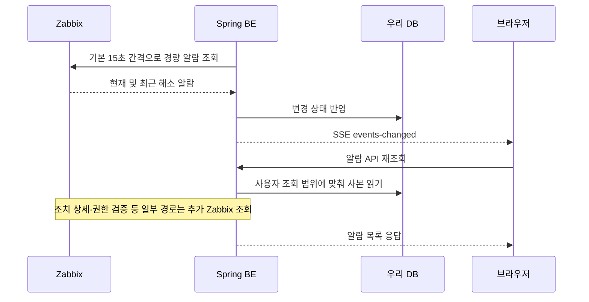

# 모니터링 갱신과 SSE

현재 서버·네트워크 모니터링의 주요 추이 차트는 **자동 갱신할 때 선택한 시간 구간 전체를 다시 요청한다.** 새로 생긴 포인트만 이어 붙이는 증분 조회는 아직 아니다. 알람 SSE는 별도 경로이며, 브라우저에 변경 신호를 보내 재조회를 유도한다.

이 문서는 “실시간 조회인가?”, “SSE가 무엇을 바꿨나?”, “ZM-123으로 반복 조회가 모두 사라졌나?”에 답한다. 범위는 Zabbix 기반 인프라 모니터링과 알람이다. APM Live 등 다른 데이터소스의 스트림 동작을 일반화하지 않는다. 현재 동작은 소스 기준으로 확인했고 운영 배포·실제 갱신 지연·부하 감소율은 측정하지 않았다. 6~7절은 **미구현 개선 제안**이며 채택된 API 계약이 아니다.

## 1. 실시간이라는 말에 섞여 있는 세 가지

| 개념 | 뜻 | 우리 제품에서의 예 |
|---|---|---|
| 최신값 조회 | 요청 시점에 원천이 가진 가장 최근 값을 읽음 | 현재 CPU 사용률 |
| 주기 갱신, polling | 일정 간격으로 다시 요청 | 상대 기간 차트의 기본 3분 갱신 |
| 서버 푸시 | 서버가 열린 연결로 소식을 전달 | 알람 변경 SSE |

최신값을 조회한다고 측정 즉시 화면에 표시되는 것은 아니다. 원천 수집 간격, BE 동기화·캐시, 화면 갱신 간격과 통신·처리 시간이 모두 신선도에 영향을 준다. 또한 **푸시 여부와 조회 범위는 별개**다. SSE를 받아도 전체 기간을 다시 요청할 수 있고, polling으로도 새 구간만 요청할 수 있다.

## 2. SSE는 무엇이고 우리 알람에는 어떻게 쓰이나

SSE(Server-Sent Events)는 브라우저가 HTTP 연결을 열어 두고 서버가 보내는 이벤트를 받는 방식이다. 데이터 전달 방향은 서버에서 브라우저 쪽이다. 브라우저에서는 `EventSource`를 사용한다. [MDN 설명](https://developer.mozilla.org/en-US/docs/Web/API/Server-sent_events/Using_server-sent_events)

우리 알람 SSE의 `events-changed`는 알람 본문이 아닌 **변경 알림**이다. 브라우저는 이 신호를 받으면 관련 Query를 무효화하고 기존 API를 자기 권한으로 다시 조회한다.

- **BE→Zabbix는 여전히 주기 조회**다. Zabbix가 측정값을 우리 BE에 푸시하는 구조가 아니다.
- 15초는 기본 동기화 간격이다. 완료 후 다음 간격을 기다리는 방식이므로 처리 시간과 실제 설정에 따라 반영 지연이 달라진다. 최대 15초 보장은 아니다.
- 5분 전체 보정은 규칙·조치 등의 정합성을 맞추는 작업이다. 과거 통계 집계 작업과는 다르다.
- 알림 벨은 SSE 연결 정상 시 5분 안전 polling, 오류 상태에서는 60초 polling을 사용한다. 이 값을 모든 화면의 polling 간격으로 해석하면 안 된다.
- 허브는 인스턴스 로컬이다. 다중 BE에서 모든 접속자에게 신호를 전달하려면 별도 인스턴스 간 전달이 필요하다.

## 3. 현재 모니터링 차트는 선택 구간 전체를 다시 요청한다

CPU·메모리 등의 차트는 `useChartOption → usePeriodTimes`를 사용한다. ‘최근 1시간’ 같은 상대 기간을 선택하면 기본 180,000ms마다 시작·종료 시각을 새로 계산한다. 시각은 분 단위로 맞추며, 변경된 `from/to`가 Query key에 포함돼 조회를 유발한다.

예를 들어 ‘최근 1시간’을 표시하면:

| 시점 | 현재 요청 범위 | 직전 요청과 겹치는 범위 |
|---|---|---|
| 10:00 | 09:00~10:00 전체 | 최초 조회 |
| 10:03 | 09:03~10:03 전체 | 57분 |
| 10:06 | 09:06~10:06 전체 | 57분 |

10:03에는 새 3분만 요청하는 것이 아니라 **새 시간창 1시간 전체 범위를 다시 요청한다.** 이는 전체 보존 이력을 모두 읽는다는 뜻이 아니라, 사용자가 선택한 호스트·메트릭·시간창을 다시 요청한다는 뜻이다.

CPU API는 `/hosts/{id}/cpu/line-charts`에 `from/to`를 전달하고, BE는 이를 `TimeRange`로 엔진에 넘긴다. RAW 경로는 `history.get`의 `time_from/time_till`, 요약 경로는 `trend.get`으로 해당 구간을 조회한다. 마지막 수신 포인트 이후만 조회하는 커서나 프론트의 증분 병합은 이 경로에 없다. 반환 건수 상한 때문에 요청 구간의 완전성이 항상 보장되는 것도 아니다.

고정된 `from/to`를 직접 지정하면 `usePeriodTimes`의 상대 기간 자동 타이머는 돌지 않는다. 수동 새로고침·재마운트·Query의 다른 재조회 조건은 별개다. 실제 브라우저의 타이머 실행 시각도 항상 정확히 3분이라고 보장하지 않는다.

## 4. 화면별로 다른 갱신 방식

| 대상 | 현재 읽는 데이터와 갱신 방식 |
|---|---|
| CPU·메모리·네트워크·디스크 주요 추이 차트 | 선택 시간창 전체 재요청, 장기 구간은 요약 조회 |
| 현재 CPU 사용률 등 | Zabbix 최신값 조회. 요약 API는 현재값과 기간 통계를 함께 읽기도 함 |
| 서버·그룹 목록 | 최신 스냅샷 재조회. BE에서 사용자·필터 범위별 30초 캐시 사용 |
| 알람 RECENT 목록 | 자체 DB 사본 + 페이지 조치 상세 등의 추가 조회 |
| 알림 벨 | 자체 DB 사본 기반. 가시 호스트·태그 권한에 따른 조회 비용은 별도 |
| 알람 HISTORY 모드 | Zabbix 이력과 복구·상세 정보 직접 조회 경로가 남음 |

따라서 “모든 모니터링이 SSE다”, “모든 화면이 매번 전체 이력을 읽는다”, “사본이 생겼으므로 Zabbix 호출은 0이다”라는 설명은 모두 부정확하다.

## 5. ZM-123이 해결한 범위와 남은 범위

| 이전 비용 | 적용된 개선 | 아직 의미하지 않는 것 |
|---|---|---|
| 알람 화면마다 원천 목록 반복 조회 | 사본 조회 + 가시 호스트 캐시 | 조치 상세·권한 검증·과거 이력의 호출까지 제거한 것은 아님 |
| 매분 무거운 전체 동기화 | 기본 15초 경량 확인 + 5분 전체 보정 | Zabbix가 변경분만 보내는 스트림은 아님. 경량 목록을 받아 앱에서 변경을 판별 |
| 목록 반복 조회 | 서버·그룹 30초 캐시 | 서로 다른 사용자 키나 동시 캐시 미스까지 한 번으로 합친 것은 아님 |
| 장기 원시값 대량 조회 | 차트 48시간 이상에서 `trends` 우선 사용 | 시간창 전체 재조회는 유지. 요약이 없을 때 RAW 폴백도 있음 |
| 개별 아이템 검색 반복 | 일부 N+1을 배치 조회로 통합 | 모든 상세 API가 단일 호출이 된 것은 아님 |
| 동시 호출 무제한 | 인스턴스당 기본 10개 연결 풀 + 계측 | 전체 배포의 초당 요청 수나 Zabbix DB 비용을 보장하는 상한은 아님 |

`trends` 전환은 **같은 기간을 더 적은 요약 데이터로 읽는 개선**이다. **겹치는 시간 구간을 다시 읽지 않게 만드는 증분 조회**와는 다른 개선이다. 부하 감소율은 동일한 사용자 수·화면·기간 조건에서 실제 호출량과 Zabbix 상태를 비교해야 판단할 수 있다.

## 6. 개선 제안: 처음에는 전체, 이후에는 새 구간과 보정 구간만

현재 API에 구현된 동작이 아닌 후속 설계 방향이다.

1. 첫 진입에는 선택 기간 전체를 조회해 차트를 채운다.
2. 다음 갱신에는 마지막으로 성공적으로 확보한 데이터 구간의 끝 시각 부근부터 새 구간을 조회한다. HTTP 응답을 받은 현재 시각을 커서로 쓰는 것이 아니다.
3. 지연 도착·값 보정을 반영하기 위해 짧은 중첩 구간을 포함한다. 길이는 수집 간격과 지연 실측으로 정한다.
4. 메트릭 식별자와 포인트 식별자로 중복을 제거하고 기존 값을 교체·병합한다. RAW의 동일 초 여러 값은 `ns` 또는 동등한 식별 정책까지 검토한다.
5. 표시 기간 밖의 오래된 포인트는 화면 버퍼에서 제거한다.
6. 호스트·항목·기간·해상도 변경 시 전체를 다시 읽는다. 연결 복구 시 누락 구간을 보충하며, 오래 끊겼다면 제한된 전체 재조회로 복구한다.

예: 10:00 최초에 09:00~10:00을 받은 뒤 10:03에는 ‘10:00 직전 보정 구간~10:03’만 요청한다. 보정 구간의 기존 값은 교체하고 새 포인트를 추가한다. 현재 제품은 이 방식이 아니다.

SSE로 갱신을 알려도 되고 polling을 유지해도 된다. 먼저 조회·병합 규약을 정해야 한다. SSE만 붙이고 전체 기간 조회를 유지하면 중복 조회 비용은 그대로 남는다.

추가 조건:

- 데이터가 없다는 이유만으로 성공 커서를 현재 시각까지 당기지 않는다. 원천 지연·미수집과 확인된 빈 구간을 구분한다.
- 요약 버킷은 뒤늦게 완성되거나 보정될 수 있으므로 최근 버킷을 다시 읽을 범위를 둔다.
- 10만 건 상한에 닿으면 제한된 분할 조회·집계 전환 또는 불완전 상태를 사용한다. ‘모두 받음’으로 처리하지 않는다.
- 권한·데이터소스·호스트·메트릭·해상도별 캐시 격리를 유지한다. 재연결 후에도 현재 권한으로 확인한다.
- 요청 수·응답량·총 소요시간 예산을 둔다. 분할을 무제한 반복하면 한 요청의 상한만 우회하는 결과가 된다.

## 7. 실시간성과 집계성 처리 분리 방향

| 경로 | 필요한 데이터 | 권장 책임 |
|---|---|---|
| 현재 상태·라이브 차트 | 최신값, 최근 구간, 빠른 변경 반영 | 짧은 캐시·공유 수집·증분 전달, 갱신 시각 표시 |
| 과거 추이·통계·보고서 | 기간 전체의 이력, 완료된 집계 | 이력 보충·롤업·집계 캐시, 누락·집계 완료 시점 표시 |

CPU가 `20% → 90% → 30%`였다면 현재 상태에는 30%가 필요하지만 기간 최대값에는 90%가 필요하다. 최신값만 덮어쓴 저장소로 정확한 과거 통계를 만들 수 없다.

우선 기존 Spring·PostgreSQL·Redis 안에서 책임을 나눌 수 있다. 무거운 보고서가 알람 동기화를 밀어내지 않도록 실행 큐와 호출 예산도 고려한다. 이는 별도 서버 분리나 독립 서비스 도입이 확정됐다는 뜻이 아니다.

## 8. 근거와 검증 범위

코드 저장소는 문서 저장소와 같은 상위 디렉터리에 있다는 기준으로 링크했다.

| 확인한 사실 | 소스 |
|---|---|
| 상대 기간 기본 3분 갱신 | [usePeriodTimes.ts](../../moveseyee_fe/src/hooks/usePeriodTimes.ts) |
| 기간을 쿼리 키와 요청에 전달 | [useChartOption.ts](../../moveseyee_fe/src/hooks/chart/useChartOption.ts) |
| CPU 차트 REST 호출 | [host-monitoring.api.ts](../../moveseyee_fe/src/services/host-monitoring.api.ts) |
| BE 시간 구간 전달 | [CpuService.java](../../moveseye-be-spring/src/main/java/com/dmove/moveseye/host/cpu/CpuService.java) |
| RAW/trends 선택·폴백 | [AdaptiveSeriesQuery.java](../../moveseye-be-spring/src/main/java/com/dmove/moveseye/common/metric/AdaptiveSeriesQuery.java) |
| 원시 이력의 범위·상한 | [ZabbixHistoryServiceImpl.java](../../moveseye-be-spring/engine-zabbix/src/main/java/com/dmove/moveseye/zabbix/timeseries/history/ZabbixHistoryServiceImpl.java) |
| SSE 변경 신호 수신·재조회 | [useEventStream.ts](../../moveseyee_fe/src/hooks/useEventStream.ts) |
| 벨의 안전 polling | [Notification/index.tsx](../../moveseyee_fe/src/components/Notification/index.tsx) |

정적 코드 대조와 문서 링크·독자 이해 검토를 수행한다. 운영 배포 확인, 실제 브라우저 네트워크 캡처, 대량 데이터 부하 시험은 이번 문서화 범위에 포함하지 않는다. 증분 API·데이터 저장 모델·중첩 구간의 구체 값은 별도 설계가 필요하다.

관련 문서: [ZM-123 부하 절감 아키텍처](../%EA%B8%B0%EB%8A%A5/solutions--%EC%9E%90%EB%B9%85%EC%8A%A4-%EB%B6%80%ED%95%98-%EC%A0%88%EA%B0%90-%EC%95%84%ED%82%A4%ED%85%8D%EC%B2%98.md), [성능·부하 책임 경계](../%EC%9A%B4%EC%98%81/solutions--%EC%9E%90%EB%B9%85%EC%8A%A4-%EC%84%B1%EB%8A%A5-%EC%B1%85%EC%9E%84-%EA%B2%BD%EA%B3%84.md), [문서 인벤토리](../%EC%B0%B8%EA%B3%A0/solutions--%EB%AC%B8%EC%84%9C-%EC%9D%B8%EB%B2%A4%ED%86%A0%EB%A6%AC.md).

## 변경 이력

| 날짜 | 내용 |
|---|---|
| 2026-09-07 | SSE와 주기 조회·선택 구간 재조회 구분, ZM-123 적용 범위 및 미구현 증분 조회 방향 작성 |
