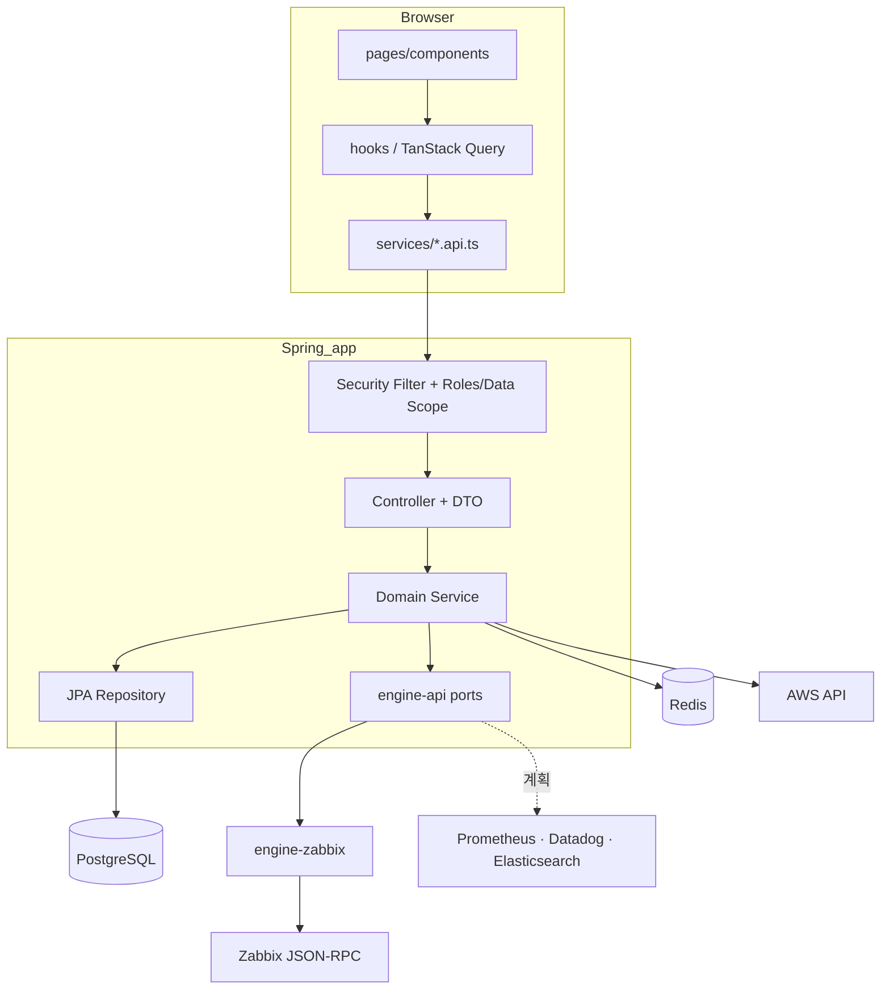
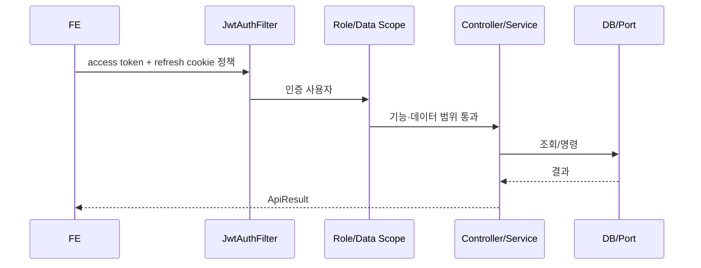

# MovesEye 아키텍처 설계서

## 1. 범위

2026-08-11 source worktree의 논리 경계, 데이터 흐름, 영속화와 수집 엔진 의존 규칙을 설명한다. 특정 운영 환경의 배포를 증명하지 않는다. Controller 목록이나 DTO 전 필드는 dev OpenAPI와 코드를 정본으로 삼는다.

## 2. 배치 구조

```text
C:\solutions
├── moveseye-be-spring/   Spring 백엔드 정본
│   ├── root(app)         Boot, REST, Security, JPA, Redis
│   ├── engine-api/       데이터소스 중립 port + 소스 전용 계약
│   └── engine-zabbix/    Zabbix JSON-RPC adapter (현재 유일한 어댑터)
├── moveseyee_fe/         React 프론트엔드
├── moveseye-be/          구 NestJS, 참조 전용
├── _workspace/           기능별 설계·계약·QA 증거
└── moveseye-docs/        제품 문서 정본
```

백엔드 Gradle dependency의 핵심 불변식:

```text
app --compile--> engine-api
app --runtime--> engine-zabbix
app --X compile--> engine-zabbix
engine-zabbix --api--> engine-api
```

이 구조는 새 app 코드가 Zabbix 구현 class를 직접 참조하면 build가 실패하도록 만든다.

## 3. 논리 아키텍처



`Service`는 어느 소스가 응답했는지 알지 못한다. 소스 선택과 인증 토큰 관리는 어댑터 내부 책임이며, 포트 시그니처에 토큰이 관통하지 않는다.

## 4. 프론트엔드 경계

- route 정본: `src/routes/routes.tsx`
- navigation 정본: `src/layouts/app/SideNav.tsx`
- 화면 내용 정본: `src/pages/`와 재사용 `src/components/`
- HTTP 진입점: `src/services/*.api.ts`와 `axiosInstance.ts`
- 서버 상태: TanStack Query 기반 custom hook
- 클라이언트 상태: Redux Toolkit + persist
- UI: Ant Design wrapper component를 우선 사용
- 사용자 문자열: i18next `en.json`·`kr.json` 동시 갱신

표준 데이터 흐름은 `Page → hook → service API → Controller`다. component에서 Axios를 직접 호출하지 않는다.

## 5. Spring app 경계

app은 기능별 수직 package를 사용한다. 주요 영역은 `auth`, `user`, `host`, `event`, `asset`, `cost`, `networkmap`, `geomap`, `scheduler`, `setting`, `zabbixadmin`, `aws`다.

```text
<feature>/
├── Controller / Service
├── dto/
├── domain/
└── repository/
```

모든 기능이 네 하위 package를 반드시 가질 필요는 없지만, 전역 `domain/`에 여러 기능의 model을 모으지 않는다.

## 6. 수집 엔진 경계

제품의 지향은 **다중 데이터소스(Zabbix·Prometheus·Datadog·Elasticsearch) 종합 모니터링**이다. 이를 위해 비즈니스 로직과 수집 코드 사이에 소스 중립 계약을 세우고 Zabbix를 그 첫 어댑터로 만들었다. 이 전환(Phase 1)은 완료됐고, **2026-08-11 현재 동작하는 어댑터는 Zabbix 하나**다.

### 6.1 두 구역

`engine-api`는 두 구역으로 나뉜다.

- `engine/`: Metric, Inventory, Alert처럼 데이터소스 중립 개념
- `zabbix/`: Zabbix 관리 기능처럼 외부 시스템 특성이 본질인 계약

**경계 판정 기준은 "그 값이 답하는 질문이 소스 중립적인가"다.** 값의 출처가 Zabbix라는 사실만으로 전용 구역에 넣지 않는다. 반대로 어느 소스에서도 같은 질문에 답할 수 없는 개념(trigger expression DSL, template link)은 중립으로 올리지 않는다 — 억지로 공통화하면 어느 소스에서도 정확하지 않은 계약이 된다.

### 6.2 포트와 capability

| 포트 | 담당 | 다중 소스 |
|---|---|---|
| `MetricPort` | 시계열·최신값·트렌드 조회 | ✅ 핵심 |
| `InventoryPort` | 호스트·그룹·인터페이스 조회 | ✅ |
| `AlertPort` | 알람 조회·이력·인지 처리 | ✅ (ack는 capability) |
| Zabbix 전용 계약 | 호스트·템플릿·아이템·트리거 관리 | ❌ 추상화 제외 |

`DataSourceRegistry`가 소스와 그 능력을 관리한다. capability는 `METRICS`·`INVENTORY`·`ALERTS`·`ALERT_ACK`·`LOGS`·`ZABBIX_ADMIN` 6종이며, 미지 소스는 `NOT_FOUND`, 미구현 포트는 `UNSUPPORTED`로 응답한다.

Phase 1은 소스 1개(`zabbix-default`)를 하드와이어한 상태다. Phase 2에서 datasource 테이블과 조회 엔드포인트를 추가하고, FE가 capability로 메뉴를 게이팅한다(예: Zabbix 관리 메뉴는 `ZABBIX_ADMIN`을 가진 소스가 있을 때만).

### 6.3 의존 방향

```text
app ──(compile)──▶ engine-api ◀──(구현, runtimeOnly)── engine-zabbix
```

`app`은 `engine-zabbix`에 **컴파일 의존할 수 없다** — 빌드가 강제한다(테스트만 예외). 이 강제가 없으면 급할 때 어댑터를 직접 부르는 코드가 반드시 생기고, 그 순간 두 번째 소스를 붙이는 비용이 다시 올라간다.

### 6.4 물리 분리는 유예

수집 어댑터는 현재 앱과 같은 프로세스에서 동작한다. 별도 엔진 서버(gRPC) 분리는 유예했지만 **계약을 proto 호환으로 설계해 승격 비용을 선지불**했다. 승격 조건은 다음 중 하나가 현실화될 때다.

- 고객사 망 내 수집기 배치 토폴로지가 필요할 때
- 수집 폴링 부하가 앱 응답성을 저해할 때
- 수집기를 다른 언어로 구현해야 할 때
- 수집기의 팀·운영 주체가 분리될 때

### 6.5 범위 밖

- **크로스 소스 엔티티 식별**(같은 서버의 Zabbix hostid ↔ Datadog host ↔ Prometheus instance 매핑) — Phase 2+에서 수동 매핑 테이블로 시작
- **Elasticsearch** — 메트릭 소스가 아니라 로그 도메인 신설 대상이며 별도 설계를 따른다
- **인증의 탈-Zabbix** — 현재 Zabbix가 사실상 IdP 역할을 겸한다. 별도 대형 과제로 인지만 하고 있다

## 7. 요청·인증 흐름



- access token은 짧게, refresh token은 회전하며 세션 저장소로 Redis를 사용한다.
- 공개 endpoint는 `SecurityConfig`에 명시한다. 나머지는 deny-by-default다.
- `@RolesGuarded`가 필요한 route는 Role interceptor가 fail-closed로 판정해야 한다.
- FE의 메뉴 숨김은 편의 기능이며 보안 경계가 아니다.

**ZM-157(2026-09-17, 소스 기준·미배포)에서 정한 판정 위치:**

| 단계 | 구성요소 | 판정 |
|---|---|---|
| 인증 | `JwtAuthFilter`, `VisitorIdCheckInterceptor` → `VisitorSessionChecker` | access 토큰과 로그인 세션(`USER_LOGIN_KEY_<userId>`) 대조. 실패는 실제 401 |
| MCP 재확인 | `McpAccessInterceptor` | MCP 토큰 요청마다 DB로 계정 상태·사용자 유형·`mcp_permission` 확인 |
| 기능 권한 | 컨트롤러 → `DmovePermissionChecker` | 역할 JSON의 `view`/`edit`. 관리자(`ADMIN ∪ SUPER_ADMIN`) 우회. 요청 단위 캐시 |
| 대상 가시성 | `HostVisibilityChecker` | 자체 DB에 호스트 id로 저장된 데이터(호스트 공용 차트)를 사용자 토큰으로 확인 |
| 데이터 범위 | 포트 → `CallerContexts` → 세션 프로바이더 | 관리자는 시스템 토큰, 연동 사용자는 사용자 토큰, 미연동 비관리자는 `unlinked` → `FORBIDDEN`(200+403) |
| 자체 사본 스코핑 | `EventService.visibleEventIds` | 이벤트 사본(목록·벨·통계)을 가시 호스트·태그 권한으로 좁힘. 태그 감지 실패는 제한 있음으로 간주 |

refresh 토큰은 사용자 세대와 로그인 계열로 관리하고, 발급·회전·세션 복원·삭제를 Redis Lua로 원자 처리한다. 자격 증명 경로는 사용자 행 잠금(`FOR UPDATE`)으로 직렬화한다. 상세는 [권한 강제와 세션 회수](../%EA%B8%B0%EB%8A%A5/solutions--%EA%B6%8C%ED%95%9C-%EA%B0%95%EC%A0%9C%EC%99%80-%EC%84%B8%EC%85%98-%ED%9A%8C%EC%88%98.md)와 [ADR-0002](../%EA%B2%B0%EC%A0%95%EA%B8%B0%EB%A1%9D/solutions--ADR-0002-%EC%97%AD%ED%95%A0-%EA%B6%8C%ED%95%9C-BE-%EA%B0%95%EC%A0%9C%EC%99%80-%EC%84%B8%EC%85%98-%EC%84%B8%EB%8C%80.md)를 본다.

## 8. 응답·오류 계약

기본 응답은 `ApiResult<T>`의 `status`, `code`, `errorCode`, `message`, `data`를 사용한다. legacy 호환 때문에 일부 오류는 HTTP 200 body에 표현될 수 있으므로 client는 HTTP status만으로 성공을 판정하지 않는다. 인증 실패는 실제 401이다.

성공 응답의 `syncTime`은 데이터 기준 시각을 나타내며, 모든 원천 값이 그 시각에 동시에 측정됐다는 뜻은 아니다.

## 9. 영속화

- PostgreSQL: 사용자·권한·설정·event mirror·자산·비용·map·scheduler metadata
- Flyway: schema 변경의 유일한 경로. `ddl-auto: none`
- Redis: token/session, cache, 데이터소스 인증 관련 단기 상태
- 데이터소스(현재 Zabbix): host, group, item, history, trend, trigger, problem, inventory의 원천. 소스가 늘어도 이 값들의 정본은 해당 소스이며 제품 DB에 복제하지 않는다(event mirror는 예외)
- AWS API/CloudWatch: Cloud Infra 영역의 inventory·metric 원천

자세한 관계는 [데이터 모델](solutions--%EB%8D%B0%EC%9D%B4%ED%84%B0-%EB%AA%A8%EB%8D%B8.md)을 참조한다.

## 10. 주요 비기능 결정

- API 문서는 운영 기본 off, dev profile에서만 on이다.
- CORS는 credential 전송 때문에 명시적 origin allowlist를 사용한다.
- Zabbix 관리 update는 원천 API의 전체 교체 semantics를 보존해야 한다.
- scheduler는 여러 job이 서로 막지 않도록 thread pool을 사용한다.
- cost bulk upload는 10MB file 계약과 multipart overhead를 분리해 request limit을 더 크게 둔다.
- runtime 동등성은 unit test만이 아니라 실제 Zabbix/DB와 FE 사용자 흐름으로 확인한다.

## 11. 관련 문서

- [데이터 모델](solutions--%EB%8D%B0%EC%9D%B4%ED%84%B0-%EB%AA%A8%EB%8D%B8.md)
- [로컬·검증 Runbook](../%EC%9A%B4%EC%98%81/solutions--%EC%9A%B4%EC%98%81%EC%9E%90-%EB%9F%B0%EB%B6%81.md)
- `C:\solutions\moveseye-be-spring\engine-api\README.md`
- `C:\solutions\moveseye-be-spring\engine-zabbix\README.md`

## 변경 이력

| 날짜 | 변경 |
|---|---|
| 2026-08-05 | Spring 단일 BE와 collector engine Phase 1 기준 최초 작성 |
| 2026-08-11 | 수집 엔진 경계(§6) 전면 확장 — 다중 데이터소스 지향, 포트·capability 표, 의존 강제, proto 호환·물리 분리 승격 조건, 범위 밖 3항목. 논리 다이어그램에 향후 adapter 반영 |
| 2026-09-17 | §7에 ZM-157 판정 위치 표·세션 세대·직렬화 요약 추가(소스 기준·미배포) |
