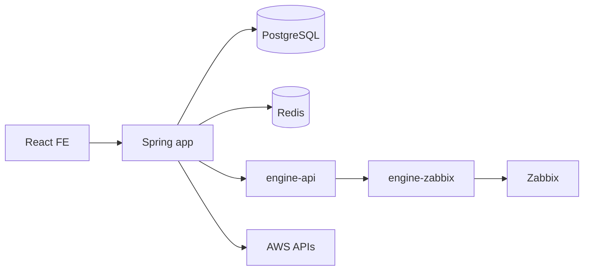

# MovesEye (DMOVE) — 프로젝트 개요 (2관점 온보딩)

> 프로젝트를 처음 이해할 때 보는 문서: ① 어떤 서비스인가, ② 현재 개발 구조와 규칙은 무엇인가.
> 상위: [[projects/moveseye/moveseye|moveseye]] · 문서 체계: [[projects/moveseye/moveseye-documentation-system|moveseye-documentation-system]] · 설계 Q&A: [[projects/moveseye/moveseye-design-qa|moveseye-design-qa]]
> 제품 문서 정본: `C:\solutions\moveseye-docs\README.md`

## 관점 ① 어떤 서비스인가

### 한 줄 정의

**Zabbix의 수집·감지 능력을 운영 친화적인 화면, 권한, 자산·비용·맵 업무로 연결하는 인프라 통합 모니터링 제품.**

### 누구를 위한 것인가

- 인프라 운영자: Host Group과 Host의 CPU·memory·disk·network 상태를 보고 Problem을 조사한다.
- Zabbix 관리자: Host·Template·Item·Trigger·사용자를 제품 흐름 안에서 관리한다.
- 자산 관리자: 모니터링 대상과 자산·비용·네트워크 맵·지리 위치를 연결한다.
- 조직 관리자: Role과 User Group–Host Group 관계로 기능과 데이터 범위를 통제한다.

### 제품 경계

Zabbix가 Host, Item, History, Trend, Trigger, Problem과 inventory의 원천이다. MovesEye는 Zabbix를 대체하지 않고 다음을 더한다.

- 화면 목적에 맞춘 조회·집계·drill-down
- 사용자·Role·데이터 범위 권한
- 자산 snapshot·custom 자산·비용·감가상각
- 네트워크 구성도와 Geo Cluster
- scheduler 설정·실행 이력·관리 감사 로그

### 현재 기능 지도

| 영역 | 상태 | 설명 |
|---|---|---|
| 홈 | 소스 구현·배포 미확인 | 전체 상태와 탐색 시작점 |
| Host Group·서버·네트워크 모니터링 | 소스 구현·배포 미확인 | resource trend, 상세 metric, custom widget |
| Event·Problem | 소스 구현·배포 미확인 | 목록·상세·acknowledge·읽음 상태 |
| Zabbix 관리 | 소스 구현·배포 미확인 | 연결·Host·Template·Item·Trigger·사용자 |
| Asset·Cost | 소스 구현·배포 미확인 | Zabbix/custom 자산, 비용·감가상각·CSV upload |
| Network/Geo Map | 소스 구현·배포 미확인 | 논리 구성도와 Zabbix inventory 좌표 기반 지도 |
| AWS Cloud | 소스 구현·배포 미확인 | Region·VPC·EC2 조회 |
| Application·Database·GPU | 계획/부분 | route가 있어도 runtime 지원으로 약속하지 않음 |
| Prometheus 등 다중 원천 | 보류 | port 구조는 완료, adapter 실검증은 미완료 |

이 표는 2026-08-05 source worktree의 구현 상태다. 실제 배포·권한·데이터 검증은 환경별 release·QA evidence로 별도 확인한다.

### 핵심 용어

정확한 정의는 `C:\solutions\moveseye-docs\reference\glossary.md`를 정본으로 쓴다.

- Host/Host Group: 모니터링 대상과 묶음. Host Group은 데이터 권한 경계이기도 하다.
- Item/History/Trend: 측정 정의, 원시 시계열, 장기 집계.
- Trigger/Problem/Event: 이상 조건, 열린 장애, 발생·복구 시점 기록.
- Asset: Zabbix Host 또는 custom 입력에서 유래한 관리 대상 snapshot과 보강 정보.
- `syncTime`: 응답의 데이터 기준 시각. 동시 측정 시각과는 다르다.

## 관점 ② 개발 구조와 규칙

### 작업 루트

```text
C:\solutions
├── moveseye-be-spring/   BE 정본 — Spring Boot 3.3.5 / Java 17
├── moveseyee_fe/         FE — React 19 / Vite / TypeScript
├── moveseye-be/          구 NestJS — 참조 전용
├── moveseye-docs/        제품·사용자·기술·운영 문서 정본
└── _workspace/           design·contract·QA 증거
```

현재 협업 mode와 소유권은 항상 `C:\solutions\COLLAB.md` 최상단 `STATUS`를 먼저 확인한다.

### 백엔드 모듈

```text
moveseye-be-spring/
├── root(app)       Boot·REST·Security·JPA·Redis·업무 조합
├── engine-api/     중립 engine port + Zabbix 전용 계약
└── engine-zabbix/  Zabbix JSON-RPC adapter·key catalog
```

`app`은 `engine-api`를 compile 의존하고 `engine-zabbix`는 runtimeOnly다. 구현 직접 참조는 build가 막는다. → [[projects/moveseye/2026-07-28-collector-engine-phase1|2026-07-28-collector-engine-phase1]]

### 백엔드 package

기능별 수직 분할을 사용한다. 현재 주요 package는 `auth`, `user`, `host`, `event`, `asset`, `cost`, `networkmap`, `geomap`, `scheduler`, `setting`, `zabbixadmin`, `aws`다. 전역 layer package에 여러 기능 model을 모으지 않는다. → [[projects/moveseye/2026-07-28-be-package-restructure|2026-07-28-be-package-restructure]]

### 프론트엔드 흐름

```text
route/page → hook(TanStack Query) → services/*.api.ts → Spring Controller
```

- route 정본: `src/routes/routes.tsx`
- menu 정본: `src/layouts/app/SideNav.tsx`
- component에서 Axios 직접 호출 금지
- response는 custom query hook의 실제 unwrap 깊이를 확인
- 사용자 문자열은 `en.json`·`kr.json` 동시 갱신
- 권한 menu 숨김과 서버 권한 검증을 함께 유지

### 데이터 흐름



### API·schema 정본

- API: Spring Controller/DTO + dev `/v3/api-docs`
- 응답: 기본 `ApiResult<T>`. 일부 legacy 오류는 HTTP 200 body error이므로 envelope까지 판정
- schema: Flyway V1~latest. JPA `ddl-auto: none`
- 작업 중 계약: `_workspace/contract_*.md`
- 완료된 설계 설명: `moveseye-docs/features/`

### 인증·권한

- 짧은 access token + 회전하는 refresh token
- refresh/session 상태는 Redis와 cookie 정책으로 통제
- Role은 기능 권한, User Group–Host Group은 데이터 범위
- FE 숨김은 UX이며 서버가 실제 경계를 검증
- 상세: [[projects/moveseye/2026-07-16-auth-hardening|2026-07-16-auth-hardening]] · [[topics/backend/session-auth-hardening|session-auth-hardening]]

### 처음 코드를 읽는 순서

1. `C:\solutions\moveseye-docs\product\overview.md`
2. `C:\solutions\moveseye_개발자_온보딩.md`
3. BE/FE 각 `AGENTS.md`, `CLAUDE.md`, `README.md`
4. FE `routes.tsx`·`SideNav.tsx`로 화면 지도 파악
5. 기능 하나를 page → hook → service → Controller → Service → DB/engine port까지 추적
6. Flyway와 관련 test·`_workspace` contract/E2E 확인
7. 왜 그런 구조인지 [[projects/moveseye/moveseye-design-qa|moveseye-design-qa]]와 관련 dated note 확인

## 문서 체계

| 목적 | 위치 |
|---|---|
| 현재 제품·사용·기술·운영 기준 | `C:\solutions\moveseye-docs` |
| 기능 설계·계약·QA 중간 산출물 | `C:\solutions\_workspace` |
| 경험·결정·타임라인 | 이 Obsidian Vault |
| repo build·코딩 규칙 | 각 repo `README.md`/`AGENTS.md`/`CLAUDE.md` |

상세 승격 규칙: [[projects/moveseye/moveseye-documentation-system|moveseye-documentation-system]]

## 주의할 현재 경계

- 구 NestJS 설명을 current BE 규칙으로 사용하지 않는다.
- route 존재와 runtime 제공을 구분한다.
- metric 부재와 실제 0을 구분한다. → [[topics/metrics/aggregation-null-vs-zero|aggregation-null-vs-zero]]
- Zabbix update의 tags·template link 등은 전체 교체 semantics를 확인한다. → [[topics/zabbix/zabbix-api-quirks|zabbix-api-quirks]]
- `_workspace`의 설계 완료 문구를 runtime 검증 없이 제품 완료로 보지 않는다. → [[projects/moveseye/2026-08-03-implementation-risk-audit|2026-08-03-implementation-risk-audit]]

## 다음에 볼 것

- [[projects/moveseye/moveseye|moveseye]] — 결정·타임라인·열린 항목
- [[projects/moveseye/moveseye-design-qa|moveseye-design-qa]] — 설계 이유 Q&A
- [[projects/moveseye/moveseye-documentation-system|moveseye-documentation-system]] — 문서 지도·승격 규칙
- [[projects/moveseye/zabbix-api-reference|zabbix-api-reference]] · [[topics/zabbix/zabbix-api-quirks|zabbix-api-quirks]] — Zabbix 개발 reference
- [[projects/moveseye/2026-07-22-collector-engine-decision|2026-07-22-collector-engine-decision]] · [[projects/moveseye/2026-07-28-collector-engine-phase1|2026-07-28-collector-engine-phase1]] — 수집 엔진
